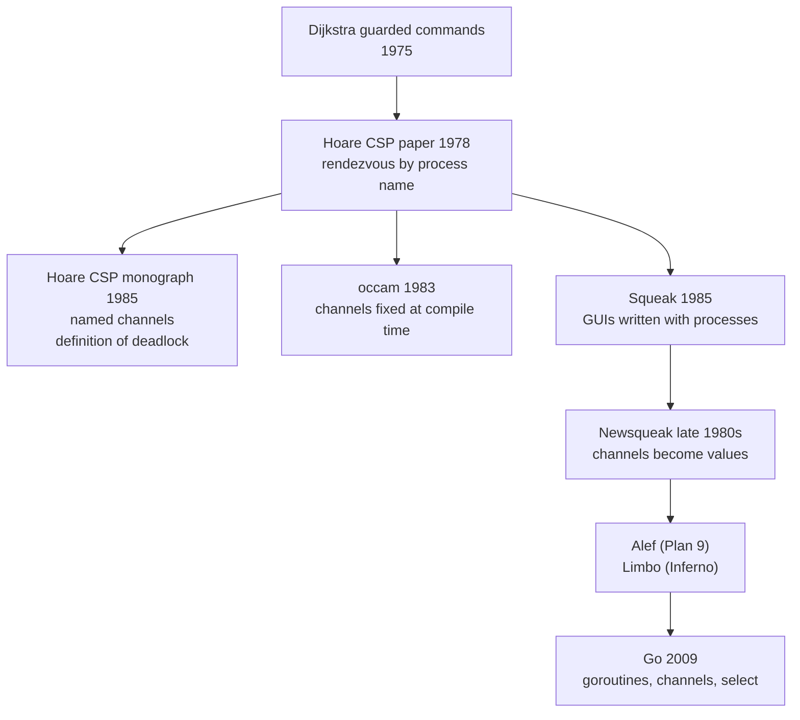

# 1.3 Communicating Sequential Processes

> An online talk accompanies this section: [YouTube](https://www.youtube.com/watch?v=Z8ZpWVuEx8c),
> [Google Slides](https://changkun.de/s/csp/).

Five philosophers sit around a circular table. A fork lies between each pair of neighbors, five in
all, and eating requires both the left and the right fork. In the program below, each philosopher is
a goroutine and each fork is a channel of capacity 1: taking the value out of the channel means
picking up the fork, and putting the value back means putting it down. Each philosopher first picks
up the left fork, thinks for a moment, and then picks up the right fork.

```go {run=true}
package main

import (
	"fmt"
	"sync"
	"time"
)

const footman = false // change to true: leave only four chairs at the table

func main() {
	const n = 5
	forks := make([]chan struct{}, n) // forks: a value in the channel means the fork is on the table
	for i := range forks {
		forks[i] = make(chan struct{}, 1)
		forks[i] <- struct{}{}
	}
	seats := make(chan struct{}, n-1) // chairs: at most n-1 philosophers seated at once

	var wg sync.WaitGroup
	for i := range n {
		left, right := forks[i], forks[(i+1)%n]
		wg.Go(func() {
			if footman {
				seats <- struct{}{} // take a seat (wait if no chair is free)
			}
			<-left                            // pick up the left fork
			time.Sleep(10 * time.Millisecond) // think for a moment
			<-right                           // pick up the right fork
			fmt.Println("philosopher", i, "starts eating")
			left <- struct{}{} // put both forks back
			right <- struct{}{}
			if footman {
				<-seats // leave the table
			}
		})
	}
	wg.Wait()
	fmt.Println("all five philosophers have eaten")
}
```

The output is as follows (most of the call stacks are omitted; goroutine numbers and file paths vary
by machine):

```
fatal error: all goroutines are asleep - deadlock!

goroutine 1 [sync.WaitGroup.Wait]:
...
goroutine 19 [chan receive]:
main.main.func1()
	.../main.go:29 +0x4c
...
```

Five goroutines in total are listed in the `chan receive` state, and line 29 is `<-right`. All five
philosophers hold their left fork and wait for the right one, which is in a neighbor's hand; nobody
can get it, and nobody will put theirs down first. A state in which a group of participants wait for
one another and none can proceed is called a **deadlock**. The Go runtime detects that all
goroutines are waiting and that no goroutine can change the situation, and exits with an error.

Change the first line to `const footman = true` and the program finishes normally (the order in
which they eat may differ on every run):

```
philosopher 2 starts eating
philosopher 1 starts eating
philosopher 0 starts eating
philosopher 4 starts eating
philosopher 3 starts eating
all five philosophers have eaten
```

Only one thing changed: four chairs are left at the table, represented by the channel `seats` with
capacity 4, and the fifth philosopher must wait until someone finishes and leaves before sitting
down. With four people sharing five forks, at least one can get two; once that person finishes and
puts the forks down, the others can continue.

The problem was first posed by Dijkstra. In 1978 Tony Hoare used it as an example in the paper that
introduced CSP, pointing out that this way of writing the solution can leave all five philosophers
starving at once; the hint the paper gives is precisely to forbid all five from sitting down
together (Hoare notes that this solution is due to Dijkstra) [[Hoare, 1978](#ref-hoare-1978)]. The
paper's thesis is that a concurrent program consists of a set of processes, each executing
sequentially, that share no variables and cooperate only by sending and receiving messages. Both
goroutines and channels derive from it. This section discusses how the idea evolved step by step
into Go's design, and which parts Go adopted and which it dropped.

## 1.3.1 Two Ways to Cooperate

For several simultaneously running threads to accomplish a task together, they must agree on the
order of execution and on how data is handed over. In the 1960s and 1970s, the methods fell into two
classes.

One is shared memory with locks: threads read and write the same data, and a lock ensures that only
one thread modifies it at a time. The **semaphore**, proposed by Dijkstra in 1965, was the earliest
such tool. In 1973 and 1974, Per Brinch Hansen and Hoare proposed the **monitor**
[[Hoare, 1974](#ref-hoare-1974)], which packages shared data together with the procedures that
operate on it and guarantees that only one thread executes inside at any time. In Go, a `sync.Mutex`
together with the fields it protects amounts to a hand-built monitor.

The other is message passing: each thread manages only its own data, and when it needs data held by
another thread it asks that thread to send it.

Neither class is inherently stronger. In 1979 Hugh Lauer and Roger Needham compared operating
systems designed in each of the two styles and argued that they can be transformed into each other:
every component of one design has a counterpart in the other, and the transformed system behaves the
same and can perform the same [[Lauer and Needham, 1979](#ref-lauer-needham-1979)]. The choice
therefore depends on which style reads more clearly and which suits the underlying machine, not on
which is more expressive.

Hoare chose message passing, and only message passing. Go offers both but favors message passing.
This preference is summed up in a widely repeated maxim: "Do not communicate by sharing memory;
instead, share memory by communicating" [[Gerrand, 2010](#ref-gerrand-2010)].

## 1.3.2 CSP in 1978: Naming the Peer

Hoare's 1978 paper is titled "Communicating Sequential Processes", abbreviated **CSP**. "Sequential
processes" means that statements within each process execute in order; "communicating" means that
processes cooperate only by sending and receiving messages.

Processes in the paper name the peer of a communication directly. `lineprinter!lineimage` sends
`lineimage` to the process named `lineprinter`, and `cardreader?cardimage` receives a value from the
process named `cardreader` and stores it in `cardimage`. Sender and receiver each wait for the
other: whichever arrives first pauses until both have reached the matching statements, at which
point the value is copied from one to the other and both continue. Communication that completes only
when both parties are present is called a **rendezvous**. Unbuffered channels in Go work in exactly
this way.

Naming the peer causes an immediate problem: every process must know whom it communicates with. A
general-purpose buffer process would have to name in its code which process it receives from and
which it sends to, and would need changing for each new use.

The paper also borrowed the notion of choice from the **guarded command** proposed by Dijkstra in
1975 [[Dijkstra, 1975](#ref-dijkstra-1975)]. A selection command consists of several branches, each
preceded by a condition called a guard; at execution one branch whose guard holds is chosen. Hoare
allowed a guard to be a receive, meaning "if a value arrives from A, run this branch; if a value
arrives from B, run that one", and whichever message arrives first selects its branch. This is the
forerunner of Go's `select`. Which branch to choose when several are ready, the paper explicitly
leaves unspecified: Hoare thought an efficient implementation should prefer the output that has
waited longest, but since the relative speeds of processes are undefined, the language itself cannot
prescribe it [[Hoare, 1978](#ref-hoare-1978)]. A program must therefore not depend on any particular
choice.

## 1.3.3 The 1985 Monograph: Channels and Deadlock

In 1985 Hoare published a monograph of the same title [[Hoare, 1985](#ref-hoare-1985)], which made
two changes.

The first concerns what processes communicate with. A process no longer names its peer but sends and
receives on a named **channel**: `c!v` sends `v` on channel `c`, and `c?x` receives from `c`. A
process needs to know only the channel, not who is at the other end, and the problem above
disappears. The occam language, designed by INMOS in 1983 for its transputer processor, also adopted
this approach [[INMOS, 1984](#ref-inmos-1984)].

These channels are not yet the passable values of Go, however. A CSP channel is merely a name
written in the program; an occam channel can be passed to a procedure as a parameter, but cannot be
assigned to a variable, sent over another channel, or created at run time. Which processes are
connected is fixed when the program is written.

The second change is more important: the monograph gives a precise mathematical definition of a
process's behavior. The idea is to consider only what can be observed from outside: which
communications the process may perform in sequence, and which communications it may refuse after a
given step. As an example, take two vending machines. After a coin is inserted, the first lets the
customer choose tea or coffee; after a coin, the second decides for itself to offer only tea or only
coffee this time. If one records only what "may have been sold", the two machines cannot be told
apart, but a customer who wants only coffee may get stuck at the second one. The difference lies in
what the machine "may refuse". Under this definition, deadlock is a process refusing all
communication after some step, so that no event ever happens again.

Both kinds of machine exist in Go programs. A `select` waits on several channels at once and runs
whichever is ready first, which corresponds to the first machine. A goroutine that decides in
advance that it will "receive only from `a`" and then waits at `<-a` corresponds to the second. The
philosophers' deadlock arises in just this way: each has decided beforehand on the right-hand fork.

With precise definitions, a computer can do the checking. In the 1990s Bill Roscoe and others at
Oxford developed the FDR tool [[Roscoe, 1997](#ref-roscoe-1997)], which explores all possible
execution orders of a system model described in CSP and answers questions such as "can it
deadlock" and "does it meet its specification". The best-known case is that in 1995 Gavin Lowe used
FDR to find a flaw in the Needham-Schroeder public-key authentication protocol, published in 1978
and believed correct for more than a decade [[Lowe, 1996](#ref-lowe-1996)].

Go did not take this route. Go programs create channels and change connections at run time, so
exploring every execution order in advance is impractical. The runtime can detect only the most
extreme case, in which all goroutines are waiting, as with the philosophers above (for how detection
works, see [16.1](../../part5toolchain/ch16tools/deadlock.md)). If only some goroutines block one
another while the rest run normally, the program reports no error, and the blocked goroutines and
the memory they hold are retained indefinitely. Go 1.26 offers an experimental feature for this
case: when built with `GOEXPERIMENT=goroutineleakprofile`, the garbage collector finds goroutines
blocked on channels or locks that no runnable goroutine can reach any more, and reports them through
a profile named `goroutineleak` in `runtime/pprof` [[Go Authors, 2026c](#ref-go-authors-2026c)].

## 1.3.4 Newsqueak: Channels Become Values

Making channels freely passable values was accomplished in several languages designed by Rob Pike.

In 1985 Luca Cardelli and Pike designed Squeak at Bell Labs
[[Cardelli and Pike, 1985](#ref-cardelli-pike-1985)] for writing graphical interfaces: a process
each for the mouse, the keyboard and the screen, connected by channels. In Squeak, however, the
processes and channels are fixed at compile time.

In the late 1980s Pike designed Newsqueak [[Pike, 1990](#ref-pike-1990)]. In Newsqueak a channel is
an ordinary value: it can be created at run time, stored in a variable, passed to a function, and
sent over another channel; processes can likewise be started at any time. The connection structure
of a program can from then on be generated and changed dynamically as it runs. In 1990 Doug McIlroy
used Newsqueak to compute power series [[McIlroy, 1990](#ref-mcilroy-1990)], with each operation on
a series carried out by a chain of connected processes.

The approach then passed into Alef on Plan 9 (designed by Phil Winterbottom)
[[Winterbottom, n.d.](#ref-winterbottom-nd)] and Limbo on Inferno
[[Dorward et al., 1997](#ref-dorward-et-al-1997)], extending from interface programming to systems
programming, and finally into Go [[Cox, n.d.](#ref-cox-nd)]. When the Go FAQ introduces Go's
ancestry, its entry for concurrency is exactly "languages inspired by Tony Hoare's CSP, such as
Newsqueak and Limbo" [[Go Authors, 2026a](#ref-go-authors-2026a)].

Theory advanced in the same direction. CCS, proposed by Robin Milner in 1980, belongs with CSP to
the process algebras; the communication ports are fixed in the process definition and cannot be
passed as messages [[Milner, 1980](#ref-milner-1980)]. The π-calculus, published by Milner, Joachim
Parrow and David Walker in 1992, allows a channel name itself to be sent as a message, and so can
describe systems whose connection structure changes during execution
[[Milner et al., 1992](#ref-milner-et-al-1992)]; in theory it corresponds to Newsqueak's treatment
of channels as values.



## 1.3.5 Go's Approach

### Rendezvous and Buffering

`make(chan int)` creates an unbuffered channel, where a send must wait for the receiver to take the
value: a rendezvous. `make(chan int, 4)` creates a channel with a buffer that holds 4 values: a send
returns immediately while the buffer is not full and waits only when it is full, and a receive waits
when the buffer is empty. Hoare's 1978 CSP had only rendezvous; where buffering was needed, a
separate process to hold the data was inserted between the two parties.

The figure below simulates a pair of goroutines. The sender needs 1 tick to produce a value and the
receiver needs 3 ticks to process one, and 4 values are passed in all. You can step through the
replay and change the capacity and the scenario.

<div class="viz" data-viz="csp-rendezvous"></div>

With capacity 0, the sender must wait for the receiver to finish the previous value before each
send, and spends 6 of the first 10 ticks waiting. With capacity 2 the sender never waits and
finishes sending at tick 4. In both cases, however, the receiver finishes at tick 13. The buffer
reduces the waiting of the faster side but does not speed up the slower side. If the scenario is
changed to a slow sender and a fast receiver, the buffer is always empty and its capacity does not
matter.

### Channels as Values: The Prime Sieve

The following is a classic Go example, and a CSP version of it appears in Hoare's 1978 paper. It
finds primes with a chain of goroutines:

```go {run=true}
package main

import "fmt"

// generate sends 2, 3, 4, ... to out in turn.
func generate(out chan<- int) {
	for i := 2; ; i++ {
		out <- i
	}
}

// filter reads numbers from in and forwards to out only those not divisible by p.
func filter(in <-chan int, out chan<- int, p int) {
	for {
		if n := <-in; n%p != 0 {
			out <- n
		}
	}
}

func main() {
	ch := make(chan int)
	go generate(ch)
	for range 10 {
		p := <-ch // the first number to pass all existing filters must be prime
		fmt.Print(p, " ")
		next := make(chan int)
		go filter(ch, next, p) // attach a new filter at the end of the pipeline
		ch = next
	}
	fmt.Println()
}
```

```
2 3 5 7 11 13 17 19 23 29
```

`generate` feeds 2, 3, 4, ... into a channel. A number that `main` receives from the end of the
pipeline is always prime: each smaller prime has a filter, and the number survived all of them.
After receiving a prime `p`, `main` creates a new channel, starts a `filter` that connects the old
end to the new channel, and points `ch` at the new channel. The length of the pipeline is not fixed
when the program is written but is extended one stage at a time at run time. In occam this would
require fixing the number of processes in advance; the version in Hoare's paper uses precisely an
array of processes of fixed size.

<div class="viz" data-viz="csp-sieve"></div>

In the figure, when 2 through 30 have been fed in there are 10 filters, which together with the
generator and `main` make 12 goroutines and 11 channels. Every prime passes through the filters of
all smaller primes in turn, so the program is in effect doing trial division one divisor after
another [[O'Neill, 2009](#ref-oneill-2009)] and is not an efficient way to find primes; its value
lies in the clarity of its structure. Also, `main` returns after printing 10 primes, while the
generator and the filters are still blocked on channels and vanish when the process exits
([3.6](../ch03life/main.md)).

### select: Random Choice Among Ready Branches

```go {run=true}
package main

import "fmt"

func main() {
	a := make(chan int, 1)
	b := make(chan int, 1)
	count := map[string]int{}
	for range 10000 {
		a <- 1 // put one value in each channel,
		b <- 2 // so both cases below can proceed immediately
		select {
		case <-a:
			count["a"]++
			<-b // drain the other channel for the next round
		case <-b:
			count["b"]++
			<-a
		}
	}
	fmt.Println("chose a:", count["a"], " chose b:", count["b"])
}
```

The two counts sum to 10000, each fluctuating around 5000, and differ on every run. The result of
one run:

```
chose a: 4920  chose b: 5080
```

The Go language specification states that when several branches can proceed, one of them is chosen
by a uniform pseudo-random selection [[Go Authors, 2026b](#ref-go-authors-2026b)]. The runtime
shuffles the order in which branches are examined on every execution of a `select`
(`runtime/select.go`). If it always chose the first executable branch in source order, then whenever
an earlier channel always had data, the later branches would never run. Shuffling gives every ready
branch the same chance. For implementation details see
[10.5](../../part3concurrency/ch10chan/select.md).

## 1.3.6 Comparison with the Actor Model

CSP is often mentioned together with the **Actor model**, proposed by Carl Hewitt and colleagues in
1973 [[Hewitt et al., 1973](#ref-hewitt-et-al-1973)]. It likewise shares no state and only passes
messages. In 1986 Gul Agha developed it into a complete model of computation
[[Agha, 1986](#ref-agha-1986)]. The most frequently cited instance of the Actor model is Erlang. The
two differ in where a message goes:

| | Go (the CSP line) | Actor (such as Erlang) |
| --- | --- | --- |
| A message is sent to | a channel | a recipient's address |
| Has a name | a goroutine has no externally visible name or number | every actor has an address and can be referenced and monitored |
| Does sending wait | with no buffer, waits until the other side takes it | no, the message goes into the recipient's mailbox |
| After a failure | not specified by the language, relies on convention | processes can be linked, and a supervisor restarts a crashed one |

Go names the conduit of communication: goroutines do not know who the others are, and whoever holds
the channel can take part. Erlang names the party being communicated with, so every process has an
address and a mailbox, and on that basis builds a fault-tolerance mechanism of "restart after a
crash" [[Armstrong, 2003](#ref-armstrong-2003)]. Achieving something similar in Go requires
combining tools such as `context` and `errgroup` yourself.

## 1.3.7 What Go Adopted and What It Dropped

- **Sequential processes and rendezvous.** A goroutine executes sequentially inside, and an
  unbuffered channel is a rendezvous. Pike summarizes this style as "the composition of
  independently executing processes", and points out that concurrency concerns the structure of a
  program while parallelism concerns its execution; the two are not the same thing
  [[Pike, 2012](#ref-pike-2012)].
- **Choice.** `select` descends from guarded commands, with the selection rule specified as
  uniformly random.
- **Newsqueak's channels.** Channels are values and can be created and passed at run time. The cost
  is that the connections cannot be known in advance, so deadlock cannot be found before running, as
  FDR does.
- **Not limited to message passing.** Go keeps shared memory, `sync.Mutex` and atomic operations
  ([Chapter 11](../../part3concurrency/ch11sync/readme.md)). By Lauer and Needham's conclusion the
  two styles are equally expressive, and Go lets the programmer choose whichever reads more clearly.
  To protect a counter, a lock is far simpler than a goroutine plus a channel.
- **Cheap processes.** A new goroutine takes up only about 2 KB of stack (measured in
  [1.2](./go.md)), which makes "start a goroutine for every concurrent task" a practical style. How
  the scheduler assigns them to threads is covered in
  [Chapter 9](../../part3concurrency/ch09sched/readme.md).

## Further Reading

- <a id="ref-dijkstra-1975"></a>[Dijkstra, 1975] Edsger W. Dijkstra. "Guarded Commands,
  Nondeterminacy and Formal Derivation of Programs." *Communications of the ACM*, 18(8):
  453–457, 1975. https://doi.org/10.1145/360933.360975 The source of guarded commands, and the
  origin of `select`.
- <a id="ref-hoare-1978"></a>[Hoare, 1978] C. A. R. Hoare. "Communicating Sequential
  Processes." *Communications of the ACM*, 21(8): 666–677, 1978.
  https://doi.org/10.1145/359576.359585 The first CSP paper. Processes rendezvous by name and there
  are no channels yet; the dining philosophers and the prime sieve are both examples in it.
- <a id="ref-hoare-1985"></a>[Hoare, 1985] C. A. R. Hoare. *Communicating Sequential Processes*.
  Prentice Hall International, 1985. The CSP monograph, which switches to communication over named
  channels and gives precise definitions of concepts such as deadlock.
- <a id="ref-lauer-needham-1979"></a>[Lauer and Needham, 1979] Hugh C. Lauer, Roger M. Needham. "On
  the Duality of Operating System Structures." *ACM SIGOPS Operating Systems Review*, 13(2):
  3–19, 1979. Argues that message-passing and procedure-call-with-locks system designs can be
  transformed into each other.
- <a id="ref-hoare-1974"></a>[Hoare, 1974] C. A. R. Hoare. "Monitors: An Operating System
  Structuring Concept." *Communications of the ACM*, 17(10): 549–557, 1974. The classic monitor
  paper.
- <a id="ref-roscoe-1997"></a>[Roscoe, 1997] A. W. Roscoe. *The Theory and Practice of Concurrency*.
  Prentice Hall, 1997. A systematic exposition of CSP theory, which also covers how to use FDR.
- <a id="ref-lowe-1996"></a>[Lowe, 1996] Gavin Lowe. "Breaking and Fixing the Needham-Schroeder
  Public-Key Protocol Using FDR." *TACAS 1996*, LNCS 1055, Springer, 1996: 147–166. The paper that
  found the protocol flaw with FDR.
- <a id="ref-cardelli-pike-1985"></a>[Cardelli and Pike, 1985] Luca Cardelli, Rob Pike. "Squeak: a
  Language for Communicating with Mice." *Computer Graphics (SIGGRAPH '85)*, 19(3): 199–204, 1985.
  The first attempt to write graphical interfaces with processes and channels.
- <a id="ref-pike-1990"></a>[Pike, 1990] Rob Pike. "The Implementation of Newsqueak." *Software:
  Practice and Experience*, 20(7): 649–659, 1990. The implementation of Newsqueak, where channels
  become passable values.
- <a id="ref-mcilroy-1990"></a>[McIlroy, 1990] M. Douglas McIlroy. "Squinting at Power
  Series." *Software: Practice and Experience*, 20(7): 661–683, 1990. Computes power series with
  chains of Newsqueak processes; published in the same issue as Pike's paper.
- <a id="ref-winterbottom-nd"></a>[Winterbottom, n.d.] Phil Winterbottom. *Alef Language Reference
  Manual*. Plan 9 Programmer's Manual, AT&T Bell Laboratories. The language manual for Alef.
- <a id="ref-dorward-et-al-1997"></a>[Dorward et al., 1997] Sean Dorward, Rob Pike, David Leo
  Presotto, Dennis M. Ritchie, Howard Trickey, Phil Winterbottom. "The Inferno Operating
  System." *Bell Labs Technical Journal*, 2(1): 5–18, 1997. An introduction to Inferno and Limbo.
- <a id="ref-cox-nd"></a>[Cox, n.d.] Russ Cox. "Bell Labs and CSP
  Threads." https://swtch.com/~rsc/thread/ A short history, with examples, of the languages along
  the line from CSP to Go.
- <a id="ref-hewitt-et-al-1973"></a>[Hewitt et al., 1973] Carl Hewitt, Peter Bishop, Richard
  Steiger. "A Universal Modular ACTOR Formalism for Artificial Intelligence." *IJCAI*, 1973. The
  source of the Actor model.
- <a id="ref-agha-1986"></a>[Agha, 1986] Gul Agha. *Actors: A Model of Concurrent Computation in
  Distributed Systems*. MIT Press, 1986. A systematic treatment of the Actor model.
- <a id="ref-armstrong-2003"></a>[Armstrong, 2003] Joe Armstrong. *Making Reliable Distributed
  Systems in the Presence of Software Errors*. PhD thesis, Royal Institute of Technology (KTH),
  Stockholm, 2003. https://erlang.org/download/armstrong_thesis_2003.pdf Erlang's design and
  the "restart after a crash" approach to fault tolerance.
- <a id="ref-oneill-2009"></a>[O'Neill, 2009] Melissa E. O'Neill. "The Genuine Sieve of
  Eratosthenes." *Journal of Functional Programming*, 19(1): 95–106, 2009. Shows that this kind of
  pipeline "sieve" is actually trial division, and compares it with the true sieve.
- <a id="ref-gerrand-2010"></a>[Gerrand, 2010] Andrew Gerrand. "Share Memory By Communicating." The
  Go Blog, 2010. https://go.dev/blog/codelab-share The official Go explanation of the maxim above.
- <a id="ref-milner-1980"></a>[Milner, 1980] Robin Milner. *A Calculus of Communicating Systems.*
  LNCS 92, Springer, 1980. (CCS)
- <a id="ref-milner-et-al-1992"></a>[Milner et al., 1992] Robin Milner, Joachim Parrow, David
  Walker. "A Calculus of Mobile Processes, I & II." *Information and Computation*, 100(1):
  1-77, 1992. (The π-calculus, with mobility through passable channel names)
- <a id="ref-inmos-1984"></a>[INMOS, 1984] INMOS Ltd. *occam Programming Manual.*
  Prentice-Hall, 1984. (occam's channels and ALT)
- <a id="ref-pike-2012"></a>[Pike, 2012] Rob Pike. *Concurrency Is Not Parallelism.* Heroku Waza,
  2012; The Go Blog, 2013-01-16. https://go.dev/blog/waza-talk
- <a id="ref-go-authors-2026a"></a>[Go Authors, 2026a] The Go Authors. *Frequently Asked Questions:
  What are Go's ancestors?* https://go.dev/doc/faq#ancestors
- <a id="ref-go-authors-2026b"></a>[Go Authors, 2026b] The Go Authors. *The Go Programming Language
  Specification: Select statements.* https://go.dev/ref/spec#Select_statements
- <a id="ref-go-authors-2026c"></a>[Go Authors, 2026c] The Go Authors. *Go 1.26 Release Notes:
  Goroutine leak profiles.* https://go.dev/doc/go1.26#goroutineleak-profiles
