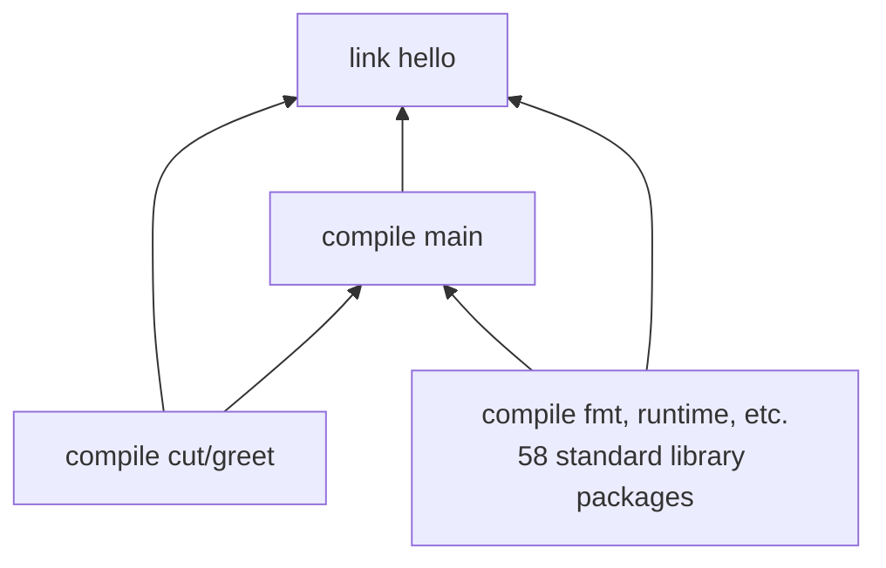

# 3.1 Starting from the `go` Command

Start with an experiment. The module `cut` has two packages, and `main` calls a function in
`cut/greet`:

```go
// greet/greet.go
package greet

// Hello returns a greeting.
func Hello(name string) string { return "hello, " + name }
```

```go
// main.go
package main

import (
	"fmt"

	"cut/greet"
)

func main() { fmt.Println(greet.Hello("gopher")) }
```

Starting from an empty build cache, make one kind of change to the source, run
`go build -x -o hello .`, and count how often the compiler `compile` and the linker `link` are
invoked in the output (Go 1.26.10, darwin/arm64):

| Action before the build | Packages recompiled | Relinked |
| --- | --- | --- |
| First build | 58 standard library packages, `cut/greet`, `main` | yes |
| No change | none | no |
| `touch greet/greet.go`, updating only the modification time | none | no |
| Edit a comment in `greet.go` | `cut/greet` | no |
| Edit the body of `Hello` | `cut/greet`, `main` | yes |
| Restore `greet.go` to its original content | none | yes |

Three rows are counterintuitive. After `touch`, no package is recompiled. When only a comment
changes, `greet` is recompiled but `main`, which depends on it, is not. After the original content
is restored, no package needs compiling. This section explains how the `go` command breaks a build
into many steps and how it decides which steps to skip. The approach builds on decades of research
on build systems, and it also determines whether Go can deliver "the same source produces the same
binary".

## 3.1.1 What the `go` Command Does

The `go` command does not translate source code itself. With `-x` it prints every command it
actually runs. Here is the build of a program that prints `hello, world` (packages such as `fmt` are
already in the cache; paths are abbreviated):

```shell
$ go build -x -o hello .
WORK=/var/folders/.../go-build2047229470
mkdir -p $WORK/b001/
cat >$WORK/b001/importcfg << 'EOF' # internal
# import config
packagefile fmt=/Users/changkun/Library/Caches/go-build/93/931515f5...-d
packagefile runtime=/Users/changkun/Library/Caches/go-build/68/6859d6a5...-d
EOF
.../pkg/tool/darwin_arm64/compile -o $WORK/b001/_pkg_.a -trimpath "$WORK/b001=>" -p main \
    -lang=go1.26 -complete \
    -buildid dlhVKz4Cg7gapk_IKXLH/dlhVKz4Cg7gapk_IKXLH -goversion go1.26.10 ... \
    -importcfg $WORK/b001/importcfg -pack ./main.go
go tool buildid -w $WORK/b001/_pkg_.a # internal
cp $WORK/b001/_pkg_.a /Users/changkun/Library/Caches/go-build/38/38c3c38b...-d # internal
cat >$WORK/b001/importcfg.link << 'EOF' # internal
packagefile hello=$WORK/b001/_pkg_.a
packagefile fmt=/Users/changkun/Library/Caches/go-build/93/931515f5...-d
... (59 lines in total, one per package to link)
EOF
.../pkg/tool/darwin_arm64/link -o $WORK/b001/exe/a.out -importcfg $WORK/b001/importcfg.link ...
go tool buildid -w $WORK/b001/exe/a.out # internal
mv $WORK/b001/exe/a.out hello
```

The `go` command itself does only the following: it creates a temporary directory; writes an
`importcfg` file that tells the compiler where the compiled result of each imported package is;
invokes the compiler to compile `main.go` into the archive `_pkg_.a` and stores it in the build
cache; and writes the `importcfg.link` used for linking and invokes the linker to produce the
executable. The actual translation is done by several separate programs under
`$GOROOT/pkg/tool/<os_arch>/`: the compiler `compile` ([3.2](./compile.md)), the assembler `asm`,
and the linker `link` ([3.4](./link.md)).

Breaking a build into steps, ordering them, and deciding which can run in parallel and which can be
skipped is the job of build systems such as `make` and Bazel. Go folds this job into the `go`
command.

## 3.1.2 The Action Graph

When package P imports package Q, compiling P needs the compiled result of Q, so Q must be compiled
first. Represent build steps as vertices and "A must finish before B" as a directed edge from A to
B, and the result is a directed graph. Go forbids import cycles, so the graph has no cycles.

The `go` command calls each step an **action** and the whole graph the **action graph**. An action
is defined as follows (`cmd/go/internal/work/action.go`, keeping only the fields relevant to
scheduling [[Go Authors, 2026b](#ref-go-authors-2026b)]):

```go
type Action struct {
	Mode    string        // action kind: "build" (compile a package), "link", etc.
	Package *load.Package // the package being processed
	Deps    []*Action     // actions that must finish first
	Actor   Actor         // the function that performs the action, e.g. invokes compile

	actionID cache.ActionID // hash of all inputs of the action, used as the cache key (3.1.4)
	buildID  string         // input hash and output hash, written into the artifact (3.1.4)
	pending  int            // number of unfinished Deps; the action can run when it reaches zero
	priority int            // execution priority among ready actions
}
```

The rules for building the graph are simple. `CompileAction` creates a compile action for a package
and recursively creates a compile action for each package it imports, as its own `Deps`. When
`AutoAction` meets the `main` package, it creates a link action instead, which depends on the
compilation of `main`. For the `cut` module above, the backbone of the action graph is:



The graph is complete before execution begins. The `import` declarations at the top of Go source
files state all dependencies, so the `go` command only has to parse them to build the whole graph
[[Go Authors, 2026c](#ref-go-authors-2026c)], without compiling any code first. Go 1.26 also adds
a "check cache" action for each compile action, which computes the cache key and looks up the
result. `go build -debug-actiongraph=ag.json` exports the action graph as JSON: for the
`hello, world` program above, the graph has 122 nodes, of which 59 are compile actions, 59 are
check-cache actions, and 1 is a link action, plus 3 auxiliary nodes.

`Builder.Do` (`cmd/go/internal/work/exec.go`) executes the action graph. For each node it records
the number of unfinished dependencies, `pending`, and puts the nodes whose count is zero in a ready
queue; when an action completes, the `pending` of each node that depends on it drops by one, and a
node whose count reaches zero enters the ready queue. This is the same idea as Kahn's algorithm,
which [3.6](./main.md) uses to determine initialization order, except that here multiple actions may
run in parallel. The degree of parallelism is controlled by `-p` and defaults to `GOMAXPROCS`
(usually the number of CPUs, see [3.5](./boot.md)).

## 3.1.3 When to Rebuild

### The Timestamp Rule of make

In 1976 Stuart Feldman at Bell Labs wrote `make`, and in 1979 he published the paper describing it
[[Feldman, 1979](#ref-feldman-1979)]. Programs on Unix were growing, and developers often forgot to
rebuild the parts that depended on a file they had changed, then debugged for a long time before
discovering that they were still running old code. The rule of `make` can be summarized in one
sentence: **if the modification time of a target file is earlier than that of any of its
dependencies, regenerate the target.**

The rule is cheap and widely applicable, and it is still in use today. But it judges whether a file
was modified, not whether its content changed:

- `touch` a file without changing its content, and every target that depends on it is regenerated.
- After switching to an older branch, a file's modification time may be earlier than the artifact's,
  so a target that should be regenerated is skipped.
- When the compiler version or the compile flags change, the file's modification time stays the same
  but the artifact is stale.
- A file regenerated with exactly the same content still gets a new modification time, so the steps
  that depend on it are redone as well.

### Two Dimensions of Build Systems

In 2018 Andrey Mokhov, Neil Mitchell and Simon Peyton Jones published *Build Systems à la Carte* at
ICFP, which brings seemingly unrelated systems such as Make, Excel, Shake and Bazel into a single
framework [[Mokhov et al., 2018](#ref-mokhov-et-al-2018)]. They observe that any build system must
answer two independent questions:

1. **Scheduling**: in what order to run the steps. If all dependencies are known in advance, the
   order can be fixed once and the steps run in sequence (the approach of Make); if dependencies are
   discovered only during execution, the order must be adjusted as the build proceeds.
2. **Rebuilding**: whether a step must be run again. Make compares timestamps. Another class of
   systems records a digest of each step's inputs from the previous run, recomputes it in this run
   and compares. A third class builds a cache keyed by the digest of the inputs that records the
   corresponding outputs.

The third approach has two advantages. First, as long as the current inputs have appeared in the
cache, the corresponding output can be reused directly, no matter when or even on which machine it
was produced. Second, when a step is rerun and its output is identical to the earlier one, the steps
that depend on it need not be redone, and the rebuild stops there. This property is called **early
cutoff** [[Mokhov et al., 2018](#ref-mokhov-et-al-2018)].

The position of `go build` in this framework is clear. Dependencies are given in advance by
`import`, so scheduling fixes the order once. Whether to rebuild is decided by the build cache,
which is exactly a cache keyed by input digests that records outputs. The cache of Bazel is of the
same type [[Bazel Authors, n.d.](#ref-bazel-authors-nd)]; the difference is that Bazel allows new
dependencies to be discovered during execution, and its scheduling is more complex.

## 3.1.4 The Content-Addressed Build Cache

### Content Addressing and Merkle Trees

Using the hash of a piece of data as the address for storing and retrieving it is called **content
addressing**. The Go build cache uses SHA-256, whose digest is 32 bytes long.

The digest of an artifact should cover all the inputs it depends on, and those dependencies are
themselves the artifacts of other steps. A structure that Ralph Merkle designed around 1979 for
digital signatures [[Merkle, 1988](#ref-merkle-1988)] solves exactly this problem: data sits at the
leaves of a tree, and the hash of each internal node is computed from the hashes of its children. A
single hash at the root represents the whole tree. If any leaf changes, the hashes along the path
from that leaf to the root change, while the hashes of unaffected subtrees stay the same. The
structure later became known as the **Merkle tree**, and Git uses it to store commits and
directories.

### Computing the Cache Key

The cache key of a compile action is called its **action ID**. `buildActionID`
(`cmd/go/internal/work/exec.go`) computes it by writing all inputs of the action into SHA-256. With
`GODEBUG=gocachehash=1`, the `go` command prints every line written into the hash
[[Go Authors, 2026a](#ref-go-authors-2026a)]. Take the `hello, world` program of 3.1.1 as an example
(the module is named `hello`; only the compile action of package `main` is excerpted):

```shell
$ GODEBUG=gocachehash=1 go build -o /dev/null .
HASH[build hello]: "go1.26.10"                              # Go version, written first into every hash
HASH[build hello]: "compile\n"
HASH[build hello]: "dir /private/tmp/.../hello\n"           # source directory (recorded in debug info)
HASH[build hello]: "go 1.26\n"                              # language version declared in go.mod
HASH[build hello]: "goos darwin goarch arm64\n"             # target platform
HASH[build hello]: "import \"hello\"\n"
...
HASH[build hello]: "compile compile version go1.26.10 [\"-shared\"] []\n"  # compiler and flags
HASH[build hello]: "GOARM64=v8.0\n"
HASH[build hello]: "file main.go ndwR08Lz3EpwYHjxBZW0\n"     # hash of the source file content
HASH[build hello]: "import fmt dNREUiHuykkfKQNLuuw2\n"       # hash of the artifact of dependency fmt
HASH[build hello]: "import runtime GvQgxar5yLrWdvDo90Uh\n"
HASH[build hello]: 7658552b3e0283b81aa64fc82972c758fc8120b2cb684550c6c74a5085448eeb
```

The last line is the action ID, the cache key. Note the second and third lines from the end: a
dependency takes part in the computation through the **hash of its artifact content**, called the
**content ID**, and not through the action ID of the dependency. The artifact of every package
carries a build ID of the form `actionID/contentID` (the build ID of an executable has an extended
format). In the `-x` output above, the compiler receives a placeholder,
`dlhVKz4Cg7gapk_IKXLH/dlhVKz4Cg7gapk_IKXLH`; after the artifact is written, `go tool buildid -w`
computes the hash of the file content (treating the bytes holding the build ID as zeros) and
rewrites the second half to the real content ID.

As a result, every key covers the entire dependency tree beneath it, which is exactly the structure
of a Merkle tree. What propagates upward is the digest of the artifact, not the digest of the
inputs, and this is what lets the rebuild stop early. Back to the opening experiment:

- `touch` changes only the modification time. The hash of the file content is unchanged, so the key
  is unchanged and the cache is hit directly.
- After a comment is edited, the hash of `greet.go` changes, and the key of `greet` changes with it,
  so it must be recompiled. But comments do not enter the artifact. The new `greet` artifact is
  byte-for-byte identical to the old one, its content ID is unchanged, and the key of `main` is
  therefore unchanged: the rebuild stops there.
- After the function body is edited, the artifact of `greet` changes (`Hello` is inlined into
  `main`, see [3.2](./compile.md)), so the key of `main` changes, and so does the key of the link
  action.
- After the original content is restored, every key equals the one from the first build, and the
  cache still holds the results from then. The cache keeps every "key to artifact" mapping that has
  appeared; only entries unused for 5 days are purged. The link is rerun because `go build` does not
  store executables in the cache. Instead it checks whether the build ID in the target file `hello`
  matches the key computed this time, and at this point `hello` is the result of the previous build.

The interactive figure below replays this experiment. Each node shows its action ID and content ID
(illustrative values). Choose a change and click "Build" to see which keys change, which actions hit
the cache, and which steps the timestamp rule of `make` would redo.

<div class="viz" data-viz="build-cache"></div>

### The Precondition for Cache Correctness

The correctness of this method rests on one premise: **every factor that can affect the artifact
must be included in the key.** If one is missed, the input changes while the key does not, and the
`go` command retrieves a stale artifact without reporting any error. A comment before the function
in `exec.go` that performs the compilation says that any new factor affecting this logic must also
be reflected in `buildActionID` [[Go Authors, 2026b](#ref-go-authors-2026b)]. `GOARM64` and
`GOEXPERIMENT` in the hash above, and even debugging environment variables such as `GOSSAFUNC`, were
added for this reason.

To detect omissions, the `go` command provides `GODEBUG=gocacheverify=1`: every action is rerun as
usual, and the new artifact is compared with the old artifact stored in the cache under the same
key; a mismatch is reported as an error [[Go Authors, 2026a](#ref-go-authors-2026a)].

## 3.1.5 Reproducible Builds

A content-addressed cache implicitly assumes that the same inputs always produce the same output.
This property is called a **reproducible build**. The Reproducible Builds project defines it this
way: given the same source code, build environment and build instructions, anyone can recreate a
byte-for-byte identical artifact [[Reproducible Builds, n.d.](#ref-reproducible-builds-nd)]. Its
value goes beyond caching: if a released binary can be rebuilt from source by anyone and compared
byte for byte, users need not trust that the machine that built it was not tampered with.

What usually breaks reproducibility is the following: build time, random numbers, map iteration
order, and the absolute path of the source. The Go compiler and linker avoid the first three in
their artifacts, and the last can be removed with `-trimpath`. Copy the same `hello, world` module
into two different directories and build each:

```shell
$ (cd a/hello && go build -o ../../h1 . && go build -trimpath -o ../../h1t .)
$ (cd b/src/hello && go build -o ../../../h2 . && go build -trimpath -o ../../../h2t .)
$ shasum -a 256 h1 h2 h1t h2t | cut -c1-16,65-
210c9a5524efb8c2  h1      # directory a/hello, default flags
91cfb5c24d5fd180  h2      # directory b/src/hello, default flags
1bbde893d88e78fb  h1t     # directory a/hello, -trimpath
1bbde893d88e78fb  h2t     # directory b/src/hello, -trimpath
```

By default the source directory is recorded in the debug information, so the two binaries differ
(this is also why the hash above contains a `dir` line). With `-trimpath`, paths are rewritten to
the module path and the two binaries are identical. The Go toolchain itself has been fully
reproducible since Go 1.21 [[Cox, 2023](#ref-cox-2023)]; see [3.3](./bootstrap.md).

## 3.1.6 Trade-offs

In C and C++, the same work is spread across many tools: `gcc` or `clang` to compile, `make`, CMake
or Ninja to schedule, a separately installed `ccache` to cache, and `pkg-config` to locate
libraries, and every project has to configure them one by one. Go gathers building, testing, caching
and cross-compilation into a single `go` command: on a new machine, after `git clone` one can run
`go build` directly, without first learning a set of build scripts.

The cost is that the build model is fixed. The `go` command assumes that "a directory is a package
and `import` is a dependency", and it cannot describe arbitrary, cross-language custom rules the way
`make` can. `go generate` and `//go:embed` cover common needs such as generating code and embedding
resources; more complex cases need external scripts, or a language-independent build system such as
Bazel.

The location of the cache was also fixed once: it could only be the local `$GOCACHE` directory. Go
1.21 added `GOCACHEPROG` as an experimental feature [[Fitzpatrick, 2023](#ref-fitzpatrick-2023)],
and Go 1.24 enabled it officially [[Go Authors, 2025](#ref-go-authors-2025)]: the `go` command hands
cache reads and writes to an external program through a JSON-based protocol, which lets teams set up
shared or remote caches. The way keys are computed does not change; only where the cache lives does.

## Further Reading

- <a id="ref-feldman-1979"></a>[Feldman, 1979] Stuart I. Feldman. "Make — A Program for Maintaining
  Computer Programs." *Software: Practice and Experience*, 9(4): 255–265, 1979.
  https://doi.org/10.1002/spe.4380090402
  The original `make` paper, the source of the timestamp rule.
- <a id="ref-mokhov-et-al-2018"></a>[Mokhov et al., 2018] Andrey Mokhov, Neil Mitchell, Simon Peyton
  Jones. "Build Systems à la Carte." *Proceedings of the ACM on Programming Languages*, 2(ICFP):
  79, 2018. https://doi.org/10.1145/3236774 Compares build systems along the two dimensions of
  scheduling and rebuilding; the framework of this section comes from this paper.
- <a id="ref-merkle-1988"></a>[Merkle, 1988] Ralph C. Merkle. "A Digital Signature Based on a
  Conventional Encryption Function." *Advances in Cryptology — CRYPTO '87*, LNCS 293: 369–378,
  Springer,
  1988. The classic source of the Merkle tree.
- <a id="ref-go-authors-2026a"></a>[Go Authors, 2026a] The Go Authors. *Command go*, "Build and test
  caching". https://pkg.go.dev/cmd/go The official description of the build cache, `GOCACHE`,
  `GODEBUG=gocacheverify` and related settings.
- <a id="ref-go-authors-2026b"></a>[Go Authors, 2026b] The Go Authors.
  `cmd/go/internal/work/action.go`, `exec.go`, `buildid.go`.
  https://github.com/golang/go/tree/release-branch.go1.26/src/cmd/go/internal/work
  https://github.com/golang/go/tree/master/src/cmd/go (`cmd/go/internal/cache/hash.go`) The
  implementation of the action graph and `buildActionID`; the beginning of `buildid.go` explains the
  action ID and content ID in detail.
- <a id="ref-reproducible-builds-nd"></a>[Reproducible Builds, n.d.] Reproducible
  Builds. "Definitions." https://reproducible-builds.org/docs/definition/ Project home page
  https://reproducible-builds.org/ The definition of reproducible builds.
- <a id="ref-cox-2023"></a>[Cox, 2023] Russ Cox. "Perfectly Reproducible, Verified Go
  Toolchains." The Go Blog, 2023. https://go.dev/blog/rebuild How the Go toolchain became
  byte-for-byte reproducible.
- <a id="ref-fitzpatrick-2023"></a>[Fitzpatrick, 2023] Brad Fitzpatrick. "cmd/go: add
  GOEXPERIMENT=cacheprog to let a child process implement the internal action/output cache." Go
  issue 59719, 2023. https://go.dev/issue/59719 The proposal and discussion of `GOCACHEPROG`.
- <a id="ref-go-authors-2026c"></a>[Go Authors, 2026c] The Go Authors. *Go Modules Reference*
  (`go.mod`, MVS, `go.sum` and verifiable builds). https://go.dev/ref/mod
- <a id="ref-bazel-authors-nd"></a>[Bazel Authors, n.d.] The Bazel Authors. *Bazel: Remote Caching.*
  https://bazel.build/remote/caching (an industrial-strength form of the content-addressed action
  cache).
- <a id="ref-go-authors-2025"></a>[Go Authors, 2025] The Go Authors. *Go 1.24 Release Notes*, "Go
  command". https://go.dev/doc/go1.24#go-command
  `GOCACHEPROG` no longer requires `GOEXPERIMENT`.
- This book: [3.2 The Go Compilation Pipeline](./compile.md), [3.4 Module Linking](./link.md),
  [Chapter 17 Modules and Dependencies](../../part5toolchain/ch17modules/readme.md).
