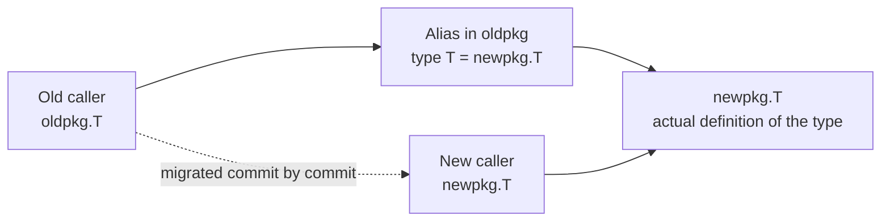

# 4.3 Type Aliases

`type A = B` and `type A B` differ by a single equals sign, yet their semantics are quite different:
the former gives an existing type another name, while the latter defines a new type with its own
identity. The difference touches a set of rules on type identity, method sets and assignability
([4.1](./type.md)), and it bears on an engineering problem Go has always taken seriously: how to
move a type from one package to another in a large codebase without breaking compatibility. This
section first explains the semantic difference between aliases and defined types, then describes why
aliases were introduced in Go 1.9, and finally discusses the generic type aliases introduced in Go
1.24 and how the type checker represents them.

## 4.3.1 Aliases and Defined Types

According to the language specification, a type declaration has two forms, the **alias declaration**
and the **type definition**, distinguished by the equals sign
[[Go Authors, 2026a](#ref-go-authors-2026a)].

`type Celsius float64` is a type definition. It creates a new type that is different from every
other type, with the same underlying type and operations as `float64`. From then on `Celsius` and
`float64` are two different named types: `Celsius` has its own identity and can declare its own
methods, and it cannot be assigned to or from `float64` directly, only converted explicitly.

`type Temperature = float64` is an alias declaration. It merely binds an identifier to an existing
type; within the scope of that identifier, `Temperature` and `float64` are two names for the same
type and are fully interchangeable. Among the predeclared identifiers, `byte` (an alias for
`uint8`), `rune` (an alias for `int32`) and, since Go 1.18, `any` (an alias for `interface{}`) are
all aliases of this kind.

The difference shows most clearly in method sets. The following program does not compile:

```go
package main

import "bytes"

type AliasBuf = bytes.Buffer // alias: the same type as bytes.Buffer
type DefBuf bytes.Buffer     // defined type: same underlying type, empty method set

func main() {
	var a AliasBuf
	a.WriteString("x") // OK: same method set as bytes.Buffer

	var d DefBuf
	d.WriteString("x")  // compile error
	_ = bytes.Buffer(d) // an explicit conversion is allowed
}
```

```
./main.go:13:4: d.WriteString undefined (type DefBuf has no field or method WriteString)
```

`DefBuf` and `bytes.Buffer` have the same underlying type, so they can be converted explicitly, but
`DefBuf` is a new type and inherits none of the methods of `bytes.Buffer`. `AliasBuf` is not a new
type at all: it is `bytes.Buffer`, and its method set is naturally identical. In short, a type
definition creates a new type identity, and methods must be declared separately; an alias adds only
a name, leaving the type identity and method set unchanged.

An alias exists only in the source code and the compiler; the runtime does not know about it. The
type information visible at run time comes from type descriptors ([4.1](./type.md)), and an alias
produces no new type descriptor:

```go {run=true}
package main

import (
	"fmt"
	"reflect"
)

type Celsius float64                // defined type
type Temperature = float64          // alias
type Set[T comparable] = map[T]bool // generic alias (Go 1.24)

func main() {
	var c Celsius
	var t Temperature
	s := Set[string]{"go": true}

	fmt.Println(reflect.TypeOf(c), reflect.TypeOf(t))
	fmt.Printf("%T\n", s)

	var m map[string]bool = s // the same type, no conversion needed
	fmt.Println(len(m))
}
```

```
main.Celsius float64
map[string]bool
1
```

At run time `Celsius` has its own name, `main.Celsius`, whereas `Temperature` and `Set[string]`
appear as `float64` and `map[string]bool`. In contrast, the compiler's error messages keep the name
of the alias. When a string is assigned to a variable of type `Temperature`, Go 1.26 reports:

```
./main.go:6:22: cannot use "hot" (untyped string constant) as Temperature value in variable declaration
```

The error message says `Temperature`, not `float64`. This is because since Go 1.23 the compiler's
type checker keeps a separate node for aliases, discussed in 4.3.5.

## 4.3.2 Counterparts in Other Languages

The distinction between giving an existing type another name and defining a new type with its own
identity is common in languages with nominal types, under different names:

- **Haskell**'s `type` declaration defines a **type synonym**, which can take parameters, for
  example `type Assoc k v = [(k, v)]`; this corresponds to Go's aliases (including the generic
  aliases of Go 1.24). When a new type with its own identity is needed, `newtype` or `data` is used,
  which corresponds to Go's type definitions.
- **C++**'s `typedef T Name;` and `using Name = T;` are aliases. The **alias templates** introduced
  in C++11, such as `template<class T> using Vec = std::vector<T>;`, are comparable to Go's generic
  aliases.
- **Rust**'s `type Km = i32;` is an alias and creates no new type. When a new type identity is
  needed, the newtype pattern `struct Km(i32);` is usually used.

Whether to change only what a type is called or to change its identity is thus a common choice in
nominal type systems. Go expresses the choice by the presence or absence of an equals sign, and for
a long time allowed only aliases without type parameters.

## 4.3.3 The Motivation for Aliases: Gradual Code Repair

Aliases were not part of Go 1.0. In November 2016, at the GothamGo conference, Russ Cox gave a talk
titled "Codebase Refactoring (with help from Go)" on refactoring large codebases
[[Cox, 2016](#ref-cox-2016)]. The talk took Google's codebase as its example: as of January 2015 it
saw about 40,000 commits per day. At that scale, when a widely used API changes, it is hard to put
the API change and the edits to all its callers into one commit (Cox calls this **atomic code
repair**). A more workable approach is to set a transition period during which callers are changed
step by step, which is **gradual code repair**.

Gradual repair requires that, during the transition, the same API be reachable from both the old and
the new location, and that old and new code interoperate. The talk points out that Go could already
introduce alternate names for all constants, all functions and nearly all variables, but not for
types: `oldpkg.T` and `newpkg.T` are two different types even when their underlying types are the
same, and assigning between them requires an explicit conversion. Moving a type therefore meant
changing all references at once [[Cox, 2016](#ref-cox-2016)].

To address this, the Go team first designed a general alias mechanism for Go 1.8
[[Griesemer, 2016](#ref-griesemer-2016)], which allowed aliases for all kinds of declarations,
including constants, functions, variables and types. The feature was ultimately shelved and did not
ship with Go 1.8. In December 2016, Russ Cox and Robert Griesemer then proposed aliases for types
only [[Cox and Griesemer, 2016](#ref-cox-griesemer-2016)], replacing the general aliases. The
proposal argued that general aliases overlap with other forms of declaration and complicate them,
while only types urgently need aliases. The proposal was implemented in Go 1.9 (August 2017)
[[Go Authors, 2017](#ref-go-authors-2017)].

With aliases, moving a type can be done in steps. First define the type in the new package, then
leave in the old package an alias that points to it:

```go
// newpkg/t.go: the new location of the type
package newpkg

type T struct { /* ... */ }

// oldpkg/t.go: the old package keeps only an alias
package oldpkg

import "path/to/newpkg"

type T = newpkg.T // oldpkg.T and newpkg.T are the same type
```

Now `oldpkg.T` and `newpkg.T` are the same type, not merely two types with the same underlying type,
so old and new code can be mixed and pass values to each other:

```go
package caller

import (
	"path/to/newpkg"
	"path/to/oldpkg"
)

func use() {
	var a oldpkg.T // code not yet migrated still uses the old name
	var b newpkg.T // migrated code uses the new name
	a = b          // the same type, so direct assignment works
	_ = a
}
```

Callers can change `oldpkg.T` to `newpkg.T` in batches. Each change can be committed on its own and
pass continuous integration on its own, without waiting for all references to be ready at the same
time. Once no code refers to the old name, the alias in the old package is deleted. Throughout the
migration the codebase stays in a state that compiles and can be released. The process is shown in
the figure below; the alias is a temporary bridge between the old and new sides:



Aliases thus solve a software engineering problem, how to move a type without breaking
compatibility, and not a problem of type theory. For this reason aliases are mainly a transitional
device for refactoring and not an everyday modeling tool. They introduce no new type and do not
change type identity; they work only at the level of names, and should not be used to give one type
a series of different names.

## 4.3.4 Generic Type Aliases

When generics were introduced in Go 1.18, aliases could not take type parameters. The appendix of
the type parameters design document explains that an alias may refer to a generic type but cannot
itself have type parameters, because it was unclear at the time how to handle aliases whose type
parameters carry constraints [[Taylor and Griesemer, 2021](#ref-taylor-griesemer-2021)]. In June
2021, Matthew Dempsky filed issue #46477 suggesting that aliases be allowed to have type parameters
[[Dempsky, 2021](#ref-dempsky-2021)]. In the discussion Robert Griesemer pointed out the difficulty:
an alias is just another name for a type and not a new type, but once the type parameters of an
alias can narrow the constraints, or only some of the parameters are instantiated, the alias
effectively defines a new type.

The feature was available as an experiment in Go 1.23 (`GOEXPERIMENT=aliastypeparams`) and enabled
by default in Go 1.24 (February 2025) [[Go Authors, 2025](#ref-go-authors-2025)]; Go 1.26 removed
the experiment switch. A **generic type alias** is written as follows:

```go
type Set[T comparable] = map[T]bool // an alias with a type parameter

func demo() {
	s := Set[string]{"a": true} // must be instantiated on use
	_ = s
}
```

As with a non-generic alias, `Set[string]` and `map[string]bool` are the same type (see the program
in 4.3.1). The specification requires a generic alias to be instantiated on use: one cannot write
`Set` alone, only an instance such as `Set[string]`. This lets aliases simplify names and support
gradual refactoring in generic code ([Chapter 8](../ch08generics/readme.md)) as well.

Generic aliases bring one restriction to be aware of: they cannot be used as method receivers. The
specification says that if the receiver type is denoted by an alias (or a pointer to an alias), the
alias must not be generic or denote an instantiated generic type, no matter how many levels of
aliases or pointers lie in between [[Go Authors, 2026a](#ref-go-authors-2026a)]. Using the example
from the specification:

```go
package main

type Point struct{ x, y float64 }

type GPoint[P any] = Point
type HPoint = *GPoint[int]

func (*GPoint[P]) Draw(P) {}
func (HPoint) Draw()      {}

func main() {}
```

```
./main.go:8:8: cannot define new methods on generic alias type GPoint[P any]
./main.go:9:7: cannot define new methods on instantiated type GPoint[int]
```

The reason is the same as in the discussion in 4.3.1: methods belong to defined types, and an alias
is only a name, with no separate type identity to attach methods to. Generic aliases extend the
expressiveness of aliases but do not change the fact that an alias is only an alias.

## 4.3.5 Alias Nodes in the Type Checker

Before Go 1.22, the type checker (`go/types` and its counterpart inside the compiler, `types2`) did
not build a separate type node for an alias: for `type A = int`, the type of `A` was represented
directly as `int`. This was simple but had two drawbacks. First, error messages could show only the
type the alias refers to, not the alias the user actually wrote. Second, there was nowhere to store
the type parameters and type arguments of a generic alias.

Go 1.22 therefore introduced the `Alias` type in `go/types`, but did not create it by default; it
had to be enabled with `GODEBUG=gotypesalias=1`. Since Go 1.23 the setting is on by default and the
compiler also uses alias nodes; the predeclared `any` is likewise represented as an `Alias`. The
main fields of `Alias` are as follows (Go 1.26 `go/types/alias.go`
[[Go Authors, 2026b](#ref-go-authors-2026b)]):

```go
type Alias struct {
	obj     *TypeName      // the corresponding alias declaration
	orig    *Alias         // the original, uninstantiated alias
	tparams *TypeParamList // type parameters, possibly nil
	targs   *TypeList      // type arguments, possibly nil
	fromRHS Type           // the type on the right-hand side of the declaration, possibly still an alias
	actual  Type           // the type actually referred to, never an alias
}
```

`fromRHS` may itself be an alias, so aliases can form a chain; the function `Unalias` follows the
chain to the first non-alias type, which is `actual`. Once `Alias` exists, all code that branches on
the kind of a type must call `Unalias` first, or it will mistake an alias for a new kind of type.
Many commits in the following releases fixed places where an `Unalias` call had been missed. The
`GODEBUG=gotypesalias` setting is removed in Go 1.27, after which alias nodes are always present.

This representation exists only at compile time. When the compiler generates code it resolves an
alias to the type it refers to, so at run time only the actual type is seen, as the program in 4.3.1
shows.

## 4.3.6 Trade-offs

The alias is a feature deliberately kept small. Once it is understood that an alias is only an alias
and a defined type is the new type, much confusion about type identity, method sets and
assignability can be avoided; the root of all these questions lies in the type identity rules of
[4.1](./type.md). The limits of aliases come from the same place: they cannot declare methods and
create no new type identity, so they cannot attach semantic constraints to an existing type, which
is the job of a defined type. Choosing between an alias and a defined type always asks the same
question: is another name enough, or is a new type needed? The generic aliases of Go 1.24 extend the
reach of aliases to generic code, but do not cross this boundary.

## Further Reading

- <a id="ref-cox-2016"></a>[Cox, 2016] Russ Cox. "Codebase Refactoring (with help from
  Go)." GothamGo,
  2016. https://go.dev/talks/2016/refactor.article (see also
        https://talks.golang.org/2016/refactor.article
  ) The distinction between atomic and gradual code repair, and the motivation for introducing
  aliases.
- <a id="ref-cox-griesemer-2016"></a>[Cox and Griesemer, 2016] Russ Cox, Robert
  Griesemer. "Proposal: Type Aliases." 2016.
  https://go.googlesource.com/proposal/+/master/design/18130-type-alias.md The design document for
  type aliases in Go 1.9, explaining why aliases are provided only for types.
- <a id="ref-griesemer-2016"></a>[Griesemer, 2016] Robert Griesemer. "Proposal: Alias declarations
  for Go." golang/go#16339, 2016. https://github.com/golang/go/issues/16339 The general alias
  proposal designed for Go 1.8 and later shelved.
- <a id="ref-taylor-griesemer-2021"></a>[Taylor and Griesemer, 2021] Ian Lance Taylor, Robert
  Griesemer. "Type Parameters Proposal." 2021.
  https://go.googlesource.com/proposal/+/master/design/43651-type-parameters.md The
  appendix "Generic type aliases" explains why generic aliases were originally excluded.
- <a id="ref-dempsky-2021"></a>[Dempsky, 2021] Matthew Dempsky. "spec: generics: permit type
  parameters on aliases." golang/go#46477, 2021. https://github.com/golang/go/issues/46477 The
  proposal and discussion for the generic type aliases of Go 1.24.
- <a id="ref-go-authors-2026a"></a>[Go Authors, 2026a] The Go Authors. *The Go Programming Language
  Specification*, "Alias declarations" and "Method declarations".
  https://go.dev/ref/spec#Alias_declarations , https://go.dev/ref/spec#Type_declarations The
  specification's definitions of alias declarations, generic aliases and the receiver restriction.
- <a id="ref-go-authors-2026b"></a>[Go Authors, 2026b] The Go Authors. `go/types/alias.go`.
  https://github.com/golang/go/blob/release-branch.go1.26/src/go/types/alias.go
  https://github.com/golang/go/blob/master/src/go/types/alias.go
  Notes on the `Alias` type, `Unalias` and the `gotypesalias` setting.
- <a id="ref-go-authors-2017"></a>[Go Authors, 2017] The Go Authors. *Go 1.9 Release
  Notes*, "Changes to the language" (type aliases). https://go.dev/doc/go1.9
- <a id="ref-go-authors-2025"></a>[Go Authors, 2025] The Go Authors. *Go 1.24 Release
  Notes*, "Changes to the language" (generic type aliases). https://go.dev/doc/go1.24
- This book: [4.1 The Runtime Type System](./type.md),
  [Chapter 8 Generics](../ch08generics/readme.md).
