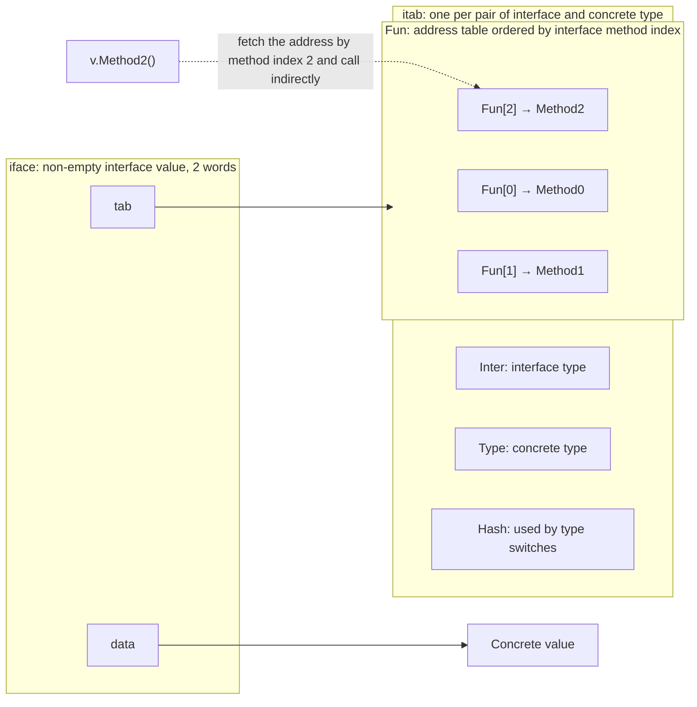

# 4.2 Interfaces

Interfaces separate behavior from implementation. Unlike most mainstream languages, Go satisfies
interfaces structurally and implicitly. This section covers how an interface is represented at run
time, how methods are dispatched dynamically, how type assertions are implemented, and where this
design stands among the various polymorphism mechanisms. The structs listed below keep only the
fields relevant to the discussion; for the full definitions, see `runtime/runtime2.go`,
`internal/abi/iface.go` and `runtime/iface.go` in Go 1.26.

## 4.2.1 Two Representations: iface and eface

An interface value always occupies two words at run time, but it comes in two forms. An interface
with methods (a **non-empty interface**) is represented as an `iface`: a pointer to an interface
table `itab`, plus a pointer to the concrete data. The empty interface `interface{}` (that is,
`any`) is represented as an `eface`: a pointer to the type descriptor ([4.1](./type.md)), plus a
data pointer. The empty interface has no methods and needs no method table, so recording the type
directly saves a level of indirection:

```go
// runtime/runtime2.go
type iface struct {
	tab  *itab          // method table for this pair of interface type and concrete type
	data unsafe.Pointer // points to the concrete value
}

type eface struct {
	_type *_type // dynamic type of the concrete value
	data  unsafe.Pointer
}
```

`data` holds a pointer. A pointer-shaped value (a pointer, map, channel, function and so on, whose
size is exactly one pointer and which is itself a pointer) is stored in `data` directly. Any other
value must first be **boxed**: copied into a block of addressable memory to which `data` then
points. Boxing usually means a heap allocation, but the runtime optimizes common cases. For example,
an integer smaller than 256 points into a static array `staticuint64s` that the runtime
preallocates, so nothing is allocated. The following program measures how many allocations each of
three assignments causes:

```go {run=true}
package main

import (
	"fmt"
	"os"
	"testing"
)

var sink any

func main() {
	small := len(os.Args) + 6 // 7, a value known only at run time
	large := small * 1000     // 7000
	p := &large

	fmt.Println(testing.AllocsPerRun(1000, func() { sink = small })) // small integer
	fmt.Println(testing.AllocsPerRun(1000, func() { sink = large })) // large integer
	fmt.Println(testing.AllocsPerRun(1000, func() { sink = p }))     // pointer
}
```

```
0
1
0
```

The value 7 points into the static array and allocates nothing; the value 7000 must be boxed and
allocates once; the pointer is stored in `data` directly and also allocates nothing. The two-word
representation is the basis for what follows: dynamic dispatch, type assertions and the nil problem
below can all be derived from it.

## 4.2.2 The Typed nil

An interface value equals `nil` if and only if both of its words are `nil`. As soon as the word
representing the dynamic type has been filled in, the interface value is not equal to `nil`, even if
the data pointer is `nil`:

```go {run=true}
package main

import "fmt"

type MyErr struct{}

func (*MyErr) Error() string { return "boom" }

func do() error {
	var p *MyErr = nil // a nil pointer of a concrete type
	return p           // stored into an error interface
}

func main() {
	err := do()
	fmt.Println(err == nil)
	fmt.Printf("%T %v\n", err, err)
}
```

```
false
*main.MyErr boom
```

In the `error` returned by `do`, `tab` points to the interface table for the pair `error` and
`*MyErr` and is not `nil`; only `data` is `nil`. The interface value therefore does not equal `nil`.
The problem is especially easy to hit in functions that return `error`. The correct approach is to
`return nil` explicitly instead of returning a concrete-type pointer that happens to be `nil`. This
is not a special case but a necessary consequence of the two-word representation.

## 4.2.3 itab: Method Tables and Dynamic Dispatch

The `itab` (interface table) is the core of a non-empty interface. For every combination of an
interface type and a concrete type, the runtime maintains an `itab` that records the interface type,
the concrete type, a type hash, and, most importantly, the table of method addresses `Fun`:

```go
// internal/abi/iface.go
type ITab struct {
	Inter *InterfaceType // interface type: which methods it requires
	Type  *Type          // concrete type (the dynamic type)
	Hash  uint32         // copy of Type.Hash, used by type switches
	Fun   [1]uintptr     // variable length: code addresses of the methods; Fun[0] == 0 means the interface is not implemented
}
```



The order of the `Fun` table is determined by the interface: the methods of an interface are sorted
by name, independently of how the concrete type is written. Dynamic dispatch rests on this. The
compiler knows at compile time the index of a method within the interface, so a call only has to
fetch the address from `Fun` by that index and call it indirectly. If `Method2` is the method with
index 2 of interface `I`, then:

```go
var v I = concrete{}
v.Method2(args)
// roughly equivalent to (pseudocode):
//   fn := v.tab.Fun[2]    // index 2 is fixed at compile time; the address is known only at run time
//   call fn(v.data, args) // data is passed as the implicit receiver
```

The index is static and the address is dynamic: at the same call site, a different concrete type in
`v` runs different code. This is **dynamic dispatch** [[Cox, 2009](#ref-cox-2009)].

Constructing an `itab` (`getitab`) is not cheap: the runtime must check one by one that the concrete
type implements every method the interface requires, and fill in the whole `Fun` table. Because the
methods of both the interface and the concrete type are sorted by name, the check can advance
through the two lists in step, in time proportional to the sum of their method counts. A constructed
`itab` is cached in the global hash table `itabTable`, so each pair is constructed only once. The
fast path of `getitab` takes no lock: it looks the pair up in the table (with quadratic probing)
using `inter.Type.Hash ^ typ.Hash` as the hash, and returns on a hit, which is the most common case.
Only when the lookup fails does it take the lock, construct a new `itab` and insert it into the
table, which grows when the load factor reaches 75% [[Go Authors, 2026a](#ref-go-authors-2026a)]. In
practice, most `itab`s need not be constructed at run time. For every combination of interface and
concrete type that can be determined at compile time (for example, assigning an `*os.File` to an
`io.Reader`, or a type that appears in a type switch), the compiler generates the `itab` statically,
the linker collects them into the `itablink` section, and `itabsinit` registers them in the table at
program start.

## 4.2.4 Structural Satisfaction: Benefits and Costs of Decoupling

Indirect calls through a method table work the same way as C++ virtual function tables (vtables).
What really sets Go apart is that interface satisfaction is structural and implicit: a type
satisfies an interface automatically as long as it has the method set the interface requires, with
no explicit `implements` declaration as in Java or C#. This is the choice of **structural typing**
over nominal typing ([4.1](./type.md)) [[Go Authors, 2026b](#ref-go-authors-2026b)].

The benefit is decoupling. A programmer can define an interface that types written by others, even
types in the standard library, happen to satisfy, without modifying those types. Small interfaces
such as `io.Reader` and `io.Writer` are widely used for exactly this reason: `bytes.Buffer`,
`os.File` and `net.Conn` never declare that they implement `io.Reader`, yet each can be passed to
any function that accepts an `io.Reader`. Interface and implementation can evolve independently,
meeting through the method set.

The cost is twofold. First, implicit satisfaction means it is no longer obvious which types
implement which interfaces; confirming it takes tools or reading code. The idiom of the compile-time
assertion `var _ io.Reader = (*T)(nil)` comes from this. Second, an interface call is an indirect
call: fetch the address by index, then jump. The compiler usually cannot inline the callee across an
interface, and so loses the further optimizations inlining enables. For a small method called
frequently on a hot path, the performance gap between an interface call and a direct call can be
considerable. When the compiler can determine the dynamic type of an interface value, it rewrites
the interface call into a direct call, which is devirtualization. For hot calls that cannot be
determined statically, profile-guided optimization can devirtualize conditionally based on profile
data ([15.3](../../part5toolchain/ch15compile/optimize.md)), recovering part of this loss.

## 4.2.5 Type Assertions and Type Switches

The assertion `x.(T)` checks the dynamic type of an interface value, and its implementation depends
on `T`:

- When `T` is a concrete type, the assertion only has to compare the type word of the interface (the
  `itab` pointer for a non-empty interface) with the address of the descriptor (or `itab`)
  corresponding to `T`. One pointer comparison suffices.
- When `T` is another interface, the runtime must decide whether the dynamic type of `x` satisfies
  `T`, that is, obtain the corresponding `itab`. This is the `getitab` path of 4.2.3.

In either case, with the form `v, ok := x.(T)` a failed assertion yields the zero value and `false`
instead of a panic.

The type switch `switch v := x.(type)` uses hash values to speed up case selection
([4.1](./type.md)): it locates the candidate case by hash and then compares the types exactly. Two
different hashes must be distinguished here. `itab.Hash` is a copy of the dynamic type's
`Type.Hash`; it serves type switches and is carried by `itab`s the compiler generates statically.
The lookup in `itabTable` uses `inter.Type.Hash ^ typ.Hash` instead. For an `itab` constructed
dynamically at run time, the `Hash` field is set to 0, because according to a comment in the runtime
source such `itab`s never take part in type switches.

Assertions to an interface type, and the interface-type cases of a type switch, used to call into
the runtime every time. Since Go 1.22, the compiler generates a small cache for each such call site,
recording the concrete types seen there and their match results (the case index and the `itab`). The
runtime (`typeAssert`, `interfaceSwitch`) consults the cache first and takes the full path only on a
miss [[Go Authors, 2026a](#ref-go-authors-2026a)]. Even so, frequent assertions to interface types
on a hot path, or a type switch with many cases, are still not free.

## 4.2.6 Method Sets: Values and Pointers

Whether an interface can hold a value or a pointer is decided by the rules for **method sets**:
methods with pointer receivers do not belong to the method set of the value type
[[Go Authors, 2026b](#ref-go-authors-2026b)].

```go
package main

type T struct{}

func (t T) Read()   {}
func (t *T) Write() {}

type ReadWriter interface {
	Read()
	Write()
}

var _ ReadWriter = &T{}
var _ ReadWriter = T{}

func main() {}
```

```
./main.go:14:20: cannot use T{} (value of struct type T) as ReadWriter value in variable declaration: T does not implement ReadWriter (method Write has pointer receiver)
```

`*T` has both `Read` and `Write`, while the method set of `T` has only `Read`. The Go FAQ explains
why: if the interface holds a `*T`, a method call can obtain the value by dereferencing; if it holds
a `T`, there is no safe way to obtain a pointer to it, since otherwise the method could modify the
value inside the interface, which the language specification does not allow
[[Go Authors, 2026c](#ref-go-authors-2026c)]. Like the typed nil, this rule stems from the
underlying representation of interfaces: what an interface holds is a copy of the value.

## 4.2.7 Design Trade-offs: Small Interfaces

Several pieces of experience in the Go community about interfaces can be read as engineering
conclusions drawn from the mechanisms above.

First, interfaces should be small. A single-method interface such as `io.Reader` is the easiest to
satisfy and the easiest to compose. One of Rob Pike's Go Proverbs is "The bigger the interface, the
weaker the abstraction" [[Pike, 2015](#ref-pike-2015)]. The more methods an interface requires, the
fewer types can satisfy it, and the smaller the benefit of decoupling.

Second, "accept interfaces, return structs". Function parameters use interfaces for generality, so
callers can substitute implementations freely; return values use concrete types, to avoid premature
abstraction and to give callers the full capability instead of a view trimmed by an interface.

What these pieces of experience share is the starting point that an interface is a lightweight
abstraction for decoupling: better small than large, better late than early.

## 4.2.8 Comparison with Other Languages

Languages implement polymorphism in different ways
[[Cardelli and Wegner, 1985](#ref-cardelli-wegner-1985)], and placing Go among them makes its
trade-offs clear:

| Language and mechanism | Dispatch | Satisfaction | Runtime representation |
| --- | --- | --- | --- |
| Go interface | Dynamic (itab method table) | Structural, implicit | Two words: itab pointer and data pointer |
| C++ virtual function | Dynamic (vtable) | Nominal, must inherit from a base class | Object embeds a vptr pointing to the class's vtable |
| Rust trait | Static (generic monomorphization) or dynamic (`dyn Trait`) | Nominal, explicit `impl` | `dyn Trait` is a fat pointer: data pointer and vtable pointer |
| Haskell type class | Dictionary passing | Nominal, `instance` declaration | An instance is a method dictionary, passed implicitly at the call site |
| Java/C# interface | Dynamic (interface method table) | Nominal, explicit `implements` | Object header holds a class metadata pointer; the JIT speeds calls with inline caches |

Rust's `dyn Trait` and Go's `iface` are very close in representation: both are a data pointer plus a
method table pointer [[Rust Project, n.d.](#ref-rust-project-nd)]. The difference is that Rust
generates its method tables at compile time for each pair of trait and type, whereas Go may
construct an `itab` only when it is first needed at run time, because structural satisfaction cannot
be enumerated at compile time.

Haskell's type classes are implemented by **dictionary passing**, proposed by Wadler and Blott in
1989 [[Wadler and Blott, 1989](#ref-wadler-blott-1989)]: each instance corresponds to a method
dictionary that is passed as an implicit argument at the call site. Go's implementation of generics
uses a similar idea ([Chapter 8](../ch08generics/readme.md)): a function body shared by GC shape
receives a dictionary at the call, from which it obtains information and methods of the concrete
type. The `itab` of an interface travels with the value at run time, whereas the dictionary of a
generic function is fixed at compile time and passed in by the caller. What is distinctive about Go
is that it combines the efficient dynamic dispatch of a vtable with the loose coupling of
structural, implicit satisfaction.

## Further Reading

- <a id="ref-cox-2009"></a>[Cox, 2009] Russ Cox. "Go Data Structures: Interfaces." 2009.
  https://research.swtch.com/interfaces
  The classic explanation of the iface and itab representations.
- <a id="ref-go-authors-2026a"></a>[Go Authors, 2026a] The Go Authors. `runtime/iface.go`,
  `internal/abi/iface.go`, `runtime/runtime2.go`.
  https://github.com/golang/go/blob/release-branch.go1.26/src/runtime/iface.go
  https://github.com/golang/go/blob/master/src/runtime/iface.go
  The implementation of `getitab`, `itabTable`, `typeAssert` and `interfaceSwitch`.
- <a id="ref-cardelli-wegner-1985"></a>[Cardelli and Wegner, 1985] Luca Cardelli, Peter Wegner. "On
  Understanding Types, Data Abstraction, and Polymorphism." *ACM Computing Surveys*, 17(4):
  471–523, 1985. https://doi.org/10.1145/6041.6042 A classic survey of polymorphism and type
  abstraction.
- <a id="ref-wadler-blott-1989"></a>[Wadler and Blott, 1989] Philip Wadler, Stephen Blott. "How to
  Make ad-hoc Polymorphism Less ad hoc." *POPL 1989*: 60–76. https://doi.org/10.1145/75277.75283 The
  source of type classes and dictionary passing.
- <a id="ref-pike-2015"></a>[Pike, 2015] Rob Pike. "Go Proverbs." Gopherfest, 2015.
  https://go-proverbs.github.io/
  Source of sayings such as "The bigger the interface, the weaker the abstraction".
- <a id="ref-go-authors-2026b"></a>[Go Authors, 2026b] The Go Authors. *The Go Programming Language
  Specification*, "Interface types" and "Method sets". https://go.dev/ref/spec#Interface_types
  The specification's definitions of structural satisfaction and method sets.
- <a id="ref-rust-project-nd"></a>[Rust Project, n.d.] The Rust Project. *The Rust
  Reference*, "Trait objects". https://doc.rust-lang.org/reference/types/trait-object.html The
  fat-pointer representation of `dyn Trait`.
- <a id="ref-go-authors-2026c"></a>[Go Authors, 2026c] The Go Authors. *Frequently Asked Questions:
  Why do T and \*T have different method sets?* https://go.dev/doc/faq#different_method_sets
