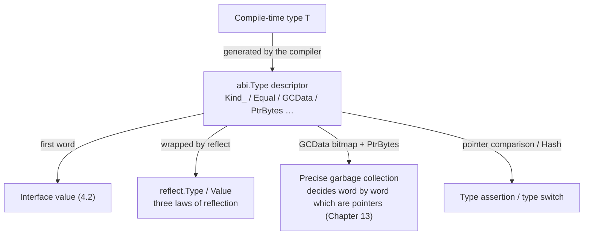

# 4.1 The Runtime Type System

Go is statically typed, and type checking is done at compile time
[[Cardelli and Wegner, 1985](#ref-cardelli-wegner-1985)]. A running Go program nevertheless retains
part of its type information, called **runtime type information** (RTTI). Interfaces
([4.2](./interface.md)), type assertions, type switches, reflection and the garbage collector's
precise identification of pointers all depend on it. This section describes what remains of a
compile-time type at run time, in what form, and which features that information supports. At its
core is a structure called the **type descriptor**.

The structs listed below keep only the fields relevant to the discussion. For the full definitions,
see `internal/abi/type.go` and the `reflect` package in Go 1.26
[[Go Authors, 2026a](#ref-go-authors-2026a)].

## 4.1.1 The Type Descriptor

The compiler generates a type descriptor for every type a program uses. In the Go 1.26 source it is
named `abi.Type`; the runtime internally keeps the older name `_type`. Descriptors live in the
read-only data segment and do not change while the program runs. A given type normally has exactly
one descriptor in a program, a property used when deciding whether two values have the same type.

```go
// internal/abi/type.go (fields as in Go 1.26; comments added for explanation)
type Type struct {
	Size_       uintptr // number of bytes a value of this type occupies, used by allocation and copying
	PtrBytes    uintptr // length of the prefix that may contain pointers; the garbage collector scans up to here
	Hash        uint32  // hash of the type, used by type switches and hash tables
	TFlag       TFlag   // flags: whether the type is named, has an UncommonType, and so on
	Align_      uint8   // alignment requirement of a variable of this type
	FieldAlign_ uint8   // alignment requirement of this type as a struct field
	Kind_       Kind    // kind: int, struct, slice, chan, and so on
	// reports whether two values of this type are equal; nil for uncomparable types
	Equal func(unsafe.Pointer, unsafe.Pointer) bool
	// pointer bitmap: marks which words of the type are pointers, used by the garbage collector
	GCData    *byte
	Str       NameOff // offset of the type name in the name table
	PtrToThis TypeOff // offset of the descriptor of *T, possibly zero
}
```

Each field serves a runtime feature. `Size_` is what the memory allocator
([Chapter 12](../../part4memory/ch12alloc/readme.md)) and value copying rely on. `Kind_` is an
enumeration that says how to interpret a block of memory; apart from `Invalid` it has 26 values:

```go
type Kind uint8

const (
	Invalid Kind = iota
	Bool
	Int
	// … remaining integer, floating-point and complex types omitted …
	Array
	Chan
	Func
	Interface
	Map
	Pointer
	Slice
	String
	Struct
	UnsafePointer
)
```

`Kind` distinguishes only the kind of a type, not the type itself: `type Celsius float64` and
`float64` both have `Kind` `Float64`, but they have two different descriptors (4.1.3).

`Equal` is the equality function the compiler generates for the type; map key comparison and
interface comparison both end up calling it. If the flag `TFlagRegularMemory` is set, values of the
type are a contiguous run of memory with no padding, so the comparison reduces to a single bytewise
memory comparison (`memequal`) instead of a field-by-field one. For uncomparable types such as
slices, maps and functions, `Equal` is `nil`. When two interface values are compared and the runtime
finds that the `Equal` of their dynamic type is `nil`, it panics:

```go {run=true}
package main

import "fmt"

func main() {
	var a, b any = 1, 1
	fmt.Println(a == b)

	a, b = []int{1}, []int{1}
	fmt.Println(a == b)
}
```

```
true
panic: runtime error: comparing uncomparable type []int
```

This error can only be detected at run time. The compiler knows that the static type of `a` and `b`
is the comparable type `any`, but it cannot know which dynamic type they hold.

A named type with methods is followed in memory by an `UncommonType` (marked by the flag
`TFlagUncommon`) that records its method table. Struct, slice, map, function and other types have
their own extended descriptors (such as `StructType` and `SliceType`), which embed `Type` at the
start and append the element type, field list and other information. Put differently, `abi.Type` is
the prefix shared by all type descriptors: the runtime first reads `Kind_` to learn the kind, then
converts the pointer to the matching extended descriptor and reads the remaining fields.

## 4.1.2 From Compile Time to Run Time

The type descriptor is the only representation of a compile-time type at run time, and its most
direct use is in the empty interface. At run time, `any` (that is, `interface{}`) consists of two
words:

```go
// internal/abi/iface.go
type EmptyInterface struct {
	Type *Type          // descriptor of the dynamic type
	Data unsafe.Pointer // points to the actual data; pointer-shaped values are stored here directly (4.2)
}
```

When a concrete value is assigned to an `any`, the compiler writes the address of the type's
descriptor into `Type` and the address of the data into `Data`. The runtime question "what type is
stored in this interface?" thus reduces to reading the `Type` pointer and finding which descriptor
it points to. The following program uses `unsafe` to read the first word of an interface value and
confirms that values of the same type share one descriptor:

```go {run=true}
package main

import (
	"fmt"
	"reflect"
	"unsafe"
)

type Celsius float64
type Fahrenheit float64

// eface has the same layout as abi.EmptyInterface: a type descriptor pointer and a data pointer.
type eface struct {
	typ, data unsafe.Pointer
}

// typeWord returns the first word of an interface value, the address of the dynamic type's descriptor.
func typeWord(v any) unsafe.Pointer { return (*eface)(unsafe.Pointer(&v)).typ }

func main() {
	var a, b Celsius = 1, 2
	var f Fahrenheit = 3
	fmt.Println(typeWord(a) == typeWord(b)) // the same type
	fmt.Println(typeWord(a) == typeWord(f)) // two named types with the same underlying type
	fmt.Println(reflect.TypeOf(a).Kind(), reflect.TypeOf(f).Kind())
}
```

```
true
false
float64 float64
```

`Celsius` and `Fahrenheit` have the same kind but different descriptors. A non-empty interface
carries one more layer beyond the type descriptor, the interface table (`ITab`); its method dispatch
mechanism is described in [4.2](./interface.md). For now it is enough to note that, for empty and
non-empty interfaces alike, the first word ultimately leads to an `abi.Type`
[[Cox, 2009](#ref-cox-2009)].

Going from compile time to run time, the type information narrows considerably. At compile time a
type is a complete body of static information that can be derived and checked; at run time the
program has only this descriptor plus a data pointer in the interface value. Type assertions,
reflection and garbage collector scanning are all built on these two things.

## 4.1.3 Nominal Types and Type Identity

Go's named types are **nominal types**: the identity of a type is determined by its declaration, not
by its structure.

```go
package main

type Celsius float64
type Fahrenheit float64

func main() {
	var c Celsius = 100
	var f Fahrenheit = c
	var x float64 = c
	_, _ = f, x
}
```

```
./main.go:8:21: cannot use c (variable of float64 type Celsius) as Fahrenheit value in variable declaration
./main.go:9:18: cannot use c (variable of float64 type Celsius) as float64 value in variable declaration
```

The underlying type of both `Celsius` and `Fahrenheit` is `float64`, and all three have the same
`Kind`, yet they are three distinct types that cannot be assigned to one another directly. The
restriction is enforced at compile time, and its purpose is to prevent a Celsius temperature from
being mistaken for a Fahrenheit temperature or a plain floating-point number. When two types are
identical, and when one value may be assigned or converted to another type, is defined precisely in
the "Type identity" and "Assignability" sections of the language specification
[[Go Authors, 2026e](#ref-go-authors-2026e)].

At run time, the identity of a nominal type shows up in a simple way. Because a type normally has
only one descriptor, deciding whether two values have the same type requires only a comparison of
their descriptor pointers. An assertion to a concrete type, `x.(T)`, therefore costs one pointer
comparison. For a type switch with many cases, the compiler also uses `Hash` from the descriptor: it
sorts the cases for concrete types by hash value and generates a binary search at run time (possibly
a jump table when there are 5 or more cases), finds the candidate case by hash, and then confirms it
by comparing descriptor pointers. When a case names an interface type, whether a concrete type
satisfies that interface cannot be decided at compile time. Since Go 1.22 such checks are done by
the runtime function `interfaceSwitch`, whose results are cached per dynamic type so that later
checks of the same kind can hit the cache directly [[Go Authors, 2026c](#ref-go-authors-2026c)].

Comparing named types with interfaces reveals a division of labor in Go's type system. Named types
have nominal identity, so a `Celsius` is never mistaken for a `float64`. Interface satisfaction, in
contrast, is **structural** ([4.2](./interface.md)): a type satisfies an interface automatically as
long as it has the method set the interface requires, with no explicit declaration. The former keeps
the boundaries of concrete types clear; the latter makes interfaces easy to decouple and compose.

## 4.1.4 Reflection: Introspection Based on Descriptors

The `reflect` package lets a program inspect and manipulate values of arbitrary types at run time
[[Go Authors, 2026d](#ref-go-authors-2026d)]. It is built on the two words described in 4.1.2:
`reflect.Type` wraps a `*abi.Type`, and `reflect.Value` holds both a type descriptor and a data
pointer. In his 2011 article "The Laws of Reflection", Rob Pike summarized this relationship in
three laws [[Pike, 2011](#ref-pike-2011)], each of which maps onto the layout of an interface:

```go
var x float64 = 3.4

// Law 1: reflection goes from interface value to reflection object.
// The parameters of TypeOf and ValueOf are of type any; they read exactly the Type and Data of the interface value.
t := reflect.TypeOf(x)  // t.Kind() == reflect.Float64, read from Kind_ of the descriptor
v := reflect.ValueOf(x) // v holds both the *abi.Type and a pointer to the data

// Law 2: reflection goes from reflection object to interface value.
var i any = v.Interface() // recombines the type and data into an interface value

// Law 3: to modify a reflection object, the value must be settable.
p := reflect.ValueOf(&x).Elem() // obtain an addressable Value through a pointer
p.SetFloat(7.1)                 // x becomes 7.1; calling it on the non-addressable v would panic
```

Being "settable" in the third law is not an extra rule but a direct consequence of the interface
layout. `reflect.ValueOf(x)` puts a copy of `x` into the interface, so modifying it would not affect
the original variable, and reflection refuses. Only by taking `&x` first and dereferencing with
`Elem()` does the `Value` hold the address of the original variable, which makes setting meaningful.

Reflection is powerful, and its costs are plain: it bypasses compile-time type checking, runs more
slowly than direct code, and exposes errors only at run time. It is therefore used mainly in
libraries that genuinely need to handle arbitrary types uniformly, such as serialization
(`encoding/json`) and ORMs. Generics, introduced in Go 1.18
([Chapter 8](../ch08generics/readme.md)), let a large class of generic code that once required
reflection regain compile-time type safety and shed the runtime cost of reflection.

## 4.1.5 The Pointer Bitmap: How Descriptors Support Precise Scanning

`GCData` and `PtrBytes` in the descriptor are used by the garbage collector
([Chapter 13](../../part4memory/ch13gc/readme.md)). Go's garbage collector is **precise**: when
scanning an object it must know exactly which words are pointers and which are plain data, and it
must not follow an integer that merely looks like an address. The type descriptor supplies this
information.

`GCData` usually points to a **pointer mask**, a bitmap with one bit for each word of the type: 1
marks a pointer, 0 a non-pointer, and the bitmap covers at least `PtrBytes`. When the collector
scans an object, it fetches this bitmap from the object's descriptor and decides bit by bit whether
to follow each word. `PtrBytes` gives an upper bound: pointers of the type can occur only within the
first `PtrBytes` bytes, everything after that is plain data, and scanning can stop there. A struct
that ends in a large array thus avoids a considerable amount of scanning.



How descriptors are stored is still evolving. Early on, the pointer bitmap of every type was
computed at compile time and written into the executable, so programs with large types had a bigger
read-only data segment. Since Go 1.24, if the pointer-containing prefix of a type exceeds 16384
words (128 KB on 64-bit platforms), the compiler sets the flag `TFlagGCMaskOnDemand`. In that case
`GCData` is actually a `**byte`, and the runtime generates the real bitmap the first time it is
needed and caches it (`getGCMask` in `runtime/type.go`)
[[Go Authors, 2026b](#ref-go-authors-2026b)], trading a little runtime computation for a smaller
executable. Go 1.26 also moved the information on whether a value is stored directly in the
interface's data word out of a bit of `Kind_` and into `TFlagDirectIface` in `TFlag`; according to
its comment, it is merely a cache of the condition that both `Size_` and `PtrBytes` equal the size
of a pointer [[Go Authors, 2026a](#ref-go-authors-2026a)].

The figure above gathers the preceding subsections in one place: a compile-time type `T` narrows to
one `abi.Type`, and this descriptor is the common basis of interfaces, reflection, garbage
collection and type assertions.

## 4.1.6 Comparison with Other Languages

Languages differ greatly in how much type information they keep at run time.

**Java and C#** keep the most. Every object on the heap carries a header with a pointer to class
metadata; the runtime can obtain fields, methods, annotations and even generic signatures through
`Class` or `Type`, and reflection is almost unrestricted. Dependency injection, serialization, ORMs,
dynamic proxies and similar frameworks are built on this. The cost is a metadata pointer in every
object and the runtime overhead of reflective calls.

**C++** keeps the least, following the principle of not paying for features that are not used. With
RTTI enabled, `typeid` and `dynamic_cast` can query the dynamic type of an object, but only for
polymorphic types that have virtual functions; the true type of a non-polymorphic type cannot be
queried at run time.

**Rust** has no general runtime reflection. `std::any::Any` supports only limited downcasting
through `TypeId` and cannot expose the structure of fields and methods. Rust leaves generic code to
compile-time generics and traits, and needs such as serialization are met by `serde` generating code
at compile time with procedural macros, not by runtime reflection.

Go lies between the two. It keeps enough type information to support interfaces, type assertions,
type switches, reflection and precise garbage collection, but unlike Java it attaches no metadata to
every object. Type information is concentrated in the single descriptor of each type. Objects carry
no type header: an ordinary value is just its data in memory, and type information is reached
through an interface value or a descriptor pointer only when needed.

## Further Reading

- <a id="ref-pike-2011"></a>[Pike, 2011] Rob Pike. "The Laws of Reflection." The Go Blog, 2011.
  https://go.dev/blog/laws-of-reflection
  The source of the three laws of reflection.
- <a id="ref-cox-2009"></a>[Cox, 2009] Russ Cox. "Go Data Structures: Interfaces." 2009.
  https://research.swtch.com/interfaces
  An early account of the memory layout of interface values and type descriptors.
- <a id="ref-go-authors-2026a"></a>[Go Authors, 2026a] The Go Authors. `internal/abi/type.go`,
  `internal/abi/iface.go`.
  https://github.com/golang/go/blob/release-branch.go1.26/src/internal/abi/type.go
  https://github.com/golang/go/blob/master/src/internal/abi/type.go The type descriptor and
  interface layout in Go 1.26; the meaning of each flag is documented in its comments.
- <a id="ref-go-authors-2026b"></a>[Go Authors, 2026b] The Go Authors. `runtime/type.go`
  (`getGCMask`). https://github.com/golang/go/blob/release-branch.go1.26/src/runtime/type.go
  https://github.com/golang/go/blob/master/src/runtime/type.go On-demand generation of pointer
  bitmaps.
- <a id="ref-go-authors-2026c"></a>[Go Authors, 2026c] The Go Authors.
  `cmd/compile/internal/walk/switch.go`.
  https://github.com/golang/go/blob/release-branch.go1.26/src/cmd/compile/internal/walk/switch.go
  Compilation of type switches: binary search by hash value, jump tables and `interfaceSwitch`.
- <a id="ref-go-authors-2026d"></a>[Go Authors, 2026d] The Go Authors. *Package reflect*.
  https://pkg.go.dev/reflect
- <a id="ref-go-authors-2026e"></a>[Go Authors, 2026e] The Go Authors. *The Go Programming Language
  Specification*, "Types" and "Type identity". https://go.dev/ref/spec#Types
  , https://go.dev/ref/spec#Type_identity
- <a id="ref-cardelli-wegner-1985"></a>[Cardelli and Wegner, 1985] Luca Cardelli, Peter Wegner. "On
  Understanding Types, Data Abstraction, and Polymorphism." *ACM Computing Surveys*, 17(4):
  471–523, 1985. https://doi.org/10.1145/6041.6042 A classic survey of types, data abstraction and
  polymorphism.
