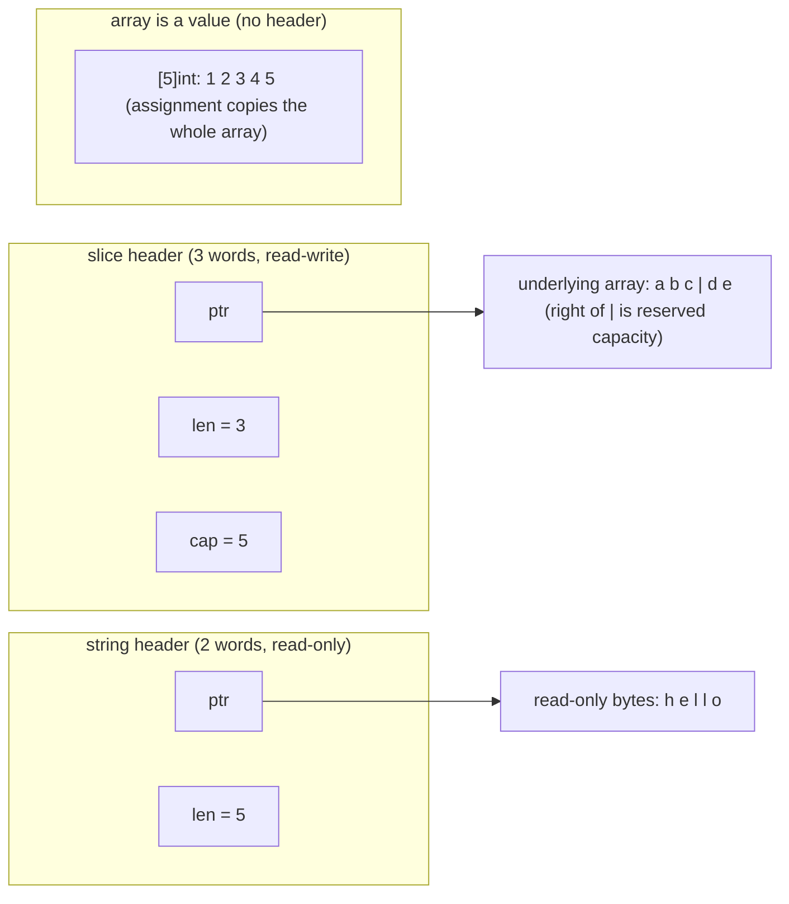

# 5.1 Arrays and Slices

Arrays and slices are the two basic sequence types in Go. They look alike in syntax but differ in
memory model, and that difference explains both the behavior of `append` and the aliasing problems
between slices. A slice and a string are each described by a small **header** that points to a
contiguous region of memory [[Gerrand, 2011](#ref-gerrand-2011)]; they differ in which fields the
header carries and in who owns that memory [[Pike, 2013](#ref-pike-2013)]. This section first
describes the layout of all three, then starts from the classic abstraction of the **dynamic array**
to show how `append` reaches $O(1)$ in the amortized sense, and what the runtime and compiler do to
reduce allocations. It closes with aliasing and a comparison with other languages. A string
resembles a slice in representation, but it is immutable and follows its own rules, which
[5.2](./string.md) covers.

## 5.1.1 Three Memory Layouts

**An array is a value.** `[5]int` is five `int`s laid out contiguously. The length is part of the
type, so `[5]int` and `[6]int` are different types. An array is copied as a whole on assignment,
when passed as an argument, and when used as a struct field. For this reason Go programs rarely pass
large arrays directly; they pass a slice of the array or a pointer to it. In the other direction, a
slice can be converted to an array pointer (since Go 1.17) or to an array (since Go 1.20), as in
`(*[4]byte)(s)` and `[4]byte(s)`. If the slice is shorter than the array, the conversion panics at
run time.

**A slice is a view of a segment of an underlying array.** At run time a slice is a three-word
header (`runtime/slice.go`):

```go
type slice struct {
	array unsafe.Pointer // points to the first element of the slice in the underlying array
	len   int            // length: the number of elements that can be accessed
	cap   int            // capacity: the number of elements from array to the end of the underlying array
}
```

`len` is the range that can be indexed, and `cap` is the length the slice can grow to without
reallocating. Keeping the two apart is what lets a slice act as a view: `s[1:3]` only computes the
three fields of a new header and never touches the underlying array.

**A string is a read-only sequence of bytes.** Its header has only two words and no `cap`
(`runtime/string.go`):

```go
type stringStruct struct {
	str unsafe.Pointer // points to the read-only bytes
	len int            // number of bytes, not the number of characters (runes)
}
```

The missing `cap` field is not an oversight: a string is **immutable**, its length never grows once
fixed, and so it needs no capacity. Immutability brings three benefits: several strings can safely
share the same bytes, a substring `s[i:j]` needs no copy, and a string can be used directly as a map
key without a defensive copy. The cost is that every modification must produce a new string. String
conversion and zero-copy tricks are covered in [5.2](./string.md).

The three layouts compare as follows:



An array has no header; it is the memory itself. A slice or a string consists of a header plus a
region of memory elsewhere. The behaviors discussed below all follow from this difference.

## 5.1.2 Dynamic Arrays and Amortized Analysis

A slice is Go's form of a **dynamic array**: a contiguous array that grows on demand. Its core
guarantee is that, although an occasional append must allocate new memory and move every element,
the **amortized** cost of $n$ consecutive `append` calls is still $O(1)$ each.

The guarantee comes from growing by a multiplicative factor. Suppose that whenever the capacity runs
out, the new capacity is the old one times a constant $g>1$ (the simplest case is $g=2$). Viewing
the $n$ appends as a whole, only the few that trigger a move are expensive, and the sizes of the
moves form a geometric series. Growing an empty slice to $n$ elements moves roughly
$\dots, n/4, n/2, n$ elements in successive reallocations, which sums to:

$$
\sum_{i=0}^{\infty} \frac{n}{2^i} = n + \frac{n}{2} + \frac{n}{4} + \cdots < 2n
$$

The total cost of moving is at most $2n$. Adding the $O(n)$ cost of writing the $n$ new elements,
$n$ appends cost $O(n)$ in total, a constant per append. This is the dynamic table that
*Introduction to Algorithms* uses to teach amortized analysis, and aggregate analysis and the
potential method both give the same bound [[Cormen et al., 2022](#ref-cormen-et-al-2022)].

The essential point is that growth must be **multiplicative**. If each growth added a fixed $c$
slots, the $k$-th growth would move about $kc$ elements, the total would be $\sum kc = \Theta(n^2)$,
and the amortized cost per append would degrade to $O(n)$. The price of multiplicative growth is
space: right after a growth only about $1/g$ of the capacity is in use, and with doubling up to half
the space may sit idle. The growth factor is therefore a trade-off between time and space; 5.1.6
shows the answers that different languages give.

## 5.1.3 The Growth Strategy of append

In theory any constant growth factor will do, but Go's implementation is more refined. When capacity
is insufficient, `append` calls the runtime function `growslice`, which first computes a target
capacity with `nextslicecap` and then adjusts it according to the memory allocator's size classes.
The code that computes the target capacity is shown below (Go 1.26 `runtime/slice.go`; the comments
are translated by the author [[Go Authors, 2026a](#ref-go-authors-2026a)]):

```go
func nextslicecap(newLen, oldCap int) int {
	newcap := oldCap
	doublecap := newcap + newcap
	if newLen > doublecap {
		return newLen // too many elements appended at once: take the required length
	}

	const threshold = 256
	if oldCap < threshold {
		return doublecap // small slice: double the capacity
	}
	for {
		// Transition from 2x growth for small slices to 1.25x growth
		// for large slices; this formula makes the transition smooth.
		newcap += (newcap + 3*threshold) >> 2

		// Check both newcap >= newLen and whether newcap overflowed.
		if uint(newcap) >= uint(newLen) {
			break
		}
	}

	// If the computation overflowed, take the required length.
	if newcap <= 0 {
		return newLen
	}
	return newcap
}
```

The strategy pivots at 256. When the old capacity is below 256, the capacity doubles, so small
slices grow fast and move less often. Once the old capacity reaches 256, each round adds
$\tfrac{1}{4}(\text{newcap} + 768)$. While `newcap` is small the constant 768 dominates and the
growth ratio is close to 2; when `newcap` is large the constant is negligible and the ratio tends to
$1.25$. The ratio thus moves continuously from 2 to 1.25. Keith Randall proposed this formula in
2021 and it was adopted in Go 1.18 [[Randall, 2021](#ref-randall-2021)]. The earlier strategy
doubled the capacity below 1024 and grew by 1.25x afterwards, so the ratio jumped at 1024.

The capacity computed by `nextslicecap` goes through one more adjustment. `growslice` passes the
required number of bytes (capacity times element size) to `roundupsize`, which rounds it up to a
**size class** of the memory allocator (see [Chapter 12](../../part4memory/ch12alloc/readme.md)),
and then derives the capacity back from the rounded byte count. For an element of pointer size:

```go
capmem = roundupsize(uintptr(newcap)*goarch.PtrSize, noscan)
newcap = int(capmem / goarch.PtrSize) // capacity extends to the size-class boundary
```

The allocator hands out a whole size-class block anyway, and `growslice` merely counts the otherwise
idle space as capacity. The following program appends elements one by one and prints the new
capacity whenever it changes:

```go {run=true}
package main

import "fmt"

func main() {
	var s []int
	last := -1
	for i := range 4000 {
		s = append(s, i)
		if cap(s) != last {
			fmt.Print(cap(s), " ")
			last = cap(s)
		}
	}
	fmt.Println()
}
```

```
4 8 16 32 64 128 256 512 848 1280 1792 2560 3408 5120
```

Below 256 the capacity doubles each time, and 256 to 512 is also a doubling because
$256 + (256 + 768)/4 = 512$. After 512 the formula gives $512 + (512 + 768)/4 = 832$, which is 6656
bytes; the smallest allocator size class of at least 6656 bytes is 6784 bytes, so the capacity is
$6784 / 8 = 848$. The next step gives 1252 by the formula, or 10016 bytes, which rounds up to the
10240-byte size class and a capacity of 1280. The actual capacity of a slice is thus the combined
effect of multiplicative growth and size-class rounding.

The sequence starts at 4 rather than 1 because of another optimization: this slice does not escape,
so the compiler reserves a 32-byte buffer for it on the stack, exactly enough for four `int`s. With
`-gcflags=-d=variablemakethreshold=0` the optimization is turned off and the sequence begins
`1 2 4 8`.

## 5.1.4 Backing Arrays on the Stack

Under the strategy of 5.1.3, a slice that starts empty and is appended to one element at a time in a
loop allocates memory at the 1st, 2nd, 4th, 8th, ... append, and every block except the last becomes
garbage right after the next growth. For a slice that does not escape
([15.5](../../part5toolchain/ch15compile/escape.md)), these allocations can be avoided.

A `make` with a constant length that does not escape has long been allocated on the stack. Go 1.25
extends this to `make([]T, n)` whose length is known only at run time, and to appends to a nil
slice: as long as the result does not escape, the compiler reserves a 32-byte buffer on the stack,
uses it directly when the required space is at most 32 bytes, and calls into the runtime to allocate
on the heap only when it is exceeded. Go 1.26 adds a dedicated analysis
(`cmd/compile/internal/slice`) [[Go Authors, 2026b](#ref-go-authors-2026b)]: if the backing array of
a slice escapes only at a few places such as the final `return`, the compiler inserts `move2heap`
before those places, so the earlier appends can still use the stack buffer and the contents are
copied to the heap only when escaping is required. The following program measures the number of
allocations in both situations:

```go {run=true}
package main

import (
	"fmt"
	"os"
	"testing"
)

//go:noinline
func local(n int) int {
	var s []int
	for i := range n {
		s = append(s, i)
	}
	return len(s) // s does not escape
}

//go:noinline
func escaping(n int) []int {
	var s []int
	for i := range n {
		s = append(s, i)
	}
	return s // s escapes on return
}

var sink []int

func main() {
	n := len(os.Args) + 3 // 4, a value known only at run time
	fmt.Println(testing.AllocsPerRun(100, func() { local(n) }))
	fmt.Println(testing.AllocsPerRun(100, func() { local(n * 25) }))
	fmt.Println(testing.AllocsPerRun(100, func() { sink = escaping(n) }))
	fmt.Println(testing.AllocsPerRun(100, func() { sink = escaping(n * 25) }))
}
```

```
0
5
1
5
```

Under Go 1.26, `local` with four appends does not allocate at all. The same loop in `escaping`
allocates once, on return, instead of once each at capacities 1, 2 and 4. With 100 appends the stack
buffer is used up quickly, and from then on the behavior is the usual one: one allocation each at
capacities 8, 16, 32, 64 and 128, five in total. With the optimization turned off, the four numbers
are 3, 8, 3 and 8.

Related to this, Go 1.26 also implements `growsliceNoAlias`: when the compiler can prove that the
old backing array of a slice has no other references, the old array can be freed immediately after
growth instead of waiting for garbage collection. This feature is controlled by the experiment flag
`GOEXPERIMENT=runtimefreegc` and is off by default in Go 1.26.

## 5.1.5 Aliasing and Common Pitfalls

A slice is a view, and several slices can share the same backing array. That is why slices are
efficient, and also the source of many bugs.

**The result of `append` may or may not share the backing array with the original slice.** If the
length after appending does not exceed the capacity, the returned slice shares the backing array
with the original, and a write through one is visible through the other. Once the capacity is
exceeded and a new array is allocated, the two are unrelated:

```go {run=true}
package main

import "fmt"

func main() {
	a := make([]int, 3, 5) // len 3, cap 5
	b := append(a, 1)      // within capacity: b shares the backing array with a
	b[0] = 99
	fmt.Println(a, b) // a[0] also becomes 99

	c := append(b, 2, 3) // capacity exceeded: c points to a newly allocated array
	c[0] = 7
	fmt.Println(a, b, c) // a and b are unaffected

	d := a[0:3:3]    // full slice expression: cap(d) == len(d)
	d = append(d, 4) // always reallocates
	d[0] = 0
	fmt.Println(a, d)
}
```

```
[99 0 0] [99 0 0 1]
[99 0 0] [99 0 0 1] [7 0 0 1 2 3]
[99 0 0] [0 0 0 4]
```

This uncertainty is especially dangerous across function boundaries: when a slice is passed to a
function that appends to it, whether the caller sees the change depends on the capacity at that
moment. The **full slice expression** `a[lo:hi:max]` solves this problem
[[Go Authors, 2026c](#ref-go-authors-2026c)]. It limits the capacity of the new slice to `max - lo`;
when `hi == max`, the next `append` always reallocates and so cuts the link with the original array,
as with `d` in the example. A library function that returns a piece of an internal buffer commonly
uses this form to keep callers from overwriting the rest of the buffer through `append`:

```go
view := buf[off : off+n : off+n] // cap == len, so an append by the caller always copies
```

**Memory retention through subslices.** As long as a slice header is reachable, the whole backing
array it points to cannot be reclaimed, even if the program uses only a small part of it:

```go
small := big[:10] // the backing array of small is still the entire backing array of big
// as long as small is reachable, the backing array of big (possibly huge) cannot be reclaimed
```

To keep a small piece of data for a long time, use `copy` or `slices.Clone` to obtain an independent
copy. Deleting elements has a similar problem. The hand-written `s = append(s[:i], s[i+1:]...)`
moves the later elements forward, but the element that used to be last remains in the backing array,
beyond `len(s)`. If the elements contain pointers, the objects they reference are still considered
live. The `slices` package introduced in Go 1.21 behaved this way at first
[[Go Authors, 2026d](#ref-go-authors-2026d)]; since Go 1.22, functions such as `slices.Delete`,
`DeleteFunc`, `Compact` and `Replace` zero the elements that have been moved out
[[Go Authors, 2024](#ref-go-authors-2024)]. The implementation of `Delete` in Go 1.26 is:

```go
func Delete[S ~[]E, E any](s S, i, j int) S {
	_ = s[i:j:len(s)] // bounds check

	if i == j {
		return s
	}

	oldlen := len(s)
	s = append(s[:i], s[j:]...)
	clear(s[len(s):oldlen]) // zero the elements moved out, so the garbage collector can reclaim them
	return s
}
```

## 5.1.6 Comparison with Other Languages

The dynamic array is a common abstraction: C++'s `std::vector`, Rust's `Vec<T>`, Python's `list` and
Java's `ArrayList` are all, in essence, multiplicatively growing arrays with amortized $O(1)$
appends. The implementations differ mainly in two respects: the growth factor and the view.

The growth factor is each implementation's answer to the time-space trade-off. Among C++ standard
libraries, libstdc++ grows by 2x and MSVC by 1.5x; when the factor is below the golden ratio, the
sum of the previously freed blocks can come to hold the next allocation, which is one argument for
choosing 1.5x. Rust's `Vec` grows by 2x; Python's `list` grows by roughly 1.125x, which is
conservative and saves memory once the size is stable; Java's `ArrayList` grows by 1.5x. Go uses the
strategy described in 5.1.3, which moves smoothly from 2x to 1.25x. A smaller factor saves memory
but moves more often; a larger one moves less often but wastes more memory. There is no universally
optimal choice, only trade-offs fitted to each language's typical workload.

As for views, a Go slice belongs to the same family as Rust's `&[T]`: both are fat pointers into
someone else's array (pointer and length, plus capacity in Go) that can refer to a subrange without
copying and do not own the memory themselves. `std::vector`, `Vec`, `list` and `ArrayList`, by
contrast, are **owning** containers that hold the underlying memory and are responsible for
releasing it. C++ provided a separate view type, `std::span`, only in C++20. Rust distinguished the
owning `Vec` from the borrowing `&[T]` at the type level from the start, and uses the borrow checker
to forbid writes through aliases at compile time. Go chose differently: one slice type plays both
roles, dynamic array and view, which keeps the language simpler at the cost of the aliasing problems
discussed in 5.1.5. Between simplicity and safety, Go chose simplicity here and left the management
of aliases to the programmer.

## Further Reading

- <a id="ref-cormen-et-al-2022"></a>[Cormen et al., 2022] Thomas H. Cormen, Charles E. Leiserson,
  Ronald L. Rivest, Clifford Stein. *Introduction to Algorithms*, 4th ed. MIT Press, 2022. The
  section on dynamic tables in Chapter 16, "Amortized Analysis", gives the amortized bound for
  growth by a multiplicative factor.
- <a id="ref-go-authors-2026a"></a>[Go Authors, 2026a] The Go Authors. `runtime/slice.go`.
  https://github.com/golang/go/blob/release-branch.go1.26/src/runtime/slice.go
  https://github.com/golang/go/blob/master/src/runtime/slice.go
  `growslice`, `nextslicecap`, and `growsliceBuf` and `growsliceNoAlias`, new in Go 1.26.
- <a id="ref-randall-2021"></a>[Randall, 2021] Keith Randall. "runtime: make slice growth formula a
  bit smoother." Go commit 2dda92ff6f, 2021. https://go.googlesource.com/go/+/2dda92ff6f The
  smoothed growth formula in use since Go 1.18.
- <a id="ref-go-authors-2026b"></a>[Go Authors, 2026b] The Go Authors.
  `cmd/compile/internal/slice/slice.go`.
  https://github.com/golang/go/blob/release-branch.go1.26/src/cmd/compile/internal/slice/slice.go
  Design notes on stack allocation of slice backing arrays and `move2heap` in Go 1.26.
- <a id="ref-gerrand-2011"></a>[Gerrand, 2011] Andrew Gerrand. "Go Slices: usage and internals." The
  Go Blog, 2011. https://go.dev/blog/slices-intro
- <a id="ref-pike-2013"></a>[Pike, 2013] Rob Pike. "Arrays, slices (and strings): The mechanics of
  'append'." The Go Blog, 2013. https://go.dev/blog/slices
- <a id="ref-go-authors-2026c"></a>[Go Authors, 2026c] The Go Authors. *The Go Programming Language
  Specification*, "Slice expressions". https://go.dev/ref/spec#Slice_expressions
  Includes the definition of the full slice expression `a[lo:hi:max]`.
- <a id="ref-go-authors-2026d"></a>[Go Authors, 2026d] The Go Authors. *Documentation of the
  `slices` package* (Go 1.21, `Clone` / `Delete` / `Insert` / `Grow`). https://pkg.go.dev/slices
- <a id="ref-go-authors-2024"></a>[Go Authors, 2024] The Go Authors. *Go 1.22 Release
  Notes*, "slices". https://go.dev/doc/go1.22 `Delete`, `DeleteFunc`, `Compact`, `CompactFunc` and
  `Replace`, which shorten a slice, now zero the elements moved out.
