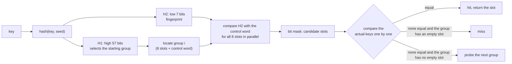
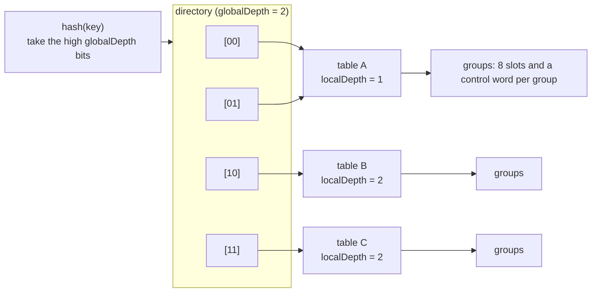

# 5.4 Swiss Table and the Go 1.24 Implementation

[5.3](./map.md) covered the general principles of hash tables and their security problems. This
section covers Go's two main implementations. It first introduces the Swiss Table, a modern
open-addressing design, then the bucket-based implementation used from Go 1.1 to Go 1.23, then how
Go 1.24 builds on the Swiss Table to meet Go's additional requirements, and the two language rules
that follow from the implementation. It closes with a comparison with hash tables in other
languages.

## 5.4.1 The Design of the Swiss Table

The Swiss Table was designed by engineers at Google; Matt Kulukundis presented it publicly at CppCon
2017 [[Kulukundis, 2017](#ref-kulukundis-2017)], and it was open-sourced in 2018 as part of the
Abseil C++ library. It is a form of open addressing. Its central improvement is that deciding which
slots in a group are empty, and which are worth comparing further, is no longer done slot by slot
but with a single parallel operation.

It splits the hash value into two parts: the high 57 bits, called **H1**, determine the group at
which probing starts, and the low 7 bits, called **H2**, serve as a fingerprint of the key. Slots
are organized in groups of 8, and each group has an 8-byte **control word**, in which each byte
corresponds to one slot of the group:

```
empty     empty     1000 0000   (0x80)
tombstone deleted   1111 1110   (0xfe)
full      full      0hhh hhhh   (top bit 0, low 7 bits are the H2 of the key)
```

The top bit distinguishes an empty slot or tombstone from an occupied one, and an occupied slot
keeps the fingerprint in its low 7 bits. To look up a key, H1 selects the starting group, and H2 is
compared with all 8 control bytes of that group at once, which amounts to 8 probe steps in one; with
SIMD instructions a group can even be widened to 16 slots. The result of the comparison is a bit
mask that marks the slots whose fingerprint matches, and the actual keys in these candidate slots
are then compared one by one. The fingerprint has only 7 bits, so each slot has about a
$1/128 \approx 0.78\%$ chance of a false match. But a full key comparison follows a match anyway, so
a false match only occasionally costs one extra comparison and does not affect correctness.



The control word also reduces two other frequent decisions to a single bit operation: whether the
group has an empty slot (`matchEmpty`, which decides when probing stops), and which slots are empty
or tombstones (`matchEmptyOrDeleted`, used to find a position on insertion). All of these operations
can be implemented with the **SWAR** (SIMD Within A Register) technique, which processes 8 bytes in
parallel in an ordinary 64-bit integer, so that even on platforms without vector instructions a few
integer and bit operations suffice.

## 5.4.2 The Earlier Bucket Implementation (Go 1.1 to Go 1.23)

To understand the rewrite in Go 1.24, one first needs to know the implementation it replaced. The
`map` of Go 1.0 used a multi-level subtable design. In March 2013 Keith Randall rewrote it, and the
commit message describes it as follows: the hash table consists of an array of buckets of 8 slots
each, collisions are handled by chained overflow buckets, each bucket stores an extra 8 bits of hash
per key to speed up lookup within the bucket, and the table grows incrementally
[[Randall, 2013](#ref-randall-2013)]. This design shipped with Go 1.1 and was used through Go 1.23.
Its top-level structure `hmap` is shown below (Go 1.23 `runtime/map.go`; the comments are translated
by the author):

```go
type hmap struct {
	count     int    // number of elements; len() reads this field directly
	flags     uint8
	B         uint8  // log base 2 of the number of buckets
	noverflow uint16 // approximate number of overflow buckets
	hash0     uint32 // hash seed

	buckets    unsafe.Pointer // array of 2^B buckets
	oldbuckets unsafe.Pointer // the old bucket array, half the size, during growth
	nevacuate  uintptr        // evacuation progress: old buckets with a lower index are all evacuated

	extra *mapextra // optional fields such as overflow buckets
}
```

Each bucket `bmap` holds 8 key-value pairs and 8 `tophash` values, the high 8 bits of each key's
hash (values below 5 are reserved to mark a slot as free or as being evacuated). The 8 keys and the
8 values are stored contiguously and separately, and once a bucket is full an overflow bucket is
chained to it. The load factor limit is 6.5 elements per bucket on average (written
`loadFactorNum / loadFactorDen`, that is 13/2 in the source); beyond it the number of buckets
doubles, and when there are too many overflow buckets a rehash is performed that leaves the bucket
count unchanged. Growth uses **incremental evacuation**: the old bucket array is kept in
`oldbuckets`, and each subsequent write operation evacuates one or two old buckets along the way,
which spreads the cost of growth over later operations and avoids a long pause in any single
insertion.

This design was in use for about 12 years, and its weaknesses are plain: fingerprints are stored
apart from keys, so a lookup scans `tophash` and then jumps to where the key lives, a discontiguous
access pattern; and overflow buckets are linked in a list, so chains grow long under heavy load and
cache locality is poor.

## 5.4.3 The Go 1.24 Implementation

In August 2022 YunHao Zhang opened issue #54766 suggesting that Go's `map` switch to a Swiss Table
[[Zhang, 2022](#ref-zhang-2022)]. YunHao Zhang, PJ Malloy and andy-wm-arthur then implemented early
versions of a Go Swiss Table, and Peter Mattis of CockroachDB built on that work to implement a
version that meets the requirements of the Go specification, `github.com/cockroachdb/swiss`
[[Mattis, 2024](#ref-mattis-2024)]. The built-in `map` of Go 1.24 was implemented by Michael Pratt
and lives in the `internal/runtime/maps` package; according to the official Go blog, it is largely
based on Peter Mattis's work [[Pratt, 2025a](#ref-pratt-2025a)]. Go 1.24 enables the new
implementation by default, and `GOEXPERIMENT=noswissmap` can still fall back to the old one
[[Go Authors, 2025](#ref-go-authors-2025)]; Go 1.26 removed this switch together with about 6000
lines of the old implementation [[Pratt, 2025b](#ref-pratt-2025b)].

### Two Additional Requirements

Abseil's design cannot be copied directly, because Go's `map` has two additional requirements.

The first is to bound the pause caused by growth. The probe sequence of open addressing depends on
the number of groups; after the number of groups doubles, all elements must be placed again
according to the new probe sequence, so the whole table must grow in one go. Go is often used in
latency-sensitive servers and cannot allow a single insertion to stall for an arbitrarily long time
because it has to grow an enormous table.

The second is iteration semantics. Go allows a `map` to be modified during iteration, and the
requirements of the specification can be summarized as follows: adding or removing elements during
iteration must not cause the same element to be returned twice; an element added during iteration
may or may not be returned; an element modified during iteration must be returned with its latest
value; an element deleted during iteration must not be returned; and the iteration order is
unspecified. Many hash tables such as Abseil's, by contrast, forbid modifying the table during
iteration.

### Directory and Extendible Hashing

For the first requirement, Go uses **extendible hashing**
[[Fagin et al., 1979](#ref-fagin-et-al-1979)]: the content of a `map` is spread over several
`table`s, each of which is a complete Swiss Table but responsible for only part of the hash space.
The top-level `Map` holds a **directory** of these tables and uses the high `globalDepth` bits of
the hash as the directory index to select the table a key belongs to. The fields of `Map` are as
follows (Go 1.26 `internal/runtime/maps/map.go` [[Go Authors, 2026](#ref-go-authors-2026)]; the
comments are the author's):

```go
type Map struct {
	used uint64  // number of elements; len() reads this field directly
	seed uintptr // hash seed of this map (5.3.2)

	dirPtr unsafe.Pointer // directory: *[dirLen]*table; for a small map, points directly at the single group
	dirLen int

	globalDepth uint8 // number of high hash bits used to select a table
	globalShift uint8 // 64 - globalDepth, the shift used to compute the directory index

	writing uint8 // flag set while a write is in progress, used to detect concurrent writes (5.4.4)

	tombstonePossible bool   // whether tombstones may exist
	clearSeq          uint64 // number of clear calls, used to detect clear during iteration
}
```

Each table has its own capacity and load limit and grows independently (`table.go`):

```go
type table struct {
	used       uint16 // number of elements
	capacity   uint16 // total number of slots, always a power of two
	growthLeft uint16 // number of slots that can still be filled before growth is needed
	localDepth uint8  // number of directory bits in use when this table was created
	index      int    // first index in the directory; -1 means the table is invalid

	groups groupsReference // array of groups (8 slots and a control word each)
}
```

Three constants matter: each group has `MapGroupSlots = 8` slots; on average at most
`maxAvgGroupLoad = 7` elements are filled per group, which guarantees that the table always has
empty slots, so a probe sequence eventually reaches a group with an empty slot and terminates; and
the capacity of a single table is capped at `maxTableCapacity = 1024`. Growth therefore falls into
two cases:

- When the capacity of a table has not reached 1024, growing means replacing it with a new table of
  doubled capacity and placing all elements again; since the table is small, the cost is bounded.
- Once the capacity reaches 1024, growth no longer doubles it. Instead the table is **split** into
  two, each responsible for half of the original hash range. If the `localDepth` of that table
  equals `globalDepth`, the directory doubles as well.

This way, the number of elements involved in a single growth never exceeds 1024. The directory
allows several indexes to point at the same table (when the `localDepth` of that table is less than
`globalDepth`), so doubling the directory does not require every table to split at once; only a full
table splits:



The `localDepth` of table A is 1, less than the `globalDepth` of 2, so the directory entries `[00]`
and `[01]` share it; only when A fills up and must split does it break into two tables with a
`localDepth` of 2. This structure no longer evacuates bucket by bucket incrementally as the old
implementation did. It limits the cost of a single growth by limiting the size of a single table.

### The Probe Sequence

The probe sequence within a table is as follows (`table.go`):

```go
func makeProbeSeq(hash uintptr, mask uint64) probeSeq {
	return probeSeq{
		mask:   mask,
		offset: uint64(hash) & mask,
		index:  0,
	}
}

func (s probeSeq) next() probeSeq {
	s.index++
	s.offset = (s.offset + s.index) & s.mask
	return s
}
```

Each step adds the increasing `index` to `offset`, so the offsets relative to the starting group are
$0, 1, 3, 6, 10, \dots$, the triangular numbers $T_k = k(k+1)/2$. The source and Abseil both call
this quadratic probing, since $T_k$ is a quadratic polynomial in $k$. It works because of a
number-theoretic fact: when the number of groups is $2^n$, $T_k \bmod 2^n$ takes every residue
exactly once for $k = 0, 1, \dots, 2^n-1$, so the probe sequence visits every group with neither
repeats nor omissions. This is the origin of the probing invariant that "the number of groups must
be a power of two". Otherwise the probe sequence could fall into a cycle while empty slots remain,
and a lookup would wrongly report a miss.

### Parallel Matching of Control Words

The inner loop of a lookup is the parallel matching described in 5.4.1. The portable implementation
of `ctrlGroupMatchH2` is as follows (`group.go`; the comments are the author's):

```go
const (
	ctrlEmpty   ctrl = 0b10000000
	ctrlDeleted ctrl = 0b11111110

	bitsetLSB = 0x0101010101010101
	bitsetMSB = 0x8080808080808080
)

func ctrlGroupMatchH2(g ctrlGroup, h uintptr) bitset {
	// XOR all 8 control bytes with H2 at once: equal bytes become 0
	v := uint64(g) ^ (bitsetLSB * uint64(h))
	// the classic SWAR trick: set the top bit of every byte whose value is 0
	return bitset(((v - bitsetLSB) &^ v) & bitsetMSB)
}
```

The comment in the source points out that this generic implementation can produce false positives in
rare cases: the borrow of the subtraction may cause the byte immediately next to a true match to be
marked as a match too. But false positives occur only where a true match exists, and never on empty
slots or tombstones, and the key comparison that follows rules them out, so the result is only an
occasional inefficiency and correctness is unaffected. On amd64, since Go 1.24 the compiler replaces
functions such as `matchH2` and `matchEmpty` with SSE instructions; the group size is still kept at
8 slots so as not to change the memory layout.

A lookup first locates the starting group, obtains the candidate slots from `matchH2` and compares
keys one by one; if the group contains an empty slot, probing ends and a miss is returned; otherwise
it proceeds to the next group along the probe sequence.

### Deletion and Tombstones

Deletion needs extra care. Probing stops at a group that contains an empty slot, so if an element is
deleted from a full group and its slot is simply marked empty, a key that should be found further
along the probe sequence is no longer found, because probing ends too early. The slot must instead
be marked as a tombstone, `ctrlDeleted`, and probing continues past a tombstone; only when the group
still has an empty slot can the slot be marked empty directly. Insertion reuses tombstones first.
Since cleaning tombstones in place would complicate iteration, tombstones are in principle cleared
completely only when the table grows.

For workloads that insert and delete repeatedly, tombstones can keep accumulating and make a table
grow frequently even though it holds few elements [[thepudds, 2024](#ref-thepudds-2024)]. Go 1.25
therefore added `pruneTombstones`: before growing, if tombstones reach 10% of the capacity, it first
tries to remove the tombstones that are no longer needed [[Randall, 2025](#ref-randall-2025)]. A
comment in the source stresses that cleaning is worthwhile only if it can remove $O(n)$ tombstones;
otherwise one would pay $O(n)$ to find a single removable tombstone and repeat the effort on the
next insertion. Since Go 1.25, `clear(m)` also clears tombstones.

### Small Maps

A `map` with no more than 8 elements fits in a single group. In that case the runtime omits the two
layers of indirection, directory and table: `dirPtr` points directly at the single group and
`dirLen` is 0. A small map needs no probe sequence, so all 8 slots can be filled, and deletion needs
no tombstones. The vast majority of `map`s are small, and this optimization saves them the cost of a
directory.

### Iteration

The official Go blog calls iteration the most complex part of the `map` implementation
[[Pratt, 2025a](#ref-pratt-2025a)]. If the `map` does not grow during iteration, it suffices to walk
each table in the directory and each group and slot in it. If a growth happens during iteration, the
new table has a different probe sequence, and recording only the current group and slot index is no
longer enough to avoid returning elements twice. Go's approach is that the iterator keeps a
reference to the old table it is currently walking; even after that table has been replaced, the
iterator continues in the order of the old table, which guarantees that the same element is not
returned twice. New elements that exist only in the new table are skipped, which the specification
allows. The data in the old table may be stale, however, so every time a key is obtained, it is
looked up again in the new table to determine whether it has been modified or deleted.

### Performance

The Go 1.24 release notes say that on a set of representative benchmarks, several runtime
improvements reduced CPU overhead by 2% to 3% on average; these improvements include the new `map`
based on the Swiss Table, more efficient allocation of small objects, and a new implementation of
the runtime's internal mutex [[Go Authors, 2025](#ref-go-authors-2025)]. That figure is thus the
combined effect of three changes. The official Go blog gives figures for the `map` itself: in
microbenchmarks, `map` operations are up to 60% faster than in Go 1.23, with a few edge cases
regressing; in full-application benchmarks, the geometric mean improvement in CPU time is about 1.5%
[[Pratt, 2025a](#ref-pratt-2025a)]. The actual gain varies with key type, workload and access
pattern.

## 5.4.4 The Origin of Two Language Rules

There are two frequently asked language rules about `map`, and both can be explained by the
implementation described above.

**The address of a `map` element cannot be taken.** Whether through evacuation in the old
implementation or growth and splitting in the new one, elements can move in memory, and a pointer
obtained earlier becomes invalid. The language therefore forbids taking the address of a `map`
element at compile time, and likewise forbids assigning directly to a field of a struct element in a
`map`:

```go
package main

type point struct{ x, y int }

func main() {
	m := map[string]point{"a": {1, 2}}
	p := &m["a"]  // cannot take the address of a map element
	m["a"].x = 10 // nor assign to a field of an element directly
	_ = p
}
```

```
./main.go:7:8: invalid operation: cannot take address of m["a"] (map index expression of struct type point)
./main.go:8:2: cannot assign to struct field m["a"].x in map
```

To change one field of a struct element, read the whole element out, modify it and write it back as
a whole; or store pointers in the `map`.

**A concurrent write terminates the program.** If several goroutines write to the same `map` at the
same time, or one reads while another writes, the runtime calls `fatal` and terminates the program,
instead of leaving an undefined result as an ordinary data race would:

```go
package main

import "sync"

func main() {
	m := map[int]int{}
	var wg sync.WaitGroup
	for g := range 2 {
		wg.Go(func() {
			for i := range 1_000_000 {
				m[i] = g // two goroutines write the same map at once
			}
		})
	}
	wg.Wait()
}
```

```
fatal error: concurrent map writes
```

Detection relies on the `Map.writing` field. At the start of every write operation it checks that
the field is 0 and then flips it (`writing ^= 1`); before finishing it checks that the field is
still 1 and flips it back. Take `PutSlot` as an example (Go 1.26, abridged):

```go
func (m *Map) PutSlot(typ *abi.MapType, key unsafe.Pointer) unsafe.Pointer {
	if m.writing != 0 {
		fatal("concurrent map writes")
	}

	hash := typ.Hasher(key, m.seed)

	// Set writing only after calling Hasher, because Hasher may panic,
	// in which case no write has actually happened.
	m.writing ^= 1 // flip; see the comment on the writing field

	// ... insertion ...

	if m.writing == 0 {
		fatal("concurrent map writes")
	}
	m.writing ^= 1
	// ...
}
```

A read operation only checks that field, and reports `concurrent map read and map write` if it is
not 0. The comment on the `writing` field in the source explains why it is flipped rather than
simply set to 1: if several writers enter at once, flipping raises the chance that both sides detect
the race. For example, if two writers flip in turn, the flag returns to 0, and the check before
finishing finds the anomaly. This is a best-effort detection: it takes no lock and does not
guarantee to catch every race, but at almost zero cost it exposes most misuse early as a clear
crash, instead of leaving errors that are hard to track down. When a `map` is shared among
goroutines, it must still be protected with `sync.Mutex` or `sync.RWMutex`, or replaced by
`sync.Map` ([Chapter 11](../../part3concurrency/ch11sync/readme.md)).

## 5.4.5 Hash Tables in Other Languages

Putting Go's two implementations next to the hash tables of other languages shows what is consensus
and what is trade-off:

| Language or library | Design | Collision handling | Key points |
| --- | --- | --- | --- |
| Go 1.24 and later | Swiss Table with an extendible-hashing directory | Open addressing, quadratic probing | Parallel matching of control words; table splitting bounds the cost of a single growth |
| Rust `HashMap` | hashbrown (a port of the Swiss Table) | Open addressing, SIMD probing by group | The standard library implementation since Rust 1.36; SipHash 1-3 by default |
| C++ `absl::flat_hash_map` | The original Swiss Table implementation | Open addressing, SIMD probing by group | Keys and values stored inline and contiguously, cache friendly |
| C++ `std::unordered_map` | Chaining | Buckets and linked lists | The bucket interface and element reference stability required by the standard effectively mandate chaining |
| Java `HashMap` | Chaining, converting to a red-black tree when necessary | Linked list, converted to a tree beyond a threshold | When a single bucket reaches 8 elements (and the table is large enough) it becomes a tree, cutting the worst case from $O(n)$ to $O(\log n)$ (JEP 180 [[OpenJDK, 2014](#ref-openjdk-2014)]) |
| Python `dict` | Compact open addressing | Perturbed probing and a separate index table | The index table is separated from the data array kept in insertion order, saving memory and preserving insertion order |

Two points stand out. First, the C++ standard requires `std::unordered_map` to provide a bucket
interface and to guarantee that references to elements remain valid after rehashing, which
effectively requires chaining and keeps it from gaining the cache advantages of open addressing;
this is why Abseil provides `flat_hash_map` separately. Go has no such constraint: the memory layout
of `map` has never been part of the language specification, so Go 1.24 could replace the
implementation wholesale without affecting any user code. Second, Rust and Go each independently
adopted Abseil's design [[Rust Release Team, 2019](#ref-rust-release-team-2019)], which indicates
that the Swiss Table has become a mainstream design for modern open-addressing hash tables.

The performance gain does not come for free. The Swiss Table pays with the extra space for control
words, the implementation complexity of SIMD and SWAR, and the indirection through the directory,
and in return gets lookups that remain contiguous and can be probed in parallel even at high load
factors. On top of this Go must also satisfy bounded growth, precise scanning by the garbage
collector, iteration semantics and concurrent-write detection. All of this complexity is hidden
inside the runtime, and what the user faces is still just `m[k]`.

## Further Reading

- <a id="ref-kulukundis-2017"></a>[Kulukundis, 2017] Matt Kulukundis. "Designing a Fast, Efficient,
  Cache-friendly Hash Table, Step by Step." CppCon, 2017.
  https://www.youtube.com/watch?v=ncHmEUmJZf4 A public walkthrough of the Swiss Table design. See
  also Abseil's design note: https://abseil.io/about/design/swisstables
- <a id="ref-pratt-2025a"></a>[Pratt, 2025a] Michael Pratt. "Faster Go maps with Swiss Tables." The
  Go Blog, 2025. https://go.dev/blog/swisstable The background of the Go 1.24 implementation, how it
  bounds growth and handles iteration semantics, and performance data.
- <a id="ref-zhang-2022"></a>[Zhang, 2022] YunHao Zhang. "runtime: use
  SwissTable." golang/go#54766, 2022. https://github.com/golang/go/issues/54766 The proposal and
  discussion on adopting the Swiss Table in Go.
- <a id="ref-mattis-2024"></a>[Mattis, 2024] Peter Mattis. `github.com/cockroachdb/swiss`. 2024.
  https://github.com/cockroachdb/swiss The Swiss Table implementation, meeting the requirements of
  the Go specification, on which the Go 1.24 implementation is based.
- <a id="ref-go-authors-2026"></a>[Go Authors, 2026] The Go Authors. `internal/runtime/maps/map.go`.
  https://github.com/golang/go/blob/release-branch.go1.26/src/internal/runtime/maps/map.go
  (development version: <https://github.com/golang/go/blob/master/src/internal/runtime/maps/map.go>)
  The package comment explains the design of extendible hashing, the directory, splitting and
  iteration in detail.
- <a id="ref-openjdk-2014"></a>[OpenJDK, 2014] OpenJDK. "JEP 180: Handle Frequent HashMap Collisions
  with Balanced Trees." 2014. https://openjdk.org/jeps/180 Java `HashMap`'s approach of using
  red-black trees to handle the worst case.
- <a id="ref-go-authors-2025"></a>[Go Authors, 2025] The Go Authors. Go 1.24 Release Notes.
  https://go.dev/doc/go1.24 The Runtime section describes the new `map` implementation, the
  `GOEXPERIMENT=noswissmap` switch, and the combined performance figures for three runtime
  improvements.
- <a id="ref-randall-2013"></a>[Randall, 2013] Keith Randall. "runtime: faster hashmap
  implementation." Go commit 00224a356a, 2013. https://go.dev/cl/7504044 The initial commit of the
  bucket-based implementation used from Go 1.1 to Go 1.23; its commit message summarizes the design
  of buckets, overflow chains and incremental growth.
- <a id="ref-thepudds-2024"></a>[thepudds, 2024] thepudds. "runtime: Swiss Table maps can double
  size multiple times when deleting/adding elements." golang/go#70886, 2024.
  https://github.com/golang/go/issues/70886 The bug report on tombstones accumulating under repeated
  insertion and deletion and making tables grow again and again.
- <a id="ref-randall-2025"></a>[Randall, 2025] Keith Randall. "internal/runtime/maps: prune
  tombstones in maps before growing." Go commit 05ed8a00e0, 2025. https://go.dev/cl/640955
  `pruneTombstones`, shipped with Go 1.25, which tries to remove tombstones before growing.
- <a id="ref-pratt-2025b"></a>[Pratt, 2025b] Michael Pratt. "all: remove GOEXPERIMENT=swissmap." Go
  commit 2ae059ccaf, 2025. https://github.com/golang/go/commit/2ae059ccaf The commit that removed
  the old implementation and the experiment flag in Go 1.26, deleting about 6100 lines of code.
- <a id="ref-fagin-et-al-1979"></a>[Fagin et al., 1979] Ronald Fagin, Jürg Nievergelt, Nicholas
  Pippenger, H. Raymond Strong. "Extendible Hashing—A Fast Access Method for Dynamic Files." ACM
  Transactions on Database Systems 4(3):315–344, 1979. https://doi.org/10.1145/320083.320092 The
  original paper on extendible hashing: a directory and local depths confine the growth of a file to
  the split of a single bucket.
- <a id="ref-rust-release-team-2019"></a>[Rust Release Team, 2019] The Rust Release
  Team. "Announcing Rust 1.36.0." Rust Blog, 2019-07-04.
  https://blog.rust-lang.org/2019/07/04/Rust-1.36.0/ Rust's standard library `HashMap` switched to
  hashbrown, based on the Swiss Table; the default hash function remains SipHash 1-3.
