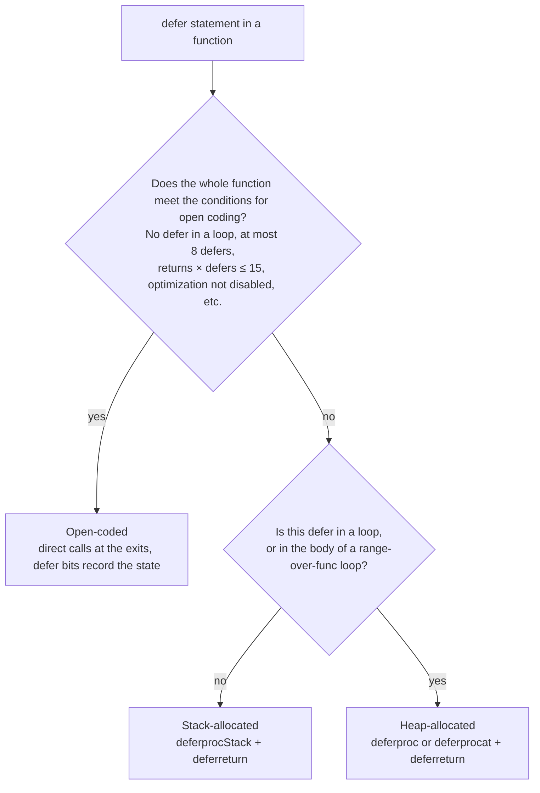

# 6.2 The Defer Statement

The `defer` statement was not part of Go's original design. On January 27, 2009, Robert Griesemer
added `defer` to the language specification [[Griesemer, 2009](#ref-griesemer-2009)], and the same
day Ken Thompson committed its first implementation [[Thompson, 2009](#ref-thompson-2009)].
According to the specification, a deferred call runs when the surrounding function returns, whether
the function executed a `return` statement, reached the end of its body, or its goroutine panicked
[[Go Authors, 2026b](#ref-go-authors-2026b)]; when `runtime.Goexit` terminates a goroutine, the
deferred calls already registered run as well. At first glance this looks like a purely compile-time
feature, like the destructor C++ calls automatically when an object leaves its scope: the compiler
need only move the deferred call to each exit of the function, and there should be no run-time cost.

The reality is more complicated. Go's `defer` is not tied to a scope or to a resource, and it may
appear inside conditionals and loops. How many deferred calls a function registers at run time often
cannot be determined at compile time:

```go
func randomDefers() {
	for rand.Intn(100) > 42 {
		defer println("golang-design/under-the-hood") // the number of executions is known only at run time
	}
}
```

`defer` therefore needs runtime support, and its cost was once considerable. This section first
explains the semantics of `defer`, then its three implementations and how the compiler chooses among
them, and finally the execution mechanism that `defer` shares with panic. That mechanism is also the
basis for understanding [6.3](./panic.md): in today's runtime, running deferred calls on a normal
return and running them while a panic unwinds are done by the same code.

## 6.2.1 Semantics

The observable semantics of `defer` can be summarized in four rules.

First, **last in, first out**. Multiple deferred calls in one function run in the reverse of the
order in which they were registered. This makes "open A, then open B" and "close B, then close
A" naturally symmetric, which is exactly the order resource cleanup requires.

Second, **both normal return and panic trigger them**. Whether the function returns normally or
unwinds upward because of a panic, the deferred calls already registered are executed. This lets
`defer` be used for cleanup that must happen, and it makes it possible to intercept a panic with
`recover` as described in [6.3](./panic.md).

Third, **arguments are evaluated at the `defer` statement, while the call is postponed**. The
deferred function and its arguments are fixed when the `defer` statement executes; only the call
itself is postponed until the function exits. If `defer f.Close()` is written right after
`f, _ := os.Open(...)`, and the arguments were evaluated only at the end, a reassignment of `f` in
between would close the wrong file. Evaluating at the `defer` matches the intent at the moment the
line is written.

Fourth, **deferred calls run after `return` has set the results**. `return 3` first assigns the
result to the return value, then runs the deferred calls, and only then actually returns. A closure
in a deferred call can therefore read and modify named return values; this is also why a function's
return value can be rewritten after a `recover` in [6.3](./panic.md).

```go {run=true}
package main

import "fmt"

func order() {
	for i := range 3 {
		defer fmt.Print(i, " ") // last in, first out
	}
}

func args() {
	i := 0
	defer fmt.Println("deferred:", i) // the argument is evaluated here
	i++
	fmt.Println("now:", i)
}

func double() (n int) {
	defer func() { n *= 2 }() // runs after return has set the result
	return 3
}

func main() {
	order()
	fmt.Println()
	args()
	fmt.Println(double())
}
```

```
2 1 0
now: 1
deferred: 0
6
```

The way the third rule is implemented later changed, while the semantics stayed the same. Early
implementations copied the arguments into the deferred record. When Go 1.17 introduced the
register-based calling convention on amd64, the compiler began rewriting every deferred call that
takes arguments into a closure that takes none [[McIntosh, 2021](#ref-mcintosh-2021)]: the arguments
are evaluated when the closure is built and captured by it, and at the end the runtime only has to
call the closure. Since Go 1.18 this rewrite is performed on all platforms
[[Mui, 2021](#ref-mui-2021)], the runtime code that handled arguments was deleted, and the deferred
record no longer needs to store arguments.

The rewrite is visible directly in the compiler's diagnostics. Compile the following program with
`-gcflags=-m=2`:

```go
package main

import "sync"

func unlock(mu *sync.Mutex) {
	mu.Lock()
	defer mu.Unlock()
}

func main() {
	var mu sync.Mutex
	unlock(&mu)
}
```

One line of the output describes the closure the compiler generated for this `defer` statement:

```
./main.go:7:2: can inline unlock.deferwrap1 with cost 76 as: func() { (*sync.Mutex).Unlock(.autotmp_1) }
```

Here `.autotmp_1` is the receiver `mu`, evaluated and saved when the `defer` statement executed; the
closure `unlock.deferwrap1` itself takes no arguments.

## 6.2.2 Three Implementations

Almost all of the cost of `defer` comes down to one question: where is the data that records "which
deferred calls are pending" stored, when is it allocated, and how are the calls found and executed
when the function exits? Go has given three answers over time. They did not replace one another in
sequence but **coexist**, and the compiler chooses among them for each function. In Go 1.26 the
record of a deferred call, `_defer`, is defined as follows (`runtime/runtime2.go`
[[Go Authors, 2026c](#ref-go-authors-2026c)]):

```go
type _defer struct {
	heap      bool
	rangefunc bool    // true for rangefunc list
	sp        uintptr // sp at time of defer
	pc        uintptr // pc at time of defer
	fn        func()  // can be nil for open-coded defers
	link      *_defer // next defer on G; can point to either heap or stack!

	// If rangefunc is true, *head is the head of the atomic linked list
	// during a range-over-func execution.
	head *atomic.Pointer[_defer]
}
```

The record has no argument size and no argument buffer: the arguments are already captured by the
closure `fn`. The records registered by one goroutine are chained through `link` into a list whose
head is kept in `g._defer`; the later a record is registered, the nearer the front it sits, which
gives last-in, first-out order naturally.

### Heap Allocation

The most direct approach is for the runtime to allocate a `_defer` each time a `defer` statement
executes, fill in `fn`, `pc`, and `sp`, and link it at the head of the `g._defer` list. The compiler
translates a `defer` statement into a call to `deferproc` and inserts a call to `deferreturn` at the
function's exits [[Go Authors, 2026a](#ref-go-authors-2026a)]:

```go
func deferproc(fn func()) {
	gp := getg()
	if gp.m.curg != gp {
		// go code on the system stack can't defer
		throw("defer on system stack")
	}

	d := newdefer()
	d.link = gp._defer
	gp._defer = d
	d.fn = fn
	d.pc = sys.GetCallerPC()
	// We must not be preempted between calling GetCallerSP and
	// storing it to d.sp because GetCallerSP's result is a
	// uintptr stack pointer.
	d.sp = sys.GetCallerSP()
}
```

`newdefer` does not allocate new memory every time. It first takes a record from the local cache
`deferpool` of the current processor (P). When the local cache is empty, it takes from the global
`sched.deferpool` enough records to fill half of the local cache, and it allocates only when both
are empty. This is the same idea as the multi-level caches of the memory allocator
([12.2](../../part4memory/ch12alloc/component.md)). Even so, this remains the slowest of the three
implementations: registering and releasing a record both touch the pool, and the list must be
maintained. The old advice "do not use `defer` on hot paths" comes from this.

### Stack Allocation (Go 1.13)

A `_defer` never outlives the function call that registered it, so the record can be placed directly
in that function's stack frame. Keith Randall proposed this as early as 2013
[[Randall, 2013](#ref-randall-2013)]; it was finally implemented in 2019 and shipped with Go 1.13.
For a `defer` statement that executes at most once per call (that is, one not in a loop), the
compiler reserves space for the `_defer` in the stack frame and calls `deferprocStack` to initialize
it and link it into the list. When the function returns, the record is released together with the
frame, which saves the allocation and the reclamation:

```go
func deferprocStack(d *_defer) {
	gp := getg()
	if gp.m.curg != gp {
		// go code on the system stack can't defer
		throw("defer on system stack")
	}

	// fn is already set.
	// The other fields are junk on entry to deferprocStack and
	// are initialized here.
	d.heap = false
	d.rangefunc = false
	d.sp = sys.GetCallerSP()
	d.pc = sys.GetCallerPC()
	// The lines below implement:
	//   d.link = gp._defer
	//   d.head = nil
	//   gp._defer = d
	// But without write barriers. The first two are writes to
	// the stack so they don't need a write barrier, and furthermore
	// are to uninitialized memory, so they must not use a write barrier.
	// The third write does not require a write barrier because we
	// explicitly mark all the defer structures, so we don't need to
	// keep track of pointers to them with a write barrier.
	*(*uintptr)(unsafe.Pointer(&d.link)) = uintptr(unsafe.Pointer(gp._defer))
	*(*uintptr)(unsafe.Pointer(&d.head)) = 0
	*(*uintptr)(unsafe.Pointer(&gp._defer)) = uintptr(unsafe.Pointer(d))
}
```

The Go 1.13 release notes state that this improvement made most `defer` calls 30% faster
[[Go Authors, 2019](#ref-go-authors-2019)]. But it still maintains the list and still calls
`deferreturn` at the function's exits, so it remains some distance from zero cost.

### Open-Coded Defers (Go 1.14)

The **open-coded defer** introduced in Go 1.14 was designed by Dan Scales, Keith Randall, and Austin
Clements [[Scales et al., 2019](#ref-scales-et-al-2019)] and implemented by Dan Scales. Its idea
returns to the original intuition: in most functions the number and positions of `defer` statements
are known at compile time, so the compiler can bypass the runtime and generate the code that calls
the deferred functions directly at each exit of the function, with no `_defer` record at all. For
example:

```go
var mu sync.Mutex

func f() {
	mu.Lock()
	defer mu.Unlock()
}
```

The compiled code contains neither `deferproc` nor `deferprocStack`, and it does not call
`deferreturn` on the normal path; the call to `mu.Unlock()` appears directly before the function
returns. The commit that implemented the feature gave a set of benchmark figures: the cost of one
`defer` statement is 35.4 ns with stack allocation alone, 5.6 ns with open coding, and 4.4 ns for
calling the function directly (without the `defer` keyword) [[Scales, 2019](#ref-scales-2019)]. The
Go 1.14 release notes accordingly state that most `defer` statements now have almost no overhead
compared with calling the deferred function directly [[Go Authors, 2020](#ref-go-authors-2020)].

The difficulty of open coding lies in conditional branches. If a `defer` sits in an `if` whose
outcome is known only at run time, how does the code at the exit know whether to call it? For this
the compiler maintains an 8-bit **defer bits** variable, `deferBits`, on the stack, with one bit for
each open-coded `defer`. When execution reaches a `defer` statement, it first saves the deferred
closure in a slot on the stack and only then sets the corresponding bit to 1. At the exit, the bits
are checked in reverse order and only the calls whose bits are set are made. Each bit is cleared,
and the variable written back to the stack, before the call, so that even if the deferred call
itself panics, panic handling will not run it again. In pseudocode:

```go
var tmp0, tmp1 func() // closure slots on the stack
deferBits := uint8(0)

tmp0 = f0 // first defer: save the closure first (arguments are already captured by it)
deferBits |= 1 << 0
if cond {
	tmp1 = f1 // second defer
	deferBits |= 1 << 1
}
// ... function body ...

// At the exit, check in reverse order:
if deferBits&(1<<1) != 0 {
	deferBits &^= 1 << 1 // clear before calling
	tmp1()
}
if deferBits&(1<<0) != 0 {
	deferBits &^= 1 << 0
	tmp0()
}
```

Open coding is thus not absolutely free: it still reserves stack slots for the function values, and
conditional `defer` statements pay for a few bit operations. Compared with allocating records and
maintaining a list, however, this cost is negligible. `deferBits` is a single byte, which is why a
function can have at most eight open-coded `defer` statements.

Open coding also has a price. The records of `defer` no longer enter the list, so a panic cannot
find them by following the list (see 6.2.4). For this reason panic handling must scan the stack
frames on the stack, looking for functions that use open coding. The data in the same commit show
that the cost of a panic followed by a recover rose from 62 ns to 255 ns
[[Scales, 2019](#ref-scales-2019)]. This is a deliberate trade-off: the normal path is far more
common than the panic path.

### How the Compiler Chooses

The compiler decides whether to use open coding per function. If any of the following conditions
holds, the whole function does not use open coding (Go 1.26 `cmd/compile/internal/walk` and
`ssagen`):

- A `defer` in the function is inside a loop (escape analysis marks such a `defer` as possibly
  executing more than once).
- The function has more than eight `defer` statements (`maxOpenDefers = 8`).
- The product of the number of return statements and the number of `defer` statements exceeds 15.
  Open coding must repeat code at every exit, and, as the source comment notes, it is meant mainly
  to improve the performance of smaller functions, which do not have many exits.
- The function is compiled with optimization disabled by `-N`, or the race detector is enabled.
- The function has result parameters allocated on the heap (the extra code segment described in
  6.2.4 cannot write such results back).
- The function has a `defer` inside the body of a range-over-func loop (since Go 1.23; see below).

When open coding is not used, each `defer` then decides separately between stack and heap
allocation: a `defer` not in a loop uses stack allocation, and one in a loop can only be allocated
on the heap.

The whole decision process is shown in the following figure:



Compiled with `-gcflags=-d=defer`, the compiler reports the implementation used for each `defer`:

```go
package main

import "sync"

func lock(mu *sync.Mutex) {
	mu.Lock()
	defer mu.Unlock()
}

func cond(b bool) {
	if b {
		defer println("a")
	}
	defer println("b")
}

func loop(n int) {
	for range n {
		defer println("x")
	}
}

func mixed(n int) {
	defer println("y")
	for range n {
		defer println("x")
	}
}

func seq(yield func(int) bool) { yield(1) }

func rangefunc() {
	for x := range seq {
		defer println(x) // belongs to the frame of rangefunc, not to the loop body closure
	}
}

func main() {
	var mu sync.Mutex
	lock(&mu)
	cond(true)
	loop(1)
	mixed(1)
	rangefunc()
}
```

```
./main.go:7:2: open-coded defer
./main.go:12:3: open-coded defer
./main.go:14:2: open-coded defer
./main.go:19:3: heap-allocated defer
./main.go:24:2: stack-allocated defer
./main.go:26:3: heap-allocated defer
./main.go:34:3: heap-allocated defer
```

`mixed` shows the consequence of deciding per function: the `defer` in the loop makes the whole
function give up open coding, and the `defer` outside the loop falls back to stack allocation. The
last line is the new case that `range` over functions brings. By the semantics, a `defer` in a loop
body belongs to the enclosing function `rangefunc` and must run when `rangefunc` returns, not each
time the loop body closure ([6.1.5](./func.md)) returns. To achieve this, the enclosing function
first calls `runtime.deferrangefunc`, which registers on the `g._defer` list a special record whose
`rangefunc` field is true and obtains a token representing the current stack frame; a `defer` in the
loop body instead calls `deferprocat`, which registers onto a separate list that the token points
to. A separate list is needed because the iterator function being traversed may itself register
`defer` statements, so the special record is not necessarily at the head of `g._defer`. So that a
misbehaving program (for example, an iterator that calls the loop body concurrently from several
goroutines) cannot corrupt the runtime's data structures, this list is maintained with atomic
operations; this is the `head` field in `_defer`. When processing of deferred calls reaches the
special record, the runtime calls `deferconvert` to merge the records hanging off it into the main
list [[Cox, 2023](#ref-cox-2023)]. Such a `defer` is always allocated on the heap.

## 6.2.3 A Brief History

The optimization of `defer` over more than a decade can be summarized as moving run-time work step
by step to compile time:

| Version | Change | Author |
| --- | --- | --- |
| 2009 | `defer` added to the language specification; first implementation, records allocated on the heap | Robert Griesemer, Ken Thompson |
| 1.1 | Records allocated in batches from 2 KB blocks for each goroutine [[Cox, 2011](#ref-cox-2011)] | Russ Cox |
| 1.3 | Changed to a record cache pool per processor (P) [[Vyukov, 2014](#ref-vyukov-2014)] | Dmitry Vyukov |
| 1.8 | Switch to the system stack only on the slow path, making `defer` about 2.2 times faster | Austin Clements |
| 1.13 | Records allocated on the stack, most `defer` calls 30% faster | Keith Randall |
| 1.14 | Open coding, almost no extra overhead for most `defer` calls | Dan Scales |
| 1.17 to 1.18 | Deferred calls with arguments rewritten as closures without arguments; the runtime no longer handles arguments | Than McIntosh, Cherry Mui |
| 1.22 | `gopanic`, `Goexit`, and `deferreturn` share one state machine for processing deferred calls | Matthew Dempsky |
| 1.23 | `range` over functions becomes an official feature; a `defer` in the loop body registers with the enclosing function | Russ Cox |

On the Go 1.8 entry: before it, every call to `deferproc` and `deferreturn` had to switch to the
system stack, to prevent preemption or stack growth while the list was being manipulated. Austin
Clements's change moved this switch into the slow path of allocating and freeing records, and made
the functions on the common path `nosplit`, that is, without the stack space check, which prevents
preemption by never triggering stack growth. The figures in the commit message show that, comparing
locking followed by a deferred unlock against calling lock and unlock directly, the extra cost of
`defer` fell from 61.4 ns to 27.9 ns [[Clements, 2016](#ref-clements-2016)].

## 6.2.4 `deferreturn` and Panic: One Mechanism

Records allocated on the stack and on the heap are both on the `g._defer` list, whereas an
open-coded `defer` has no record. This raises a question that must be answered: when a panic unwinds
up the call stack and has to run the deferred calls registered in each frame, how does it find the
open-coded ones?

The answer is that for each function that uses open coding the compiler generates extra metadata,
`FUNCDATA_OpenCodedDeferInfo`, which records `deferBits` and the positions in the stack frame of the
function values of the deferred calls [[Scales et al., 2019](#ref-scales-et-al-2019)]. When a panic
unwinds to such a frame, it reads this metadata and the current value of `deferBits` on the stack,
and can then run precisely those deferred calls that would have run at a normal return but were
interrupted by the panic. In addition, the compiler generates at the end of such a function a small
piece of code that normal execution never reaches: it only calls `deferreturn`, loads the results
into registers, and returns. After a `recover`, the runtime transfers execution to the call to
`deferreturn` in the function (for a function that uses open coding, this piece of code), so that
the function can run its remaining deferred calls and return normally. Open coding saves the
`_defer` records, and the price is that these frames must still be walkable accurately during a
panic.

Go 1.22 unified this mechanism further. Matthew Dempsky refactored `gopanic`, `Goexit`, and
`deferreturn` so that the three share one state machine for processing pending deferred calls
[[Dempsky, 2023](#ref-dempsky-2023)]. Today's `deferreturn` builds a `_panic` value marked as
`deferreturn` and then executes the same loop as a real panic:

```go
func deferreturn() {
	var p _panic
	p.deferreturn = true

	p.start(sys.GetCallerPC(), unsafe.Pointer(sys.GetCallerSP()))
	for {
		fn, ok := p.nextDefer()
		if !ok {
			break
		}
		fn()
	}
}
```

`nextDefer` is the core of this mechanism. It can take deferred calls from the `g._defer` list, both
stack-allocated and heap-allocated, and it can also take open-coded ones with the help of the
metadata described above, hiding the differences among the three implementations from its caller.
Since then, a normal return, a panic unwinding, and `runtime.Goexit` all run deferred calls with the
same code. [6.3](./panic.md) discusses how `recover` is detected in this loop and stops the
unwinding.

## 6.2.5 Deterministic Cleanup in Other Languages

`defer` addresses a common problem: how to guarantee that cleanup runs no matter which path leaves.
Languages take different approaches.

C++ **RAII** (Resource Acquisition Is Initialization, a name coined by Bjarne Stroustrup
[[Stroustrup, 1994](#ref-stroustrup-1994)]) ties cleanup to an object's lifetime: when the object
leaves its scope, the compiler deterministically calls its destructor. This is a purely compile-time
mechanism with no run-time record overhead. The cost is that cleanup must be attached to a type;
unlike `defer`, it cannot register an arbitrary piece of code on the spot. Rust's `Drop` follows the
RAII idea, with the ownership system determining at compile time when release happens. Java's
`try`-`finally` (and try-with-resources) and Python's `with` statement
[[van Rossum and Coghlan, 2005](#ref-van-rossum-coghlan-2005)] put the cleanup explicitly in a
syntactic block, which makes the scope clear but nests deeply when several resources are managed at
once.

Go took another path. `defer` is not tied to a type and needs no extra syntactic block; the release
can be registered right next to the code that acquires the resource, so that the line after `Open`
is `defer Close`, which reads well. The cost is what this section has discussed: because `defer` is
detached from static scope and can appear in conditionals and loops, the compiler cannot always
reduce it to a static call as RAII does, so it needs the runtime's participation, and this is why
the series of optimizations that followed aimed to bring the cost close to zero.

Because of those optimizations, the long-circulated rule of thumb "do not use `defer` on hot
paths" is now out of date. In the era of heap allocation it was correct; since open coding, a
`defer` in a small function is almost indistinguishable from hand-written cleanup code. Performance
advice applies to particular versions, and before tuning on the basis of a rule of thumb, one should
first confirm that the cost model it rests on still holds.

## Further Reading

- <a id="ref-scales-et-al-2019"></a>[Scales et al., 2019] Dan Scales, Keith Randall, Austin
  Clements. "Proposal: Low-cost defers through inline code, and extra funcdata to manage the panic
  case." 2019. https://go.googlesource.com/proposal/+/master/design/34481-opencoded-defers.md
  (Alternative
  form: <https://go.googlesource.com/proposal/+/refs/heads/master/design/34481-opencoded-defers.md>)
  The design document for open-coded `defer`.
- <a id="ref-scales-2019"></a>[Scales, 2019] Dan Scales. "cmd/compile, cmd/link, runtime: make
  defers low-cost through inline code and extra funcdata." Go commit be64a19d99, 2019.
  https://go.googlesource.com/go/+/be64a19d99 The implementation of open coding; the commit message
  gives benchmark figures for `defer` and for panic/recover.
- <a id="ref-randall-2013"></a>[Randall, 2013] Keith Randall. "cmd/compile: allocate some defers in
  stack frames." golang/go#6980, 2013. https://github.com/golang/go/issues/6980 The original idea of
  allocating `defer` records on the stack, implemented in Go 1.13.
- <a id="ref-clements-2016"></a>[Clements, 2016] Austin Clements. "runtime: optimize defer code." Go
  commit f8b2314c56, 2016. https://go.googlesource.com/go/+/f8b2314c56
  The Go 1.8 optimization of `deferproc` and `deferreturn`.
- <a id="ref-dempsky-2023"></a>[Dempsky, 2023] Matthew Dempsky. "runtime: refactor defer
  processing." Go commit 9eb1d5317b, 2023. https://go.googlesource.com/go/+/9eb1d5317b The Go 1.22
  refactoring that unified `gopanic`, `Goexit`, and `deferreturn`.
- <a id="ref-go-authors-2026a"></a>[Go Authors, 2026a] The Go Authors. `runtime/panic.go`.
  https://github.com/golang/go/blob/release-branch.go1.26/src/runtime/panic.go
  (Development version: <https://github.com/golang/go/blob/master/src/runtime/panic.go>)
  The implementations of `deferproc`, `deferprocStack`, `newdefer`, `deferreturn`, and `nextDefer`.
- <a id="ref-go-authors-2026b"></a>[Go Authors, 2026b] The Go Authors. *The Go Programming Language
  Specification*, "Defer statements". https://go.dev/ref/spec#Defer_statements
- <a id="ref-go-authors-2019"></a>[Go Authors, 2019] The Go Authors. Go 1.13 Release Notes.
  https://go.dev/doc/go1.13#performance
  Stack allocation of `defer` records, making most `defer` calls 30% faster.
- <a id="ref-go-authors-2020"></a>[Go Authors, 2020] The Go Authors. Go 1.14 Release Notes.
  https://go.dev/doc/go1.14#runtime
  Open-coded `defer`, with almost no overhead compared with calling the deferred function directly.
- <a id="ref-cox-2011"></a>[Cox, 2011] Russ Cox. "runtime: aggregate defer." golang/go#2364, 2011.
  https://github.com/golang/go/issues/2364
  Batch allocation of `defer` records from blocks for each goroutine.
- <a id="ref-vyukov-2014"></a>[Vyukov, 2014] Dmitry Vyukov. "runtime: per-P defer pool." Go commit
  1ba04c171a, 2014. https://github.com/golang/go/commit/1ba04c171a3c3a1ea0e5157e8340b606ec9d8949
  The per-processor (P) cache pool of `defer` records in Go 1.3.
- <a id="ref-griesemer-2009"></a>[Griesemer, 2009] Robert Griesemer. "defer statement." Go commit
  4a903e0b32, 2009. https://github.com/golang/go/commit/4a903e0b32be5a590880ceb7379e68790602c29d
  Adds the `defer` statement to the language specification.
- <a id="ref-thompson-2009"></a>[Thompson, 2009] Ken Thompson. "defer." Go commit 1e1cc4eb57, 2009.
  https://github.com/golang/go/commit/1e1cc4eb570aa6fec645ff4faf13431847b99db8
  The first implementation of `defer`, committed the same day as the specification change.
- <a id="ref-go-authors-2026c"></a>[Go Authors, 2026c] The Go Authors. `runtime/runtime2.go`:
  `_defer`. https://github.com/golang/go/blob/release-branch.go1.26/src/runtime/runtime2.go The
  definition of the deferred call record.
- <a id="ref-mcintosh-2021"></a>[McIntosh, 2021] Than McIntosh. "cmd/compile: wrap/desugar defer
  calls for register abi." Go commit 769d4b68ef, 2021. https://go.googlesource.com/go/+/769d4b68ef
  Rewriting deferred calls with arguments into closures without arguments, in Go 1.17.
- <a id="ref-mui-2021"></a>[Mui, 2021] Cherry Mui. "cmd/compile, runtime: always enable defer/go
  wrapping." Go commit a9de78ac88, 2021. https://go.googlesource.com/go/+/a9de78ac88
  From Go 1.18 this rewrite is performed on all platforms.
- <a id="ref-cox-2023"></a>[Cox, 2023] Russ Cox. "runtime: add support for range-over-func." Go
  commit e82cb14255, 2023. https://go.googlesource.com/go/+/e82cb14255 The introduction of
  `deferrangefunc`, `deferprocat`, and `deferconvert`.
- <a id="ref-stroustrup-1994"></a>[Stroustrup, 1994] Bjarne Stroustrup. *The Design and Evolution of
  C++*. Addison-Wesley, 1994. §16.5 "Resource Management". The source of the name "Resource
  Acquisition Is Initialization" (RAII), and the design motivation for managing resources with
  destructors.
- <a id="ref-van-rossum-coghlan-2005"></a>[van Rossum and Coghlan, 2005] Guido van Rossum, Alyssa
  Coghlan. "PEP 343 – The 'with' Statement." 2005. https://peps.python.org/pep-0343/ The design of
  Python's `with` statement, released with Python 2.5.
