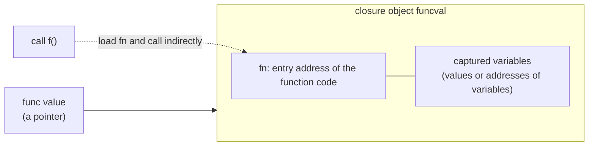

# 6.1 Function Calls

Functions in Go are first-class citizens: they can be assigned to variables, passed as arguments,
returned as results, and can capture outer variables to become closures. Implementing this raises
two questions: how a function value (a closure in particular) is represented in memory, and how a
callee finds the variables it has captured when a function value is called. This section answers
both, and then covers several features that follow from them: the Go 1.22 change to loop variable
semantics, method values and method expressions, variadic parameters, and the Go 1.23 `range` over
functions. Argument passing and stack frame layout were covered in Chapter 2
([2.3](../../part1overview/ch02asm/callconv.md), [2.4](../../part1overview/ch02asm/args.md)); this
section cites their conclusions only where needed.

## 6.1.1 Function Values and Closures

A value of `func` type is a pointer to a **closure object**. The runtime calls this object a
`funcval`, and its definition in `runtime/runtime2.go` has a single field
[[Go Authors, 2026c](#ref-go-authors-2026c)]:

```go
type funcval struct {
	fn uintptr
	// variable-size, fn-specific data here
}
```

`fn` is the entry address of the function's code. As the comment in the source says, it is followed
by variable-size data specific to the function, namely the variables the closure captures. A
function that captures nothing has a `funcval` consisting of the single word `fn`, generated
statically by the compiler and placed in read-only data; all function values of the same function
share this object. A closure that does capture variables must build a new `funcval` on each
evaluation, with the captured variables stored after `fn`. If the closure escapes
([15.5](../../part5toolchain/ch15compile/escape.md)), the object is allocated on the heap; otherwise
it is allocated on the stack.



Semantically, a closure captures the variable itself, not its value at some moment. The two closures
returned by `counter` below share the same `n`:

```go {run=true}
package main

import "fmt"

func counter() (inc, get func() int) {
	n := 0
	inc = func() int { n++; return n } // captures variable n
	get = func() int { return n }      // captures the same n
	return
}

func main() {
	inc, get := counter()
	inc()
	inc()
	fmt.Println(get())
}
```

```
2
```

Because `n` is still used by both closures after `counter` returns, escape analysis allocates it on
the heap, and both closure objects hold the address of `n`. Capture by reference, however, is only a
semantic rule. If a variable is never reassigned after being captured, never has its address taken,
and is no larger than 128 bytes, the compiler copies its value directly into the closure object
(`cmd/compile/internal/escape` [[Go Authors, 2026d](#ref-go-authors-2026d)]). This does not change
the program's behavior, since the variable can no longer change, and it saves a heap allocation and
a level of indirection.

## 6.1.2 Calling a Closure: The Context Register

To read a captured variable, the callee first needs the address of the closure object. For this
purpose Go's internal calling convention designates a **closure context register**, in addition to
the registers that carry ordinary arguments. Before calling a function value, the caller places the
address of the `funcval` in that register, and the callee reads its captured variables through it.
On amd64 the register is `RDX`; on arm64 it is `R26` [[Go Authors, 2026a](#ref-go-authors-2026a)].
`RDX` is not among the nine registers amd64 uses for integer arguments
([2.3](../../part1overview/ch02asm/callconv.md)); it is reserved for this purpose.

Consider the following program:

```go
package main

//go:noinline
func adder(base int) func(int) int {
	return func(x int) int { return base + x }
}

func main() {
	f := adder(40)
	println(f(2))
}
```

Compiled with `GOOS=linux GOARCH=amd64 go build -gcflags=-S`, the part of `adder` that builds the
closure object is as follows (stack check and similar code omitted):

```asm
LEAQ  type:noalg.struct { F uintptr; X0 int }(SB), AX
CALL  runtime.newobject(SB)           // allocate the closure object on the heap
LEAQ  main.adder.func1(SB), CX
MOVQ  CX, (AX)                        // first word: function entry address fn
MOVQ  main.base+32(SP), CX
MOVQ  CX, 8(AX)                       // second word: captured base
```

The closure object's type is the compiler-synthesized `struct { F uintptr; X0 int }`: `F` is `fn`
and `X0` is the captured `base`. Since `base` is never reassigned, it is captured by value and
stored directly in the object. The code in `main` that calls `f(2)` is:

```asm
MOVQ  (AX), CX     // AX is the closure object returned by adder; load its fn
MOVQ  AX, DX       // put the closure object address in the context register DX
MOVL  $2, AX       // argument x
CALL  CX           // indirect call
```

The closure body takes only two instructions:

```asm
TEXT  main.adder.func1(SB), NOSPLIT|NEEDCTXT|NOFRAME|ABIInternal, $0-8
ADDQ  8(DX), AX    // read base from the closure object DX points to, add it to argument x
RET
```

The `NEEDCTXT` flag marks a function that needs the context register. Calling a function value
resembles the dynamic dispatch of interfaces ([4.2](../ch04type/interface.md)): both load a code
address from an object and call it indirectly. The difference is that an interface finds the address
through the method table in its `itab`, whereas a function value stores the address directly in the
first word of the closure object.

## 6.1.3 Loop Variables and Go 1.22

Capture by reference, combined with the scoping of `for` loop variables, caused one of the most
common bugs in Go. In Go 1.21 and earlier, a variable declared by a `for` loop had a single instance
for the whole loop, and each iteration merely assigned it a new value:

```go {run=true}
package main

import "fmt"

func main() {
	var fs []func()
	for i := 0; i < 3; i++ {
		fs = append(fs, func() { fmt.Print(i, " ") })
	}
	for _, f := range fs {
		f()
	}
	fmt.Println()
}
```

If the module's `go.mod` declares `go 1.21`, this program prints `3 3 3`: the three closures capture
the same `i`, and by the time they are called the loop has long finished. In a module that declares
`go 1.22` or later, it prints:

```
0 1 2
```

Go 1.22 gives each iteration its own instance of the loop variable, for both the three-clause `for`
and `for range` [[Go Authors, 2024a](#ref-go-authors-2024a)]. The change does not alter how
variables are captured; it alters which object is captured. Since every iteration now has a fresh
variable, a closure that captures by reference naturally captures its own. Before this, Go
programmers usually wrote `i := i` in the loop body to create a new variable per iteration; Go 1.22
turns that idiom into a language rule [[Cox, 2022](#ref-cox-2022)].

The change also shows a careful way of altering language semantics. It is not backward compatible
and could silently change the results of code that relied on the old behavior, so the new semantics
are tied to the language version declared in `go.mod`: only modules that declare `go 1.22` or later
get them, and older modules behave as before [[Chase and Cox, 2023b](#ref-chase-cox-2023b)]. Go 1.21
first offered a preview as `GOEXPERIMENT=loopvar`. For code whose behavior might change, the
`bisect` tool can also search between the old and new semantics to locate the specific loops
affected [[Chase and Cox, 2023a](#ref-chase-cox-2023a)]. Tying a semantic change to a version
declaration, backed by a preview switch and a locating tool, is Go's compromise between evolving the
language and preserving compatibility, and the significance of this mechanism extends beyond the
loop variable change itself.

## 6.1.4 Method Values, Method Expressions, and Variadic Functions

A **method value** `t.M` binds the receiver `t` to the method and yields a function value that can
be passed around on its own. It is in essence a closure that captures a copy of the receiver (a copy
of the pointer, if the receiver is a pointer). A **method expression** `T.M` binds no receiver and
yields an ordinary function that takes the receiver as its first parameter:

```go {run=true}
package main

import (
	"fmt"
	"testing"
)

type T struct{ x int }

func (t T) Add(d int) int { return t.x + d }

var sink func(int) int

func main() {
	t := T{x: 1}
	f := t.Add // method value: func(int) int, receiver t is copied into the closure
	g := T.Add // method expression: func(T, int) int, the receiver becomes the first parameter
	fmt.Println(f(1), g(t, 1))

	fmt.Println(testing.AllocsPerRun(100, func() { sink = t.Add }))     // the method value escapes
	fmt.Println(testing.AllocsPerRun(100, func() { f := t.Add; f(1) })) // the method value does not escape
}
```

```
2 2
1
0
```

For a method value the compiler synthesizes a wrapper function (such as `main.T.Add-fm`) that takes
the receiver from the closure object and then calls the real method. As with any closure, the
closure object of a method value is allocated on the heap only if it escapes: in the example above,
the method value assigned to a global variable causes one allocation, while the one used only
locally causes none. A method expression captures nothing; it is a static function value and never
needs an allocation.

A **variadic parameter** `f(xs ...int)` is packed into a slice by the caller: for `sum(1, 2, 3)` the
compiler builds an underlying array and a slice header, whereas `sum(s...)` passes the existing
slice directly. The constructed array follows the rules described in [5.1](../ch05data/slice.md)
and, if it does not escape, is allocated on the stack.

## 6.1.5 Range over Functions: Turning the Loop Body into a Closure

Go 1.23 allows `range` over functions: if `f` has type `func(yield func(T) bool)`, then
`for x := range f { ... }` executes the loop body repeatedly, with each `x` supplied by `f` calling
`yield` [[Cox, 2023](#ref-cox-2023)] [[Go Authors, 2024b](#ref-go-authors-2024b)]. The standard
library's `iter.Seq` and `iter.Seq2` are such function types, and functions such as `maps.Keys` and
`slices.Values` return such iterators [[Taylor, 2024](#ref-taylor-2024)].

The feature is implemented entirely by the compiler through rewriting; the runtime provides no
dedicated mechanism for it. The comment of the `cmd/compile/internal/rangefunc` package
[[Go Authors, 2026b](#ref-go-authors-2026b)] explains that the basic idea is to rewrite

```go
for x := range f {
	...
}
```

as

```go
f(func(x T) bool {
	...
	return true
})
```

That is, the loop body becomes a closure passed to `f` as `yield`. A `continue` in the body is
rewritten as `return true`, telling `f` to continue, and a `break` as `return false`, telling `f` to
stop. A `return`, a labeled `break`, a `continue`, or a `goto` in the body is more involved: the
compiler introduces a hidden variable `#next` that records the control flow to perform after the
closure returns. The closure sets the variable and returns `false`, and once `f` has returned, the
code performs the corresponding jump or return according to `#next`.

Because the loop body is now a function that anyone may call, the compiler must also guard against
misbehaving iterators, for example one that keeps calling `yield` after it has returned `false`.
Each rewritten loop has a state variable recording whether the body has exited, and checks it on
every call:

```go {run=true}
package main

import "fmt"

// An iterator that violates the contract: it keeps calling yield after yield returns false
func bad(yield func(int) bool) {
	for i := range 3 {
		yield(i)
	}
}

func main() {
	for x := range bad {
		fmt.Println(x)
		break
	}
}
```

```
0
panic: runtime error: range function continued iteration after function for loop body returned false
```

In the panic's call stack, the function containing the loop body is named `main.main-range1`, which
is exactly the closure the compiler generated for the body. The rewrite happens in the compiler
front end, so the generated closure can be inlined like any ordinary function; when both the
iterator function and the loop body are inlined, the indirect call disappears.

## 6.1.6 Stack Frames, Growable Stacks, and Escape

Each function call occupies a stack frame on the goroutine's stack. Go's stack is a **growable
contiguous stack**: when the stack check at the beginning of a function finds too little space left,
it calls `morestack`, which allocates a larger stack, copies the contents of the old one, and
adjusts every pointer into the old stack ([2.4](../../part1overview/ch02asm/args.md),
[Chapter 14](../../part4memory/ch14stack/readme.md)).

Growable stacks and closures are related in an unavoidable way. The stack can move, while closures
capture variables by reference. If the address of a local variable is held by a closure that may
outlive the current stack frame (for example one that is returned, stored in a global variable, or
handed to another goroutine), the variable cannot stay on the stack. Escape analysis
([15.5](../../part5toolchain/ch15compile/escape.md)) determines at compile time whether a variable's
address can escape the current function, and if so allocates the variable on the heap. The `n` in
`counter` in 6.1.1 remains usable after `counter` returns precisely because it was allocated on the
heap. Escape analysis is what allows closures that capture by reference to coexist with a movable
stack.

## 6.1.7 Comparison with Other Languages

The term "closure" comes from Peter Landin. In 1964, describing how to evaluate expressions
mechanically, Landin used it for the combination of a lambda expression and the environment in which
it is evaluated [[Landin, 1964](#ref-landin-1964)]. Closures are now a common feature of modern
languages, and languages differ mainly in their capture semantics. Go captures by reference
semantically in every case, which is simple; whether to copy is decided by the compiler without
changing behavior, and lifetimes are handled by escape analysis and garbage collection. C++ lambdas
require the capture list to choose explicitly between capture by value (`[=]`) and by reference
(`[&]`), which gives finer control, but a local variable captured by reference leaves a dangling
reference once it goes out of scope. Rust distinguishes capture by value from capture by reference
with the `move` keyword, and uses the three traits `Fn`, `FnMut`, and `FnOnce` to distinguish
whether a closure may modify the variables it captures and whether it may be called more than once,
so that checks on ownership and mutability are done at compile time
[[Rust Project, n.d.](#ref-rust-project-nd)]. Languages strike different balances among simplicity,
control, and safety.

As for calling conventions, C and C++ follow the platform's standard ABI (such as the System V AMD64
psABI) so that they interoperate directly with system libraries and object files produced by other
compilers, and once published such a convention is hard to change. Go instead defines its own ABI
for internal calls, giving up direct interoperability with external object files (a cgo call must
cross the ABI boundary; for the cost see [15.6](../../part5toolchain/ch15compile/cgo.md)) in
exchange for the freedom to evolve the calling convention as it needs. The Go 1.17 switch from
stack-based to register-based argument passing [[Clements, 2020](#ref-clements-2020)]
[[Go Authors, 2021](#ref-go-authors-2021)] ([2.3](../../part1overview/ch02asm/callconv.md))
benefited from exactly this freedom.

## Further Reading

- <a id="ref-go-authors-2026a"></a>[Go Authors, 2026a] The Go Authors. "Go internal ABI
  specification." https://github.com/golang/go/blob/release-branch.go1.26/src/cmd/compile/abi-internal.md
  (Development version: <https://github.com/golang/go/blob/master/src/cmd/compile/abi-internal.md>)
  The closure context register (RDX on amd64, R26 on arm64) and the rules for register-based
  argument passing.
- <a id="ref-chase-cox-2023a"></a>[Chase and Cox, 2023a] David Chase, Russ Cox. "Fixing For Loops in
  Go 1.22." The Go Blog, 2023. https://go.dev/blog/loopvar-preview The reasons for the loop variable
  change, the compatibility strategy, and the `bisect` tool.
- <a id="ref-cox-2022"></a>[Cox, 2022] Russ Cox. "redefining for loop variable semantics." golang/go
  discussion #56010, 2022. https://github.com/golang/go/discussions/56010
  The original discussion of changing loop variable semantics.
- <a id="ref-taylor-2024"></a>[Taylor, 2024] Ian Lance Taylor. "Range Over Function Types." The Go
  Blog,
  2024. https://go.dev/blog/range-functions
  The design and use of `range` over functions.
- <a id="ref-cox-2023"></a>[Cox, 2023] Russ Cox. "spec: add range over int, range over func."
  golang/go#61405, 2023. https://github.com/golang/go/issues/61405
  The proposal for `range` over integers and functions.
- <a id="ref-go-authors-2026b"></a>[Go Authors, 2026b] The Go Authors.
  `cmd/compile/internal/rangefunc/rewrite.go`.
  https://github.com/golang/go/blob/release-branch.go1.26/src/cmd/compile/internal/rangefunc/rewrite.go
  The package comment explains in detail the rewrite rules for `range` loops and the iterator
  checks.
- <a id="ref-clements-2020"></a>[Clements, 2020] Austin Clements. "Proposal: Register-based Go
  calling convention." Go design document, 2020.
  https://go.googlesource.com/proposal/+/master/design/40724-register-calling.md The design document
  for the Go 1.17 register calling convention; Cherry Zhang, Michael Knyszek, David Chase, and
  others took part in the discussion.
- <a id="ref-go-authors-2021"></a>[Go Authors, 2021] The Go Authors. Go 1.17 Release Notes.
  https://go.dev/doc/go1.17 The new register calling convention: about 5% better performance on
  representative benchmarks and about 2% smaller binaries.
- <a id="ref-go-authors-2024a"></a>[Go Authors, 2024a] The Go Authors. Go 1.22 Release Notes.
  https://go.dev/doc/go1.22
  Each iteration of a loop gets a new instance of the loop variable.
- <a id="ref-go-authors-2024b"></a>[Go Authors, 2024b] The Go Authors. Go 1.23 Release Notes.
  https://go.dev/doc/go1.23
  `for range` accepts iterator functions.
- <a id="ref-chase-cox-2023b"></a>[Chase and Cox, 2023b] David Chase, Russ Cox. "Proposal: Less
  Error-Prone Loop Variable Scoping." Go design document, 2023.
  https://go.googlesource.com/proposal/+/master/design/60078-loopvar.md The formal design of the
  loop variable change: a compatibility strategy tied to the `go.mod` language version, and its
  justification.
- <a id="ref-go-authors-2026c"></a>[Go Authors, 2026c] The Go Authors. `runtime/runtime2.go`:
  `funcval`. https://github.com/golang/go/blob/master/src/runtime/runtime2.go The runtime
  representation of closures.
- <a id="ref-go-authors-2026d"></a>[Go Authors, 2026d] The Go Authors.
  `cmd/compile/internal/escape/escape.go`.
  https://github.com/golang/go/blob/release-branch.go1.26/src/cmd/compile/internal/escape/escape.go
  The conditions for capturing a closure variable by value: never reassigned, never address-taken,
  and no larger than 128 bytes.
- <a id="ref-landin-1964"></a>[Landin, 1964] Peter J. Landin. "The Mechanical Evaluation of
  Expressions." The Computer Journal 6(4):308–320, 1964. https://doi.org/10.1093/comjnl/6.4.308 The
  source of the SECD machine, and the paper that coined the term "closure": the combination of a
  lambda expression with its evaluation environment.
- <a id="ref-rust-project-nd"></a>[Rust Project, n.d.] The Rust Project. *The Rust
  Reference*, "Closure types". https://doc.rust-lang.org/reference/types/closure.html The capture
  modes of Rust closures and the three traits `Fn`, `FnMut`, and `FnOnce`.
- This book: [4.2 Interfaces](../ch04type/interface.md),
  [5.1 Arrays and Slices](../ch05data/slice.md),
  [Chapter 14 Execution Stack Management](../../part4memory/ch14stack),
  [15.5 Escape Analysis](../../part5toolchain/ch15compile/escape.md).
