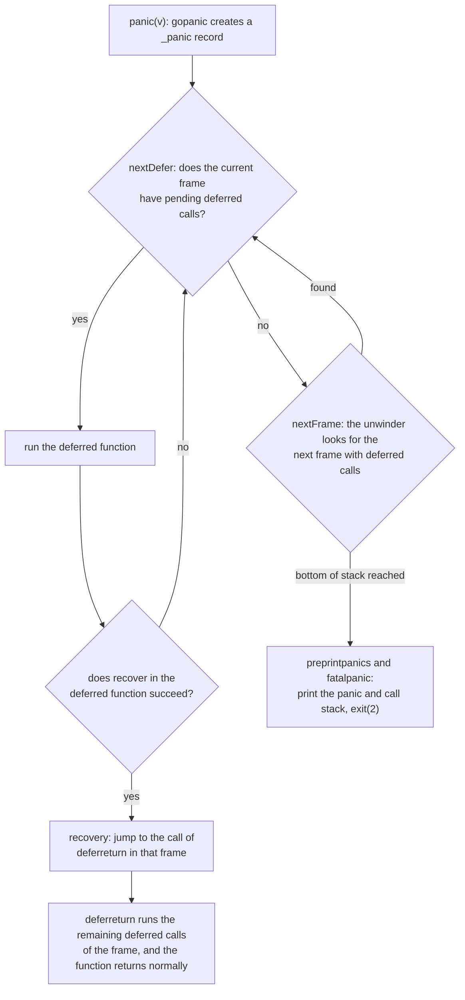

# 6.3 The panic and recover Builtins

Go has no exceptions. Functions report expected failures by returning `error` values
([Chapter 7](../ch07errors/readme.md)). For situations in which a program cannot continue normally,
Go provides a pair of builtins: `panic` raises a **panic**, which abandons the normal control flow,
runs deferred calls and propagates up the call stack; `recover` intercepts a panic inside a deferred
call and lets the program resume normal execution [[Gerrand, 2010](#ref-gerrand-2010)].

The pair was not in Go from the beginning. On 25 March 2010, Rob Pike posted a proposal
titled "Proposal for an exception-like mechanism" to the golang-nuts mailing list
[[Pike, 2010a](#ref-pike-2010a)] and changed the language specification the same day
[[Pike, 2010b](#ref-pike-2010b)]; Russ Cox finished the compiler implementation on 31 March
[[Cox, 2010a](#ref-cox-2010a)]. The proposal states that it deliberately differs from the usual
exception model, which serves as a control structure, to avoid conflating errors with exceptions as
languages such as Java do. Until then, runtime errors such as an out-of-range index or a nil pointer
dereference crashed the program outright; in April of the same year, Russ Cox turned these runtime
errors into panics as well, so that `recover` can intercept them [[Cox, 2010b](#ref-cox-2010b)]
[[Cox, 2010c](#ref-cox-2010c)]. The same proposal also changed the semantics of `defer` so that
deferred calls run after the function has set its results and before it returns to its caller. This
is the origin of the fourth rule in [6.2.1 Semantics](./defer.md): only then can a deferred call
rewrite the function's return value after a panic has been intercepted.

This section first describes the semantics of `panic` and `recover`, then the runtime
implementation: how `gopanic` runs deferred calls frame by frame up the stack, how `gorecover`
decides whether a call is entitled to intercept a panic, and how execution returns to the normal
path after an interception. It closes with how panic differs from the exception mechanisms of other
languages and how it should be used in practice.

## 6.3.1 Semantics

After `panic(v)` is called, normal execution of the current function stops at once. The deferred
calls registered on the current goroutine run in last-in-first-out order, first those of the current
function and then those of its callers, level by level. If this process reaches the goroutine's
top-level function without the panic being intercepted, the program terminates: the runtime prints
the panic value and the call stack and ends **the whole process** with exit status 2, not just the
goroutine that panicked.

Errors detected by the runtime are also reported as panics, for example an out-of-range index, a
write to a nil map, a nil pointer dereference and integer division by zero. The values of these
panics implement the `runtime.Error` interface, which distinguishes them from panics raised
explicitly by the program.

`recover` intercepts a panic. According to the language specification, `recover` returns nil in two
cases: the goroutine is not panicking, or `recover` was not called **directly** by a deferred
function [[Go Authors, 2026a](#ref-go-authors-2026a)]. Conversely, if the goroutine is panicking and
`recover` is called directly by a deferred function, it returns the value passed to `panic` and the
panic stops; the function that registered the deferred function then returns to its caller normally,
with the values currently held in its result variables. The "directly" restriction is strict: one
call level too many or too few does not qualify.

```go {run=true}
package main

import "fmt"

func direct() (err error) {
	defer func() {
		if r := recover(); r != nil {
			err = fmt.Errorf("recovered: %v", r) // rewrite the return value
		}
	}()
	panic("boom")
}

func nested() {
	defer func() {
		func() { fmt.Println("nested:", recover()) }() // one call level too many
	}()
	panic("boom")
}

func deferRecover() {
	defer recover() // the deferred call is recover itself
	panic("boom")
}

func guard(f func()) {
	defer func() { fmt.Println("guard:", recover()) }()
	f()
}

func main() {
	fmt.Println(direct())
	guard(nested)
	guard(deferRecover)
}
```

```
recovered: boom
nested: <nil>
guard: boom
guard: boom
```

In `direct`, the deferred function calls `recover` itself, intercepts the panic and rewrites the
named result `err`. In `nested`, `recover` is called by another function inside the deferred
function, and in `deferRecover` the deferred call is `recover` itself. Neither meets the condition,
so `recover` returns nil and the panic continues upward until `guard` intercepts it. Section 6.3.4
shows that the runtime enforces this rule by inspecting the shape of the call stack.

The specification also guarantees that `recover` does not return nil when these conditions hold. To
this end, Go 1.21 specifies that `panic(nil)` itself raises a runtime panic whose value has type
`*runtime.PanicNilError`. Before that, intercepting `panic(nil)` with `recover` yielded nil, and the
caller could not distinguish "a panic occurred" from "no panic
occurred" [[Fitzpatrick, 2018](#ref-fitzpatrick-2018)]. Programs that need the old behavior can set
`GODEBUG=panicnil=1` [[Go Authors, 2023](#ref-go-authors-2023)]. The following program prints the
dynamic types of three panic values and whether they implement `runtime.Error`:

```go {run=true}
package main

import (
	"fmt"
	"runtime"
)

func catch(f func()) {
	defer func() {
		r := recover()
		_, ok := r.(runtime.Error)
		fmt.Printf("%T %v\n", r, ok)
	}()
	f()
}

func main() {
	var s []int
	i := 3
	catch(func() { _ = s[i] })      // out of range
	catch(func() { panic(nil) })    // no longer yields nil since Go 1.21
	catch(func() { panic("boom") }) // raised explicitly by the program
}
```

```
runtime.boundsError true
*runtime.PanicNilError true
string false
```

Two other situations resemble panics but cannot be intercepted by `recover`. The first is
`runtime.Goexit`: it terminates the current goroutine and, like a panic, runs all deferred calls,
but it is not a panic, and `recover` in a deferred function returns nil. The second is the runtime's
**fatal errors**, such as concurrent map reads and writes, deadlock of all goroutines, stack
overflow and memory exhaustion. In these cases the runtime calls the internal `throw` or `fatal`
function, prints a message beginning with `fatal error:` and terminates the process directly,
without running any deferred calls. The former is used where the runtime itself may be at fault, the
latter where the error most likely lies in user code; in both cases the state of the program can no
longer be trusted, and continuing makes no sense.

## 6.3.2 The Call Stack During Unwinding

Before turning to the implementation, one easily overlooked fact needs stating: while a panic runs
deferred calls, the call stack has not been popped. A deferred function is an ordinary function call
and runs on top of the frame that panicked; the runtime discards the intermediate frames only when
some deferred function intercepts the panic. Rob Pike's proposal already pointed this out: deferred
calls run like normal calls, so unwinding of the caller's frames happens only if a deferred call
stops the panic [[Pike, 2010a](#ref-pike-2010a)].

This property lets a deferred function see the full call stack as it was when the panic occurred.
The following program calls `runtime.Stack` in a deferred function to obtain the current call stack
and prints the function name of each frame:

```go {run=true}
package main

import (
	"fmt"
	"runtime"
	"strings"
)

//go:noinline
func handler() {
	var m map[string]int
	m["k"] = 1 // write to a nil map
}

func serve() {
	defer func() {
		r := recover()
		buf := make([]byte, 4096)
		buf = buf[:runtime.Stack(buf, false)] // the call stack at this point
		for _, line := range strings.Split(string(buf), "\n") {
			if fn, _, ok := strings.Cut(line, "("); ok && !strings.HasPrefix(line, "\t") {
				fmt.Println(fn)
			}
		}
		fmt.Println("recovered:", r)
	}()
	handler()
}

func main() { serve() }
```

```
main.serve.func1
panic
main.handler
main.serve
main.main
recovered: assignment to entry in nil map
```

Beneath the deferred function `main.serve.func1` is `panic` (the runtime's `gopanic`, shown as
`panic` in stack traces), and below that is `main.handler`, where the error occurred, with its frame
still intact. The standard library's `net/http` relies on this: the goroutine serving a connection
intercepts a handler's panic in a deferred function, calls `runtime.Stack` to record the call stack
at the point of failure, and then writes it to the server's error log.

For the same reason, a deferred function can itself panic while it runs. The new panic record is
then placed in front of the old one, and a program that leaves them unintercepted prints them in
order when it terminates:

```go
func main() {
	defer func() {
		panic("second") // panic again while running deferred calls
	}()
	panic("first")
}
```

```
panic: first
	panic: second
```

A common idiom is to intercept a panic, record something and then panic again with the same value.
Since Go 1.25, this case no longer prints the same value twice but is annotated
`[recovered, repanicked]` [[Go Authors, 2025](#ref-go-authors-2025)]:

```go
func main() {
	defer func() {
		panic(recover()) // intercept, then panic again with the same value
	}()
	panic("boom")
}
```

```
panic: boom [recovered, repanicked]
```

## 6.3.3 gopanic: Running Deferred Calls Frame by Frame

The compiler translates `panic(v)` into a call to `runtime.gopanic` and `recover()` into a call to
`runtime.gorecover` [[Go Authors, 2026d](#ref-go-authors-2026d)]. A panic in progress is described
by a `_panic` structure. It lives only on the stack and is linked through its `link` field to
earlier panics, forming a list whose head is stored in `g._panic`. The Go 1.26 definition is as
follows (`runtime/runtime2.go` [[Go Authors, 2026e](#ref-go-authors-2026e)]; the comments are
translated by the author):

```go
type _panic struct {
	arg  any     // the value passed to panic
	link *_panic // an earlier panic

	// startPC and startSP record where _panic.start was called.
	startPC uintptr
	startSP unsafe.Pointer

	// The frame for which deferred calls are currently being run.
	sp unsafe.Pointer
	lr uintptr
	fp unsafe.Pointer

	// If the function most recently returned by _panic.next() intercepted
	// the panic, retpc is the PC to jump back to.
	retpc uintptr

	// Extra state needed to process open-coded defers.
	deferBitsPtr *uint8
	slotsPtr     unsafe.Pointer

	recovered   bool // whether it has been intercepted
	repanicked  bool // whether it panicked again with the same value
	goexit      bool
	deferreturn bool

	gopanicFP unsafe.Pointer // frame pointer of the frame gopanic runs in
}
```

`gopanic` first handles `panic(nil)`, then rules out several situations in which running user code
is unsafe: a panic on the system stack, during memory allocation, while preemption is disabled or
while holding a runtime lock terminates the program directly with `throw`. The remainder is a single
loop:

```go
func gopanic(e any) {
	if e == nil {
		if debug.panicnil.Load() != 1 {
			e = new(PanicNilError)
		} else {
			panicnil.IncNonDefault()
		}
	}

	gp := getg()
	// ... rule out the system stack, memory allocation, disabled preemption and held locks ...

	var p _panic
	p.arg = e
	p.gopanicFP = unsafe.Pointer(sys.GetCallerSP())

	runningPanicDefers.Add(1)

	p.start(sys.GetCallerPC(), unsafe.Pointer(sys.GetCallerSP()))
	for {
		fn, ok := p.nextDefer()
		if !ok {
			break
		}
		fn()
	}

	// ...
	preprintpanics(&p)
	fatalpanic(&p)   // does not return
	*(*int)(nil) = 0 // not reached
}
```

This loop is identical to the `deferreturn` loop in
[6.2.4 `deferreturn` and Panic: One Mechanism](./defer.md); only the initial state of the `_panic`
differs. `p.start` links `p` at the head of `g._panic` and finds the first frame that has deferred
calls to run; `p.nextDefer` returns one pending deferred function at a time. When the loop ends, all
deferred calls have run and the panic is still not intercepted, so control passes to `fatalpanic`.

`nextDefer` has to cope with the three implementations described in 6.2. For the current frame, it
first examines the defer bitmap `deferBitsPtr`: if any bit is set, it clears the highest one and
takes the closure from the corresponding slot, which yields open-coded defers in reverse order. It
then examines the head of the `g._defer` list: if that record was registered in the current frame
(`d.sp` equals the frame's stack pointer), it unlinks the record and returns its function. When both
are exhausted, it calls `nextFrame` to move on to the next frame:

```go
// nextFrame finds the next frame that has deferred calls.
func (p *_panic) nextFrame() (ok bool) {
	if p.lr == 0 {
		return false
	}

	gp := getg()
	systemstack(func() {
		var limit uintptr
		if d := gp._defer; d != nil {
			limit = d.sp
		}

		var u unwinder
		u.initAt(p.lr, uintptr(p.fp), 0, gp, 0)
		for {
			if !u.valid() {
				p.lr = 0
				return // ok == false
			}
			if u.frame.sp == limit {
				break // found a frame with a deferred call registered on the list
			}
			if p.initOpenCodedDefers(u.frame.fn, unsafe.Pointer(u.frame.varp)) {
				break // found a frame with pending open-coded defers
			}
			u.next()
		}

		p.lr = u.frame.lr
		p.sp = unsafe.Pointer(u.frame.sp)
		p.fp = unsafe.Pointer(u.frame.fp)

		ok = true
	})

	return
}
```

`nextFrame` moves up one frame at a time with the runtime's stack **unwinder**. It has two criteria
for whether a frame has deferred calls: the stack pointer recorded at the head of `g._defer` equals
the frame's stack pointer, or the function carries `FUNCDATA_OpenCodedDeferInfo` metadata and its
defer bitmap is nonzero. The latter is the mechanism, mentioned in
[6.2.4 `deferreturn` and Panic: One Mechanism](./defer.md), by which open-coded defers can still be
found during a panic: `initOpenCodedDefers` reads from the metadata the offsets of the defer bitmap
and the closure slots within the frame, and records in `p.retpc` the address of the call to
`deferreturn` in that function, for use after an interception.

Before Go 1.22, `gopanic` walked the `_defer` list itself, and open-coded defers were handled by
separate code (`addOneOpenDeferFrame`) that scanned stack frames and temporarily generated `_defer`
records to insert into the list, independently of the logic in `deferreturn`. A refactoring by
Matthew Dempsky unified the three into the `_panic`-driven loop above
[[Dempsky, 2023](#ref-dempsky-2023)]; normal return, panic and `runtime.Goexit` have since shared
one implementation of deferred-call processing.

## 6.3.4 gorecover: Inspecting the Shape of the Call Stack

The difficulty of `recover` lies in deciding whether the caller is entitled to intercept the panic,
that is, in implementing the rule "called directly by a deferred function." The Go 1.26 `gorecover`
makes this decision by inspecting the shape of the call stack, and a source comment explains its
basis (the comment is translated by the author):

```go
func gorecover() any {
	gp := getg()
	p := gp._panic
	if p == nil || p.goexit || p.recovered {
		return nil
	}

	// Check whether the function calling recover() was deferred directly
	// by the function that panicked.
	// For code like this:
	//     func foo() {
	//         defer bar()
	//         panic("panic")
	//     }
	//     func bar() {
	//         recover()
	//     }
	// the call stack usually looks like this:
	//     foo
	//     runtime.gopanic
	//     bar
	//     runtime.gorecover
	//
	// But if the deferred function needs a wrapper of some kind, the
	// wrapper should be ignored. The call stack then looks like this:
	//     foo
	//     runtime.gopanic
	//     wrapper
	//     bar
	//     runtime.gorecover
	// This case should also intercept successfully.
	//
	// Finally, in the peculiar case of "defer recover()", the call stack
	// looks like this:
	//     foo
	//     runtime.gopanic
	//     wrapper
	//     runtime.gorecover
	// This case must not intercept.
	//
	// So the criterion is: there must be exactly one non-wrapper frame
	// between gopanic and gorecover.
	//
	// defer func() { func() { recover() }() }() does not intercept,
	// because there are 2 non-wrapper frames in between.
	//
	// defer recover() does not intercept,
	// because there are 0 non-wrapper frames in between.
	canRecover := false
	systemstack(func() {
		var u unwinder
		u.init(gp, 0)
		u.next() // skip systemstack_switch
		u.next() // skip gorecover
		nonWrapperFrames := 0
	loop:
		for ; u.valid(); u.next() {
			for iu, f := newInlineUnwinder(u.frame.fn, u.symPC()); f.valid(); f = iu.next(f) {
				sf := iu.srcFunc(f)
				switch sf.funcID {
				case abi.FuncIDWrapper:
					continue
				case abi.FuncID_gopanic:
					if u.frame.fp == uintptr(p.gopanicFP) && nonWrapperFrames > 0 {
						canRecover = true
					}
					break loop
				default:
					nonWrapperFrames++
					if nonWrapperFrames > 1 {
						break loop
					}
				}
			}
		}
	})
	if !canRecover {
		return nil
	}
	p.recovered = true
	return p.arg
}
```

A **wrapper function** here is a function generated automatically by the compiler solely to forward
a call. Examples are the argument-less closure generated for a deferred call with arguments,
described in [6.2.1 Semantics](./defer.md) (such as `unlock.deferwrap1`), and the pointer-receiver
version generated for a method with a value receiver. If the method `M` in `defer obj.M(x)` calls
`recover`, such a closure sits between `gopanic` and `M`, yet by the semantics the call must
intercept successfully, so wrappers have to be skipped when counting.

The `nested` and `deferRecover` functions of 6.3.1 fall on either side of this criterion: the former
has two non-wrapper frames between `gopanic` and `gorecover`, the latter has none. The check also
requires that the `gopanic` frame found belong to the current panic (`gopanicFP` matches). Counting
uses the inline unwinder, so functions inlined into the same physical frame are counted one by one
as source-level functions.

This implementation was adopted only in Go 1.26. Earlier, `gorecover` took a parameter `argp`, the
caller's argument pointer, and the runtime compared it with the argument pointer of the topmost
deferred call recorded in the `_panic`; interception was permitted only if the two were equal. A
wrapper inserts an extra frame between them, so the compiler had to insert code into the prologue of
every wrapper: if a panic is in progress and its `argp` points at this frame, adjust it to the
argument pointer of the wrapped function. In 2025, Keith Randall changed the decision to the
unwinding approach above and deleted this adjustment code from wrappers
[[Randall, 2025](#ref-randall-2025)]. As his commit message states, the new method unwinds only a
few frames, and only when `recover` is called during a panic; the cost rises somewhat in that case
and falls in all others.

## 6.3.5 recovery: Returning to Normal Execution

`gorecover` merely sets `p.recovered` to true and returns the panic value; the interception itself
happens after the deferred function returns. When the `gopanic` loop calls `nextDefer` again,
`nextDefer` sees `p.recovered`, switches to the system stack through `mcall` and calls `recovery`,
which does not return.

The task of `recovery` is to let the function that registered the deferred function continue from
its call to `deferreturn`. It locates this function through `p.retpc` and obtains its frame from
`p.sp` and `p.fp`. It then pops from the `g._panic` list all `_panic` records that originated in
functions called from this frame: the panic just intercepted, and any earlier panics it superseded.
If it meets a record initiated by `runtime.Goexit`, it must not cross it; instead it returns to the
`Goexit` loop, which continues running deferred calls. If the frame still has open-coded defers that
have not run, `recovery` also saves the defer bitmap and the slot locations for the following
`deferreturn` to process. Finally, it sets the stack pointer in the goroutine's scheduling context
`gp.sched` to the frame's stack pointer and the program counter to the location of the `deferreturn`
call in that function, then jumps there with `gogo`. All the frames the panic passed over are
discarded at that point.

The jump goes to `deferreturn` rather than returning directly because the frame may have registered
further deferred calls that have not run, and they must run first. For each function containing
`defer`, the linker records in its metadata the location of the call to `deferreturn`; for functions
using open coding, this is the code described in
[6.2.4 `deferreturn` and Panic: One Mechanism](./defer.md) that never executes on the normal path.
After `deferreturn` has run the remaining deferred calls, the function returns, its return values
being those held in the result variables, and execution is back on the normal path.

## 6.3.6 fatalpanic: When No One Intercepts

If all deferred calls have run and no one has intercepted the panic, `gopanic` enters the
program-termination path. It first calls `preprintpanics`, which, for each value on the panic list
that implements the `error` interface or has a `String` method, calls its `Error` or `String` method
to obtain the string to print in advance, because the whole program is about to be frozen and
running arbitrary user code then would be unsafe; records that panicked again with the same value
are also marked `repanicked` in this step. Next, `fatalpanic` switches to the system stack, and
`startpanic_m` makes a best effort to freeze the execution of the whole program (if another panic
occurs at this point, only `panic during panic` is printed). `printpanics` prints the panic list
from earliest to latest, `dopanic_m` prints the call stack according to the `GOTRACEBACK`
environment variable, and finally the process is terminated with `exit(2)`.

The whole process, from `panic` to either a return to normal execution or termination, is summarized
in the following diagram:



It bears repeating that this process terminates the whole process. An unintercepted panic in a
background goroutine terminates every other goroutine, however unrelated; and `recover` can
intercept only panics in its own goroutine, so one goroutine cannot intercept a panic occurring in
another.

## 6.3.7 Panic and Exceptions

Formally, `panic` and `recover` resemble exception handling in C++, Java and Python: both abandon
the current execution, propagate up the call stack and are intercepted somewhere. Their design goals
differ, however. In explaining why Go has no exceptions, the Go FAQ observes that coupling
exceptions to control structures like `try`-`catch`-`finally` makes code convoluted, and that it
also tempts programmers to treat too many ordinary errors, such as failing to open a file, as
exceptions [[Go Authors, 2026b](#ref-go-authors-2026b)]. Go's approach is to report ordinary errors
as return values that the caller handles explicitly, and to reserve `panic` and `recover` for truly
exceptional situations.

The difference shows in the mechanism as well. In C++ and Java, exception handlers are declared by
type in `catch` clauses, so when an exception is thrown the runtime can first look for a matching
handler. The Itanium C++ ABI (the exception-handling specification used by GCC and Clang on most
platforms) [[Itanium C++ ABI, n.d.](#ref-itanium-cxx-abi-nd)] divides this into two phases: it first
searches for a handler without changing the call stack; once one is found, it enters a cleanup phase
that runs destructors frame by frame and transfers control. If the search phase finds no handler, it
calls `terminate()` directly and never enters the cleanup phase. The C++ standard likewise specifies
only that `std::terminate` is called in this case, and whether the stack is unwound is
implementation-defined [[Smith, 2020](#ref-smith-2020)]. Go has no such search phase, because
whether a panic is intercepted is not declared statically by type but decided at run time by
arbitrary code in a deferred function: whether a deferred function will call `recover` is known only
once it has run. A panic therefore always runs all deferred calls in turn, so that even if no one
intercepts it in the end, every deferred call has run before the program terminates.

Rust makes a similar trade-off. Recoverable errors are represented by the `Result<T, E>` type, and
`panic!` is for unrecoverable errors [[Klabnik et al., n.d.](#ref-klabnik-et-al-nd)]. Rust also
provides `std::panic::catch_unwind` to intercept a panic, but its documentation states explicitly
that it is not recommended as a general try/catch mechanism and that functions which may often fail
should return `Result` [[Rust Project, n.d.](#ref-rust-project-nd)]. Moreover, when a program is
compiled with `panic=abort`, a panic terminates the process directly and `catch_unwind` cannot
intercept it.

In Go, `recover` has two main legitimate uses. The first is to use panic inside a package to
simplify error propagation and convert it to an error value at the package boundary, so that callers
never see the panic [[Go Authors, 2026c](#ref-go-authors-2026c)]. The standard library's
`encoding/json` encoder does this: deeply recursive code aborts encoding with
`panic(jsonError{err})`, the outermost `marshal` intercepts it in a deferred function and returns
the contained error; a panic of any other type is raised again unchanged rather than masked:

```go
func (e *encodeState) marshal(v any, opts encOpts) (err error) {
	defer func() {
		if r := recover(); r != nil {
			if je, ok := r.(jsonError); ok {
				err = je.error
			} else {
				panic(r)
			}
		}
	}()
	e.reflectValue(reflect.ValueOf(v), opts)
	return nil
}
```

The second is to isolate faults at a service boundary. The `net/http` documentation says that if a
handler's `ServeHTTP` panics, the server assumes the effects of the panic are confined to the
current request: it intercepts the panic, writes the call stack to the error log and closes the
network connection (or resets the stream under HTTP/2), leaving other requests unaffected
[[Go Authors, 2026f](#ref-go-authors-2026f)]. The practice is itself controversial, though. In 2018,
Damien Neil proposed that `net/http` stop intercepting handler panics
[[Neil, 2018](#ref-neil-2018)]: a panic means there is a defect in the handler, and the handler may
not have cleaned up correctly after the panic. An unreleased mutex, for example, blocks every
subsequent request, and rather than let the service continue in an inconsistent state, it is better
to crash the process and restart it. Brad Fitzpatrick replied that the behavior is regrettable but
cannot be changed in Go 1.x for compatibility reasons. Intercepting a panic at a boundary is
therefore safe only when one can be sure that no state has been corrupted.

Finally, there is cost. A function that contains a `defer` statement or calls `recover` is not
inlined by the compiler. Compile the following program with `-gcflags=-m=2`:

```go
package main

import "sync"

func withDefer(mu *sync.Mutex) {
	mu.Lock()
	defer mu.Unlock()
}

func withRecover() (r any) {
	defer func() { r = recover() }()
	return nil
}

func main() {
	var mu sync.Mutex
	withDefer(&mu)
	_ = withRecover()
}
```

The compiler's diagnostics include the following lines:

```
./main.go:5:6: cannot inline withDefer: unhandled op DEFER
./main.go:10:6: cannot inline withRecover: unhandled op DEFER
./main.go:11:8: cannot inline withRecover.func1: call to recover
```

A panic itself is also expensive: it relies on the stack unwinder to look for deferred calls frame
by frame, and the open-coded defers described in [6.2](./defer.md) deliberately make the panic path
slower in exchange for speed on the normal path. All this shows that panic is designed for rare,
exceptional situations. Among the Go Proverbs that Rob Pike summarized in 2015, one consists of just
two words: "Don't panic."

## Further Reading

- <a id="ref-pike-2010a"></a>[Pike, 2010a] Rob Pike. "Proposal for an exception-like mechanism."
  golang-nuts, 25 March 2010. https://groups.google.com/g/golang-nuts/c/HOXNBQu5c-Q
  The original proposal for `panic` and `recover`, including the change to the semantics of `defer`.
- <a id="ref-gerrand-2010"></a>[Gerrand, 2010] Andrew Gerrand. "Defer, Panic, and Recover." The Go
  Blog, 4 August 2010. https://go.dev/blog/defer-panic-and-recover
- <a id="ref-go-authors-2026a"></a>[Go Authors, 2026a] The Go Authors. *The Go Programming Language
  Specification*, "Handling panics" and "Run-time panics". https://go.dev/ref/spec#Handling_panics
- <a id="ref-go-authors-2026b"></a>[Go Authors, 2026b] The Go Authors. Go FAQ, "Why does Go not have
  exceptions?" https://go.dev/doc/faq#exceptions
- <a id="ref-go-authors-2026c"></a>[Go Authors, 2026c] The Go Authors. *Effective
  Go*, "Panic" and "Recover". https://go.dev/doc/effective_go#panic Includes the idiom of using
  panic inside a package and converting it to an error value at the boundary.
- <a id="ref-randall-2025"></a>[Randall, 2025] Keith Randall. "runtime: detect successful recovers
  differently." Go commit 7b50024330, 2025. https://go.googlesource.com/go/+/7b50024330
  The Go 1.26 implementation that decides whether `recover` is valid by unwinding the stack.
- <a id="ref-neil-2018"></a>[Neil, 2018] Damien Neil. "proposal: net/http: don't recover from
  handler panics." golang/go#25245, 2018. https://github.com/golang/go/issues/25245
- <a id="ref-itanium-cxx-abi-nd"></a>[Itanium C++ ABI, n.d.] *Itanium C++ ABI: Exception Handling*.
  https://itanium-cxx-abi.github.io/cxx-abi/abi-eh.html
  The specification of the two-phase exception-handling model.
- <a id="ref-rust-project-nd"></a>[Rust Project, n.d.] The Rust Project. `std::panic::catch_unwind`.
  https://doc.rust-lang.org/std/panic/fn.catch_unwind.html
- <a id="ref-go-authors-2026d"></a>[Go Authors, 2026d] The Go Authors. `runtime/panic.go`.
  https://github.com/golang/go/blob/release-branch.go1.26/src/runtime/panic.go The implementation of
  `gopanic`, `nextDefer`, `nextFrame`, `gorecover`, `recovery` and `fatalpanic`.
- <a id="ref-go-authors-2026e"></a>[Go Authors, 2026e] The Go Authors. `runtime/runtime2.go`:
  `_panic` and `_defer`.
  https://github.com/golang/go/blob/release-branch.go1.26/src/runtime/runtime2.go (Runtime source
  directory: <https://github.com/golang/go/tree/master/src/runtime>)
- <a id="ref-dempsky-2023"></a>[Dempsky, 2023] Matthew Dempsky. "runtime: refactor defer
  processing." Go commit 9eb1d5317b, 2023. https://go.googlesource.com/go/+/9eb1d5317b In Go 1.22,
  `gopanic`, `Goexit` and `deferreturn` came to share one loop driven by `_panic` state, which is
  the origin of `nextDefer` and `nextFrame`. Earlier design background (originally cited here):
  golang/go#57261, https://github.com/golang/go/issues/57261
- <a id="ref-klabnik-et-al-nd"></a>[Klabnik et al., n.d.] Steve Klabnik, Carol Nichols, Chris
  Krycho. *The Rust Programming Language*, Chapter 9 "Error Handling".
  https://doc.rust-lang.org/book/ch09-00-error-handling.html The division into recoverable errors
  (`Result`) and unrecoverable errors (`panic!`).
- <a id="ref-pike-2010b"></a>[Pike, 2010b] Rob Pike. "spec changes for panic and recover." Go commit
  5bb29fb116, 2010. https://go.googlesource.com/go/+/5bb29fb116
  The change to the language specification on the day the proposal was posted.
- <a id="ref-cox-2010a"></a>[Cox, 2010a] Russ Cox. "gc: implement panic and recover." Go commit
  9b1507b050, 2010. https://go.googlesource.com/go/+/9b1507b050
  The initial implementation of `panic` and `recover` in the compiler.
- <a id="ref-cox-2010b"></a>[Cox, 2010b] Russ Cox. "runtime: turn run time errors checks into
  panics." Go commit f75d0d224f, 2010. https://go.googlesource.com/go/+/f75d0d224f Runtime checks
  such as array bounds now raise panics.
- <a id="ref-cox-2010c"></a>[Cox, 2010c] Russ Cox. "runtime: turn divide by zero, nil dereference
  into panics." Go commit 5963dbac08, 2010. https://go.googlesource.com/go/+/5963dbac08 Integer
  division by zero and nil pointer dereference now raise panics.
- <a id="ref-fitzpatrick-2018"></a>[Fitzpatrick, 2018] Brad Fitzpatrick. "spec: guarantee non-nil
  return value from recover." golang/go#25448, 2018. https://github.com/golang/go/issues/25448 The
  proposal that made `panic(nil)` raise `*runtime.PanicNilError`.
- <a id="ref-go-authors-2023"></a>[Go Authors, 2023] The Go Authors. Go 1.21 Release Notes.
  https://go.dev/doc/go1.21
  The new semantics of `panic(nil)` and `GODEBUG=panicnil=1`.
- <a id="ref-go-authors-2025"></a>[Go Authors, 2025] The Go Authors. Go 1.25 Release Notes.
  https://go.dev/doc/go1.25
  Printing `[recovered, repanicked]` when a panic is raised again with the same value.
- <a id="ref-go-authors-2026f"></a>[Go Authors, 2026f] The Go Authors. `net/http` package
  documentation, "Handler". https://pkg.go.dev/net/http#Handler How the server handles a panic in
  `ServeHTTP`.
- <a id="ref-smith-2020"></a>[Smith, 2020] Richard Smith, ed. "Working Draft, Standard for
  Programming Language C++." WG21 N4861, 2020.
  https://www.open-std.org/jtc1/sc22/wg21/docs/papers/2020/n4861.pdf The final working draft of
  C++20. §14.4 [except.handle] paragraph 9: when no matching handler is found, `std::terminate` is
  called, and whether the stack is unwound beforehand is implementation-defined.
- This book: [6.2 The Defer Statement](./defer.md),
  [Chapter 7 Error Handling](./../ch07errors/readme.md).
