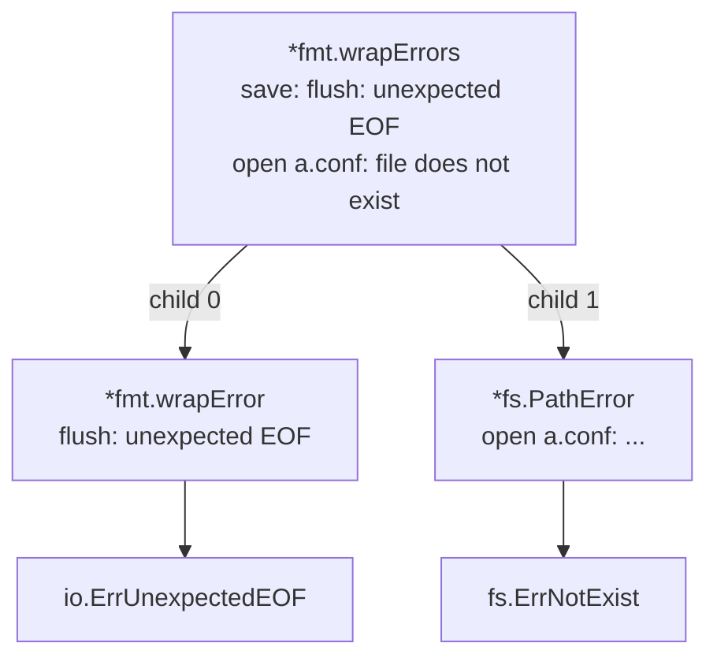

# 7.2 Inspecting Error Values

[7.1.5](./value.md) showed that before Go 1.13, attaching context and preserving an error's identity
were hard to achieve together: after adding a phrase with `fmt.Errorf` and `%v`, both `==`
comparison and type assertions stopped working. Go 1.13 resolved this in two parts. The first is
**wrapping**: an error can implement an `Unwrap` method that returns the lower-level error it wraps,
and the `%w` verb of `fmt.Errorf` produces such an error. The second is **inspection**: `errors.Is`
and `errors.As` search along the wrapping relation, layer by layer, in place of `==` and type
assertions. Go 1.20 allowed an error to wrap several errors at once, and Go 1.26 added a generic
variant, `errors.AsType` [[Neil and Amsterdam, 2019](#ref-neil-amsterdam-2019)].

This section discusses how wrapping forms an error tree; the implementation and cost of `Unwrap`,
`Is`, `As` and `AsType`; the trade-offs made before the design settled in Go 1.13; and how it
compares with exception chains in other languages.

## 7.2.1 Wrapping and the Error Tree

`fmt.Errorf` returns one of three kinds of error, depending on the number of `%w` in the format
string. The Go 1.26 implementation is:

```go
// src/fmt/errors.go
func Errorf(format string, a ...any) (err error) {
	// This function has been split in a somewhat unnatural way
	// so that both it and the errors.New call can be inlined.
	if err = errorf(format, a...); err != nil {
		return err
	}
	// No formatting was needed. We can avoid some allocations and other work.
	// See https://go.dev/cl/708836 for details.
	return errors.New(format)
}

// errorf formats and returns an error value, or nil if no formatting is needed.
func errorf(format string, a ...any) error {
	if len(a) == 0 && stringslite.IndexByte(format, '%') == -1 {
		return nil
	}
	p := newPrinter()
	p.wrapErrs = true
	p.doPrintf(format, a)
	s := string(p.buf)
	var err error
	switch len(p.wrappedErrs) {
	case 0:
		err = errors.New(s)
	case 1:
		w := &wrapError{msg: s}
		w.err, _ = a[p.wrappedErrs[0]].(error)
		err = w
	default:
		if p.reordered {
			slices.Sort(p.wrappedErrs)
		}
		var errs []error
		for i, argNum := range p.wrappedErrs {
			if i > 0 && p.wrappedErrs[i-1] == argNum {
				continue
			}
			if e, ok := a[argNum].(error); ok {
				errs = append(errs, e)
			}
		}
		err = &wrapErrors{s, errs}
	}
	p.free()
	return err
}
```

(The comments are paraphrased from the original.) During formatting, each time `doPrintf` meets a
`%w` it records the index of the corresponding argument in `p.wrappedErrs`, then prints that
argument as `%v`, so `%w` and `%v` produce exactly the same text. The difference lies only in the
type of the result: with no `%w` it is the `*errorString` made by `errors.New`; with one `%w` it is
a `*wrapError`; with several `%w` it is a `*wrapErrors`, and if the format string names argument
indices explicitly with `%[n]w`, the indices are sorted first and repeated references to the same
argument are dropped. The fast path at the top was added in Go 1.26 (thepudds, c1e6e49d5d)
[[Go Authors, 2026b](#ref-go-authors-2026b)]: with no arguments and no `%` in the format string, it
calls `errors.New` directly, so `fmt.Errorf("x")` allocates as often as `errors.New("x")`.

Both wrapper types add just one method:

```go
// src/fmt/errors.go
type wrapError struct {
	msg string
	err error
}

func (e *wrapError) Error() string { return e.msg }
func (e *wrapError) Unwrap() error { return e.err }

type wrapErrors struct {
	msg  string
	errs []error
}

func (e *wrapErrors) Error() string   { return e.msg }
func (e *wrapErrors) Unwrap() []error { return e.errs }
```

`Unwrap() []error` is the second form, introduced in Go 1.20 (Damien Neil, 4a0a2b33df)
[[Go Authors, 2023](#ref-go-authors-2023)]. The same change added `errors.Join`, which merges
several errors into one, discards the `nil` ones, and returns `nil` if all are `nil`; the message of
the merged error is the messages of the individual errors joined by newlines:

```go
// src/errors/join.go
func Join(errs ...error) error {
	n := 0
	for _, err := range errs {
		if err != nil {
			n++
		}
	}
	if n == 0 {
		return nil
	}
	e := &joinError{
		errs: make([]error, 0, n),
	}
	for _, err := range errs {
		if err != nil {
			e.errs = append(e.errs, err)
		}
	}
	return e
}

func (e *joinError) Unwrap() []error {
	return e.errs
}
```

The documentation of the `errors` package [[Go Authors, 2026a](#ref-go-authors-2026a)] builds on
this to define the **error tree**: if the `Unwrap` method of an error `e` returns `w`, or returns a
slice containing `w`, then `e` wraps `w`; all the errors obtained by calling `Unwrap` repeatedly,
together with `e` itself, form a tree rooted at `e`. A node implementing `Unwrap() error` has one
child, a node implementing `Unwrap() []error` has several, and the leaves are errors that wrap
nothing, usually sentinel errors or some concrete type. `Is` and `As` traverse this tree in
pre-order, depth first. The documentation also requires that the slice returned by
`Unwrap() []error` contain no `nil`.



The following program builds the error tree in the figure, then inspects it with `==`, `errors.Is`,
`errors.As` and `errors.AsType`:

```go {run=true}
package main

import (
	"errors"
	"fmt"
	"io"
	"io/fs"
)

func main() {
	flush := fmt.Errorf("flush: %w", io.ErrUnexpectedEOF)
	open := &fs.PathError{Op: "open", Path: "a.conf", Err: fs.ErrNotExist}
	err := fmt.Errorf("save: %w\n%w", flush, open)

	fmt.Println(err)
	fmt.Println(err == io.ErrUnexpectedEOF)
	fmt.Println(errors.Is(err, io.ErrUnexpectedEOF), errors.Is(err, fs.ErrNotExist))

	var pe *fs.PathError
	if errors.As(err, &pe) {
		fmt.Println("As:", pe.Op, pe.Path)
	}
	if pe, ok := errors.AsType[*fs.PathError](err); ok {
		fmt.Println("AsType:", pe.Op, pe.Path)
	}
	fmt.Println(errors.Unwrap(err) == nil) // Unwrap does not handle Unwrap() []error
}
```

```
save: flush: unexpected EOF
open a.conf: file does not exist
false
true true
As: open a.conf
AsType: open a.conf
true
```

## 7.2.2 Unwrap

`errors.Unwrap` calls only the `Unwrap() error` form and does not handle `Unwrap() []error`, so it
returns `nil` for the result of `errors.Join` or for an error with several `%w`, as the last line of
the program above shows. Traversing the whole tree is the job of `Is` and `As`:

```go
// src/errors/wrap.go
func Unwrap(err error) error {
	u, ok := err.(interface {
		Unwrap() error
	})
	if !ok {
		return nil
	}
	return u.Unwrap()
}
```

## 7.2.3 Is

`errors.Is(err, target)` decides whether any error in the tree of `err` matches `target`. There are
two ways to match: the error is equal to `target`, or the error implements an `Is(error) bool`
method and `Is(target)` returns true.

```go
// src/errors/wrap.go
func Is(err, target error) bool {
	if err == nil || target == nil {
		return err == target
	}

	isComparable := reflectlite.TypeOf(target).Comparable()
	return is(err, target, isComparable)
}

func is(err, target error, targetComparable bool) bool {
	for {
		if targetComparable && err == target {
			return true
		}
		if x, ok := err.(interface{ Is(error) bool }); ok && x.Is(target) {
			return true
		}
		switch x := err.(type) {
		case interface{ Unwrap() error }:
			err = x.Unwrap()
			if err == nil {
				return false
			}
		case interface{ Unwrap() []error }:
			for _, err := range x.Unwrap() {
				if is(err, target, targetComparable) {
					return true
				}
			}
			return false
		default:
			return false
		}
	}
}
```

The single-chain part is a loop; recursion happens only at nodes with several children. `Is` first
checks whether the dynamic type of `target` is comparable: when two interface values have the same
dynamic type and that type is not comparable (a struct with a slice field, for example), `==` raises
a run-time panic, so for a non-comparable `target` only the `Is` method is tried. This check was
added before the release of Go 1.13 (0bf1f02ed9).

The `Is` method lets an error declare itself equivalent to another error without wrapping it. The
classic example in the standard library is `syscall.Errno`. `ErrPermission`, `ErrExist` and
`ErrNotExist` of `os` and `io/fs` are defined in the `internal/oserror` package so that `syscall`
can refer to them too, and `Errno.Is` maps a number of error numbers onto these abstract sentinels:

```go
// src/syscall/syscall_unix.go
func (e Errno) Is(target error) bool {
	switch target {
	case oserror.ErrPermission:
		return e == EACCES || e == EPERM
	case oserror.ErrExist:
		return e == EEXIST || e == ENOTEMPTY
	case oserror.ErrNotExist:
		return e == ENOENT
	case errorspkg.ErrUnsupported:
		return e == ENOSYS || e == ENOTSUP || e == EOPNOTSUPP
	}
	return false
}
```

Thus `errors.Is(err, fs.ErrNotExist)` recognizes an `ENOENT` wrapped in a `*fs.PathError`. Before
this, the same judgment depended on functions such as `os.IsNotExist`, which knew only a few wrapper
types of the `os` package itself and could not see through user-defined wrappers. The Go 1.26
documentation of `os.IsNotExist` states that the function predates `errors.Is`, supports only errors
returned by the `os` package, and that new code should use `errors.Is(err, fs.ErrNotExist)`
[[Amsterdam and Mills, 2019](#ref-amsterdam-mills-2019)]. The documentation also requires that an
`Is` method compare only `err` and `target` shallowly, without calling `Unwrap` on either; traversal
is the business of `errors.Is`.

## 7.2.4 As and AsType

`errors.As(err, target)` looks in the tree for the first error assignable to `*target` and, once
found, stores it in `*target`. The type of `target` is `any`, so `As` uses `internal/reflectlite` at
run time to check the argument and perform the assignment:

```go
// src/errors/wrap.go
func As(err error, target any) bool {
	if err == nil {
		return false
	}
	if target == nil {
		panic("errors: target cannot be nil")
	}
	val := reflectlite.ValueOf(target)
	typ := val.Type()
	if typ.Kind() != reflectlite.Ptr || val.IsNil() {
		panic("errors: target must be a non-nil pointer")
	}
	targetType := typ.Elem()
	if targetType.Kind() != reflectlite.Interface && !targetType.Implements(errorType) {
		panic("errors: *target must be interface or implement error")
	}
	return as(err, target, val, targetType)
}

func as(err error, target any, targetVal reflectlite.Value, targetType reflectlite.Type) bool {
	for {
		if reflectlite.TypeOf(err).AssignableTo(targetType) {
			targetVal.Elem().Set(reflectlite.ValueOf(err))
			return true
		}
		if x, ok := err.(interface{ As(any) bool }); ok && x.As(target) {
			return true
		}
		switch x := err.(type) {
		case interface{ Unwrap() error }:
			err = x.Unwrap()
			if err == nil {
				return false
			}
		case interface{ Unwrap() []error }:
			for _, err := range x.Unwrap() {
				if err == nil {
					continue
				}
				if as(err, target, targetVal, targetType) {
					return true
				}
			}
			return false
		default:
			return false
		}
	}
}
```

This signature has two inconveniences. First, `target` must be a non-nil pointer to an error type or
an interface type, but this can be checked only at run time: a wrong argument panics, and the
`errorsas` check of `go vet` catches only some of the mistakes. Second, the caller must declare a
variable and pass its address, so `target` escapes to the heap through the `any` parameter.

In March 2022 the GitHub user slnt proposed a generic version (#51945)
[[slnt, 2022](#ref-slnt-2022)]; three years later Julien Cretel implemented it, and it entered Go
1.26 (a846bb0aa5). `AsType` replaces the pointer parameter with a type parameter:

```go
// src/errors/wrap.go
func AsType[E error](err error) (E, bool) {
	if err == nil {
		var zero E
		return zero, false
	}
	var pe *E // lazily initialized
	return asType(err, &pe)
}

func asType[E error](err error, ppe **E) (_ E, _ bool) {
	for {
		if e, ok := err.(E); ok {
			return e, true
		}
		if x, ok := err.(interface{ As(any) bool }); ok {
			if *ppe == nil {
				*ppe = new(E)
			}
			if x.As(*ppe) {
				return **ppe, true
			}
		}
		switch x := err.(type) {
		case interface{ Unwrap() error }:
			err = x.Unwrap()
			if err == nil {
				return
			}
		case interface{ Unwrap() []error }:
			for _, err := range x.Unwrap() {
				if err == nil {
					continue
				}
				if x, ok := asType(err, ppe); ok {
					return x, true
				}
			}
			return
		default:
			return
		}
	}
}
```

(The comment is paraphrased from the original.) The traversal has the same structure as `as`, with
two differences. First, matching uses a plain type assertion `err.(E)`, which needs no reflection;
`E` is constrained to `error`, so a wrong argument is rejected at compile time. Second, a `*E` is
allocated and handed over only when some error in the tree implements an `As(any) bool` method, so
in the vast majority of cases nothing is allocated at all.

The two differences show clearly in the cost. The following results were measured on Go 1.26.10 on
an Apple M5 Pro, where "three layers" means `fmt.Errorf` wrapping three times with `%w` and the
target at the innermost level (each item run 5 times, median taken):

| Operation | Time per call | Allocations |
| :-- | --: | --: |
| `err == sentinel` (unwrapped) | 1.8 ns | 0 |
| `errors.Is` (unwrapped) | 3.3 ns | 0 |
| `errors.Is` (three layers) | 8.5 ns | 0 |
| `err.(*fs.PathError)` (unwrapped) | 1.7 ns | 0 |
| `errors.As` (three layers) | 48.3 ns | 1, 8 B |
| `errors.AsType` (three layers) | 6.5 ns | 0 |

The single allocation in `As` comes from the target variable: compiling the benchmark with
`-gcflags=-m`, the compiler reports `moved to heap: pe`. `AsType` avoids both the reflection and
this allocation, and is about 7 times faster in this example. The documentation of `As` therefore
recommends `AsType` in most cases; `As` remains because its target may be any interface type, which
need not implement `error`.

## 7.2.5 How the Design Came About

This mechanism did not take shape in one step. In August 2018, with the Go 2 drafts, Jonathan
Amsterdam and Damien Neil published a draft design for error inspection
[[Amsterdam and Neil, 2018](#ref-amsterdam-neil-2018)] that proposed early forms of `Unwrap`, `Is`
and `As`; the implementation was first tried in `golang.org/x/xerrors`. In January 2019 Amsterdam
filed the formal proposal, #29934 [[Amsterdam et al., 2019](#ref-amsterdam-et-al-2019)]. In February
of that year Marcel van Lohuizen merged it into the main tree (62f5e8156e, 6be6f114e0). That version
also included frame information recording the call location, the `errors.Formatter` and
`errors.Printer` interfaces, a multi-line output format for `%+v`, and special handling of the end
of the format string: `%w` could appear only at the end of the format string in the form `": %w"`,
and when the string ended in `": %s"` or `": %v"` with an error as the last argument, that error was
not wrapped but was printed in the detailed format.

On May 6, 2019, just before the development freeze, Damien Neil announced the Go 1.13 decision in
#29934 [[Neil, 2019](#ref-neil-2019)]: keep `Unwrap`, `Is`, `As` and `%w`; allow `%w` anywhere in
the format string; remove everything related to formatting and call locations, to be reconsidered
later. The reasons given were that experience with these formatting interfaces was still
insufficient and there were signs that the design was not entirely right; and that the special
handling of the end of the format string violated the consistent model of printf, in which the
meaning of a `%` verb is independent of context and the remaining text has no meaning. This was the
most contested point of the original design. A week later Neil reverted those changes (3e2c522d5c).
The same decision also explained why the name `Cause` from `pkg/errors` was not adopted: existing
packages disagreed about what `Cause` means, and `Unwrap` describes the operation more accurately.

Why a format verb such as `%w` rather than a new `errors.Wrap` function was explained by Russ Cox
the next day in the same discussion [[Cox, 2019a](#ref-cox-2019a)]. Whether an error can be taken
apart to reach the inner error is a semantic decision, like whether a struct field is exported:
sometimes it should be exposed and sometimes not. If `errors.Wrap` produced unwrappable errors and
`fmt.Errorf` produced opaque ones, the choice of API would drive whether the inner error is exposed.
`%w` separates the two decisions: the API is always `fmt.Errorf`, and whether to expose is decided
by `%w` versus `%v`, so changing one's mind takes a single letter.

`fmt.Errorf` in Go 1.13 allowed only one `%w`. In June 2022 Damien Neil proposed wrapping multiple
errors (#53435) [[Neil, 2022](#ref-neil-2022)], which led to the `Unwrap() []error` and
`errors.Join` of Go 1.20, and turned the error chain into an error tree.

## 7.2.6 Comparison with Exception Chains

Keeping the "cause" of an exception has long existed in other languages. Java 1.4 (2002) introduced
the chained exception facility: a `Throwable` can carry another `Throwable` as its cause, retrieved
with `getCause`, and the cause may itself have a cause, forming a chain
[[Oracle, 2014](#ref-oracle-2014)]. `Exception.InnerException` in C# serves the same purpose. Python
3 added the `raise ... from` syntax under PEP 3134 (Ka-Ping Yee, 2005) [[Yee, 2005](#ref-yee-2005)],
and an explicitly set cause is stored in `__cause__`. Rust's `std::error::Error` trait returns the
lower-level error through its `source` method (introduced by RFC 2504 in 2018
[[Rust, 2018](#ref-rust-2018)], replacing the older `cause` method as of Rust 1.33). Go's `Unwrap`
belongs to the same lineage.

The difference lies in how inspection works. Exception languages catch by type hierarchy: catching a
base class catches all its subclasses, and making an error "also count as" another kind usually
requires adjusting the inheritance relation; moreover, a catch looks only at the outermost
exception, and the cause chain is used mainly for printing diagnostics. Go's inspection works over
the whole tree:

- Sentinels and concrete types can appear in the same tree. `Is` matches sentinels by value, while
  `As` and `AsType` retrieve concrete errors by type; the two kinds of inspection do not interfere.
- Equivalence is declared by the errors themselves. The `Is(error) bool` and `As(any) bool` methods
  let an error be equivalent to some sentinel or be treated as another type with no inheritance
  relation at all; `syscall.Errno.Is` is an example.
- Wrapping is composition, not inheritance. The shape of the tree is determined by run-time data,
  not by a class hierarchy fixed at compile time.

The cost is that inspection changes from a single type dispatch to a tree traversal, and that the
caller must call `Is` or `As` explicitly.

## 7.2.7 Idioms and Pitfalls

A few practical recommendations, most of them direct consequences of the mechanism above:

- **`%w` is part of the API.** Wrapping with `%w` means callers can match the inner error with `Is`
  or `As`, so the inner error becomes part of the public contract. If the inner error is only an
  implementation detail, use `%v`. Section 7.4 discusses this from the library author's viewpoint.
- **Do not wrap `nil`.** `fmt.Errorf("read: %w", err)` with a `nil` `err` does not return `nil`; it
  returns a non-`nil` error whose message is `read: %!w(<nil>)`. Wrapping belongs inside
  `if err != nil`.
- **Wrap only when it helps.** Wrapping at every layer makes error messages long and repetitive.
  Wrapping should add information specific to that layer, such as the name of the file being
  processed or a request ID.
- **Prefer `AsType`.** It checks the type argument at compile time, with no reflection and no
  allocation. `As` is needed only when the target is an interface that does not implement `error`.
- **Keep custom `Is` and `As` methods shallow.** Compare only the error itself with `target`; do not
  call `Unwrap` inside them.

## Further Reading

- <a id="ref-neil-amsterdam-2019"></a>[Neil and Amsterdam, 2019] Damien Neil, Jonathan Amsterdam.
  *Working with Errors in Go 1.13.* The Go Blog, 2019. https://go.dev/blog/go1.13-errors (design
  motivation and usage of `%w`/`Unwrap`/`Is`/`As`)
- <a id="ref-go-authors-2026a"></a>[Go Authors, 2026a] The Go Authors. *Package errors.*
  https://pkg.go.dev/errors (authoritative documentation of
  `New`/`Unwrap`/`Is`/`As`/`AsType`/`Join`)
- <a id="ref-amsterdam-et-al-2019"></a>[Amsterdam et al., 2019] Jonathan Amsterdam, Russ Cox, Marcel
  van Lohuizen, Damien Neil. *Proposal: Go 2 Error Inspection (#29934).* 2019.
  https://go.googlesource.com/proposal/+/master/design/29934-error-values.md ; discussion at
  https://go.dev/issue/29934 (the design proposal for `Is`/`As`/`Unwrap`, recording the rejected
  alternatives)
- <a id="ref-go-authors-2023"></a>[Go Authors, 2023] The Go Authors. *Go 1.20 Release Notes:
  Wrapping multiple errors.* https://go.dev/doc/go1.20#errors (`Unwrap() []error` and `errors.Join`)
- <a id="ref-slnt-2022"></a>[slnt, 2022] *errors: AsType (As with type parameters) (#51945).*
  2022–2025. https://go.dev/issue/51945 (the proposal and discussion of the generic `AsType` in Go
  1.26)
- <a id="ref-go-authors-2026b"></a>[Go Authors, 2026b] The Go Authors. *src/errors/wrap.go, join.go,
  src/fmt/errors.go.* https://github.com/golang/go/tree/master/src/errors (primary source for the
  implementations in this section); Go 1.26:
  [src/errors/wrap.go](https://github.com/golang/go/blob/release-branch.go1.26/src/errors/wrap.go),
  [src/errors/join.go](https://github.com/golang/go/blob/release-branch.go1.26/src/errors/join.go),
  [src/fmt/errors.go](https://github.com/golang/go/blob/release-branch.go1.26/src/fmt/errors.go);
  the pre-Go 1.13 revert commit https://go.googlesource.com/go/+/3e2c522d5c
- <a id="ref-amsterdam-mills-2019"></a>[Amsterdam and Mills, 2019] Jonathan Amsterdam, Bryan C.
  Mills. *Error Values: Frequently Asked Questions.* 2019.
  https://github.com/golang/go/wiki/ErrorValueFAQ (common questions and authoritative answers on the
  practical use of `Is`/`As`/`%w`)
- <a id="ref-amsterdam-neil-2018"></a>[Amsterdam and Neil, 2018] Jonathan Amsterdam, Damien Neil.
  *Error Inspection, Draft Design.* 2018.
  https://go.googlesource.com/proposal/+/master/design/go2draft-error-inspection.md
- <a id="ref-neil-2019"></a>[Neil, 2019] Damien Neil. *Go 1.13 launch decision about error
  values.* 2019. https://github.com/golang/go/issues/29934#issuecomment-489682919
- <a id="ref-cox-2019a"></a>[Cox, 2019a] Russ Cox. *Response regarding "proposal: Go 2 error
  values".*
  2019. https://github.com/golang/go/issues/29934#issuecomment-490087200
- <a id="ref-neil-2022"></a>[Neil, 2022] Damien Neil. *errors: add support for wrapping multiple
  errors (#53435).* 2022. https://go.dev/issue/53435
- <a id="ref-oracle-2014"></a>[Oracle, 2014] Oracle. *Java Platform SE 8 API: Class Throwable*
  (exception chaining, `getCause` since 1.4).
  https://docs.oracle.com/javase/8/docs/api/java/lang/Throwable.html
- <a id="ref-yee-2005"></a>[Yee, 2005] Ka-Ping Yee. *PEP 3134: Exception Chaining and Embedded
  Tracebacks.* 2005. https://peps.python.org/pep-3134/
- <a id="ref-rust-2018"></a>[Rust, 2018] *RFC 2504: fix_error.* Rust RFCs, 2018.
  https://rust-lang.github.io/rfcs/2504-fix-error.html
- This book: [7.1 The Evolution of the Problem](./value.md),
  [7.5 The Future of Error Handling](./future.md).
