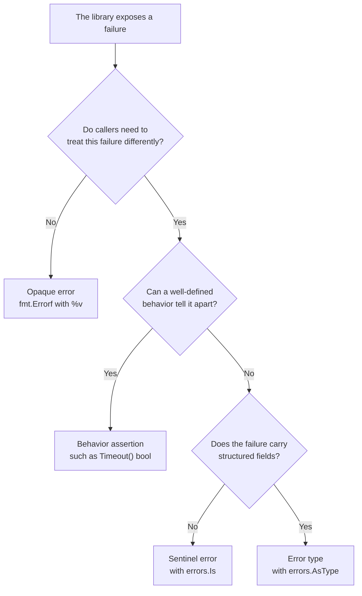

# 7.4 Error Semantics

[7.2](./inspect.md) and [7.3](./context.md) took the caller's side: once a program holds an `error`,
how does it inspect the error and add context? This section takes the library author's side and asks
an earlier question: when a package exposes a failure to its callers, in what form should it do so?
Export a comparable value, export a type with fields, or export nothing?

Since errors are values [[Pike, 2015](#ref-pike-2015)], the form in which an error appears is the
library author's decision. This is not merely a matter of style. Once published, the form of an
error becomes part of the package's public contract, like a function signature: callers write
branching logic against it, and any later change in the library breaks those callers. Different
forms promise different things to the contract and leave the library different amounts of room to
change later. In his talk at GoCon Spring 2016 in Tokyo, Dave Cheney summarized Go error handling as
three basic strategies: sentinel errors, error types and opaque errors
[[Cheney, 2016a](#ref-cheney-2016a)] [[Cheney, 2016b](#ref-cheney-2016b)]. This section adds a
fourth, asserting the behavior of an error, discusses each by what it commits the contract to, and
ends with an order in which to choose.

## 7.4.1 Sentinel Errors: Committing to a Value

The most direct form is to export a pre-created error value for callers to compare against. The
standard library has many examples:

```go
// src/io/io.go
// EOF is the error returned by Read when no more input is available.
// (Read must return EOF itself, not an error wrapping EOF,
// because callers will test for EOF using ==.)
// Functions should return EOF only to signal a graceful end of input.
// If the EOF occurs unexpectedly in a structured data stream,
// the appropriate error is either ErrUnexpectedEOF or some other error
// giving more detail.
var EOF = errors.New("EOF")

// src/database/sql/sql.go
// ErrNoRows is returned by Row.Scan when DB.QueryRow doesn't return a
// row. In such a case, QueryRow returns a placeholder *Row value that
// defers this error until a Scan.
var ErrNoRows = errors.New("sql: no rows in result set")
```

Such pre-defined error values are called **sentinel errors**. What they express is often not a fault
but a definite outcome other than the normal result: `io.EOF` means the input ended normally, and
`sql.ErrNoRows` means the query matched no rows [[Go Authors, 2026a](#ref-go-authors-2026a)].

The documentation of `io.EOF` also reveals a hidden cost of sentinels. Because callers detect it
with `==`, `Read` must return `EOF` unchanged and cannot add any context to it with `%w`.
`errors.Is` eases this, but a sentinel such as `io.EOF`, published before Go 1.13, remains bound by
its original contract. Cheney sees the biggest problem with sentinels as the source-level dependency
they create between two packages: to check for `io.EOF`, the caller must import `io`
[[Cheney, 2016b](#ref-cheney-2016b)]. In addition, an exported sentinel is a variable, and any code
that imports the package can overwrite it (see [7.1.5](./value.md)
[[Cheney, 2016e](#ref-cheney-2016e)]). Cheney's advice is to avoid sentinel errors in one's own code
wherever possible.

Since Go 1.13 the use of sentinels has shifted. The documentation of `errors.ErrUnsupported`, added
in Go 1.21 [[Go Authors, 2026c](#ref-go-authors-2026c)], says that functions and methods should not
return this error directly, but should return an error that includes appropriate context and
satisfies `errors.Is(err, errors.ErrUnsupported)`, either by wrapping `ErrUnsupported` directly or
by implementing an `Is` method. Here the sentinel is no longer a value returned as is but a category
for `Is` to match; this is how `syscall.Errno` maps error numbers such as `ENOSYS` to
`ErrUnsupported` in [7.2.3](./inspect.md).

## 7.4.2 Error Types: Committing to a Structure

When a failure needs to carry data, the natural approach is to define a type that implements `error`
and keep the data in fields:

```go
// src/io/fs/fs.go
// PathError records an error and the operation and file path that caused it.
type PathError struct {
	Op   string
	Path string
	Err  error
}

func (e *PathError) Error() string { return e.Op + " " + e.Path + ": " + e.Err.Error() }

func (e *PathError) Unwrap() error { return e.Err }
```

The caller extracts the type with `errors.AsType` and reads its fields:

```go
if pe, ok := errors.AsType[*fs.PathError](err); ok {
	log.Printf("%s %s failed", pe.Op, pe.Path)
}
```

An error type can carry far more information than a sentinel, at the price of deeper coupling: a
sentinel commits only a value, whereas a type commits an entire structure to the contract. The
caller's code hard-wires `*fs.PathError` and its field names, so if the library later renames a
field, changes what a field means, or switches to a different type, those callers break. Adding
fields to an error type is a compatible change; renaming or deleting them is not. Exported fields
should therefore be kept few, limited to those callers genuinely need to branch on
[[Cheney, 2014](#ref-cheney-2014)].

A fuller example is the Upspin error package described by Rob Pike and Andrew Gerrand in 2017
[[Pike and Gerrand, 2017](#ref-pike-gerrand-2017)]. Upspin has a single error type, with fields for
the path `Path`, the user `User`, the operation `Op`, the category `Kind` and the nested underlying
error `Err`; any field may be empty. The constructor `errors.E(args ...interface{})` decides which
field each argument goes into from its type. `Kind` divides errors into a few categories such as
`Permission`, `IO` and `NotExist`, and callers test the category with `errors.Is(kind, err)` without
caring which specific error occurred. The design goals they list are to make it easy to build
informative error messages, to be understandable to users, and to help programmers diagnose
problems. The nested errors record which components of the system a request passed through; they
call this an operation trace, as distinct from a call stack, which records the path of code
execution, and they stress that Upspin's error model has no call stack. They also state that the
design is not a recommendation for other systems. Today, matching on `Kind` can be implemented with
the `Is` method from [7.2](./inspect.md), which works seamlessly with `errors.Is`.

## 7.4.3 Opaque Errors: Committing to Nothing

The opposite extreme is to return only `error`, exporting no sentinel or type. Beyond telling
success from failure, the caller cannot make any structured judgment about the error:

```go
func (c *Config) Load(path string) error {
	f, err := os.Open(path)
	if err != nil {
		return fmt.Errorf("load config: %v", err)
	}
	defer f.Close()
	// ...
	return nil
}
```

Cheney calls this an **opaque error** and advises treating all errors as opaque wherever possible
[[Cheney, 2016b](#ref-cheney-2016b)]. Its benefits are exactly the reverse of the costs of the first
two forms: the library commits nothing to the contract, so how it represents failure internally,
which types it uses and which fields they carry can all be changed freely. Note that the code above
uses `%v` rather than `%w`: `%w` would make `*fs.PathError` an inner error that callers can match,
turning it into part of the contract (see Russ Cox's explanation of `%w` versus `%v` in
[7.2.5](./inspect.md)).

The cost of opacity is that callers lose the ability to tell errors apart. Some failures do need
different treatment: a timeout can be retried, and a missing row can be replaced by a default. If
all such cases are made opaque, callers can only match the text of the error message, and Cheney
states explicitly that the `Error` method is for people and programs should not change behavior
based on its output. The question then becomes whether callers can branch without writing a value or
a type into the contract.

## 7.4.4 Asserting Behavior

Cheney's answer is to assert the behavior of an error rather than its type
[[Cheney, 2014](#ref-cheney-2014)]. The error type implements a small interface that describes only
one behavior, and callers assert that interface instead of a concrete type. The `Error` interface in
the standard library's `net` package is the canonical example
[[Go Authors, 2026b](#ref-go-authors-2026b)]:

```go
// src/net/net.go
// An Error represents a network error.
type Error interface {
	error
	Timeout() bool // Is the error a timeout?

	// Deprecated: Temporary errors are not well-defined.
	// Most "temporary" errors are timeouts, and the few exceptions are surprising.
	// Do not use this method.
	Temporary() bool
}
```

The caller does not need to import `net`; it only has to declare a structurally identical interface
locally. Go interfaces are satisfied structurally (see [4.2.4](../ch04type/interface.md)), so any
error that implements `Timeout() bool` satisfies it, whichever package it comes from. Both
`context.DeadlineExceeded` and `os.ErrDeadlineExceeded` implement this method, and the former has
nothing to do with the `net` package.

Before Go 1.13 this assertion applied directly to the error itself, and once an error was wrapped
the assertion failed. Today `errors.As` should be used to search the error tree for an error that
implements the interface. The target of `As` can be any interface type, whereas `AsType` requires
its type argument to satisfy the `error` constraint, so the interface must embed `error`:

```go {run=true}
package main

import (
	"context"
	"errors"
	"fmt"
	"os"
)

type timeout interface{ Timeout() bool }

func main() {
	for _, cause := range []error{context.DeadlineExceeded, os.ErrDeadlineExceeded, os.ErrClosed} {
		err := fmt.Errorf("fetch: %w", cause)

		_, direct := err.(timeout) // the outermost error is *fmt.wrapError, so the assertion fails

		var t timeout
		viaAs := errors.As(err, &t) && t.Timeout()

		te, ok := errors.AsType[interface {
			error
			Timeout() bool
		}](err)
		viaAsType := ok && te.Timeout()

		fmt.Println(cause, direct, viaAs, viaAsType)
	}
}
```

```
context deadline exceeded false true true
i/o timeout false true true
file already closed false false false
```

The library side must cooperate as well. `net.OpError` wraps an underlying error, and its `Timeout`
method does not decide anything itself but forwards to the underlying error:

```go
// src/net/net.go
func (e *OpError) Timeout() bool {
	if ne, ok := e.Err.(*os.SyscallError); ok {
		t, ok := ne.Err.(timeout)
		return ok && t.Timeout()
	}
	t, ok := e.Err.(timeout)
	return ok && t.Timeout()
}
```

`*fs.PathError` also has a `Timeout` method that forwards to `Err` in the same way. This code
predates `Unwrap`: every type that wraps another error had to forward the behavior itself, and
`OpError` needed an extra check for the `*os.SyscallError` layer. Since `errors.As` appeared, as
long as a wrapper type implements `Unwrap`, the standard library performs the search along the tree
uniformly, and individual wrapper types no longer need to forward behavior one by one.

Behavioral assertions can also fail, as the second method of `net.Error` shows. `Temporary() bool`
was meant to say "this error is transient and worth retrying". In April 2021, Damien Neil proposed
deprecating it [[Neil, 2021](#ref-neil-2021)]. The meaning of a timeout is quite intuitive: the
operation exceeded its deadline. The meaning of "temporary" is not well-defined. For example,
`EHOSTUNREACH` may stem from a transient routing fault, so does it count as temporary? An operation
that exceeded its deadline will still fail if retried without extending the deadline, so does it
count as permanent? Neil counted the cases in the standard library where `Temporary` returns true
and found that most were in fact timeouts. The method has been marked deprecated since Go 1.18
(a53e3d5f88). The lesson is that a behavior worth asserting must have a clear, agreed definition;
`Timeout()` meets that bar and `Temporary()` does not.

## 7.4.5 Forms in Other Languages

Exception-oriented languages organize errors into a type hierarchy.
`catch (FileNotFoundException e)` is essentially the type check of
[7.4.2](#742-error-types-committing-to-a-structure), organized through inheritance: catching a base
class catches all of its subclasses. The whole exception hierarchy thus enters the contract. Java's
checked exceptions go a step further by writing exceptions into method signatures, and Hejlsberg's
criticism described in [7.1.1](./value.md) is aimed at exactly this.

Rust writes the error type into the signature of `Result<T, E>` and has the compiler force callers
to handle it. In the community, `thiserror` is used to define structured error enums for libraries,
which corresponds to Go's error types; `anyhow` boxes errors into an opaque type, which corresponds
to Go's opaque errors. Error types and opaque errors are therefore not unique to Go: any language
that treats errors as values faces this choice. The difference is that Go expresses it with
interfaces and runtime checks, while Rust expresses it with enums and compile-time exhaustiveness
checks. Behavioral assertion is the most distinctively Go of the four forms: it relies on structural
interface satisfaction and is not easy to reproduce in languages that have only nominal types.

## 7.4.6 How to Choose

Ordered by what they commit the contract to, the four forms are:

| Form | Commits the contract to | Coupling | What the caller can do |
| :-- | :-- | :-- | :-- |
| Opaque error | Nothing | Lowest | Only check `err != nil` |
| Behavior assertion | A small interface | Low | `errors.As(err, &t)`, where `t` is an `interface{ Timeout() bool }` |
| Sentinel error | A value | Medium | `errors.Is(err, ErrX)` |
| Error type | A structure | High | `errors.AsType[*T](err)`, then read fields |

A workable default order is this: start opaque, so that the library exposes no internal detail, and
wait until callers genuinely need to distinguish cases. When a failure does need different
treatment, prefer a behavior assertion with the smallest interface possible. Only when behavior
cannot express the distinction, for example when callers must read structured fields, export a
sentinel or a type, and do so knowing that from then on the value or structure is part of the API,
and its evolution is governed by the Go 1 compatibility promise
[[Go Authors, 2012](#ref-go-authors-2012)].



The `Unwrap`, `Is` and `As` of Go 1.13 changed the relative cost of these forms. Before them, a
sentinel or an error type could not be recognized once wrapped, which was an important part of the
background to Cheney's advocacy of opaque errors; after `errors.Is` and `errors.As` arrived
[[Neil and Amsterdam, 2019](#ref-neil-amsterdam-2019)], they can be recognized through wrapping, and
become more practical. But what they commit the contract to did not shrink: a sentinel is still a
value, a type is still a structure, and choosing `%w` when wrapping means adding the inner error to
the contract as well. The order above therefore still holds: commit little first, commit more when
there is a real need, and know what each additional commitment buys.

## Further Reading

- <a id="ref-cheney-2016b"></a>[Cheney, 2016b] Dave Cheney. Don't just check errors, handle them
  gracefully. GoCon Spring (Tokyo), 2016-04; blog post 2016-04-27; also given at GopherCon 2016.
  https://dave.cheney.net/2016/04/27/dont-just-check-errors-handle-them-gracefully
- <a id="ref-cheney-2016a"></a>[Cheney, 2016a] Dave Cheney. My philosophy for error handling. GoCon
  Spring, 2016-04. https://dave.cheney.net/paste/gocon-spring-2016.pdf (the talk notes on the
  trade-offs among the sentinel, type and opaque forms)
- <a id="ref-pike-gerrand-2017"></a>[Pike and Gerrand, 2017] Rob Pike, Andrew Gerrand. Error
  handling in Upspin. 2017-12-06.
  https://commandcenter.blogspot.com/2017/12/error-handling-in-upspin.html (a first-hand case of
  designing an error type in a real system)
- <a id="ref-cheney-2014"></a>[Cheney, 2014] Dave Cheney. Inspecting errors. 2014-12-24.
  https://dave.cheney.net/2014/12/24/inspecting-errors
- <a id="ref-cheney-2016e"></a>[Cheney, 2016e] Dave Cheney. Constant errors. 2016-04-07.
  https://dave.cheney.net/2016/04/07/constant-errors
- <a id="ref-go-authors-2026b"></a>[Go Authors, 2026b] The Go Authors. Package net: type Error.
  https://pkg.go.dev/net#Error
- <a id="ref-go-authors-2026a"></a>[Go Authors, 2026a] The Go Authors. Package io: variable EOF.
  https://pkg.go.dev/io#EOF
- <a id="ref-neil-amsterdam-2019"></a>[Neil and Amsterdam, 2019] Damien Neil, Jonathan Amsterdam.
  Working with Errors in Go 1.13. The Go Blog, 2019-10-17. https://go.dev/blog/go1.13-errors
- <a id="ref-pike-2015"></a>[Pike, 2015] Rob Pike. Errors are values. The Go Blog, 2015-01-12.
  https://go.dev/blog/errors-are-values
- <a id="ref-neil-2021"></a>[Neil, 2021] Damien Neil. net: deprecate Temporary error status. 2021.
  https://go.dev/issue/45729 ; the deprecation commit https://go.googlesource.com/go/+/a53e3d5f88
- <a id="ref-go-authors-2026c"></a>[Go Authors, 2026c] The Go Authors. Package errors:
  ErrUnsupported. https://pkg.go.dev/errors#ErrUnsupported
- <a id="ref-go-authors-2012"></a>[Go Authors, 2012] The Go Authors. Go 1 and the Future of Go
  Programs.
  2012. https://go.dev/doc/go1compat
