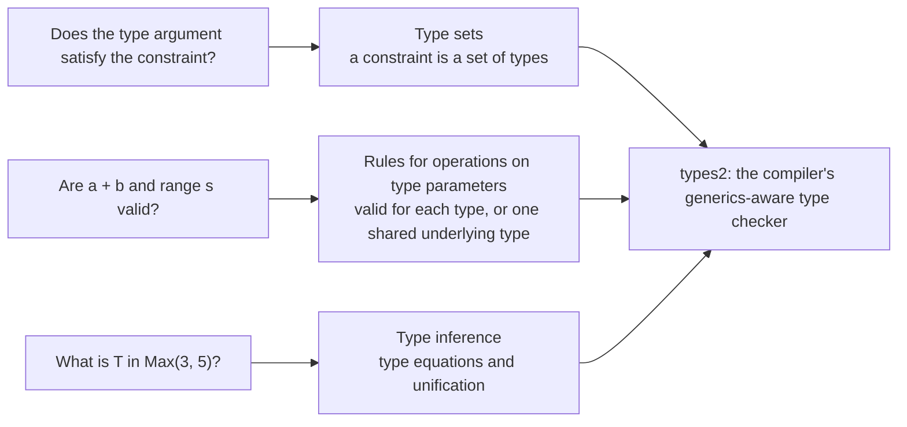

# 8.3 Type-Checking Techniques

Generics make the type checker's job much harder. Without them, the checker answers essentially one
kind of question: does a value belong to a type? Type parameters add three more: does a type
argument satisfy its constraint; is an operation such as `a + b` or `range s` valid when the type is
not yet known; and, in a call such as `Max(3, 5)`, what is the `T` that nobody wrote down? This
section takes the corresponding techniques in turn: type sets, the rules for operations on type
parameters, and type inference. It ends with `types2`, the type checker in the compiler that
implements them. Together they are the compile-time realization of the design described in
[8.1 The Evolution of Generics Design](./history.md) and
[8.2 Contract-Based Generics](./contracts.md); the overall structure of the compiler front end is
covered in [Chapter 15 The Compiler Pipeline](../../part5toolchain/ch15compile/readme.md).



The type rules of generics have also been studied formally. In 2020, Griesemer, Taylor, Philip
Wadler and others, using Featherweight Java as a model, proposed two core calculi for Go: FG, and
FGG, which adds type parameters. Unlike Java, Go has structural subtyping, and its generics are
implemented by monomorphization rather than type erasure. The paper proves type soundness for both
calculi and formalizes the monomorphizing translation from FGG to FG, proving that it preserves
types and forms a bisimulation; the authors describe this as one of the first formalizations of
monomorphization [[Griesemer et al., 2020](#ref-griesemer-et-al-2020)]. The work appeared before the
type parameters proposal was accepted in 2021, and Griesemer and Taylor are the two designers of Go
generics.

## 8.3.1 Type Sets: A Constraint Is a Set of Types

The central notion of a constraint is the **type set**. An ordinary interface describes which
methods a type has; an interface used as a constraint additionally describes which types belong to
it ([8.2.4](./contracts.md)). A type set is built as a union of **type terms**, and the `term`
struct in the compiler's `cmd/compile/internal/types2` package borrows set notation directly
[[Go Authors, 2026c](#ref-go-authors-2026c)]:

```go
// Go 1.26 cmd/compile/internal/types2/typeterm.go (comments translated)
//
// A term describes elementary type sets:
//
//	 ∅:  (*term)(nil)     == ∅                      // set of no types (empty set)
//	 𝓤:  &term{}          == 𝓤                      // set of all types (𝓤niverse)
//	 T:  &term{false, T}  == {T}                    // set containing exactly T
//	~t:  &term{true, t}   == {t' | under(t') == t}  // set of all types with underlying type t
type term struct {
	tilde bool // valid if typ != nil
	typ   Type
}
```

The three forms that can appear in a constraint each correspond to one kind of set. `int` is the set
containing only `int`; `~int` is $\{t \mid \mathrm{under}(t) = \texttt{int}\}$, all types whose
underlying type is `int`; and `A | B` is the union $S_A \cup S_B$. The language specification places
two restrictions on `~T`: the underlying type of `T` must be `T` itself, so `~MyInt` is invalid, and
`T` cannot be an interface, so `~error` is invalid [[Go Authors, 2026a](#ref-go-authors-2026a)]. The
type set of an interface is the intersection of the type sets of its interface elements: a method
element denotes all types that have the method, and a union element denotes the union of its terms
[[Taylor and Griesemer, 2021](#ref-taylor-griesemer-2021)]. `types2` represents it with the
following structure:

```go
// Go 1.26 cmd/compile/internal/types2/typeset.go (comments translated)
type _TypeSet struct {
	methods    []*Func  // all methods of the interface, sorted by unique ID
	terms      termlist // type terms of the type set
	comparable bool     // invariant: !comparable || terms.isAll()
}
```

"Type $T$ satisfies constraint $C$" now has a precise meaning: $T$ belongs to the set described by
`terms`, implements every method in `methods`, and, if `comparable` is true, is comparable. The
checker's job is to compute these sets and then test membership.

`comparable` deserves separate mention. It cannot be written as a union of type terms, so `_TypeSet`
represents it with its own boolean field. In Go 1.18, `comparable` admitted only strictly comparable
types, those for which `==` is guaranteed not to panic at run time, which excluded interface types.
Go 1.20 relaxed the rule: ordinary interface types, and composite types with interface fields, can
also satisfy `comparable`, at the price that a comparison panics at run time when the dynamic types
of two interface values are not comparable [[Go Authors, 2023a](#ref-go-authors-2023a)]. For
expressiveness, part of the check moved from compile time to run time.

## 8.3.2 Operations on Type Parameters: Per-Type Validity and a Shared Underlying Type

A type set answers "which types may be passed in". The body of a generic function raises a different
question: when is an operation valid on a type parameter? The Go 1.26 specification uses two kinds
of rules for different operations, and they are easy to confuse when first learning generics.

The first kind requires the operation to be valid for **every type** in the type set. Operators
belong here: if an operand's type is a type parameter, the operator must apply to every type in its
type set, and the operation is carried out on the concrete type used at instantiation
[[Go Authors, 2026a](#ref-go-authors-2026a)]. So `a + b` is valid for
`interface{ ~float32 | ~float64 }`, and `a < b` is valid for `cmp.Ordered`, which has a dozen or so
underlying types; this is what makes `slices.Sort` implementable. `len`, `cap` and indexing follow
the same rule: `len(s)` only needs to be valid for each type in the type set, while the index
expression `s[i]` additionally requires all the types to have the same element type.

The second kind requires all types in the type set to have the **same underlying type**. It applies
to operations that can be defined only given a uniform underlying structure: `range`, the slice
expression `s[i:j]`, `append`, `make`, and composite literals. Only when the uniform structure is
known can the compiler decide how `range s` iterates and what type `s[i:j]` has. The specification
makes exceptions for some cases: channels in a type set may differ in direction, as long as their
element types are identical and the directions do not conflict; and slice expressions and `append`
allow `string` and types whose underlying type is `[]byte` to appear together.

The following example shows where the two kinds of rules divide:

```go
package main

type SliceOrArray interface{ ~[]int | ~[2]int }

func First[T SliceOrArray](s T) (int, int) {
	return len(s), s[0] // len and indexing: valid for each type in the type set
}

func Sum[T SliceOrArray](s T) (n int) {
	for _, v := range s { // range: all types in the type set need the same underlying type
		n += v
	}
	return
}
```

`First` compiles, because both slices and arrays have a length, both can be indexed, and both have
element type `int`. `Sum` does not:

```
./main.go:10:20: cannot range over s (variable of type T constrained by SliceOrArray): []int and [2]int have different underlying types
```

From Go 1.18 to Go 1.24, the specification expressed the second kind of rule through the notion of
**core type**: the core type of a non-type-parameter is its underlying type; the core type of a type
parameter is the single underlying type shared by all types in its type set, and it does not exist
if the underlying types differ. Several adjustments were added to the definition to handle channel
directions and the mixing of `[]byte` and `string`. Go 1.25 removed the concept from the
specification and instead states an explicit, equivalent rule wherever one is needed; the behavior
of programs did not change at all [[Go Authors, 2025](#ref-go-authors-2025)]. Griesemer explained
the reasons in a blog post. The core type definition was too strict for some concrete operations: in
Go 1.24, slice expressions relied on core types, so a type parameter admitting both `[]byte` and
`string` could not be sliced, although that could have been allowed. To understand a feature
unrelated to generics, such as slice expressions, readers also had to learn core types first. And
the rules for indexing, `len` and `cap`, which do not depend on core types, looked like exceptions.
Spelling out each operation separately leaves the specification with fewer concepts, keeps the rules
for non-generic code free of generic concepts, and leaves room to relax the rules for individual
operations later [[Griesemer, 2025](#ref-griesemer-2025)].

In the compiler, the common underlying type is computed by the `commonUnder` function in
`types2/under.go` [[Go Authors, 2026c](#ref-go-authors-2026c)]. Its body is:

```go
// Go 1.26 cmd/compile/internal/types2/under.go, abridged, comments translated
func commonUnder(t Type, cond func(t, u Type) *typeError) (Type, *typeError) {
	var ct, cu Type // type and its common underlying type seen so far
	for t, u := range typeset(t) {
		// ...
		if cu == nil { // first type seen
			ct, cu = t, u
			continue
		}
		// A channel seen before and a channel now: the two must be compatible.
		// Element types must be identical; if directions differ, keep the restricted one,
		// and report an error if they conflict.
		// ...
		// Otherwise: the underlying type of the current type must be identical
		// to that of all types seen before.
		if !Identical(cu, u) {
			return nil, typeErrorf("%s and %s have different underlying types", ct, t)
		}
	}
	return cu, nil
}
```

The error message for `Sum` above is produced here. Although the specification no longer speaks of
core types, the type inference code and its comments in the compiler still use the names "core
type" and `coreTerm`; the specification being renamed first while the implementation lags behind is
common when reading compiler source.

## 8.3.3 Type Inference: Fewer Type Arguments at the Call Site

If every call to a generic function had to spell out all type arguments, as in `Max[int](3, 5)`,
generics would be verbose. Go's type checker implements **type inference**, so most calls can be
written `Max(3, 5)` and the compiler deduces the missing type arguments.

Griesemer describes Go's type inference as a kind of pattern matching on types: the compiler
collects a set of **type equations** from the call and solves for the type parameters by
**unification** [[Griesemer, 2023](#ref-griesemer-2023)]. Equations come from three sources:
explicitly supplied type arguments, each of which forms a trivial equation; the assignment relation
between each function argument and its parameter; and the satisfaction relation between each type
parameter and its constraint. Unification compares the structure of two types recursively, records a
correspondence where a type parameter meets a concrete type, and fails if the structures do not
match or the same type parameter corresponds to two different types. Untyped constants are handled
separately: typed arguments take priority, and only if a type parameter is still undetermined is it
filled in with the default type of the corresponding untyped constant. In Go 1.26 this process is
carried out by the `infer` method in `types2/infer.go`:

```go
// Given some of the type arguments targs, infer the rest from the parameters params
// and arguments args; reverse reports that inference runs backward from the target
// type of an assignment. Returns nil on failure.
func (check *Checker) infer(pos syntax.Pos, tparams []*TypeParam, targs []Type,
	params *Tuple, args []*operand, reverse bool, err *error_) (inferred []Type)
```

Sometimes the equations supplied by a constraint are the key to inference. The following `Scale`
multiplies every element of a slice by a factor:

```go {run=true}
package main

import "fmt"

type Number interface {
	~int | ~int64 | ~float64
}

// E does not appear on its own in the parameter types; it is inferred from the constraint ~[]E
func Scale[S ~[]E, E Number](s S, c E) S {
	r := make(S, len(s))
	for i, v := range s {
		r[i] = v * c
	}
	return r
}

type Point []int

func (p Point) String() string { return fmt.Sprint([]int(p)) }

func main() {
	p := Point{1, 2}
	q := Scale(p, 2) // S = Point; E is inferred as int from Point's underlying type []int
	fmt.Println(q.String())
}
```

```
[2 4]
```

The argument `p` gives `S = Point`; `2` is an untyped constant and cannot determine `E` by itself.
The constraint `S ~[]E` then supplies an equation: the underlying type `[]int` of `S` must be
identical to `[]E`, and unification immediately yields `E = int`. The type parameters proposal calls
this step **constraint type inference** [[Taylor and Griesemer, 2021](#ref-taylor-griesemer-2021)].
The result `q` has type `Point` rather than `[]int`, so its `String` method can be called; had
`Scale` been declared as `func Scale[E Number](s []E, c E) []E`, the result would have lost the type
`Point`.

Go 1.21 strengthened type inference further [[Go Authors, 2023b](#ref-go-authors-2023b)]. First,
since a type argument must implement all methods of its constraint, inference now matches the
methods of the type argument against those of the constraint one by one and deduces more type
arguments from them. The figure in [8.2.4](./contracts.md) is an example: `New([]*Vertex{a, b})`
supplies only the slice of nodes, and a Go 1.21 or later compiler deduces the edge type `*FromTo`
from the `Edges` method of `*Vertex`, while a Go 1.20 compiler reports `cannot infer Edge`. Second,
a generic function can be inferred backward from the target type of an assignment:

```go
func lessThan[T int | float64](a, b T) bool { return a < b }

var less func(int, int) bool = lessThan // since Go 1.21, T is inferred as int from the variable's type
```

A Go 1.20 compiler reports `cannot use generic function lessThan without instantiation` for this.
Third, when one type parameter corresponds to several untyped constant arguments of different kinds,
for example an untyped integer and an untyped floating-point constant, inference no longer fails but
determines the type by the rules for untyped constant operations. The wording of the type inference
section of the specification was also clarified in this release
[[Go Authors, 2026b](#ref-go-authors-2026b)].

Compared with the Hindley-Milner type inference of ML and Haskell, Go's inference is deliberately
local. A Hindley-Milner system can infer the types of function definitions themselves, so
programmers often need not write any type annotation [[Milner, 1978](#ref-milner-1978)]. Go requires
the signature of a function to state its types, and inference solves for the type parameters of a
function only within the scope of a single generic function call or a single assignment. When
inference fails, the error message can point out exactly which type parameter could not be
determined. Go also does not infer the type arguments of generic types; a generic type is always
instantiated explicitly. Griesemer explains that when a type is instantiated only the type arguments
are available for inference, unlike a function call, which also has ordinary arguments, so at least
one type argument would have to be given, and inference would help only in completing a partially
instantiated type, which is not a common case. More importantly, type parameters make a whole new
class of recursive types possible, for example `type T[P T[P]] interface{ … }`, where the constraint
refers to the type being declared, and together with complex mutual references among several type
parameters this would make inference far more complicated, with consequences the team does not yet
fully understand [[Griesemer, 2023](#ref-griesemer-2023)].

## 8.3.4 types2: The Generics-Aware Type Checker in the Compiler

The rules above are implemented by the compiler's internal **`types2`** package
(`cmd/compile/internal/types2`). To support generics, Go 1.18 replaced the compiler's original type
checker entirely, and the release notes warned that the wording of some error messages changed as a
result [[Go Authors, 2022](#ref-go-authors-2022)]. `types2` is a sister implementation of the
standard library's `go/types`: the two share their algorithms and behave identically, differing in
that `types2` works directly on the compiler's own syntax tree, `cmd/compile/internal/syntax`, while
`go/types` works on the standard library's `go/ast` tree.

Two implementations coexist because they serve different users. `types2` serves compilation itself,
is tightly integrated into the compilation pipeline, and is sensitive to compile speed. `go/types`
is a public library on which `gopls`, static analysis tools and code generators are built
[[Go Authors, 2026d](#ref-go-authors-2026d)]
([Chapter 16 Tooling and Observability](../../part5toolchain/ch16tools/readme.md)). As a result,
jump-to-definition, completion and renaming in an editor agree with the compiler's understanding of
the same generic code. The burden of keeping the two in sync is reduced by code generation: since
2023, some source files in `go/types` have been generated from the corresponding `types2` files by a
test program, and each begins with "DO NOT EDIT" and a note on its source. In Go 1.26, 46 of the 74
non-test source files in `go/types` are generated this way.

## 8.3.5 Unresolved Boundaries

The restraint of inference is a deliberate choice, and it also means inference stops at several
boundaries. First, inference is not complete: there are cases where the types can be determined but
Go's algorithm does not solve for them, for example when a constraint lacks a uniform underlying
type, a more elaborate method might still deduce type information; the type arguments must then be
written explicitly. Griesemer's view is that the cases where inference fails are either rare in real
code or do not matter [[Griesemer, 2023](#ref-griesemer-2023)]. Second, in Go 1.26 a method cannot
declare its own type parameters, and `func (r Recv) M[T any]()` is invalid; Go 1.27 lifts this
restriction, but generic methods do not take part in interface satisfaction, as discussed in
[8.4.2](./future.md). Third, generic types cannot be inferred. Fourth, operations on a type
parameter can use only the methods common to the type set, and even if every struct in the type set
has a field of the same name, the field cannot be accessed through the type parameter:

```go
type A struct{ X int }
type B struct{ X int }

func GetX[T A | B](v T) int { return v.X } // error: v.X undefined (type T has no field or method X)
```

A proposal to allow such access (#48522) was declined in November 2023, on the grounds that the team
should wait for the overall cleanup that removes core types (#63940) instead of patching individual
points [[Beoran, 2021](#ref-beoran-2021)]. In explaining why core types were removed, Griesemer
noted that without them this feature becomes a natural consequence of the ordinary field access
rules [[Griesemer, 2025](#ref-griesemer-2025)]; but as of Go 1.27 it is still not implemented. These
boundaries are not defects; they are the result of a strategy of first building a conservative,
predictable core and then relaxing it cautiously, one release at a time. The strengthened inference
in Go 1.21 and the cleanup of the specification in Go 1.25 are both relaxations of this kind. Go
1.26 lifted the restriction that a generic type cannot refer to itself in its own type parameter
list, so declarations like the hypothetical `type T[P T[P]]` in Griesemer's article are now valid
[[Go Authors, 2026e](#ref-go-authors-2026e)]; this is discussed in [8.4](./future.md).

## 8.3.6 Trade-offs: Relocating Complexity

Type checking for generics raises the complexity of Go's type system considerably: unions and
intersections of type sets, solving for a common underlying type, and unification-based inference
are all much more complex than the checking that existed before generics. The Go team accepted this
complexity but tried to confine it to the compiler:

- for users, a constraint is just an interface, and no new constraint syntax has to be learned
  ([8.2](./contracts.md));
- when calling a generic function, type arguments mostly need not be written, because inference
  fills them in;
- when inference or constraint checking fails, the error message aims to name the specific type
  parameter, or the specific type in the type set that caused the problem.

This is the other face of the implementation strategy in [8.1](./history.md). That section dealt
with run time: GC shape stenciling with dictionaries, a compromise between code bloat and run-time
efficiency. This one deals with compile time: type sets with conservative inference, a compromise
between expressiveness and the cognitive load on users. The complexity has not gone away; it has
been placed in the compiler, where it disturbs users least.

## Further Reading

- <a id="ref-taylor-griesemer-2021"></a>[Taylor and Griesemer, 2021] Ian Lance Taylor, Robert
  Griesemer. "Type Parameters Proposal." Go design document, 2021.
  https://go.googlesource.com/proposal/+/refs/heads/master/design/43651-type-parameters.md The
  design basis for type sets, core types, function argument inference and constraint type inference.
- <a id="ref-griesemer-2023"></a>[Griesemer, 2023] Robert Griesemer. "Everything You Always Wanted
  to Know About Type Inference - And a Little Bit More." The Go Blog, 2023-10-09.
  https://go.dev/blog/type-inference Type equations, unification, the handling of untyped constants,
  and the cases inference does not yet cover.
- <a id="ref-go-authors-2026a"></a>[Go Authors, 2026a] The Go Authors. *The Go Programming Language
  Specification*, "Interface types", "Type sets", "Type constraints".
  https://go.dev/ref/spec#Interface_types
  The specification's definitions of type sets, the restrictions on `~T`, and constraints.
- <a id="ref-go-authors-2026b"></a>[Go Authors, 2026b] The Go Authors. *The Go Programming Language
  Specification*, "Type inference". https://go.dev/ref/spec#Type_inference The specification's
  definition of type inference, including the reverse inference added in Go 1.21.
- <a id="ref-go-authors-2025"></a>[Go Authors, 2025] The Go Authors. Go 1.25 Release Notes: the
  specification replaces "core type" with dedicated wording. https://go.dev/doc/go1.25 ; for the
  specification, see https://go.dev/ref/spec#Underlying_types Go 1.25 removes the concept of core
  types from the specification; program behavior is unchanged.
- <a id="ref-go-authors-2026c"></a>[Go Authors, 2026c] The Go Authors.
  `cmd/compile/internal/types2`.
  https://github.com/golang/go/tree/master/src/cmd/compile/internal/types2 The generics-aware type
  checker in the compiler front end: `typeset.go`, `typeterm.go`, `under.go`, `infer.go`.
- <a id="ref-go-authors-2026d"></a>[Go Authors, 2026d] The Go Authors. `go/types` package
  documentation. https://pkg.go.dev/go/types The sister implementation that drives `gopls` and
  static analysis tools.
- <a id="ref-griesemer-2025"></a>[Griesemer, 2025] Robert Griesemer. "Goodbye core types - Hello Go
  as we know and love it!" The Go Blog, 2025-03-26. https://go.dev/blog/coretypes The definition of
  core types, the problems it caused, and the reasons for removing the concept in Go 1.25 (proposal
  #70128).
- <a id="ref-beoran-2021"></a>[Beoran, 2021] Beoran. "proposal: spec: permit referring to a field
  shared by all elements of a type set." golang/go#48522, 2021-09-21.
  https://github.com/golang/go/issues/48522 A proposal to access fields shared by a type set through
  a type parameter; declined in November 2023 to wait for the overall cleanup of core types
  (#63940).
- <a id="ref-griesemer-et-al-2020"></a>[Griesemer et al., 2020] Robert Griesemer, Raymond Hu, Wen
  Kokke, Julien Lange, Ian Lance Taylor, Bernardo Toninho, Philip Wadler, Nobuko
  Yoshida. "Featherweight Go." *Proceedings of the ACM on Programming Languages* 4(OOPSLA):
  1–29, 2020. https://doi.org/10.1145/3428217 A formalization of Go generics: the FG and FGG
  calculi, type soundness, and the monomorphizing translation.
- <a id="ref-milner-1978"></a>[Milner, 1978] Robin Milner. "A Theory of Type Polymorphism in
  Programming." *Journal of Computer and System Sciences* 17(3): 348–375, 1978.
  https://doi.org/10.1016/0022-0000(78)90014-4 One origin of Hindley-Milner type inference, for
  comparison with Go's local inference.
- <a id="ref-go-authors-2022"></a>[Go Authors, 2022] The Go Authors. Go 1.18 Release Notes.
  https://go.dev/doc/go1.18
  The release of generics, and the compiler type checker that was replaced entirely to support them.
- <a id="ref-go-authors-2023a"></a>[Go Authors, 2023a] The Go Authors. Go 1.20 Release Notes.
  https://go.dev/doc/go1.20
  Ordinary interface types can also satisfy the `comparable` constraint.
- <a id="ref-go-authors-2023b"></a>[Go Authors, 2023b] The Go Authors. Go 1.21 Release Notes.
  https://go.dev/doc/go1.21 Improvements to type inference: method matching, reverse inference, and
  untyped constants of different kinds.
- <a id="ref-go-authors-2026e"></a>[Go Authors, 2026e] The Go Authors. Go 1.26 Release Notes.
  https://go.dev/doc/go1.26
  A generic type may refer to itself in its own type parameter list.
