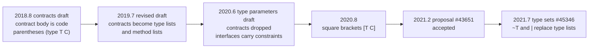

# 8.2 Contract-Based Generics

> A talk accompanies this section: [YouTube recording](https://www.youtube.com/watch?v=E16Y6bI2S08),
> [Google Slides](https://changkun.de/s/go2generics/). The talk was recorded in 2019, while the
> contracts draft was still under discussion, and can be read alongside this section.

[8.1](./history.md) mentioned in a single sentence how the design of constraints moved from
contracts to interfaces. This section expands on that move: what contracts looked like, how
expressive they were, and why they were eventually abandoned. The rejected design explains where
today's `[T Ordered]` syntax comes from, and it illustrates a pattern that recurs in Go's design:
first propose a powerful but fairly complex mechanism, then ask whether what it does can be
expressed with existing concepts.

The `contract` syntax shown in this section appears only in design drafts from 2018 to 2020 and was
never accepted by any released Go compiler. Every contract notation below is given as it appeared in
the draft and is marked "deprecated" in a comment, to avoid confusion with today's syntax.

## 8.2.1 The Problem Constraints Solve

A generic function must answer one question: which operations may be performed on values of the type
parameter `T`? `Max`, which finds the larger of two values, needs the comparison operator `<`; if
`T` is instantiated with a type that cannot be compared, such as some struct or a slice, the
function body is no longer valid. A generics mechanism therefore needs a way for the function's
author to **declare** which operations `T` must support, and for the compiler to check this at the
point of instantiation. This is the **constraint**.

Without constraints, generics has only two fallbacks. One is to leave type parameters entirely
unconstrained, as C++ templates do, so that type errors are deferred until instantiation and surface
as long, hard-to-read error messages. The other is to give up static type information as
`interface{}` does and rely on run-time assertions, sacrificing both type safety and performance
([8.1](./history.md)) [[Cox, 2009](#ref-cox-2009)]. A constraint moves "what `T` must be able to
do" to the declaration, so errors are found at the call site and the compiler has what it needs to
generate correct code. What remains is the question of which syntax to use to write down these
requirements.

## 8.2.2 Contracts: A Piece of Code That Never Runs

In August 2018 Ian Lance Taylor and Robert Griesemer published the contracts design draft and
presented it at that year's GopherCon [[Taylor and Griesemer, 2018](#ref-taylor-griesemer-2018)].
The draft introduced a new keyword, `contract`. A contract looks like a function: it has a list of
type parameters, and its body contains code that uses those types. Any type that makes this code
type-check satisfies the contract. For example, to require that a type support `<`:

```go
// Deprecated: syntax of the 2018 draft; the contract body is code that is only type-checked
contract ordered(e Ele) { e < e }

func Max(type T ordered)(a, b T) T {
	if a < b {
		return b
	}
	return a
}
```

The `e < e` in the contract body is never executed. It means "a type satisfying `ordered` must
support `<`"; likewise `x == x` means comparable, and `var x bool = v.Equal(v)` means there must be
an `Equal` method returning `bool`. Another difference from today is how type parameters are
declared: the draft used parentheses and began with the keyword `type`, as in
`func Max(type T ordered)(a, b T) T`. The change from parentheses to square brackets is part of the
evolution described below.

Expressing constraints as code seems natural, but there is almost no limit on what that code can
look like. The reader must infer what requirements an arbitrary piece of code places on the type,
and the compiler must answer the same question. In July 2019, introducing the revised draft, Taylor
wrote that they had received a great deal of feedback that the earlier contracts were too
complicated; the new contracts were much simpler to write, read and understand, and could specify
the underlying type of a type parameter, list the methods of a type parameter, and describe
relationships between different type parameters [[Taylor, 2019](#ref-taylor-2019)]. The revised
contracts were no longer arbitrary code but a list
[[Taylor and Griesemer, 2019](#ref-taylor-griesemer-2019)]. The permitted types were enumerated in a
**type list**:

```go
// Deprecated: syntax of the 2019 draft; a type list enumerates the permitted types
contract Ordered(T) {
	T int, int8, int16, int32, int64,
		uint, uint8, uint16, uint32, uint64, uintptr,
		float32, float64,
		string
}

func Max(type T Ordered)(a, b T) T {
	if a < b {
		return b
	}
	return a
}
```

Every type in the list supports `<`, so the compiler only needs to confirm that the underlying type
of `T` is one of them to know that `a < b` is valid. A method requirement is written as a type name
followed by a method signature, and contracts can be composed by embedding, with the conditions of
the embedded contract expanded in place:

```go
// Deprecated: requires X to have both String and Print methods
contract stringer(X) {
	X String() string
}

contract PrintStringer(X) {
	stringer(X)
	X Print()
}
```

Where contracts showed their expressive power most was in describing **relationships among several
type parameters**. One example in the draft is a graph: the node type must have a method returning
all of its edges, the edge type must have a method returning its two endpoint nodes, and the two
type parameters refer to each other:

```go
// Deprecated: one contract constrains both type parameters Node and Edge
contract G(Node, Edge) {
	Node Edges() []Edge
	Edge Nodes() (from Node, to Node)
}

type Graph(type Node, Edge G) struct { ... }
```

The draft points out that `Node` and `Edge` here are not interface types but concrete types with
particular methods, such as `*Vertex` and `*FromTo`. An interface describes only a single type, so
this kind of relationship across type parameters was for a time regarded as something only contracts
could do, and it was the hard part that had to be solved when interfaces later replaced contracts.
That completes the picture of what contracts could do: enumerate underlying types, require methods,
compose existing contracts, and constrain relationships among several type parameters.

## 8.2.3 Why They Were Abandoned

The revised contracts were much simpler, but they still created a second declaration mechanism in
the language. To describe which methods a value has, you use `interface`; to describe which
conditions a type parameter must satisfy, you use `contract`. The two have heavily overlapping roles
and entirely different syntax. In June 2020 Taylor and Griesemer published a new design draft and
wrote on the blog: "The biggest change is that we are dropping the idea of contracts. The difference
between contracts and interface types was confusing, so we've eliminated that
difference." [[Taylor and Griesemer, 2020a](#ref-taylor-griesemer-2020a)]

The new draft gives two reasons for the decision: many people found it hard to understand the
difference between contracts and interface types, and contracts turned out to be expressible as a
corresponding set of interfaces, so dropping them lost no expressive power
[[Taylor and Griesemer, 2020b](#ref-taylor-griesemer-2020b)]. Contracts were abandoned not because
of anything they could not do, but because they required users to learn a new mechanism for
something that a concept everyone already knew could do.

The draft also answered another natural question: why not allow operators as method names, such as
`+(T) T`, so that methods alone describe every constraint? The draft's answer is that this is not
enough. Shift `<<` and indexing `[]` accept operands of any integer type, which needs a way to
say "any integer type"; the result of `==` is an untyped boolean; conversions, `range` and the value
range of untyped constants all need new notation; and one must decide whether supporting `<` implies
supporting `<=`, and whether supporting `+` implies supporting `++`. By comparison, type lists need
only one new syntactic construct plus one new name, `comparable`
[[Taylor and Griesemer, 2020b](#ref-taylor-griesemer-2020b)].

## 8.2.4 From Method Sets to Type Sets

The existing concept that could take over the job of constraints is the interface. An interface
originally describes which methods a type must have, that is, its **method set**. What a constraint
needs to express is which operations a type must support, and the two overlap heavily: methods are
operations, and operators are operations too. All that is missing is a way for an interface to
say "the underlying type of `T` must be `int`". The 2020 draft therefore allowed interfaces used as
constraints to contain type lists, written by listing types after the keyword `type` inside the
interface:

```go
// Deprecated: syntax of the June 2020 draft; a type list introduced by type inside an interface
type Ordered interface {
	type int, int8, int16, int32, int64,
		uint, uint8, uint16, uint32, uint64, uintptr,
		float32, float64,
		string
}
```

In April 2021 Taylor proposed restating the semantics of interfaces in terms of **type sets**
(#45346), and the proposal was accepted in July of that year [[Taylor, 2021](#ref-taylor-2021)].
Under this formulation, an interface no longer describes only "the types that implement this set of
methods" but directly describes a set of types, namely which types satisfy it. A method set is just
one way to delimit a type set (all types that implement a given set of methods form a set); type
sets can also be delimited with unions, underlying types and the predeclared `comparable`. `Ordered`
then becomes an ordinary interface:

```go
// Final design: a constraint is an interface described by a type set
type Ordered interface {
	~int | ~int8 | ~int16 | ~int32 | ~int64 |
		~uint | ~uint8 | ~uint16 | ~uint32 | ~uint64 | ~uintptr |
		~float32 | ~float64 |
		~string
}

func Max[T Ordered](a, b T) T {
	if a < b {
		return b
	}
	return a
}
```

The new notation has two symbols that serve type sets: `|` denotes a **union**, merging several
types into one set, and `~T` denotes **all types whose underlying type is `T`**. With `~`, a defined
type such as `type Celsius float64`, whose underlying type is `float64`, also belongs to `Ordered`,
so `Max(Celsius(21.5), 19)` can be called directly without listing such types in the constraint one
by one. The type lists in the 2020 draft also matched by underlying type; type sets simply write
this rule as explicit notation and drop the `type` keyword. Method requirements keep the interface's
existing syntax, and composition of contracts returns to embedding of interfaces.

The hard part left at the end of 8.2.2, relationships among several type parameters, is solved by
**parameterized interfaces**: an interface can itself take type parameters. The graph described by
contract `G` can be split into two interfaces with type parameters, whose arguments are then lined
up in the type parameter list of `Graph` [[Taylor and Griesemer, 2021](#ref-taylor-griesemer-2021)]:

```go
// Final design: parameterized interfaces express relationships among several type parameters
type NodeConstraint[Edge any] interface {
	Edges() []Edge
}

type EdgeConstraint[Node any] interface {
	Nodes() (from, to Node)
}

type Graph[Node NodeConstraint[Edge], Edge EdgeConstraint[Node]] struct { ... }
```

When `Graph[Node NodeConstraint[Edge], Edge EdgeConstraint[Node]]` is instantiated, `Node` and
`Edge` in the two constraints are bound to the same pair of types. The relationship that contracts
expressed with dedicated syntax thus falls under the combination rules that interfaces and type
parameters already have, with no new concept introduced. When instantiating with `*Vertex` and
`*FromTo`, compilers from Go 1.21 on can even infer the edge type from the node slice alone (see
[8.3](./checker.md)). For the common constraint "the type must support `==`", the type set design
provides the predeclared `comparable`, so there is no need to list all comparable types as a
contract would. The simplification did not cost contracts' core expressive power.

## 8.2.5 A Timeline of the Evolution

The move from contracts to type sets did not happen in one step. In chronological order:



The August 2018 draft described constraints with a piece of code
[[Taylor and Griesemer, 2018](#ref-taylor-griesemer-2018)]. The July 2019 revision turned contracts
into type lists and method lists [[Taylor and Griesemer, 2019](#ref-taylor-griesemer-2019)]. The
June 2020 draft dropped contracts and let interfaces carry constraints
[[Taylor and Griesemer, 2020b](#ref-taylor-griesemer-2020b)], and in August of that year type
parameters moved to square brackets. In January 2021 the draft became the formal proposal #43651,
which was accepted in February [[Taylor and Griesemer, 2021](#ref-taylor-griesemer-2021)]. In July
2021 the type set proposal #45346 was accepted, and `~T` and `|` replaced type lists introduced by
`type` [[Taylor, 2021](#ref-taylor-2021)]. In March 2022 the design shipped with Go 1.18.

The change of brackets had concrete reasons. The final proposal explains that the parenthesized
syntax could work but caused several parsing ambiguities. In `var f func(x(T))`, one cannot tell
whether this is a function whose parameter type is the instantiated type `x(T)`, or a parameter
named `x` of parenthesized type `(T)`. For `[]T(v1)` and `[]T(v2){}`, a parser reading the opening
parenthesis cannot tell a conversion from a composite literal. In `interface { M(T) }`, `M(T)` could
be a method or an embedded instantiated interface. The ambiguities can be resolved by adding
parentheses, but the result is awkward; moreover, a run of parentheses as in
`func F(T any)(v T)(r1, r2 T)` and `F(int)(1)` bothered many people
[[Taylor and Griesemer, 2021](#ref-taylor-griesemer-2021)].

Every step subtracted something: first the contract body was narrowed from arbitrary code to a list,
then the `contract` keyword was removed, and finally type lists were absorbed into the unified
semantics of type sets. Complexity was compressed by repeatedly asking "can this be expressed with
existing concepts?", and what remained is a natural generalization of the existing abstraction, the
interface.

## 8.2.6 What This Trade-off Shows

The rise and fall of contracts illustrates a concrete working method: first let a powerful but
complex design exist, then repeatedly ask whether an existing concept can replace it, making the
complexity prove that it is indispensable. Contracts failed that test: they required users to learn
a mechanism used only for constraints, and everything they did could be done by generalized
interfaces.

C++ **Concepts** went through a similar process with a different outcome. Concepts are a mechanism
for describing the requirements on template parameters, intended to address the lack of explicit
specification of template interfaces and the unreadable error messages. The Concepts designed for
C++0x were removed from the draft standard in 2009. In the same year Stroustrup, with Gabriel Dos
Reis and Andrew Sutton, started a redesign from scratch, which produced a technical specification in
2015 [[Stroustrup, 2017](#ref-stroustrup-2017)] and finally entered the standard in C++20. Notably,
the C++20 `requires` expression describes requirements with a piece of code that is never executed,
for example `requires(T x) { { x == x } -> std::convertible_to<bool>; }`
[[Smith, 2020](#ref-smith-2020)], which is very close to the contract bodies in Go's 2018 draft. Go
abandoned this form and chose to describe constraints with type sets; C++ kept it and organized it
with named concepts. The two languages gave different answers to the same problem, which also shows
that how constraints should be expressed is a widely acknowledged hard problem in generics design.

Once this abandoned history is understood, the plainness of today's `[T Constraint]` is no longer
taken for granted: it is the result of a powerful design being rejected and then simplified.
[8.3](./checker.md) discusses how the compiler uses type sets to check, at instantiation, whether
`T` satisfies its constraint.

## Further Reading

- <a id="ref-cox-2009"></a>[Cox, 2009] Russ Cox. "The Generic Dilemma." 2009.
  https://research.swtch.com/generic The generic dilemma; the constraint problem that contracts set
  out to solve comes from the trade-off described there.
- <a id="ref-taylor-griesemer-2019"></a>[Taylor and Griesemer, 2019] Ian Lance Taylor, Robert
  Griesemer. "Contracts — Draft Design." Go design document, 2019-07-31 (superseded).
  https://go.googlesource.com/proposal/+/master/design/go2draft-contracts.md The revised contracts
  draft: type lists, method lists, and contracts over several type parameters.
- <a id="ref-taylor-griesemer-2020a"></a>[Taylor and Griesemer, 2020a] Ian Lance Taylor, Robert
  Griesemer. "The Next Step for Generics." The Go Blog, 2020-06-16.
  https://go.dev/blog/generics-next-step The turning point that announced dropping contracts and
  letting interfaces carry constraints.
- <a id="ref-taylor-griesemer-2020b"></a>[Taylor and Griesemer, 2020b] Ian Lance Taylor, Robert
  Griesemer. "Type Parameters — Draft Design." Go design document, 2020.
  https://go.googlesource.com/proposal/+/master/design/go2draft-type-parameters.md The stage where
  constraints are interfaces and interfaces contain type lists; the section "What happened to
  contracts?" gives the reasons for dropping contracts.
- <a id="ref-taylor-griesemer-2021"></a>[Taylor and Griesemer, 2021] Ian Lance Taylor, Robert
  Griesemer. "Type Parameters Proposal." Go design document, 2021-08-20.
  https://go.googlesource.com/proposal/+/refs/heads/master/design/43651-type-parameters.md The final
  design: square brackets, type sets, `~T` and `|`, and the reasons for choosing square brackets.
- <a id="ref-taylor-2019"></a>[Taylor, 2019] Ian Lance Taylor. "Why Generics?" The Go Blog,
  2019-07-31. https://go.dev/blog/why-generics Why generics are needed, and how the revised
  contracts simplify the 2018 draft.
- <a id="ref-stroustrup-2017"></a>[Stroustrup, 2017] Bjarne Stroustrup. "Concepts: The Future of
  Generic Programming, or How to Design Good Concepts and Use Them Well." WG21 P0557R1, 2017-01-31.
  https://www.stroustrup.com/good_concepts.pdf The design and history of C++ Concepts, another
  evolution of a constraint mechanism to set against Go contracts.
- <a id="ref-taylor-griesemer-2018"></a>[Taylor and Griesemer, 2018] Ian Lance Taylor, Robert
  Griesemer. "Contracts — Draft Design." Go design document, 2018-08-27.
  https://github.com/golang/proposal/blob/00fd2f6529/design/go2draft-contracts.md The original
  contracts draft: the contract body is code that is only type-checked.
- <a id="ref-taylor-2021"></a>[Taylor, 2021] Ian Lance Taylor. "spec: generics: use type sets to
  remove type keyword in constraints." golang/go#45346, 2021.
  https://github.com/golang/go/issues/45346 Restates the semantics of interfaces in terms of type
  sets and introduces `~T` and `|`.
- <a id="ref-smith-2020"></a>[Smith, 2020] Richard Smith, ed. "Working Draft, Standard for
  Programming Language C++." WG21 N4861, 2020.
  https://www.open-std.org/jtc1/sc22/wg21/docs/papers/2020/n4861.pdf The final working draft of
  C++20; §13.7.8 [temp.concept] defines concepts.
