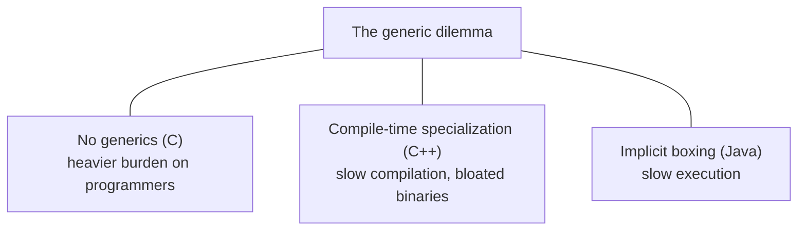
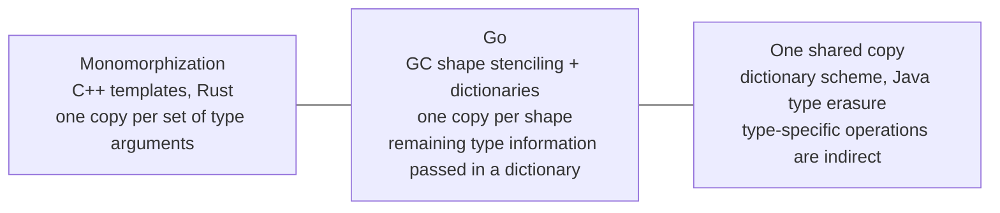

# 8.1 The Evolution of Generics Design

**Generics** let a function or data structure take types as parameters, so that one piece of code
works for many types. Go was open-sourced in 2009 but did not support generics until Go 1.18,
released in March 2022 [[Go Authors, 2022](#ref-go-authors-2022)], after more than a decade of
discussion and several abandoned drafts. This section addresses three questions: why Go went so long
without generics, what is distinctive about the syntax that was finally added, and how the compiler
implements it. The design's move from contracts to type sets is covered in [8.2](./contracts.md),
type-checking issues such as type sets and type inference in [8.3](./checker.md), and developments
since Go 1.18 in [8.4](./future.md).

## 8.1.1 The Long Stalemate: The Generic Dilemma

Without generics, code that applies the same logic to several types can be written in only three
ways. The first is to write one version per type:

```go
func MaxInt(a, b int) int {
	if a > b {
		return a
	}
	return b
}

func MaxFloat64(a, b float64) float64 {
	if a > b {
		return a
	}
	return b
}

// Every additional type needs another copy of the same logic
```

These functions have identical logic and differ only in type. The second is to erase the difference
with the empty interface `interface{}`, so that one piece of code handles every type:

```go
func Max(a, b interface{}) interface{} {
	// The compiler cannot know whether a and b are comparable, so it can only assert their types at run time
	if a.(int) > b.(int) { // handles only int; any other type fails the assertion and panics
		return a
	}
	return b
}
```

This loses static type checking, so type errors surface only at run time, and every call pays for
boxing and type assertions ([4.2](../ch04type/interface.md)). The third is code generation: write a
template, then let a tool generate concrete code for each type. `genny` was one of the more popular
tools at the time, and its templates are themselves compilable Go code:

```go
package maxgen

import "github.com/cheekybits/genny/generic"

// T is a placeholder type. Running
//
//	cat max.go | genny gen "T=int,float64" > max_gen.go
//
// generates one concrete function each for int and float64.
type T generic.Number

func MaxT(a, b T) T {
	if a > b {
		return a
	}
	return b
}
```

Code generation restores static type checking and run-time efficiency. The price is an extra
generation step in the build, regeneration whenever the template changes, and a generator that does
not understand Go's type system. Each of the three approaches has a drawback, and that was the
position of Go programmers before Go 1.18.

Russ Cox summarized this position in a short article in December 2009 as the **generic dilemma**
[[Cox, 2009](#ref-cox-2009)]. He sorted the existing approaches into three kinds. C provides no
generics, which slows programmers down but adds no complexity to the language. C++ specializes code
for each type at compile time, which slows compilation and produces a great deal of duplicated code.
Java boxes everything implicitly, which slows execution. Cox concluded: "do you want slow
programmers, slow compilers and bloated binaries, or slow execution times?"



Go values both compilation speed and run-time efficiency. For a long time it found no design that
was acceptable on all three counts, so it preferred to go without generics. This does not mean the
Go team did not try. Between 2010 and 2013 Ian Lance Taylor wrote four generics drafts, and in 2016
Bryan C. Mills proposed compile-time functions and first-class types; none was adopted
[[Go Authors, 2026b](#ref-go-authors-2026b)]. In April 2016 Andrew Gerrand opened issue #15292,
accompanied by the overview document "Go should have generics" that Taylor had been writing
since 2011. The document lists the four earlier drafts as historical material and acknowledges that
each was flawed in different ways. The issue explains that its purpose was not to add generics at
that time but to show what a complete proposal would have to look like
[[Taylor, 2016](#ref-taylor-2016)]. In August 2018 Russ Cox published "Generics: Problem Overview",
which, together with the contracts draft by Taylor and Robert Griesemer, restarted the design
[[Cox, 2018](#ref-cox-2018)]. Over the following three years, contracts were replaced by constraints
expressed as interfaces. In February 2021 the type parameters proposal by Taylor and Griesemer
(#43651) was accepted [[Taylor and Griesemer, 2021](#ref-taylor-griesemer-2021)], and it shipped a
year later in Go 1.18. This history is covered in [8.2](./contracts.md).

## 8.1.2 The Syntax That Landed: Constraints Are Interfaces

The syntax added in Go 1.18 introduces only one new element on top of existing concepts. Functions
and types can declare **type parameters** in square brackets, and each type parameter has a
**constraint**, which is itself an interface
[[Taylor and Griesemer, 2021](#ref-taylor-griesemer-2021)]:

```go
func Max[T cmp.Ordered](a, b T) T { // T is a type parameter, cmp.Ordered is its constraint
	if a > b {
		return a
	}
	return b
}

var x = Max[int](3, 5) // type argument given explicitly
var y = Max(3.0, 5.0)  // inferred from the arguments; equivalent to Max[float64](3.0, 5.0)
```

`cmp.Ordered` joined the standard library in Go 1.21 and admits every type that supports the
operators `<`, `<=`, `>=` and `>`. When Go 1.18 shipped, the corresponding `constraints.Ordered`
lived in the experimental `golang.org/x/exp/constraints`. Also since Go 1.21, `max` and `min` are
built-in functions [[Go Authors, 2023](#ref-go-authors-2023)]; the `Max` here serves only as an
illustration.

The key change is the generalization of interfaces. Previously, an interface described a **method
set**: a type satisfies the interface if it implements those methods. An interface used as a
constraint describes a **type set**: which types satisfy it. Besides methods, a constraint can
contain a union of types (`int | string`), all types whose underlying type is a given type (`~int`),
and the predeclared constraint `comparable` (types that can be compared with `==` and `!=`)
[[Griesemer and Taylor, 2022](#ref-griesemer-taylor-2022)]. Carrying constraints in existing
interfaces avoids introducing a separate constraint mechanism into the language; this was settled
only after several reversals, described in [8.2](./contracts.md). The precise definition of type
sets and their role in type checking are covered in [8.3](./checker.md).

## 8.1.3 Implementation: GC Shape Stenciling and Dictionaries

The type parameters proposal does not prescribe an implementation. It cites Cox's "The Generic
Dilemma" and notes that the design spares people from choosing slow programmers. How to trade off
between slow compilers (compiling separately for each set of type arguments) and slow execution
(performing every operation on a type-parameter value through a method call) is left to the
implementation [[Taylor and Griesemer, 2021](#ref-taylor-griesemer-2021)].

In 2020 Keith Randall compared the possible implementations in three design documents. The first is
**monomorphization**, which the Go documents call stenciling: the compiler copies the function body
for each set of type arguments, substitutes the concrete types, and compiles the result, so
`Max[int]` and `Max[float64]` become two independent pieces of machine code
[[Randall, 2020a](#ref-randall-2020a)]. C++ templates and Rust generics both work this way. There is
no extra run-time overhead, and each copy can be fully optimized for its concrete types; the price
is code bloat and slower compilation, which is the "slow compilers and bloated binaries" horn of the
dilemma. The second is the **dictionary**: one piece of code is generated per generic function, and
the caller passes the type-specific information as an extra argument
[[Randall, 2020b](#ref-randall-2020b)]. This is compact and compiles quickly, but many operations on
type-parameter values go through the dictionary indirectly, which approaches the "slow
execution" horn. Java generics **erase** the type parameters after compilation, so all instances
share one piece of code [[Bracha et al., 1998](#ref-bracha-et-al-1998)], which also falls on the
shared-code end. The third document proposes a compromise between the two, which Go 1.18 actually
adopted: **GC shape stenciling** plus dictionaries [[Randall, 2020c](#ref-randall-2020c)]
[[Scales, 2022](#ref-scales-2022)]:



### Shapes

Instead of generating code for every type argument, the compiler first sorts type arguments into
**GC shapes**, and types of the same shape share one copy of the code. The name comes from Randall's
design: a type's GC shape is how it looks to the memory allocator and the garbage collector,
determined by its size, its alignment requirement and which parts are pointers
([Chapter 13](../../part4memory/ch13gc/readme.md)) [[Randall, 2020c](#ref-randall-2020c)]. The
actual implementation uses a finer partition. The Go 1.18 implementation document states that two
types have the same shape if and only if they have the same underlying type, or if both are pointer
types. The partition is drawn this way to guarantee that a dictionary never has to hold an
implementation of an operator: `int` and `float64` arithmetic are different machine instructions,
and shifts on `int16` and `int32` also differ, so these types all belong to different shapes
[[Scales, 2022](#ref-scales-2022)]. Randall's document gives another reason: under a register-based
calling convention, `struct{ x, y int }` and `[2]int` have the same size and pointer layout but are
assigned to registers differently, so size and pointer layout alone cannot determine where the
arguments go.

In Go 1.26 the shape is determined by the function `shapify` in package `cmd/compile/internal/noder`
[[Go Authors, 2026a](#ref-go-authors-2026a)]. Its core logic is:

```go
// Go 1.26 cmd/compile/internal/noder/reader.go, abridged, comments added by the author
func shapify(targ *types.Type, basic bool) *types.Type {
	// basic is true when the constraint of the corresponding type parameter is a basic interface (an interface with only methods).
	// The pointed-to type then does not affect the generated code, so every pointer gets the shape *byte.
	pointerShaping := basic && targ.IsPtr() && !targ.Elem().NotInHeap()
	// ...
	under := targ.Underlying() // in all other cases the shape is the underlying type
	if pointerShaping {
		under = types.NewPtr(types.Types[types.TUINT8])
	}
	// ... find or create the unique shape type in package go.shape, keyed by under
}
```

Shape types all live in a special package named `go.shape`, for example `go.shape.int` and
`go.shape.string`; merged pointers are always written `go.shape.*uint8`. So in Go 1.26 merging
pointers has a precondition: the constraint of the type parameter must be a basic interface
containing only methods, such as `any`. A TODO comment in `shapify` notes that shapes could be
coarser still: group all pointer-shaped types into one class, group scalars of equal size and
alignment into one class, apply shaping recursively to the elements of composite types, and discard
struct field names and tags. Implementing part of this would first require tracking how type
parameters are actually used in the function body.

### Dictionaries

A single shape instance must serve many types, and the type information it lacks is supplied by a
**dictionary**. A dictionary is read-only data generated statically at compile time, one for each
pair of generic function and concrete type arguments, for example `main..dict.Max[int]`. The
compiler adds a hidden first parameter `.dict` to each shape instance, and the caller passes the
dictionary's address [[Scales, 2022](#ref-scales-2022)]. In Go 1.26 the run-time dictionary consists
of four parts in order, corresponding to the last four fields of the `readerDict` struct
[[Go Authors, 2026a](#ref-go-authors-2026a)]:

- method expressions for the methods declared in the constraint, used to call methods of the type
  parameter;
- sub-dictionaries, the dictionaries passed to other generic functions called from the function
  body;
- type descriptors ([4.1](../ch04type/type.md)), used to convert a type-parameter value to the empty
  interface, and for type assertions and type switches;
- interface tables (`itab`, [4.2](../ch04type/interface.md)), used to convert a type-parameter value
  to a non-empty interface.

The dictionary is consulted only for operations that the shape alone cannot perform. The following
program instantiates `Max` with three types and `Last` with two pointer types:

```go {run=true}
package main

import (
	"cmp"
	"fmt"
	"os"
)

type Node struct{ v int }

//go:noinline
func Max[T cmp.Ordered](a, b T) T {
	if a > b {
		return a
	}
	return b
}

//go:noinline
func Last[T any](s []T) T { return s[len(s)-1] }

func main() {
	fmt.Println(Max(3, 5), Max[int64](3, 5), Max("a", "b"))
	n := Last([]*Node{{1}, {2}})
	f := Last([]*os.File{os.Stdout})
	fmt.Println(n.v, f == os.Stdout)
}
```

```
5 5 b
2 true
```

Building with `GOOS=linux GOARCH=amd64 go build` and inspecting the symbols in the binary with
`go tool nm`, only the following entries relate to these two functions:

```
main.Max[go.shape.int]
main.Max[go.shape.int64]
main.Max[go.shape.string]
main.Last[go.shape.*uint8]
main..dict.Max[int]
main..dict.Max[int64]
main..dict.Max[string]
main..dict.Last[*main.Node]
main..dict.Last[*os.File]
```

The constraint `cmp.Ordered` of `Max` admits only scalars and strings, and the three type arguments
have pairwise different underlying types, so each gets its own copy; `int` and `int64` have the same
size but are not merged. The constraint of `Last` is `any`, so the two pointer types fall into the
same shape `*uint8` and share one copy, differing only in the dictionary. Inspecting the assembly
with `-gcflags=-S`, the code in `main` that calls `Max(3, 5)` is:

```asm
LEAQ  main..dict.Max[int](SB), AX   // address of the dictionary, the hidden first argument
MOVL  $3, BX                        // a
MOVL  $5, CX                        // b
CALL  main.Max[go.shape.int](SB)
```

The shape instance itself is:

```asm
TEXT  main.Max[go.shape.int](SB), DUPOK|NOSPLIT|NOFRAME|ABIInternal, $0-24
CMPQ  CX, BX       // compares a and b directly; the dictionary in AX is not used
JGE   9
MOVQ  BX, AX
RET
MOVQ  CX, AX
RET
```

The argument area is 24 bytes; the 8 bytes beyond `a` and `b` are the dictionary pointer. On shape
`go.shape.int`, `>` is just an integer comparison, so the compiler emits a compare instruction
directly. This instance does not need the dictionary at all and is no different from a hand-written
`MaxInt`.

Dictionaries are needed for a different class of operations. The following `Describe` uses
`fmt.Stringer` as its constraint and calls the `String` method declared by the constraint in its
body:

```go
//go:noinline
func Describe[T fmt.Stringer](x T) string {
	return "<" + x.String() + ">" // calls the method declared in the constraint
}

// Calls: Describe(&Celsius{21.5}), Describe(&Meter{8848})
```

Both arguments are pointers and the constraint is a basic interface, so the two share
`main.Describe[go.shape.*uint8]`. Within this code the compiler cannot know which method
`x.String()` should call, so it must fetch it from the dictionary:

```asm
MOVQ  (AX), CX   // load the entry address of the String method from the first dictionary slot
MOVQ  AX, DX     // the closure context register points to this slot
MOVQ  BX, AX     // receiver x
CALL  CX         // indirect call
```

The first dictionary slot holds the entry address of the method expression `(*Celsius).String` (or
`(*Meter).String` in the other dictionary), and the generated code calls it indirectly in the same
way as a function value ([6.1.2](../ch06func/func.md)). Compared with a direct call, this adds a
memory load and an indirect jump. More importantly, the compiler cannot see the callee while
compiling `Describe`, so it cannot inline it, and escape analysis can only make conservative
assumptions. Randall anticipated this in the design document: most code generated by shape
stenciling is the same as with full monomorphization, but method calls on type parameters cannot be
resolved at compile time, which may cause more heap allocation and miss inlining that would
otherwise be possible [[Randall, 2020c](#ref-randall-2020c)].

Compare this mechanism with the **dictionary passing** of Haskell type classes
([4.2](../ch04type/interface.md)) and the family resemblance is clear. When Haskell compiles a
function with an `Ord a` constraint, it packages the implementations of `Ord`'s methods into a
dictionary and passes it as an implicit argument [[Wadler and Blott, 1989](#ref-wadler-blott-1989)].
A Go dictionary is likewise a hidden argument, except that its contents are fixed at compile time
according to what each shape instance needs, and it is used only when the shape is insufficient to
determine the operation.

Suppose a program uses $n$ distinct type arguments, which merge into $s$ shapes ($s \le n$). The
code size of full monomorphization is proportional to $n$, that of the shared-code scheme to $1$,
and that of Go's scheme to $s$. The run-time costs run the opposite way. Monomorphized code has no
extra indirection; the shared-code scheme performs almost every type-specific operation indirectly;
Go consults the dictionary only for operations the shape cannot determine, namely calling methods of
the type parameter, converting to an interface, and type assertions. The coarser the shapes, the
smaller $s$ is, the less code is generated, and the more operations need a dictionary lookup. The
TODO in `shapify` shows that this trade-off is still being tuned.

## 8.1.4 Theoretical Roots and Comparison with Other Languages

The idea of parameterizing over types has a long history. In his 1967 lecture notes Christopher
Strachey distinguished two kinds of polymorphism. **Parametric polymorphism** means a function acts
uniformly on any type, such as `map`, which applies a function to each element of a list. **Ad hoc
polymorphism** has no uniform rule: the same name has different implementations for different types,
as with arithmetic operators [[Strachey, 2000](#ref-strachey-2000)]. In 1978 Robin Milner gave a
type system and a type inference algorithm for parametric polymorphism in the language ML
[[Milner, 1978](#ref-milner-1978)]. In 1989 David Musser and Alexander Stepanov proposed **generic
programming**: starting from concrete, efficient algorithms and abstracting them into generic
algorithms that can be combined with different data representations
[[Musser and Stepanov, 1989](#ref-musser-stepanov-1989)], an idea that later became the basis of the
C++ Standard Template Library. In the same year Philip Wadler and Stephen Blott proposed Haskell's
type classes, which implement constrained polymorphism through dictionary passing
[[Wadler and Blott, 1989](#ref-wadler-blott-1989)]. Go's type parameters are parametric
polymorphism, with constraints adding restrictions on top.

In implementation strategy, languages fall between the poles of monomorphization and shared code:

| Language | Implementation strategy | Run-time type information | Main cost |
| --- | --- | --- | --- |
| C++ templates | Monomorphization | Not needed | Code bloat, slow compilation, hard-to-read template error messages |
| Rust | Monomorphization (plus dynamic dispatch with `dyn`) | Not needed | Code bloat, slow compilation |
| Java | Type erasure, all instances share one copy | Type arguments not kept | Primitive types must be boxed, e.g. only `List<Integer>` is possible |
| C# | Run-time reification: reference types share code, value types are specialized on demand | Type arguments kept | The JIT must generate specialized code at run time |
| Haskell | Type classes and dictionary passing | Supplied by dictionaries | Indirect calls through dictionaries |
| Go | GC shape stenciling plus dictionaries | Supplied by dictionaries | Indirect calls through dictionaries, some calls cannot be inlined |

Java generics originate in GJ, proposed by Bracha, Odersky, Stoutamire and Wadler in 1998. For
compatibility with existing libraries and the virtual machine, GJ erases type parameters after
compilation, so generic code and pre-existing non-generic code can call each other
[[Bracha et al., 1998](#ref-bracha-et-al-1998)]. C# took another path: Andrew Kennedy and Don Syme
kept type arguments in the .NET Common Language Runtime. All instantiations over reference types
share one copy, while instantiations over value types get specialized code generated by the JIT
compiler at run time, so value types need no boxing
[[Kennedy and Syme, 2001](#ref-kennedy-syme-2001)].

Go's position is closest to C#'s: both share code for pointer or reference types and keep concrete
type information at run time. The difference is that Go has no JIT, all shape instances and
dictionaries are generated at compile time, and the granularity of code sharing is determined by the
GC shape, a notion tied directly to memory layout and garbage collection.

## 8.1.5 Trade-offs

Go's generics deliberately omit many capabilities found in other languages. The type parameters
proposal lists explicitly what it does not support: specialization, that is, writing a separate
version for particular type arguments; metaprogramming, that is, running code at compile time to
generate code; higher-level abstraction that takes generic functions or generic types as parameters;
covariance and contravariance of function parameters; operator methods; partial instantiation
(currying); variadic type parameters; and non-type values such as constants as parameters
[[Taylor and Griesemer, 2021](#ref-taylor-griesemer-2021)]. Methods also cannot declare additional
type parameters; this restriction was lifted in a limited form only in Go 1.27, as described in
[8.4.2](./future.md). The proposal holds that it already covers the basic needs of generic
programming, and whether the remaining needs exist, and in what form to meet them, is left to
practice.

Later evolution has kept this pace: provide a minimal usable form of generics first, then add to it
based on experience. Go 1.21 added generic packages such as `slices`, `maps` and `cmp`, Go 1.24
supported generic type aliases ([4.3](../ch04type/alias.md)), Go 1.26 allowed a constraint to refer
to the generic type being constrained, and Go 1.27 added generic methods; these are covered in
[8.4](./future.md). On the implementation side, the granularity of shapes and the indirection cost
of dictionaries remain open to improvement. Coarser shapes could reduce code further, but one must
first confirm that this does not degrade operations that could be inlined into dictionary lookups.
And when the call site pins down the concrete instance, the compiler since Go 1.21 can already fold
the entry address read from the dictionary into a constant, yet still misses the opportunity to
inline ([8.4.4](./future.md)). Generics' decade-long journey in Go shows Go's attitude toward
complexity: it prefers to wait until it finds a design acceptable on every count, whether
compilation speed, run-time efficiency or the simplicity of the language.

## Further Reading

- <a id="ref-cox-2009"></a>[Cox, 2009] Russ Cox. "The Generic Dilemma." 2009-12-03.
  https://research.swtch.com/generic
  The original statement of the "pick two of three" trade-off.
- <a id="ref-taylor-griesemer-2021"></a>[Taylor and Griesemer, 2021] Ian Lance Taylor, Robert
  Griesemer. "Type Parameters Proposal." Go design document, 2021-08-20.
  https://go.googlesource.com/proposal/+/refs/heads/master/design/43651-type-parameters.md The final
  design of Go 1.18 generics: type parameters, constraints and type sets, type inference, and the
  deliberately omitted features.
- <a id="ref-scales-2022"></a>[Scales, 2022] Dan Scales. "Go 1.18 Implementation of Generics via
  Dictionaries and Gcshape Stenciling." Go design document, 2022.
  https://go.googlesource.com/proposal/+/refs/heads/master/design/generics-implementation-dictionaries-go1.18.md
  The design document of the Go 1.18 implementation: how shapes are partitioned, the dictionary
  format and naming, and the compiler's processing pipeline.
- <a id="ref-go-authors-2026a"></a>[Go Authors, 2026a] The Go Authors.
  `cmd/compile/internal/noder/reader.go`.
  https://github.com/golang/go/blob/master/src/cmd/compile/internal/noder/reader.go (Go
  1.26: <https://github.com/golang/go/blob/release-branch.go1.26/src/cmd/compile/internal/noder/reader.go>)
  `readerDict` and `shapify`: the actual implementation of dictionary entries and shape merging.
- <a id="ref-go-authors-2022"></a>[Go Authors, 2022] The Go Authors. Go 1.18 Release Notes.
  https://go.dev/doc/go1.18
  The official release of generics.
- <a id="ref-griesemer-taylor-2022"></a>[Griesemer and Taylor, 2022] Robert Griesemer, Ian Lance
  Taylor. "An Introduction To Generics." The Go Blog, 2022-03-22. https://go.dev/blog/intro-generics
  An introduction to type parameters, type sets and type inference.
- <a id="ref-wadler-blott-1989"></a>[Wadler and Blott, 1989] Philip Wadler, Stephen Blott. "How to
  Make Ad-hoc Polymorphism Less Ad Hoc." *POPL '89*, 60–76, 1989.
  https://doi.org/10.1145/75277.75283 The original paper on type classes and dictionary passing, the
  theoretical source of Go's dictionary approach.
- <a id="ref-go-authors-2026b"></a>[Go Authors, 2026b] The Go Authors. Proposal: Generics
  (design/15292 series). golang/proposal.
  https://github.com/golang/proposal/tree/master/design/15292 An archive of the generics drafts from
  2010 to 2016: Taylor's Type Functions, Generalized Types (two versions) and Type Parameters in Go,
  and Mills's Compile-time Functions and First Class Types.
- <a id="ref-taylor-2016"></a>[Taylor, 2016] Ian Lance Taylor. "Proposal: Go should have
  generics." Go design document, created 2011-01, last updated 2016-04.
  https://go.googlesource.com/proposal/+/master/design/15292-generics.md The overview document
  accompanying issue #15292: why generics are needed, what a generics design must satisfy, and the
  list of the four earlier drafts.
- <a id="ref-cox-2018"></a>[Cox, 2018] Russ Cox. "Generics — Problem Overview." Go design document,
  2018-08-27. https://go.googlesource.com/proposal/+/master/design/go2draft-generics-overview.md
  The restatement of the problem when the generics design was restarted in 2018.
- <a id="ref-randall-2020a"></a>[Randall, 2020a] Keith Randall. "Generics implementation -
  Stenciling." Go design document, 2020.
  https://go.googlesource.com/proposal/+/master/design/generics-implementation-stenciling.md The
  scheme that generates one copy of the code for each set of type arguments.
- <a id="ref-randall-2020b"></a>[Randall, 2020b] Keith Randall. "Generics implementation -
  Dictionaries." Go design document, 2020.
  https://go.googlesource.com/proposal/+/master/design/generics-implementation-dictionaries.md The
  scheme that generates a single copy of the code and passes type information in a dictionary.
- <a id="ref-randall-2020c"></a>[Randall, 2020c] Keith Randall. "Generics implementation - GC Shape
  Stenciling." Go design document, 2020.
  https://go.googlesource.com/proposal/+/master/design/generics-implementation-gcshape.md The
  compromise between the first two schemes: generate code per GC shape and use dictionaries to
  handle differences between types of the same shape.
- <a id="ref-go-authors-2023"></a>[Go Authors, 2023] The Go Authors. Go 1.21 Release Notes.
  https://go.dev/doc/go1.21
  The built-in functions `min` and `max`, and package `cmp`.
- <a id="ref-strachey-2000"></a>[Strachey, 2000] Christopher Strachey. "Fundamental Concepts in
  Programming Languages." *Higher-Order and Symbolic Computation* 13(1–2): 11–49, 2000.
  https://doi.org/10.1023/A:1010000313106 Lecture notes from the 1967 Copenhagen summer school,
  distinguishing parametric from ad hoc polymorphism.
- <a id="ref-milner-1978"></a>[Milner, 1978] Robin Milner. "A Theory of Type Polymorphism in
  Programming." *Journal of Computer and System Sciences* 17(3): 348–375, 1978.
  https://doi.org/10.1016/0022-0000(78)90014-4 ML's polymorphic type system and type inference
  algorithm.
- <a id="ref-musser-stepanov-1989"></a>[Musser and Stepanov, 1989] David R. Musser, Alexander A.
  Stepanov. "Generic Programming." *Symbolic and Algebraic Computation (ISSAC '88)*, LNCS 358:
  13–25, 1989. https://doi.org/10.1007/3-540-51084-2_2 The source of the term "generic programming".
- <a id="ref-bracha-et-al-1998"></a>[Bracha et al., 1998] Gilad Bracha, Martin Odersky, David
  Stoutamire, Philip Wadler. "Making the Future Safe for the Past: Adding Genericity to the Java
  Programming Language." *OOPSLA '98*, 183–200, 1998. https://doi.org/10.1145/286936.286957 GJ and
  type erasure, the precursor of Java generics.
- <a id="ref-kennedy-syme-2001"></a>[Kennedy and Syme, 2001] Andrew Kennedy, Don Syme. "Design and
  Implementation of Generics for the .NET Common Language Runtime." *PLDI '01*, 1–12, 2001.
  https://doi.org/10.1145/378795.378797 Reified generics that keep type arguments: reference types
  share code, and value types are specialized on demand by the JIT.
