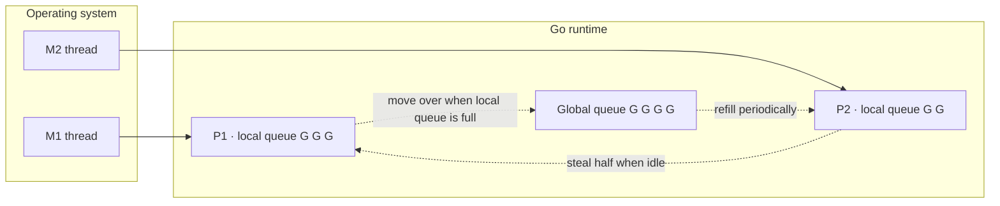
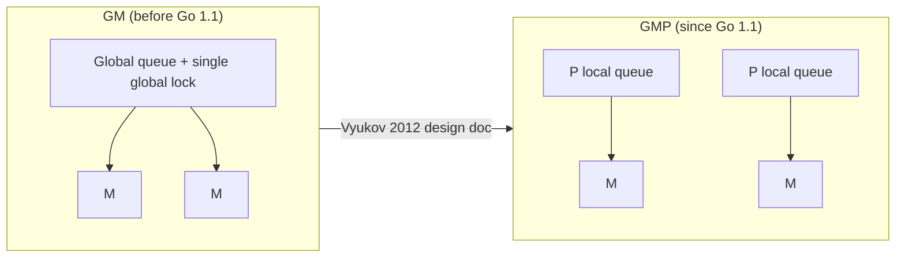

# 9.1 The Scheduling Problem and the GMP Model

After `go f()` executes, the function `f` runs in a new goroutine. The runtime scheduler decides
when and on which thread it runs. The problem the scheduler solves can be stated as follows: how to
let tens of thousands of goroutines take turns on a limited number of CPU cores, so that creation
and switching are cheap, the program scales with the number of cores, and a goroutine's blocking
stays transparent to the programmer. This section first covers the historical background of the
problem and several classic answers, then introduces Go's GMP model and where it came from, and
finally uses scheduling theory to describe what guarantees the scheduler can reach. The following
sections take up the parts of the model one by one.

## 9.1.1 Three Threading Models

Historically, three threading models have emerged for mapping concurrent tasks onto processors. They
strike different balances among overhead, parallelism and implementation complexity.

- The **1:1 model**, or kernel-thread model: each user thread corresponds to one operating system
  thread. Threads run truly in parallel, the kernel handles blocking system calls transparently, and
  the implementation is the simplest. The cost is that creating and switching threads both trap into
  the kernel, and each thread reserves megabytes of stack space. Linux NPTL, Windows and Java
  platform threads all use this model.
- The **N:1 model**, or pure user-level threads, formerly called "green threads": several user
  threads share one operating system thread. Switching happens entirely in user space, so the
  overhead is very low and stacks can be small. But the model cannot use multiple cores, and when
  any one thread makes a blocking system call, all threads stall together.
- The **M:N model**, or two-level model: $M$ user threads are multiplexed onto $N$ kernel threads.
  It combines low overhead with parallelism, at the price of requiring a user-space scheduler and a
  kernel scheduler to work together, which is the source of its complexity.

In the 1990s the M:N model was once seen as very promising. The most influential proposal was
**scheduler activations** by Anderson et al.: the kernel notifies the user-level scheduler when a
thread blocks, resumes and so on, so that the two levels of scheduling can cooperate
[[Anderson et al., 1992](#ref-anderson-et-al-1992)]. Industry nevertheless mostly returned to the
1:1 model. Drepper and Molnar explained the choice in the design document of Linux NPTL: in the M:N
model two schedulers work at the same time, and if they do not cooperate, scheduling decisions can
degrade performance significantly. The kernel developers' consensus was that an M:N implementation
does not fit the philosophy of the Linux kernel, and the infrastructure it requires is too costly,
for example copying register contents from kernel space to switch contexts in a user-level scheduler
[[Drepper and Molnar, 2005](#ref-drepper-molnar-2005)].

Go chose the M:N model anyway. It can avoid the difficulties its predecessors met because everything
it needs is in the runtime's own hands and does not depend on kernel cooperation. First, a goroutine
stack is small and growable: it starts at 2 KiB, and since Go 1.19 the initial size is adjusted
according to the average stack usage of past goroutines, so both creation and switching are cheap
[[Go Authors, 2022](#ref-go-authors-2022)]. Second, every operation that may block goes through the
runtime. Synchronization operations such as channels and locks only suspend the goroutine, not the
thread. Network I/O is taken over by the built-in network poller ([9.9](./poller.md)), so waiting
goroutines are suspended and occupy no thread. For system calls that do block a thread, the runtime
hands the resource needed to run Go code (the P below) to another thread, so the remaining
goroutines are unaffected ([9.5](./thread.md)). Scheduler activations need the kernel to notify the
user-level scheduler when a thread blocks; Go arranges this itself in the runtime before entering
the system call, so it needs no help from the kernel.

## 9.1.2 The GMP Model

The interactive figure below shows the GMP model at work. Each P holds a local run queue, and an M
that has acquired a P runs the G at the head of the queue. When a P finds both its local queue and
the global queue empty, it steals half of the Gs from another P. You can pause, single-step, or run
`go func()` by hand to watch the queues and the stealing change.

The Go scheduler is built around three structures, collectively called GMP:

- **G** (goroutine): a piece of concurrently executing user code, together with its stack and
  execution state;
- **M** (machine): an operating system thread, the entity that actually executes instructions on a
  CPU;
- **P** (processor): a logical processor, representing the resources and the permission needed to
  run Go code. The number of Ps is determined by `GOMAXPROCS`.

The relationship among the three fits in one sentence: **an M must hold a P to run a G**. The number
of Ps is therefore the upper bound on the parallelism of Go code. Each P has a **local run queue**
with a capacity of 256 that holds ready Gs, and there is also a **global run queue** shared by all
Ps [[Go Authors, 2026](#ref-go-authors-2026)]. The basic procedure is that the M holding a P takes a
G from the queue and runs it, then takes the next one after that G yields or is preempted. When the
local queue is empty, the M looks for a runnable G in the global queue and in other Ps, which is the
work stealing discussed in [9.2](./steal.md).

A goroutine is a **stackful coroutine**: it has its own stack, can be suspended at any call depth,
and can be preempted. This is the fundamental difference from the stackless coroutines discussed
below. Goroutine stacks were originally implemented as segmented stacks. Go 1.3 changed them to
contiguous stacks: when the stack runs out of space, the whole stack is copied to a larger
contiguous block of memory, which removes the "hot split" problem of a computation repeatedly
crossing a segment boundary [[Go Authors, 2014](#ref-go-authors-2014)]. See
[Chapter 14](../../part4memory/ch14stack) for details.

## 9.1.3 Choices of Other Runtimes

How to run a huge number of concurrent units at low cost is a problem shared by this generation of
language runtimes, and GMP is only one answer. Comparing it with other runtimes shows more clearly
where GMP stands.

- **Erlang/BEAM**: lightweight processes each have their own heap and share no mutable state. The
  scheduler preempts by **reduction** count (roughly the number of function calls). There is one
  scheduler per core, each with its own run queue, and load is balanced by migrating processes
  [[Stenman, n.d.](#ref-stenman-nd)].
- **Java virtual threads** (JEP 444, finalized in JDK 21 in 2023): a virtual thread is mounted on a
  platform thread (called the carrier thread) to run, and is unmounted on blocking operations such
  as I/O. The scheduler is a work-stealing `ForkJoinPool` running in FIFO mode, whose parallelism
  defaults to the number of available processors [[OpenJDK, 2023](#ref-openjdk-2023)]. This is
  essentially an M:N model too, the one rejected on Linux back then and now adopted again in the
  JVM.
- **GHC Haskell**: lightweight threads are multiplexed onto as many Haskell execution contexts as
  there are cores, and parallelism comes from work stealing together with sparks produced by `par`
  [[Marlow et al., 2009](#ref-marlow-et-al-2009)].
- **Rust and .NET async**: these use **stackless coroutines**. An `async` function is compiled into
  a state machine, and the state at a suspension point is saved in the state machine object rather
  than on a separate stack. A runtime such as Tokio drives its execution.

A key design axis appears here: stackful or stackless. A stackful coroutine needs a stack for each
concurrent unit, and in return it can be suspended at any depth and can be preempted. A stackless
coroutine saves the separate stack, but its suspension points are fixed at `.await` at compile time,
so it can only be scheduled cooperatively: a loop containing no `.await` cannot be interrupted by
the runtime. Go chose stackful coroutines, and can therefore implement the asynchronous preemption
described in [9.7](./preemption.md), which can interrupt even an infinite loop with no function
calls.

## 9.1.4 From GM to GMP

The P did not exist at the beginning. The scheduler of 2008 had only G and M
[[Cox, 2008](#ref-cox-2008)]. When Go was open-sourced in 2009, the scheduler by default let only
one thread run user code, and setting the environment variable `GOMAXPROCS` raised this limit
[[Cox, 2009](#ref-cox-2009)]. All ready Gs sat on one global queue protected by a global lock. In
2012, Dmitry Vyukov pointed out in the *Scalable Go Scheduler Design Doc* that this scheduler
limited the scalability of concurrent programs: the Vtocc server could use at most 70% of the CPU on
an 8-core machine, and profiling showed 14% of the time spent in `runtime.futex`. Vyukov summarized
four problems [[Vyukov, 2012](#ref-vyukov-2012)]:

1. A single global mutex and centralized state: all goroutine-related operations, such as creation,
   completion and rescheduling, contend for this lock;
2. Goroutine handoff: worker threads frequently hand runnable Gs to each other, which adds latency
   and overhead;
3. Per-M memory caches: resources such as memory caches are attached to every M, although only an M
   that is running Go code needs them. The ratio of Ms running Go code to all Ms can be as low as
   1:100, and each cache can take up to 2 MB, which wastes memory and hurts data locality;
4. Overly aggressive thread blocking and unblocking: with system calls present, worker threads block
   and wake up frequently, which is expensive.

Introducing P addresses these problems directly. The local run queues keep most enqueue and dequeue
operations from contending for the global lock. Memory caches and similar resources move from M to
P, so their number is fixed at `GOMAXPROCS` and locality improves. M and P can be separated and
recombined, so when a thread enters a system call it can hand its P to another M to keep running Go
code. This implementation was committed in March 2013 [[Vyukov, 2013a](#ref-vyukov-2013a)], together
with the network poller integrated with the runtime committed the same month
[[Vyukov, 2013b](#ref-vyukov-2013b)], and both shipped in Go 1.1 in May 2013. Notably, the Go 1.1
release notes do not mention the scheduler rewrite; the performance section only says that, because
of tighter integration of the runtime with the network library, network operations require fewer
context switches [[Go Authors, 2013](#ref-go-authors-2013)].

`GOMAXPROCS` is the number of Ps, and its default value has changed twice. Before Go 1.5 the default
was 1, because a program that switches goroutines frequently runs much more slowly with multiple
threads: switching between two goroutines on the same thread is far cheaper than switching between
threads. In a 2015 design document, Cox noted that improvements such as scheduling affinity had
largely solved this problem by keeping goroutines that are concurrent but not parallel on the same
thread, and that as core counts kept growing, not using multiple cores by default would put Go at a
disadvantage [[Cox, 2015](#ref-cox-2015)]. Since Go 1.5 the default is therefore the number of
available CPU cores [[Go Authors, 2015](#ref-go-authors-2015)].

In containers this default can be too high: a container's CPU limit is implemented through the
bandwidth control of Linux cgroups, and a process that has used up its quota for a period is stopped
completely for the rest of that period, which greatly affects tail latency. Since Go 1.25, if
`GOMAXPROCS` is not set explicitly, the runtime in a container takes the smaller of the CPU limit
and the core count as the default, rounds a fractional limit up, and periodically checks for changes
to the limit [[Pratt and Amedee, 2025](#ref-pratt-amedee-2025)]. In the Go 1.26 implementation this
logic applies only on Linux, the rounded-up limit is at least 2, and the system monitor checks at
most once per second [[Go Authors, 2026](#ref-go-authors-2026)].

## 9.1.5 A Scheduling-Theory Perspective

> This subsection is for readers interested in theory; skipping it does not affect understanding of
> the implementation that follows.

There is no "optimal" scheduler, because a real scheduler is **online**: it must decide on the spot,
without knowing which goroutines will arrive in the future or when they will block. An **offline**
scheduler with all future information can always do better, and the gap between the two is measured
by the **competitive ratio**, the worst-case ratio of an online algorithm's cost to the offline
optimum. Sleator and Tarjan systematically introduced this method of analysis in 1985 while studying
list update and paging problems [[Sleator and Tarjan, 1985](#ref-sleator-tarjan-1985)]. What one can
expect of a scheduler is therefore provably good bounds, not optimality.

The analysis of online scheduling is usually traced back to a result Graham proved in 1966: greedy
**list scheduling**, in which a processor that becomes idle immediately takes a ready task, finishes
all tasks on $m$ identical machines in at most $2 - 1/m$ times the optimal time
[[Graham, 1966](#ref-graham-1966)]. The result shows that as long as processors are never idle while
there is work to do, the outcome is not much worse than optimal even without knowledge of the
future. Work stealing extends this principle to distributed run queues. Blumofe and Leiserson proved
that for a computation with total work $T_1$ and critical-path length $T_\infty$, randomized work
stealing has an expected execution time of $T_1/P + O(T_\infty)$ on $P$ processors
[[Blumofe and Leiserson, 1999](#ref-blumofe-leiserson-1999)]. Here $T_1/P$ is the ideal linear
speedup and $O(T_\infty)$ is the part that cannot be parallelized. Go, GHC, Erlang and Java virtual
threads have all converged on one run queue per core plus work stealing, and this bound is the
theoretical basis. Its full statement, the idea of the proof and its scope (the result concerns
fork-join computations; for goroutine programs of arbitrary structure it is only a heuristic, not a
strict guarantee) are in [9.2](./steal.md).

## Further Reading

- [Anderson et al., 1992] Thomas E. Anderson, Brian N. Bershad,
  Edward D. Lazowska, Henry M. Levy. "Scheduler Activations: Effective Kernel Support for the
  User-Level Management of Parallelism." *ACM Transactions on Computer Systems* 10(1): 53–79, 1992
  (conference version in SOSP 1991). https://doi.org/10.1145/146941.146944
- [Drepper and Molnar, 2005] Ulrich Drepper, Ingo Molnar. *The
  Native POSIX Thread Library for Linux*. Red Hat, 2005.
  https://www.akkadia.org/drepper/nptl-design.pdf The argument for why the 1:1 model won on Linux.
- [Vyukov, 2012] Dmitry Vyukov. *Scalable Go Scheduler Design Doc*.
  2012-05-02. https://go.dev/s/go11sched
- [Marlow et al., 2009] Simon Marlow, Simon Peyton Jones, Satnam
  Singh. "Runtime Support for Multicore Haskell." *Proceedings of the 14th ACM SIGPLAN International
  Conference on Functional Programming (ICFP 2009)*, 65–78. https://doi.org/10.1145/1596550.1596563
- [OpenJDK, 2023] OpenJDK. *JEP 444: Virtual Threads*. JDK 21, 2023.
  https://openjdk.org/jeps/444
- [Blumofe and Leiserson, 1999] Robert D. Blumofe, Charles E.
  Leiserson. "Scheduling Multithreaded Computations by Work Stealing." *Journal of the ACM* 46(5):
  720–748, 1999. https://doi.org/10.1145/324133.324234
- [Pratt and Amedee, 2025] Michael Pratt, Carlos
  Amedee. "Container-aware GOMAXPROCS." The Go Blog, 2025-08-20.
  https://go.dev/blog/container-aware-gomaxprocs
- [Stenman, n.d.] Erik Stenman. *The BEAM Book: Understanding the Erlang
  Runtime System*. https://github.com/happi/theBeamBook
- [Cox, 2008] Russ Cox. "comment, clean up scheduler; rewrite lock
  implementation to be correct; ..." Go commit 96824000ed, 2008-08-05.
  https://github.com/golang/go/commit/96824000ed89d13665f6f24ddc10b3bf812e7f47 The early form of the
  scheduler with a global lock and a single queue, the starting point of the evolution described in
  this section.
- [Cox, 2009] Russ Cox. "update old comment: things are much better
  now." Go commit fe1e49241c, 2009-11-10.
  https://github.com/golang/go/commit/fe1e49241c04c748d0e3f4762925241adcb8d7da The scheduler comment
  from the early open-source days: by default only one thread runs user code, and `GOMAXPROCS` can
  raise this limit.
- [Vyukov, 2013a] Dmitry Vyukov. "runtime: improved scheduler." Go
  commit 779c45a507, 2013-03-01.
  https://github.com/golang/go/commit/779c45a50700bda0f6ec98429720802e6c1624e8 The key commit that
  turned the go11sched design into the GMP implementation.
- [Vyukov, 2013b] Dmitry Vyukov. "runtime: integrated network poller
  for linux." Go commit 49e0300854, 2013-03-14. https://github.com/golang/go/commit/49e0300854
- [Go Authors, 2013] The Go Authors. Go 1.1 Release Notes.
  https://go.dev/doc/go1.1
- [Go Authors, 2014] The Go Authors. Go 1.3 Release Notes.
  https://go.dev/doc/go1.3
  Goroutine stacks changed from segmented to contiguous.
- [Go Authors, 2015] The Go Authors. Go 1.5 Release Notes.
  https://go.dev/doc/go1.5
  The default of `GOMAXPROCS` changed from 1 to the number of available cores.
- [Go Authors, 2022] The Go Authors. Go 1.19 Release Notes.
  https://go.dev/doc/go1.19
  The initial goroutine stack is allocated from the historical average stack usage.
- [Go Authors, 2026] The Go Authors. `runtime/runtime2.go` and
  `runtime/cgroup_linux.go`. https://github.com/golang/go/tree/master/src/runtime
  The P's local run queue, and the computation of the default `GOMAXPROCS` in containers.
- [Graham, 1966] R. L. Graham. "Bounds for Certain Multiprocessing
  Anomalies." *Bell System Technical Journal* 45(9): 1563–1581, 1966.
  https://doi.org/10.1002/j.1538-7305.1966.tb01709.x The $2 - 1/m$ bound for list scheduling, one of
  the starting points of online scheduling analysis.
- [Sleator and Tarjan, 1985] Daniel D. Sleator, Robert E.
  Tarjan. "Amortized Efficiency of List Update and Paging Rules." *Communications of the ACM* 28(2):
  202–208,
  1985. https://doi.org/10.1145/2786.2793
  The source of competitive analysis.
- [Cox, 2015] Russ Cox. *Go 1.5 GOMAXPROCS Default*. Go design document,
  2015-05. https://go.dev/s/go15gomaxprocs
