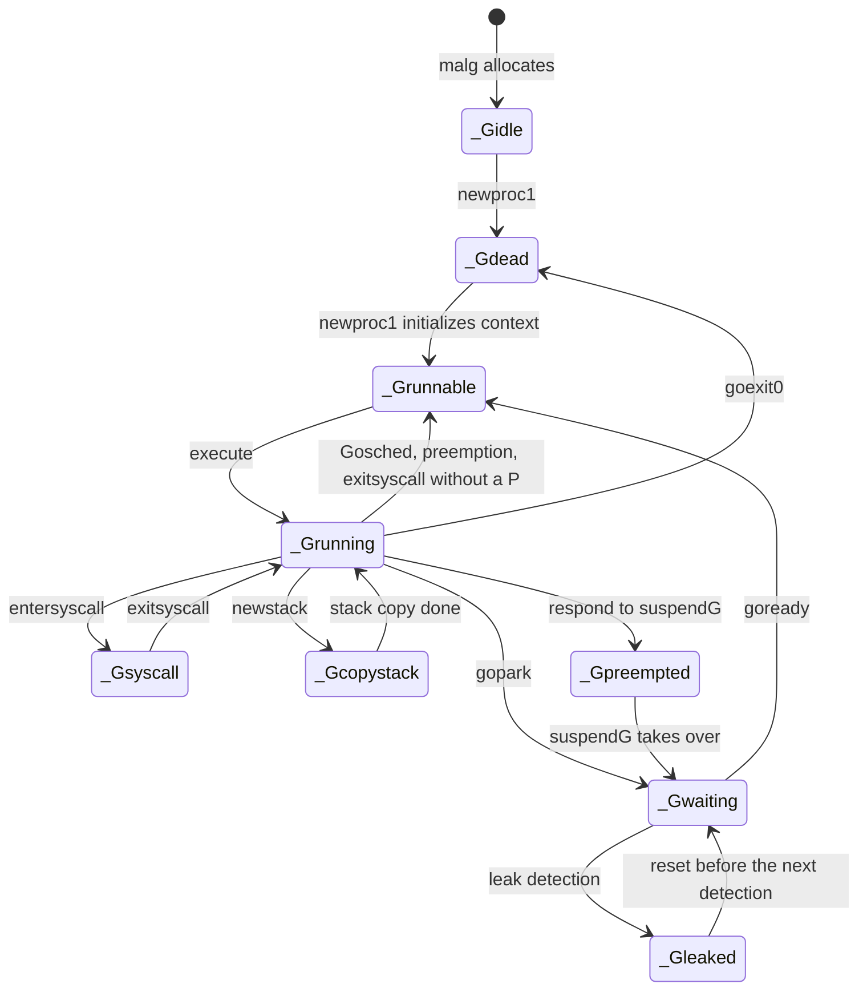

# 9.3 The MPG Model and the Units of Concurrent Scheduling

[9.1](./model.md) introduced the division of labor among G, M and P from the point of view of
threading models, and [9.2](./steal.md) discussed how work is shared among Ps. This section turns to
the three scheduling units themselves: where the goroutine stands in the lineage of coroutines, how
G, M and P are represented in the runtime, why scheduling code must run on a dedicated g0 stack,
which states a goroutine goes through, and how idle worker threads park and unpark. The structs
shown are trimmed sketches that keep only the fields relevant to the design; for the full
definitions see `runtime/runtime2.go` and `runtime/proc.go` in Go 1.26
[[Go Authors, 2026a](#ref-go-authors-2026a)].

## 9.3.1 Goroutines and Coroutines

The concept of the coroutine appeared in the early 1960s and is usually credited to Conway's 1963
paper, which describes coroutines as subroutines that treat each other as the main program, and uses
them to organize the cooperation between the lexical analyzer and the parser of a COBOL compiler
[[Conway, 1963](#ref-conway-1963)]. Over the following decades coroutine mechanisms varied widely
and never had a unified definition. Moura and Ierusalimschy pointed out that, beyond the shared
property of keeping local state between two invocations, coroutine mechanisms differ in three
respects [[Moura and Ierusalimschy, 2009](#ref-moura-and-ierusalimschy-2009)]:

- **Control transfer**: a **symmetric coroutine** offers a single transfer operation, and any
  coroutine can pass control to any other. An **asymmetric coroutine** distinguishes resume from
  yield, and a resumed coroutine can only return control to the one that resumed it.
- **First-class status**: whether coroutines can be created, passed around and stored as ordinary
  values, or can only appear in restricted syntactic constructs.
- **Stackfulness**: a **stackful coroutine** can suspend at any depth of nested calls and, once
  resumed, continues from the suspension point. A stackless mechanism can suspend only at the top
  level of the coroutine body.

They call a coroutine that is both first-class and stackful a **full coroutine**, and prove that
full coroutines are as expressive as **one-shot continuations** and one-shot partial continuations.
The symmetric and asymmetric forms are equally expressive, but the asymmetric form is easier to use.

By this classification, the goroutine implementation is stackful. Each G has its own stack.
Suspending it only requires saving a few registers, such as the stack pointer and the program
counter, into the G (the `gobuf` of 9.3.2); the call frames on the stack stay as they are, and
resuming reloads the registers. The relationship between a G and the scheduler is close to that of
an asymmetric coroutine: the G passes control to the scheduler through `mcall` (9.3.3), and the
scheduler picks the next G and resumes it.

A goroutine is nevertheless not a coroutine in the strict sense. Coroutines provide concurrency
without parallelism: only one runs at a time, and the program explicitly decides when control moves.
Goroutines are run by the scheduler, which decides when and on which thread they run; they can truly
run in parallel and can be preempted [[Cox, 2023](#ref-cox-2023)]. The two also differ in cost.
Cox's prototype measurements show that simulating a coroutine between two goroutines with channels
takes about 190 ns per switch, while a coroutine switch implemented directly in the runtime takes
only about 20 ns. This implementation later entered the runtime (`runtime/coro.go`) and became the
basis of `iter.Pull` in Go 1.23: `coroswitch` switches the current thread directly from one
goroutine to another, going through neither a run queue nor introducing new parallelism.

The stackful design also shaped the language itself. With stackless coroutines based on
`async`/`await`, a function that wants to suspend internally must itself be marked `async`, and its
callers often must be too, so "whether it can suspend" becomes a function property that propagates
up the call chain. Nystrom calls this property the "color" of a function, and notes that Go, Lua and
Ruby do not have the problem, because all of them have multiple independent call stacks that can be
switched between [[Nystrom, 2015](#ref-nystrom-2015)]. In Go, any function can block at any depth
without the caller knowing, and the standard library does not need to provide separate synchronous
and asynchronous interfaces.

The price of being stackful is that every goroutine occupies a piece of stack memory. Go starts the
stack very small and grows it on demand: a newly allocated goroutine stack is 2 KiB (`stackMin` in
`runtime/stack.go`), and when space runs out, the contiguous-stack mechanism copies the whole stack
into larger memory [[Randall, 2013](#ref-randall-2013)]; see
[14.3](../../part4memory/ch14stack/grow.md). Since Go 1.19 the runtime also computes the average
size of scanned stacks in each GC cycle and uses it as the initial stack size (`startingStackSize`)
for goroutines reused from the free list, which reduces early stack growth
[[Go Authors, 2022](#ref-go-authors-2022)].

The table below compares how several languages represent a concurrent execution unit. For scheduling
approaches, see [9.1.3](./model.md):

| Execution unit | Stackful | Where state lives while suspended | Initial cost |
| --- | --- | --- | --- |
| Go goroutine | Yes | A separate stack; register state saved in `gobuf` | 2 KiB stack |
| Erlang process | Yes | The process's private stack and heap | 338 words (about 2.6 KiB on 64-bit platforms), of which the heap is 233 words |
| Java virtual thread | Yes | The stack is stored as stack chunk objects on the GC heap | The stack grows and shrinks as it runs |
| Lua coroutine | Yes | A separate Lua stack; control moves asymmetrically with `resume`/`yield` | |
| Kotlin coroutine | No | A `suspend` function is compiled into a state machine, with state held in a continuation object | No separate stack, only a state object |

The Erlang figures are from its efficiency guide [[Ericsson, n.d.](#ref-ericsson-nd)], and the
description of Java virtual threads is in JEP 444
[[Pressler and Bateman, 2023](#ref-pressler-and-bateman-2023)]. Lua coroutines are exactly the full
asymmetric coroutines that Moura and Ierusalimschy discuss. Kotlin is the only stackless
implementation in the table: the compiler rewrites a `suspend` function into a state machine in
continuation-passing style (CPS), with each state corresponding to one suspension point
[[Breslav and Elizarov, n.d.](#ref-breslav-and-elizarov-nd)]. It needs no separate stack, at the
price of making `suspend` a function color.

## 9.3.2 Representing G, M and P

The comment at the top of `proc.go` defines the three: G is a goroutine; M is a worker thread
(machine); P is a processor, the resource needed to execute Go code. An M must be associated with a
P to execute Go code, but it can block or make a system call without a P
[[Go Authors, 2026a](#ref-go-authors-2026a)]. The reasons for keeping run queues and memory caches
on P rather than M are given in [9.1.4](./model.md): there may be far more threads than
`GOMAXPROCS`, whereas resources allocated per P are proportional only to the degree of parallelism
[[Vyukov, 2012](#ref-vyukov-2012)].

### G

```go
// g: a goroutine (sketch)
type g struct {
	stack        stack          // stack range [stack.lo, stack.hi)
	stackguard0  uintptr        // bound for the stack overflow check; doubles as a preemption request when set to stackPreempt
	m            *m             // the M running this G, nil when not running
	sched        gobuf          // execution context saved while suspended
	param        unsafe.Pointer // argument passed from the waker to the woken G
	atomicstatus atomic.Uint32  // status, see 9.3.4
	goid         uint64         // goroutine ID
	schedlink    guintptr       // links G lists such as run queues and free lists
	waitreason   waitReason     // why it is blocked while in _Gwaiting
	preempt      bool           // preemption request, equivalent to stackguard0 = stackPreempt
	waiting      *sudog         // list of sudogs it is blocked on, see Chapter 10
}

// gobuf: the register context needed to resume execution (sketch)
type gobuf struct {
	sp   uintptr        // stack pointer
	pc   uintptr        // address of the instruction to resume at
	g    guintptr       // the owning G
	ctxt unsafe.Pointer // closure context
	lr   uintptr        // link register (arm64 and other architectures)
	bp   uintptr        // frame pointer
}
```

Suspending a goroutine means storing these few registers in `g.sched`; resuming it means that the
assembly routine `gogo` loads them back into the CPU and jumps to `pc`. The other registers need not
be saved: Go's internal calling convention has no callee-saved registers
[[Go Authors, 2026a](#ref-go-authors-2026a)], so at a call site such as `mcall` there are no
register values to preserve. Asynchronous preemption can happen at any instruction, and then
`asyncPreempt` first pushes all registers onto the goroutine's own stack; see
[9.7](./preemption.md).

`newproc1`, which creates a goroutine, forges a call context with the same mechanism. It takes a G
from the free list, or allocates a new G with a 2 KiB stack if there is none. It then sets
`sched.pc` to an address inside the `goexit` function, has `gostartcallfn` push that address onto
the new stack as the return address, and changes `sched.pc` to the entry of the goroutine function.
The first time the new G is scheduled it therefore starts at the function entry, and when the
function returns it "returns" into `goexit` and enters the exit path. A goroutine's exit thus needs
no special epilogue code generated by the compiler for the `go` statement.

### M

```go
// m: a worker thread (sketch; the real struct has about 70 fields)
type m struct {
	g0        *g                // goroutine holding the scheduling stack, see 9.3.3
	gsignal   *g                // goroutine that handles signals, see 9.6
	tls       [tlsSlots]uintptr // thread-local storage
	curg      *g                // the user goroutine currently running
	p         puintptr          // the associated P; Go code cannot run when 0
	nextp     puintptr          // the P to associate with after being woken
	oldp      puintptr          // the P associated before entering a system call
	id        int64
	spinning  bool              // whether spinning, see 9.3.5
	park      note              // sleeps here while parked
	alllink   *m                // links into the global list allm
	schedlink muintptr          // links into the idle M list
	lockedg   guintptr          // the G locked to this thread via LockOSThread
}
```

An M holds two goroutines that do not run user code: `g0` carries scheduling and runtime code, and
`gsignal` carries signal handling; `curg` is the user goroutine currently running. The fields `p`,
`nextp` and `oldp` record the association between M and P at different stages: the waker writes the
P into `nextp` in advance and the M associates with it after waking up; on entering a system call
the M remembers its original P and, on return, first tries to get it back ([9.5](./thread.md)).
`lockedg` corresponds to `runtime.LockOSThread`: the locked G runs only on this M, and this M runs
no other G.

### P

```go
// p: the resources needed to execute Go code (sketch)
type p struct {
	id     int32
	status uint32   // _Pidle, _Prunning, _Pgcstop, _Pdead
	link   puintptr // links into the idle P list
	m      muintptr // the associated M, 0 when idle
	mcache *mcache  // memory allocation cache, see 12.2

	goidcache, goidcacheend uint64 // a locally cached batch of goroutine IDs

	runqhead uint32
	runqtail uint32
	runq     [256]guintptr // local run queue, a ring buffer
	runnext  guintptr      // the G to run next with priority

	gFree gList // exited Gs that can be reused
}
```

The core of a P is its local run queue. `runq` is a ring buffer with a capacity of 256. The M
holding the P pushes at the tail and pops at the head, and other Ps steal from the head as well; all
parties coordinate with atomic operations and no lock is needed ([9.2.2](./steal.md)). `runnext` is
a single-slot priority position: a G woken by `ready` (for example the receiver woken by a channel
operation) and a G newly created by a `go` statement are both put into `runnext`, and the G
previously there is pushed to the tail of the queue. Two goroutines that have just established a
communication relationship thus run one after the other on the same P; the motivation is in
[9.2.2](./steal.md). The following program shows this rule directly:

```go {run=true native=true}
package main

import (
	"fmt"
	"runtime"
	"sync"
)

func main() {
	runtime.GOMAXPROCS(1) // keep only one P, so the order is determined entirely by its queue

	var wg sync.WaitGroup
	for i := range 10 {
		wg.Add(1)
		go func() { // the new G goes into runnext, and the previous runnext is pushed to the tail
			defer wg.Done()
			fmt.Print(i, " ")
		}()
	}
	wg.Wait() // after main blocks, the P starts running the Gs in its queue
	fmt.Println()
}
```

```
9 0 1 2 3 4 5 6 7 8
```

With a single P, every G created by the loop takes `runnext`, and the previous G is pushed to the
tail of the local queue. After main blocks in `wg.Wait`, the scheduler first takes the 9 from
`runnext`, then takes 0 to 8 in first-in-first-out order. This order is an implementation detail,
not a language guarantee, and programs should not depend on it.

`gFree` caches exited Gs. An exited G is not freed: it is put back into the P's `gFree` together
with its stack, and if the stack has grown to a non-standard size, the stack is freed first and only
the G itself is kept. When the local list reaches 64 entries, the runtime moves a batch to the
global list `sched.gFree` until fewer than 32 remain locally; when the local list is empty, it takes
a batch back from the global list, preferring Gs that still have stacks. The G structures themselves
are never returned to the heap: every G ever created is recorded in the global slice `allgs`, which
only grows. Besides the run queue and `gFree`, a P also caches resources such as defer records,
sudogs and memory pages, all so that fast paths need no lock. This is the same design as the mcache
of the memory allocator ([12.2](../../part4memory/ch12alloc/component.md)) and the per-P sharding of
`sync.Pool` ([11.6](../ch11sync/pool.md)).

## 9.3.3 g0 and Stack Switching

Scheduling code also needs a stack to run on, but it cannot run on a user goroutine's stack, for two
reasons. First, a user stack is copied in its entirety to a new address when it grows, and any
pointer into the old stack held by runtime code would become invalid after the copy. Second, stack
growth is itself a runtime operation: the function prologue calls `morestack` when it finds the
stack too small, and the growth cannot be carried out on a stack that is already exhausted. Every M
therefore has a dedicated `g0` whose stack has a fixed size and never moves: on platforms such as
Linux the runtime allocates 16 KiB, and on Darwin, Windows and other platforms, as well as when cgo
is enabled, it uses the stack the operating system allocated for the thread. The g0 stack cannot
grow, and if `morestack` is triggered on g0 the runtime terminates the program directly
(`badmorestackg0`). Code running on the system stack cannot be preempted, and the GC does not scan
the system stack [[Go Authors, 2026a](#ref-go-authors-2026a)].

There are two ways to switch from a G to g0, with different semantics:

- `mcall(fn)`: saves the current G's context to `g.sched`, switches to the g0 stack and calls
  `fn(g)`. `fn` must not return and usually ends by calling `schedule`; the original G continues
  only after being scheduled again. `gopark`, `Gosched` and goroutine exit all enter the scheduler
  through it. `mcall` can only be called on an ordinary goroutine's stack.
- `systemstack(fn)`: if already on the g0 or gsignal stack, it calls `fn` directly; otherwise it
  switches to the g0 stack to run `fn` and switches back to the original G when done. It is used for
  runtime fragments that must run on the system stack, such as the creation of a G in `newproc` and
  the marking work of the GC.

A typical block and resume is thus composed as follows. When a G blocks on a channel it calls
`gopark`, which switches to g0 through `mcall(park_m)`. `park_m` sets the G to `_Gwaiting` and then
calls `schedule`. The scheduler picks another G and restores its context through `execute` and
`gogo`. The blocked G is later put back on a run queue by `goready` ([9.4](./schedule.md)). In
addition, each M has a `gsignal` for signal handling, whose stack is 32 KiB on Linux; see
[9.6](./signal.md).

## 9.3.4 Goroutine States

A G's state is kept in `atomicstatus`. What a state really expresses is ownership: it determines who
may access the G's stack at the moment, and whether the G is on some queue. The table below is
compiled from the comments in Go 1.26 `runtime2.go`:

| State | Value | Meaning | Owner of the stack |
| --- | --- | --- | --- |
| `_Gidle` | 0 | Just allocated, not yet initialized | |
| `_Grunnable` | 1 | On a run queue, waiting to execute | None |
| `_Grunning` | 2 | May execute user code; has an M and usually holds a P | The G itself |
| `_Gsyscall` | 3 | Executing a system call; has an M | The G itself |
| `_Gwaiting` | 4 | Blocked in the runtime; not on a run queue, but recorded somewhere (such as a channel's wait queue) so it can be woken | None, but channel operations may read and write parts of it while holding a lock |
| `_Gdead` | 6 | Not in use: just exited, on a free list, or being initialized | The M exiting it or taking it from a free list |
| `_Gcopystack` | 8 | The stack is being moved | The G that put it in this state |
| `_Gpreempted` | 9 | Stopped itself in response to `suspendG`, and no one is yet responsible for waking it | Same as `_Gwaiting` |
| `_Gleaked` | 10 | A blocked G that the GC has determined to be leaked (Go 1.26) | Same as `_Gwaiting` |
| `_Gdeadextra` | 11 | A dead G attached to the extra M used for cgo callbacks (Go 1.26) | Same as `_Gdead` |

Values 5 and 7 are the deprecated states `_Gmoribund_unused` and `_Genqueue_unused`; the former is
kept because its numeric value is hard-coded in gdb scripts. There is also a `_Gscan` bit
(`0x1000`): when the GC scans a G's stack, it combines this bit with the current state (such as
`_Gscanwaiting`) to indicate that the stack temporarily belongs to the scanner, and clearing the bit
after the scan restores the original state; see [Chapter 13](../../part4memory/ch13gc).
`_Gscanrunning` is the exception: it only briefly blocks state transitions while the GC tells a
running G to scan its own stack.

State transitions all go through `casgstatus` using compare-and-swap (CAS). If the target G is in a
`_Gscan` state, `casgstatus` loops and waits: it first busy-waits with `procyield`, and after about
5 µs switches to `osyield` to yield the thread, until the scanner clears the bit. The handoff of
stack ownership between the scanner and the G is thus implemented as an atomic operation on one
word.

The runtime functions that drive these transitions are labeled on the edges of the following
diagram:



Creating a goroutine corresponds to the first few steps in the diagram. `newproc1` first moves the
newly allocated G from `_Gidle` to `_Gdead` and adds it to `allgs`, so that the GC knows it exists
and does not scan its uninitialized stack. It then initializes the stack and `gobuf`, assigns an ID,
and sets the G to `_Grunnable` and puts it on a run queue. A G reused from the free list is already
`_Gdead`, so it starts at the second step. Only stack growth goes through `_Gcopystack`. Stack
shrinking happens during GC scanning, or is deferred to the goroutine's own next synchronous safe
point; in both cases the party performing the shrink already owns the stack (through the `_Gscan`
bit in the former, and as the G itself in the latter), so no separate state is needed. The diagram
also omits one shortcut: `coroswitch`, used by `iter.Pull`, sets the current G to `_Gwaiting` and
the target G directly from `_Gwaiting` to `_Grunning`, then jumps through `gogo`, bypassing the run
queue (9.3.1).

Go 1.26 removed the P state `_Psyscall` and synchronizes on the G's `_Gsyscall` state instead,
saving one atomic write and one CAS on the system call path [[Knyszek, 2025a](#ref-knyszek-2025a)].
Since then `exitsyscall` always returns to `_Grunning` first and changes to `_Grunnable` if it
cannot get a P, so there is a brief window in which a G is `_Grunning` without a P. The same set of
changes split `_Gdeadextra` out of `_Gdead`: a G on the extra M prepared for cgo callbacks may still
hold a P that is in a system call, so it must be able to take the `_Gscan` bit, and `_Gdead` does
not allow such a transition [[Knyszek, 2025b](#ref-knyszek-2025b)].

These states can be observed in a goroutine's stack trace:

```go {run=true native=true}
package main

import (
	"fmt"
	"runtime"
	"strings"
	"sync"
	"time"
)

func main() {
	var mu sync.Mutex
	mu.Lock()
	ch := make(chan int)

	go func() { <-ch }()                  // blocked on a channel receive
	go func() { time.Sleep(time.Hour) }() // blocked on a timer
	go func() { mu.Lock() }()             // blocked on a mutex
	go func() { select {} }()             // blocked forever
	go func() {                           // computing continuously
		for {
		}
	}()
	time.Sleep(100 * time.Millisecond) // wait for the goroutines above to reach their states

	buf := make([]byte, 1<<20)
	n := runtime.Stack(buf, true)
	for line := range strings.SplitSeq(string(buf[:n]), "\n") {
		if strings.HasPrefix(line, "goroutine ") {
			fmt.Println(line)
		}
	}
}
```

```
goroutine 1 [running]:
goroutine 7 [chan receive]:
goroutine 8 [sleep]:
goroutine 9 [sync.Mutex.Lock]:
goroutine 10 [select (no cases)]:
goroutine 11 [runnable]:
```

In the square brackets, a G in `_Gwaiting` shows its `waitreason`, and the other Gs show the state
name. The last goroutine is executing an infinite loop yet shows as `runnable`:
`runtime.Stack(buf, true)` must first stop the world to traverse the stacks of all Gs, and by then
every goroutine other than the caller has been preempted and put back on a run queue. The goroutine
IDs are not contiguous and may differ across runs, because each P takes IDs from the global counter
in batches of 16. Go 1.26 also added per-state goroutine counts to `runtime/metrics`, namely the
runnable, running, waiting and other metrics under `/sched/goroutines/`
[[Go Authors, 2026b](#ref-go-authors-2026b)].

`_Gleaked`, new in Go 1.26, is a diagnostic state that serves GC-based goroutine leak detection
[[Saioc and Chabbi, 2025](#ref-saioc-and-chabbi-2025)]. A **leak** is a goroutine blocked on a
synchronization primitive such as a channel, `sync.Mutex` or `sync.Cond` that can never be unblocked
[[Go Authors, 2026b](#ref-go-authors-2026b)]. Detection reuses the GC's existing reachability
analysis. In a GC cycle with detection, the runtime initially takes only the stacks of goroutines
that may run as roots. During marking, if the channel or synchronization object that a blocked
goroutine waits on has been marked, that goroutine may be woken, so its stack is added to the roots
as well and marking continues until no new goroutines are added. A blocked goroutine still outside
the root set then waits on a primitive that is unreachable from every goroutine that may run, so it
is judged leaked and marked with `casgstatus(gp, _Gwaiting, _Gleaked)` (`findGoroutineLeaks` in
`runtime/mgc.go`). Before the next detection starts, these Gs are first reset to `_Gwaiting` and
then analyzed again. Goroutines judged leaked are not reclaimed; the runtime only reports them.
Because the method rests on reachability, a leak cannot be recognized if the primitive is reachable
through a global variable or a local variable of a runnable goroutine. The theoretical basis of this
method is in the paper by Saioc et al. [[Saioc et al., 2025](#ref-saioc-et-al-2025)].

Detection runs only when a `goroutineleak` profile is requested, so it has no extra cost otherwise.
In Go 1.26 the profile is available only when building with `GOEXPERIMENT=goroutineleakprofile`, and
since Go 1.27 it is available by default [[Go Authors, 2026c](#ref-go-authors-2026c)]. The following
program runs on Go 1.27:

```go {run=true native=true}
package main

import (
	"fmt"
	"runtime/pprof"
	"strings"
	"time"
)

func leak() {
	ch := make(chan int) // ch is referenced only by the goroutine below
	go func() { ch <- 1 }()
}

func main() {
	leak()
	time.Sleep(100 * time.Millisecond)

	var b strings.Builder
	pprof.Lookup("goroutineleak").WriteTo(&b, 2) // triggers a GC with leak detection
	for line := range strings.SplitSeq(b.String(), "\n") {
		if strings.HasPrefix(line, "goroutine ") {
			fmt.Println(line)
		}
	}
}
```

```
goroutine 1 [running]:
goroutine 35 [chan send (leaked)]:
```

After `leak` returns, `ch` is referenced only by the goroutine blocked on the send, and no goroutine
that may run can ever receive from it, so the goroutine is judged leaked.

## 9.3.5 Spinning, Parking and Unparking Worker Threads

Finally, back to the M. An idle M should park to save CPU and power, and unpark promptly when there
is new work, so as to use the hardware's parallelism. The comment at the top of `proc.go` gives two
reasons why this trade-off is hard: the scheduler's state is deliberately distributed across the Ps,
so on the fast path a global predicate such as "is there idle work anywhere" cannot be computed; and
optimal thread management requires knowing the future, for example the current thread should not
park if a new G is about to become ready [[Go Authors, 2026a](#ref-go-authors-2026a)].

The same comment lists three rejected designs. The first is to manage all scheduling state
centrally, which would limit scalability. The second is direct handoff: whenever a G becomes ready
and there is an idle P, wake a thread and hand the G to it. This causes thread-state thrashing,
because the thread that readied the G may have nothing left to do a moment later and have to park;
it also destroys the locality of interdependent goroutines staying on the same thread, and adds
latency. The third is to wake an additional thread, without handoff, whenever a G becomes ready and
there is an idle P. The woken thread often finds no work and parks again at once, producing a great
many useless parks and unparks.

The design Go adopted centers on the **spinning** state. An M with no local work that also finds
none in the global queue and the network poller enters the spinning state and keeps looking in other
Ps' run queues, timer heaps and GC work. If it finds work, it leaves the spinning state to run it;
if not, it leaves the spinning state and parks. Spinning Ms are recorded in `m.spinning` and the
counter `sched.nmspinning`. When new work is submitted (a G becomes ready, a timer is added or moved
earlier, or idle-priority GC work appears), `wakep` wakes a thread only if both of the following
hold:

1. There is an idle P;
2. There is no M in the spinning state.

The woken thread is also in the spinning state, because it was not handed work directly. As long as
some M is spinning, submitting work does not wake a new thread. As compensation, when the last
spinning M finds work and leaves the spinning state, it must wake a new spinning thread, which is
the call to `wakep` in `resetspinning`. This smooths out bursts of thread wakeups while ensuring
that all the parallelism is eventually used. In addition, the number of spinning Ms is limited to
half the number of busy Ps; see [9.2.2](./steal.md).

Parking and unparking themselves are straightforward. `stopm` puts the M on the idle list
`sched.midle` and then sleeps on `m.park` (based on futex on Linux). `startm` takes an M from the
idle list (creating a new thread if there is none), writes the P to be handed to it into `m.nextp`,
and wakes it.

The real difficulty is the transition from spinning to non-spinning. This transition races with the
submission of new work: if both sides assume the other will wake a thread, work stays in the queues
with no one handling it, causing persistent CPU underutilization. To prevent this, both sides follow
a fixed order with barriers:

- Submitting work: first put the work into the run queue, timer heap or GC state, then execute a
  StoreLoad barrier, and finally check `sched.nmspinning`;
- Leaving the spinning state: first decrement `nmspinning`, then execute a StoreLoad barrier, and
  finally recheck all Ps' work queues and GC work.

This is the classic "write your own, then read the other's" pattern. Without barriers, both reads
could move ahead of the preceding writes, and both sides would see stale values: the submitter would
believe a spinning M still exists, and the M leaving the spinning state would believe there is no
new work. With barriers, at least one side sees the other's write. According to the comment in
`proc.go`, the global run queue is outside this protocol, because the runtime is not stingy about
waking threads when submitting work to the global queue. For example, after `injectglist` puts a
batch of Gs into the global queue, it starts an M directly for each idle P, without relying on
spinning Ms to discover them.

The subtleties of this protocol have surfaced repeatedly in practice. Since Go 1.1 the scheduler has
performed the above recheck before any M parks, whether or not it is spinning. A non-spinning M does
not take part in stealing, however, yet it finds work in the recheck, so it returns to the start
again and again, skips stealing, and rechecks, spinning uselessly. Go 1.17 therefore changed the
recheck to be done only by spinning Ms [[Pratt, 2021](#ref-pratt-2021)]. This change introduced a
new race: when a non-spinning M is about to drop its P and park, a thread submitting work happens to
find no idle P and assumes the system is fully loaded, so it wakes no thread, and idle Ps and
runnable work exist at the same time [[Mills, 2021](#ref-mills-2021)]. Go 1.20 introduced the
`sched.needspinning` flag to compensate: when the submitter finds no idle P it sets the flag, and a
non-spinning M checks it before dropping its P; if it is set, the M abandons parking and becomes a
spinning M instead. The fix commit notes that, if this race were not handled, in the worst case all
Ps could go idle at the same time and the program would deadlock completely
[[Pratt, 2022](#ref-pratt-2022)].

With this, the representation and states of the three scheduling units are in place: G is the
stackful execution unit being scheduled, M is the thread that runs it, and P is the permit that
connects the two and carries local resources. How they work together in each round of scheduling is
the subject of [9.4 The Scheduling Loop](./schedule.md).

## Further Reading

- <a id="ref-breslav-and-elizarov-nd"></a>[Breslav and Elizarov, n.d.] Andrey Breslav and Roman
  Elizarov. *Kotlin Coroutines*. KEEP design proposal.
  https://github.com/Kotlin/KEEP/blob/master/proposals/coroutines.md Stackless coroutines: `suspend`
  functions are compiled into state machines in continuation-passing style.
- <a id="ref-conway-1963"></a>[Conway, 1963] Melvin E. Conway. Design of a Separable
  Transition-Diagram Compiler. *Communications of the ACM*, 6(7):396–408, 1963.
  https://doi.org/10.1145/366663.366704 The source of the concept of the coroutine.
- <a id="ref-cox-2023"></a>[Cox, 2023] Russ Cox. Coroutines for Go. 2023-07-17.
  https://research.swtch.com/coro How coroutines differ from goroutines, and the design and
  measurement of runtime coroutine switching, which became the basis of `iter.Pull`.
- <a id="ref-ericsson-nd"></a>[Ericsson, n.d.] Ericsson AB. *Erlang System Documentation: Memory
  Usage*. Efficiency Guide. https://www.erlang.org/doc/system/memory.html
- <a id="ref-go-authors-2022"></a>[Go Authors, 2022] The Go Authors. Go 1.19 Release Notes.
  https://go.dev/doc/go1.19
  The initial goroutine stack size is determined from the historical average stack usage.
- <a id="ref-go-authors-2026a"></a>[Go Authors, 2026a] The Go Authors. `runtime/runtime2.go`,
  `proc.go`, `stack.go`, `stubs.go`, `HACKING.md` and `cmd/compile/abi-internal.md`.
  https://github.com/golang/go/tree/master/src/runtime The `g`, `m`, `p` and `gobuf` structures, the
  `_G*` state constants and `casgstatus`, and thread spinning, parking and unparking (this section
  follows Go 1.26).
- <a id="ref-go-authors-2026b"></a>[Go Authors, 2026b] The Go Authors. Go 1.26 Release Notes.
  https://go.dev/doc/go1.26
- <a id="ref-go-authors-2026c"></a>[Go Authors, 2026c] The Go Authors. Go 1.27 Release Notes.
  https://go.dev/doc/go1.27
- <a id="ref-knyszek-2025a"></a>[Knyszek, 2025a] Michael Knyszek. runtime: eliminate _Psyscall. Go
  commit 7244e9221f, 2025. https://go.dev/cl/646198
- <a id="ref-knyszek-2025b"></a>[Knyszek, 2025b] Michael Knyszek. runtime: add _Gdeadextra status.
  Go commit df33c17091, 2025. https://go.dev/cl/646197
- <a id="ref-mills-2021"></a>[Mills, 2021] Bryan C. Mills. runtime: broken work conservation due to
  CL
  310850. Go issue #45867, 2021. https://go.dev/issue/45867
- <a id="ref-moura-and-ierusalimschy-2009"></a>[Moura and Ierusalimschy, 2009] Ana Lúcia de Moura
  and Roberto Ierusalimschy. Revisiting Coroutines. *ACM Transactions on Programming Languages and
  Systems*, 31(2):1–31, 2009. https://doi.org/10.1145/1462166.1462167 The classification of
  coroutines (symmetric and asymmetric, first-class status, stackfulness) and the equivalence of
  full coroutines and one-shot continuations, illustrated with Lua coroutines.
- <a id="ref-nystrom-2015"></a>[Nystrom, 2015] Bob Nystrom. What Color is Your Function? 2015-02-01.
  https://journal.stuffwithstuff.com/2015/02/01/what-color-is-your-function/
  The function coloring problem.
- <a id="ref-pratt-2021"></a>[Pratt, 2021] Michael Pratt. runtime: skip work recheck for
  non-spinning Ms. Go commit ecfce58965, 2021. https://go.dev/cl/310850
- <a id="ref-pratt-2022"></a>[Pratt, 2022] Michael Pratt. runtime: synchronize P wakeup and dropping
  Ps. Go commit 8cb350d69a, 2022. https://go.dev/cl/389014
- <a id="ref-pressler-and-bateman-2023"></a>[Pressler and Bateman, 2023] Ron Pressler and Alan
  Bateman. *JEP 444: Virtual Threads*. OpenJDK, 2023. https://openjdk.org/jeps/444 Java's stackful
  virtual threads.
- <a id="ref-randall-2013"></a>[Randall, 2013] Keith Randall. *Contiguous Stacks*. Go design
  document,
  2013. https://docs.google.com/document/d/1wAaf1rYoM4S4gtnPh0zOlGzWtrZFQ5suE8qr2sD8uWQ
  Contiguous stacks: the implementation that lowers the fixed cost of the stackful design.
- <a id="ref-saioc-and-chabbi-2025"></a>[Saioc and Chabbi, 2025] Georgian-Vlad Saioc and Milind
  Chabbi. Proposal: Goroutine leak detection via garbage collection. Go design document, 2025-08-14.
  https://go.dev/design/74609-goroutine-leak-detection-gc
- <a id="ref-saioc-et-al-2025"></a>[Saioc et al., 2025] Georgian-Vlad Saioc, I-Ting Angelina Lee,
  Anders Møller, and Milind Chabbi. Dynamic Partial Deadlock Detection and Recovery via Garbage
  Collection. In *Proceedings of the 30th ACM International Conference on Architectural Support for
  Programming Languages and Operating Systems (ASPLOS '25), Volume 2*, 244–259, 2025.
  https://doi.org/10.1145/3676641.3715990
- <a id="ref-vyukov-2012"></a>[Vyukov, 2012] Dmitry Vyukov. *Scalable Go Scheduler Design
  Doc*. 2012. https://golang.org/s/go11sched The prototype design of spinning threads, `nmspinning`,
  and thread parking and unparking.
