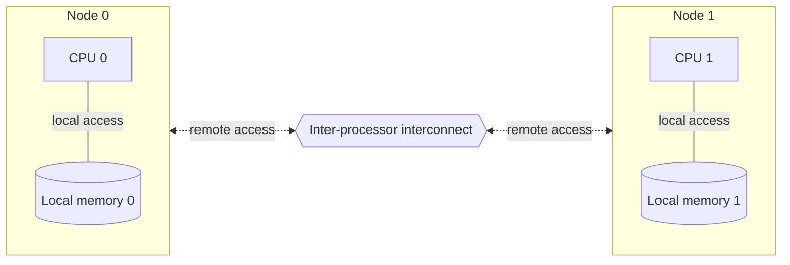

# 9.11 NUMA Awareness and the Future of the Scheduler

The scheduler described in the preceding sections carries an implicit assumption: every thread pays
the same cost to access any memory, and moving a goroutine from one P to another costs nothing
beyond a cold cache. On a laptop or a single-socket server the assumption roughly holds; on a
multi-socket server it does not. This section discusses why the assumption fails, the locality the
Go runtime does have, the NUMA-aware scheduler that Dmitry Vyukov proposed in 2014 and that was
never implemented, and what can be done outside the runtime.

## 9.11.1 Non-Uniform Memory Access

In early symmetric multiprocessing (SMP) machines, all CPUs reached the same memory over one bus,
and memory latency did not depend on which CPU made the access. As core counts grew, the shared bus
and memory controller became the bottleneck. **Non-uniform memory access** (NUMA) divides the
machine into nodes, each with its own CPUs and directly attached local memory, connected to one
another by inter-processor links. Access to a node's own memory takes the shortest path; access to
another node's memory crosses an interconnect, with higher latency and lower bandwidth
[[Lameter, 2013](#ref-lameter-2013)]. Vyukov opens the design document by observing that, with the
advent of Intel QPI and AMD HT, even commodity SMP servers have become NUMA
[[Vyukov, 2014](#ref-vyukov-2014)].

The size of the gap depends on the platform and on the distance between nodes. In the AMD figures
Ulrich Drepper cited in 2007, reads one hop away and two hops away were 9% and 30% slower than local
reads; Drepper's own measurements of read bandwidth on remote memory one hop away came out
consistently 20% lower than local [[Drepper, 2007](#ref-drepper-2007)]. Caches soften the problem:
once remote data is in the local cache, accessing it again is fast. The effect of NUMA therefore
falls mainly on data that does not fit in the cache or that must be passed back and forth between
nodes. On Linux, `numactl --hardware` lists the nodes in the system
[[Linux man-pages, n.d.](#ref-linux-man-pages-nd)].

A rough model expresses what this means for scheduling. Suppose a goroutine makes $n$ cache-missing
memory accesses in its lifetime, of which a fraction $r$ land on a remote node, and let $t_l$ and
$t_r$ be the local and remote latency of one access. The total cost of the accesses is then about

$$
T(r) = n\big[(1-r)\,t_l + r\,t_r\big] = n\,t_l\Big[1 + r\big(\tfrac{t_r}{t_l} - 1\big)\Big].
$$

Moving a goroutine to a CPU on another node turns the data it allocated earlier into remote data,
and $r$ rises. For a memory-intensive program with a large $n$, this cost is considerable; for a
program that spends most of its time waiting for I/O, $n$ is small to begin with and the effect is
limited. This is why the benefit of NUMA optimization varies from program to program.

Which node holds the data is decided by the operating system. Linux's default policy is local
allocation: physical pages are taken first from the node of the CPU on which the allocation occurs
[[Linux kernel, n.d.a](#ref-linux-kernel-nda)]. For anonymous memory, the allocation occurs when a
thread first touches the page [[Linux man-pages, n.d.](#ref-linux-man-pages-nd)]. The Go heap is
anonymous memory, so the node on which a page lands depends on which thread touches it first, not on
which thread asked the kernel for that range of address space.

## 9.11.2 Locality in the Go Runtime

The Go runtime has no notion of a node. No NUMA-related code can be found in the Go 1.26 runtime
source: work stealing traverses all Ps in a pseudo-random order independent of topology
([9.2](./steal.md)), and the runtime does not record which CPU an M is running on or which node it
belongs to [[Go Authors, 2026a](#ref-go-authors-2026a)].

The runtime nevertheless retains some locality, which comes from other designs rather than from any
concern for NUMA. In a 2024 issue, Michael Pratt listed several practices by which the runtime
maintains affinity [[Pratt, 2024](#ref-pratt-2024)]:

- when a goroutine is switched out, it is usually put back on the local P's run queue and continues
  later on the same P, unless another P steals it;
- a P stays on the same M until it stops;
- the M itself makes no attempt to maintain CPU affinity, but the operating system's scheduler
  usually does.

Pratt also pointed out how this chain of affinity connects to NUMA. A goroutine allocates objects
from its P's memory allocation cache, the mcache ([9.3](./mpg.md),
[12.2](../../part4memory/ch12alloc/component.md)); under the local allocation policy of the previous
section, newly acquired pages land on the node of the thread that first writes to them. As long as
the chain of affinity holds, the new pages a goroutine writes are on the node where it runs; once it
migrates to a CPU on another node, accessing those objects becomes remote access.

The chain breaks in several places. Pratt noted in the same issue that goroutines are occasionally
put on the global run queue, which makes it more likely that they move to another P; stop-the-world
([9.4](./schedule.md)) stops all Ps, and on resumption the Ps are assigned to arbitrary Ms; and GC
mark workers, which start during stop-the-world and are scheduled with high priority, often take
over a P that was running a user goroutine and push that goroutine onto another P. In addition, work
stealing does not distinguish on which node the target P sits, and the runtime's free memory is not
divided by node. Pratt also stressed that the performance effect of these migrations has never been
measured: migrations are typically more than 10 milliseconds apart, and on that time scale it is
unclear whether the cost of a cold cache is significant.

The operating system also moves data on its own. Linux's automatic NUMA balancing (`numa_balancing`)
periodically unmaps pages, uses the page faults that follow to sample which thread accesses which
page, and then decides whether to migrate the page to the accessor's node. The kernel documentation
cautions that unmapping and handling the faults have a cost of their own that locality gains may not
offset, and that the feature should be turned off when the workload is already bound to nodes
[[Linux kernel, n.d.b](#ref-linux-kernel-ndb)].

It once interacted with the Go runtime in a surprising way. In 2016 Rhys Hiltner reported that a
program with a large number of goroutines suffered long pauses in the GC mark termination phase; in
a reproducer with one million goroutines the pauses ranged from 121 to 1010 milliseconds. `perf`
showed a large number of page faults during this time, in which the kernel called `do_numa_page` and
`migrate_misplaced_page` to migrate pages: the GC's heavy memory access made the kernel believe the
pages should move to the node of the GC worker, and when the migration happened to fall in mark
termination, the pause grew longer [[Hiltner, 2016](#ref-hiltner-2016)]. Setting the process's
memory policy to `MPOL_BIND` avoids the migration, even when all nodes are bound, because under
`MPOL_BIND` pages already on an allowed node are not moved. Austin Clements said in the discussion
that the right fix is to make the runtime friendlier to NUMA, but that this is long-term work. The
problem was finally resolved from another direction: Clements's change makes mark termination
process only the goroutines whose stacks have been modified, rather than examining every goroutine
[[Clements, 2016](#ref-clements-2016)]. In Hiltner's real application (about 60,000 goroutines) the
mark termination pause fell from 11 milliseconds to 1.3 milliseconds, and to 1.0 millisecond with
`MPOL_BIND` added. From this Clements concluded that the migrations occurred mainly in accesses to
metadata such as goroutine descriptors, and then closed the issue. These changes shipped with Go
1.7.

## 9.11.3 A Design That Was Not Implemented

In September 2014 Vyukov wrote a design document for a NUMA-aware scheduler
[[Vyukov, 2014](#ref-vyukov-2014)]. It builds on the MPG model ([9.3](./mpg.md)) and adds a node
level above it; the MPG model itself is also Vyukov's work [[Vyukov, 2012](#ref-vyukov-2012)]. The
document states its premise at the outset: to get the maximum benefit, affinity must be maintained
at every level, between CPU core and M, between M and P, between P and G, and for memory, and if any
one level fails the benefit is greatly reduced.

Around this premise the design makes the following arrangements:

- Global resources are divided by node. The heap, the global run queue and the pool of idle Ms are
  all separated by node; when a P needs a new span, it takes it from its own node's heap first,
  ensuring that the memory it gets is local. The network poller and timers become one per P.
- Threads are bound to nodes, not to cores. The document's reasoning is that if threads were bound
  to specific cores, two processes might both pick the same core and each run at half speed without
  noticing; binding only to a node leaves the operating system room to coordinate the competition
  between processes. Ps belong strictly to individual nodes and remember the M that last ran them
  (`lastm`), to maintain affinity between P and M.
- The scheduling policy favors locality. The stealing order is the node's global queue, the queues
  of the node's other Ps, the global queue of a remote node, and the queues of the Ps of a remote
  node. The local queue changes from strictly first-in-first-out to roughly last-in-first-out, to
  use the cache better, while a goroutine is taken from the other end every so often to ensure
  fairness. A stolen goroutine returns to its original P through the network poller and timers it
  has registered.
- Garbage collection and stacks are also organized by node: each node has its own GC workers and
  queue of objects to scan; stacks are allocated from the node's own cache, and a goroutine that
  runs on a remote node for a long time can move its stack there.

The document also lists the risks, and admits that even such a relatively conservative affinity
scheme could slow some programs down. Several processes might all place their threads on the same
node, overloading it while other nodes sit idle; and a large data structure that every goroutine
accesses frequently, if allocated entirely on one node, would make that node's memory bus a
bottleneck, in which case interleaving memory across the nodes would be better.

The design was not implemented. A few of its ideas later appeared in separate forms: for example,
`runnext` in Go 1.5 lets a woken goroutine run right after its waker, so its data is likely still in
the cache ([9.2](./steal.md)); and in Go 1.14 timers became a per-P structure ([9.10](./timer.md)).
But the node level never entered the runtime, and no formal record of its adoption or rejection was
left. This differs from the request-oriented collector (ROC) in garbage collection, which had a
prototype and measurements and was abandoned because of the cost of write barriers
([13.9](../../part4memory/ch13gc/roc.md)). The difficulty of implementation is visible in the design
document itself: scheduling, memory allocation, garbage collection and stack management all have to
take on the dimension of the node, while the benefit varies from program to program.

## 9.11.4 Approaches Outside the Runtime

The runtime does not handle NUMA, so programs that need better locality can obtain it only outside
the runtime.

- Bind the process to one node. `numactl --cpunodebind=0 --membind=0 ./server` makes the process run
  only on the CPUs of node 0 and allocate memory only from node 0. On Linux the default `GOMAXPROCS`
  is taken from the number of CPUs in the process's CPU affinity mask, so it automatically equals
  the number of CPUs on that node [[Go Authors, 2026a](#ref-go-authors-2026a)]; since Go 1.25 the
  runtime also updates `GOMAXPROCS` periodically when the number of available CPUs changes
  [[Go Authors, 2025](#ref-go-authors-2025)]. The cost is that only part of the machine is used.
- Run one process per node. Start a process on each node, bound to that node, and partition data and
  requests by node at the application level. This amounts to implementing, at the process level,
  the "divide by node" of the design document, and is a common way to use the whole machine while
  keeping locality.
- Interleave allocation. For large data accessed by all threads, `numactl --interleave=all` spreads
  memory across the nodes page by page, preventing any single node's memory bus from becoming the
  bottleneck, which is exactly the suggestion in the risk discussion of the design document.
- Turn off automatic NUMA balancing. When the process is already bound to nodes, turn off
  `numa_balancing` as the kernel documentation advises, saving the cost of sampling and migration.

Thread-level binding is not convenient in Go. `runtime.LockOSThread` only locks a goroutine to its
current thread and does not bind the thread to any CPU; the runtime also provides no interface for
binding an M to a CPU or a node.

The runtime's use of transparent huge pages is likewise unrelated to nodes, and has been scaled
back. Under the default settings of most Linux distributions, `madvise(MADV_HUGEPAGE)` can make a
thread block in the kernel's memory reclaim and compaction, in the worst case for hundreds of
milliseconds or even seconds; so since Go 1.21.1 the runtime no longer marks heap memory
`MADV_HUGEPAGE`, and now requests huge pages only for a small amount of metadata such as the heap
index and the page allocator bitmaps [[Knyszek, 2023](#ref-knyszek-2023)].

## 9.11.5 Current State

In March 2026 a user reported that Go programs lose performance on machines with several NUMA nodes,
pointing out that the runtime's free memory and work stealing do not distinguish nodes. In reply,
Pratt wrote that improving performance on multi-node machines, and on high-core-count machines in
general, is certainly in the plans for this year; Pratt also listed several contention points that
the GC exposes at high core counts as priorities, and said the aim is to study how to distribute
memory allocation and GC work across nodes [[Pratt, 2026](#ref-pratt-2026)]. A change in the same
direction that has already landed is the Green Tea garbage collector
([13.11](../../part4memory/ch13gc/greentea.md)): added as an experiment in Go 1.25 and enabled by
default since Go 1.26, it improves the marking and scanning of small objects through better locality
and CPU scalability [[Go Authors, 2026b](#ref-go-authors-2026b)].

NUMA awareness is therefore still an open problem. From Vyukov's design document to today the
difficulty has not changed: the node level has to run through scheduling, allocation and collection
to be effective, and its benefit is clear only in memory-intensive programs with clear locality. The
skeleton of the scheduler has not fundamentally changed since Go 1.1, and the improvements since
then, from `runnext` and per-P timers to the container-aware `GOMAXPROCS`, have all been made step
by step within the MPG framework.

## Further Reading

- [Clements, 2016] Austin Clements. runtime: make stack re-scan O(#
  dirty stacks). Go commit 2a889b9d93, 2016. https://go.dev/cl/20700 Shipped with Go 1.7.
- [Drepper, 2007] Ulrich Drepper. *What Every Programmer Should Know
  About Memory.* Red Hat, 2007. https://www.akkadia.org/drepper/cpumemory.pdf (The authoritative
  long article on NUMA, cache coherence and memory latency; section 5 is devoted to NUMA.)
- [Go Authors, 2025] The Go Authors. Go 1.25 Release Notes, 2025.
  https://go.dev/doc/go1.25
  Container-aware `GOMAXPROCS`.
- [Go Authors, 2026a] The Go Authors. *runtime/proc.go
  (`stealWork`, `randomOrder`), runtime/mem_linux.go (`MADV_HUGEPAGE`).*
  https://github.com/golang/go/tree/master/src/runtime (the current state of topology-independent
  work stealing and transparent huge pages) Also `getCPUCount` in `runtime/os_linux.go`, which
  computes the CPU count from `sched_getaffinity` (this section follows Go 1.26).
- [Go Authors, 2026b] The Go Authors. Go 1.26 Release Notes, 2026.
  https://go.dev/doc/go1.26
  The Green Tea garbage collector enabled by default.
- [Hiltner, 2016] Rhys Hiltner. golang/go#14406. *runtime: GC's mark
  termination STW time extended by Linux NUMA migration.* 2016.
  https://github.com/golang/go/issues/14406
- [Knyszek, 2023] Michael Knyszek. runtime: avoid MADV_HUGEPAGE for
  heap memory. Go commit 9f9bb26880, 2023. https://go.dev/cl/516795 Fixes issue #61718; backported
  to Go 1.21.1.
- [Lameter, 2013] Christoph Lameter. *NUMA (Non-Uniform Memory Access):
  An Overview.* ACM Queue 11(7): 40-51, 2013. https://queue.acm.org/detail.cfm?id=2513149 (Node
  topology, distance matrices and the Linux NUMA interfaces.) DOI:
  https://doi.org/10.1145/2508834.2513149
- [Linux kernel, n.d.a] The Linux Kernel. *NUMA Memory Policy.*
  https://www.kernel.org/doc/html/latest/admin-guide/mm/numa_memory_policy.html
- [Linux kernel, n.d.b] The Linux Kernel. *Documentation for
  /proc/sys/kernel/* (`numa_balancing`).
  https://www.kernel.org/doc/html/latest/admin-guide/sysctl/kernel.html
- [Linux man-pages, n.d.] Linux man-pages project.
  *numactl(8), numa(7), set_mempolicy(2).* https://man7.org/linux/man-pages/man8/numactl.8.html
  (Tools and system calls for NUMA binding from outside the process.)
- [Pratt, 2024] Michael Pratt. golang/go#65694. *runtime: stronger
  affinity between G ↔ P ↔ M ↔ CPU?* 2024. https://github.com/golang/go/issues/65694
- [Pratt, 2026] Michael Pratt. Comment on golang/go#78044, 2026.
  https://github.com/golang/go/issues/78044#issuecomment-4033364256
- [Vyukov, 2012] Dmitry Vyukov. *Scalable Go Scheduler Design
  Doc.* 2012. https://golang.org/s/go11sched (The original design of MPG and work stealing, the
  starting point of this section's discussion of locality.)
- [Vyukov, 2014] Dmitry Vyukov. *NUMA-aware scheduler for Go.* Go design
  proposal, 2014.
  https://docs.google.com/document/u/0/d/1d3iI2QWURgDIsSR6G2275vMeQ_X7w-qxM2Vp7iGwwuM/pub (The
  complete design: grouping Ps by node, stealing nearby first, localizing the heap.)
- This book: [9.2 Work-Stealing Scheduling](./steal.md),
  [9.3 The MPG Model and the Units of Concurrent Scheduling](./mpg.md),
  [12.2 Components](../../part4memory/ch12alloc/component.md), [13.9 The Request Hypothesis and the
  Request-Oriented Collector](../../part4memory/ch13gc/roc.md), [9.10 Timers](./timer.md),
  [13.11 Green Tea: Locality-Aware Marking](../../part4memory/ch13gc/greentea.md).
