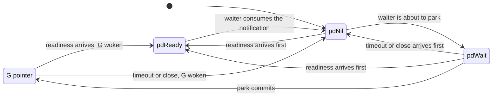

# 9.9 The Network Poller

Go network code is written in a blocking style: `conn.Read` does not return until data arrives.
[9.5](./thread.md) showed that when a goroutine blocks in a system call, the thread it runs on
blocks with it, and the runtime must start another thread to run the remaining goroutines. A network
server typically holds tens of thousands of connections, almost all of them waiting for data at any
given moment; if each wait occupied a thread, the M:N model ([9.1](./model.md)) would be pointless.
The runtime's **network poller** (netpoll in the source) solves this problem. It turns a goroutine's
block on the network into a goroutine park, and lets a few threads watch all the connections through
the operating system's event notification facilities.

This section first reviews the two kinds of I/O event notification the operating system provides,
then traces the poller from Go 1.0 to the present. It then covers how a read is converted into a
park, the state machine on each file descriptor, the per-platform implementations, and how the
poller meshes with the scheduler. It closes with the I/O that bypasses the poller and a comparison
with other runtimes.

## 9.9.1 Readiness Notification and Completion Notification

Around 1999 Dan Kegel posed what became known as the C10K problem: how can one server serve ten
thousand clients at once? Kegel estimated that, on the hardware of the time, providing each client
with the bandwidth and memory it needed was not hard, so "hardware is no longer the bottleneck"; the
question was how software should organize I/O [[Kegel, 1999](#ref-kegel-1999)]. The most direct
organization is one thread per connection, but thread stacks are large: Kegel gives the example of a
2 MB stack per thread on a 32-bit machine with 1 GB of usable user address space, which holds only
512 threads. Smaller stacks are possible, but most thread libraries do not let a stack grow after
creation. The alternative is to let one thread watch many file descriptors and perform I/O on a
descriptor only when it is ready to read or write. This is **I/O multiplexing**.

The early Unix multiplexing interfaces are `select` and `poll`. They keep no state in the kernel: on
every call the caller hands the kernel the full set of descriptors it cares about, the kernel checks
them one by one and returns, and the caller then searches for the ready ones. With $n$ descriptors
of interest, of which $k$ are ready, each call costs $O(n)$. For a large population of idle,
long-lived connections, $k$ is far smaller than $n$, and most of the cost goes to checking
descriptors that will not become ready.

Two interfaces that appeared around 2001 keep the set of interest in the kernel. FreeBSD's kqueue,
designed by Jonathan Lemon, unifies sockets, files, signals, processes, timers and other event
sources behind the single system call `kevent` [[Lemon, 2001](#ref-lemon-2001)]. Linux's epoll was
proposed by Davide Libenzi; the first draft was written in July 2001 and the patch was merged into
the kernel in October 2002 [[Libenzi, 2002](#ref-libenzi-2002)], first appearing in kernel version
2.5.44. With epoll, `epoll_ctl` registers a descriptor once, and from then on `epoll_wait` returns
only the descriptors that are ready, so the cost of each call is proportional to $k$ rather than
$n$. The common claim that "epoll is $O(1)$" is not accurate: the registration cost is paid once by
`epoll_ctl`, and the cost of waiting depends on the number of ready descriptors.

These interfaces offer two notification modes. With **level-triggered** notification, a descriptor
is reported on every wait for as long as it remains ready. With **edge-triggered** notification, it
is reported once, when it goes from not ready to ready. The epoll(7) manual illustrates the
difference with a pipe: the write end writes 2 kB, and the read end, once woken, reads only 1 kB.
Under level triggering the next `epoll_wait` returns immediately, because data remains in the pipe;
under edge triggering no new data has arrived, so the next `epoll_wait` may block indefinitely. The
manual therefore recommends that edge-triggered I/O be used as follows: "(1) with nonblocking file
descriptors; and (2) by waiting for an event only after read(2) or write(2) return
EAGAIN" [[Linux man-pages, n.d.a](#ref-linux-man-pages-nda)]. Section 9.9.3 shows that Go's read
loop is written exactly this way.

The interfaces above tell the caller "you may read or write now", and the caller still performs the
I/O itself. This is the readiness model. Windows I/O completion ports (IOCP) take another route: the
caller starts an asynchronous operation and hands over a buffer, and the kernel completes the whole
operation before telling the caller "the I/O is done". This is the completion model. Douglas Schmidt
summarized event dispatching based on readiness notification as the Reactor pattern
[[Schmidt, 1995](#ref-schmidt-1995)]. Two years later, Irfan Pyarali, Schmidt and others summarized
event dispatching based on completion notification as the Proactor pattern
[[Pyarali et al., 1997](#ref-pyarali-et-al-1997)]. Linux did not get a general completion-model
interface until io_uring in kernel 5.1 (2019): user space and the kernel share a pair of ring
queues, the application puts requests on the submission queue and takes results from the completion
queue, and many operations can be submitted and collected in one step
[[Axboe, 2019](#ref-axboe-2019)].

| | Readiness model (Reactor) | Completion model (Proactor) |
| --- | --- | --- |
| What the kernel reports | The descriptor can be read or written | The operation has completed |
| Who performs the I/O | The caller, after the notification | The kernel, after the request |
| Buffer | Needed only when the I/O is performed | Held by the kernel from submission to completion |
| Examples | `select`, `poll`, epoll, kqueue | IOCP, io_uring |

The buffer row matters most for Go; 9.9.5 and 9.9.8 return to it.

## 9.9.2 Origins

Go 1.0 already presented network I/O as blocking, and on Unix the underlying mechanism was already
non-blocking descriptors plus epoll or kqueue, but the event loop lived not in the runtime but in a
goroutine of the `net` package. A source comment reads: "All the network FDs use a single
pollServer" [[Go Authors, 2012](#ref-go-authors-2012)]. When a read hit `EAGAIN`, the goroutine
handed the descriptor to the pollServer through a buffered channel, then wrote a byte to the
pollServer's own pipe to wake the pollServer from `epoll_wait`; the pollServer added the descriptor
to epoll, waited for it to become ready, and woke the waiting goroutine through another channel.
Descriptors were registered with `EPOLLONESHOT`, which fires once and then disarms, so every wait
required another `epoll_ctl` call to re-arm. Deadlines were checked by scanning all waiters one by
one, and a comment left a to-do: "This needs to be handled more efficiently, probably with a heap
indexed by wakeup time". A single wait thus cost two channel communications, one pipe write and one
`epoll_ctl`, and a round trip between two goroutines.

In Go 1.1 Dmitry Vyukov moved the poller into the runtime [[Vyukov, 2013](#ref-vyukov-2013)].
Waiters no longer pass through channels and an intermediary goroutine; they park directly on the
runtime structure for the descriptor, and the scheduler collects ready events and resumes the
waiters at the appropriate moments. The commit message includes benchmark data: for a benchmark that
repeatedly sends and receives on a persistent connection, the time per operation fell from about
81.7 µs to about 7.8 µs compared with the old scheduler and old polling, a figure that also includes
the gains from the scheduler rewrite in the same release. The Go 1.1 release notes say: "Because the
runtime is more tightly integrated with the net library, fewer context switches are required for
network operations" [[Go Authors, 2013](#ref-go-authors-2013)]. The main changes since then are:

| Version | Change | Source |
| --- | --- | --- |
| Go 1.1 | The poller joins the runtime (Linux and Darwin) | [[Vyukov, 2013](#ref-vyukov-2013)] |
| Go 1.2 | Windows implementation, based on IOCP | [[Brainman, 2013](#ref-brainman-2013)] |
| Go 1.3 | Solaris implementation, based on event ports | [[Hăvărneanu, 2014](#ref-havarneanu-2014)] |
| Go 1.9 | Descriptors such as pipes in the `os` package also go to the poller | [[Taylor, 2017](#ref-taylor-2017)] |
| Go 1.14 | A blocking `netpoll` doubles as the timer wait; `netpollBreak` introduced | [[Taylor, 2019a](#ref-taylor-2019a)] |
| Go 1.23 | On Linux, an eventfd wakes a blocked poller | [[Pan, 2024a](#ref-pan-2024a)] |
| Go 1.25 | At most one P polls in non-blocking mode at a time | [[Taylor, 2024a](#ref-taylor-2024a)] |

## 9.9.3 Turning Blocking into Parking

File descriptors in the `net` and `os` packages all perform I/O through `internal/poll.FD`. Taking a
read on Unix as the example, the core of `FD.Read` is a loop
[[Go Authors, 2026a](#ref-go-authors-2026a)]:

```go
// internal/poll/fd_unix.go (excerpt)
func (fd *FD) Read(p []byte) (int, error) {
	// ... take the read lock, check for closure or timeout ...
	for {
		n, err := ignoringEINTRIO(syscall.Read, fd.Sysfd, p)
		if err != nil {
			n = 0
			if err == syscall.EAGAIN && fd.pd.pollable() {
				if err = fd.pd.waitRead(fd.isFile); err == nil {
					continue
				}
			}
		}
		err = fd.eofError(n, err)
		return n, err
	}
}
```

The descriptor has been set to non-blocking mode, so with no data `read` returns `EAGAIN`
immediately. If the descriptor is registered with the poller (`pollable`), `waitRead` makes the
current goroutine wait until the descriptor becomes readable, and on waking the goroutine returns to
the top of the loop and reads again. This is exactly the edge-triggered usage recommended by
epoll(7): the descriptor is non-blocking, and the program waits only after `EAGAIN`. The loop had
this shape already in Go 1.0; Go 1.1 changed only the implementation behind `waitRead`.

`waitRead` enters the runtime through `runtime_pollWait`, and `netpollblock` parks the goroutine:

```go
// runtime/netpoll.go (excerpt)
func netpollblock(pd *pollDesc, mode int32, waitio bool) bool {
	gpp := &pd.rg
	if mode == 'w' {
		gpp = &pd.wg
	}
	for {
		if gpp.CompareAndSwap(pdReady, pdNil) {
			return true // a readiness notification has arrived; consume it, no need to park
		}
		if gpp.CompareAndSwap(pdNil, pdWait) {
			break
		}
		// ...
	}
	// after setting pdWait, check again for closure or timeout
	if waitio || netpollcheckerr(pd, mode) == pollNoError {
		gopark(netpollblockcommit, unsafe.Pointer(gpp), waitReasonIOWait, traceBlockNet, 5)
	}
	old := gpp.Swap(pdNil)
	return old == pdReady
}
```

`gopark` puts the goroutine into the waiting state and switches to the scheduling loop
([9.4](./schedule.md)), and the thread goes on to run other goroutines. The park takes effect only
after the stack switch: `gopark` calls `netpollblockcommit`, which uses a CAS to replace `pdWait`
with a pointer to the current G and adds one to the count of goroutines waiting on the poller; if
the CAS fails, the park is abandoned and the goroutine continues immediately.

```mermaid
sequenceDiagram
    participant G as goroutine
    participant FD as internal/poll.FD
    participant RT as runtime
    participant K as kernel (epoll)
    G->>FD: conn.Read(p)
    FD->>K: read(2)
    K-->>FD: EAGAIN
    FD->>RT: runtime_pollWait (read)
    RT->>RT: netpollblock: rg goes from pdNil to pdWait
    RT->>RT: gopark → netpollblockcommit: rg stores G
    Note over G,RT: G is waiting; the thread moves on to other goroutines
    K-->>RT: some M calls netpoll; epoll_wait reports the descriptor readable
    RT->>RT: netpollready: rg goes from G to pdReady; G returns to a run queue
    RT->>FD: G is scheduled; netpollblock returns true
    FD->>K: read(2)
    K-->>FD: n bytes
    FD-->>G: n, nil
```

When a descriptor becomes ready, the platform-specific `netpoll` sorts the events reported by the
kernel into read and write modes and calls `netpollready` for each ready descriptor; `netpollready`
takes the waiting goroutine out through `netpollunblock` and strings the goroutines into a list,
which is returned for the caller of `netpoll` to put back on a run queue (9.9.6). A goroutine
waiting on the network occupies no thread; its cost is its own stack plus one entry in the kernel's
epoll instance.

## 9.9.4 The pollDesc State Machine

The runtime allocates a `pollDesc` for each registered descriptor. The fields relevant to this
section are:

```go
// runtime/netpoll.go (excerpt)
type pollDesc struct {
	_     sys.NotInHeap
	link  *pollDesc      // free list in pollcache
	fd    uintptr        // constant for the lifetime of the pollDesc
	fdseq atomic.Uintptr // protects against stale pollDesc

	rg atomic.Uintptr // pdReady, pdWait, G waiting for read, or pdNil
	wg atomic.Uintptr // pdReady, pdWait, G waiting for write, or pdNil

	lock    mutex   // protects the following fields
	closing bool
	rseq    uintptr // protects from stale read timers
	rt      timer   // read deadline timer
	rd      int64   // read deadline (a future nanotime, or -1 if expired)
	wseq    uintptr // protects from stale write timers
	wt      timer   // write deadline timer
	wd      int64   // write deadline
	// ...
}
```

`rg` and `wg` are two binary semaphores, one on which readers park and one for writers. The source
comments list their four states: `pdReady` means a readiness notification is pending and has not
been consumed; `pdWait` means a goroutine is about to park but has not yet parked; a G pointer means
that goroutine is parked; `pdNil` means none of the above. Four parties take part in the
transitions: the waiter itself, I/O readiness notification, deadline expiry, and descriptor closure.



The key to the design is that `pdReady` can hold on to one readiness notification. A notification
can arrive at three moments: before the waiter checks, after the waiter has set `pdWait` but before
it has parked, and after the waiter has parked. In the first case the notification turns `pdNil`
into `pdReady`, and the waiter then consumes it directly. In the second, the notification turns
`pdWait` into `pdReady`, so the CAS in `netpollblockcommit` fails and `gopark` returns immediately.
In the third, the notification turns the G pointer into `pdReady` and wakes the G. In no case is a
notification lost. This is essential for edge triggering: an edge-triggered event is reported only
once, and losing it can mean waiting forever.

Timeouts and closure are different. `netpollunblock` writes `pdReady` only on readiness; a timeout
or closure leaves no mark, because the waiter checks for them itself through `netpollcheckerr`
before parking. To avoid missing a concurrent timeout or closure, `netpollblock` performs that check
only after setting the state to `pdWait`. The source comments point out that the other side runs in
the opposite order: it first writes `closing`, `rd` or `wd` and publishes their atomic summary
`atomicInfo`, and only then reads `rg` and `wg`. Both sides write first and read second, so at least
one of them sees the other's write: either the waiter sees the timeout and does not park, or the
timing-out side sees `pdWait` or a G pointer, changes it to `pdNil` and wakes the waiter.

`pollDesc` does not live on the garbage-collected heap. `pollcache` allocates them in blocks with
`persistentalloc`, puts them back on a free list after closure for reuse, and never frees them. The
source comment gives the reason: a `pollDesc` "can be referenced only from epoll/kqueue internals",
where the GC cannot see the references, so it must live in non-GC memory. The kernel's holding of
these references also requires `pollDesc` to be type-stable: after a descriptor is closed and its
`pollDesc` reused, the kernel may still deliver events that belong to the old descriptor. At
registration the runtime stores `fdseq` together with the address of the `pollDesc` in the kernel's
event data (`data` for epoll, `udata` for kqueue), and on receiving an event it compares the two,
discarding the stale event if they differ.

Deadlines are also handled by `pollDesc`. `SetReadDeadline` ends up calling
`poll_runtime_pollSetDeadline`, which sets `rd` to an absolute time and arranges for the timer `rt`
to call `netpollReadDeadline` on expiry; when the read and write deadlines are equal, only the timer
`rt` is armed, and it serves both directions. On expiry the callback sets `rd` to -1, publishes
`atomicInfo`, and calls `netpollunblock` to wake the waiter; the waiter gets `pollErrTimeout` from
`netpollcheckerr`, and `internal/poll` converts it to `ErrDeadlineExceeded`, that is,
`os.ErrDeadlineExceeded`. Whenever an installed deadline is modified or cancelled, and whenever a
`pollDesc` is reused, `rseq` or `wseq` is incremented; an old timer callback that is already running
finds the sequence number mismatched and does nothing. The timer implementation itself is covered in
[9.10](./timer.md).

## 9.9.5 Platform Implementations and Edge Triggering

`netpoll.go` is the platform-independent part, and the comment at the top of the file specifies the
functions every platform must implement:

```go
// func netpollinit()
//     Initialize the poller. Only called once.
// func netpollopen(fd uintptr, pd *pollDesc) int32
//     Arm edge-triggered notifications for fd. The pd argument is passed back
//     to netpollready when fd is ready.
// func netpollclose(fd uintptr) int32
//     Disable notifications for fd.
// func netpoll(delta int64) (gList, int32)
//     Poll the network. If delta < 0, block indefinitely. If delta == 0,
//     do not block. If delta > 0, block for up to delta nanoseconds.
//     Return a list of goroutines built by calling netpollready,
//     and a delta to add to netpollWaiters when all goroutines are ready.
// func netpollBreak()
//     Wake up the poller blocked in netpoll.
// func netpollIsPollDescriptor(fd uintptr) bool
//     Reports whether fd is a file descriptor used by the poller.
```

The Linux implementation is in `netpoll_epoll.go`. `netpollopen` registers a descriptor only once in
its whole lifetime, watching both read and write, and uses edge triggering:

```go
// runtime/netpoll_epoll.go
func netpollopen(fd uintptr, pd *pollDesc) uintptr {
	var ev linux.EpollEvent
	ev.Events = linux.EPOLLIN | linux.EPOLLOUT | linux.EPOLLRDHUP | linux.EPOLLET
	netpollPackData(&ev, pd, pd.fdseq.Load())
	return linux.EpollCtl(epfd, linux.EPOLL_CTL_ADD, int32(fd), &ev)
}
```

On each call `netpoll` fetches at most 128 events from `epoll_wait`, classifying events carrying
`EPOLLIN`, `EPOLLRDHUP`, `EPOLLHUP` or `EPOLLERR` as readable, and those carrying `EPOLLOUT`,
`EPOLLHUP` or `EPOLLERR` as writable. The kqueue implementation (`netpoll_kqueue.go`) registers the
two filters `EVFILT_READ` and `EVFILT_WRITE` with `EV_CLEAR`, and its comment states that both are
armed "in edge-triggered mode (EV_CLEAR) for the whole fd lifetime".

The reason for choosing edge triggering is clear by comparison with Go 1.0, which registered with
`EPOLLONESHOT` and had to call `epoll_ctl` before every wait to re-arm. If the design used level
triggering while watching both read and write, the problem would be on the write side: a socket's
send buffer usually has room, so `EPOLLOUT` would show up in the result of every `epoll_wait`.
`EPOLLOUT` could be enabled only while a writer is waiting and disabled after the write, and every
toggle is a system call. Netty 4.2's epoll transport uses only level triggering and does exactly
this: before adding or removing an event of interest it compares the old and new sets, and a source
comment says that when the interest has not changed, a system call can be saved
[[Netty, n.d.b](#ref-netty-ndb)]. With edge triggering, Go calls `epoll_ctl` only once at
registration and once at close, and never has to change the registration in between, however many
reads and writes occur.

The price of edge triggering is that an event is reported only once: the application must read or
write until `EAGAIN`, and must not miss any notification. The first is guaranteed by the read loop
of 9.9.3, where the goroutine waits only after `EAGAIN`; the second by the `pdReady` of 9.9.4, which
keeps a notification that arrives when no one is waiting.

Not every platform uses edge triggering. A comment in `poll_runtime_pollWait` reads: "As for now
only Solaris, illumos, AIX and wasip1 use level-triggered IO." On those platforms `netpollarm` must
re-arm before each wait, as in Go 1.0, and the "edge-triggered" wording at the top of `netpoll.go`
does not hold for them.

Windows uses the completion model. `netpollopen` associates the handle with the process's single I/O
completion port; `internal/poll` starts overlapped I/O, and if the operation returns
`ERROR_IO_PENDING` it calls `runtime_pollWait` to park, just as on Unix; `netpoll` collects
completion events with `GetQueuedCompletionStatusEx` and then calls `netpollready` to wake the
waiters [[Go Authors, 2026d](#ref-go-authors-2026d)]. On timeout or close, `internal/poll` calls
`CancelIoEx` to cancel the operation that has not yet completed. The completion notification is thus
wrapped as a readiness notification, and the layers above still see the same park and wake. The
completion model requires the buffer to stay valid, at a fixed address, until the operation
completes, whereas a goroutine's stack can move ([14.4](../../part4memory/ch14stack/copy.md)). Go
1.26 pins the buffer with `runtime.Pinner` before starting overlapped I/O; the commit message
says: "To be on the safe side, pin the input byte slice so that stack-allocated slices don't get
moved while overlapped I/O is in progress" [[Muntal, 2025](#ref-muntal-2025)].

Finally, a thread blocked in `netpoll` sometimes has to be woken early, for example when a timer
that expires sooner appears. `netpollBreak` does this. On Linux, since Go 1.23 it writes to an
eventfd [[Pan, 2024a](#ref-pan-2024a)], where earlier versions used a pipe; Darwin, DragonFly and
FreeBSD trigger a kqueue `EVFILT_USER` event, while NetBSD and OpenBSD still use a pipe. This is the
same idea as the Go 1.0 pollServer writing a byte to its own pipe, the self-pipe trick introduced in
[9.6](./signal.md).

## 9.9.6 Meshing with the Scheduler

Ready goroutines do not wake themselves; some thread must call `netpoll` to collect them. The
runtime calls it in several places [[Go Authors, 2026b](#ref-go-authors-2026b)].

The first is the non-blocking poll in the scheduling loop. After the local and global run queues are
both empty, and before stealing work from other Ps, `findRunnable` ([9.4](./schedule.md)) calls
`netpoll(0)` once:

```go
// runtime/proc.go, findRunnable (excerpt)
if netpollinited() && netpollAnyWaiters() && sched.lastpoll.Load() != 0 &&
	sched.pollingNet.Swap(1) == 0 {
	list, delta := netpoll(0)
	sched.pollingNet.Store(0)
	// ... take the first G to run directly, put the rest on a run queue ...
}
```

The source comment describes this poll as "only an optimization before we resort to stealing", and
it has three preconditions: some goroutine is waiting on the poller; no thread is blocked in
`netpoll` (`lastpoll` is not 0); and no other P is doing the same thing. The last condition was
added in Go 1.25. In #65064 a program on a 192-core machine held more than 2,500 sockets, with more
than a thousand ready at once, and `epoll_wait` used about 65% of the CPU time
[[Pratt, 2024](#ref-pratt-2024)]: many idle Ps entered `findRunnable` together and polled the same
epoll instance simultaneously, contending with one another in the kernel. Ian Lance Taylor's fix
lets only one P do this poll at a time. The change was reverted after it was first merged because of
a failing CockroachDB benchmark, and merged again once the problem was understood
[[Taylor, 2024a](#ref-taylor-2024a)].

The second is the blocking poll. When stealing also fails and there is truly nothing to do, the M
gives up its P and prepares to sleep. Before sleeping, if some goroutine is waiting on the poller or
some timer has not yet expired, it tries to call `netpoll` in blocking mode:

```go
// runtime/proc.go, findRunnable (excerpt)
if netpollinited() && (netpollAnyWaiters() || pollUntil != 0) &&
	sched.lastpoll.Swap(0) != 0 {
	sched.pollUntil.Store(pollUntil)
	delay := int64(-1)
	if pollUntil != 0 {
		delay = pollUntil - now // block at most until the earliest timer expires
	}
	list, delta := netpoll(delay)
	// ... if an idle P is available, run the first ready G; otherwise put all of them on the global queue ...
} else if pollUntil != 0 && netpollinited() {
	// another thread is already blocked in netpoll: wake it if it waits until later than the new timer
	pollerPollUntil := sched.pollUntil.Load()
	if pollerPollUntil == 0 || pollerPollUntil > pollUntil {
		netpollBreak()
	}
}
stopm()
```

`sched.lastpoll` records the time of the last poll, and the value 0 means some thread is blocked in
`netpoll`. `Swap(0)` ensures that at most one M is blocked in `epoll_wait` at a time while the other
idle Ms sleep; and because there is only one waiter, epoll's thundering herd problem cannot arise in
Go's poller. How long it blocks depends on the earliest timer: since Go 1.14, `netpoll` accepts a
blocking duration, and this M serves both as the waiter for the network and as the waiter for timers
[[Taylor, 2019a](#ref-taylor-2019a)]. When a timer that expires sooner appears, `netpollBreak` wakes
the M so it can recompute how long to wait.

The `netpollAnyWaiters` in the condition has a history. After Go 1.9 let descriptors such as pipes
in the `os` package use the poller, more programs initialized it. If the runtime blocked in
`netpoll` even without any waiters, a program whose goroutines were all blocked would always have
one thread that appeared to be waiting on the network, and the runtime could no longer tell that it
had deadlocked. The commit message says the change modifies the runtime "to only block waiting for
the poller if there is some goroutine that is waiting on the poller", which "preserves the runtime's
current simple deadlock detection" [[Taylor, 2017](#ref-taylor-2017)]. The waiter count is
incremented by `netpollblockcommit` and decremented after a waiter is taken out by `netpollunblock`.

The third is sysmon. When all Ps are busy computing, no M reaches the two paths above; if sysmon
finds that no one has polled the network for more than 10 ms, it calls `netpoll(0)` on their behalf,
as detailed in [9.8](./sysmon.md). In addition, when stop-the-world ends, `startTheWorldWithSema`
also polls once in non-blocking mode; and the GC's idle mark worker uses `pollWork` to check whether
other work is available, including ready network events, and if so stops marking and yields its P.

## 9.9.7 I/O That Bypasses the Poller

The poller can watch only descriptors for which the kernel can report readiness. Ordinary disk files
on Linux cannot be added to epoll: the `epoll_ctl(2)` manual states that it returns `EPERM` when the
target is a regular file or directory [[Linux man-pages, n.d.b](#ref-linux-man-pages-ndb)]. From the
viewpoint of the readiness model this is natural: a disk file is always "ready to read", and the
wait of a read happens during the read, not before it.

When the `os` package opens a file, `newFile` tries to use the poller for descriptors obtained from
`OpenFile`, for pipes and for sockets [[Go Authors, 2026c](#ref-go-authors-2026c)]. On Linux,
registration of an ordinary file fails; a source comment says: "An error here indicates a failure to
register with the netpoll system. That can happen for a file descriptor that is not supported by
epoll/kqueue; for example, disk files on Linux systems." The descriptor then reverts to blocking
mode, and reads and writes go through ordinary blocking system calls. On BSD and Darwin, `newFile`
does not hand ordinary files and directories to kqueue at all, because FreeBSD always reports
regular files as writable, and DragonFly, NetBSD and OpenBSD signal readiness only once (#19093);
FIFOs on Darwin are also excluded, because when the last writer closes, kqueue does not notify the
reader (#24164).

Before Go 1.9, all I/O in the `os` package consisted of blocking system calls. The Go 1.9 release
notes say: "The os package now uses the internal runtime poller for file I/O. This reduces the
number of threads required for reads and writes on pipes, and it eliminates races when one goroutine
closes a file while another is using the file for I/O" [[Go Authors, 2017](#ref-go-authors-2017)].

I/O that bypasses the poller still blocks a thread, with the handoff of the P described in
[9.5](./thread.md) as the backstop. With `GOMAXPROCS` set to 2, the following program blocks 500
goroutines reading from TCP connections and another 500 reading from `os.Pipe`:

```go {run=true native=true}
package main

import (
	"fmt"
	"net"
	"os"
	"runtime"
	"runtime/metrics"
	"time"
)

// read reads two scheduler metrics added in Go 1.26.
func read() (threads, waiting uint64) {
	s := []metrics.Sample{
		{Name: "/sched/threads/total:threads"},
		{Name: "/sched/goroutines/waiting:goroutines"},
	}
	metrics.Read(s)
	return s[0].Value.Uint64(), s[1].Value.Uint64()
}

func main() {
	runtime.GOMAXPROCS(2)
	t, w := read()
	fmt.Printf("at start: %d threads, %d waiting goroutines\n", t, w)

	// 500 goroutines block reading from TCP connections
	ln, err := net.Listen("tcp", "127.0.0.1:0")
	if err != nil {
		panic(err)
	}
	var conns []net.Conn
	for range 500 {
		c, err := net.Dial("tcp", ln.Addr().String())
		if err != nil {
			panic(err)
		}
		s, err := ln.Accept()
		if err != nil {
			panic(err)
		}
		conns = append(conns, c, s)
		go s.Read(make([]byte, 1)) // the peer never sends, so the read waits forever
	}
	// 500 goroutines block reading from os.Pipe
	var pipes []*os.File
	for range 500 {
		r, w, err := os.Pipe()
		if err != nil {
			panic(err)
		}
		pipes = append(pipes, r, w)
		go r.Read(make([]byte, 1)) // nothing in the pipe, so the read waits forever
	}
	time.Sleep(100 * time.Millisecond)
	t, w = read()
	fmt.Printf("afterwards: %d threads, %d waiting goroutines\n", t, w)
}
```

```
at start: 5 threads, 6 waiting goroutines
afterwards: 5 threads, 1006 waiting goroutines
```

A thousand goroutines are waiting, yet the thread count has not changed, because they are parked on
the poller and occupy no threads. The 6 goroutines waiting at the start are the runtime's own
background goroutines (forced GC, sweeping, the scavenger, the `GOMAXPROCS` update, finalizers and
cleanups). The waiting count is approximate, as the metric's description also says, and may differ
by one or two between runs; the thread count may also be one higher, but the two readings in a run
are the same. For contrast, in [9.5](./thread.md) 10 goroutines read a blocking-mode pipe with
`syscall.Read`, and the thread count rose from 5 to 13. Both programs read pipes; the only
difference is whether the descriptor was handed to the poller. These two metrics are new in Go 1.26
[[Go Authors, 2026e](#ref-go-authors-2026e)]; the results above are from macOS. The program opens
about 2,000 descriptors, more than the default soft limit on some systems (256, for example). Since
Go 1.19 the runtime raises this soft limit to the hard limit at startup, and the commit message
gives a reason tied to 9.9.1: such low defaults exist for compatibility with programs that use
`select`, whose capacity is bounded by the size of `fd_set`, and "Go does not use select, so it
should not be subject to these limits" [[Cox, 2022](#ref-cox-2022)].

## 9.9.8 Comparison with Other Runtimes

Node.js uses libuv, a single-threaded event loop that hands network I/O to platform mechanisms such
as epoll, kqueue and IOCP. Files are different; the libuv documentation says: "Unlike network I/O,
there are no platform-specific file I/O primitives libuv could rely on, so the current approach is
to run blocking file I/O operations in a thread pool" [[libuv, n.d.](#ref-libuv-nd)]. The pool has 4
threads by default, adjustable through `UV_THREADPOOL_SIZE` up to a maximum of 1024. This is the
same structure as Go's: sockets go to the poller and files go to threads. The difference is that Go
has no such fixed-size pool; each blocking file operation occupies its own M and the thread count
grows with them, up to the limit described in [9.5](./thread.md).

In Java's Netty 4.1, the native epoll transport uses edge triggering by default
[[Netty, n.d.a](#ref-netty-nda)]; in 4.2 it uses only level triggering, the method that sets the
trigger mode became a no-op, and the log says that changing the EpollMode is no longer supported
[[Netty, n.d.b](#ref-netty-ndb)]. As noted above, it toggles `EPOLLOUT` only when needed. Both
trigger modes can be made correct; the trade-off is between the number of system calls and the
difficulty of the implementation.

Rust's tokio is built on mio. mio uses `EPOLLET` on epoll and `EV_CLEAR` on kqueue
[[mio, n.d.](#ref-mio-nd)], the same choice as Go. The difference is that a readiness event wakes a
`Future` task, and the places where it may park are marked explicitly in the source by `async` and
`await`.

Erlang's BEAM also integrates I/O polling into the runtime, but OTP 21 changed who collects the
events: "Before OTP 21 delivering of the events was done by an Erlang scheduler thread. In OTP 21
delivering is done by dedicated threads" [[Larsson, 2018](#ref-larsson-2018)]. Go still has its own
runtime threads collect events: an M that enters `findRunnable`, or sysmon.

Java's virtual threads are closest to Go's division of labor. JEP 444 explains that a virtual thread
releases its underlying platform thread when it establishes a network connection or reads from a
socket, whereas because of limitations at the operating system level (many file system operations,
for example), some blocking operations pin both the carrier thread and the underlying operating
system thread, and the JDK compensates by temporarily expanding the scheduler's parallelism
[[Pressler and Bateman, 2023](#ref-pressler-and-bateman-2023)]. This matches Go: sockets park, while
file operations block the thread and hand off the P.

Most of these systems expose the event loop to the user, who works with callbacks, `Future`s or
handlers. Go and Java virtual threads hide it beneath the runtime, and the user writes sequential
blocking code.

After io_uring appeared, #31908 proposed that Go's standard library use it transparently
[[Brandhorst-Satzkorn, 2019](#ref-brandhorst-satzkorn-2019)]; the issue remains open. Ian Lance
Taylor pointed out two difficulties in the discussion. The first is that io_uring "seems to be able
to handle only a fixed number of concurrent I/O requests ... we can't allocate a ring properly
without knowing what the Go program is going to do" [[Taylor, 2019b](#ref-taylor-2019b)]; Taylor
thought it better suited to file I/O, since requests can be deferred when the ring is full, but then
it would not belong to the poller. A ring per P looks feasible, but when a P is idle some M must
sleep in an io_uring wait and be woken again, and the case where the P is handed to another M must
be handled, which "might be doable, but it seems quite
complicated" [[Taylor, 2019c](#ref-taylor-2019c)]. The second is what Taylor wrote in 2024: "I still
don't see how to map standard library operations onto io_uring, other than the sort of polling that
we do today with epoll" [[Taylor, 2024b](#ref-taylor-2024b)]. Andy Pan added that to get the benefit
of io_uring on the network, buffer management must be handed to io_uring and I/O requests must be
batched for submission, and neither fits the patterns of Go's existing network code
[[Pan, 2024b](#ref-pan-2024b)]. In the end this is the disagreement of the buffer row in the table
of 9.9.1: the completion model requires the buffer to be handed over at submission, whereas Go's
`Read(p)` supplies the buffer only when the goroutine calls it, and a goroutine does only one
operation at a time.

## 9.9.9 Summary

The network poller lets Go network code be written in a blocking style and executed in an
event-driven way. Descriptors are non-blocking; when a read or write hits `EAGAIN`, the goroutine
parks on the descriptor's `pollDesc` and the thread moves on to other goroutines. After the kernel
reports readiness, an M entering the scheduling loop, or sysmon, collects the events and puts the
goroutines back on a run queue. The Linux and BSD implementations use edge triggering and register
each descriptor once, with `pdReady` ensuring no notification is lost; the Windows completion port
is wrapped behind the same interface. The poller evolved from a goroutine of the `net` package in Go
1.0 into a part of the runtime, closely tied to the scheduler, timers and deadlock detection. I/O
that cannot report readiness, such as disk files, bypasses it and is still carried by threads.

## Further Reading

- <a id="ref-axboe-2019"></a>[Axboe, 2019] Jens Axboe. *Efficient IO with io_uring*. 2019.
  https://kernel.dk/io_uring.pdf
  io_uring shipped with Linux 5.1.
- <a id="ref-brainman-2013"></a>[Brainman, 2013] Alex Brainman. net: implement netpoll for windows.
  Go commit 6ea7bf253c, 2013.
  https://github.com/golang/go/commit/6ea7bf253c67ab85a4ba99bb1716112ca139de9f
- <a id="ref-brandhorst-satzkorn-2019"></a>[Brandhorst-Satzkorn, 2019] Johan Brandhorst-Satzkorn.
  golang/go#31908. *internal/poll: transparently support new linux io_uring interface.* 2019.
  https://github.com/golang/go/issues/31908
- <a id="ref-cox-2022"></a>[Cox, 2022] Russ Cox. os: raise open file rlimit at startup. Go commit
  8427429c59, 2022. https://go.dev/cl/393354
  Fixes issue #46279; shipped with Go 1.19.
- <a id="ref-go-authors-2012"></a>[Go Authors, 2012] The Go Authors. `net/fd.go`, `net/fd_linux.go`
  (Go 1.0). https://github.com/golang/go/blob/release-branch.go1/src/pkg/net/fd.go The Go 1.0
  `pollServer`: a single goroutine, a pipe for wakeups, `EPOLLONESHOT`, and linearly scanned
  deadlines.
- <a id="ref-go-authors-2013"></a>[Go Authors, 2013] The Go Authors. Go 1.1 Release Notes, 2013.
  https://go.dev/doc/go1.1
- <a id="ref-go-authors-2017"></a>[Go Authors, 2017] The Go Authors. Go 1.9 Release Notes, 2017.
  https://go.dev/doc/go1.9
- <a id="ref-go-authors-2026a"></a>[Go Authors, 2026a] The Go Authors.
  *runtime/netpoll.go, netpoll_epoll.go, netpoll_kqueue.go, internal/poll/fd_unix.go.*
  https://github.com/golang/go/tree/master/src/runtime
  Also `internal/poll/fd_poll_runtime.go` (this section follows Go 1.26).
- <a id="ref-go-authors-2026b"></a>[Go Authors, 2026b] The Go Authors. `runtime/proc.go`
  (`findRunnable`, `pollWork`, `startTheWorldWithSema`).
  https://github.com/golang/go/blob/master/src/runtime/proc.go
- <a id="ref-go-authors-2026c"></a>[Go Authors, 2026c] The Go Authors. `os/file_unix.go`
  (`newFile`). https://github.com/golang/go/blob/master/src/os/file_unix.go
- <a id="ref-go-authors-2026d"></a>[Go Authors, 2026d] The Go Authors. `runtime/netpoll_windows.go`
  and `internal/poll/fd_windows.go` (`execIO`, `cancelIO`, `pin`).
  https://github.com/golang/go/blob/master/src/internal/poll/fd_windows.go
- <a id="ref-go-authors-2026e"></a>[Go Authors, 2026e] The Go Authors. Go 1.26 Release Notes, 2026.
  https://go.dev/doc/go1.26
- <a id="ref-havarneanu-2014"></a>[Hăvărneanu, 2014] Aram Hăvărneanu. runtime, net: add support for
  GOOS=solaris. Go commit 50df136483, 2014.
  https://github.com/golang/go/commit/50df1364838445164d29c1e16b7077437b04b537
- <a id="ref-kegel-1999"></a>[Kegel, 1999] Dan Kegel. *The C10K problem.* 1999-2014.
  http://www.kegel.com/c10k.html
- <a id="ref-larsson-2018"></a>[Larsson, 2018] Lukas Larsson. *I/O Polling options in OTP 21*.
  Erlang/OTP blog, 2018. https://blog.erlang.org/IO-Polling/
- <a id="ref-lemon-2001"></a>[Lemon, 2001] Jonathan Lemon. "Kqueue: A Generic and Scalable Event
  Notification Facility." *USENIX ATC (FREENIX track) 2001*, pp. 141-153.
  https://people.freebsd.org/~jlemon/papers/kqueue.pdf
- <a id="ref-libenzi-2002"></a>[Libenzi, 2002] Davide Libenzi. *Improving (network) I/O performance
  ... (epoll).* 2002. http://www.xmailserver.org/linux-patches/nio-improve.html
- <a id="ref-libuv-nd"></a>[libuv, n.d.] libuv. *Design overview / Thread pool.*
  https://docs.libuv.org/en/v1.x/design.html
  For the size and limit of the thread pool see https://docs.libuv.org/en/v1.x/threadpool.html .
- <a id="ref-linux-man-pages-nda"></a>[Linux man-pages, n.d.a] The Linux man-pages project.
  *epoll(7).* https://man7.org/linux/man-pages/man7/epoll.7.html Edge-triggered versus
  level-triggered notification and the recommended usage; epoll first appeared in Linux 2.5.44.
- <a id="ref-linux-man-pages-ndb"></a>[Linux man-pages, n.d.b] The Linux man-pages project.
  *epoll_ctl(2).* https://man7.org/linux/man-pages/man2/epoll_ctl.2.html
- <a id="ref-mio-nd"></a>[mio, n.d.] Tokio Contributors. mio: `src/sys/unix/selector/epoll.rs` and
  `kqueue.rs`. https://github.com/tokio-rs/mio/tree/master/src/sys/unix/selector
- <a id="ref-muntal-2025"></a>[Muntal, 2025] Quim Muntal. internal/poll: remove buf field from
  operation. Go commit 690fc2fb05, 2025. https://go.dev/cl/704155
- <a id="ref-netty-nda"></a>[Netty, n.d.a] The Netty Project. `EpollChannelConfig.java` (4.1
  branch).
  https://github.com/netty/netty/blob/4.1/transport-classes-epoll/src/main/java/io/netty/channel/epoll/EpollChannelConfig.java
- <a id="ref-netty-ndb"></a>[Netty, n.d.b] The Netty Project. `EpollChannelConfig.java` and
  `AbstractEpollChannel.java` (4.2 branch).
  https://github.com/netty/netty/tree/4.2/transport-classes-epoll/src/main/java/io/netty/channel/epoll
- <a id="ref-pan-2024a"></a>[Pan, 2024a] Andy Pan. runtime: use eventfd as the event wait/notify
  mechanism for epoll. Go commit d068c2cb62, 2024. https://go.dev/cl/560615 Implements issue #65443.
- <a id="ref-pan-2024b"></a>[Pan, 2024b] Andy Pan. Comment on golang/go#31908, 2024.
  https://github.com/golang/go/issues/31908#issuecomment-2289030063
- <a id="ref-pratt-2024"></a>[Pratt, 2024] Michael Pratt. golang/go#65064. *runtime: epoll
  scalability problem with 192 core machine and 1k+ ready sockets.* 2024.
  https://github.com/golang/go/issues/65064
- <a id="ref-pressler-and-bateman-2023"></a>[Pressler and Bateman, 2023] Ron Pressler and Alan
  Bateman. *JEP 444: Virtual Threads*. OpenJDK, 2023. https://openjdk.org/jeps/444
- <a id="ref-pyarali-et-al-1997"></a>[Pyarali et al., 1997] Irfan Pyarali, Tim Harrison, Douglas C.
  Schmidt, and Thomas D. Jordan. "Proactor: An Object Behavioral Pattern for Demultiplexing and
  Dispatching Handlers for Asynchronous Events." *4th Pattern Languages of Programming Conference
  (PLoP)*,
  1997. https://www.dre.vanderbilt.edu/~schmidt/PDF/Proactor.pdf
- <a id="ref-schmidt-1995"></a>[Schmidt, 1995] Douglas C. Schmidt. "Reactor: An Object Behavioral
  Pattern for Concurrent Event Demultiplexing and Event Handler Dispatching." *PLoPD vol. 1*, 1995.
  https://www.dre.vanderbilt.edu/~schmidt/PDF/Reactor.pdf The link is a revised version
  titled "Reactor: An Object Behavioral Pattern for Demultiplexing and Dispatching Handles for
  Synchronous Events".
- <a id="ref-taylor-2017"></a>[Taylor, 2017] Ian Lance Taylor. os: use poller for file I/O. Go
  commit c05b06a12d, 2017. https://go.dev/cl/36800
- <a id="ref-taylor-2019a"></a>[Taylor, 2019a] Ian Lance Taylor. runtime: change netpoll to take an
  amount of time to block. Go commit 831e3cfaa5, 2019. https://go.dev/cl/171821 CL 171824 in the
  same series introduced `netpollBreak`; both shipped with Go 1.14.
- <a id="ref-taylor-2019b"></a>[Taylor, 2019b] Ian Lance Taylor. Comment on golang/go#31908, 2019.
  https://github.com/golang/go/issues/31908#issuecomment-490558164
- <a id="ref-taylor-2019c"></a>[Taylor, 2019c] Ian Lance Taylor. Comment on golang/go#31908, 2019.
  https://github.com/golang/go/issues/31908#issuecomment-491053700
- <a id="ref-taylor-2024a"></a>[Taylor, 2024a] Ian Lance Taylor. runtime: only poll network from one
  P at a time in findRunnable. Go CL 564197, 2024. https://go.dev/cl/564197 Merged in April 2025
  (352dd2d932) and then reverted; merged again by Carlos Amedee (1e436ba668, CL 669235), and shipped
  with Go 1.25.
- <a id="ref-taylor-2024b"></a>[Taylor, 2024b] Ian Lance Taylor. Comment on golang/go#31908, 2024.
  https://github.com/golang/go/issues/31908#issuecomment-2287038308
- <a id="ref-vyukov-2013"></a>[Vyukov, 2013] Dmitry Vyukov. runtime: integrated network poller for
  linux. Go commit 49e0300854, 2013.
  https://github.com/golang/go/commit/49e0300854dabc8d3c2e91d26897a998345f2447 The commit 0bee99ab3b
  of the same day implemented the kqueue-based version for Darwin.
- This book: [9.5 Thread Management](./thread.md), [9.4 The Scheduling Loop](./schedule.md),
  [9.8 System Monitoring](./sysmon.md), [9.10 Timers](./timer.md),
  [9.6 Signal Handling](./signal.md),
  [14.4 Stack Copying and Pointer Adjustment](../../part4memory/ch14stack/copy.md).
