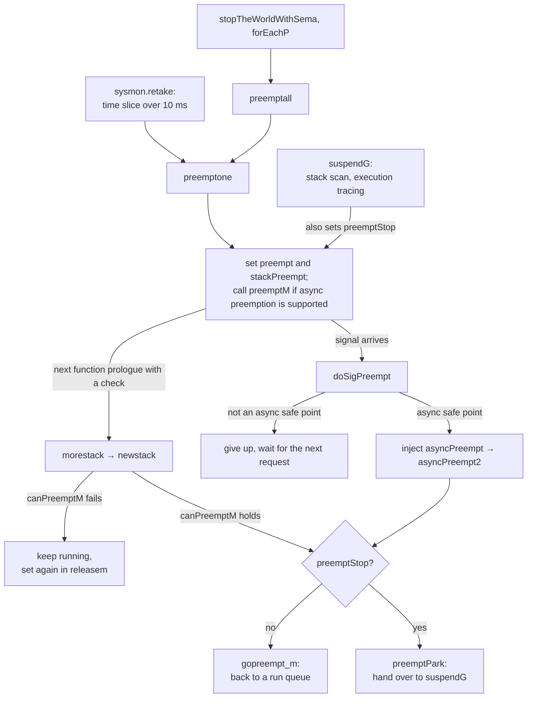

# 9.7 Cooperation and Preemption

The scheduling loop described in [9.4 The Scheduling Loop](./schedule.md) regains control only when
a goroutine leaves the CPU: it yields, blocks, enters a system call, or exits. A goroutine that does
none of these keeps its P indefinitely. The runtime therefore needs a way to stop a goroutine that
does not cooperate, and this ability is called **preemption**. For a runtime with garbage
collection, the hard part is not interrupting execution, which the operating system can do at any
moment with a signal or a thread suspension. The hard part is where the interruption lands: once the
goroutine is stopped, the garbage collector must be able to interpret its stack correctly, and the
scheduler must be able to resume it where it left off.

This section first uses a program to show what Go's preemption covers and what it does not. It then
introduces the safe point and its origin, and discusses in turn the cooperative preemption
introduced in Go 1.2, the attempts to insert checks on loop back edges, the asynchronous preemption
introduced in Go 1.14, and the situations in which the runtime issues a preemption request. It
closes with a comparison to HotSpot and .NET.

## 9.7.1 Loops That Refuse to Yield

The following program runs three kinds of loops that never yield voluntarily, each in a child
process. The first repeatedly calls a non-leaf function (a function that itself calls other
functions), the second repeatedly calls a **leaf function** (a function that calls no function), and
the third makes no calls at all. The child has a single P. It starts the goroutine that runs the
loop and then lets main sleep for 1 ms; as soon as main gets back on the P, the child exits. Each
loop runs with the default settings and with `GODEBUG=asyncpreemptoff=1` (asynchronous preemption
disabled), and the parent gives each child a deadline of 1 second:

```go {run=true native=true}
package main

import (
	"context"
	"fmt"
	"os"
	"os/exec"
	"runtime"
	"time"
)

//go:noinline
func leaf(x int) int { return x*3 + 1 } // small-frame leaf function: the compiler omits the stack check

//go:noinline
func nonleaf(x int) int { return leaf(x) + 1 } // non-leaf function: the prologue has a stack check

// Three loops that never yield.
var loops = map[string]func(){
	"loop calling a non-leaf function": func() {
		for x := 0; ; x = nonleaf(x) {
		}
	},
	"loop calling a leaf function": func() {
		for x := 0; ; x = leaf(x) {
		}
	},
	"loop without calls": func() {
		for x := 0; ; x++ {
		}
	},
}

func main() {
	if len(os.Args) == 2 { // child: run the loop on the only P, then see whether main gets back on the P
		runtime.GOMAXPROCS(1)
		go loops[os.Args[1]]()
		time.Sleep(time.Millisecond)
		return
	}
	for _, godebug := range []string{"asyncpreemptoff=1", ""} {
		for _, name := range []string{"loop calling a non-leaf function", "loop calling a leaf function", "loop without calls"} {
			ctx, cancel := context.WithTimeout(context.Background(), time.Second)
			cmd := exec.CommandContext(ctx, os.Args[0], name)
			cmd.Env = append(os.Environ(), "GODEBUG="+godebug)
			result := "main got back on the P"
			if err := cmd.Run(); ctx.Err() != nil {
				result = "not preempted within 1 s"
			} else if err != nil {
				result = err.Error()
			}
			cancel()
			fmt.Printf("GODEBUG=%q, %s: %s\n", godebug, name, result)
		}
	}
}
```

On Go 1.26, the author obtained the same output on darwin/arm64 and on darwin/amd64 (the latter run
under Rosetta):

```
GODEBUG="asyncpreemptoff=1", loop calling a non-leaf function: main got back on the P
GODEBUG="asyncpreemptoff=1", loop calling a leaf function: not preempted within 1 s
GODEBUG="asyncpreemptoff=1", loop without calls: not preempted within 1 s
GODEBUG="", loop calling a non-leaf function: main got back on the P
GODEBUG="", loop calling a leaf function: main got back on the P
GODEBUG="", loop without calls: main got back on the P
```

The 1 second is a deadline chosen by the example, not a constant of the runtime: a child that times
out is not slow, it would never finish. The program therefore needs about 2 seconds to run. How long
main waits when preemption does occur is measured in
[9.4.2 Two Switches: execute and mcall](./schedule.md).

With asynchronous preemption disabled, only the first loop can be preempted. The Go 1.2 release
notes state that "the scheduler is invoked occasionally upon entry to a function. This means that
any loop that includes a (non-inlined) function call can be
preempted" [[Go Authors, 2013](#ref-go-authors-2013)]. The second line of output shows that this is
too broad: a loop that calls a leaf function contains a non-inlined call but still cannot be
preempted. With the default settings all three loops can be preempted, which is the result of the
asynchronous preemption introduced in Go 1.14; before that, the last two loops were enough to make a
program with a single P stop responding. The rest of this section explains where the three lines of
difference come from.

## 9.7.2 Safe Points

After pausing a goroutine, the runtime usually also has to scan its stack, or take it off the CPU
and later resume it where it stopped. Go's garbage collection is precise: the collector must know
whether each stack slot and register holds a pointer or a plain value, and must not treat an integer
that happens to look like an address as a pointer
([13.7 Safe-Point Analysis](../../part4memory/ch13gc/safe.md)). The compiler produces this
information in the form of stack maps, but it cannot do so for every instruction: which slots of a
frame hold pointers changes constantly during execution, and recording it per instruction would make
the metadata enormous. Summarizing the implementation of Sun's EVM Java virtual machine, Agesen
wrote in 1998 that, to reduce storage overhead, frame maps are usually kept only for a number of
so-called GC points in each method, so garbage collection can proceed only when all threads are at
GC points [[Agesen, 1998](#ref-agesen-1998)]. Before that, Diwan, Moss, and Hudson had discussed how
a compiler generates such tables for precise collection and what they cost in space
[[Diwan et al., 1992](#ref-diwan-et-al-1992)]. Go's compiler records a stack map at every call site
[[Clements, 2019b](#ref-clements-2019b)]. Agesen also notes that Peyton Jones and Ramsey generalized
the GC point into the **safe point**: a program point at which execution can safely be paused,
variables inspected and modified, and garbage collection performed. This book uses "safe
point" throughout.

In a single-threaded program, GC points add no overhead: the thread that triggers a collection is
always the one whose allocation failed, and an allocation site is itself a GC point. Multithreaded
programs differ. Agesen points out that only the triggering thread is at a GC point; every other
thread must first roll forward to its next GC point before the collection can begin. The time it
takes for all threads to reach a safe point is called the **time to safepoint** (TTSP)
[[Wakart, 2015](#ref-wakart-2015)]. The duration of a stop-the-world (STW) pause is therefore
determined by the slowest thread: if one thread stays away from safe points for a long time, all the
threads that have already stopped wait for it. Go's proposal for non-cooperative preemption lists
this as the first problem caused by untimely preemption; the others are scheduling latency, stack
scan latency, and, in extreme cases, a program that stops responding
[[Clements, 2019a](#ref-clements-2019a)].

The comment at the top of `runtime/preempt.go` divides safe points into three kinds
[[Go Authors, 2026](#ref-go-authors-2026)]:

1. Blocking safe points: the entire time a goroutine is switched out, blocked on a synchronization
   operation, or in a system call.
2. Synchronous safe points: the places where a running goroutine checks whether there is a
   preemption request.
3. Asynchronous safe points: any instruction in user code where the goroutine can safely be paused
   and where a conservative scan of the stack and registers is enough to find all roots on the
   stack. The runtime stops goroutines at these places using operating system mechanisms such as
   signals.

At the first two kinds of safe points, the goroutine has little CPU state and the collector has
precise information about its whole stack, so switching it out requires saving little state and the
stack scan is precise. The third kind was added in Go 1.14. It allows nearly arbitrary stopping
places at the cost of precision in the innermost frames (9.7.5).

There are two ways to bring a thread to a safe point. One is **polling**: the compiler inserts check
code at certain places, and when a thread reaches one it looks for a pause request. This is how EVM
originally worked; its compiler inserted polling code before every backward branch and in method
prologues. Polling costs resident check instructions, and its blind spot is code that goes a long
time without passing a check. The other is forced from outside. EVM later switched to code patching:
no checks are performed normally, and when a collection is needed, the GC points in the methods
where the threads are executing are rewritten into calls to the runtime, after which the threads
continue to run until they reach them. On SPARC, patching executed on average 4.7% fewer
instructions than polling, at the cost of 5.1% to 8.5% more code and a harder implementation
[[Agesen, 1998](#ref-agesen-1998)]. As later sections show, Go has used both approaches in turn, and
keeps both.

## 9.7.3 Cooperative Preemption: Borrowing the Stack Check

Before Go 1.2, a goroutine gave up its P only when it yielded, blocked, or entered a system call. In
January 2010, Russ Cox reported a one-line problem: `go func() { for { } }()` should not stall the
rest of the program, but it does [[Cox, 2010](#ref-cox-2010)]. In May 2013, Dmitry Vyukov listed two
problems in the design document for a preemptive scheduler. Some programs misbehave for lack of
preemption: a single goroutine runs forever without switching to others, and timers do not fire.
Garbage collection needs an STW pause, which without preemption may take arbitrarily long, and users
had reported pauses of several minutes [[Vyukov, 2013](#ref-vyukov-2013)]. Vyukov's solution reuses
the check of segmented stacks: on every function call, each goroutine checks whether there is enough
stack space and calls into the runtime if not. If the check can be made to fail on external request,
the result is preemption. The document summarizes the advantages of this approach as no additional
overhead, a relatively simple implementation, no use of signals, and minimal synchronization. It was
implemented in Go 1.2. It is called **cooperative preemption** because the runtime can only make a
request; preemption happens only when the goroutine itself reaches a check.

For a function with a small frame, the stack check in the prologue
([14.3.1](../../part4memory/ch14stack/grow.md)) takes only two instructions on amd64. For `nonleaf`
from the example in 9.7.1, the assembly printed by `go build -gcflags=-S`, trimmed and rewritten
with labels, is:

```
TEXT main.nonleaf(SB), ABIInternal, $16-8
	CMPQ  SP, 16(R14)      // R14 holds the current g; 16(R14) is g.stackguard0
	JLS   slow             // SP not above stackguard0: not enough stack, or a preemption request
	...                    // function body
slow:
	MOVQ  AX, 8(SP)        // spill the register argument to the stack
	CALL  runtime.morestack_noctxt(SB)
	MOVQ  8(SP), AX
	JMP   main.nonleaf(SB) // go back to the entry and check again
```

To issue a preemption request, the runtime only needs to set the target goroutine's `stackguard0` to
`stackPreempt`, a value larger than any valid stack pointer. The check at the next function call is
then bound to fail, execution enters `morestack`, and it switches to g0 to call `newstack`.
`newstack` first determines whether this is a preemption request:

```go
// runtime.newstack (runtime/stack.go), keeping only the parts related to preemption
const stackPreempt = uintptrMask & -1314 // 0xfffffffffffffade on 64-bit platforms

func newstack() {
	thisg := getg()
	gp := thisg.m.curg
	preempt := gp.stackguard0 == stackPreempt
	if preempt && !canPreemptM(thisg.m) {
		// Not a good time to preempt: restore the normal stack bound and let the goroutine continue.
		// gp.preempt stays true; stackPreempt is set again when the M releases its runtime locks.
		gp.stackguard0 = gp.stack.lo + stackGuard
		gogo(&gp.sched)
	}
	// ... check that the stack pointer is not out of bounds ...
	if preempt {
		if gp.preemptShrink { // stack shrinking deferred to a synchronous safe point
			gp.preemptShrink = false
			shrinkstack(gp)
		}
		gp.syncSafePoint = true
		if gp.preemptStop {
			preemptPark(gp) // pause for a stack scan, see 9.7.6
		}
		gopreempt_m(gp) // equivalent to calling runtime.Gosched
	}
	// only now does the actual stack growth begin
}
```

`canPreemptM` decides whether preemption is possible at this moment:

```go
// runtime.canPreemptM (runtime/preempt.go)
func canPreemptM(mp *m) bool {
	return mp.locks == 0 && mp.mallocing == 0 && mp.preemptoff == "" &&
		mp.p.ptr().status == _Prunning && mp.curg != nil &&
		readgstatus(mp.curg)&^_Gscan != _Gsyscall
}
```

These conditions correspond almost one for one to the non-preemptible situations listed in Vyukov's
design document: holding a runtime lock, allocating memory, the goroutine not being in the running
state (for example, being in a system call), and the M having no P or its P not running. Among them,
`m.locks` doubles as a counter that disables preemption: the runtime increments it with `acquirem`
when entering a critical section; when `releasem` brings it down to zero and `gp.preempt` is still
true, it sets `stackguard0` back to `stackPreempt`, making up for the request that was deferred.
`gopreempt_m` shares `goschedImpl` with `runtime.Gosched` and puts the goroutine on the global run
queue ([9.4.3](./schedule.md)).

This design adds no instructions: the preemption check is the stack overflow check that was already
there. Agesen records a similar idea: EVM omits the polling in the prologues of methods that contain
at most one call site, reasoning that a thread executing only in such loop-free methods will either
overflow its stack quickly, because the depth grows with execution time, or leave these methods
soon, and the code that handles stack overflow itself provides an opportunity to pause
[[Agesen, 1998](#ref-agesen-1998)]. Go goes one step further and merges the poll with the stack
overflow check.

The price is that preemption can happen only at the entries of functions that have a stack check,
and that is fewer than "every function call". The assemblers for amd64 and arm64 mark leaf functions
whose frame is smaller than `StackSmall` (128 bytes) as `NOSPLIT` and omit the check: at least
`StackSmall` bytes are always reserved below the stack bound, so such a function cannot run past the
bottom of the stack ([14.3](../../part4memory/ch14stack/grow.md)). Inlined calls no longer have a
prologue either. The `leaf` in 9.7.1 is exactly such a function; the output of `-gcflags=-S` marks
it as `nosplit`, so a loop that calls it repeatedly never passes a synchronous safe point, just like
a loop with no calls. Clements summarizes the situation up to Go 1.10 in the design document for
non-cooperative preemption: safe points exist only at function calls, and when a function is small
or inlined, not even there [[Clements, 2019a](#ref-clements-2019a)].

## 9.7.4 Polling on Back Edges

Vyukov's design document leaves open whether to compile additional preemption checks on **back
edges** (the edges of the control flow graph that jump from the loop body back to the loop header),
on the grounds that the checks at function entries should be enough for most practical cases
[[Vyukov, 2013](#ref-vyukov-2013)]. Checks on back edges are the standard practice in runtimes that
use cooperative preemption, because almost no code can run for long without passing a back edge; EVM
and HotSpot both do this (9.7.7). Examples in which the checks at function entries are not enough
kept appearing in Go, and issue #10958, "runtime: tight loops should be preemptible", opened by
Austin Clements in 2015, collects them [[Clements, 2015](#ref-clements-2015)].

David Chase made two attempts. His 2016 commit 7f1ff65c39 added `GOEXPERIMENT=preemptibleloops` to
the compiler: when enabled, the compiler inserts a rescheduling check on every back edge of every
reducible loop, in the same way as in a function prologue, comparing the stack pointer with
`stackguard0` [[Chase, 2016](#ref-chase-2016)]. The commit message says that the STW latency target
had been brought down to about 100 µs and that the experiment was meant for studying and diagnosing
GC and other latency problems. It still exists and is off by default in Go 1.26.

CL 43050 in 2017 tried to reduce the check to the minimum. On amd64, each back edge gains just one
`TESTB AX, runtime.reschedulePage` instruction, which reads a byte reserved by the runtime
[[Chase, 2017](#ref-chase-2017)]. Normally the read has no effect; by design, when preemption is
needed the runtime makes the page inaccessible, so the read raises a page fault that is taken over
by the signal handler. This approach is therefore called fault-based preemption. It introduces no
branch and takes no register. Replacing explicit flag checks with page protection is an old
technique: Agesen records that Steve Dever proposed a write-protected "polling page" for EVM, which
Mosberger, Druschel, and Peterson called "controlled faults" [[Agesen, 1998](#ref-agesen-1998)];
HotSpot's safe point polls still work this way (9.7.7).

Even so, on a large benchmark suite the geometric mean slowdown was 7.8%, with several clearly worse
outliers; compared with Go 1.9, the slowdown was only 1% because other improvements offset it, but
most benchmarks still became slower [[Clements, 2019a](#ref-clements-2019a)]. The design document
also lists several shortcomings of the implementation. First, it cannot target a specific thread or
goroutine, so it is unsuitable for stack scans, ragged barriers (which require each thread to
perform some operation at some point, without all threads stopping at the same time), or ordinary
scheduler preemption. Second, it is "sticky": none of the loops can be resumed until all of them
are, so when the state is unsafe (for example, a runtime lock is held), it cannot simply let the
thread through. Third, it needs more instructions on non-x86 or non-UNIX platforms. Fourth, it
interferes with debuggers, which usually treat an illegal memory access as a reason to pause the
program. Paying a resident cost in every hot loop for something that almost never happens, and still
being unable to target a specific goroutine, pushed the Go team toward a non-cooperative approach.

## 9.7.5 Asynchronous Preemption

In March 2018, Austin Clements opened issue #24543, proposing non-cooperative preemption: switching
the execution context without relying on explicit checks in the preempted code or on its cooperation
[[Clements, 2018a](#ref-clements-2018a)]. Interrupting a running goroutine with a signal and
obtaining its CPU state is not hard. The difficulty is that it is almost never stopped at an
instruction that has a stack map. The design document gives two sub-proposals.

The first is safe-points everywhere: the compiler generates liveness maps for the stack and
registers for every instruction [[Clements, 2018b](#ref-clements-2018b)]. Go 1.11 already began
recording register maps in the binary, partly in preparation for non-cooperative preemption and
partly to let debuggers inject function calls into the target program; binaries grew by about 5% as
a result [[Clements, 2018c](#ref-clements-2018c)]. The second is conservative inner-frame scanning:
for a preempted goroutine, only the innermost stack frame and the registers are scanned
conservatively as roots, any word that could be a valid heap pointer is treated as a pointer, and
the remaining frames are still scanned precisely using the stack maps at call sites
[[Clements, 2019b](#ref-clements-2019b)].

Go adopted the second sub-proposal. The design document gives these reasons: it is much simpler to
implement, far less likely to leave long-standing bugs, and shrinks binaries by about 5%. The usual
problem with conservative scanning is that it keeps objects alive that should have been collected,
but here the scope is strictly limited to the innermost frame, which changes quickly, so an object
is rarely wrongly retained for more than one collection cycle. Go 1.14 implemented this scheme and
called it **asynchronous preemption** [[Clements, 2019c](#ref-clements-2019c)]; Go 1.15 removed the
register maps, and stack maps were again generated only at call sites
[[Clements, 2020a](#ref-clements-2020a)]. The Go 1.14 release notes say that goroutines can now be
asynchronously preempted, so loops without function calls no longer risk deadlocking the scheduler
or significantly delaying garbage collection [[Go Authors, 2020](#ref-go-authors-2020)].

On platforms that use signals, an asynchronous preemption goes through the following steps:

1. The initiator calls `preemptM`, which sends `SIGURG` to the thread of the target M (for the
   choice of signal, see [9.6.6](./signal.md)). If the M already has an unhandled preemption signal,
   no further signal is sent.
2. The signal handler calls `doSigPreempt` (for the dispatch path, see [9.6.3](./signal.md)). It
   confirms that the goroutine still needs to be preempted and that the interrupted location is an
   asynchronous safe point, then modifies the signal context so that the thread appears to have
   called `asyncPreempt` at the interrupted location.
3. After the signal handler returns, the thread starts executing at `asyncPreempt`. This assembly,
   generated by `mkpreempt.go`, saves all general-purpose registers and flags on the goroutine's
   stack and then calls `asyncPreempt2`.
4. `asyncPreempt2` switches to g0 and, as in synchronous preemption, proceeds to `preemptPark` or
   `gopreempt_m`. When the goroutine is scheduled again, `asyncPreempt2` returns, `asyncPreempt`
   restores all registers, and control returns to the interrupted instruction.

The code for steps 2 and 4 is as follows:

```go
// runtime.doSigPreempt (runtime/signal_unix.go), without the special handling for Darwin
func doSigPreempt(gp *g, ctxt *sigctxt) {
	if wantAsyncPreempt(gp) {
		if ok, newpc := isAsyncSafePoint(gp, ctxt.sigpc(), ctxt.sigsp(), ctxt.siglr()); ok {
			// push newpc as the return address and set the PC to asyncPreempt
			ctxt.pushCall(abi.FuncPCABI0(asyncPreempt), newpc)
		}
	}
	gp.m.preemptGen.Add(1) // tell the initiator that this request has been handled
	gp.m.signalPending.Store(0)
}

// runtime.asyncPreempt2 (runtime/preempt.go)
func asyncPreempt2() {
	mcall(func(gp *g) {
		gp.asyncSafePoint = true // the top two frames have no precise pointer information
		xRegSave(gp)             // move the extended register state from the P to the G
		if gp.preemptStop {
			preemptPark(gp)
		} else {
			gopreempt_m(gp)
		}
	})
	gp := getg() // the goroutine continues here after being rescheduled
	xRegRestore(gp)
	gp.asyncSafePoint = false
}
```

The comment at the top of `preempt.go` also explains why the preemption is not carried out directly
in the signal handler. The advantage would be that the operating system saves and restores the
registers, and the runtime would only need to extract the registers that may contain pointers from
the signal context. But every preempted goroutine would then pin down an M, and the scheduler was
not designed to run inside a signal handler: on the preemption path it often has to allocate memory
and start threads.

A signal can arrive at any instruction, and `isAsyncSafePoint` decides whether pausing here is
allowed. In the following cases it always refuses and waits for the next request:

- The interrupted code is not the user goroutine the M is currently running, for example because the
  M is in the scheduler handling this goroutine, or `canPreemptM` does not hold.
- There is not enough stack space left to inject a call to `asyncPreempt`. The required space,
  `asyncPreemptStack`, is computed at startup from the largest frame of the relevant functions, and
  must not exceed the stack space available to `nosplit` functions.
- The code is not Go code, or is an assembly function.
- The location is an unsafe point marked by the compiler, such as an atomic instruction sequence
  like a write barrier, or any place in a `nosplit` function other than a call site.
- The innermost function (taking inlining into account) belongs to the `runtime`,
  `internal/runtime`, or `reflect` package. These packages contain, among other things, the regions
  of the scheduler that must not be preempted between this point and that one, the untyped data that
  the `defer` implementation keeps on the stack, and batched write barriers.
- Under the Go 1.26 experiment `GOEXPERIMENT=runtimesecret`, the goroutine is performing a
  confidential computation: a conservative scan could carry secret data from the stack into the
  collector's work buffers, and saving registers would leave copies of the secret data.

There is one more kind of location where a goroutine can be paused but cannot be resumed in place.
When the assemblers for arm64, loong64, and similar platforms load a large constant or offset, they
generate several instructions, with intermediate results held in the temporary register `REGTMP`,
while `asyncPreempt` uses this register to load the return address when it returns and does not
preserve its value. The assembler marks such instruction sequences as restartable sequences. Since
Go 1.18, `isAsyncSafePoint` accepts these locations but moves the resume address back to the
beginning of the sequence, so that `REGTMP` is recomputed after resumption
[[Mui, 2021](#ref-mui-2021)].

A goroutine paused at an asynchronous safe point has two frames at the top of its stack without
precise pointer information: the `asyncPreempt` frame, which holds the saved registers, and the
frame of the interrupted function. When the stack scan reaches the `asyncPreempt` frame, it scans
that frame and its parent frame conservatively, including the area in the parent frame reserved for
outgoing arguments, because at the time of the interruption it may have been preparing a call
([13.7 Safe-Point Analysis](../../part4memory/ch13gc/safe.md)). Conservative scanning does not treat
every word that looks like an address as a pointer: only a word that points to an allocated object
in the heap causes that object to be marked, and objects newly allocated during the mark phase are
black anyway and are skipped; a word that points into the goroutine's own stack causes the
corresponding stack object to be scanned conservatively as well
[[Go Authors, 2026](#ref-go-authors-2026)]. Because the pointer information of these two frames is
imprecise, the runtime also cannot move the stack at this point: `isShrinkStackSafe` refuses to
shrink when `gp.asyncSafePoint` is true, and the collector only sets `preemptShrink`, deferring the
shrinking to the next synchronous safe point, which is the code in `newstack` shown in 9.7.3
([14.5 Stack Shrinking and Evolution](../../part4memory/ch14stack/shrink.md)).

Where the registers are saved also needs thought. General-purpose registers may contain pointers and
must be saved on the goroutine's stack so that the conservative scan can find them. Before Go 1.26,
all registers were saved on the stack; for this, `asyncPreempt` on amd64 needed 368 bytes of stack
space, most of it for the XMM registers, while the AVX-512 register state is 2.5 KiB, which exceeds
the limit for `nosplit` functions. Go 1.26 therefore saves vector registers and other
non-general-purpose registers off the stack on amd64, arm64, and loong64: `asyncPreempt` first
writes them to a scratch area of the current P, and `asyncPreempt2` then moves them, on g0, into
extended register state that is allocated for the G on demand
[[Clements, 2025](#ref-clements-2025)]. On amd64, the AVX2 and AVX-512 state is currently saved only
under `GOEXPERIMENT=simd`; the default build saves only the XMM registers. Go 1.26 assumes that this
state contains only scalar data and does not scan it. The assumption does not always hold: the
compiler may use vector registers to copy small blocks of memory, and if a preemption occurs in the
middle of such a copy, a pointer may exist only in a vector register. Go 1.27 therefore begins to
scan this state conservatively [[Musman, 2026](#ref-musman-2026)].

Not all platforms use signals. Windows has no POSIX signals; `preemptM` suspends the target thread
with `SuspendThread`, reads its registers with `GetThreadContext`, and, once it has confirmed that
the thread is at an asynchronous safe point, rewrites the context, writes it back with
`SetThreadContext`, and resumes the thread, which is the same approach as .NET's in 9.7.7. Plan 9
and js/wasm do not support asynchronous preemption (`preemptMSupported` is false) and can rely only
on cooperative preemption. When debugging, if a problem is suspected to be related to asynchronous
preemption, it can be turned off with `GODEBUG=asyncpreemptoff=1`; the example in 9.7.1 used exactly
this switch to show the blind spot of cooperative preemption.

## 9.7.6 Sources of Preemption Requests

The entry point for issuing a preemption request is `preemptone`. It sets two triggers at once: it
sets `stackPreempt` and waits for the goroutine's next prologue check, and, on platforms that
support asynchronous preemption, it also sends a preemption signal to the M. The goroutine enters
the scheduler by whichever path it satisfies first:

```go
// runtime.preemptone (runtime/proc.go), without the validity checks at the start
func preemptone(pp *p) bool {
	mp := pp.m.ptr()
	gp := mp.curg
	// ... skip the case of no M, the current M itself, g0, and goroutines in system calls ...
	gp.preempt = true
	gp.stackguard0 = stackPreempt // synchronous: the next prologue check is bound to fail
	if preemptMSupported && debug.asyncpreemptoff == 0 {
		pp.preempt = true
		preemptM(mp) // asynchronous: send a preemption signal to the M
	}
	return true
}
```

`preemptone` is called from two places. The first is `retake` in the system monitor sysmon: if a P's
scheduling count has not changed within 10 ms (`forcePreemptNS`), the same time slice has been
running too long, and sysmon requests preemption of the goroutine on that P (for the rule, see
[9.4.2](./schedule.md); for sysmon itself, see [9.8 System Monitoring](./sysmon.md)). The second is
`preemptall`, which calls `preemptone` on every running P. `stopTheWorldWithSema`, which performs an
STW, calls `preemptall` once and then again every 100 µs until all Ps have stopped; `forEachP` also
uses it to make each P execute the given operation as soon as possible. Neither kind of request sets
`preemptStop`: the preempted goroutine returns to a run queue through `gopreempt_m` and can later
continue on any P.

The third source is `suspendG`. When the collector scans a goroutine's stack (the stack-root tasks
in `markroot`), and when the execution tracer needs to read a goroutine's stack, the runtime does
not stop the world but pauses goroutines one at a time. For a running goroutine, `suspendG` sets
`preemptStop`, `preempt`, and `stackPreempt`, calls `preemptM` at a rate of at most once every 5 µs,
and spins waiting. The goroutine enters `preemptPark` at a synchronous or asynchronous safe point,
and its status becomes `_Gpreempted`; `suspendG` changes it to `_Gwaiting` and holds the scan bit
for the caller to use, and after the scan `resumeG` makes it ready again. A goroutine already at a
blocking safe point (`_Grunnable`, `_Gwaiting`, `_Gsyscall`) needs no preemption, and `suspendG`
only has to acquire its scan bit.

The design document distinguishes between these kinds of requests: STW preemption has strict timing
requirements but does not scan stacks, so it can use asynchronous preemption immediately; stack
scans and scheduler preemption have no strict timing requirements, so the runtime can wait for
cooperative preemption first and thereby reduce conservative scanning
[[Clements, 2019b](#ref-clements-2019b)]. In fact, `suspendG` in Go 1.26 issues both kinds of
requests. The ability to pause goroutines one by one lets the collector scan each goroutine's stack
individually during concurrent marking; after the hybrid write barrier was introduced in Go 1.8, the
mark termination phase also no longer needs to rescan stacks during an STW pause
[[Clements and Hudson, 2016](#ref-clements-and-hudson-2016)]. HotSpot gained the ability to pause a
single thread only in JDK 10, and ZGC moved the processing of thread stacks out of the safe point
only in JDK 16 (9.7.7).

The following figure summarizes the sources of requests and the two preemption paths:



## 9.7.7 How Other Runtimes Do It

The HotSpot JVM uses polling. Wakart summarizes where OpenJDK places safe point polls: in
interpreted execution, effectively between any two bytecodes; in code compiled by C1 and C2, on the
back edges of non-counted loops and at method returns. Threads blocked on locks, monitors, or I/O,
and threads executing JNI native code, are already at a safe point
[[Wakart, 2015](#ref-wakart-2015)]. The poll itself is a `test` instruction that reads the polling
page, which on x86-64 takes only 6 bytes with RIP-relative addressing and normally has no effect;
when the VM needs to enter a safe point, it makes this page unreadable, so the poll triggers
`SIGSEGV`, which is taken over by the JVM's signal handler [[Shipilëv, 2019](#ref-shipilev-2019)].
This is the technique used in CL 43050. Counted loops (loops whose variable is an `int` and whose
bounds are known) used to contain no poll, and Wakart shows by example how such loops let TTSP run
out of control, even making all other threads wait indefinitely at the next safe point. JDK 10
introduced loop strip mining: a counted loop is split into an inner and an outer loop, where the
inner loop runs at most `LoopStripMiningIter` iterations without polling and the outer loop contains
the poll [[Westrelin, 2017](#ref-westrelin-2017)]. With G1 and ZGC the optimization is on by
default, with 1000 iterations per strip. Also in JDK 10, JEP 312 introduced thread-local handshakes:
each thread reads the polling page through a thread-local pointer, so the VM can pause a single
thread, without pausing all threads, simply by pointing that thread's pointer at the unreadable page
[[Ehn, 2018](#ref-ehn-2018)]. Shipilëv measured this to cost only an additional read that hits the
L1 cache, about half a clock cycle. Later, in JDK 16, ZGC used a stack watermark barrier to move the
scanning of thread stacks into the concurrent phase, with the goal of pauses under 1 ms per GC safe
point [[Österlund, 2020](#ref-osterlund-2020)].

.NET's CoreCLR lets the just-in-time compiler choose, for each method, between two kinds of code
[[Microsoft, n.d.](#ref-microsoft-nd)]. In partially interruptible code, the only safe points are
call sites and explicitly inserted GC polls, and GC information is generated only for those
locations. In fully interruptible code, every instruction is a safe point; the compiler generates GC
information for every instruction and inserts no polls. The JIT compiler uses heuristics to trade
off code quality, the size of the GC information, and pause latency. When a thread needs to be
paused, the runtime suspends it with `SuspendThread` and reads its context with `GetThreadContext`.
If the thread is in fully interruptible code, it rewrites the instruction pointer to redirect the
thread to a stub that saves the full context and waits for the GC to finish. If the thread is in
partially interruptible code, it rewrites the return address of the topmost frame so that when the
method returns it lands in the same stub, which is called thread hijacking.

| Runtime | Location of safe points | How threads reach a safe point | Stack scanning |
| --- | --- | --- | --- |
| Go 1.2 to 1.13 | Function prologues with a stack check | Polling, reusing the stack overflow check | Precise |
| Go 1.14 and later | Same, plus most instructions in user code | Polling; signal or thread suspension followed by call injection | Top two frames conservative, the rest precise |
| HotSpot (C1, C2) | Method returns, back edges of non-counted loops, outer loops of strip-mined counted loops | Read the polling page, make it unreadable when needed | Precise |
| .NET CoreCLR | Partially interruptible: call sites and GC polls; fully interruptible: every instruction | Suspend the thread, then rewrite the instruction pointer or return address | Precise |

By comparison, Go's asynchronous safe points come close to .NET's fully interruptible code in
coverage, but without generating GC information for every instruction, which is precisely the
safe-points-everywhere approach Go gave up; what Go accepted is a bounded imprecision, the
conservative scan of the top two frames. HotSpot instead puts its effort into making polls as cheap
as possible and uses strip mining to cover the blind spot of counted loops; Go went down the same
road in CL 43050 and ultimately abandoned it because of its overhead and its inability to target a
specific goroutine.

## 9.7.8 Summary

The constraint on preemption comes from precise collection: a goroutine can stop only where the
collector can read its stack. Go 1.2 merged the preemption check into the stack overflow check in
the function prologue, which adds no instructions but leaves blind spots for leaf functions, inlined
calls, and loops without calls. Polling on back edges can cover loops, but even when compressed to a
single instruction it has considerable overhead and cannot target a specific goroutine. Go 1.14
interrupts goroutines with signals (by suspending threads on Windows) and replaces per-instruction
stack maps with a conservative scan of the top two frames. The two mechanisms coexist: every request
from sysmon, STW, and stack scanning sets both the synchronous and the asynchronous trigger.

Asynchronous preemption still has gaps, namely the runtime's own code, assembly functions, and
unsafe points marked by the compiler. For example, the zeroing of large blocks of memory in
operations such as `clear` and `append` is done inside the runtime and cannot be preempted while it
runs [[Hiltner, 2024](#ref-hiltner-2024)]; issue #36365 tracks the remaining loose ends of
asynchronous preemption [[Clements, 2020b](#ref-clements-2020b)].

## Further Reading

- <a id="ref-agesen-1998"></a>[Agesen, 1998] Ole Agesen. GC Points in a Threaded Environment. Sun
  Microsystems Laboratories Technical Report SMLI TR-98-70, 1998.
  https://www.cs.tufts.edu/~nr/cs257/archive/ole-agesen/gc-points.pdf The classic account of
  bringing threads to GC points in a multithreaded environment, comparing polling with code
  patching.
- <a id="ref-chase-2016"></a>[Chase, 2016] David Chase. cmd/compile: insert scheduling checks on
  loop backedges. Go commit 7f1ff65c39, 2016. https://go.dev/cl/33910 The origin of
  `GOEXPERIMENT=preemptibleloops`.
- <a id="ref-chase-2017"></a>[Chase, 2017] David Chase. cmd/compile: loop preemption with "fault
  branch" on amd64. Go CL 43050, 2017 (not merged). https://golang.org/cl/43050 Fault-based
  preemption on back edges: one `TESTB` instruction per back edge.
- <a id="ref-clements-2015"></a>[Clements, 2015] Austin Clements. runtime: tight loops should be
  preemptible. Go issue #10958, 2015. https://github.com/golang/go/issues/10958
  A collection of reports on the blind spots of prologue preemption.
- <a id="ref-clements-2018a"></a>[Clements, 2018a] Austin Clements. runtime: non-cooperative
  goroutine preemption. Go issue #24543, 2018. https://github.com/golang/go/issues/24543 The
  proposal discussion for asynchronous preemption.
- <a id="ref-clements-2018b"></a>[Clements, 2018b] Austin Clements. Proposal: Safe-points everywhere
  for non-cooperative goroutine preemption. Go design document, 2018.
  https://go.googlesource.com/proposal/+/master/design/24543/safe-points-everywhere.md The
  sub-proposal that was not adopted: generating a liveness map for every instruction.
- <a id="ref-clements-2018c"></a>[Clements, 2018c] Austin Clements. cmd/compile, cmd/internal/obj:
  record register maps in binary. Go commit 9f95c9db23, 2018. https://go.dev/cl/109353
- <a id="ref-clements-2019a"></a>[Clements, 2019a] Austin Clements. Proposal: Non-cooperative
  goroutine preemption. Go design document, 2019.
  https://github.com/golang/proposal/blob/master/design/24543-non-cooperative-preemption.md The
  problems caused by untimely preemption, the attempt at back-edge preemption and its 7.8% overhead,
  and the overall design of the signal-based approach.
- <a id="ref-clements-2019b"></a>[Clements, 2019b] Austin Clements. Proposal: Conservative
  inner-frame scanning for non-cooperative goroutine preemption. Go design document, 2019.
  https://go.googlesource.com/proposal/+/master/design/24543/conservative-inner-frame.md The
  sub-proposal that was adopted: conservatively scanning the innermost frame.
- <a id="ref-clements-2019c"></a>[Clements, 2019c] Austin Clements. runtime: implement async
  scheduler preemption. Go commit 177a36a5dc, 2019. https://go.dev/cl/201762
- <a id="ref-clements-2020a"></a>[Clements, 2020a] Austin Clements. cmd/compile,runtime: stack maps
  only at calls, remove register maps. Go commit 9d812cfa5c, 2020. https://go.dev/cl/230544
- <a id="ref-clements-2020b"></a>[Clements, 2020b] Austin Clements. runtime: clean up async
  preemption loose ends. Go issue #36365, 2020. https://go.dev/issue/36365
- <a id="ref-clements-2025"></a>[Clements, 2025] Austin Clements. runtime: save scalar registers off
  stack in amd64 async preemption. Go commit af0c4fe2ca, 2025. https://go.dev/cl/669195
- <a id="ref-clements-and-hudson-2016"></a>[Clements and Hudson, 2016] Austin Clements and Rick
  Hudson. Proposal: Eliminate STW stack re-scanning. Go design document, 2016.
  https://go.googlesource.com/proposal/+/master/design/17503-eliminate-rescan.md The hybrid write
  barrier, which removes the need for an STW pause in stack scanning.
- <a id="ref-cox-2010"></a>[Cox, 2010] Russ Cox. runtime: preemptive scheduling. Go issue
  #543, 2010. https://go.dev/issue/543 The original report of an empty loop stalling the whole
  program.
- <a id="ref-diwan-et-al-1992"></a>[Diwan et al., 1992] Amer Diwan, Eliot Moss, and Richard Hudson.
  Compiler support for garbage collection in a statically typed language. In *Proceedings of
  PLDI '92*, 273–282, 1992. https://doi.org/10.1145/143095.143140 Compiler-generated stack map
  tables for precise collection; Agesen (1998) cites its discussion of the space cost of such
  tables.
- <a id="ref-ehn-2018"></a>[Ehn, 2018] Robbin Ehn. JEP 312: Thread-Local Handshakes. OpenJDK, 2018.
  https://openjdk.org/jeps/312
  From global safe points to per-thread handshakes.
- <a id="ref-go-authors-2013"></a>[Go Authors, 2013] The Go Authors. Go 1.2 Release Notes, 2013.
  https://go.dev/doc/go1.2
  The section "Pre-emption in the scheduler".
- <a id="ref-go-authors-2020"></a>[Go Authors, 2020] The Go Authors. Go 1.14 Release Notes, 2020.
  https://go.dev/doc/go1.14#runtime
  Asynchronous preemption becomes available, and `asyncpreemptoff`.
- <a id="ref-go-authors-2026"></a>[Go Authors, 2026] The Go Authors. `runtime/preempt.go`,
  `runtime/signal_unix.go`, `runtime/proc.go`, `runtime/mgcmark.go`.
  https://github.com/golang/go/tree/master/src/runtime The classification of safe points,
  `suspendG`, `isAsyncSafePoint`, `preemptone`/`retake`, and conservative stack scanning (this
  section follows Go 1.26).
- <a id="ref-hiltner-2024"></a>[Hiltner, 2024] Rhys Hiltner. runtime: non-preemptible zeroing in
  clear, append, bytes.growSlice, etc. Go issue #69327, 2024. https://go.dev/issue/69327
- <a id="ref-microsoft-nd"></a>[Microsoft, n.d.] Microsoft. Book of the Runtime: CLR Threading
  Overview. https://github.com/dotnet/runtime/blob/main/docs/design/coreclr/botr/threading.md
  Partially and fully interruptible code, and thread hijacking.
- <a id="ref-mui-2021"></a>[Mui, 2021] Cherry Mui. runtime: accept restartable sequence pcdata
  values in isAsyncSafePoint. Go commit 8ff16c1990, 2021. https://go.dev/cl/340011
- <a id="ref-musman-2026"></a>[Musman, 2026] Alexander Musman. runtime: conservatively scan extended
  register state. Go commit 683aa8893a, 2026. https://go.dev/cl/740681
- <a id="ref-osterlund-2020"></a>[Österlund, 2020] Erik Österlund. JEP 376: ZGC: Concurrent
  Thread-Stack Processing. OpenJDK, 2020. https://openjdk.org/jeps/376 Moving the processing of
  thread stacks out of the safe point.
- <a id="ref-shipilev-2019"></a>[Shipilëv, 2019] Aleksey Shipilëv. JVM Anatomy Quark #22: Safepoint
  Polls.
  2019. https://shipilev.net/jvm/anatomy-quarks/22-safepoint-polls/
  The implementation of the polling page and the cost of thread-local handshakes.
- <a id="ref-vyukov-2013"></a>[Vyukov, 2013] Dmitry Vyukov. Go Preemptive Scheduler Design
  Doc. 2013. https://docs.google.com/document/d/1ETuA2IOmnaQ4j81AtTGT40Y4_Jr6_IDASEKg0t0dBR8/edit A
  design that borrows the segmented-stack check to implement preemption, the source of cooperative
  preemption in Go 1.2.
- <a id="ref-wakart-2015"></a>[Wakart, 2015] Nitsan Wakart. Safepoints: Meaning, Side Effects and
  Overheads. 2015. https://psy-lob-saw.blogspot.com/2015/12/safepoints.html
  A systematic discussion of HotSpot safe points and TTSP.
- <a id="ref-westrelin-2017"></a>[Westrelin, 2017] Roland Westrelin. 8186027: C2: loop strip mining.
  OpenJDK commit 386e258e20, 2017. https://bugs.openjdk.org/browse/JDK-8186027
- This book: [9.4 The Scheduling Loop](./schedule.md), [9.6 Signal Handling](./signal.md),
  [9.8 System Monitoring](./sysmon.md),
  [Chapter 14 Execution Stack Management](../../part4memory/ch14stack/readme.md),
  [13.4 Scan Marking and Mark Assist](../../part4memory/ch13gc/mark.md),
  [13.7 Safe-Point Analysis](../../part4memory/ch13gc/safe.md).
