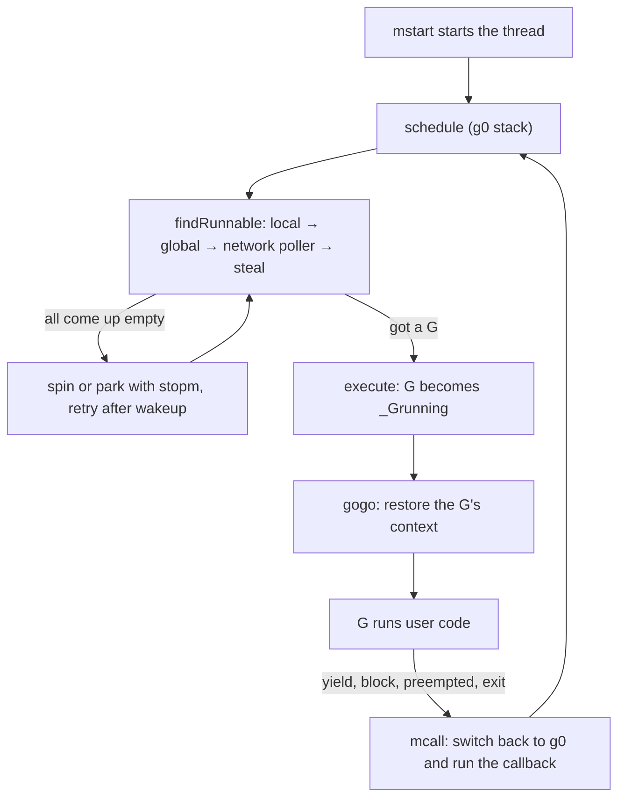

# 9.4 The Scheduling Loop

[9.3](./mpg.md) introduced the representation of G, M and P and the stack switch between a G and g0,
and [9.2](./steal.md) gave the full order in which an M looks for a runnable G. This section
connects these parts into a whole: how each M repeatedly selects and runs goroutines in the
scheduling loop, how Go bounds the time slice without timer interrupts, by which paths a goroutine
returns to the scheduler, and how the scheduler trades locality against fairness. The code below
consists of trimmed sketches that omit side branches such as GC, tracing and profiling; for the full
implementation see `runtime/proc.go` in Go 1.26 [[Go Authors, 2026a](#ref-go-authors-2026a)].

## 9.4.1 schedule, Which Never Returns

Every M eventually enters `schedule` after it starts and loops there until the thread exits. With
the side branches removed, the structure of `schedule` is as follows:

```go
// schedule: runs one round of scheduling, finds a runnable G and executes it, never returns (sketch)
func schedule() {
	mp := getg().m
	if mp.lockedg != 0 { // this M is locked by a G and can only run that G
		stoplockedm()
		execute(mp.lockedg.ptr(), false)
	}

top:
	gp, inheritTime, tryWakeP := findRunnable() // blocks inside when no work is found
	if mp.spinning {
		resetspinning() // leave the spinning state, waking a new spinning M if needed (9.3.5)
	}
	if tryWakeP {
		wakep() // a special G such as a GC worker was chosen; wake another P for ordinary Gs
	}
	if gp.lockedm != 0 { // gp is locked to another M: hand the P to that M and wait for a new P
		startlockedm(gp)
		goto top
	}
	execute(gp, inheritTime) // switch to gp, never returns
}
```

`findRunnable` checks the local queue, the global queue, the network poller and the other Ps in the
order described in [9.2.2](./steal.md). When all of these come up empty, it lets the M spin or park
and retries after being woken, so it always returns a G and `schedule` need not handle the "nothing
to do" case. `execute` does not return either: it jumps through the assembly routine `gogo` to the
context saved in the G, and the stack frame of `schedule` is abandoned from then on. Control can
return to the scheduler only when a G switches back to g0 and calls `schedule` again from the start,
which is usually done through `mcall` (9.4.3). A function that never returns but is called over and
over does not exhaust the g0 stack, because every switch starts again from the same position on it.
When a thread starts, `mstart1` records its caller's stack pointer in `g0.sched.sp`; its comment
notes that `mstart1` will never be returned to, so its stack frame can be reused. When `mcall`
switches to g0, it always resets the stack pointer to `g0.sched.sp` before calling the callback
[[Go Authors, 2026b](#ref-go-authors-2026b)]. Each round of scheduling therefore starts at the same
position on the g0 stack, and the frames left by the previous round are simply overwritten. The
`lockedg` and `lockedm` branches correspond to `runtime.LockOSThread`. A locked G can run only on
its M, and that M can run no other G: if `findRunnable` picks a G that is locked elsewhere, the
current M hands its own P to that M and then parks, waiting for a new P; a locked M, each time it
enters `schedule`, only waits for and runs its G. This handoff involves waking and parking threads
and costs far more than an ordinary G switch, so `LockOSThread` should be used only for cgo or where
the operating system requires thread affinity.



## 9.4.2 execute and the Time Slice

`execute` associates the selected G with the current M and then hands over control:

```go
// execute: runs gp on the current M (sketch)
func execute(gp *g, inheritTime bool) {
	mp := getg().m
	mp.curg = gp // M and G refer to each other
	gp.m = mp
	casgstatus(gp, _Grunnable, _Grunning)
	gp.preempt = false
	gp.stackguard0 = gp.stack.lo + stackGuard // clear any leftover preemption request
	if !inheritTime {
		mp.p.ptr().schedtick++ // start a new time slice
	}
	gogo(&gp.sched) // restore gp's context, never returns
}
```

Unlike an operating system kernel, the Go runtime sets no timer interrupt for each goroutine; the
time slice is bounded jointly by a counter and a background thread. `p.schedtick` is the P's
time-slice number and is incremented each time a new time slice starts. The system monitor thread
sysmon ([9.8](./sysmon.md)) periodically records each P's `schedtick`: if it finds that a P's number
is the same as last time and 10 ms (`forcePreemptNS`) have passed since the record was made, it
sends a preemption request to the G running on that P [[Go Authors, 2026a](#ref-go-authors-2026a)].
The preempted G goes back to the global run queue, and the P turns to other Gs.

The `inheritTime` parameter decides whether the new G starts a new time slice or inherits the
remainder of the current one. A G taken from `runnext` inherits the time slice; in all other cases a
new time slice begins. The following program measures the actual duration of `time.Sleep(1ms)` with
a single P:

```go {run=true native=true}
package main

import (
	"fmt"
	"runtime"
	"slices"
	"time"
)

// latency measures the actual duration of time.Sleep(1ms), taking the median of 20 runs.
func latency() time.Duration {
	var d []time.Duration
	for range 20 {
		start := time.Now()
		time.Sleep(time.Millisecond)
		d = append(d, time.Since(start))
	}
	slices.Sort(d)
	return d[len(d)/2]
}

func main() {
	runtime.GOMAXPROCS(1)
	fmt.Println("idle:", latency().Round(time.Millisecond))

	go func() { // a computation that never yields
		for {
		}
	}()
	fmt.Println("with a compute-bound goroutine:", latency().Round(time.Millisecond))
}
```

On the author's macOS (arm64) machine, one run produced the following output:

```
idle: 1ms
with a compute-bound goroutine: 24ms
```

Once the compute-bound goroutine appears, main's timer expires after 1 ms but must wait until that
goroutine is preempted before main can run. The actual latency exceeds 10 ms because sysmon wakes
only once every 10 ms when it has nothing else to do, and a time slice must be observed in both
samples before it is judged to have expired. With a single P, a goroutine that never yields
therefore makes the response latency of other goroutines reach 10 ms to 20 ms or more, depending on
the sleep precision of the platform.

## 9.4.3 Paths Back to the Scheduler

A goroutine can leave the CPU in five ways. Except for system calls, which have their own path, the
other four switch back to g0 to run a corresponding callback, with synchronous preemption going
through `morestack` and the rest through `mcall`:

| Path | Entry | Callback on g0 | Where the G goes |
| --- | --- | --- | --- |
| Voluntary yield | `runtime.Gosched` | `gosched_m` | `_Grunnable`, put on the global queue |
| Blocking | `gopark` | `park_m` | `_Gwaiting`, recorded in a wait queue |
| Preemption | Function prologue or asynchronous signal | `gopreempt_m` | `_Grunnable`, put on the global queue |
| System call | `entersyscall` | | `_Gsyscall`, see [9.5](./thread.md) |
| Exit | `goexit` | `goexit0` | `_Gdead`, put back into `gFree` |

Voluntary yield and preemption share `goschedImpl`: it sets the G to `_Grunnable`, puts it on the
**global** queue rather than the local one, and then calls `wakep` and `schedule`. A yielding G
therefore runs again only when some P's local queue is empty or the global queue check that happens
once every 61 time slices (9.4.4) comes around, which is the point of yielding. The one exception is
preemption initiated for stop-the-world (STW): there the G stays in the local `runnext`, so that it
continues immediately after resuming. The two ways preemption is triggered (the check in the
function prologue and signal-based asynchronous preemption) are covered in [9.7](./preemption.md).

The blocking path is the most commonly used, and waits on channels, mutexes, timers and network I/O
are all implemented through it. `gopark` takes a callback `unlockf` and a lock: `park_m` first sets
the G to `_Gwaiting` and detaches it from the M, and only then calls `unlockf` on g0. Take a channel
as an example: the receiver registers itself in the wait queue while holding the channel lock and
then calls `gopark`, and `unlockf` releases the lock after the G has fully stopped. If the lock were
released before stopping, a sender could find the receiver in that gap and try to wake a G that has
not yet stopped. If `unlockf` returns `false`, the awaited condition has already been met, and
`park_m` changes the G back to `_Grunnable` and resumes it immediately with `execute(gp, true)`.

A blocked G is woken by `goready`. It calls `ready`, which sets the G to `_Grunnable`, puts it into
the current P's `runnext`, and calls `wakep` to wake a possibly idle P (9.3.5). Because the woken G
is in `runnext` and inherits the time slice, it runs immediately on the same P after the waker
blocks.

## 9.4.4 Fairness

Scheduling purely on a "local first" principle produces two kinds of starvation, and the scheduler
has a mechanism for each. In addition, to expose program bugs that depend on scheduling order, the
race detector mode also randomizes the scheduling order.

**Starvation of the global queue.** As long as the local queue is not empty, a P never looks at the
global queue. If two goroutines keep creating each other, the local queue is never empty and the Gs
in the global queue never run. For this reason `findRunnable` takes a G from the global queue once
every 61 time slices, before checking the local queue:

```go
// the fairness check in findRunnable (sketch)
// Check the global queue once in a while to ensure fairness;
// otherwise two goroutines can occupy the local queue by constantly creating each other.
if pp.schedtick%61 == 0 && !sched.runq.empty() {
	lock(&sched.lock)
	gp := globrunqget()
	unlock(&sched.lock)
	if gp != nil {
		return gp, false, false
	}
}
```

Vyukov added this check in 2013 to fix the starvation in issue #5639, and it shipped in Go 1.2
[[Vyukov, 2013](#ref-vyukov-2013)]. The original C implementation used two multiplications instead
of one division to compute `tick%61`, claiming this was faster on modern processors. Neither the
commit nor the source explains why 61 was chosen; a common explanation is that a prime avoids
resonance with the program's own periods, but that is only conjecture. The counter is `schedtick`,
which increments only when a new time slice starts, so "61" counts time slices, not G switches.

**Starvation through `runnext`.** `runnext` and time-slice inheritance were introduced by Clements
in 2015 [[Clements, 2015](#ref-clements-2015)]. The commit message gives an example: a P has three
Gs, one a compute-bound G that never yields and the other two communicating alternately over an
unbuffered channel. Previously, a woken G went to the tail of the queue, and the two communicating
Gs got almost no CPU time; with `runnext`, the pair as a whole and the compute-bound G each get half
of the CPU time, and the running time of the corresponding benchmark dropped by 99.88%. But this
brings a new risk: if two Gs keep waking each other through `runnext`, they could occupy the P
forever and starve the other Gs in the queue. Time-slice inheritance is the constraint on this. The
pair shares one `schedtick`, so sysmon sees a time slice that has run longer than 10 ms, preempts
whichever G is running and puts it on the global queue. The comment in sysmon states explicitly that
what runs for a long time may be a single goroutine, or a chain of goroutines running through
`runnext` and sharing one time slice.

This constraint depends on sysmon. On the wasm platform there are no threads and hence no sysmon,
and Bryan C. Mills reported starvation resulting from this [[Mills, 2024](#ref-mills-2024)]. Since
Go 1.23 the runtime disables `runnext` entirely on platforms without sysmon, and a woken G is always
put at the tail [[Pratt, 2024](#ref-pratt-2024)]:

```go
// the start of runqput (sketch)
if !haveSysmon && next {
	// A runnext goroutine shares the same time slice as the current goroutine.
	// To prevent a pair of goroutines that wake each other from starving the
	// others, the runtime relies on sysmon to preempt long-running goroutines,
	// that is, any group of goroutines sharing the same time slice. Without
	// sysmon, runnext must be avoided entirely, or there is a risk of starvation.
	next = false
}
```

The fix commit also notes that this does not solve the problem of a single goroutine that does not
yield: without sysmon preemption it holds the run queue indefinitely. Fairness thus does not come
from any single mechanism but from several mechanisms constraining one another: `runnext` buys
locality, time-slice inheritance confines its cost to one time slice, and the time slice in turn
depends on sysmon's preemption to be enforced.

**Randomization.** `runnext` changed the scheduling order in Go 1.5, and many tests that depended on
a particular execution order failed as a result. Cox then introduced randomization in race detector
mode: with `-race` enabled, `runqput` does not use `runnext` with probability one half, and the
woken or new G goes to the tail instead [[Cox, 2015](#ref-cox-2015)]. The source comment says that
tests which pass stably under `-race` should not implicitly assume a scheduling order. Running the
`runnext` example in [9.3.2](./mpg.md) with `go run -race` gives a different order each time, for
example:

```
8 0 1 3 4 2 6 5 7 9
9 0 2 1 3 4 5 6 7 8
9 1 2 0 4 5 6 3 7 8
```

## 9.4.5 Evolution

The basic structure of the scheduling loop has not changed since Go 1.1, and later modifications
mostly address the fairness and latency problems above:

| Version | Change | Motivation |
| --- | --- | --- |
| Go 1.1 | Per-P local queues, work stealing, spinning Ms ([9.1.4](./model.md)) | The scalability bottleneck of a single global queue and global lock [[Vyukov, 2012](#ref-vyukov-2012)] |
| Go 1.2 | Check the global queue once every 61 time slices | Goroutines that create each other starve the global queue [[Vyukov, 2013](#ref-vyukov-2013)] |
| Go 1.2 | Check for preemption requests at function entry; sysmon preempts a G that has run for more than 10 ms | An infinite loop starves other goroutines on the same thread [[Go Authors, 2013](#ref-go-authors-2013)] |
| Go 1.5 | `runnext` and time-slice inheritance | A woken G queued behind a long queue made communication latency too high [[Clements, 2015](#ref-clements-2015)] |
| Go 1.5 | Randomized scheduling order in `-race` mode | Tests implicitly assume a scheduling order [[Cox, 2015](#ref-cox-2015)] |
| Go 1.14 | Signal-based asynchronous preemption ([9.7](./preemption.md)) | A loop with no function calls cannot be preempted and delays STW [[Clements, 2019](#ref-clements-2019)] |
| Go 1.23 | Disable `runnext` on platforms without sysmon | `runnext` starvation on wasm [[Pratt, 2024](#ref-pratt-2024)] |

The overhead of the scheduling loop itself has also drawn attention. In 2016 Hofer reported that in
a service dominated by network I/O, `findrunnable` and the functions it calls accounted for 35% of
CPU samples, the main callees being `stopm`, `injectglist` and `runqsteal`
[[Hofer, 2016](#ref-hofer-2016)]. The issue is still open today, and it shows that the spinning and
wakeup policy described in 9.3.5 still has a considerable cost under workloads with frequent
wakeups.

## 9.4.6 A Scheduling-Theory Perspective

On a single P, the scheduling loop is close to **round-robin** scheduling with a time quantum: the
local queue is first in first out, each time slice is about 10 ms, and a G that overruns is
preempted and moved to the global queue. Unlike classic round-robin, Go's time slice is only an
upper bound, and the vast majority of goroutines leave the CPU, by blocking or yielding, long before
using up their slice. The scheduler's main job is therefore not to divide CPU time among compute
tasks but to pick the next G quickly in the gaps where goroutines block and wake.

`runnext` corresponds to **handoff scheduling** in operating systems. Black described this technique
in Mach: the current thread hands the processor directly to a specified thread, bypassing the
scheduler's internal machinery, and Mach's message-passing subsystem uses it to let the receiver of
a message run immediately [[Black, 1990](#ref-black-1990)]. Black also noted that one-way messages
gain little from handoff, because without it the sender can send several messages in a row, and on a
multiprocessor sender and receiver can run fully in parallel, so Mach uses handoff for RPC only when
no processor is idle. Go's approach is similar: the woken G does not preempt the waker immediately
but runs after the waker blocks; at the same time `ready` still calls `wakep`, giving an idle P the
chance to steal and run other work in parallel.

Go sits between cooperation and preemption. Purely cooperative scheduling has cheap switches, but a
single task that does not yield can starve the others; purely time-slice preemption does not depend
on the tasks' cooperation, but its switch points are uncontrolled, which hurts locality. The vast
majority of Go's switches happen when a goroutine blocks or yields, and preemption serves only as a
backstop: sysmon issues a request when it finds an expired time slice, and the check in the function
prologue or an asynchronous signal carries it out. Erlang/BEAM instead uses a reduction count as a
budget, and a process is swapped out when it exhausts its budget ([9.1.3](./model.md))
[[Stenman, n.d.](#ref-stenman-nd)]. The two differ in where the preemption points lie: BEAM's count
is independent of time, so the granularity of fairness is more uniform; Go triggers preemption by
real time and parks the preemption request in `stackguard0`, the bound of the stack overflow check,
because the function prologue already checks stack space, so synchronous preemption needs no extra
counter. Load balancing across Ps is done by work stealing, whose theoretical guarantees are in
[9.2.4](./steal.md) [[Blumofe and Leiserson, 1999](#ref-blumofe-and-leiserson-1999)].

## Further Reading

- <a id="ref-black-1990"></a>[Black, 1990] David L. Black. Scheduling Support for Concurrency and
  Parallelism in the Mach Operating System. *Computer*, 23(5):35–43, 1990.
  https://doi.org/10.1109/2.53353 Handoff scheduling in Mach.
- <a id="ref-blumofe-and-leiserson-1999"></a>[Blumofe and Leiserson, 1999] Robert D. Blumofe and
  Charles E. Leiserson. Scheduling Multithreaded Computations by Work Stealing. *Journal of the
  ACM*, 46(5):720–748, 1999. https://doi.org/10.1145/324133.324234 The theoretical foundation of
  work stealing.
- <a id="ref-clements-2015"></a>[Clements, 2015] Austin Clements. runtime: yield time slice to most
  recently readied G. Go commit e870f06c3f, 2015. https://go.dev/cl/9289
- <a id="ref-clements-2019"></a>[Clements, 2019] Austin Clements. Proposal: Non-cooperative
  goroutine preemption. Go design document, 2019-01-18.
  https://github.com/golang/proposal/blob/master/design/24543-non-cooperative-preemption.md The
  design of asynchronous preemption.
- <a id="ref-cox-2015"></a>[Cox, 2015] Russ Cox. runtime: randomize scheduling in -race mode. Go
  commit 2028077899, 2015. https://go.dev/cl/11795
- <a id="ref-go-authors-2013"></a>[Go Authors, 2013] The Go Authors. Go 1.2 Release Notes.
  https://go.dev/doc/go1.2
- <a id="ref-go-authors-2026a"></a>[Go Authors, 2026a] The Go Authors. `runtime/proc.go`.
  https://github.com/golang/go/blob/master/src/runtime/proc.go The implementations of `schedule`,
  `findRunnable`, `execute`, `mcall`, `goschedImpl`, `park_m`, `runqput` and `retake` (this section
  follows Go 1.26).
- <a id="ref-go-authors-2026b"></a>[Go Authors, 2026b] The Go Authors. `runtime/asm_amd64.s`.
  https://github.com/golang/go/blob/master/src/runtime/asm_amd64.s
  The assembly implementations of `gogo` and `mcall`.
- <a id="ref-hofer-2016"></a>[Hofer, 2016] Phil Hofer. runtime: scheduler is slow when goroutines
  are frequently woken. Go issue #18237, 2016. https://github.com/golang/go/issues/18237
- <a id="ref-mills-2024"></a>[Mills, 2024] Bryan C. Mills. runtime: scheduler sometimes starves a
  runnable goroutine on wasm platforms. Go issue #65178, 2024. https://go.dev/issue/65178
- <a id="ref-pratt-2024"></a>[Pratt, 2024] Michael Pratt. runtime: disable use of runnext on wasm.
  Go commit a6a5c30d2b, 2024. https://go.dev/cl/559798
- <a id="ref-stenman-nd"></a>[Stenman, n.d.] Erik Stenman. *The BEAM Book: Understanding the Erlang
  Runtime System*. Scheduling. https://blog.stenmans.org/theBeamBook/#CH-Scheduling
  Reduction-count preemption.
- <a id="ref-vyukov-2012"></a>[Vyukov, 2012] Dmitry Vyukov. *Scalable Go Scheduler Design
  Doc*. 2012. https://go.dev/s/go11sched The origin of work stealing and spinning Ms.
- <a id="ref-vyukov-2013"></a>[Vyukov, 2013] Dmitry Vyukov. runtime: improve scheduler fairness. Go
  commit 4bb491b12e, 2013. https://golang.org/cl/10042044
- This book: [9.2 Work-Stealing Scheduling](./steal.md),
  [9.3 The MPG Model and the Units of Concurrent Scheduling](./mpg.md),
  [9.7 Cooperation and Preemption](./preemption.md), [9.8 System Monitoring](./sysmon.md).
