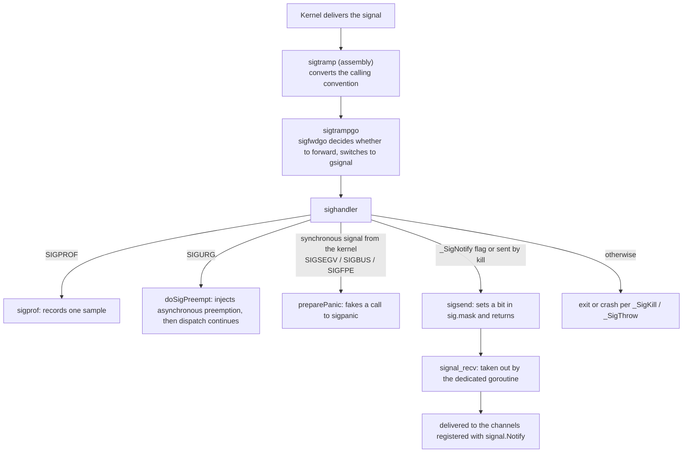

# 9.6 Signal Handling

A signal is a mechanism by which the kernel sends an asynchronous notification to a process. For the
Go runtime, signals play three distinct roles. First, they carry external events that users care
about, such as the `SIGINT` produced by pressing Ctrl-C in a terminal, which a program receives as a
channel through the `os/signal` package. Second, they report errors in the program itself, such as
the `SIGSEGV` caused by dereferencing a nil pointer, which the runtime converts into a panic that
can be recovered. Third, they are tools the runtime uses for its own purposes, such as the `SIGPROF`
on which CPU profiling depends and the `SIGURG` on which asynchronous preemption
([9.7](./preemption.md)) depends.

All three uses share one handling path, and the design of that path is governed by one constraint: a
signal handler runs in an interrupted context and can do very little. This section first explains
the constraint, then discusses the stack used for signal handling, how the handler dispatches, how a
signal reaches a user's channel, and how the runtime shares signals with non-Go code in the same
process.

## 9.6.1 Async-Signal Safety

A signal can arrive between any two instructions. The kernel picks a thread, suspends the code it is
running, executes the signal handler, and resumes the original execution when the handler returns.
The interrupted code may be holding a lock, or may be in the middle of modifying a data structure.
If the handler then tries to acquire the same lock, the thread deadlocks with itself; if it reads
that data structure, it sees an inconsistent intermediate state.

POSIX therefore allows a signal handler to call only a small set of functions, called
**async-signal-safe** functions. The list is short: system calls such as `write`, `_exit` and
`sigaction` are on it, `malloc` is not, and every function in stdio is unsafe because stdio
maintains statically allocated buffers and the corresponding counters
[[Linux man-pages, n.d.a](#ref-linux-man-pages-nda)]. Stevens and Rago give a systematic treatment
of signals and reentrant functions [[Stevens and Rago, 2013](#ref-stevens-and-rago-2013)].

The resulting common practice is that the handler does the minimum necessary and defers the real
handling to a normal context. The classic example is the **self-pipe trick**. It addresses the fact
that `select` or `poll` cannot be mixed safely with signals such as `SIGCHLD`: a signal may arrive
just as `select` begins, interrupting it too early, and by then it is too late to change its
timeout. The solution is for the process to keep a pipe, have `select` also watch the read end of
the pipe, and have the signal handler write a single byte to the write end. The signal thus becomes
an ordinary "pipe is readable" event, and the follow-up handling returns to an unrestricted event
loop.

Bernstein devised the trick around 1990, described it publicly in a newsgroup in 1991, and it was
named only several years later. In introducing it, Bernstein cited the discussion of this very
problem in the first edition of Stevens's *Advanced Programming in the UNIX Environment*, published
in 1992 [[Bernstein, n.d.](#ref-bernstein-nd)]. `signalfd(2)`, introduced in Linux 2.6.22, brings
the same idea into the kernel and lets a signal be read directly as a file descriptor by `poll` or
`epoll` [[Linux man-pages, n.d.a](#ref-linux-man-pages-nda)].

The Go runtime follows the same principle. The comment at the top of `runtime/sigqueue.go` says that
a signal handler cannot block, allocate memory or use locks, so it communicates through a structure
named `sig` with a goroutine dedicated to signals [[Go Authors, 2026a](#ref-go-authors-2026a)]. The
runtime also enforces these restrictions actively. Go's signal handlers are themselves Go code,
annotated with `//go:nowritebarrierrec`, and the compiler checks that no write barrier appears in
their call graph. The memory allocator checks at its entry whether the current goroutine is
`gsignal` (9.6.2), the one used for signal handling, and if so it aborts the program with
`malloc during signal`.

## 9.6.2 The Alternate Signal Stack

The first problem to solve is on which stack the handler runs. By default, the kernel runs the
handler on the current stack of the interrupted thread. A goroutine stack is small (2 KiB initially)
and grows on demand ([Chapter 14](../../part4memory/ch14stack)). The handler can neither assume that
the stack has enough space left nor trigger stack growth, since growth requires allocating memory.
POSIX's `sigaltstack(2)` provides an **alternate signal stack** for this purpose: a thread registers
a region of memory in advance, the handler is installed with the `SA_ONSTACK` flag, and the kernel
switches to that stack to run the handler when it delivers the signal.

Go prepares a special goroutine named `gsignal` for every M, and its stack is the alternate signal
stack of that thread ([9.3.3](./mpg.md)). `gsignal` is created by `mpreinit`, which `mcommoninit`
calls; it takes no part in scheduling and runs no user code:

```go
// runtime/os_linux.go
func mpreinit(mp *m) {
	mp.gsignal = malg(32 * 1024) // Linux wants >= 2K
	mp.gsignal.m = mp
}
```

The comment on macOS is "OS X wants >= 8K". After a thread starts, `minit` calls `minitSignalStack`,
which registers the stack of `gsignal` as the alternate signal stack of the thread through
`sigaltstack`. The one exception arises in programs that use cgo: if a C-created thread has already
set up its own alternate signal stack and then calls back into Go, the runtime does not overwrite
it. Instead, `gsignal` borrows the existing stack and `unminit` restores the original state. Since
Go 1.14, programs that do not use cgo always use a Go-allocated signal stack
[[Zhang, 2019](#ref-zhang-2019)].

The alternate signal stack has also caused the runtime unexpected trouble. A kernel bug introduced
in Linux 5.2 corrupts the vector registers after a signal returns if the page holding the signal
stack has not yet been paged in. For this, Go 1.14 locks the top page of every signal stack with
`mlock` on the affected kernels [[Clements, 2019b](#ref-clements-2019b)]; this workaround was
removed in Go 1.16.

## 9.6.3 Handler Entry and Dispatch

At startup the runtime calls `initsig`, which installs a handler for every signal it cares about. On
Linux the installation flags are `SA_SIGINFO | SA_ONSTACK | SA_RESTORER | SA_RESTART`; before
installing, the existing handler is recorded in the array `fwdSig` so that signals can be forwarded
to it later (9.6.5).

The kernel calls the handler with the C calling convention and knows nothing about Go's G, M and P.
What the kernel actually calls is therefore a piece of assembly, `sigtramp`, which rearranges the
arguments to the Go convention and calls `sigtrampgo`. `sigtrampgo` first calls `sigfwdgo` to decide
whether the signal should be passed to a non-Go handler, and then obtains the interrupted goroutine.
If the interrupted thread has no G, or is an extra M running C code, the signal goes to `badsignal`,
which borrows an extra M to run Go code ([9.5.5](./thread.md)). In the usual case, `sigtrampgo`
switches the current G to the thread's `gsignal` and calls `sighandler`:

```go
// sigtrampgo: the Go entry of signal handling (sketch)
func sigtrampgo(sig uint32, info *siginfo, ctx unsafe.Pointer) {
	if sigfwdgo(sig, info, ctx) {
		return // hand over to the handler installed before Go
	}
	c := &sigctxt{info, ctx}
	gp := sigFetchG(c) // the interrupted goroutine
	setg(gp)
	if gp == nil || (gp.m != nil && gp.m.isExtraInC) {
		badsignal(uintptr(sig), c) // a non-Go thread: borrow an extra M (details omitted)
		return
	}
	setg(gp.m.gsignal)                  // switch to gsignal
	// if non-Go code changed the signal stack, adjustSignalStack corrects the bounds of gsignal's stack (omitted)
	sighandler(sig, info, ctx, gp)
	setg(gp)
}
```

`sighandler` dispatches according to the kind and origin of the signal. The default treatment of
each signal is recorded in the table `sigtable`, expressed as flag bits:

```go
// runtime/runtime2.go
const (
	_SigNotify   = 1 << iota // let signal.Notify have signal, even if from kernel
	_SigKill                 // if signal.Notify doesn't take it, exit quietly
	_SigThrow                // if signal.Notify doesn't take it, exit loudly
	_SigPanic                // if the signal is from the kernel, panic
	_SigDefault              // if the signal isn't explicitly requested, don't monitor it
	_SigGoExit               // cause all runtime procs to exit (only used on Plan 9).
	_SigSetStack             // Don't explicitly install handler, but add SA_ONSTACK to existing libc handler
	_SigUnblock              // always unblock; see blockableSig
	_SigIgn                  // _SIG_DFL action is to ignore the signal
)
```

On Linux, for example, `SIGINT`, `SIGTERM` and `SIGHUP` are marked `_SigNotify + _SigKill`,
`SIGQUIT` is marked `_SigNotify + _SigThrow`, `SIGSEGV` is marked `_SigPanic + _SigUnblock`, and
`SIGURG` is marked `_SigNotify + _SigIgn`. The documentation of `os/signal` summarizes the default
behavior accordingly: synchronous signals are converted into panics; `SIGHUP`, `SIGINT` and
`SIGTERM` make the program exit; `SIGQUIT` and some other signals make the program print a stack
traceback and exit, which is why pressing Ctrl-\ in a terminal shows the stacks of all goroutines
[[Go Authors, 2026b](#ref-go-authors-2026b)]. The overall dispatch is as follows:



Each case is explained below.

**Synchronous signals.** `SIGSEGV`, `SIGBUS` and `SIGFPE` are raised directly by instructions the
thread itself executes, and have a definite causal relationship with the interrupted code. If the
signal really comes from the kernel rather than from `kill`, and the interrupted code is a goroutine
running user code, `sighandler` records the signal information in the G and then calls
`preparePanic` to rewrite the interrupted context: it pushes the PC of the faulting location onto
the stack and sets the PC to `sigpanic`, so that it looks as if the faulting instruction had called
`sigpanic`. When the handler returns, the thread starts executing from `sigpanic`, which raises the
panic in an ordinary goroutine context. If the signal occurs inside the runtime or in C code (the
interrupted code is not `m.curg`), or in a region where stack growth is forbidden, the panic cannot
proceed safely and the runtime can only crash. Converting division by zero and nil pointer
dereferences into panics started with a change by Cox in 2010; before that, such errors crashed the
program outright [[Cox, 2010](#ref-cox-2010)].

`sigpanic` does not turn every illegal memory access into a panic. For `SIGSEGV` and `SIGBUS`, only
a faulting address below 0x1000 is treated as a nil pointer dereference and calls `panicmem`; for
any other address it prints "unexpected fault address" and terminates the program, unless the
program has called `debug.SetPanicOnFault`, introduced in Go 1.3. The boundary at 0x1000 matches a
convention in the compiler: the compiler assumes that addresses below 4096 are inaccessible on all
platforms (`minZeroPage`), so for memory accesses with a sufficiently small offset it omits the
explicit nil check and relies on the hardware-triggered `SIGSEGV` to detect the nil pointer. The
following program shows this conversion:

```go {run=true}
package main

import (
	"fmt"
	"runtime"
)

func main() {
	defer func() {
		err := recover().(runtime.Error) // a runtime error converted from SIGSEGV
		fmt.Println("recover:", err)
	}()
	var p *int
	fmt.Println(*p) // touches the zero page, the kernel raises SIGSEGV
}
```

```
recover: runtime error: invalid memory address or nil pointer dereference
```

**Signals the runtime uses itself.** `SIGPROF` is sent periodically by the timer of CPU profiling.
The handler records one stack sample at the interrupted location and returns immediately, and
`runtime/pprof` aggregates the samples afterwards ([16.5](../../part5toolchain/ch16tools/perf.md)).
`SIGURG` carries asynchronous preemption: `doSigPreempt` checks whether the interrupted G needs to
be preempted and whether the current location is an asynchronous safe point, and if both hold it
calls `pushCall` to inject a call to `asyncPreempt`. This is the same technique that `preparePanic`
uses: the handler does nothing complicated itself, and only rewrites the interrupted context so that
the interrupted code "calls" a function when it resumes, and the real work is done in that function,
in an ordinary context. Because a `SIGURG` may arrive merged with a `SIGURG` sent by the application
itself, dispatch continues after `doSigPreempt`. In Linux programs that do not use cgo, the runtime
also borrows `SIGSETXID` (`_SIGRTMIN + 1`), which glibc uses internally, to run the same system call
on all threads, which implements `syscall.AllThreadsSyscall`.

**Signals for the user.** A signal that carries the `_SigNotify` flag, and any signal sent through a
system call such as `kill`, goes to `sigsend` first. If the program has registered the signal with
`signal.Notify`, `sigsend` merely sets a bit in the `sig` structure and returns immediately: the
handler involves no channel, lock or memory allocation, and the actual delivery is done by the
goroutine described in the next subsection. A signal nobody has registered makes the program exit or
crash according to `_SigKill` or `_SigThrow` in `sigtable`.

## 9.6.4 From sigsend to the Channel

`sigsend` and `signal_recv` are the two ends of this path: the former runs in the signal handler,
the latter in an ordinary goroutine. Between them, the `sig` structure is a set of fixed-size
bitmaps, one bit per signal:

```go
// runtime/sigqueue.go
var sig struct {
	note       note
	mask       [(_NSIG + 31) / 32]uint32 // signals that have arrived and not yet been taken
	wanted     [(_NSIG + 31) / 32]uint32 // signals registered through Notify
	ignored    [(_NSIG + 31) / 32]uint32 // signals ignored through Ignore
	recv       [(_NSIG + 31) / 32]uint32 // the receiver's local copy
	state      atomic.Uint32             // sigIdle, sigReceiving or sigSending
	delivering atomic.Uint32             // number of sigsend handlers currently running
	inuse      bool
}
```

The bitmaps have a fixed size and bits are set with CAS, so `sigsend` needs neither memory
allocation nor locks. The other problem is how to wake a sleeping receiver while avoiding
unnecessary wakeups. The comment in `sigqueue.go` explains that this relies on the three values of
`state`: `sigReceiving` means the receiver is sleeping on `sig.note` and there are no new signals;
`sigSending` means `sig.mask` **may** hold new signals, so the receiver will not sleep; `sigIdle`
means there are no new signals and the receiver is not sleeping. All transitions between states use
CAS. A concurrent `sigsend` and `signal_recv` may cause a redundant check of `sig.mask`, but never
lose a signal or deadlock [[Go Authors, 2026a](#ref-go-authors-2026a)].

```go
// sigsend: queue a signal in the signal handler (sketch)
func sigsend(s uint32) bool {
	bit := uint32(1) << (s & 31)
	if atomic.Load(&sig.wanted[s/32])&bit == 0 {
		return false // nobody registered this signal
	}
	for { // set the signal's bit in sig.mask
		mask := sig.mask[s/32]
		if mask&bit != 0 {
			return true // the same signal has not been taken yet, merge into one
		}
		if atomic.Cas(&sig.mask[s/32], mask, mask|bit) {
			break
		}
	}
	for { // notify the receiver
		switch sig.state.Load() {
		case sigIdle:
			if sig.state.CompareAndSwap(sigIdle, sigSending) {
				return true // the receiver is not asleep and will see the new signal before sleeping
			}
		case sigSending:
			return true // a notification is already pending
		case sigReceiving:
			if sig.state.CompareAndSwap(sigReceiving, sigIdle) {
				notewakeup(&sig.note) // wake the sleeping receiver
				return true
			}
		}
	}
}
```

`signal_recv` first hands out signals one by one from the local copy `recv`. When the local copy is
empty, it changes the state from `sigIdle` to `sigReceiving` and sleeps on `sig.note`, or finds the
state `sigSending` and changes it back to `sigIdle`; it then takes `sig.mask` into the local copy as
a whole with an atomic exchange and starts the next round:

```go
// signal_recv: take signals out in the dedicated goroutine (sketch)
func signal_recv() uint32 {
	for {
		for i := uint32(0); i < _NSIG; i++ { // first hand out the signals in the local copy
			if sig.recv[i/32]&(1<<(i&31)) != 0 {
				sig.recv[i/32] &^= 1 << (i & 31)
				return i
			}
		}
	Receive:
		for { // wait for the notification from sigsend
			switch sig.state.Load() {
			case sigIdle:
				if sig.state.CompareAndSwap(sigIdle, sigReceiving) {
					notetsleepg(&sig.note, -1) // sleep on a user goroutine, giving up the P meanwhile
					noteclear(&sig.note)
					break Receive
				}
			case sigSending:
				if sig.state.CompareAndSwap(sigSending, sigIdle) {
					break Receive
				}
			}
		}
		for i := range sig.mask { // take all newly arrived signals
			sig.recv[i] = atomic.Xchg(&sig.mask[i], 0)
		}
	}
}
```

The wakeup here must itself be async-signal-safe. On Linux, `notewakeup` ends in a futex system
call, which is usable in a handler. On macOS, however, `note` is built on a pthread mutex and
condition variable, and neither `pthread_mutex_lock` nor `pthread_cond_signal` is async-signal-safe.
For this, Taylor implemented a separate pipe-based version of `sig.note` in Go 1.13: `sigsend`
writes a byte to the pipe, and `signal_recv` blocks on the read end
[[Taylor, 2019](#ref-taylor-2019)]. On macOS, Go thus uses exactly the self-pipe trick introduced in
9.6.1.

The last stage is done by the `os/signal` package. At the first call to `Notify`, `os/signal` starts
a goroutine that calls `signal_recv` in a loop, and `process` dispatches each signal to all channels
registered for it:

```go
// os/signal/signal_unix.go
func loop() {
	for {
		process(syscall.Signal(signal_recv()))
	}
}

// process in os/signal/signal.go (sketch)
func process(sig os.Signal) {
	n := signum(sig)
	handlers.Lock()
	defer handlers.Unlock()
	for c, h := range handlers.m {
		if h.want(n) {
			select { // send, but do not block
			case c <- sig:
			default:
			}
		}
	}
}
```

The send is non-blocking: when a channel is full, this signal is dropped for that channel, so that a
slow receiver does not hold up the whole dispatch loop. The documentation of `Notify` therefore
requires the caller to ensure that the channel has enough buffering to keep up with the expected
rate of signals, and points out that a buffer of capacity 1 suffices when the channel is used to
receive a single signal only [[Go Authors, 2026b](#ref-go-authors-2026b)].

Signals can also merge before they reach a channel. Standard signals in the kernel do not queue;
only real-time signals can [[Linux man-pages, n.d.b](#ref-linux-man-pages-ndb)]. The runtime's
internal `sig.mask` likewise keeps one bit per signal, so signals of the same kind that arrive
before `signal_recv` takes them are merged into one. The following program sends `SIGUSR1` to itself
five times in a row:

```go {run=true native=true}
package main

import (
	"fmt"
	"os"
	"os/signal"
	"syscall"
	"time"
)

func main() {
	c := make(chan os.Signal, 10)
	signal.Notify(c, syscall.SIGUSR1)
	syscall.Kill(os.Getpid(), syscall.SIGUSR1) // send a signal to ourselves
	fmt.Printf("received: %v\n", <-c)

	for range 5 {
		syscall.Kill(os.Getpid(), syscall.SIGUSR1)
	}
	time.Sleep(100 * time.Millisecond)
	fmt.Println("sent 5 in a row, received", len(c))
}
```

```
received: user defined signal 1
sent 5 in a row, received 1
```

This is the result on macOS. The number received depends on the platform and on when the receiving
goroutine runs, but because of the two layers of merging above, it does not reflect the number sent.
Signals can convey that some kind of event occurred, but they are not suitable for counting.

The interface of `os/signal` has itself evolved. The original version, added by Symonds in 2009,
offered only `Incoming`: every signal the process received went to a single channel
[[Symonds, 2009](#ref-symonds-2009)]. Before Go 1 was released, Cox replaced it with `Notify`: a
caller can request only particular signals, and a signal is delivered to every requester rather than
to just one of them [[Cox, 2012](#ref-cox-2012)]. Functions such as `Stop`, `Ignore`, `Reset`,
`Ignored` (Go 1.11) and `NotifyContext` (Go 1.16) were added later. On the runtime side, `sigqueue`
was rewritten from C into Go in Go 1.4.

## 9.6.5 Sharing Signals with Non-Go Code

A process can have only one handler per signal. When Go code and C code share a process, for example
when a Go program calls a C library through cgo, or when Go code compiled with `-buildmode=c-shared`
is loaded by another program, both sides may need the same signal, and they must agree on who
handles it.

The basic rule was established by the signal forwarding of Go 1.5. When Go installs a handler, it
records the existing handler. Petrovic, who implemented it, wrote in the commit message that,
following a suggestion from Taylor, a signal is passed to the original handler when all of the
following hold: a non-default handler existed before Go; the signal is synchronous; and the signal
occurs on a non-Go thread, or on a Go thread while it is executing C code
[[Petrovic, 2015](#ref-petrovic-2015)]. Today's `sigfwdgo` still follows this idea: signals Go has
not taken over are always forwarded; among the signals Go has taken over, only synchronous signals
that occur outside Go code, and `SIGPIPE`, are forwarded. macOS is an exception: it delivers
`SIGPIPE` to the main thread rather than to the thread that wrote to the pipe, so the runtime cannot
tell where the signal came from and can only ignore it.

Conversely, non-Go code also needs to follow conventions. The documentation of `os/signal` requires
that handlers installed by non-Go code carry the `SA_ONSTACK` flag, since otherwise a Go thread that
receives a signal on its limited stack is very likely to crash; and if non-Go code installs a
handler for a synchronous signal, it should record Go's handler and call it when the signal occurs
in Go code, or some runtime panics will not happen as expected
[[Go Authors, 2026b](#ref-go-authors-2026b)]. Go code built with `-buildmode=c-archive` or
`c-shared` installs handlers by default only for synchronous signals and `SIGPIPE`, and since Go
1.18 also for `SIGURG`, which preemption uses; other signals are taken over only after a call to
`Notify`.

The Java virtual machine faces the same problem. HotSpot uses signals such as `SIGSEGV`, `SIGBUS`
and `SIGFPE` to implement features such as implicit null checks, and uses `SIGQUIT` to print the
stack traces of Java threads, both of which Go does as well [[Oracle, n.d.b](#ref-oracle-ndb)]. Its
**signal chaining** mechanism saves existing handlers when the virtual machine is created and calls
them for signals that do not belong to the virtual machine. For handlers installed after the virtual
machine is created, `libjsig.so` must be preloaded; it intercepts calls such as `signal` and
`sigaction` and places the new handlers after the virtual machine's own. A program that embeds the
virtual machine and needs to handle signals such as `SIGINT` and `SIGTERM` itself can use the `-Xrs`
option to reduce the virtual machine's use of signals [[Oracle, n.d.a](#ref-oracle-nda)].

## 9.6.6 Choosing the Preemption Signal, and EINTR

Signals are a scarce shared resource in a process, so Go 1.14 was careful in choosing the signal for
asynchronous preemption. The comment on `sigPreempt` in `signal_unix.go` lists four heuristics
[[Go Authors, 2026a](#ref-go-authors-2026a)]:

1. Debuggers should pass the signal through by default. On Linux, such signals are `SIGALRM`,
   `SIGURG`, `SIGCHLD`, `SIGIO`, `SIGVTALRM`, `SIGPROF`, `SIGWINCH`, and several glibc-internal
   signals.
2. In programs mixing Go and C, it should not be used internally by libc, as `SIGCANCEL` and
   `SIGSETXID` are.
3. It should be possible for it to arrive spuriously without consequence. `SIGALRM` is unsuitable
   because the handler cannot tell whether a real timer caused it; `SIGUSR1` and `SIGUSR2` are
   unsuitable because applications often give them real meanings.
4. It must not be a real-time signal, because platforms such as macOS have none.

`SIGURG` meets all the conditions. It was originally meant to report out-of-band data on sockets,
which almost nobody uses; `SIGURG` does not even say which socket, so it is nearly useless by
itself, and any application that does use it must tolerate spurious `SIGURG`s. The comment also
mentions that `SIGIO` would be a reasonable choice too, but is more likely to be used in practice.
For the motivation and implementation of the preemption mechanism, see [9.7](./preemption.md) and
its design document [[Clements, 2019a](#ref-clements-2019a)].

This choice has a user-visible consequence. A signal interrupts a blocking slow system call and
makes it fail with `EINTR`. The Go 1.14 release notes point out that, because of the preemption
implementation, Go programs on Unix systems will receive more signals than before, and programs that
use `syscall` or `golang.org/x/sys/unix` will see more slow system calls fail with `EINTR`; such
programs must handle this error, most commonly by retrying
[[Go Authors, 2020](#ref-go-authors-2020)]. Go installs its handlers with the `SA_RESTART` flag, but
this restarts only some system calls automatically: according to `signal(7)`, `poll`, `select`,
`epoll_wait`, `nanosleep`, and socket operations with a timeout fail with `EINTR` after being
interrupted by a signal handler whether or not `SA_RESTART` is set
[[Linux man-pages, n.d.b](#ref-linux-man-pages-ndb)]. The standard library retries such system calls
in `os` and `internal/poll` with helpers such as `ignoringEINTR`, while code that calls `syscall`
directly must handle them itself. To investigate problems related to the preemption signal, set
`GODEBUG=asyncpreemptoff=1` to turn off asynchronous preemption.

## 9.6.7 Summary

The constraint of async-signal safety determines the structure of Go's signal handling: the handler
runs on the `gsignal` stack dedicated to each thread and does the minimum of work. For synchronous
signals and the preemption signal, it rewrites the interrupted context and leaves the real work to
`sigpanic` and `asyncPreempt`; for user signals, it sets a bit in a bitmap and leaves delivery to an
ordinary goroutine, which finally presents the signal to the user as a channel. When sharing signals
with non-Go code, the runtime coexists with C libraries and other runtimes by saving and forwarding
the existing handlers.

## Further Reading

- <a id="ref-bernstein-nd"></a>[Bernstein, n.d.] D. J. Bernstein. The self-pipe trick.
  https://cr.yp.to/docs/selfpipe.html
  An account of the origin of the self-pipe trick by its originator.
- <a id="ref-clements-2019a"></a>[Clements, 2019a] Austin Clements. Proposal: Non-cooperative
  goroutine preemption. Go design document #24543, 2019.
  https://go.googlesource.com/proposal/+/master/design/24543-non-cooperative-preemption.md The
  motivation for `SIGURG` and asynchronous preemption.
- <a id="ref-clements-2019b"></a>[Clements, 2019b] Austin Clements. runtime: mlock top of signal
  stack on Linux 5.2–5.4.1. Go commit 8174f7fb2b, 2019. https://go.dev/cl/209899
- <a id="ref-cox-2010"></a>[Cox, 2010] Russ Cox. runtime: turn divide by zero, nil dereference into
  panics. Go commit 5963dbac08, 2010. https://golang.org/cl/906041
- <a id="ref-cox-2012"></a>[Cox, 2012] Russ Cox. os/signal: selective signal handling. Go commit
  35586f718c, 2012. https://golang.org/cl/3749041
- <a id="ref-go-authors-2020"></a>[Go Authors, 2020] The Go Authors. Go 1.14 Release Notes, 2020.
  https://go.dev/doc/go1.14
- <a id="ref-go-authors-2026a"></a>[Go Authors, 2026a] The Go Authors. `runtime/signal_unix.go`,
  `runtime/sigqueue.go`. https://github.com/golang/go/blob/master/src/runtime/signal_unix.go
  `sighandler`, `sigtramp`/`sigtrampgo`, `sigsend`/`signal_recv`, and the comment on the choice
  of `sigPreempt = _SIGURG` (this section follows Go 1.26).
- <a id="ref-go-authors-2026b"></a>[Go Authors, 2026b] The Go Authors. Documentation of the
  `os/signal` package and `src/os/signal/signal_unix.go`. https://pkg.go.dev/os/signal `Notify`,
  `loop`, `process`, and the default behavior and signal conventions in cgo programs.
- <a id="ref-linux-man-pages-nda"></a>[Linux man-pages, n.d.a] The Linux man-pages project.
  *signal-safety(7)*; *sigaltstack(2)*; *signalfd(2)*.
  https://man7.org/linux/man-pages/man7/signal-safety.7.html
  The list of async-signal-safe functions.
- <a id="ref-linux-man-pages-ndb"></a>[Linux man-pages, n.d.b] The Linux man-pages project.
  *signal(7)*. https://man7.org/linux/man-pages/man7/signal.7.html The queuing semantics of standard
  and real-time signals, and the rules for restarting system calls interrupted by signals.
- <a id="ref-oracle-nda"></a>[Oracle, n.d.a] Oracle. *The java Command* (Java SE 21 tool
  specification). https://docs.oracle.com/en/java/javase/21/docs/specs/man/java.html Signal-related
  options such as `-Xrs`: industrial practice for a managed runtime sharing signals with native
  libraries.
- <a id="ref-oracle-ndb"></a>[Oracle, n.d.b] Oracle. *Java Platform, Standard Edition
  Troubleshooting Guide* (Java SE 8), Chapter 7, Handle Signals and Exceptions.
  https://docs.oracle.com/javase/8/docs/technotes/guides/troubleshoot/signals003.html Signal
  chaining and `libjsig`, and the signals HotSpot uses.
- <a id="ref-petrovic-2015"></a>[Petrovic, 2015] Srdjan Petrovic. runtime: signal forwarding. Go
  commit 5c8fbc6f1e, 2015. https://go.dev/cl/8712
- <a id="ref-stevens-and-rago-2013"></a>[Stevens and Rago, 2013] W. Richard Stevens and Stephen A.
  Rago. *Advanced Programming in the UNIX Environment*, 3rd ed. Addison-Wesley, 2013. The classic
  treatment of signal handling and async-signal safety. In introducing the self-pipe trick,
  Bernstein cited the first edition's discussion of why `select` and signals cannot be mixed safely.
- <a id="ref-symonds-2009"></a>[Symonds, 2009] David Symonds. os/signal: new package. Go commit
  b5866494ea, 2009. https://golang.org/cl/162056
- <a id="ref-taylor-2019"></a>[Taylor, 2019] Ian Lance Taylor. runtime: use a pipe to wake up
  signal_recv on Darwin. Go commit c485e8b559, 2019. https://go.dev/cl/184169
- <a id="ref-zhang-2019"></a>[Zhang, 2019] Cherry Zhang. runtime: always use Go signal stack in
  non-cgo program. Go commit 73d20f8186, 2019. https://go.dev/cl/207445
- This book: [9.3 The MPG Model and the Units of Concurrent Scheduling](./mpg.md),
  [9.7 Cooperation and Preemption](./preemption.md),
  [Chapter 14 Execution Stack Management](../../part4memory/ch14stack).
