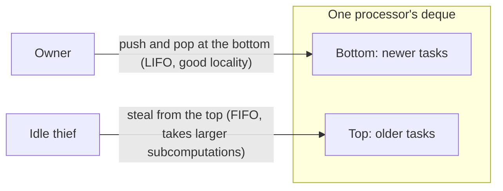

# 9.2 Work-Stealing Scheduling

Each P in [9.1](./model.md) has its own local run queue, so load is bound to be unevenly
distributed: some Ps accumulate a backlog of Gs while others have nothing to do. How to balance load
without introducing a central bottleneck is the core problem of concurrent scheduling. Go uses
**work stealing**, a design backed by decades of theory and one that keeps reappearing in industry.
This section first describes what Go does, then the scheduling theory behind it, then compares the
forms it takes in Cilk, Java, Rust and other systems, and finally discusses the problems that remain
open.

## 9.2.1 Work Sharing and Work Stealing

There are two basic paradigms for migrating tasks between processors. In **work sharing**, whenever
a processor produces new tasks, the scheduler tries to migrate some of them to less loaded
processors. In **work stealing**, the initiative lies with the idle processor: it steals tasks from
other processors. Blumofe and Leiserson pointed out the intuitive difference: when all processors
have work, a work-stealing scheduler migrates no tasks, whereas a work-sharing scheduler migrates
all the time [[Blumofe and Leiserson, 1999](#ref-blumofe-leiserson-1999)]. The heavier the load, the
fewer migrations work stealing performs. This is its fundamental advantage over work sharing, and
the communication bound below makes it rigorous.

The idea of work stealing goes back at least to the 1981 study of parallel execution of functional
programs by Burton and Sleep [[Burton and Sleep, 1981](#ref-burton-sleep-1981)] and to Halstead's
1984 implementation of Multilisp [[Halstead, 1984](#ref-halstead-1984)]. They had already noticed
the benefits of this strategy in space and communication, but the first rigorous guarantees came a
decade later from the Cilk project at MIT.

## 9.2.2 How Go Finds a Runnable G

When an M finishes its current G, it does not steal right away. It looks for the next runnable G in
order from near to far and from cheap to expensive. The runtime's `findRunnable` does this
[[Go Authors, 2026](#ref-go-authors-2026)]:

```go
// The skeleton of Go 1.26 runtime.findRunnable (abridged; comments added by the author)
top:
	// ... if GC is waiting, pause first; run expired timers on this P; schedule a GC mark worker if needed
	if pp.schedtick%61 == 0 && !sched.runq.empty() { // check the global queue once every 61 schedules, for fairness
		lock(&sched.lock)
		gp := globrunqget()
		unlock(&sched.lock)
		if gp != nil {
			return gp, false, false
		}
	}
	if gp, inheritTime := runqget(pp); gp != nil { // local run queue, including runnext
		return gp, inheritTime, false
	}
	if !sched.runq.empty() { // global run queue: take a batch and move it to the local queue
		lock(&sched.lock)
		gp, q := globrunqgetbatch(int32(len(pp.runq)) / 2)
		unlock(&sched.lock)
		// ...
	}
	if netpollinited() && netpollAnyWaiters() && sched.lastpoll.Load() != 0 && sched.pollingNet.Swap(1) == 0 {
		list, delta := netpoll(0) // check the network poller without blocking
		// ...
	}
	// the number of spinning Ms never exceeds half the number of busy Ps
	if mp.spinning || 2*sched.nmspinning.Load() < gomaxprocs-sched.npidle.Load() {
		if !mp.spinning {
			mp.becomeSpinning()
		}
		gp, inheritTime, tnow, w, newWork := stealWork(now) // steal from other Ps
		// ...
	}
	// ... still no work: release the P, check the global queue and every P once more, block waiting for network events, and finally sleep (stopm)
```

This procedure has several key points.

**The local run queue.** Each P's local queue is a ring buffer with a capacity of 256. Only the
owning P puts Gs into it, while both the owning P and thieves take Gs out, so it can be implemented
without locks. When the queue is full, `runqputslow` moves half of it (128 Gs) together with the new
G to the global queue. In the other direction, taking Gs from the global queue fetches a batch of at
most 128, and no more than the global queue length divided by `GOMAXPROCS` plus one, so that the Gs
in the global queue are spread roughly evenly over the Ps.

**runnext.** Besides the local queue, each P has a `runnext` slot holding the G to run next with
priority. Clements introduced it in Go 1.5 to address this problem: when one G wakes another, the
woken G goes to the tail of the local queue, and if the queue contains compute-bound Gs, it waits a
long time before it runs. Instead, the woken G is placed in `runnext` and inherits the remaining
time slice of the waker. A pair of Gs communicating back and forth over an unbuffered channel then
gets CPU time as if it were a single unit; in the benchmark written for this change, the running
time dropped by 99.88% [[Clements, 2015](#ref-clements-2015)]. The G in `runnext` was just woken by
the current P, so its data is likely still in the cache, which improves locality as well.

**How stealing works.** `stealWork` traverses all Ps at most four times, each time taking half
(rounded up) of the Gs from the target P's local queue. The traversal order is a pseudo-random
permutation: it starts at a random position and uses a random step that is **coprime** to the total
number of Ps. Coprimality guarantees that each round visits every P exactly once, and randomization
keeps all thieves from converging on the same target. Vyukov introduced this in Go 1.7. The earlier
implementation picked 4×`GOMAXPROCS` random targets, and because the pseudo-random number generator
was of poor quality, some Ps were often never examined [[Vyukov, 2016](#ref-vyukov-2016)]. The last
round also runs expired timers on other Ps and steals the `runnext` of other Ps; to avoid competing
with the target P for a G it has just woken and is about to run, the thief waits about 3
microseconds before stealing `runnext`.

**Spinning threads.** An M that finds no work does not sleep immediately. It enters the **spinning**
state and keeps looking, so that a newly ready G can be picked up quickly and threads do not sleep
and wake up too often. Spinning consumes CPU, so the number of spinning Ms is limited. Vyukov's
design document allowed at most `GOMAXPROCS` spinning Ms [[Vyukov, 2012](#ref-vyukov-2012)]. The
2013 implementation used a stricter condition: the number of spinning Ms does not exceed half the
number of busy Ps, to avoid wasting CPU when `GOMAXPROCS` is large but the program's parallelism is
low [[Vyukov, 2013](#ref-vyukov-2013)]. This condition is still in use.

## 9.2.3 The Computation Model

To discuss how good work stealing is, we first need a yardstick. Abstract a parallel computation as
a directed acyclic graph in which each node is one unit-time instruction and edges represent
dependencies. Two quantities characterize the graph:

- the **work** $T_1$: the total number of nodes, that is, the time needed on a single processor;
- the **span** (critical-path length) $T_\infty$: the length of the longest dependency chain, that
  is, the time needed on infinitely many processors.

Their ratio $T_1/T_\infty$ is called the **parallelism**, an upper bound on the speedup that can be
obtained. Because $P$ processors execute at most $P$ instructions per step, and instructions on the
critical path can only run one after another, the execution time $T_P$ of any schedule on $P$
processors satisfies $T_P \ge \max(T_1/P,\ T_\infty)$. A good scheduler should bring $T_P$ as close
to this lower bound as possible.

## 9.2.4 Theoretical Guarantees

**Greedy scheduling.** Early work by Brent [[Brent, 1974](#ref-brent-1974)] and Graham
[[Graham, 1969](#ref-graham-1969)] on scheduling directed acyclic graphs showed that a schedule
exists with execution time at most $T_1/P + T_\infty$. This upper bound is the sum of two lower
bounds, so it is within a factor of two of the optimal schedule. A **greedy schedule** executes $P$
ready instructions at each step if at least $P$ are ready, and otherwise executes all ready
instructions. Blumofe and Leiserson, and Eager et al. [[Eager et al., 1989](#ref-eager-et-al-1989)],
proved that any greedy schedule achieves this bound; Blumofe and Leiserson call it the **greedy
scheduling theorem** [[Blumofe and Leiserson, 1999](#ref-blumofe-leiserson-1999)]:

$$T_P \le \frac{T_1}{P} + T_\infty.$$

**Randomized work stealing.** The greedy scheduling theorem only says that never leaving a processor
idle cannot be too bad; it does not say how to achieve that in a distributed way. Blumofe and
Leiserson proved that for **fully strict** computations, that is, fork-join computations in which
every synchronization edge goes from a child thread to its parent thread, the expected execution
time of randomized work stealing is

$$\mathbb{E}[T_P] = \frac{T_1}{P} + O(T_\infty),$$

the space required is at most $S_1 P$, where $S_1$ is the space required for serial execution, and
the expected total communication is at most

$$O\big(P\,T_\infty\,(1 + n_d)\,S_{\max}\big),$$

where $S_{\max}$ is the largest activation record and $n_d$ is the maximum number of times any
thread synchronizes with its parent. All three bounds are optimal to within a constant factor, and
the communication bound confirms the folk wisdom that work stealing communicates less than work
sharing [[Blumofe and Leiserson, 1999](#ref-blumofe-leiserson-1999)]. The proof of the time bound
uses an accounting argument: in each step every processor either executes an instruction or attempts
a steal, and puts one dollar into the "work" bucket or the "steal" bucket accordingly. At the end of
the execution the work bucket holds exactly $T_1$ dollars, and the execution time equals the total
of both buckets divided by $P$. The difficulty is bounding the steal bucket, which takes a "delay
sequence" argument: if the number of steal attempts were large, one could find a sequence of
instructions in the graph such that every time a steal attempt starts, some instruction in the
sequence is in a "critical" state. But the probability that a critical instruction stays critical
after several steal attempts is small, so such a sequence is unlikely to exist, and the expected
number of steal attempts is $O(P\,T_\infty)$. Dividing the sum of the two buckets by $P$ gives the
time bound above. It follows that as long as the computation has enough parallelism, that is,
$T_\infty \ll T_1/P$, work stealing approaches linear speedup, and the costs in space and
communication are bounded as well.

**The deque used for stealing.** Realizing the theoretical bounds depends on a carefully designed
data structure. The classic approach is for each processor to maintain a **double-ended queue**
(deque). The owner pushes and pops tasks at the bottom, last in first out; the newest subtasks are
most likely still in the cache, so locality is good. Thieves take tasks from the top, first in first
out; what they take are earlier and usually larger subcomputations, so a single steal obtains enough
work.



Arora, Blumofe and Plaxton gave a non-blocking implementation of this deque and extended the
analysis to multiprogrammed environments, where the operating system kernel is treated as an
adversary that does not necessarily provide $P$ processors throughout; their analysis uses a
potential function based on node weights [[Arora et al., 1998](#ref-arora-et-al-1998)]. Chase and
Lev further gave a version built on a growable circular array
[[Chase and Lev, 2005](#ref-chase-lev-2005)], the design most used in practice today. One
clarification: the **THE protocol** and the **work-first principle**, often mentioned alongside work
stealing, come from Cilk-5 [[Frigo et al., 1998](#ref-frigo-et-al-1998)], not from the work of Arora
et al.

Go's local queue is not this classic deque. It is a first-in-first-out ring buffer, with a separate
last-in-first-out `runnext` slot that preserves the locality of newly woken Gs ([9.3](./mpg.md)),
and a steal takes half of the queue rather than a single task. This is an engineering adaptation of
the theoretical model.

## 9.2.5 Work Stealing in Other Systems

Work stealing has become a nearly standard component of parallel runtimes, but each system makes
different trade-offs:

- **Cilk-5**: the representative of fork-join parallelism. It established the work-first principle
  and the THE protocol, and reduced the cost of spawning tasks by compiling each function in two
  clones [[Frigo et al., 1998](#ref-frigo-et-al-1998)];
- **Java's Fork/Join framework**: Lea's paper states that its overall design is a variant of the
  Cilk work-stealing framework [[Lea, 2000](#ref-lea-2000)];
- **The .NET Task Parallel Library**: it also schedules tasks by work stealing
  [[Leijen et al., 2009](#ref-leijen-et-al-2009)];
- **Tokio**: Rust's multi-threaded async runtime. When rewriting the scheduler, Lerche read Go's
  source closely and adopted the same design: each processor has a fixed-size local queue that
  overflows into a global queue protected by a mutex, there is a "next task" slot that is checked
  first, and a steal takes half [[Lerche, 2019](#ref-lerche-2019)].

Go differs from the Cilk family in one fundamental way: Cilk schedules fork-join task graphs, while
Go schedules general-purpose goroutines. Goroutines can block on channels, system calls or network
I/O, and can be asynchronously preempted ([9.7](./preemption.md)); they generally do not form fully
strict computations. The $T_1/P + O(T_\infty)$ guarantee of 9.2.4 therefore does not hold for Go.
Go's work stealing is a load-balancing strategy that borrows from this theory, not a scheduler with
provable performance bounds. Recognizing this keeps the theoretical results from being wrongly
applied to goroutines.

## 9.2.6 Evolution and Open Problems

Go's work stealing has itself evolved: Go 1.1 introduced work stealing together with the GMP model
[[Vyukov, 2013](#ref-vyukov-2013)], Go 1.5 added `runnext` [[Clements, 2015](#ref-clements-2015)],
and Go 1.7 switched to traversing all Ps with a coprime step [[Vyukov, 2016](#ref-vyukov-2016)].

Many open problems remain. The first is **NUMA awareness**: random stealing ignores memory locality,
and stealing a task onto another NUMA node incurs the cost of remote memory access
([9.11](./numa.md)); how to favor locality while keeping the ability to balance load is still an
active topic. The second is the **tension between latency and throughput**: last-in-first-out local
execution favors throughput and caching but can leave latency-sensitive tasks unrun for a long time.
Systems can only compensate with fairness counters, time-slice inheritance and preemption, and Go's
check of the global queue once every 61 schedules is one example. The third is **scalability at high
core counts**: with many cores, every idle M scans all Ps and the stealing overhead grows; this has
been discussed since 2018 and is still unresolved [[Hines, 2018](#ref-hines-2018)]. The fourth is
the **gap between theory and practice**: the clean $T_1/P + O(T_\infty)$ holds only for fully strict
computations, and how to give provable bounds for a general-purpose scheduler whose tasks block,
perform I/O and can be preempted remains largely an open problem.

## Further Reading

- <a id="ref-graham-1969"></a>[Graham, 1969] R. L. Graham. "Bounds on Multiprocessing Timing
  Anomalies." *SIAM Journal on Applied Mathematics* 17(2): 416–429, 1969.
  https://doi.org/10.1137/0117039 Approximation bounds for list scheduling.
- <a id="ref-brent-1974"></a>[Brent, 1974] Richard P. Brent. "The Parallel Evaluation of General
  Arithmetic Expressions." *Journal of the ACM* 21(2): 201–206, 1974.
  https://doi.org/10.1145/321812.321815
- <a id="ref-blumofe-leiserson-1999"></a>[Blumofe and Leiserson, 1999] Robert D. Blumofe, Charles E.
  Leiserson. "Scheduling Multithreaded Computations by Work Stealing." *Journal of the ACM* 46(5):
  720–748, 1999 (conference version in FOCS 1994). https://doi.org/10.1145/324133.324234
  The time, space and communication bounds, and the greedy scheduling theorem.
- <a id="ref-arora-et-al-1998"></a>[Arora et al., 1998] Nimar S. Arora, Robert D. Blumofe, C. Greg
  Plaxton. "Thread Scheduling for Multiprogrammed Multiprocessors." *SPAA 1998*, 119–129.
  https://doi.org/10.1145/277651.277678
  The non-blocking steal deque, and the analysis in multiprogrammed environments.
- <a id="ref-chase-lev-2005"></a>[Chase and Lev, 2005] David Chase, Yossi Lev. "Dynamic Circular
  Work-Stealing Deque." *SPAA 2005*, 21–28. https://doi.org/10.1145/1073970.1073974
- <a id="ref-frigo-et-al-1998"></a>[Frigo et al., 1998] Matteo Frigo, Charles E. Leiserson, Keith H.
  Randall. "The Implementation of the Cilk-5 Multithreaded Language." *PLDI 1998*, 212–223.
  https://doi.org/10.1145/277650.277725
  The work-first principle, the THE protocol and the two-clone compilation scheme.
- <a id="ref-lea-2000"></a>[Lea, 2000] Doug Lea. "A Java Fork/Join Framework." *ACM Java Grande
  2000*, 36–43. https://doi.org/10.1145/337449.337465
- <a id="ref-leijen-et-al-2009"></a>[Leijen et al., 2009] Daan Leijen, Wolfram Schulte, Sebastian
  Burckhardt. "The Design of a Task Parallel Library." *OOPSLA 2009*, 227–242.
  https://doi.org/10.1145/1640089.1640106
- <a id="ref-burton-sleep-1981"></a>[Burton and Sleep, 1981] F. Warren Burton, M. Ronan
  Sleep. "Executing Functional Programs on a Virtual Tree of Processors." *FPCA 1981*, 187–194.
  https://doi.org/10.1145/800223.806778 An early source of the idea of work stealing.
- <a id="ref-lerche-2019"></a>[Lerche, 2019] Carl Lerche. "Making the Tokio scheduler 10x
  faster." Tokio Blog, 2019-10-13. https://tokio.rs/blog/2019-10-scheduler Tokio adopts Go's local
  queue algorithm.
- <a id="ref-vyukov-2012"></a>[Vyukov, 2012] Dmitry Vyukov. *Scalable Go Scheduler Design
  Doc*. 2012. https://go.dev/s/go11sched
- <a id="ref-hines-2018"></a>[Hines, 2018] Chris Hines. "runtime: scheduler work stealing slow for
  high GOMAXPROCS." golang/go#28808, 2018-11-15. https://github.com/golang/go/issues/28808 The cost
  of the steal scan at high parallelism.
- <a id="ref-halstead-1984"></a>[Halstead, 1984] Robert H. Halstead. "Implementation of Multilisp:
  Lisp on a Multiprocessor." *Proceedings of the 1984 ACM Symposium on LISP and Functional
  Programming*, 9–17. https://doi.org/10.1145/800055.802017
- <a id="ref-go-authors-2026"></a>[Go Authors, 2026] The Go Authors. `runtime/proc.go`.
  https://github.com/golang/go/blob/master/src/runtime/proc.go
  The implementations of `findRunnable`, `stealWork`, `runqputslow` and `randomOrder`.
- <a id="ref-clements-2015"></a>[Clements, 2015] Austin Clements. "runtime: yield time slice to most
  recently readied G." Go commit e870f06c3f, 2015-04-22 (Go 1.5).
  https://github.com/golang/go/commit/e870f06c3f
- <a id="ref-vyukov-2013"></a>[Vyukov, 2013] Dmitry Vyukov. "runtime: improved scheduler." Go commit
  779c45a507, 2013-03-01.
  https://github.com/golang/go/commit/779c45a50700bda0f6ec98429720802e6c1624e8
- <a id="ref-vyukov-2016"></a>[Vyukov, 2016] Dmitry Vyukov. "runtime: improve randomized stealing
  logic." Go commit ea0386f85f, 2016-03-18 (Go 1.7). https://github.com/golang/go/commit/ea0386f85f
- <a id="ref-eager-et-al-1989"></a>[Eager et al., 1989] Derek L. Eager, John Zahorjan, Edward D.
  Lazowska. "Speedup versus Efficiency in Parallel Systems." *IEEE Transactions on Computers* 38(3):
  408–423, 1989. https://doi.org/10.1109/12.21127
