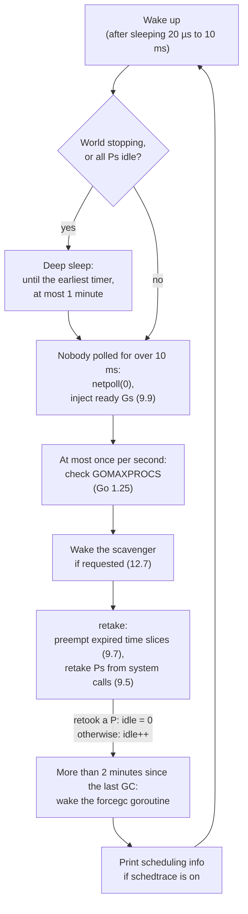

# 9.8 System Monitoring

The scheduler is passive: it gets a chance to run only when a goroutine hands control back to the
runtime, for example by yielding, blocking, entering a system call, or finding a preemption request
in a function prologue. If no goroutine returns control, the scheduler has no way of noticing that
scheduling is needed. Four situations fall into this category: a goroutine that never yields
monopolizes a P ([9.7 Cooperation and Preemption](./preemption.md)); a thread is stuck in a blocking
system call while the P it holds has goroutines waiting to run
([9.5 Thread Management](./thread.md)); all Ps are computing and no M is available to collect
network events that are already ready ([9.9 The Network Poller](./poller.md)); and the program
hardly allocates any more memory, so the heap stops growing and garbage collection is never
triggered. These situations call for an observer that does not depend on the scheduler and acts on
time rather than on events.

The Go runtime starts a dedicated M in `runtime.main` to run the `sysmon` function
[[Go Authors, 2026a](#ref-go-authors-2026a)]:

```go
func main() {
	// ...
	if haveSysmon {
		systemstack(func() {
			newm(sysmon, nil, -1) // an M not associated with a P
		})
	}
	// ...
}
```

This is the **system monitor**, abbreviated sysmon in the source. `haveSysmon` is false on wasm; the
source comment gives the reason that wasm has no threads yet. This section first explains what a
thread without a P can and cannot do, then traces the origin of sysmon, then discusses its sleep
strategy and its duties in each round, uses `schedtrace` to observe it at work, and finally compares
it with threads that play a similar role in other systems.

## 9.8.1 A Thread Without a P

The M that runs sysmon is never associated with a P, and this defines the limits of what it can do.

First, it cannot execute code that has write barriers. `sysmon` carries a `//go:nowritebarrierrec`
annotation, and the source comment reads: "Always runs without a P, so write barriers are not
allowed." The runtime's development guide explains that write barriers require a current active P,
while scheduler code often runs without one; `go:nowritebarrierrec` makes the compiler check the
annotated function and every function it calls recursively, and report an error if a write barrier
appears in any of them [[Go Authors, 2026c](#ref-go-authors-2026c)]. Second, the allocator's
per-thread cache, the mcache, hangs off the P
([12.2 Components](../../part4memory/ch12alloc/component.md)); without a P, heap allocation cannot
proceed either.

Sysmon therefore never does heavy work itself. Each of its duties only reads some state, makes a
judgment, and then modifies a few flags or puts a goroutine on a run queue. The real work is left to
goroutines running on ordinary Ps: a forced GC is started by the `forcegc` goroutine, returning
memory to the operating system is done by the background scavenger goroutine, and since Go 1.25 the
stop-the-world that adjusting `GOMAXPROCS` requires is performed by a dedicated helper goroutine.
The `injectglist` that sysmon uses to put them on a run queue is suited to callers without a P: when
there is no current P, the injected Gs go to the global queue, and the runtime then starts Ms
according to the number of idle Ps to run them.

Having no P also means that sysmon is unaffected by scheduling conditions. It sleeps through
`usleep` and `notetsleep`, both built directly on operating system primitives (for `note`, see
[9.5 Thread Management](./thread.md)), and does not need to wait for any P to become idle. Even if
all Ps are occupied, sysmon still wakes up on time. The watcher must be independent of the system it
watches, a principle shared by watchdog mechanisms in general.

This status of sysmon also shows in deadlock detection. `checkdead` is called when an M becomes idle
(`mput`), when a locked M becomes idle (`incidlelocked`), when an M exits (`mexit`), and when the
template thread and sysmon start. It subtracts the idle Ms, the idle locked Ms, and `sched.nmsys`
from the total number of Ms to get the number of running Ms; when that number is zero and no timer
is waiting to expire, it reports `all goroutines are asleep - deadlock!`. `sched.nmsys`
counts "system Ms not counted for deadlock detection", namely sysmon and the template thread
([9.5 Thread Management](./thread.md)): as soon as sysmon starts, it executes `sched.nmsys++` and
calls `checkdead` once. Otherwise, a thread that patrols forever would keep the number of running Ms
above zero, and a deadlock could never be detected. Deadlock detection is discussed in full in
[16.1 Runtime Deadlock Detection](../../part5toolchain/ch16tools/deadlock.md).

## 9.8.2 Origins

Sysmon appeared with the rewrite of the scheduler in Go 1.1. To see why it exists, we first need to
look at how Go 1.0 handled system calls.

The Go 1.0 scheduler used an atomic variable `sched.atomic` to record the number `mcpu` of Ms
executing Go code and its upper bound `mcpumax` (that is, `GOMAXPROCS`). On each system call,
`entersyscall` decremented `mcpu`; if some goroutine was waiting to run, it took a lock and called
`matchmg` to arrange another M for the waiter immediately. In other words, every system call gave up
its slot for executing Go code in advance, on entry, whether the call lasted 100 nanoseconds or 10
seconds. In his 2012 scheduler design document, Vyukov listed "aggressive thread
blocking/unblocking" as one of four problems of the scheduler at the time: in the presence of
syscalls, worker threads are frequently blocked and unblocked, which adds a lot of overhead. The
document's requirement for system calls nevertheless remained the same as in Go 1.0: "when an M
enters a syscall, it must ensure that there is another M to execute Go
code" [[Vyukov, 2012](#ref-vyukov-2012)].

The Go 1.1 implementation took another route, which the commit message summarizes as "Faster
non-blocking syscall enter/exit" [[Vyukov, 2013a](#ref-vyukov-2013a)]. `entersyscall` no longer
gives anything up; it only changes the P's status to `Psyscall`, and the P stays with its M. If the
system call returns quickly, the M simply continues. A call that does not return for a long time is
found after the fact by the newly added sysmon, which takes the P away and hands it to another M.
The Go 1.1 sysmon had only two duties: retaking Ps stuck in system calls, and polling the network on
behalf of others when nobody had polled for a long time.

This is an optimistic design: it assumes that system calls are short, does nothing on entry, and has
a background thread correct the guess when it was wrong. The fixed cost of every system call is
thereby traded for a bounded delay: when a P has goroutines waiting to run, a blocking system call
leaves the P idle for roughly one to two sysmon periods (for the rule, see
[9.5 Thread Management](./thread.md)). After Go 1.26 removed the `_Psyscall` state, the way the two
sides synchronize changed, but this division of labor did not.

Since then, sysmon has gradually taken on more duties:

| Version | Change | Source |
| --- | --- | --- |
| Go 1.1 | Sysmon appears: retakes Ps in system calls, polls the network on behalf of others | [[Vyukov, 2013a](#ref-vyukov-2013a)] |
| Go 1.2 | Preempts goroutines that have run for more than 10 ms | [[Vyukov, 2013c](#ref-vyukov-2013c)] |
| Go 1.4 | The dedicated scavenger is merged into sysmon: forced GC and periodic return of memory | [[Vyukov, 2014](#ref-vyukov-2014)] |
| Go 1.13 | Periodic return of memory is removed; a background scavenger goroutine does it instead | [[Knyszek, 2018b](#ref-knyszek-2018b)] |
| Go 1.15 | Sysmon wakes the scavenger | [[Knyszek, 2019](#ref-knyszek-2019)] |
| Go 1.25 | Checks once per second whether `GOMAXPROCS` needs updating | [[Pratt, 2025](#ref-pratt-2025)] |

The merge in Go 1.4 deserves a mention. Go 1.0 already had a background goroutine, `MHeap_Scavenger`
[[Paolacci, 2012](#ref-paolacci-2012)]: it forced a GC if none had happened within two minutes, and
returned spans unused for five minutes to the operating system. While sleeping it was in the system
call state, which amounted to occupying a thread permanently. Vyukov removed it in Go 1.4, and the
commit message reads: "A whole thread is too much for background scavenger that sleeps all the time
anyway. We already have sysmon thread that can do this work" [[Vyukov, 2014](#ref-vyukov-2014)].
Forced GC thereby became a duty of sysmon; and because sysmon cannot execute a GC itself, the same
commit introduced the `forcegc` helper goroutine.

## 9.8.3 Adaptive Sleep

Sysmon is a loop that never exits. In each round it first sleeps for a while and then patrols its
duties once. If it sleeps too long, preemption and retaking Ps are late; if it wakes too often, it
wastes CPU while the program is idle. Sysmon balances the two with an adaptive backoff:

```go
func sysmon() {
	lock(&sched.lock)
	sched.nmsys++ // not counted for deadlock detection
	checkdead()
	unlock(&sched.lock)

	idle := 0 // how many rounds in a row no P was retaken from a system call
	delay := uint32(0)
	for {
		if idle == 0 { // start with 20 µs
			delay = 20
		} else if idle > 50 { // start doubling after about 1 ms
			delay *= 2
		}
		if delay > 10*1000 { // cap at 10 ms
			delay = 10 * 1000
		}
		usleep(delay)

		now := nanotime()
		if debug.schedtrace <= 0 && (sched.gcwaiting.Load() || sched.npidle.Load() == gomaxprocs) {
			// take the lock and recheck the condition (omitted)
			syscallWake := false
			next := timeSleepUntil() // the earliest timer
			if next > now {
				sched.sysmonwait.Store(true)
				sleep := forcegcperiod / 2 // at most 1 minute
				if next-now < sleep {
					sleep = next - now
				}
				syscallWake = notetsleep(&sched.sysmonnote, sleep) // deep sleep
				sched.sysmonwait.Store(false)
			}
			if syscallWake { // woken explicitly, not by timeout
				idle = 0
				delay = 20
			}
		}
		// the duties of this round, see 9.8.4
	}
}
```

The input to the backoff is `idle`. The source comment says it records "how many cycles in
succession we had not woken up somebody"; judging from the code, it depends only on the return value
of `retake`, and that return value counts only the Ps taken from system calls (9.8.4). Neither
preemption requests nor Gs injected by network polling reset `idle` to zero.

Under this rule, sysmon first sleeps 51 rounds at 20 µs intervals (about 1 ms), then doubles the
interval each round, sleeping 40, 80, ..., 5120 µs, 8 rounds in all (about 10 ms in total), and then
stays at the 10 ms cap. That is, once no P has been retaken from a system call for about 11 ms,
sysmon drops to one patrol every 10 ms. This has two direct consequences. A purely computational
program rarely blocks in system calls, so sysmon soon settles into a 10 ms period, and since a time
slice must be observed in two samples before it is judged to have timed out, a goroutine that never
yields actually runs for 10 ms to 20 ms or more before being preempted (see the measurement in
[9.4.2](./schedule.md)). Conversely, a program that blocks frequently in system calls keeps sysmon
at the 20 µs interval, and Ps can be retaken promptly.

On top of the backoff there is a layer of deep sleep. If the world is being stopped (`gcwaiting`) or
all Ps are idle, sysmon has nothing to watch, so it uses `notetsleep` to sleep until the earliest
timer expires, but for at most half of `forcegcperiod`, that is, 1 minute. The cap and its
comment, "Make wake-up period small enough for the sampling to be correct.", both come unchanged
from the Go 1.0 `MHeap_Scavenger` [[Paolacci, 2012](#ref-paolacci-2012)]: the criterion for forcing
a GC is more than 2 minutes since the last GC, and checking once a minute means a forced GC is never
more than 1 minute late.

The deep sleep can be interrupted early. When entering a system call (`reentersyscall`), when
returning from a system call and obtaining an idle P (the two slow paths of `exitsyscall`), and when
the stop-the-world ends (`startTheWorldWithSema`), the runtime calls `notewakeup` to wake sysmon if
it finds `sysmonwait` set. When woken explicitly, sysmon resets `idle` and `delay` to the most
responsive state; the source comment calls this a bet: since a P was retaken from a system call
before, the program may need to do it again soon after it starts working again. When woken because a
timer expired, it does not reset; the comment explains that this avoids adding system load to
applications that spend most of their time asleep.

Two more details. With `GODEBUG=schedtrace` enabled, sysmon does not enter deep sleep, so that it
can print scheduling information on time (9.8.5). On Windows, if the system does not support
high-resolution timers, sysmon calls `osRelax` during a long deep sleep to relax the system's timer
resolution, so that no power is spent on driving a high-resolution timer when all Ps are idle.

## 9.8.4 The Duties of Each Round

After waking up, sysmon performs its duties in a fixed order:

```go
	for {
		// sleep, see 9.8.3
		lock(&sched.sysmonlock) // operations such as ReadMemStats use this to hold sysmon off temporarily
		now = nanotime()
		// (omitted: the cgo libc interception hook)

		// if nobody has polled the network for more than 10 ms, poll once on their behalf
		lastpoll := sched.lastpoll.Load()
		if netpollinited() && lastpoll != 0 && lastpoll+10*1000*1000 < now {
			sched.lastpoll.CompareAndSwap(lastpoll, now)
			list, delta := netpoll(0) // non-blocking
			if !list.empty() {
				incidlelocked(-1) // pretend there is one more running M, to avoid a false deadlock report
				injectglist(&list)
				incidlelocked(1)
				netpollAdjustWaiters(delta)
			}
		}
		// at most once per second, check whether GOMAXPROCS needs updating
		if debug.updatemaxprocs != 0 && lastgomaxprocs+1e9 <= now {
			sysmonUpdateGOMAXPROCS()
			lastgomaxprocs = now
		}
		// wake the scavenger if it has asked for it
		if scavenger.sysmonWake.Load() != 0 {
			scavenger.wake()
		}
		// preempt time slices that have run too long, retake Ps from system calls
		if retake(now) != 0 {
			idle = 0
		} else {
			idle++
		}
		// more than 2 minutes since the last GC: wake the forcegc goroutine
		if t := (gcTrigger{kind: gcTriggerTime, now: now}); t.test() && forcegc.idle.Load() {
			lock(&forcegc.lock)
			forcegc.idle.Store(false)
			var list gList
			list.push(forcegc.g)
			injectglist(&list)
			unlock(&forcegc.lock)
		}
		if debug.schedtrace > 0 && lasttrace+int64(debug.schedtrace)*1000000 <= now {
			lasttrace = now
			schedtrace(debug.scheddetail > 0)
		}
		unlock(&sched.sysmonlock)
	}
```

The first duty is to poll the network on behalf of others. Normally, network events are collected as
a side effect by an M that is looking for work in the scheduling loop
([9.9 The Network Poller](./poller.md)). If all Ps are busy computing, no M polls, and goroutines
that are already ready can only wait. When more than 10 ms have passed since the last poll, sysmon
polls once on their behalf and advances `lastpoll` to the current time with a CAS. A `lastpoll` of
zero means that some M is blocked in a network poll, which will collect events directly, so sysmon
need not step in. Before injecting the ready Gs, it calls `incidlelocked(-1)`, and the source
comment describes what would happen otherwise: after `injectglist` has taken all the Ps but before
it has had time to start Ms for them, another M returns from a system call, finishes its G, finds no
work to do and no other running M, and reports a false deadlock.

The condition of this duty was wrong in two places in Go 1.1. In July 2013, Vyukov first reported
that once nobody had polled the network for 10 ms, sysmon would poll in every subsequent round
(every 20 µs) until another thread blocked in a network poll; the fix was to have sysmon update
`lastpoll` with a CAS after each poll [[Vyukov, 2013b](#ref-vyukov-2013b)]. Three months later,
Vyukov reported again that sysmon was polling the network excessively, and pointed out that the
comparison in the condition was inverted: Go 1.1 wrote `lastpoll + 10ms > now`, which polls exactly
when a poll has just happened; Ian Lance Taylor promptly submitted the fix
[[Taylor, 2013](#ref-taylor-2013)]. Both fixes shipped in Go 1.2.

The second duty is updating `GOMAXPROCS`. Since Go 1.25, the default value of `GOMAXPROCS` takes the
Linux cgroup CPU bandwidth limit into account, and is updated automatically when the number of
available logical CPUs or the cgroup limit changes; if the user has set it manually through the
environment variable or `runtime.GOMAXPROCS`, both behaviors are turned off automatically
[[Go Authors, 2025](#ref-go-authors-2025)]. The periodic check is performed by sysmon at most once
per second: `sysmonUpdateGOMAXPROCS` recomputes the default value, and an update is needed only if
it differs from the current one. The update must stop the world, and the source comment says
plainly: "Sysmon can't directly stop the world. Run the helper to do so on our behalf." So sysmon
puts `updateMaxProcsG` on a run queue, and it performs the stop-the-world and the adjustment on an
ordinary P [[Pratt, 2025](#ref-pratt-2025)].

The third duty is waking the scavenger. Since Go 1.13, returning memory to the operating system is
done at its own pace by the background scavenger goroutine [[Knyszek, 2018a](#ref-knyszek-2018a)]
([12.7 The Page Allocator](../../part4memory/ch12alloc/pagealloc.md)), and sysmon no longer does it
itself. Since Go 1.15, the scavenger needs to be woken when sweeping finishes, but the sweeper
cannot wake it directly: waking requires modifying timers and making a goroutine ready, the latter
may trigger a memory allocation, and sweeping may be taking place in the middle of an allocation. So
the sweeper only sets a flag, `sysmonWake`, and sysmon finds it in its next round and performs the
wake-up [[Knyszek, 2019](#ref-knyszek-2019)]. `scavenger.wake` also puts the G on a run queue
through `injectglist`; the comment notes in particular that it may run without a P and that it does
not put the scavenger in the current P's `runnext`, so as not to disturb the scheduling of user
goroutines [[Go Authors, 2026b](#ref-go-authors-2026b)].

The fourth duty is performed by `retake`. It traverses all Ps that are in `_Prunning` and handles
two situations:

```go
func retake(now int64) uint32 {
	n := 0
	for i := 0; i < len(allp); i++ {
		pp := allp[i]
		if pp == nil || atomic.Load(&pp.status) != _Prunning {
			continue
		}
		pd := &pp.sysmontick
		sysretake := false
		if schedt := int64(pp.schedtick); int64(pd.schedtick) != schedt {
			pd.schedtick = uint32(schedt) // a new time slice: record when it was first observed
			pd.schedwhen = now
		} else if pd.schedwhen+forcePreemptNS <= now {
			preemptone(pp) // the same time slice has run for more than 10 ms: request preemption
			sysretake = true
		}
		// only if the P is in a system call and the conditions described in 9.5 hold, run the next three lines (omitted)
		thread.takeP()
		n++ // only taking a P counts
		handoffp(pp)
	}
	return uint32(n)
}
```

The first situation is a time slice that has run too long. If `schedtick` has not changed within 10
ms (`forcePreemptNS`), the same time slice has been running too long, and sysmon calls `preemptone`
to request preemption; the request is answered by the check in the function prologue or by the
asynchronous preemption signal [[Clements, 2019](#ref-clements-2019)]; see [9.4.2](./schedule.md)
and [9.7 Cooperation and Preemption](./preemption.md). The second is a P stuck in a system call,
which sysmon takes when the conditions are met and hands to another M through `handoffp`; for the
rules and the synchronization details, see [9.5 Thread Management](./thread.md). If a P whose time
slice has timed out happens to be in a system call, nobody answers the preemption request, and
`sysretake` lets sysmon take the P without waiting for a second observation. The return value `n`
counts only the Ps taken, which is where `idle` in 9.8.3 comes from.

The fifth duty is forcing a GC. The pacing algorithm that triggers GC by heap growth
([13.3 Trigger Frequency and the Pacing Algorithm](../../part4memory/ch13gc/pacing.md)) has a blind
spot: if a program hardly allocates any more, the heap never reaches the next goal, and the garbage
produced since the last GC stays in the heap. The criterion of `gcTriggerTime` is that `GOGC` is not
`off`, at least one GC has already happened, and more than `forcegcperiod` (2 minutes) have passed
since the last GC. When it holds, sysmon puts the resident `forcegc` goroutine on a run queue, and
that goroutine calls `gcStart` to begin a concurrent GC; with `GODEBUG=gctrace=1`, a line
`GC forced` is printed before such a GC. Sysmon itself is just a timed alarm clock.

The last duty is printing scheduling information. With `GODEBUG=schedtrace=N`, sysmon calls
`schedtrace` every N milliseconds and prints the scheduler state to standard error; `scheddetail=1`
makes the output include the details of every P, M, and G.

The whole loop can be summarized in the following figure:



## 9.8.5 Observing sysmon

The output of `schedtrace` is printed by sysmon, which makes it the most direct way to observe
sysmon from outside. The following program runs as a child process: the child has two Ps, three
goroutines that never yield run for 0.3 seconds and finish, and then the program idles for another
0.2 seconds. The parent sets `GODEBUG=schedtrace=100` for the child and keeps only the fields of the
output that are relevant to this section:

```go {run=true native=true}
package main

import (
	"bufio"
	"bytes"
	"fmt"
	"os"
	"os/exec"
	"slices"
	"strings"
	"time"
)

func main() {
	if len(os.Args) == 2 { // child: three goroutines that never yield run for 0.3 s, then idle for 0.2 s
		stop := time.Now().Add(300 * time.Millisecond)
		for range 3 {
			go func() {
				for time.Now().Before(stop) {
				}
			}()
		}
		time.Sleep(500 * time.Millisecond)
		return
	}
	var stderr bytes.Buffer
	cmd := exec.Command(os.Args[0], "child")
	cmd.Env = append(os.Environ(), "GOMAXPROCS=2", "GODEBUG=schedtrace=100")
	cmd.Stderr = &stderr
	if err := cmd.Run(); err != nil {
		fmt.Println(err)
		return
	}
	// keep only the fields relevant to this section
	omit := []string{"gomaxprocs=", "spinningthreads=", "needspinning=", "idlethreads="}
	sc := bufio.NewScanner(&stderr)
	for sc.Scan() {
		fields := strings.Fields(sc.Text())
		if len(fields) == 0 || fields[0] != "SCHED" {
			continue
		}
		fields = slices.DeleteFunc(fields, func(f string) bool {
			return slices.ContainsFunc(omit, func(p string) bool { return strings.HasPrefix(f, p) })
		})
		fmt.Println(strings.Join(fields, " "))
	}
}
```

On the author's macOS (arm64) machine, one run with Go 1.26 produced the following output:

```
SCHED 0ms: idleprocs=0 threads=4 runqueue=0 [ 0 0 ] schedticks=[ 0 2 ]
SCHED 108ms: idleprocs=0 threads=4 runqueue=0 [ 1 0 ] schedticks=[ 8 8 ]
SCHED 210ms: idleprocs=0 threads=4 runqueue=0 [ 0 1 ] schedticks=[ 13 13 ]
SCHED 310ms: idleprocs=2 threads=4 runqueue=0 [ 0 0 ] schedticks=[ 18 16 ]
SCHED 413ms: idleprocs=2 threads=4 runqueue=0 [ 0 0 ] schedticks=[ 18 16 ]
SCHED 515ms: idleprocs=2 threads=4 runqueue=0 [ 0 0 ] schedticks=[ 18 16 ]
```

`runqueue` is the length of the global queue, the numbers in brackets are the lengths of each P's
local queue in turn, and `schedticks` is the time slice number of each P ([9.4.2](./schedule.md));
this field was added to the non-detailed output in Go 1.25 [[Hillegeer, 2024](#ref-hillegeer-2024)].
Three things can be seen in the output.

First, the times of printing are not exact multiples of 100 ms. Sysmon checks whether it is time to
print only when it wakes up in each round, so printing always falls in the first round after the
deadline; while computation continues, sysmon wakes up about every 10 ms, and the deviation is of
that order. The `threads=4` also includes the thread that sysmon itself runs on, which holds no P.

Second, during the busy 0.3 seconds, the three goroutines never yield, yet each P's `schedticks`
keeps increasing. Apart from the first few increments, when the three goroutines each start to run,
every increment in this phase means that sysmon judged the previous time slice to have timed out and
preempted it: the preempted goroutine goes into a queue, and a waiting goroutine starts a new time
slice. Over repeated runs, the author saw each P advance by 3 to 5 per 100 ms, occasionally fewer,
so a time slice lasts roughly 20 ms to 30 ms. This agrees with the latency measured on the same
machine in 9.4.2: a time slice must be observed in two of sysmon's samples before it is judged to
have timed out. The specific numbers vary with the run and the platform.

Third, after the computation ends, `idleprocs` becomes 2 and `schedticks` stops changing. All Ps are
now idle, and sysmon would normally enter deep sleep, but because `schedtrace` is on it still wakes
in every round and prints on time, which is the exception described in 9.8.3.

This example can only run locally: wasm has neither the subprocesses that `os/exec` needs nor a
sysmon. The consequences of the latter go well beyond `schedtrace` not working: there is no time
slice preemption, no polling the network on behalf of others, no forced GC, and no automatic update
of `GOMAXPROCS`; and as [9.4 The Scheduling Loop](./schedule.md) discusses, precisely because there
is no sysmon preemption, since Go 1.23 the runtime disables `runnext` entirely on such platforms.

## 9.8.6 Comparison with Other Systems

Having a periodically running watcher outside the monitored system is common practice in systems
software. Implementations differ mainly in what they do after finding an anomaly.

The Linux kernel has two kinds of watchdogs. Soft lockup detection is driven by a high-resolution
timer on each CPU: the timer periodically schedules a job, each run of the job updates a timestamp,
and if the timestamp has not been updated for more than `2*watchdog_thresh` (20 seconds by default),
this CPU has been looping in kernel mode without giving other tasks a chance to run
[[Linux Kernel Documentation, n.d.a](#ref-linux-kernel-documentation-nda)]. Hung task detection is
performed by the kernel thread `khungtaskd` [[Linux Kernel, n.d.](#ref-linux-kernel-nd)], which
reports tasks that have been in uninterruptible sleep (D state) for more than
`hung_task_timeout_secs` (120 seconds by default) without being scheduled
[[Linux Kernel Documentation, n.d.b](#ref-linux-kernel-documentation-ndb)]. After finding a problem,
both only print diagnostics and by default leave the system as it is; they panic only if explicitly
configured to. They diagnose problems but do not repair them.

The WatcherThread of the HotSpot JVM is described in the source as the only thread "used to simulate
timer interrupts"; it runs various periodic tasks (`PeriodicTask`), whose intervals range from 10 ms
to 10 s with a granularity of 10 ms [[OpenJDK, n.d.](#ref-openjdk-nd)]. For example, when the
diagnostic option `AbortVMOnVMOperationTimeout` is enabled, one task monitors the VM operations
executing on the VMThread and aborts the virtual machine if an operation takes longer than the
threshold. The WatcherThread also times the reporting of fatal errors, because the error handler
itself may deadlock. The source comment explains that this logic lives in the WatcherThread because
it wakes up periodically anyway and is less likely to crash than other threads; the loop that checks
for the timeout uses the most primitive sleep, so as not to depend on VM facilities that may be
corrupted at that point. This is the same consideration as sysmon sleeping through operating system
primitives and not depending on the scheduler.

The closest relative of sysmon is the gate thread of the .NET thread pool
[[Microsoft, n.d.](#ref-microsoft-nd)]. It performs a periodic check every 500 ms: if work is queued
and the thread pool has not taken any work from the queue for a while (500 ms when CPU utilization
is low, otherwise the target thread count multiplied by 1 s), it concludes that starvation has
occurred, raises the target thread count by one, and starts a new worker thread. After two
consecutive rounds without pending requests, the gate thread stops and waits until a worker thread
needs it again, which resembles sysmon's deep sleep. The two differ in the amount of information.
Apart from blocking such as `Task.Wait`, which notifies the thread pool actively (the source calls
it cooperative blocking), the .NET thread pool cannot tell whether a worker thread is blocked on
synchronous I/O or computing, and can only infer it from the queue making no progress for a long
time. The Go runtime has already marked the G as `_Gsyscall` in `entersyscall`, so sysmon knows
precisely which P is stuck in a system call, can react within one to two periods, and hands off the
P instead of adding a thread.

| Mechanism | Check period | After finding an anomaly |
| --- | --- | --- |
| Linux soft lockup | 4 s (default) | Prints diagnostics, can be configured to panic |
| Linux hung task | 120 s (default) | Reports a warning, can be configured to panic |
| .NET thread pool gate thread | 500 ms | Adds a worker thread |
| Go sysmon | 20 µs to 10 ms | Requests preemption, hands off a P, injects Gs |

## 9.8.7 Summary

Sysmon is a thread that is not associated with a P and not subject to the scheduler. It exists
because of a choice made in Go 1.1: entering and leaving a system call take a fast path that gives
up nothing, and the case of a call that blocks too long is corrected after the fact by a background
thread. On top of that, it gradually took on other work that has to be handled by time rather than
by event: preempting time slices that have run too long, polling the network on behalf of others,
triggering forced GC, waking the scavenger, and updating `GOMAXPROCS`. Because it has no P, it is
responsible only for finding problems and issuing requests; any work that needs a P is handed to
helper goroutines. Adaptive sleep keeps it responsive enough when the program is busy and nearly
free when the program is idle; the 10 ms cap on its period also determines the practical granularity
of time slice preemption.

## Further Reading

- <a id="ref-clements-2019"></a>[Clements, 2019] Austin Clements. *Proposal: Non-cooperative
  goroutine preemption* (proposal #24543, how sysmon preemption and signal preemption work
  together).
  https://go.googlesource.com/proposal/+/master/design/24543-non-cooperative-preemption.md
- <a id="ref-go-authors-2025"></a>[Go Authors, 2025] The Go Authors. Go 1.25 Release Notes, 2025.
  https://go.dev/doc/go1.25 The container-aware default for `GOMAXPROCS`, its periodic update, and
  the `GODEBUG` settings that turn them off.
- <a id="ref-go-authors-2026a"></a>[Go Authors, 2026a] The Go Authors. `runtime/proc.go` (`sysmon`,
  `retake`, `handoffp`, `preemptone`, `checkdead`, `forcePreemptNS`, `forcegcperiod`).
  https://github.com/golang/go/blob/master/src/runtime/proc.go Also contains `forcegchelper`,
  `sysmonUpdateGOMAXPROCS`, and `schedtrace` (this section follows Go 1.26).
- <a id="ref-go-authors-2026b"></a>[Go Authors, 2026b] The Go Authors. `runtime/mgcscavenge.go`
  (`bgscavenge`, `scavenger.wake`, `sysmonWake`, the dedicated goroutine that returns free memory).
  https://github.com/golang/go/blob/master/src/runtime/mgcscavenge.go
- <a id="ref-go-authors-2026c"></a>[Go Authors, 2026c] The Go Authors. `runtime/HACKING.md`.
  https://github.com/golang/go/blob/master/src/runtime/HACKING.md
  `go:nowritebarrierrec` and `go:yeswritebarrierrec`: why write barriers require an active P.
- <a id="ref-hillegeer-2024"></a>[Hillegeer, 2024] Nicolas Hillegeer. runtime: print pp.schedtick in
  scheddetail even when !detailed. Go commit 5295722238, 2024. https://go.dev/cl/635636
- <a id="ref-knyszek-2018a"></a>[Knyszek, 2018a] Michael Knyszek. runtime: add background scavenger.
  Go commit fe67ea32bf, 2018. https://go.dev/cl/142960
- <a id="ref-knyszek-2018b"></a>[Knyszek, 2018b] Michael Knyszek. runtime: remove periodic
  scavenging. Go commit eaa1c87b00, 2018. https://go.dev/cl/143157 Part of the series of changes for
  issue #30333, released with Go 1.13.
- <a id="ref-knyszek-2019"></a>[Knyszek, 2019] Michael Knyszek. runtime: wake scavenger and update
  address on sweep done. Go commit 2491c5fd24, 2019. https://go.dev/cl/207998 Introduces
  `sysmonWake`; related to issue #35788 (runtime: scavenger not as effective as in previous
  releases).
- <a id="ref-linux-kernel-nd"></a>[Linux Kernel, n.d.] The Linux Kernel. `kernel/hung_task.c`.
  https://github.com/torvalds/linux/blob/master/kernel/hung_task.c
  The implementation of the hung task detection thread `khungtaskd`.
- <a id="ref-linux-kernel-documentation-nda"></a>[Linux Kernel Documentation, n.d.a] The Linux
  Kernel. *Softlockup detector and hardlockup detector (aka nmi_watchdog)* (the soft lockup and hard
  lockup watchdogs). https://www.kernel.org/doc/html/latest/admin-guide/lockup-watchdogs.html
- <a id="ref-linux-kernel-documentation-ndb"></a>[Linux Kernel Documentation, n.d.b] The Linux
  Kernel. *Documentation for /proc/sys/kernel/* (`hung_task_timeout_secs`, `hung_task_panic`, and
  other parameters of hung task detection).
  https://www.kernel.org/doc/html/latest/admin-guide/sysctl/kernel.html
- <a id="ref-microsoft-nd"></a>[Microsoft, n.d.] Microsoft. `PortableThreadPool.GateThread.cs`.
  https://github.com/dotnet/runtime/blob/main/src/libraries/System.Private.CoreLib/src/System/Threading/PortableThreadPool.GateThread.cs
  The gate thread of the .NET thread pool: starvation detection and thread injection.
- <a id="ref-openjdk-nd"></a>[OpenJDK, n.d.] OpenJDK / HotSpot. Source of the WatcherThread and
  VMThread (`src/hotspot/share/runtime/`: WatcherThread in `nonJavaThread.hpp`/`nonJavaThread.cpp`,
  `PeriodicTask` in `task.hpp`, `vmThread.hpp`/`vmThread.cpp`).
  https://github.com/openjdk/jdk/tree/master/src/hotspot/share/runtime
- <a id="ref-paolacci-2012"></a>[Paolacci, 2012] Sébastien Paolacci. runtime: release unused memory
  to the OS. Go commit 5c598d3c9f, 2012.
  https://github.com/golang/go/commit/5c598d3c9f0b9d78f92ffe1ab5a2365fe900c631 The Go 1.0
  `MHeap_Scavenger`: a forced GC after two minutes, and spans unused for five minutes returned to
  the operating system.
- <a id="ref-pratt-2025"></a>[Pratt, 2025] Michael Pratt. runtime: use cgroup CPU limit to set
  GOMAXPROCS. Go commit e6dacf91ff, 2025. https://go.dev/cl/670497 Implements issue #73193 (runtime:
  CPU limit-aware GOMAXPROCS default).
- <a id="ref-taylor-2013"></a>[Taylor, 2013] Ian Lance Taylor. runtime: correct test for when to
  poll network. Go commit 88c448ba40, 2013.
  https://github.com/golang/go/commit/88c448ba40a29ac96563e9945d2af17fba779d23 Fixes issue #6610
  (Dmitry Vyukov, runtime: sysmon polls network excessively).
- <a id="ref-vyukov-2012"></a>[Vyukov, 2012] Dmitry Vyukov. *Scalable Go Scheduler Design
  Doc*. 2012. https://go.dev/s/go11sched
- <a id="ref-vyukov-2013a"></a>[Vyukov, 2013a] Dmitry Vyukov. runtime: improved scheduler. Go commit
  779c45a507, 2013. https://github.com/golang/go/commit/779c45a50700bda0f6ec98429720802e6c1624e8
  The Go 1.1 scheduler rewrite, where sysmon first appears.
- <a id="ref-vyukov-2013b"></a>[Vyukov, 2013b] Dmitry Vyukov. runtime: prevent sysmon from polling
  network excessivly. Go commit 6857264457, 2013.
  https://github.com/golang/go/commit/68572644576be5f1f7121428755e7d8af5b7044c Fixes issue #5922.
- <a id="ref-vyukov-2013c"></a>[Vyukov, 2013c] Dmitry Vyukov. runtime: preempt long-running
  goroutines. Go commit bc31bcccd3, 2013.
  https://github.com/golang/go/commit/bc31bcccd3b94ec8dd324e523c4c7ae9180b937f Sysmon starts
  preempting goroutines that have run for more than 10 ms; linked to issue #543 (runtime: preemptive
  scheduling).
- <a id="ref-vyukov-2014"></a>[Vyukov, 2014] Dmitry Vyukov. runtime: remove dedicated scavenger
  thread. Go commit b83d8bd0b8, 2014.
  https://github.com/golang/go/commit/b83d8bd0b85ff8b60a113bac841bfaf4cce52e3c Forced GC and
  periodic return of memory are merged into sysmon, and the `forcegc` helper goroutine is
  introduced.
- This book: [9.7 Cooperation and Preemption](./preemption.md),
  [9.5 Thread Management](./thread.md), [9.9 The Network Poller](./poller.md),
  [16.1 Runtime Deadlock Detection](../../part5toolchain/ch16tools/deadlock.md),
  [9.4 The Scheduling Loop](./schedule.md),
  [12.7 The Page Allocator](../../part4memory/ch12alloc/pagealloc.md).
