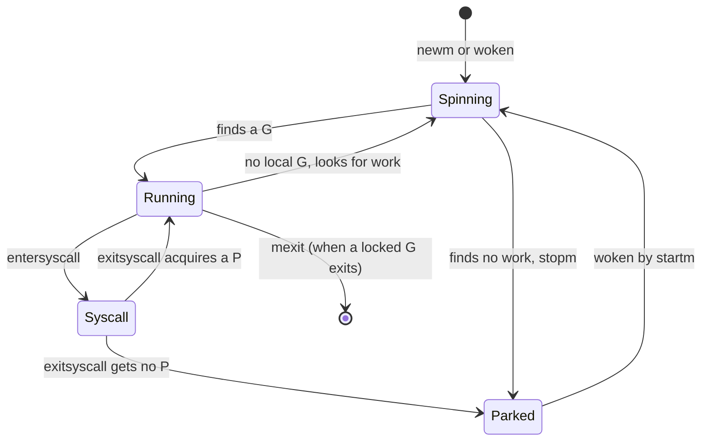
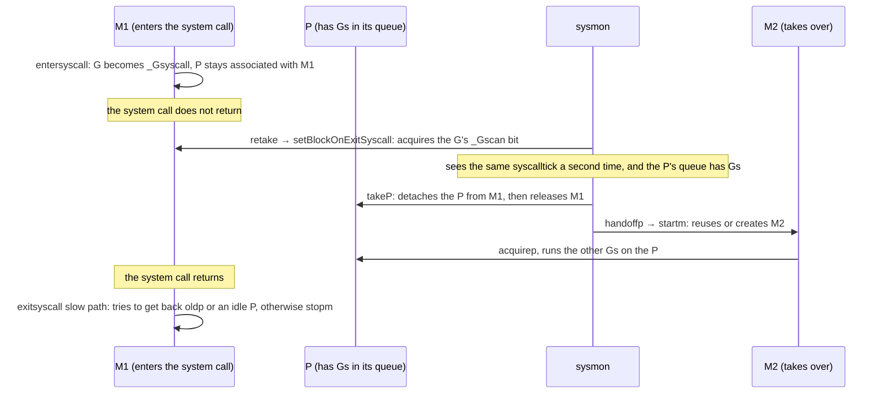

# 9.5 Thread Management

The previous sections dealt mainly with G and P. This section turns to M, the thread that the
runtime requests from the operating system. It answers these questions: how threads are created, how
idle threads are reused, why there are often more threads than `GOMAXPROCS`, why a goroutine blocked
in a system call does not hold up the other goroutines on the same P, and what it costs to lock a
goroutine to a thread (`LockOSThread`).

The premise throughout is that threads are an expensive resource. Creating one requires a trap into
the kernel, a stack allocation and a signal mask setup, and the operating system limits how many can
exist. Many runtime designs, from reusing idle Ms and handing off the P during system calls to
capping the total thread count, serve one goal: create few threads and reuse them.

## 9.5.1 M and the Operating System Thread

Each M corresponds to one operating system thread. The main thread of the process is wrapped as
`m0`, a global variable that is not allocated on the heap
([3.5](../../part1overview/ch03life/boot.md)); every later M corresponds to a thread the runtime
creates explicitly (except the extra M of 9.5.5). The fields relevant to thread management are:

```go
// m: fields relevant to thread management (sketch)
type m struct {
	g0    *g       // the goroutine that owns the system stack, runs scheduling and runtime code
	curg  *g       // the user goroutine currently executing
	p     puintptr // the associated P
	nextp puintptr // the P to associate with after being woken
	oldp  puintptr // the P associated before entering a system call

	park      note     // sleeps here while parked
	schedlink muintptr // links into the idle-M list or the newmHandoff list

	lockedg   guintptr // the G locked to this M, see 9.5.6
	lockedExt uint32   // nesting count of user calls to LockOSThread
	lockedInt uint32   // nesting count of internal runtime locks
	incgo     bool     // whether a cgo call is in progress
	isextra   bool     // whether this is an extra M serving cgo callbacks, see 9.5.5
}
```

A new thread is created through `newm` → `newm1` → `newosproc`. On Linux, `newosproc` ends up
issuing a `clone(2)` system call, and the flags it passes show how a thread differs from a process
[[Go Authors, 2026b](#ref-go-authors-2026b)]:

```go
// clone flags used to create a thread, from runtime/os_linux.go
cloneFlags = _CLONE_VM | // share the address space
	_CLONE_FS | // share filesystem information (current directory and so on)
	_CLONE_FILES | // share the file descriptor table
	_CLONE_SIGHAND | // share the table of signal handlers
	_CLONE_SYSVSEM | // share the System V semaphore undo list
	_CLONE_THREAD // join the same thread group and share the process ID
```

The address space, file descriptors and signal handlers are shared; only the registers and the stack
are private to a thread [[Linux man-pages, n.d.](#ref-linux-man-pages-nd)]. On Darwin and some other
platforms, the runtime calls `pthread_create` instead. Even creating a thread is not cheap: around
`clone`, `newosproc` blocks all signals with `sigprocmask` and then restores the mask, so that the
new thread starts with signals blocked and unblocks them only after `minit` has finished
initializing it. The new thread also needs a system stack to serve as the stack of its g0
([9.3.3](./mpg.md)). If `clone` returns `EAGAIN`, the runtime retries; if it still fails, the
program aborts with the message "may need to increase max user processes (ulimit -u)", which shows
that threads are a resource subject to operating system quotas.

## 9.5.2 Reusing Idle Ms

The runtime does not destroy an M that has nothing to do. It parks the M and waits for the next use.
Parking and resuming are done by `stopm` and `startm`:

```go
// stopm: park the current M until a P is handed to it (sketch)
func stopm() {
	gp := getg()
	// precondition: the M holds no lock, holds no P and is not spinning
	lock(&sched.lock)
	mput(gp.m) // put it on the idle-M list sched.midle
	unlock(&sched.lock)
	mPark()                    // sleep on m.park
	acquirep(gp.m.nextp.ptr()) // the waker has stored the P to hand over in nextp
	gp.m.nextp = 0
}
```

At the core of `mPark` is `notesleep(&gp.m.park)`. A `note` is a one-shot event internal to the
runtime. On Linux, FreeBSD and similar platforms it is built on futexes; on Darwin, Windows and
others it is built on the per-M sleep primitives `semasleep` and `semawakeup`, which use a pthread
mutex and condition variable on Darwin and an event object on Windows. A parked M sleeps in the
kernel, uses no CPU, and stays asleep until `notewakeup` wakes it. For the semantics of futexes and
the pitfalls of using them, see Drepper [[Drepper, 2011](#ref-drepper-2011)]. A `note` should not be
confused with the semaphore in `runtime/sema.go`: the latter serves packages such as `sync` from Go
code, and its design follows the semaphores of Plan 9
[[Mullender and Cox, 2008](#ref-mullender-and-cox-2008)]; see [11.2](../ch11sync/mutex.md).

When a P needs a thread to run on (a new G becomes ready, a P is handed off during a system call,
and so on), `startm` first takes an M from the idle list with `mget`, writes the P into its `nextp`
and wakes it. Only when the idle list is empty does it call `newm` to create a new thread. Reusing
before creating keeps thread creation on the cold path.

An M has no explicit state field, but what it is doing falls into a few states:



On the usual execution paths, an M never exits. Only since Go 1.10 has the runtime been able to let
a thread it created exit, and today this is used only when a G that locked its thread exits without
unlocking it (9.5.6) [[Clements, 2017b](#ref-clements-2017b)]. A proposal to let idle threads exit
on their own (issue #14592) remains unimplemented [[Lopez, 2016](#ref-lopez-2016)], so the threads a
program creates at its peak stay around afterwards.

## 9.5.3 GOMAXPROCS Limits P

`GOMAXPROCS` limits the number of Ps, that is, the upper bound on the parallelism of Go code, not
the number of threads. The runtime creates threads on demand, and apart from the case in 9.5.6 they
only grow in number (9.5.2), so the thread count can well exceed `GOMAXPROCS`. The most common cause
is system calls: when an M blocks in a system call, its P is handed to another M (9.5.4), and the
blocked M and the M that took over exist at the same time. `LockOSThread` and the extra Ms used by
cgo callbacks also push the number of Ms above the number of Ps. With `GOMAXPROCS` set to 2, the
following program blocks 10 goroutines in a system call that reads from an empty pipe:

```go {run=true native=true}
package main

import (
	"fmt"
	"runtime"
	"runtime/metrics"
	"syscall"
	"time"
)

// read reads two scheduler metrics added in Go 1.26.
func read() (threads, inSyscall uint64) {
	s := []metrics.Sample{
		{Name: "/sched/threads/total:threads"},           // threads owned by the runtime
		{Name: "/sched/goroutines/not-in-go:goroutines"}, // goroutines in system or cgo calls (approximate)
	}
	metrics.Read(s)
	return s[0].Value.Uint64(), s[1].Value.Uint64()
}

func main() {
	runtime.GOMAXPROCS(2)
	t, n := read()
	fmt.Printf("at start: %d threads, %d goroutines in system calls\n", t, n)

	var fds [2]int
	if err := syscall.Pipe(fds[:]); err != nil { // blocking pipe, bypasses the network poller
		panic(err)
	}
	for range 10 {
		go func() {
			buf := make([]byte, 1)
			syscall.Read(fds[0], buf) // the pipe is empty, so the thread blocks in the kernel
		}()
	}
	time.Sleep(100 * time.Millisecond)
	t, n = read()
	fmt.Printf("later: %d threads, %d goroutines in system calls\n", t, n)
}
```

```
at start: 5 threads, 0 goroutines in system calls
later: 13 threads, 10 goroutines in system calls
```

Each of the 10 goroutines occupies a thread blocked in the kernel, so the total thread count far
exceeds `GOMAXPROCS`, yet main keeps running. Both metrics are new in Go 1.26
[[Go Authors, 2026c](#ref-go-authors-2026c)]. The output above was produced on macOS; the exact
thread counts vary with the platform and runtime version.

Without a cap on the thread count, a large number of goroutines blocked in system calls could make
the runtime create threads without bound. The runtime therefore sets a limit, `sched.maxmcount`,
which defaults to 10000. The comment on `checkmcount` explains that the purpose of the limit is to
keep millions of goroutines blocked in system calls from accidentally causing a "fork
bomb" [[Go Authors, 2026a](#ref-go-authors-2026a)]:

```go
// checkmcount: check whether the total number of Ms exceeds the limit (sketch)
func checkmcount() {
	// extra Ms are not counted: they serve callbacks from C-created threads
	count := mcount() - int32(extraMInUse.Load()) - int32(extraMLength.Load())
	if count > sched.maxmcount {
		print("runtime: program exceeds ", sched.maxmcount, "-thread limit\n")
		throw("thread exhaustion")
	}
}
```

When the limit is exceeded, the program aborts with `thread exhaustion`. The limit is not meant for
well-behaved programs but is a safeguard that keeps a runaway program from bringing down the whole
machine, and it can be adjusted with `debug.SetMaxThreads`. Extra Ms are not counted because their
number depends on how many C-created threads call back into Go, not on how many threads the Go
program itself created. This exclusion was added during the development of Go 1.21: a change that
binds an extra M to its C thread (9.5.5) meant the extra M was returned only when the C thread
exited, so 10,000 distinct C threads each calling Go once would trigger `thread exhaustion`
[[Pratt, 2023b](#ref-pratt-2023b)].

## 9.5.4 System Calls and P Handoff

[9.1](./model.md) noted that an M:N model must solve one problem: a goroutine blocked in a system
call must not make the other goroutines on the same P wait. Go's solution is to hand the P to
another M for the duration of the system call. The trade-off is that most system calls return
quickly, so handing off the P on every call would cost too much, while for calls that really do
block for a long time the P must promptly be put to work on other Gs. The runtime therefore handles
system calls on two paths, a fast one and a slow one.

On entering a system call, `entersyscall` (the work is actually done by `reentersyscall`) sets the G
to `_Gsyscall`, saves the stack pointer and program counter for use by the GC and stack tracebacks,
records the current P in `m.oldp`, and notes the P's `syscalltick` so that it can later tell whether
the P was taken away. The key point is that `entersyscall` neither releases the P nor changes its
state: `m.p` still points to the original P, the P stays in `_Prunning`, and only the state of the G
changes.

```go
// reentersyscall: enter a system call (sketch)
func reentersyscall(pc, sp, bp uintptr) {
	gp := getg()
	gp.m.locks++                  // disable preemption: g.sched may be inconsistent, so the GC must not see it
	gp.stackguard0 = stackPreempt // make any stack check fail
	gp.throwsplit = true          // and tell newstack that stack growth here is fatal
	gp.m.syscalltick = gp.m.p.ptr().syscalltick
	gp.m.oldp.set(gp.m.p.ptr()) // only remember the P; m.p is not cleared and the P's state is unchanged
	save(pc, sp, bp)            // save the context for the GC and stack tracebacks
	casgstatus(gp, _Grunning, _Gsyscall) // the P must not be accessed after this
	if sched.sysmonwait.Load() {
		systemstack(entersyscallWakeSysmon) // wake sysmon if it is in deep sleep
	}
	gp.m.locks--
}
```

On return, `exitsyscall` first switches the G back to `_Grunning`, then checks whether the P is
still there:

- **Fast path**: `m.p` is still non-nil, which means the system call returned quickly and the P was
  not taken. The G continues directly, with no lock and no need to reassociate the P.
- **Slow path**: the P has been taken. `exitsyscallTryGetP` first tries to get back the original
  `oldp`, and failing that tries to take an idle P. If neither works, the G is put on the global
  queue and the M parks through `stopm`.

The one that takes the P is the monitor thread sysmon ([9.8](./sysmon.md)). In `retake` it examines
the Ps one by one, and for a G in a system call it first calls `setBlockOnExitSyscall` to acquire
the G's `_Gscan` bit. While it holds this bit, the G cannot leave `_Gsyscall`; even if the thread
returns from the kernel, it can only wait in `exitsyscall` and does not compete with sysmon for the
P. Under this protection, sysmon decides by the following rules whether to take the P, and lets the
thread go immediately if it does not:

- The first time sysmon observes a system call, it only records the `syscalltick` and the time, and
  does not take the P. A P therefore stays in a system call for at least one sysmon period (at least
  20 µs).
- After that, if the P's local queue is empty, the system already has a spinning or idle P, and less
  than 10 ms have passed since the first observation, sysmon still does not take it: taking the P
  would not let more work run. The P is eventually taken anyway, because otherwise it would keep
  sysmon from entering deep sleep.
- The exception is a P whose `schedtick` has not changed for 10 ms, that is, the same time slice has
  lasted too long (9.4.2). A preemption request sent to a G in a system call cannot be answered, so
  only sysmon can take the P, and it need not wait for the second observation.

Once it decides to take the P, `takeP` detaches the P from the M, and `handoffp` then hands it over
[[Go Authors, 2026a](#ref-go-authors-2026a)].

```go
// handoffp: arrange what happens next for a P (sketch)
func handoffp(pp *p) {
	// there is a G in the local or global queue: start an M to take over at once
	if !runqempty(pp) || !sched.runq.empty() {
		startm(pp, false, false)
		return
	}
	// likewise start an M when there is GC or tracing work (omitted)
	// with no spinning or idle P, start a spinning M to look for work
	if sched.nmspinning.Load()+sched.npidle.Load() == 0 &&
		sched.nmspinning.CompareAndSwap(0, 1) {
		startm(pp, true, false)
		return
	}
	// in the remaining cases (omitted), put the P back on the idle list
	pidleput(pp, 0)
}
```

The whole process is shown below:



If the system call returns quickly, none of sysmon's steps take place, and `exitsyscall` finds the P
still there and continues on the fast path. The fast path leaves the common case with almost no
extra cost, and the slow path ensures that the rare long block does not reduce parallelism.

For calls known in advance to block, such as `notetsleepg`, with which the runtime sleeps on a user
goroutine, the runtime uses `entersyscallblock`. It hands off the P with `handoffp(releasep())`
before entering the system call, without waiting for sysmon.

The system call path was simplified in Go 1.26. Previously, a P was in a dedicated `_Psyscall` state
during a system call, and the returning M and sysmon competed for ownership of the P with a CAS on
the P's state. Go 1.26 removed `_Psyscall` (it remains in the source as `_Psyscall_unused`) and
synchronizes on the G's `_Gsyscall` state instead, which saves one atomic write and one CAS on every
system call [[Knyszek, 2025](#ref-knyszek-2025)]. The price is a brief window in which a G is
`_Grunning` but has no P; see [9.3.4](./mpg.md).

Note that network I/O and timers do not take this path. They go to the network poller
([9.9](./poller.md)): the G is parked, M and P immediately run other Gs, and once the I/O is ready
the poller makes the G runnable again. What really ties up an M is a system call that cannot be made
asynchronous, such as regular file I/O, `fork`/`exec`, and cgo calls.

Java virtual threads face the same problem. JEP 444 states that some blocking operations are limited
by the operating system (such as many filesystem operations) or by the JDK (such as `Object.wait()`)
and cannot unmount a virtual thread from its carrier thread; the implementations of these operations
compensate for the pinned thread by temporarily expanding the parallelism of the scheduler
[[Pressler and Bateman, 2023](#ref-pressler-and-bateman-2023)]. This is the same idea as Go handing
the P to a new M during a system call.

## 9.5.5 cgo Callbacks and the Extra M

The Ms discussed so far are all created by the runtime itself. In another situation, C code calls
back into a Go function on a thread **not created by Go**: this thread has no g0 and no M, and the
runtime knows nothing about it, yet Go code must run on it.

The runtime prepares a number of **extra Ms** in advance. They are allocated by `oneNewExtraM` and
kept on a dedicated list; each extra M carries a G in the `_Gdeadextra` state ([9.3.4](./mpg.md)),
and the two lock each other through `lockedg` and `lockedm`. When an external thread calls back into
Go, `needm` borrows an extra M from the list and gives the current thread the g0 and the context it
needs to run Go code; when the callback ends, `dropm` returns it. With cgo enabled, `mstartm0` calls
`newextram` early in the runtime's startup to prepare the first extra M.

```go
// oneNewExtraM: prepare one extra M for cgo callbacks (sketch)
func oneNewExtraM() {
	mp := allocm(nil, nil, -1) // allocate an M with no associated P
	gp := malg(4096)           // a G with a small stack
	casgstatus(gp, _Gidle, _Gdeadextra)
	gp.m = mp
	mp.curg = gp
	mp.isextra = true
	mp.lockedInt++ // the extra M and its G are locked to each other
	mp.lockedg.set(gp)
	gp.lockedm.set(mp)
	allgadd(gp)
	sched.ngsys.Add(1) // count it as a system goroutine
	addExtraM(mp)      // put it on the extra-M list
}
```

If the same C thread calls Go repeatedly, borrowing and returning an extra M each time is a
considerable cost. Since Go 1.21, on platforms that support pthreads (except Windows and Plan 9),
the runtime binds the extra M to the C thread using pthread thread-specific data (`cgoBindM`) and
returns it only when the thread exits, through a pthread destructor, which removes the borrow and
return from every callback [[Pratt, 2023a](#ref-pratt-2023a)]. Extra Ms are also one source of
thread counts above `GOMAXPROCS`.

## 9.5.6 LockOSThread

So far the Ms have been interchangeable: which M runs which G does not matter. Some situations,
however, require a goroutine to always run on the **same** thread, and `runtime.LockOSThread` exists
for this. Its documentation says a goroutine should call `LockOSThread` before calling operating
system services or non-Go library functions that depend on per-thread state
[[Go Authors, 2026d](#ref-go-authors-2026d)]. There are two typical needs. First, some C libraries
(graphics libraries such as OpenGL) keep state in thread-local storage and must be called on a fixed
thread. Second, the program has changed the kernel state of a thread through a system call, for
example by putting the thread into a separate Linux namespace with `unshare(CLONE_NEWNS)`, after
which no other goroutine should use that thread. The documentation also points out that all init
functions run on the startup thread, and that calling `LockOSThread` in an init function makes the
main function run on this thread as well; a library that must be called on the main thread can use
this to meet its requirement.

The locking itself is simple to implement: increment a count, and let G and M refer to each other.

```go
// LockOSThread: lock the caller to the current thread (sketch)
func LockOSThread() {
	if newmHandoff.haveTemplateThread == 0 && GOOS != "plan9" {
		startTemplateThread() // start the template thread while thread state is still sound, see below
	}
	getg().m.lockedExt++ // the runtime-internal lockOSThread increments lockedInt instead
	dolockOSThread()
}

func dolockOSThread() {
	gp := getg()
	gp.m.lockedg.set(gp) // the M remembers the G that locked it
	gp.lockedm.set(gp.m) // the G remembers the M it locked
}
```

`UnlockOSThread` decrements the count, and clears the two fields only when both `lockedExt` and
`lockedInt` reach zero.

The lock takes effect in the scheduling loop: the `schedule` function shown in
[9.4.1](./schedule.md) checks `m.lockedg` at the very start, and a locked M only waits for and runs
its own G; if `findRunnable` picks a G locked elsewhere, the current M hands its P to that M. When a
locked G blocks, `stoplockedm` gives up the P through `handoffp` and then parks, and is woken only
when the G becomes runnable again, at which point it gets a P back. This shows what locking costs:
the M is monopolized by one G, and every time the G blocks or wakes, the P must be moved between
threads, so a switch that would have stayed on one thread becomes a wakeup and a park across
threads. The resulting significant slowdown is described in issue #18023
[[Taylor, 2016](#ref-taylor-2016)]; issue #21827, which reports the same kind of problem
[[Smelkov, 2017](#ref-smelkov-2017)], is still open.

The present semantics were established in Go 1.10. In Clements's words, programs that needed to
change the kernel state of a thread were "walking on thin ice" in Go
[[Clements, 2017c](#ref-clements-2017c)]: locking could only keep other goroutines from running on
the thread, but could not stop the runtime from spreading the modified state through the thread
pool. Clements made three changes:

- **Nesting**: previously the lock was a single flag, so one `UnlockOSThread` after two
  `LockOSThread` calls released the lock. Issue #20458 showed this was almost never what users
  intended; after the change, the lock is released only when `UnlockOSThread` has been called as
  many times as `LockOSThread` [[Clements, 2017a](#ref-clements-2017a)].
- **Terminate the thread on exit**: previously, a goroutine exiting implicitly released the lock and
  the thread returned to the pool. After the change, if a goroutine exits while still holding the
  lock, the runtime terminates the thread (`mexit`) so that no other goroutine reuses a thread whose
  state may have been modified [[Clements, 2017d](#ref-clements-2017d)]. This first required the
  runtime to be able to exit threads it created. The difficulty is reclaiming the g0 stack: a thread
  cannot free the stack it is using, so the exiting M is first moved onto the `sched.freem` list,
  and a later `allocm` reclaims the stack once the thread is certain to no longer use it
  [[Clements, 2017b](#ref-clements-2017b)].
- **Template thread**: `clone` carries part of the calling thread's kernel state over to the new
  thread, so creating a thread from a locked thread could copy modified state into the pool. The
  runtime therefore starts a **template thread** at the first call to `LockOSThread` (or at startup,
  for programs that use cgo). The template thread is always in a known good state and runs no G. If
  `newm` finds that the current thread is locked by the user (`lockedExt` is non-zero) or is
  executing a cgo call and so may be a C-created thread, it does not create the thread itself but
  queues the request on the `newmHandoff` list for the template thread to create
  [[Clements, 2017c](#ref-clements-2017c)].

The last two mechanisms are disabled on Plan 9: when a locked goroutine exits there, the thread has
its lock cleared and is reused [[du Colombier, 2017](#ref-du-colombier-2017)].

Because of these side effects, `LockOSThread` is hard to call an ideal feature: it puts a
considerable management burden on the scheduler, and exists mainly to support C libraries and
operating system interfaces that depend on thread-local state.

## 9.5.7 Summary

The spectrum of threading models (1:1, N:1 and M:N) and the choices of various language runtimes
were discussed in [9.1](./model.md). This section showed the engineering price Go pays for the M:N
model: parking and resuming idle threads, handing off the P during system calls and the patrols of
sysmon, the cap on the total thread count, and special cases such as the extra M and the template
thread. These mechanisms are what keep users almost unaware of threads: they can create thousands of
goroutines without caring which thread each runs on, and without worrying that one blocked system
call will stop the others.

## Further Reading

- <a id="ref-clements-2017a"></a>[Clements, 2017a] Austin Clements. runtime: make
  LockOSThread/UnlockOSThread nested. Go commit c85b12b579, 2017. https://go.dev/cl/45752
  Fixes issue #20458 (Bryan C. Mills, proposal: runtime: pair LockOSThread, UnlockOSThread calls).
- <a id="ref-clements-2017b"></a>[Clements, 2017b] Austin Clements. runtime: make it possible to
  exit Go-created threads. Go commit eff2b2620d, 2017. https://go.dev/cl/46037 The thread exit
  mechanism and the reclamation of the g0 stack (`sched.freem`).
- <a id="ref-clements-2017c"></a>[Clements, 2017c] Austin Clements. runtime: don't start new threads
  from locked threads. Go commit 2595fe7fb6, 2017. https://go.dev/cl/46033 Introduces the template
  thread; fixes issue #20676 (runtime: don't spawn threads from locked Ms).
- <a id="ref-clements-2017d"></a>[Clements, 2017d] Austin Clements. runtime: terminate locked OS
  thread if its goroutine exits. Go commit 4f34a52913, 2017. https://go.dev/cl/46038 Fixes issue
  #20395.
- <a id="ref-drepper-2011"></a>[Drepper, 2011] Ulrich Drepper. *Futexes Are Tricky*. Red Hat, 2011.
  https://www.akkadia.org/drepper/futex.pdf
  The futex semantics and pitfalls on which parking and resuming an M depend.
- <a id="ref-du-colombier-2017"></a>[du Colombier, 2017] David du Colombier. runtime: crash on Plan
  9 since CL 46033. Go issue #22227, 2017. https://go.dev/issue/22227
- <a id="ref-go-authors-2026a"></a>[Go Authors, 2026a] The Go Authors. `runtime/proc.go`.
  https://github.com/golang/go/blob/master/src/runtime/proc.go
  `newm`/`newm1`/`mstart`, `stopm`/`startm`/`mPark`, `entersyscall`/`exitsyscall`/`reentersyscall`,
  `handoffp`/`retake`, `acquirep`/`releasep`, `checkmcount`, and the extra-M functions
  `newextram`/`oneNewExtraM`/`needm`/`dropm` (this section follows Go 1.26).
- <a id="ref-go-authors-2026b"></a>[Go Authors, 2026b] The Go Authors. `runtime/os_linux.go`.
  https://github.com/golang/go/blob/master/src/runtime/os_linux.go
  `newosproc` and `cloneFlags`: thread creation ends in `clone`.
- <a id="ref-go-authors-2026c"></a>[Go Authors, 2026c] The Go Authors. Go 1.26 Release Notes, 2026.
  https://go.dev/doc/go1.26
- <a id="ref-go-authors-2026d"></a>[Go Authors, 2026d] The Go Authors. Documentation of
  `runtime.LockOSThread` and `runtime.UnlockOSThread`. https://pkg.go.dev/runtime#LockOSThread
- <a id="ref-knyszek-2025"></a>[Knyszek, 2025] Michael Knyszek. runtime: eliminate _Psyscall. Go
  commit 7244e9221f, 2025. https://go.dev/cl/646198
- <a id="ref-linux-man-pages-nd"></a>[Linux man-pages, n.d.] The Linux man-pages project.
  *clone(2)*. https://man7.org/linux/man-pages/man2/clone.2.html The semantics of flags such as
  `CLONE_VM` and `CLONE_THREAD`, and the line between a thread and a process.
- <a id="ref-lopez-2016"></a>[Lopez, 2016] Brian Lopez. runtime: let idle OS threads exit. Go issue
  #14592, 2016. https://go.dev/issue/14592
- <a id="ref-mullender-and-cox-2008"></a>[Mullender and Cox, 2008] Sape Mullender and Russ Cox.
  *Semaphores in Plan 9*. 2008. https://swtch.com/semaphore.pdf
  The origin of the design of the Go runtime semaphore (`runtime/sema.go`).
- <a id="ref-pratt-2023a"></a>[Pratt, 2023a] Michael Pratt. runtime/cgo: store M for C-created
  thread in pthread key. Go commit c426c87012, 2023. https://go.dev/cl/495855 A resubmission of CL
  485500; the original implementation binding the extra M to the C thread came from doujiang24's
  CL 481061.
- <a id="ref-pratt-2023b"></a>[Pratt, 2023b] Michael Pratt. runtime: crash when >10k C threads call
  Go after CL 485500. Go issue #60004, 2023. https://go.dev/issue/60004
- <a id="ref-pressler-and-bateman-2023"></a>[Pressler and Bateman, 2023] Ron Pressler and Alan
  Bateman. *JEP 444: Virtual Threads*. OpenJDK, 2023. https://openjdk.org/jeps/444 Project Loom:
  Java's convergence on the M:N model.
- <a id="ref-smelkov-2017"></a>[Smelkov, 2017] Kirill Smelkov. runtime: big performance penalty with
  runtime.LockOSThread. Go issue #21827, 2017. https://go.dev/issue/21827
- <a id="ref-taylor-2016"></a>[Taylor, 2016] Ian Lance Taylor. runtime: unexpectedly large slowdown
  with runtime.LockOSThread. Go issue #18023, 2016. https://go.dev/issue/18023
- Go issue tracker: #20458 (pairing `LockOSThread` with `UnlockOSThread`), #20395 (terminating the
  thread of a goroutine that exits while locked), #21827 (large performance loss from
  `LockOSThread`), #22227 (disabling `newmHandoff` on Plan 9), #18023 (unexpected slowdown caused by
  `LockOSThread`), #14592 (letting idle operating system threads exit).
  https://github.com/golang/go/issues
- This book: [9.1 The Scheduling Problem and the GMP Model](./model.md),
  [9.4 The Scheduling Loop](./schedule.md), [9.8 System Monitoring](./sysmon.md),
  [9.9 The Network Poller](./poller.md).
