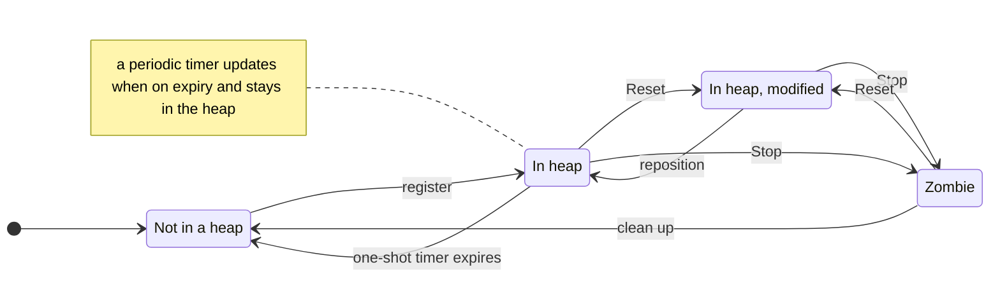

# 9.10 Timers

`time.Sleep`, `time.After`, `time.Timer`, `time.Ticker`, `context.WithTimeout`, and the
`SetDeadline` of a network connection all rest on the same **timer** machinery. It must answer two
questions. The first is a data-structure question: with tens of thousands of timers alive at once,
how can timers be registered and cancelled cheaply, while the earliest one to expire is always
known? The second is a scheduling question: when a timer expires, who runs its action? Go's answer
to the second question has been rewritten several times. At first a dedicated goroutine was
responsible; later the work passed to each P and the scheduling loop, and no thread is reserved for
timers any more. This section first introduces the classic timer algorithms, then follows Go's
evolution to the current implementation.

## 9.10.1 Timer Algorithms

Varghese and Lauck abstract a timer module into four routines
[[Varghese and Lauck, 1987](#ref-varghese-and-lauck-1987)]:

- `START_TIMER`: register a timer that expires after a given interval;
- `STOP_TIMER`: cancel a timer before it expires;
- `PER_TICK_BOOKKEEPING`: on every clock tick, check whether any timer has expired;
- `EXPIRY_PROCESSING`: run the action of an expired timer.

The first two are called by the user, the last two are driven by the clock. The paper is aimed at
network protocols. Timers for retransmission and timeouts exist to detect that "an expected action
did not happen within the allotted time"; when failures are rare, they seldom expire and are mostly
cancelled beforehand. Cancellation is therefore as frequent as registration, and the per-tick check
runs whether or not any timer expires, so all three must be cheap. The schemes the paper compares
are:

| Scheme | `START_TIMER` | `STOP_TIMER` | `PER_TICK_BOOKKEEPING` |
| --- | --- | --- | --- |
| 1: a counter per timer | $O(1)$ | $O(1)$ | $O(n)$ |
| 2: ordered list | $O(n)$ | $O(1)$ | $O(1)$ |
| 3: tree or heap | $O(\log n)$ | $O(1)$ or $O(\log n)$ | $O(1)$ |
| 4: simple timing wheel | $O(1)$ | $O(1)$ | $O(1)$ |

Scheme 1 decrements every timer's counter on each tick. Scheme 2 keeps a list sorted and looks only
at its head on each tick, shifting the cost to the search at insertion. Scheme 3 uses a priority
queue such as a tree or heap, which brings insertion down to $O(\log n)$ and keeps the earliest
timer always at the root.

Scheme 4 is the paper's protagonist, the **timing wheel**. It is a circular array of $N$ slots, each
slot representing one tick and holding a list, with a pointer to the current time. To register a
timer that expires in $j$ ticks, it is hung on the $j$-th slot after the pointer; on each tick the
pointer advances one slot and every timer in that slot expires. Cancellation unlinks it from the
list. All three operations are $O(1)$, at the cost that no interval may exceed $N$ ticks. The paper
then gives three extensions. Schemes 5 and 6 hash arbitrarily long intervals onto a smaller wheel,
with the lists in the slots kept sorted and unsorted respectively, for an average cost that is still
$O(1)$. Scheme 7 is the hierarchical timing wheel: like the hour, minute and second hands of a
clock, a timer with a long interval is first registered on a coarse wheel and migrates level by
level to finer wheels as time advances. This migration is called a cascade.

A timing wheel has one easily overlooked prerequisite: it is driven by periodic ticks, and the
pointer must advance slot by slot even when no timer expires. Inside a kernel the ticks come from
the clock interrupt. A user-space runtime has no ready-made tick; to keep one, a thread would have
to wake periodically, which consumes resources and keeps an idle program from truly sleeping.
Letting a wheel skip a run of empty slots while idle takes extra structure, of which the Linux
bitmap in 9.10.7 is an example. A heap has no such problem: its root is the earliest expiry time,
and the runtime can sleep until exactly that moment. This is the key to understanding Go's choice,
and 9.10.8 returns to it.

## 9.10.2 Origins

The timers of Go 1.0 were a binary min-heap protected by a single global lock and ordered by expiry
time [[Go Authors, 2012](#ref-go-authors-2012)]. A dedicated goroutine, `timerproc`, handled expiry:
it took the top of the heap, ran its callback if it had expired, and otherwise slept until the top
expired. The way it slept is noteworthy: it called `entersyscall` and then `notetsleep` on a note,
blocking its thread just as a system call would. Waiting for a timer thus occupied a thread, and
every expiry first woke this thread, which then woke the waiting goroutine. To stop a timer,
`deltimer` used the heap index recorded in the timer to delete it from the heap immediately, at a
cost of $O(\log n)$.

The evolution since then falls into three stages.

The first stage reduced contention. Go 1.2 changed the binary heap to a 4-ary heap
[[Sokolov, 2013](#ref-sokolov-2013)], whose commit message says only that it "slightly improves
performance when a lot of timers are present". In 2013 Dmitry Vyukov filed the issue "make timers
faster", pointing out that the global lock and `timerproc` were the bottleneck
[[Vyukov, 2013](#ref-vyukov-2013)]. Go 1.10 adopted a change by Aliaksandr Valialkin that split the
one heap into 64, each with its own lock and its own `timerproc`, with a timer choosing its heap by
the number of its P modulo 64 [[Valialkin, 2017](#ref-valialkin-2017)]. The commit message cites two
scenarios: `net/http` servers in which a large number of concurrent connections all set read and
write deadlines, and the large number of timers created implicitly through `context.WithTimeout`. A
source comment explains why 64:

> Ideally, this would be set to GOMAXPROCS, but that would require
> dynamic reallocation
>
> The current value is a compromise between memory usage and performance
> that should cover the majority of GOMAXPROCS values used in the wild.

The second stage merged timers into the scheduler. A series of changes completed by Ian Lance Taylor
in 2019 moved the timer heap into the P, handled expiry in the scheduling loop, and eliminated
`timerproc`; the job of waiting for the earliest timer went to the thread blocked in the network
poller ([9.9](./poller.md)). With GOMAXPROCS at 12, the commit that switched to the new
implementation measured the `AfterFunc` benchmark's time down by 95.42%, `Ticker` down by 99.43% and
`Sleep` down by 31.67% [[Taylor, 2019b](#ref-taylor-2019b)]. The commit links two issues: #6239,
which Vyukov filed in 2013, and #27707, reported in 2018, in which a `Ticker` with a period of 1
millisecond used 20% to 25% of the CPU [[lni, 2018](#ref-lni-2018)] and which remains open. The Go
1.14 release notes [[Go Authors, 2020](#ref-go-authors-2020)] say that the internal timers used by
`time.After`, `time.Tick`, `net.Conn.SetDeadline` and others "are more efficient, with less lock
contention and fewer context switches". This version used a state field with ten values and
coordinated concurrent modifications with atomic compare-and-swap, and kept it until Go 1.22.

Having each P own its timers soon brought a latency problem. A P running a CPU-intensive goroutine
has no chance to check its timers, and the other Ps do not run them for it; the final backstop was
sysmon, which might wake only every 10 milliseconds. Chris Hines reported the problem
[[Hines, 2020a](#ref-hines-2020a)]. Go 1.15 allowed a P looking for work to steal the timers of a
running P [[Taylor, 2020b](#ref-taylor-2020b)]. Go 1.16 went further: when a timer is created it
wakes an idle P if needed, which blocks in the network poller waiting for the new timer to expire,
and sysmon no longer serves as the backstop [[Hines, 2020b](#ref-hines-2020b)]. The benchmark
`ParallelTimerLatency` in that commit measures the average time by which a timer is late: 17.3
milliseconds in Go 1.14, 7.9 milliseconds in Go 1.15, and 0.2 milliseconds after this change.

The third stage corrected semantics. In Go 1.23 Russ Cox rewrote the internal structure of timers:
the timer state of each P was gathered into a separate `timers` type [[Cox, 2024a](#ref-cox-2024a)],
and the ten-valued state was simplified, through a series of merges, into one real lock per timer
plus three state bits [[Cox, 2024e](#ref-cox-2024e)]. The same series of changes also fixed two
long-standing problems of `time.Timer` and `time.Ticker`: a timer that was not stopped could not be
garbage collected, and a stale value could still be received after `Stop` or `Reset` returned.
9.10.6 discusses these two points.

| Version | Data structure | Expiry processing | Reference |
| --- | --- | --- | --- |
| Go 1.0 | One binary heap, one global lock | Dedicated goroutine, occupying a thread while it sleeps | [[Go Authors, 2012](#ref-go-authors-2012)] |
| Go 1.2 | One 4-ary heap | Same | [[Sokolov, 2013](#ref-sokolov-2013)] |
| Go 1.10 | 64 4-ary heaps, each with its own lock | One dedicated goroutine per heap | [[Valialkin, 2017](#ref-valialkin-2017)] |
| Go 1.14 | One 4-ary heap per P; stopping only marks, cleanup is deferred | Scheduling loop and network poller | [[Taylor, 2019b](#ref-taylor-2019b)] |
| Go 1.15 | Same | Timers of running Ps can be stolen | [[Taylor, 2020b](#ref-taylor-2020b)] |
| Go 1.16 | Same | Creating a timer wakes an idle P; sysmon no longer a backstop | [[Hines, 2020b](#ref-hines-2020b)] |
| Go 1.23 | One lock plus three state bits; channel timers enter the heap on demand | Same | [[Cox, 2024e](#ref-cox-2024e)] |

## 9.10.3 The Per-P 4-ary Heap

Each P's timers are kept in `pp.timers`, of type `timers`
[[Go Authors, 2026a](#ref-go-authors-2026a)]. Omitting the details of locking and the race detector,
the design-relevant fields are:

```go
// the per-P timer set (sketch)
type timers struct {
	heap []timerWhen // 4-ary min-heap ordered by expiry time

	len     atomic.Uint32 // atomic copy of len(heap), so other Ps can test emptiness without a lock
	zombies atomic.Int32  // number of timers stopped but not yet removed from the heap

	// wakeTime derives the earliest expiry from these two lower bounds without locking
	minWhenHeap     atomic.Int64 // expiry time at the top of the heap
	minWhenModified atomic.Int64 // lower bound on the expiry of modified timers not yet repositioned in the heap
}

type timerWhen struct {
	timer *timer
	when  int64 // redundant copy of the expiry time
}
```

`timerWhen` keeps a redundant copy of the expiry time next to the pointer. The heap compares this
copy when sifting up and down, so it need not dereference every timer; this is a Go 1.23 change, and
the commit message says it "avoids an indirection when doing heap
operations" [[Cox, 2024d](#ref-cox-2024d)]. A single timer is a `timer`:

```go
// a single timer (sketch)
type timer struct {
	mu     mutex       // protects the fields below
	astate atomic.Uint8 // atomic snapshot of state at the last unlock, for lock-free checks on fast paths
	state  uint8        // state bits: timerHeaped, timerModified, timerZombie
	isChan bool         // whether this is a channel timer of time.Timer or time.Ticker

	blocked uint32 // number of goroutines blocked on this timer's channel

	when   int64 // expiry time (nanoseconds on the monotonic clock)
	period int64 // if greater than 0, a periodic timer that fires every period
	f      func(arg any, seq uintptr, delay int64) // called on expiry; must not block
	arg    any
	seq    uintptr

	ts *timers // the heap it lives in; nil when in no heap
}
```

The meaning of `f`, `arg` and `seq` is up to the user. In `time.Sleep`, `f` wakes the sleeping
goroutine; in `time.Timer`, `f` sends the current time to the channel; in `time.AfterFunc`, `f`
starts a new goroutine to run the user's function; in the network poller, `f` wakes the goroutine
waiting on a deadline, and `seq` identifies stale firings ([9.9.4](./poller.md)).

The heap's elements are stored in an array. The parent of the node at index $i$ is at
$\lfloor (i-1)/4 \rfloor$, and its children are at $4i+1$ through $4i+4$. The benefit of the 4-ary
heap comes from the nature of heaps, not from the argument in that commit. A 4-ary heap of $n$
elements has height $\log_4 n$, half that of a binary heap. Insertion only sifts up along the path
to the root with one comparison per level, so the number of comparisons halves. When the top is
deleted, an element sinks, and at each level the smallest of four children must be found, so the
number of comparisons is about $4\log_4 n = 2\log_2 n$, level with a binary heap; but there are half
as many levels, half as many elements to move, and the four children are adjacent in the array, so
the access is to one contiguous stretch of memory. A 4-ary heap is therefore no worse than a binary
heap for either insertion or deletion.

Registration is done by `maybeAdd`. When a timer needs to enter a heap, it is added to the current
P's heap, not another P's; to ensure this it first pins the goroutine to the current M with
`acquirem`, so that it cannot be scheduled onto another P after the heap pointer is obtained. Before
adding, it tidies the ends of the heap in passing (see 9.10.4); after adding, if the new timer is
earlier than the heap's previous earliest expiry, it calls `wakeNetPoller`:

```go
func wakeNetPoller(when int64) {
	if sched.lastpoll.Load() == 0 {
		// a thread is already blocked in the network poller: wake it if it waits until later than when
		pollerPollUntil := sched.pollUntil.Load()
		if pollerPollUntil == 0 || pollerPollUntil > when {
			netpollBreak()
		}
	} else {
		// no thread is in the network poller; try to wake an idle P and M
		wakep()
	}
}
```

The woken thread recomputes how long it should block ([9.9.6](./poller.md)). In addition, the
runtime maintains a bitmap `timerpMask` recording which Ps may have timers in their heaps: when a P
goes idle with an empty heap its bit is cleared, and when a P is acquired the bit is set again.
Other Ps use it to skip Ps that cannot have timers.

## 9.10.4 Stopping, Modifying and Lazy Deletion

A timer is stopped or modified by the goroutine that uses it, while the heap it lives in belongs to
the P that registered it; the two need not be the same. Deleting from the heap immediately would
require locking another P's heap and contending with that P's scheduling loop, and would also incur
the $O(\log n)$ cost of sifting down. Go 1.0 had only one global lock, so immediate deletion added
no extra contention; once heaps were spread across Ps, the cost became conspicuous.

Go's approach is **lazy deletion**: stopping and modifying touch only the timer itself, and leave
tidying the heap to its owner. `stop` marks the timer `timerZombie` and increments the `zombies`
count of its heap; `modify` (through which `Reset` is implemented) changes `when` and marks the
timer `timerModified`, and if the new time is earlier than `minWhenModified`, it updates that bound
and calls `wakeNetPoller`. For a timer already in a heap, both lock only the timer, not the heap,
and move no element in the heap; only when a timer not in a heap is `Reset` does `maybeAdd` add it
to the current P's heap. The three state bits mean:

- `timerHeaped`: the timer is in some P's heap;
- `timerModified`: `when` has changed, but the position in the heap and the `timerWhen` copy have
  not yet been updated;
- `timerZombie`: the timer has been stopped but is still in the heap (a channel timer with no one
  waiting is also marked this way, see 9.10.6).

The last two bits matter only when `timerHeaped` is set, and they can be set together, meaning that
the timer was modified and then stopped.



Marked timers are handled in several places, each holding the heap's lock:

- `cleanHead`: called before registering a new timer. It first deletes zombies from the end of the
  array, which needs no heap adjustment; it then checks the top of the heap, and if the top is a
  zombie or modified, removes it or sifts it to the right position, until the top is a normal timer.
- `run`: when running an expired timer, if the top of the heap is a zombie or modified, it likewise
  removes or sifts it first and then looks at the new top.
- `adjust`: scans the whole array, deletes all zombies, writes the new times of modified timers into
  the `timerWhen` copies, and then rebuilds the whole heap at $O(n)$ cost. It scans only when the
  earliest modified timer has already expired, or when forced to.
- `take`: when GOMAXPROCS is reduced, `procresize` destroys the surplus Ps with the world stopped
  and adds their timers one by one to the current P's heap, discarding zombies
  [[Taylor, 2019a](#ref-taylor-2019a)].

A forced tidy-up happens when more than a quarter of the zombies are in the current P's own heap.
This rule comes from a change shortly before the release of Go 1.14, whose commit is titled "don't
let P's timer heap get clogged with deleted timers" [[Taylor, 2020a](#ref-taylor-2020a)].
Restricting it to the local P avoids contending for other Ps' locks. A program that frequently
creates and then cancels timers, such as a server that calls `context.WithTimeout` for every request
and in which most requests finish before the timeout, relies on this rule to hold the share of
zombies in the heap at around a quarter.

`adjust` must also handle a subtle concurrency problem. Other Ps call `wakeTime` without a lock; it
returns the earlier of `minWhenHeap` and `minWhenModified` and decides how long the network poller
may block at most. After `adjust` scans, `minWhenModified` should be reset to zero; but if it is
zeroed before the scan, `wakeTime` may report a time that is too late during the scan, and if it is
zeroed after the scan, modifications made to timers by other goroutines during the scan would be
lost. The solution in the source comments has four steps:

1. set `minWhenHeap` to the earlier of the two lower bounds, fixing the correct `wakeTime` first;
2. reset `minWhenModified` to zero, so that later modifications by other goroutines update it
   afresh;
3. scan and process all timers;
4. set `minWhenHeap` to the new time at the top of the heap.

`wakeTime` reads `minWhenModified` first and `minWhenHeap` second, which pairs with the order of
writes above: if it reads the zeroed `minWhenModified`, it is guaranteed to read the `minWhenHeap`
written in step 1. To avoid having to lock every timer in step 3, `modify` first writes
`timerModified` into the atomic snapshot `astate` and then updates `minWhenModified`, so the scan
need only read the snapshot to avoid missing modifications made while the first two steps were in
progress.

## 9.10.5 Expiry Checks

The current implementation has no thread dedicated to running timers; expiry checks are spread over
paths the scheduler already has. The core is `timers.check`:

```go
// run all expired timers in ts (sketch)
func (ts *timers) check(now int64) (rnow, pollUntil int64, ran bool) {
	next := ts.wakeTime() // read the earliest expiry without a lock
	if next == 0 {
		return now, 0, false // no timers
	}
	if now == 0 {
		now = nanotime()
	}
	// force a tidy-up when more than a quarter of the local P's timers are zombies
	force := ts == &getg().m.p.ptr().timers && int(ts.zombies.Load()) > int(ts.len.Load())/4
	if now < next && !force {
		return now, next, false // fast path: nothing expired, nothing to tidy
	}

	ts.lock()
	ts.adjust(now, false)
	for len(ts.heap) > 0 {
		if tw := ts.run(now); tw != 0 { // run the top; if it has not expired, return its expiry time
			if tw > 0 {
				pollUntil = tw
			}
			break
		}
		ran = true
	}
	// after running timers, decide again whether a forced tidy-up is needed
	if ts == &getg().m.p.ptr().timers && int(ts.zombies.Load()) > int(ts.len.Load())/4 {
		ts.adjust(now, true)
	}
	ts.unlock()
	return now, pollUntil, ran
}
```

Most calls take the fast path, which does only a few atomic reads and comparisons, with no lock. A
source comment notes that deferring the forced tidy-up until after the timers have run is
significantly faster under heavy contention, "though we do not fully understand why".

`run` runs the timer at the top of the heap on the system stack. For a periodic timer, it sets the
next expiry time to `when + period*(1+delay/period)`, where `delay` is the difference between the
actual run time and `when`. If the run is late by more than one period, the periods missed in
between are skipped outright rather than made up one by one. `run` then releases the timer's lock
and the heap's lock, calls `f(arg, seq, delay)`, and relocks the heap on return. While `f` runs it
holds no lock and is not on an ordinary goroutine, so a source comment requires it to be "a
well-behaved function and not block".

The points where the scheduler meets timers are all in `runtime/proc.go`
[[Go Authors, 2026b](#ref-go-authors-2026b)]; the first two call `check`, and the last two only read
`wakeTime`:

- `findRunnable` begins by checking the current P's timers. The goroutines woken by expired timers
  are put on the local run queue and can then be scheduled.
- In its last round of work stealing, `stealWork` calls `check` on every other P marked in
  `timerpMask`, running expired timers on their behalf. This includes Ps that are running
  CPU-intensive code, and is the Go 1.15 change.
- When an M without a P is about to block, `checkTimersNoP` reads the `wakeTime` of all Ps and uses
  it as the time limit for blocking in the network poller. After waking on time, the M acquires a P
  and runs the timers in the next round of `findRunnable`.
- When a P is handed back as idle, `handoffp` reads its `wakeTime` and calls `wakeNetPoller`,
  ensuring that some thread will wake when this P's earliest timer expires.

sysmon ([9.8](./sysmon.md)) does not run timers. It reads the earliest expiry time only through
`timeSleepUntil`, to bound how long it sleeps deeply.

`time.Sleep` is the most common user of timers, and its implementation has a detail worth
mentioning:

```go
func timeSleep(ns int64) {
	if ns <= 0 {
		return
	}
	gp := getg()
	t := gp.timer
	if t == nil { // each goroutine reuses the same timer
		t = new(timer)
		t.init(goroutineReady, gp)
		gp.timer = t
	}
	gp.sleepWhen = nanotime() + ns
	gopark(resetForSleep, nil, waitReasonSleep, traceBlockSleep, 1)
}

// called only after the goroutine has parked; this is when the timer is registered
func resetForSleep(gp *g, _ unsafe.Pointer) bool {
	gp.timer.reset(gp.sleepWhen, 0)
	return true
}
```

The timer is not registered in `timeSleep`; it is registered in the callback of `gopark`, after the
goroutine has already parked. A source comment gives the reason: if the sleep is short and
goroutines are many, a P might run the timer's callback `goroutineReady` before this goroutine has
parked, waking a goroutine that has not yet parked.

## 9.10.6 Timer Channels

The channel returned by `time.NewTimer` and `time.NewTicker` is written by the timer's callback
`sendTime` in a non-blocking way. Before Go 1.23 this channel was an ordinary buffered channel of
capacity 1, and once registered the timer stayed in the heap until it expired or was stopped. This
brought two problems.

The first is garbage collection. The heap references the timer and the timer references the channel,
so a timer that has not been stopped cannot be reclaimed before it expires, and a `Ticker` that has
not been stopped can never be reclaimed. Writing `select { case <-time.After(time.Minute): ... }` in
a loop leaves behind, on every iteration, a timer that cannot be reclaimed for a minute. The
documentation therefore advised using `NewTimer` and calling `Stop` when done, and much code
acquired the habit of `defer t.Stop()` [[Cox, 2024b](#ref-cox-2024b)]. As early as 2014, Vyukov had
proposed another approach: let the timer's channel record the time of the next firing itself, and
let the receive operation work out whether it has expired, without keeping the timer in a heap
[[Vyukov, 2014](#ref-vyukov-2014)].

The second is stale values. A timer may expire just before `Stop` or `Reset`, putting a value in the
buffer, and the caller may still receive this value, which belongs to the old setting, after `Stop`
or `Reset` returns. Correct usage requires checking the return value of `Stop` and, if necessary,
draining the value from the buffer, which is easy to get wrong. In 2020 Bryan C. Mills proposed
guaranteeing that no old value is received after `Stop` or `Reset` returns
[[Mills, 2020](#ref-mills-2020)].

Go 1.23 solved both problems. For the first, a channel timer enters the heap only while some
goroutine is blocked on its channel, and the condition is in `needsAdd`:

```go
need := t.state&timerHeaped == 0 && t.when > 0 && (!t.isChan || t.blocked > 0)
```

When a channel receive or a `select` decides to block, it calls `blockTimerChan`, which increments
`blocked` and, if needed, adds the timer to the heap; when it no longer blocks it calls
`unblockTimerChan`, and after the last waiter leaves, the timer is marked a zombie, awaiting
cleanup. When no goroutine is waiting, the timer is in no heap and is referenced only by the user's
variable; once the variable is unreachable, the timer can be reclaimed. If a goroutine comes to
receive after the timer has expired, the receive operation calls `maybeRunChan`, and on finding the
timer expired it runs the callback on the spot. The callback then runs some time late, and
`sendTime` subtracts that delay from the time value it sends. A source comment says that no one has
looked at the channel in the meantime, or the send would not have happened so late, so no one can
tell the difference.

For the second, the semantics of `Stop` and `Reset` are changed to match an unbuffered channel. In
the commit message Cox gives the semantic model [[Cox, 2024c](#ref-cox-2024c)]:

> behave like the channels are unbuffered and fed by a coordinating goroutine.

The implementation has no such extra goroutine. The channel still carries a one-element buffer, but
`len` and `cap` are special-cased for timer channels and always return 0, so the user cannot see
what is in the buffer except by receiving. `Stop` and `Reset` increment `seq` under the protection
of `sendLock`, and a send in progress that finds the sequence number mismatched gives up; they then
empty the buffer with `timerchandrain`. The field `isSending` lets them know whether they
intercepted a send in progress, so that they return `true` correctly.

The following program lets a timer expire with no one receiving, and then calls `Reset`:

```go {run=true}
package main

import (
	"fmt"
	"time"
)

func main() {
	t := time.NewTimer(20 * time.Millisecond)
	time.Sleep(50 * time.Millisecond) // the timer has long expired, but nobody receives

	fmt.Println("len, cap:", len(t.C), cap(t.C))
	fmt.Println("Reset returns:", t.Reset(20*time.Millisecond))
	select {
	case <-t.C:
		fmt.Println("received a stale value")
	default:
		fmt.Println("no stale value")
	}
	<-t.C
	fmt.Println("received the firing after the reset")
}
```

In Go 1.23 and later, its output is:

```
len, cap: 0 0
Reset returns: true
no stale value
received the firing after the reset
```

The timer expires during the `Sleep`, but no goroutine is waiting for it, so it is not in the heap,
the callback has not run, and the channel holds no value. `Reset` therefore considers that it has
intercepted this firing and returns `true`. In Go 1.22 and earlier, the same program prints
`len, cap: 1 1`, `Reset returns: false` and "received a stale value": the value entered the buffer
during the `Sleep` and can still be received after `Reset` returns. This is the very example Cox
used in the commit message to illustrate the change in behavior, and it originally came from issue
#11513 of 2015. Cox also noted that the correct way of checking the return value of `Reset` works
under both semantics.

A periodic timer also shows the rule of 9.10.5 that skips missed periods:

```go {run=true}
package main

import (
	"fmt"
	"time"
)

func main() {
	start := time.Now()
	tk := time.NewTicker(100 * time.Millisecond)

	time.Sleep(350 * time.Millisecond) // misses the ticks at 100, 200 and 300 ms
	for range 2 {
		v := <-tk.C
		fmt.Printf("received at %3d ms, value stamped %3d ms\n",
			time.Since(start).Round(50*time.Millisecond).Milliseconds(),
			v.Sub(start).Round(50*time.Millisecond).Milliseconds())
	}
}
```

```
received at 350 ms, value stamped 100 ms
received at 400 ms, value stamped 400 ms
```

The first receive happens at 350 milliseconds, where `maybeRunChan` runs on the spot the callback
that should have fired at 100 milliseconds, and `sendTime` subtracts the delay of 250 milliseconds,
so the value received is the time of the 100-millisecond instant. The next firing time, by integer
division, is `100 + 100×(1 + 250/100) = 100 + 100×3`, that is, 400 milliseconds, and the ticks at
200 and 300 milliseconds are dropped. The documentation of `time.NewTicker` describes this as
adjusting the time interval or dropping ticks to make up for slow receivers. Go 1.22 and earlier
print the same output, for a different reason: the 100-millisecond value was already in the buffer,
and the sends at 200 and 300 milliseconds were dropped because the buffer was full.

The new semantics take effect only for main modules whose `go.mod` declares Go 1.23 or later;
programs of older modules get `GODEBUG=asynctimerchan=1` by default, that is, the old behavior
[[Go Authors, 2024](#ref-go-authors-2024)]. Go 1.27 removes this setting and all programs use the
new semantics; after that, a program that still sets it to the old value reports an error and exits
at startup [[Griesemer, 2026](#ref-griesemer-2026)].

## 9.10.7 Comparison with Other Systems

The Linux kernel uses both timing wheels and trees. The ordinary timers used for timeouts hang on
the timing wheel. Thomas Gleixner rewrote it in Linux 4.8 [[Gleixner, 2016](#ref-gleixner-2016)],
for a reason in line with the observation of Varghese and Lauck: the great majority of timers on the
wheel are cancelled or reset before they expire, so they are safeguards for timeouts and not real
timers used to measure time. The new wheel has several levels, each with a granularity 8 times that
of the one before; a timer stays in the slot where it was registered and no longer cascades to finer
wheels, at the cost of an error of about 12.5% in the worst case. Whether each slot is empty is
recorded in a bitmap, so finding the next timer to expire is $O(1)$
[[Corbet, 2015](#ref-corbet-2015)]. This matters for tickless (NOHZ) mode: after a long idle spell
the kernel need not catch up with time tick by tick. Timers that require precision use
high-resolution timers (hrtimers), which are stored by expiry time in a red-black tree
[[Linux kernel, n.d.](#ref-linux-kernel-nd)].

Netty's `HashedWheelTimer` is a direct implementation of the hashed timing wheel; its documentation
cites the paper of Varghese and Lauck, and says it is optimized for approximated I/O timeout
scheduling: by default one tick per 100 milliseconds, 512 slots per wheel, and one thread per
instance [[Netty, n.d.](#ref-netty-nd)]. The Erlang/OTP runtime also uses timing wheels and, like
Go, shards them by scheduler: each scheduler thread maintains its own timing wheel, the nearer wheel
has $2^{14}$ slots with one clock tick per slot and covers a range of a little over 16 seconds, and
timers farther out are placed on another wheel [[Erlang/OTP, n.d.](#ref-erlang-otp-nd)].

Quite a few systems use heaps or trees. libevent uses a binary min-heap
[[libevent, n.d.](#ref-libevent-nd)] and nginx uses a red-black tree [[nginx, n.d.](#ref-nginx-nd)].
Java's `ScheduledThreadPoolExecutor` uses a binary heap implemented in an array, in which each task
records its own index in the heap so that it can be cancelled faster, as in Go 1.0. Its
documentation also warns that, by default, cancelled tasks are not removed from the queue until
their delay elapses, which can cause cancelled tasks to be retained for an unbounded time, and that
`setRemoveOnCancelPolicy` can be used to remove them immediately [[OpenJDK, n.d.](#ref-openjdk-nd)].
This is just why lazy deletion needs a cleanup rule, and the quarter rule is what Go's does.

Overall, scenarios dominated by timeouts, where most timers are cancelled and some loss of precision
is acceptable, favor timing wheels; scenarios that require ordering by exact time and whose
intervals vary widely favor heaps or trees.

## 9.10.8 Summary

The reasons Go chose a 4-ary heap per P can be drawn from the preceding sections. A heap needs no
periodic tick: the runtime can use the earliest expiry time directly as the blocking limit of the
network poller, so an idle program is truly asleep. A heap orders by 64-bit absolute time and treats
a microsecond `Sleep` and a deadline of hours alike, with no limit of wheel length and no cascades.
Sharding by P removes the global lock; lazy deletion lets stop and modify lock only the timer
itself, making up for the heap's disadvantage against the timing wheel in cancellation. With expiry
processing folded into the scheduling loop, no dedicated thread is needed, and the goroutine a timer
wakes goes directly to the run queue of the P that ran the timer.

The design has costs too. Timers rely on the network poller's timeout to wake threads, while Linux's
`epoll_wait` takes its timeout in milliseconds, so a wait shorter than 1 millisecond is rounded up
to 1 millisecond. The documentation of the `time` package also says that timer resolution on Unix is
about 1 millisecond. After Go 1.16 removed sysmon's backstop role, Michael Pratt measured the time
of `time.Sleep(50 * time.Microsecond)` going from 86.9 microseconds to 609.8 microseconds
[[Pratt, 2021](#ref-pratt-2021)]. Pratt's analysis points out that before this, the expiry of such
short sleeps was mostly noticed by sysmon, and afterwards it had to wait for the network poller's
timeout. The same problem on Windows improved in Go 1.23: the runtime now uses a high-resolution
timer to wake the I/O completion port, raising the precision of `Sleep` and the like from 15.6
milliseconds to 0.5 milliseconds [[Go Authors, 2024](#ref-go-authors-2024)]. A high-frequency
`Ticker` is still expensive, since every tick may have to wake a thread, and #27707 remains open.
From the single goroutine of Go 1.0 to the heap per P, each rewrite of timers has re-weighed lock
contention, wakeup latency, memory reclamation and semantic clarity, and these trade-offs land in
the end on the scheduler.

## Further Reading

- <a id="ref-corbet-2015"></a>[Corbet, 2015] Jonathan Corbet. *Reinventing the timer wheel.*
  LWN.net, 2015-06-03. https://lwn.net/Articles/646950/
- <a id="ref-cox-2024a"></a>[Cox, 2024a] Russ Cox. runtime: move per-P timers state into its own
  struct. Go commit adc575e64c, 2024. https://go.dev/cl/564132
- <a id="ref-cox-2024b"></a>[Cox, 2024b] Russ Cox. time: garbage collect unstopped Tickers and
  Timers. Go commit 508bb17edd, 2024. https://go.dev/cl/512355 Fixes issues #8898 and #61542;
  shipped with Go 1.23.
- <a id="ref-cox-2024c"></a>[Cox, 2024c] Russ Cox. time: avoid stale receives after Timer/Ticker
  Stop/Reset return. Go commit 966609ad9e, 2024. https://go.dev/cl/568341
  Fixes issue #37196; shipped with Go 1.23.
- <a id="ref-cox-2024d"></a>[Cox, 2024d] Russ Cox. runtime: move whenHeap into heap slice. Go commit
  bb7a29991c, 2024. https://go.dev/cl/574896
- <a id="ref-cox-2024e"></a>[Cox, 2024e] Russ Cox. runtime: clean up timer state. Go commit
  6135651867,
  2024. https://go.dev/cl/570335
  Replaces the state word that doubled as a lock with a real lock and establishes the state bits
  such as `timerHeaped` and `timerModified`; shipped with Go 1.23.
- <a id="ref-erlang-otp-nd"></a>[Erlang/OTP, n.d.] Ericsson AB. `erts/emulator/beam/time.c`.
  https://github.com/erlang/otp/blob/master/erts/emulator/beam/time.c
  The comment at the top of the file describes the per-scheduler-thread timing wheel.
- <a id="ref-gleixner-2016"></a>[Gleixner, 2016] Thomas Gleixner. *timers: Switch to a non-cascading
  wheel.* Linux commit 500462a9de65, 2016. https://git.kernel.org/torvalds/c/500462a9de65
  Shipped with Linux 4.8.
- <a id="ref-go-authors-2012"></a>[Go Authors, 2012] The Go Authors. `runtime/time.goc` (Go 1.0).
  https://github.com/golang/go/blob/release-branch.go1/src/pkg/runtime/time.goc
  The global binary heap, `timerproc` and `deltimer`.
- <a id="ref-go-authors-2020"></a>[Go Authors, 2020] The Go Authors. Go 1.14 Release Notes, 2020.
  https://go.dev/doc/go1.14
- <a id="ref-go-authors-2024"></a>[Go Authors, 2024] The Go Authors. Go 1.23 Release Notes, 2024.
  https://go.dev/doc/go1.23 Unbuffered timer channels that can be garbage collected immediately;
  better timer resolution on Windows.
- <a id="ref-go-authors-2026a"></a>[Go Authors, 2026a] The Go Authors. *runtime/time.go*
  (`type timers`, `addHeap`, `check`, `take`).
  https://github.com/golang/go/blob/master/src/runtime/time.go Also the timer-channel parts of
  `time/sleep.go`, `time/tick.go` and `runtime/chan.go` (this section follows Go 1.26).
- <a id="ref-go-authors-2026b"></a>[Go Authors, 2026b] The Go Authors. `runtime/proc.go`
  (`findRunnable`, `stealWork`, `checkTimersNoP`, `wakeNetPoller`, `pidleput`).
  https://github.com/golang/go/blob/master/src/runtime/proc.go
- <a id="ref-griesemer-2026"></a>[Griesemer, 2026] Robert Griesemer. runtime: remove asynctimerchan
  GODEBUG setting. Go commit a5bc606a68, 2026. https://go.dev/cl/781580
  Corresponds to issue #76472 and shipped with Go 1.27; see also https://go.dev/doc/godebug .
- <a id="ref-hines-2020a"></a>[Hines, 2020a] Chris Hines. golang/go#38860. *runtime: CPU bound
  goroutines cause unnecessary timer latency.* 2020. https://github.com/golang/go/issues/38860
- <a id="ref-hines-2020b"></a>[Hines, 2020b] Chris Hines. runtime: reduce timer latency. Go commit
  8fdc79e18a, 2020. https://go.dev/cl/232298
  Shipped with Go 1.16.
- <a id="ref-libevent-nd"></a>[libevent, n.d.] libevent. `minheap-internal.h`.
  https://github.com/libevent/libevent/blob/master/minheap-internal.h
- <a id="ref-linux-kernel-nd"></a>[Linux kernel, n.d.] The Linux Kernel. *hrtimers - high-resolution
  kernel timers.* https://www.kernel.org/doc/html/latest/timers/hrtimers.html
- <a id="ref-lni-2018"></a>[lni, 2018] lni. golang/go#27707. *time: excessive CPU usage when using
  Ticker and Sleep.* 2018. https://github.com/golang/go/issues/27707 One of the motivations for the
  Go 1.14 per-P timers; still open.
- <a id="ref-mills-2020"></a>[Mills, 2020] Bryan C. Mills. golang/go#37196. *time: make Timer/Ticker
  channels not receivable with old values after Stop or Reset returns.* 2020.
  https://github.com/golang/go/issues/37196
- <a id="ref-netty-nd"></a>[Netty, n.d.] Netty. *HashedWheelTimer* (based on Varghese-Lauck).
  https://netty.io/4.1/api/io/netty/util/HashedWheelTimer.html
- <a id="ref-nginx-nd"></a>[nginx, n.d.] nginx. `src/event/ngx_event_timer.c`.
  https://github.com/nginx/nginx/blob/master/src/event/ngx_event_timer.c
- <a id="ref-openjdk-nd"></a>[OpenJDK, n.d.] OpenJDK.
  `java/util/concurrent/ScheduledThreadPoolExecutor.java`.
  https://github.com/openjdk/jdk/blob/master/src/java.base/share/classes/java/util/concurrent/ScheduledThreadPoolExecutor.java
- <a id="ref-pratt-2021"></a>[Pratt, 2021] Michael Pratt. Comment on golang/go#44343, 2021.
  https://github.com/golang/go/issues/44343#issuecomment-780845628 The analysis of the cause is in
  https://github.com/golang/go/issues/44343#issuecomment-780894325 in the same issue. The Windows
  problem was fixed in Go 1.23 by Quim Muntal's Go commit cf52e70997 (<https://go.dev/cl/488675>).
- <a id="ref-sokolov-2013"></a>[Sokolov, 2013] Sokolov Yura. *time: make timers heap 4-ary.* 2013.
  https://golang.org/cl/13094043 Shipped with Go 1.2; Go commit
  https://github.com/golang/go/commit/fcf6a7e5ceb79f771bcf8e783c85535bfaad4f9c
- <a id="ref-taylor-2019a"></a>[Taylor, 2019a] Ian Lance Taylor. *runtime: handle timers on P's in
  procresize/(\*pp).destroy.* 2019. https://go-review.googlesource.com/c/go/+/171828
  One of the Go 1.14 per-P timer changes.
- <a id="ref-taylor-2019b"></a>[Taylor, 2019b] Ian Lance Taylor. runtime: switch to using new timer
  code. Go commit 6becb03334, 2019. https://go.dev/cl/171883 Shipped with Go 1.14.
- <a id="ref-taylor-2020a"></a>[Taylor, 2020a] Ian Lance Taylor. runtime: don't let P's timer heap
  get clogged with deleted timers. Go commit 641e61db57, 2020. https://go.dev/cl/214299 Shipped with
  Go 1.14.
- <a id="ref-taylor-2020b"></a>[Taylor, 2020b] Ian Lance Taylor. runtime: steal timers from running
  P's. Go commit 9b90491e4a, 2020. https://go.dev/cl/232199 Shipped with Go 1.15.
- <a id="ref-valialkin-2017"></a>[Valialkin, 2017] Aliaksandr Valialkin. *runtime: improve timers
  scalability on multi-CPU systems.* 2017. https://go-review.googlesource.com/34784
  Shipped with Go 1.10, 64 buckets.
- <a id="ref-varghese-and-lauck-1987"></a>[Varghese and Lauck, 1987] George Varghese, Anthony
  Lauck. "Hashed and Hierarchical Timing Wheels: Data Structures for the Efficient Implementation of
  a Timer Facility." *SOSP 1987*, pp. 25-38; *IEEE/ACM Trans. Networking* 5(6), 1997.
  https://doi.org/10.1145/41457.37504 Journal version: https://doi.org/10.1109/90.650142
- <a id="ref-vyukov-2013"></a>[Vyukov, 2013] Dmitry Vyukov. *runtime: make timers faster*. Go issue
  #6239,
  2013. https://golang.org/issue/6239 (the scalability bottleneck of the single global timer heap,
        the motivation for the later per-P design)
- <a id="ref-vyukov-2014"></a>[Vyukov, 2014] Dmitry Vyukov. golang/go#8898. *runtime: special case
  timer channels.* 2014. https://github.com/golang/go/issues/8898
- This book: [9.9 The Network Poller](./poller.md), [9.8 System Monitoring](./sysmon.md),
  [9.4 The Scheduling Loop](./schedule.md).
