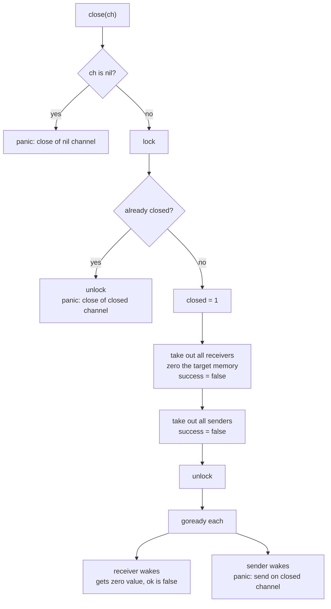
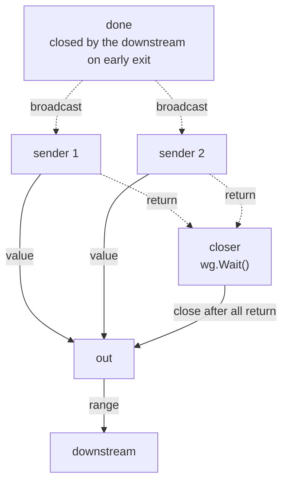

# 10.4 The Semantics of Closing

The sends and receives discussed in [10.3 Send, Receive, and Direct Handoff](./sendrecv.md) are all
one-to-one: one send pairs with one receive, and the side that arrives first waits for the side that
arrives later. Closing is the only one-to-many operation on a channel. One `close(ch)` wakes every
goroutine blocked on the channel: those waiting to receive each get the zero value, those waiting to
send each panic, and later receives no longer block. The specification defines closing in a single
sentence: `close` records that "no more values will be sent on the
channel" [[Go Authors, 2026a](#ref-go-authors-2026a)]. Closing is therefore not the release of a
resource but a message from the sender, which every receiver can receive, however many times they
receive.

This section first looks at how the runtime implements closing (10.4.1), then at receives after the
close and the end of a `for range` loop (10.4.2), then at closing as a broadcast (10.4.3), the three
misuses and their panics (10.4.4), and finally at who should close (10.4.5).

## 10.4.1 What closechan Does

The compiler translates `close(ch)` into a call to the runtime function `closechan`. Apart from the
nil check at the entry and the wakeups at the end, its work is done in a single critical section:
check whether the channel is already closed, set `closed` to 1, and take all goroutines out of the
two wait queues. The following is the implementation in Go 1.26
[[Go Authors, 2026b](#ref-go-authors-2026b)]:

```go
// closechan closes c (Go 1.26, omitting race detection, block profiling and synctest handling)
func closechan(c *hchan) {
	if c == nil {
		panic(plainError("close of nil channel"))
	}

	lock(&c.lock)
	if c.closed != 0 {
		unlock(&c.lock)
		panic(plainError("close of closed channel"))
	}
	c.closed = 1

	var glist gList

	// release all receivers
	for {
		sg := c.recvq.dequeue()
		if sg == nil {
			break
		}
		if sg.elem.get() != nil {
			typedmemclr(c.elemtype, sg.elem.get()) // write the zero value for the receiver
			sg.elem.set(nil)
		}
		gp := sg.g
		gp.param = unsafe.Pointer(sg)
		sg.success = false // this wakeup does not come from a send
		glist.push(gp)
	}

	// release all senders; they will panic after waking
	for {
		sg := c.sendq.dequeue()
		if sg == nil {
			break
		}
		sg.elem.set(nil)
		gp := sg.g
		gp.param = unsafe.Pointer(sg)
		sg.success = false
		glist.push(gp)
	}
	unlock(&c.lock)

	// wake only after releasing the lock
	for !glist.empty() {
		gp := glist.pop()
		gp.schedlink = 0
		goready(gp, 3)
	}
}
```

The principle of [10.3 Send, Receive, and Direct Handoff](./sendrecv.md) is extended here to
one-to-many: the closer is the last party to arrive, and it completes the receive for every waiting
receiver. Before blocking, a receiver has recorded its target address in `sudog.elem`; `closechan`
zeroes it with `typedmemclr`, and that is the zero value the receiver gets. `success` is set to
false, and on waking, the receiver reports `ok` as `false` accordingly. After waking, the receiver
does not need to take the lock or copy anything; it reads `success` and returns.

A sender's operation cannot be completed on its behalf, because its value has nowhere to go.
`closechan` only wakes it and sets `success` to false. After waking, the sender checks this flag
([10.3.3](./sendrecv.md)): if it is false, it first confirms that `c.closed` is indeed non-zero,
otherwise it terminates the program with "chansend: spurious wakeup", and then panics, with the same
message as when sending directly to a closed channel. A send blocked in a `select` is the same: when
`selectgo` finds that the chosen send case did not succeed, it goes to the same panic
([10.5 The Implementation of select](./select.md)).

Setting the flag and emptying the queues happen in the same critical section, so no goroutine can
join a queue after it has been emptied and thereby miss the close: any later send or receive must
first acquire the same lock and sees `closed` already at 1. The goroutines taken out are first
collected in the local `glist`, and `goready` is called on them one by one only after the channel's
lock is released, because of the lock order introduced in [10.2.6](./impl.md): while holding a
channel's lock, one must not change the state of another goroutine, or a deadlock with stack
shrinking may result. `closechan` originally woke goroutines one by one inside the lock, the only
place that violated this order, and in 2016 Austin Clements changed it to its present form
[[Clements, 2016](#ref-clements-2016)].

`closed` only ever changes from 0 to 1, and no path in the runtime sets it back to 0. This
monotonicity makes it possible to read `closed` without a lock: once "closed" has been read, that
fact holds forever. The fast path for non-blocking operations in [10.3.5](./sendrecv.md), and the
optimization that returns the zero value without locking when the channel is "closed and empty",
both depend on this.



## 10.4.2 Receiving After Close

Closing does not discard the values in the buffer. The specification states that after `close` is
called, receive operations first obtain the values sent earlier, and only after they are drained
return the zero value without blocking [[Go Authors, 2026a](#ref-go-authors-2026a)]. The order of
checks in `chanrecv` after taking the lock guarantees this ([10.3.4](./sendrecv.md)): the zero value
is returned immediately only when "closed" and "buffer empty" both hold; while the buffer still has
values, they are taken from the head as usual. On a closed channel no sender can still be waiting,
because `closechan` has released them all and any later send panics immediately, so the values
remaining in the buffer are the last batch, and when they are taken the stream ends.

```go {run=true}
package main

import "fmt"

func main() {
	ch := make(chan int, 3)
	ch <- 1
	ch <- 2
	close(ch)
	fmt.Println("len after close =", len(ch))

	for range 4 {
		v, ok := <-ch
		fmt.Println(v, ok)
	}

	words := make(chan string, 2)
	words <- "a"
	words <- "b"
	close(words)
	for w := range words {
		fmt.Println(w)
	}
	fmt.Println("range done")
}
```

```
len after close = 2
1 true
2 true
0 false
0 false
a
b
range done
```

The specification defines `ok` as `true` when the received value came from a successful send, and
`false` when it is the zero value produced because the channel is closed and empty
[[Go Authors, 2026a](#ref-go-authors-2026a)]. So `ok` does not answer "is the channel closed": in
the example above, for the two buffered values taken after the close, `ok` is still `true`. Go also
provides no separate operation to query "is it closed". The old `closed(c)` had to be called after
the receive, and in 2011 it was replaced by `v, ok := <-c`, which completes in one step
([10.1.5](./model.md)). In a concurrent program such a query could only answer for some moment in
the past, and by the time the caller acts on it, the conclusion may be stale.

The termination condition of `for v := range ch` comes from this too. The compiler rewrites it into
a loop that performs one receive with `ok` per iteration and exits when `ok` is `false`
[[Go Authors, 2026c](#ref-go-authors-2026c)]:

```go
// The rewrite of for v := range ch { ... } (schematic)
for {
	hv1, hb := <-ch
	if !hb {
		break
	}
	v = hv1
	// loop body
	hv1 = zero value // so that blocking in the next receive does not still reference the previous value (issue #15281)
}
```

The loop therefore ends when the channel is closed and the buffer is drained. On a channel that is
never closed, `range` blocks forever after taking the last value.

This design can be traced back to Hoare's 1978 CSP paper. There, a repetitive command may use an
input command as a guard, for example `*[c:character; west?c → east!c]`, which repeatedly reads
characters from process `west` and forwards them to `east`. According to the paper, an input command
fails when its source process has terminated, and a repetitive command guarded by inputs terminates
once all its sources have terminated [[Hoare, 1978](#ref-hoare-1978)]. CSP communicates by process
name, and "the source has terminated" is an observable fact. Go's channels and goroutines are
independent of each other: that a goroutine has exited does not mean no more values will be sent to
a channel it once used, and there may be other senders on the same channel. "No more values" must
therefore be declared explicitly by the sender, which is what `close` does. In the discussion
section of the paper, Hoare himself admitted that this automatic termination, although convenient,
is certainly not a primitive: the same effect can be obtained by explicitly exchanging an `end()`
signal, only rather inconveniently. Go's approach lies between the two: the notification of the end
is explicit, while the receiver's loop still ends automatically.

## 10.4.3 Closing as a Broadcast

A send can wake only one receiver. To notify $n$ goroutines by sending, one has to send $n$ times
and must know $n$ in advance. Closing wakes all waiters at once, and receives arriving later also
return immediately, so the notifier need not know how many receivers there are or when they begin to
wait. In his article introducing pipelines, Sameer Ajmani uses closing exactly to tell goroutines
whose number is unknown and unbounded to stop sending, and calls the close effectively a broadcast
signal [[Ajmani, 2014a](#ref-ajmani-2014a)]. Such a channel usually carries no data, its element
type is `struct{}`, and by convention it is called a done channel. The program below waits until
three goroutines are all blocked on the same done channel (using the same way of waiting as in
[10.3.6](./sendrecv.md)), then wakes all three with a single `close`:

```go {run=true}
package main

import (
	"fmt"
	"runtime"
	"strings"
	"sync"
)

// blocked waits until exactly n goroutines are parked in the given wait state.
func blocked(state string, n int) {
	buf := make([]byte, 1<<16)
	for strings.Count(string(buf[:runtime.Stack(buf, true)]), "["+state+"]") != n {
		runtime.Gosched()
	}
}

func main() {
	done := make(chan struct{})
	var wg sync.WaitGroup
	woke := make([]bool, 3)
	for i := range 3 {
		wg.Go(func() {
			<-done
			woke[i] = true
		})
	}
	blocked("chan receive", 3)
	fmt.Println("all three goroutines are blocked on <-done")

	close(done)
	wg.Wait()
	fmt.Println("after one close:", woke)

	_, ok := <-done
	fmt.Println("a later receive returns immediately, ok =", ok)
}
```

```
all three goroutines are blocked on <-done
after one close: [true true true]
a later receive returns immediately, ok = false
```

A done channel conveys more than an event. The memory model specifies that the closing of a channel
is synchronized before a receive that returns because of the close ([10.1.3](./model.md))
[[Go Authors, 2022](#ref-go-authors-2022)], so data the closer wrote before `close` is certainly
visible to receivers after they receive the close. A done channel can therefore also publish data:
write the result first, then close the channel, and every waiter can read the result after waking.
In the race detector, this rule shows up as a `racerelease` that `closechan` performs on the channel
and a `raceacquireg` that it performs for each woken goroutine.

Closing is one-shot. A channel cannot be reopened, and closing twice panics (10.4.4), so a channel
can broadcast only once; to notify repeatedly, one must prepare a new channel each time, or use a
condition variable instead ([11.4.6](../ch11sync/cond.md)). The cancellation of a `context` is
exactly a one-time event, which fits the semantics of closing [[Ajmani, 2014b](#ref-ajmani-2014b)].
Each cancelable context holds its own done channel, created on the first call to `Done`; `cancel`
checks under a mutex whether the context is already canceled, which guarantees that it closes only
once, and if nobody has called `Done` yet, it stores a shared, pre-closed channel instead; as
cancellation propagates down the context tree, each descendant closes its own channel
([11.8 Context](../ch11sync/context.md)).

## 10.4.4 Three Misuses and Their Panics

Closing involves three runtime panics:

| Misuse | Where it is detected | Panic message |
| --- | --- | --- |
| Sending on a closed channel | `chansend` checks `closed` after taking the lock; a blocked sender checks `success` after waking; the chosen send case in `selectgo` | `send on closed channel` |
| Closing a closed channel | `closechan` checks `closed` after taking the lock | `close of closed channel` |
| Closing a nil channel | `closechan` checks `c == nil` at entry | `close of nil channel` |

In addition, calling `close` on a receive-only channel is rejected at compile time
([10.1.1](./model.md)).

All three panics are ordinary runtime panics: the panic value implements `runtime.Error`, `chansend`
and `closechan` have released the channel's lock before panicking, so the channel's state is
consistent, and `recover` can catch them as usual. This was not so before January 2011: a send on a
closed channel was at first silently ignored, and after a certain number of them the runtime
terminated the program with an uncatchable fatal error, which is exactly the problem the change of
that year set out to solve ([10.1.5](./model.md)).

```go {run=true}
package main

import (
	"fmt"
	"runtime"
)

func try(name string, f func()) {
	defer func() {
		r := recover()
		_, isRuntimeError := r.(runtime.Error)
		fmt.Printf("%s: %v (runtime.Error: %t)\n", name, r, isRuntimeError)
	}()
	f()
}

func main() {
	ch := make(chan int, 1)
	close(ch)
	try("send on a closed channel", func() { ch <- 1 })
	try("close again", func() { close(ch) })

	var nilCh chan int
	try("close a nil channel", func() { close(nilCh) })

	fmt.Println("the program continues")
}
```

```
send on a closed channel: send on closed channel (runtime.Error: true)
close again: close of closed channel (runtime.Error: true)
close a nil channel: close of nil channel (runtime.Error: true)
the program continues
```

That a panic can be recovered does not mean it should be. All three cases show that the program has
misjudged who owns the channel, not that the environment did something unexpected: sending on a
closed channel means the sender did not know that "no more values" had been declared; closing twice
means two parties each thought they were responsible for the cleanup; closing a nil channel is most
likely an uninitialized variable. One way to see why the language chose to panic: if the error were
silently ignored, the completion of a send statement would no longer mean that the value was
received or entered the buffer, and the error would show up as data mysteriously missing downstream;
if an error value were returned, every send would have to handle one more result that a correct
program never produces. An immediate panic exposes the error where it happens.

More fundamentally, using `recover` to catch "send on a closed channel" does not fix the program. If
there is no synchronized-before relation between the send and the close, the program has a data
race: the race detector records a send as a read of the channel and a close as a write, so even if
in some run the send happens to complete before the close and nothing panics, `go run -race` reports
this pair of operations ([10.3.5](./sendrecv.md)). A receive concurrent with a close is not a race,
since closing exists precisely to notify receivers. The address the detector uses to record these
reads and writes is a field of `hchan` chosen deliberately to avoid the two counters read by `len`
and `cap`, so `len` and `cap` running concurrently with a close are not a race either; Go 1.11
wrongly reported this case as a race, and Go 1.11.1 fixed it [[Randall, 2018](#ref-randall-2018)].

## 10.4.5 Who Closes

The analysis above comes down to one convention: the sender closes the channel, and the receiver
never does. The Go tour puts it as "only the sender should close a channel, never the
receiver" [[Go Authors, 2026d](#ref-go-authors-2026d)]. The reason is direct: only the sender knows
that "no more values" will come; if a receiver closes rashly, a party that is still sending will
panic.

This convention also reflects the one-way nature of closing. In CSP, an output command likewise
fails when its destination process has terminated, and either party to a communication can use
termination to tell the other that it will not continue [[Hoare, 1978](#ref-hoare-1978)]. Go's close
has only one direction: it can only express "no more values", and a channel has no operation to
express "no longer receiving". When a receiver wants to quit early, it needs another channel in the
opposite direction to notify the sender, which is another use of the done channel. Having the
receiver close a done channel does not violate the convention, because on a done channel the
receiver is the sender of the message "stop".

When a channel has several senders, none of them can close it alone, because it has no way of
knowing whether the other senders have finished. The approach Ajmani gives is to start another
goroutine responsible for closing, which uses a `sync.WaitGroup` to wait until all senders have
returned and then closes [[Ajmani, 2014a](#ref-ajmani-2014a)]. The `merge` below combines several
inputs into one output channel and also supports early exit through `done`:

```go
func merge(done <-chan struct{}, inputs ...<-chan int) <-chan int {
	out := make(chan int)
	var wg sync.WaitGroup
	for _, c := range inputs {
		wg.Go(func() {
			for v := range c {
				select {
				case out <- v:
				case <-done: // downstream no longer receives
					return
				}
			}
		})
	}
	go func() {
		wg.Wait() // all senders have returned; no more sends will happen
		close(out)
	}()
	return out
}
```

Each of the two channels has one closer: `out` is closed by the goroutine that waits for all senders
to return, and `done` is closed by the downstream.



Finally, not every channel needs to be closed. The Go tour reminds us that channels, unlike files,
usually do not need to be closed; closing is needed only when the receiver must be told that no more
values are coming, for example to end a `range` loop [[Go Authors, 2026d](#ref-go-authors-2026d)]. A
channel that is no longer referenced is garbage collected whether or not it is closed. The real cost
falls on the goroutines waiting on it: a receiver waiting on a channel that will never be closed and
will never get another value blocks forever, and neither its stack nor the objects it references can
be reclaimed. The goroutine leak detection that Go 1.26 introduced as an experiment recognizes
exactly this kind of goroutine blocked on an unreachable channel ([9.3.4](../ch09sched/mpg.md)).

## Further Reading

- <a id="ref-ajmani-2014a"></a>[Ajmani, 2014a] Sameer Ajmani. *Go Concurrency Patterns: Pipelines
  and cancellation.* The Go Blog, 2014. https://go.dev/blog/pipelines The original account of the
  done-channel cancellation pattern.
- <a id="ref-ajmani-2014b"></a>[Ajmani, 2014b] Sameer Ajmani. *Go Concurrency Patterns: Context.*
  The Go Blog, 2014. https://go.dev/blog/context Cancellation propagation built on closing.
- <a id="ref-clements-2016"></a>[Clements, 2016] Austin Clements. runtime: define lock order between
  G status and channel lock. Go commit d45bf7228f, 2016. https://go.dev/cl/20041 Written for issue
  #12967; released with Go 1.7.
- <a id="ref-go-authors-2022"></a>[Go Authors, 2022] The Go Authors. *The Go Memory Model.* Version
  of June 6, 2022. https://go.dev/ref/mem#chan The section on channel communication, including the
  rule that closing is synchronized before a receive that returns because of the close.
- <a id="ref-go-authors-2026a"></a>[Go Authors, 2026a] The Go Authors. *The Go Programming Language
  Specification: Close, Receive operator, For statements with range clause.*
  https://go.dev/ref/spec#Close
- <a id="ref-go-authors-2026b"></a>[Go Authors, 2026b] The Go Authors. *runtime/chan.go.*
  https://github.com/golang/go/blob/master/src/runtime/chan.go
  (`closechan`, and the closing branches of `chanrecv` and `chansend`) This section follows Go 1.26.
- <a id="ref-go-authors-2026c"></a>[Go Authors, 2026c] The Go Authors.
  *cmd/compile/internal/walk/range.go.*
  https://github.com/golang/go/blob/master/src/cmd/compile/internal/walk/range.go
  (the rewriting of channels in `walkRange`) This section follows Go 1.26.
- <a id="ref-go-authors-2026d"></a>[Go Authors, 2026d] The Go Authors. *A Tour of Go: Range and
  Close.* https://go.dev/tour/concurrency/4
- <a id="ref-hoare-1978"></a>[Hoare, 1978] C. A. R. Hoare. "Communicating Sequential
  Processes." *Communications of the ACM*, 21(8), 1978. https://doi.org/10.1145/359576.359585 The
  theoretical source of channel communication. The failure of input and output commands is in
  Section 2.3, the termination of repetitive commands in Section 2.4, and the author's reservation
  about automatic termination in Section 7.9.
- <a id="ref-randall-2018"></a>[Randall, 2018] Keith Randall. runtime: ignore races between close
  and len/cap. Go commit 83dfc3b001, 2018. https://go.dev/cl/135698 Fixes issue #27070; released
  with Go 1.11.1 and Go 1.12.
- This book: [10.3 Send, Receive, and Direct Handoff](./sendrecv.md),
  [10.5 The Implementation of select](./select.md),
  [11.8 Context](../../part3concurrency/ch11sync/context.md),
  [11.9 Memory Consistency Models](../../part3concurrency/ch11sync/mem.md).
