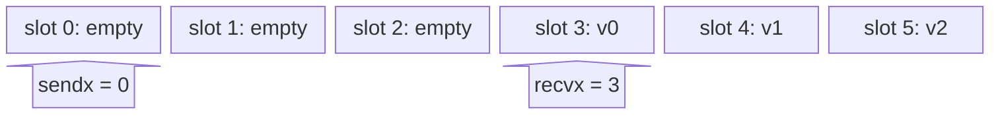

# 10.2 hchan: The Internal Structure of a Channel

In the runtime, a channel is an `hchan` structure, and the channel value returned by
`make(chan T, n)` is just a pointer to it. This is consistent with `make` in general: the values
`make` returns carry an implicit pointer inside [[Cox, 2009](#ref-cox-2009)]. Channel values can
therefore be copied and passed around freely, and all copies point to the same `hchan`. This section
starts with the invariants stated at the top of `runtime/chan.go`, then covers the fields of
`hchan`, the ring buffer, the wait queues, the three allocation strategies of `makechan`, and the
lock that protects all of it. The structs shown below omit fields irrelevant to the discussion; for
the complete definitions see `runtime/chan.go` and `runtime/runtime2.go`
[[Go Authors, 2026a](#ref-go-authors-2026a)].

## 10.2.1 Three Invariants

The top of `chan.go` states the invariants that the channel implementation maintains:

- At least one of `c.sendq` and `c.recvq` is empty. The only exception is a goroutine that blocks in
  a `select` statement sending and receiving on the same unbuffered channel at once; then the length
  of both queues is bounded only by the size of that `select` statement.
- For a buffered channel, `c.qcount > 0` implies that `c.recvq` is empty.
- For a buffered channel, `c.qcount < c.dataqsiz` implies that `c.sendq` is empty.

Their meaning is direct. When the buffer holds a value, no receiver should be waiting, because it
could have taken the value; when the buffer has a free slot, no sender should be waiting, because it
could have put its value there; and when a receiver is waiting, a new sender pairs with it directly,
so the sender does not queue as well. The exception comes from `select`: a goroutine cannot pair
with itself, so when its `select` contains both `case c <- v` and `case <-c`, it appears in both
queues of `c`. The implementation of send and receive
([10.3 Send, Receive, and Direct Handoff](./sendrecv.md)) maintains these invariants throughout:
pair with a waiter if possible, use the buffer if possible, and enter a wait queue only when neither
works.

## 10.2.2 The Structure of hchan

```go
type hchan struct {
	qcount   uint           // number of elements currently in the buffer
	dataqsiz uint           // capacity of the buffer, the second argument of make
	buf      unsafe.Pointer // points to an array that holds dataqsiz elements
	elemsize uint16         // size of an element
	closed   uint32         // whether the channel is closed
	timer    *timer         // timer that sends time to this channel, if any
	elemtype *_type         // element type
	sendx    uint           // position where the next send writes
	recvx    uint           // position where the next receive reads
	recvq    waitq          // goroutines waiting to receive
	sendq    waitq          // goroutines waiting to send
	bubble   *synctestBubble

	// lock protects all fields of hchan, as well as several fields of the sudogs blocked on this channel.
	lock mutex
}
```

The fields fall into groups. `qcount`, `dataqsiz`, `buf`, `sendx` and `recvx` describe the ring
buffer (10.2.3); `recvq` and `sendq` are the two wait queues (10.2.4); `closed` records the closed
state ([10.4 The Semantics of Closing](./close.md)); `elemsize` and `elemtype` are used to copy
elements, and `elemtype` also decides whether the copy needs a write barrier. `dataqsiz` does not
change after creation, so the runtime can read it without the lock; `full`, which decides without
locking whether a send would block, and `empty`, which does the same for a receive, depend on this
([10.3 Send, Receive, and Direct Handoff](./sendrecv.md)).

Two other fields serve other components. `timer` is non-nil only on channels created by functions
such as `time.NewTimer`: on receive, the runtime uses it to check whether the timer has expired, and
if it has expired but has not yet sent, performs the send on the spot
([9.10 Timers](../ch09sched/timer.md)). `bubble` records the `testing/synctest` bubble that created
the channel (Go 1.25): a goroutine outside the bubble that sends to, receives from, or closes it
terminates the program, and a goroutine inside the bubble that blocks on it is considered wakeable
only by other goroutines in the bubble, from which `synctest` decides when to advance the virtual
clock.

## 10.2.3 The Ring Buffer

The elements of a buffered channel live in a **ring buffer**. `buf` points to a contiguous block of
memory that holds `dataqsiz` elements, and `sendx` and `recvx` are two indices: a send writes the
element at `sendx` and then advances it by one; a receive reads from `recvx` and then advances it by
one; both wrap to 0 on reaching the end. `qcount` records the number of elements present: the buffer
is full when `qcount == dataqsiz` and empty when `qcount == 0`. The address of slot `i` is computed
by `chanbuf`:

```go
func chanbuf(c *hchan, i uint) unsafe.Pointer {
	return add(c.buf, uintptr(i)*uintptr(c.elemsize))
}
```

The figure below shows a channel of capacity 6 that holds 3 elements. `recvx` points to the earliest
written element, which is read next, and `sendx` points to the next free slot; slot 0 follows
slot 5.



When an index advances, the runtime does not take a modulus but compares and resets to zero:

```go
c.sendx++
if c.sendx == c.dataqsiz {
	c.sendx = 0
}
```

The capacity is generally not a power of two, so a modulus needs a division while a comparison does
not. A channel is first-in-first-out, and the ring buffer makes both enqueue and dequeue a matter of
moving one index, with no elements shifted.

Early implementations were different. Before April 2011 the buffer was a circular linked list: the
elements were allocated in one block of memory but connected by pointers. Russ Cox changed it into
an array accessed by index, saving the following and storing of pointers; the change also removed a
pointer from the channel into its own memory block. That self-reference formed a cycle, and memory
blocks in a cycle are not guaranteed to run their finalizers correctly. At the time, on some systems
a channel relied on a finalizer to release an operating-system-level lock, so such a channel could
never be reclaimed [[Cox, 2011](#ref-cox-2011)].

An unbuffered channel has a `dataqsiz` of 0 and no buffer; values are always passed directly between
two goroutines ([10.3 Send, Receive, and Direct Handoff](./sendrecv.md)).

## 10.2.4 Wait Queues and sudog

When the buffer cannot complete an operation, for example a send to a full channel, a receive from
an empty channel, or a channel with no buffer at all, the current goroutine must wait for the other
side to arrive. Send and receive on an unbuffered channel are exactly a rendezvous in Hoare's sense:
the side that arrives first waits for the side that arrives later [[Hoare, 1978](#ref-hoare-1978)].
Waiters line up in `recvq` or `sendq`, both doubly linked lists of type `waitq`:

```go
type waitq struct {
	first *sudog // head: entered earliest, woken first
	last  *sudog // tail
}
```

The nodes of the list are `sudog`s. A `sudog` represents a goroutine blocked on a channel, together
with the element it wants to send or receive [[Go Authors, 2026b](#ref-go-authors-2026b)]:

```go
type sudog struct {
	// The following fields are protected by the hchan.lock of the channel this sudog blocks on.
	g    *g
	next *sudog
	prev *sudog
	elem maybeTraceablePtr // the element to send or receive, may point into a stack

	isSelect bool               // whether g is in a select
	success  bool               // true: communication completed; false: woken because the channel was closed
	c        maybeTraceableChan // the channel this blocks on
	...
}
```

The nodes of the queue are not `g`s directly because goroutines and channels are not in a one-to-one
relationship: a `select` statement can block one goroutine on several channels at once, and then it
prepares one `sudog` for each channel. The memory `elem` points to is often on the waiter's own
stack, which lets a sender write the value directly into the stack of a waiting receiver without
going through the buffer ([10.3 Send, Receive, and Direct Handoff](./sendrecv.md)). In Go 1.26 the
types of `elem` and `c` are pointers that can be hidden from the GC, for use by GC-based goroutine
leak detection ([9.3 The MPG Model and the Units of Concurrent Scheduling](../ch09sched/mpg.md)).

`sudog` is not specific to channels. The runtime's semaphores also queue with `sudog`, and they
underpin synchronization primitives such as `sync.Mutex` ([11.2 Mutex](../ch11sync/mutex.md)); most
of the omitted fields exist for semaphores. `sudog`s are reused through a per-P cache and a global
cache rather than allocated each time.

Enqueue appends at the tail and dequeue takes from the head. Dequeue has one special case: a
goroutine executing a `select` may already have been woken by another case without yet having
removed itself from the other queues. When `dequeue` meets such a node, it uses a CAS on
`g.selectDone` to decide who wins the right to wake the goroutine, and skips the node if it loses:

```go
func (q *waitq) dequeue() *sudog {
	for {
		sgp := q.first
		if sgp == nil {
			return nil
		}
		// ... take sgp off the head ...
		if sgp.isSelect && !sgp.g.selectDone.CompareAndSwap(0, 1) {
			continue // this goroutine was already woken elsewhere
		}
		return sgp
	}
}
```

The queue was originally a singly linked list. A woken `select` must remove its `sudog`s from the
queues of the remaining channels, which in a singly linked list requires a search from the head.
When a channel has a great many waiters, the total cost of removing them one by one can become
quadratic. In Go 1.5 Keith Randall changed it to a doubly linked list, so that removing an arbitrary
node takes constant time; in the corresponding benchmark the running time dropped by 75.54%
[[Randall, 2014](#ref-randall-2014)]. The significance of waking the earliest waiter first is
discussed in [10.3.6](./sendrecv.md).

## 10.2.5 The Three Allocation Strategies of makechan

The compiler translates `make(chan T, n)` into a call to `makechan`. It computes the size of the
buffer, requests memory from the heap, and fills in the element information. Because it always calls
`mallocgc`, a channel is always allocated on the heap. With the debugging and `synctest` code
removed:

```go
func makechan(t *chantype, size int) *hchan {
	elem := t.Elem
	if elem.Size_ >= 1<<16 {
		throw("makechan: invalid channel element type")
	}
	mem, overflow := math.MulUintptr(elem.Size_, uintptr(size))
	if overflow || mem > maxAlloc-hchanSize || size < 0 {
		panic(plainError("makechan: size out of range"))
	}

	var c *hchan
	switch {
	case mem == 0:
		// unbuffered, or zero-size elements: no buffer needed
		c = (*hchan)(mallocgc(hchanSize, nil, true))
		c.buf = c.raceaddr()
	case !elem.Pointers():
		// elements contain no pointers: hchan and buffer are allocated together
		c = (*hchan)(mallocgc(hchanSize+mem, nil, true))
		c.buf = add(unsafe.Pointer(c), hchanSize)
	default:
		// elements contain pointers: the buffer is allocated separately, with the element type
		c = new(hchan)
		c.buf = mallocgc(mem, elem, true)
	}
	c.elemsize = uint16(elem.Size_)
	c.elemtype = elem
	c.dataqsiz = uint(size)
	lockInit(&c.lock, lockRankHchan)
	return c
}
```

The three branches differ in whether the GC needs to scan the memory.

- `mem == 0` covers two cases: an unbuffered channel, and a channel whose element size is 0, such as
  the `chan struct{}` used as a signal. Neither needs a buffer, so only an `hchan` is allocated;
  `buf` points to an address inside the `hchan`, for the race detector to use as a synchronization
  address.
- When the elements contain no pointers, the `hchan` and the buffer are allocated by a single
  `mallocgc`, with the buffer immediately after the `hchan`.
- When the elements contain pointers, the buffer must be allocated separately, and the element type
  is handed to the allocator so that the GC can find the objects referenced by the elements still in
  the buffer.

The first two branches pass the type `nil` to `mallocgc`, so the whole block is not scanned.
Notably, `hchan` itself contains pointer fields; why can it go unscanned? The comment in the source
gives three reasons: `buf` points into the same block; the type information `elemtype` points to is
permanent; and the `sudog`s in the wait queues are referenced by the goroutines they belong to, so
they are not reclaimed because of this. Only the third branch allocates a scannable `hchan` with
`new(hchan)`, and a separate scannable buffer.

The number of allocations can be observed directly:

```go {run=true}
package main

import (
	"fmt"
	"testing"
)

var (
	sinkInt    chan int
	sinkPtr    chan *int
	sinkSignal chan struct{}
)

func main() {
	allocs := func(f func()) float64 { return testing.AllocsPerRun(100, f) }
	fmt.Println("make(chan int)          ", allocs(func() { sinkInt = make(chan int) }))
	fmt.Println("make(chan struct{}, 8)  ", allocs(func() { sinkSignal = make(chan struct{}, 8) }))
	fmt.Println("make(chan int, 8)       ", allocs(func() { sinkInt = make(chan int, 8) }))
	fmt.Println("make(chan *int, 8)      ", allocs(func() { sinkPtr = make(chan *int, 8) }))
}
```

```
make(chan int)           1
make(chan struct{}, 8)   1
make(chan int, 8)        1
make(chan *int, 8)       2
```

`elemsize` is a 16-bit integer, so elements must be smaller than 64 KiB. The compiler checks this at
compile time: `make(chan [1 << 16]byte)` gets the error "channel element type too large (>64kB)",
and the check in `makechan` is only a safeguard. In practice this limit is almost never hit: large
values should travel through a channel as pointers.

## 10.2.6 The Lock

The final field of `hchan`, `lock`, protects all fields of `hchan` as well as the `g`, `next`,
`prev` and `elem` fields of the `sudog`s blocked on the channel. Send, receive, close and `select`
all acquire it before reading or writing this state. The guarantees the memory model gives channels
([10.1 Channels and the Engineering of CSP](./model.md)) are realized in the critical sections of
this lock; see [10.6 The Memory Model and the Lock-Free Evolution](./lockfree.md) for details.

The lock comes with a discipline, written in its comment: while holding it, do not change the state
of another goroutine, and in particular do not wake a goroutine, or a deadlock with stack shrinking
may result. The reason lies in the order of lock acquisition. When the runtime shrinks the stack of
a goroutine blocked on a channel, it first locks the goroutine through the scan bit in its status,
and then acquires the locks of the channels it waits on, so as to fix the pointers into the old
stack in `sudog.elem`. If another goroutine holds a channel's lock and then tries to change this
goroutine's state, it must wait for the scan bit to clear, and each side holds one lock while
waiting for the other. In 2016 Austin Clements established this order for the implementation of
concurrent stack shrinking, and fixed `closechan`, then the only code that violated it
[[Clements, 2016](#ref-clements-2016)]. The work originated in issue #12967 reported by Rhys
Hiltner: shrinking stacks during mark termination noticeably lengthened pauses, and the program
involved is the one with a great many goroutines discussed in
[9.11 NUMA Awareness and the Future of the Scheduler](../ch09sched/numa.md). That is why send,
receive and close take waiters off the queue while holding the lock and call `goready` to wake them
only after releasing it ([10.3 Send, Receive, and Direct Handoff](./sendrecv.md),
[10.4 The Semantics of Closing](./close.md)).

Protecting the whole channel with one lock keeps the implementation simple and its correctness easy
to argue, at the price that concurrent operations on the same channel serialize on this lock. In a
design document of January 2014, Dmitry Vyukov proposed a series of ways to speed up channels, with
goals including faster uncontended operations, contended producer-consumer scenarios, and failing
non-blocking operations and `select`; the document also lists making channels entirely lock-free as
a non-goal, on the grounds that it would make the implementation much more complex and slow down the
common cases [[Vyukov, 2014a](#ref-vyukov-2014a)]. In August of the same year Vyukov added a
lock-free fast path for failing non-blocking operations, which cut the running time by 97% at
`GOMAXPROCS` of 4 [[Vyukov, 2014b](#ref-vyukov-2014b)]; today's `full` and `empty` are part of that
fast path. The channel is still a lock-based structure; later attempts at lock-free channels are
covered in [10.6 The Memory Model and the Lock-Free Evolution](./lockfree.md).

## Further Reading

- <a id="ref-clements-2016"></a>[Clements, 2016] Austin Clements. runtime: define lock order between
  G status and channel lock. Go commit d45bf7228f, 2016. https://go.dev/cl/20041 Related issue
  #12967; released with Go 1.7.
- <a id="ref-cox-2009"></a>[Cox, 2009] Russ Cox. *Go Data Structures.* 2009.
  https://research.swtch.com/godata
- <a id="ref-cox-2011"></a>[Cox, 2011] Russ Cox. runtime: drop chan circular linked list in favor of
  circular buffer. Go commit 507df959e4, 2011. https://github.com/golang/go/commit/507df959e4
  Fixes issue #1676.
- <a id="ref-go-authors-2026a"></a>[Go Authors, 2026a] The Go Authors. *runtime/chan.go* (`hchan`,
  `waitq`, `makechan`, `chanbuf`, including the invariants comment at the top).
  https://github.com/golang/go/blob/master/src/runtime/chan.go
  This section follows Go 1.26.
- <a id="ref-go-authors-2026b"></a>[Go Authors, 2026b] The Go Authors. *runtime/runtime2.go* (the
  definition and field documentation of `sudog`).
  https://github.com/golang/go/blob/master/src/runtime/runtime2.go
- <a id="ref-hoare-1978"></a>[Hoare, 1978] C. A. R. Hoare. *Communicating Sequential Processes.*
  Communications of the ACM, 21(8), 1978. https://doi.org/10.1145/359576.359585
- <a id="ref-randall-2014"></a>[Randall, 2014] Keith Randall. runtime: use doubly-linked lists for
  channel send/recv queues. Go commit 8eb8b40a49, 2014.
  https://github.com/golang/go/commit/8eb8b40a49 Released with Go 1.5.
- <a id="ref-vyukov-2014a"></a>[Vyukov, 2014a] Dmitry Vyukov. *Go channels on steroids* (a design
  for speeding up channels; going entirely lock-free is listed as a non-goal). 2014.
  https://docs.google.com/document/d/1yIAYmbvL3JxOKOjuCyon7JhW4cSv1wy5hC0ApeGMV9s
- <a id="ref-vyukov-2014b"></a>[Vyukov, 2014b] Dmitry Vyukov. runtime: add fast paths to
  non-blocking channel operations. Go commit f6ceefa2bf, 2014.
  https://github.com/golang/go/commit/f6ceefa2bf Released with Go 1.4.
- This book: [10.1 Channels and the Engineering of CSP](./model.md),
  [10.3 Send, Receive, and Direct Handoff](./sendrecv.md),
  [11.9 Memory Consistency Models](../ch11sync/mem.md),
  [12 Memory Allocator](../../part4memory/ch12alloc).
