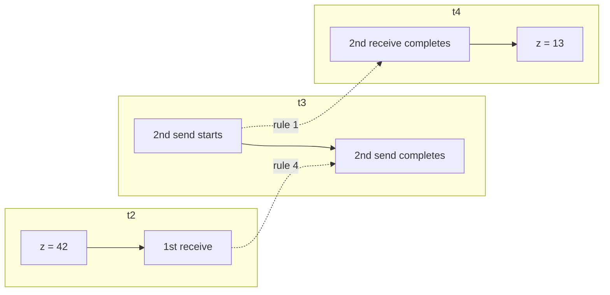

# 10.6 The Memory Model and the Lock-Free Evolution

[10.1.3](./model.md) listed the four rules that the Go memory model gives for channels. This section
discusses what exactly they mean and where they come from: why every rule rests on the completion of
some operation (10.6.1); why an unbuffered channel is a two-way synchronization (10.6.2); how the
fourth rule, about buffered channels, was written down only in 2014 (10.6.3); how the race detector
turns these rules into executable checks (10.6.4); and why these rules, together with
first-come-first-served service, `select` and closing, mean that a channel is still protected by a
single lock today (10.6.5).

## 10.6.1 The Rules Rest on Completion

The Go memory model describes visibility between goroutines with three relations
[[Go Authors, 2022](#ref-go-authors-2022)]: within one goroutine, an earlier statement is sequenced
before a later one in program order; synchronizing operations are related by synchronized before;
the transitive closure of the two is happens before. A write that happens before a read guarantees
that the read sees the write. The four channel rules are all synchronized-before relations:

1. A send on a channel is synchronized before the completion of the corresponding receive from that
   channel.
2. The closing of a channel is synchronized before a receive that returns because the channel is
   closed.
3. A receive from an unbuffered channel is synchronized before the completion of the corresponding
   send on that channel.
4. The $k$-th receive on a channel with capacity $C$ is synchronized before the completion of the
   $(k+C)$-th send from that channel.

The second half of rules 1, 3 and 4 is the completion of some operation, and the receive in rule 2
that returns because of the close likewise refers to the completion of that receive. A channel
operation may block; it has a start and a completion, which may be arbitrarily far apart. What the
rules promise is that once the operation has completed, that is, once the receive has obtained its
value or the send has returned, the other side's writes made before the synchronization point are
visible. The example in the memory model is:

```go
var c = make(chan int, 10)
var a string

func f() {
	a = "hello, world"
	c <- 0
}

func main() {
	go f()
	<-c
	print(a)
}
```

The write to `a` precedes the send in `f`; the send is synchronized before the completion of the
receive in `main` (rule 1); the receive precedes `print` in `main`. Chained together, the write
happens before the read, and the program is guaranteed to print `hello, world`. Replacing `c <- 0`
with `close(c)` gives the same guarantee by rule 2; the use of closing as a broadcast is covered in
[10.4.3](./close.md). The word "completion" is not rhetoric; 10.6.4 shows its consequences.

## 10.6.2 Unbuffered Channels: Two-Way Synchronization

Rule 3 reverses the direction: on an unbuffered channel, the receive is also synchronized before the
completion of the corresponding send. Swap the two sides of the example above and use an unbuffered
channel:

```go
var c = make(chan int)
var a string

func f() {
	a = "hello, world"
	<-c
}

func main() {
	go f()
	c <- 0
	print(a)
}
```

The send in `main` cannot complete until the receive in `f` arrives (the direct handoff of
[10.3.2](./sendrecv.md)), and the write that `f` made before the receive is visible after the send
returns, so the program is again guaranteed to print `hello, world`. If `c` is changed to
`make(chan int, 1)`, the send returns as soon as it has put the value in the buffer, when `f` may
not have run yet, and the program no longer has this guarantee
[[Go Authors, 2022](#ref-go-authors-2022)].

Rules 1 and 3 together make a communication on an unbuffered channel a two-way synchronization: the
writes each side made before the communication are visible to the other side after it completes.
This is exactly the communication that Hoare defined in CSP: a matching input command and output
command are executed "simultaneously", there is no automatic buffering, and whichever side arrives
first waits for the other [[Hoare, 1978](#ref-hoare-1978)]. In the discussion part of the paper,
Hoare gave two reasons for not providing automatic buffering: it is hard to implement on several
unconnected processors, and when a buffer is needed it can be programmed from the existing
primitives. Hoare also admitted that one could just as well argue the other way and express
synchronization by a pair of buffered input and output. Go provides both, and the memory model
states the difference precisely: with a buffer, the synchronization in the direction from receive to
send no longer holds for every operation but only across a gap of $C$ operations, which is rule 4.

## 10.6.3 Buffered Channels: Synchronization Across C Operations

The intuition behind rule 4 is the reuse of slots. A buffer of capacity $C$ has $C$ slots, and the
$(k+C)$-th send uses exactly the slot freed by the $k$-th receive, so it can complete only after
that receive. With $C = 0$, rule 4 is rule 3. The following program shows the correspondence:

```go {run=true}
package main

import "fmt"

func main() {
	const C = 3
	c := make(chan struct{}, C)
	send := func(k int) {
		select {
		case c <- struct{}{}:
			fmt.Printf("send %d completed\n", k)
		default:
			fmt.Printf("send %d cannot complete: the buffer is full\n", k)
		}
	}
	for k := 1; k <= C+1; k++ {
		send(k)
	}
	<-c
	fmt.Println("receive 1 completed")
	send(C + 1)
}
```

```
send 1 completed
send 2 completed
send 3 completed
send 4 cannot complete: the buffer is full
receive 1 completed
send 4 completed
```

This rule lets a buffered channel serve as a counting semaphore
([1.3](../../part1overview/ch01intro/csp.md)): a send acquires, a receive releases, and the capacity
is the upper bound on concurrent holders. The memory model uses this idiom to limit the number of
concurrently running tasks to 3; below it is rewritten with `sync.WaitGroup.Go`, added in Go 1.25:

```go
var limit = make(chan struct{}, 3)

func run(work []func()) {
	var wg sync.WaitGroup
	for _, w := range work {
		wg.Go(func() {
			limit <- struct{}{} // acquire
			w()
			<-limit // release
		})
	}
	wg.Wait()
}
```

Besides limiting the number of concurrent tasks, rule 4 also guarantees that the writes a task made
before releasing its slot are visible to the task that acquires the slot next.

This rule was written into the memory model only in 2014. Before that there were only the first
three rules, and to have the memory model's guarantee, a semaphore could only be written the other
way round: fill the channel first, acquire with a receive and release with a send, so that between
the receive that acquires a slot and the send by which the previous holder released it there is the
guarantee of rule 1. That is how Effective Go wrote it at the time, with the explicit remark that,
because data synchronization happens on receipt from a channel, the semaphore must be acquired by a
receive, not by a send. Yet acquiring with a send is the more natural form, had long been in wide
use, and appears in the standard library. In August 2013, Dan Kortschak filed an issue noting that
the discussions on golang-nuts and golang-dev held that this form had no formal guarantee, although
it worked correctly in the implementation of the time [[Kortschak, 2013](#ref-kortschak-2013)]. In
March 2014, Cox wrote the rule into the memory model and rewrote the example in Effective Go at the
same time; the commit message says: "This rule not existing has been the source of many discussions
on golang-dev and on issues. We have stated publicly that it is true, but we have never written it
down. Write it down." [[Cox, 2014](#ref-cox-2014)]. The rule written down then had the direction
reversed: the $k$-th send happens before the completion of the $(k+C)$-th receive. A little over two
months later, Vyukov corrected it, writing in the commit message: "The current wording is reversed
in 2 places. Not sure how it got 4 LGTMs (mine was there as
well)." [[Vyukov, 2014a](#ref-vyukov-2014a)]. The former shipped with Go 1.3, the correction with Go
1.4.

A rule in the memory model is a promise about behavior that the implementation had long provided.
Writing a rule down does not change how any program runs, but it decides what programs may depend
on. Stating the promise accurately is not easy: the reviewers all knew what the rule meant and still
did not notice that the wording was reversed.

## 10.6.4 The Rules in the Race Detector

The way the runtime honors these rules on hardware is straightforward: almost all successful sends
and receives complete while holding the channel's lock, and acquiring and releasing the lock itself
orders the memory accesses; the lock-free fast path returns only when the operation fails, or when a
receive finds a closed channel that has been drained, and the ordering argument for these cases is
in [10.3.5](./sendrecv.md). A lock provides stronger ordering than the memory model promises.
Whether a program depends only on what is promised is for the race detector to check.

The race detector is based on ThreadSanitizer. It maintains a vector clock for each goroutine,
recording the history of other goroutines that this goroutine already knows about; synchronizing
operations store and load clocks in the synchronization object that corresponds to an address, and
if two accesses are not related by happens-before, a race is reported. Every channel rule has a
corresponding annotation in `chan.go` [[Go Authors, 2026](#ref-go-authors-2026)]:

- On an unbuffered channel, the two sides exchange clocks with each other through `racesync`, which
  corresponds to the two-way synchronization of rules 1 and 3;
- On a buffered channel, the address of each slot serves as a synchronization object, and both send
  and receive call `racereleaseacquire` on the slot used through `racenotify`; so do `bufsend` and
  `bufrecv` in `select.go`;
- On closing, `racerelease` is called on the channel, and a receive that returns because of the
  close calls `raceacquire` on the same address, which corresponds to rule 2.

`racereleaseacquire` first stores the current goroutine's clock into the synchronization object,
overwriting its previous content, and then merges the clock that was previously in the object into
its own [[LLVM Project, 2023](#ref-llvm-project-2023)]. Applied to a slot, it implements exactly
rules 1 and 4: the $k$-th send leaves its history in the slot, to be taken by the $k$-th receive;
the $k$-th receive in turn leaves its history, to be taken by the $(k+C)$-th send. What is stored is
the clock from before the take, so the history obtained by the $(k+C)$-th send is not passed along
with the value it puts in to the $(k+C)$-th receive. This is the meaning of "completion" in the
rules: a send hands over its own history when it starts, and obtains the history of the previous
user only when it completes.

This order used to be reversed. In February 2020, Daniel S. Fava, reading `chan.go`, noticed that
sends and receives on buffered channels took first and stored afterwards, and gave a program on
which the detector misses a race [[Fava, 2020a](#ref-fava-2020a)]. The version below fixes the
execution order with sleeps; a sleep does not establish a happens-before relation:

```go
var z int

func main() {
	c := make(chan bool, 1)
	var wg sync.WaitGroup
	wg.Go(func() { c <- true })                                      // t1: the 1st send
	wg.Go(func() { z = 42; <-c })                                    // t2: the 1st receive
	wg.Go(func() { time.Sleep(10 * time.Millisecond); c <- true })   // t3: the 2nd send
	wg.Go(func() { time.Sleep(20 * time.Millisecond); <-c; z = 13 }) // t4: the 2nd receive
	wg.Wait()
}
```

The receive of t2 is the first receive and is synchronized before the completion of the send of t3
(rule 4, $C = 1$); the send of t3 is synchronized before the completion of the receive of t4 (rule
1). But the send of t3 starts before its completion, and the two relations do not connect, so there
is no happens-before relation between `z = 42` and `z = 13`, and this is a data race:



The old annotation had t3 first take the history that t2 left, and then store it, together with its
own, in the slot; t4 thus learned of t2's write, and the detector no longer reported the race. In
Go's implementation, the value of t3 can be put in only after t2 has freed the slot, and every
access goes through the same lock, so the two writes are in fact ordered; but that is an order
provided by the implementation, not promised by the memory model, and what the detector must check
is the latter. Fava's change swapped the order, and for this added a new store-then-take operation
to ThreadSanitizer [[Fava, 2020b](#ref-fava-2020b)] [[Fava, 2020c](#ref-fava-2020c)]; it shipped
with Go 1.16. Running the program above with `-race` on Go 1.26 reports this race every time.

After the change landed, a piece of code in `cmd/go` that uses a buffered channel as a semaphore
occasionally reported a race under race detection, although the code itself had none
[[Mills, 2020](#ref-mills-2020)]. The cause is that a channel whose element size is zero (this code
uses `chan token`, whose element type is `struct{}`) has no real buffer, and all slots have the same
address and share one synchronization object, so exchanging history per slot does not match rule 4
here. The Go team was for a while ready to roll the change back; Vyukov's reason was "False
positives are much worse than false negatives." [[Vyukov, 2020](#ref-vyukov-2020)]. In the end, only
for such channels was the cumulative form restored: each operation takes first and then stores,
together with its own history [[Fava, 2020d](#ref-fava-2020d)]. For these channels, the detector
assumes more happens-before relations than the memory model promises, so it may miss a race but
never reports a false one; replace `chan bool` with `chan struct{}` in the program above and the
detector no longer reports it. The element type of a channel used as a semaphore is usually exactly
`struct{}`.

## 10.6.5 Why a Channel Is Still a Lock

[10.2.6](./impl.md) mentioned that in his design document of January 2014, Vyukov listed making
channels entirely lock-free as a non-goal. What that design set out to do was to make the common
paths take no lock [[Vyukov, 2014b](#ref-vyukov-2014b)]. In the ring buffer of a buffered channel,
each slot carries a lap count; the slot is writable on even laps and readable on odd laps; a sender
advances the send position with a CAS, whoever wins the position writes the slot and then adds one
to the lap count, and a receiver reads symmetrically. Only when it must block does it take the lock,
operate on the wait queue, and recheck the buffer after enqueueing, so as not to miss a peer that
has just arrived. `select` also no longer locks all channels at once; it locks, enqueues and
rechecks channel by channel, and uses one CAS to guarantee that it is woken only once. The lap count
of a slot describes the same thing as rule 4: a slot can be used by the $(k+C)$-th send only after
the $k$-th receive.

In October of the same year, Vyukov filed issue #8899 with an implementation: on a real application
that had given up channels for the sake of performance and switched to other synchronization
primitives, it brought a 23% end-to-end speedup [[Vyukov, 2014c](#ref-vyukov-2014c)]. The issue has
not been closed to this day, and its status is Unplanned. Vyukov himself gave two reasons. First, in
that design, a woken receiver on a buffered channel competes on equal terms with other receivers and
blocks again if it loses, which was exactly the protocol before Go 1.6; the change in Go 1.6
[[Randall, 2015](#ref-randall-2015)] made the waker complete the woken party's operation directly,
resolving issue #11506 raised by Cox [[Cox, 2015](#ref-cox-2015)], and the implementation has since
provided first-come-first-served service ([10.3.6](./sendrecv.md)). Vyukov wrote in 2016 that after
this change about fairness his algorithm no longer applied, because it lacked the fairness property
that the existing code provides [[Vyukov, 2016a](#ref-vyukov-2016a)]. Second, the work "was
constantly deprioritized over other runtime changes, thus constantly get outdated", Vyukov could not
keep up, and the main problem became porting it onto the new runtime code
[[Vyukov, 2017](#ref-vyukov-2017)].

Later proposals met the same requirement. In 2016, someone showed a user-space lock-free channel in
this issue, and Vyukov pointed out its problems: it is not first-in-first-out; sends and receives
may fail for no reason; `len` may return -1; it cannot tell the scheduler when to block and when to
wake a goroutine; and the same goes for `select` [[Vyukov, 2016b](#ref-vyukov-2016b)]. A similar
proposal came in 2022, and Taylor replied: "Channels aren't just thread-safe queues; they also have
to handle the `select` statement and the `close` function." [[Taylor, 2022](#ref-taylor-2022)].

What the lock protects is not a queue but a set of interrelated properties: the order in which
waiters are served (10.3.6); the atomic choice that `select` makes among several channels, together
with its uniform random selection ([10.5](./select.md)), which failed in Go 1.9 because of a defect
in the random numbers [[Chenebault, 2017](#ref-chenebault-2017)]; the waking of all waiters on close
([10.4.1](./close.md)); and the four synchronization rules built on top of these. A lock-free
implementation must prove each of them anew. Shenghou Ma suggested in the discussion that if more
lock-free structures are to be added to the runtime, a formal model should be written first and kept
in sync with the source at all times [[Ma, 2016](#ref-ma-2016)]. The runtime has a precedent: in
2011 Cox wrote a Promela model of the scheduler and used SPIN to enumerate more than 1.1 million
states [[Cox, 2011](#ref-cox-2011)]; a little over two years later, Vyukov deleted it with the
explanation "It's entirely outdated today." [[Vyukov, 2014d](#ref-vyukov-2014d)].

## Further Reading

- <a id="ref-chenebault-2017"></a>[Chenebault, 2017] Benjamin Chenebault. Go issue #21806. *runtime:
  select is not fair.* 2017. https://github.com/golang/go/issues/21806
- <a id="ref-cox-2011"></a>[Cox, 2011] Russ Cox. runtime: faster entersyscall, exitsyscall. Go
  commit 025abd530e, 2011. https://github.com/golang/go/commit/025abd530e Adds the Promela model of
  the scheduler, `src/pkg/runtime/proc.p`.
- <a id="ref-cox-2014"></a>[Cox, 2014] Russ Cox. doc: allow buffered channel as semaphore without
  initialization. Go commit 132e816734, 2014. https://github.com/golang/go/commit/132e816734 Fixes
  issue #6242; shipped with Go 1.3; the change shows the semaphore idiom and its explanation in the
  earlier Effective Go.
- <a id="ref-cox-2015"></a>[Cox, 2015] Russ Cox. Go issue #11506. *runtime: make sure blocked
  channels run operations in FIFO order.* 2015. https://github.com/golang/go/issues/11506 Fixed by
  CL 16740 in Go 1.6 (see [Randall, 2015]).
- <a id="ref-fava-2020a"></a>[Fava, 2020a] Daniel S. Fava. Go issue #37355. *runtime/race: running
  with -race misses races (mismatch with memory model).* 2020.
  https://github.com/golang/go/issues/37355
- <a id="ref-fava-2020b"></a>[Fava, 2020b] Daniel S. Fava. runtime: swap the order of raceacquire()
  and racerelease(). Go commit 35455fff0e, 2020. https://go.dev/cl/220419 Fixes issue #37355;
  shipped with Go 1.16.
- <a id="ref-fava-2020c"></a>[Fava, 2020c] Daniel S. Fava. tsan: Adding releaseAcquire() to
  ThreadClock. LLVM review D76322, 2020. https://reviews.llvm.org/D76322
- <a id="ref-fava-2020d"></a>[Fava, 2020d] Daniel S. Fava. runtime: check channel's elemsize before
  calling race detector. Go commit df68e01b68, 2020. https://go.dev/cl/271987
  Fixes issue #42598; shipped with Go 1.16.
- <a id="ref-go-authors-2022"></a>[Go Authors, 2022] The Go Authors. *The Go Memory Model* (Version
  of June 6, 2022). Section "Channel communication". https://go.dev/ref/mem
- <a id="ref-go-authors-2026"></a>[Go Authors, 2026] The Go Authors. *src/runtime/chan.go,
  src/runtime/select.go.* https://github.com/golang/go/tree/master/src/runtime In Go 1.26 `hchan` is
  still protected by `lock`; this section uses `racesync` and `racenotify`, and `bufsend` and
  `bufrecv` in `select.go`.
- <a id="ref-hoare-1978"></a>[Hoare, 1978] C. A. R. Hoare. "Communicating Sequential
  Processes." *Communications of the ACM*, 21(8), 1978. https://doi.org/10.1145/359576.359585
  Section 2 defines the matching input and output commands; section 7.4 discusses automatic
  buffering.
- <a id="ref-kortschak-2013"></a>[Kortschak, 2013] Dan Kortschak. Go issue #6242. *spec: clarify the
  guarantees for HB behaviour of buffered chans.* 2013. https://github.com/golang/go/issues/6242
- <a id="ref-llvm-project-2023"></a>[LLVM Project, 2023] The LLVM Project.
  *compiler-rt/lib/tsan/rtl/tsan_vector_clock.cpp* (`ReleaseStore`, `ReleaseStoreAcquire`).
  https://github.com/llvm/llvm-project/blob/51bfeff0e4b0757ff773da6882f4d538996c9b04/compiler-rt/lib/tsan/rtl/tsan_vector_clock.cpp
  On most platforms, the race detector runtime library of Go 1.26 is built from LLVM commit
  51bfeff0e4; see `src/runtime/race/README`.
- <a id="ref-ma-2016"></a>[Ma, 2016] Shenghou Ma. Comment on golang/go#8899, 2016.
  https://github.com/golang/go/issues/8899#issuecomment-202166577
  March 27, 2016: suggests writing a formal model first for lock-free structures in the runtime.
- <a id="ref-mills-2020"></a>[Mills, 2020] Bryan C. Mills. Go issue #42598. *runtime: apparent
  false-positive race report for a buffered channel after CL 220419.* 2020.
  https://github.com/golang/go/issues/42598
- <a id="ref-randall-2015"></a>[Randall, 2015] Keith Randall. runtime: simplify chan ops, take 2. Go
  commit e410a527b2, 2015. https://go.dev/cl/16740
  Shipped with Go 1.6.
- <a id="ref-taylor-2022"></a>[Taylor, 2022] Ian Lance Taylor. Comment on golang/go#52652, 2022.
  https://github.com/golang/go/issues/52652#issuecomment-1115348887
  May 2, 2022: channels are not just thread-safe queues.
- <a id="ref-vyukov-2014a"></a>[Vyukov, 2014a] Dmitry Vyukov. doc: fix happens-before rules for
  buffered channels. Go commit 81a93ef24a, 2014. https://github.com/golang/go/commit/81a93ef24a
  Shipped with Go 1.4.
- <a id="ref-vyukov-2014b"></a>[Vyukov, 2014b] Dmitry Vyukov. *Go channels on steroids.* 2014.
  https://docs.google.com/document/d/1yIAYmbvL3JxOKOjuCyon7JhW4cSv1wy5hC0ApeGMV9s
- <a id="ref-vyukov-2014c"></a>[Vyukov, 2014c] Dmitry Vyukov. *runtime: lock-free channels.* Go
  issue #8899 (with the design document and CL 12544043; reports a speedup of about 23%; still
  Unplanned and not merged as of go1.26). https://github.com/golang/go/issues/8899
- <a id="ref-vyukov-2014d"></a>[Vyukov, 2014d] Dmitry Vyukov. runtime: delete proc.p. Go commit
  0e027fca42, 2014. https://github.com/golang/go/commit/0e027fca42
- <a id="ref-vyukov-2016a"></a>[Vyukov, 2016a] Dmitry Vyukov. Comment on golang/go#8899, 2016.
  https://github.com/golang/go/issues/8899#issuecomment-269321360
  December 27, 2016: after the fairness change in Go 1.6, this algorithm no longer applies.
- <a id="ref-vyukov-2016b"></a>[Vyukov, 2016b] Dmitry Vyukov. Comment on golang/go#8899, 2016.
  https://github.com/golang/go/issues/8899#issuecomment-202024390
  March 27, 2016: five objections to a user-space lock-free channel.
- <a id="ref-vyukov-2017"></a>[Vyukov, 2017] Dmitry Vyukov. Comment on golang/go#8899, 2017.
  https://github.com/golang/go/issues/8899#issuecomment-292491545
  April 7, 2017: why this work was not merged.
- <a id="ref-vyukov-2020"></a>[Vyukov, 2020] Dmitry Vyukov. Comment on golang/go#42598, 2020.
  https://github.com/golang/go/issues/42598#issuecomment-731033819 November 20, 2020: argues for
  rolling back CL 220419; false positives are much worse than false negatives.
- This book: [10.3 Send, Receive, and Direct Handoff](./sendrecv.md),
  [10.5 The Implementation of select](./select.md),
  [11.9 Memory Consistency Models](../ch11sync/mem.md).
