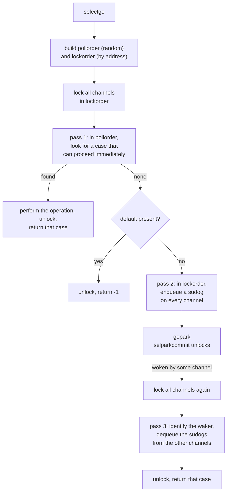

# 10.5 The Implementation of select

`select` lets a goroutine wait on several channel operations at once and run whichever can proceed
first; with a `default` case, it does not block when none can. The semantics are fixed by the
language specification [[Go Authors, 2026a](#ref-go-authors-2026a)] and were introduced in
[10.1.4](./model.md): on entering the `select`, the channels and the values to be sent in all cases
are evaluated once; if several cases can proceed, one is chosen by a uniform pseudo-random
selection.

A send or receive on a single channel involves one lock. A `select` faces several channels at once,
which raises three further problems: how to choose fairly when several cases are ready; how to avoid
deadlock when it holds several locks at the same time so that it can check and wait atomically; and,
once blocked on several channels at once, how to guarantee that exactly one of them wakes it. The
runtime function `selectgo` answers all three [[Go Authors, 2026b](#ref-go-authors-2026b)]. This
section first shows how the compiler filters out the simple forms (10.5.1), then turns to the data
structures of `selectgo` (10.5.2), fairness (10.5.3), lock order (10.5.4) and the complete procedure
(10.5.5), and finally discusses the relation between `select` and CSP (10.5.6).

## 10.5.1 The Compiler Filters Out the Simple Forms

During the walk phase, the compiler rewrites `select` statements and distinguishes four forms by the
number of cases [[Go Authors, 2026c](#ref-go-authors-2026c)]:

| Form | Rewritten as |
| --- | --- |
| `select {}` | a call to `runtime.block`, which blocks forever |
| a single case | an ordinary send or receive |
| a single case plus `default` | a non-blocking send or receive: `selectnbsend` or `selectnbrecv` |
| anything else | a call to `selectgo` |

Compiling the four functions below with `go build -gcflags=-S` shows which runtime function each one
calls in the assembly: `zero` calls `block`, `one` calls `chanrecv2`, `nonblocking` calls
`selectnbrecv`, and `two` calls `selectgo` (Go 1.26, identical on amd64 and arm64). `one` calls the
receive form with `ok`: the compiler represents every receive case in the form with `ok`, and an
`ok` that is not written is recorded as the blank identifier. Only when neither the value nor `ok`
is written (`case <-c:`) does a single case become a plain receive expression, which calls
`chanrecv1`.

```go
func zero() {
	select {}
}

func one(c chan int) int {
	select {
	case v := <-c:
		return v
	}
}

func nonblocking(c chan int) (int, bool) {
	select {
	case v := <-c:
		return v, true
	default:
		return 0, false
	}
}

func two(a, b chan int) int {
	select {
	case v := <-a:
		return v
	case b <- 1:
		return 0
	}
}
```

`selectnbsend` and `selectnbrecv` merely call `chansend` and `chanrecv` with `block` set to false;
when the operation cannot proceed, it returns directly through the lock-free fast path of
[10.3.5](./sendrecv.md). Non-blocking probes of the form "one case plus `default`" are common in
real code, and this way they avoid `selectgo` entirely.

For the remaining forms, the compiler prepares two arrays on the stack: one holds the descriptions
of the cases, sends first and receives after; the other is left for `selectgo` to store its orders
in. It then calls `selectgo` and jumps to the matching branch by the returned index:

```go
// Lowering of select { case v := <-a: ...; case b <- x: ...; default: ... } (sketch)
var cases [2]scase  // send cases first, receive cases after
var order [4]uint16 // room for selectgo's two orders
cases[0] = scase{c: b, elem: &x}
cases[1] = scase{c: a, elem: &v}
chosen, recvOK := selectgo(&cases[0], &order[0], nil, 1, 1, false) // there is a default, so block is false
switch {
case chosen < 0: // the default branch
case chosen == 0: // the b <- x branch
case chosen == 1: // the v := <-a branch; if ok is written, ok = recvOK
}
```

This layout went through two simplifications. Before Go 1.11, the compiler registered each case with
a call to a runtime function (`selectsend`, `selectrecv`, `selectdefault`); Matthew Dempsky changed
the compiler to fill in the array directly [[Dempsky, 2018](#ref-dempsky-2018)]. In Go 1.16, Dempsky
removed the `kind` field of `scase`, which distinguished sends, receives and defaults: the compiler
places send cases before receive cases and passes the count of each, and the presence of a `default`
is expressed by the parameter `block`. The commit message notes that reordering the cases this way
is safe, "because the runtime will randomize the order they're polled in
anyway" [[Dempsky, 2020a](#ref-dempsky-2020a)].

## 10.5.2 The Data Structures of selectgo

```go
// scase describes one case (Go 1.26)
type scase struct {
	c    *hchan         // the channel the case operates on
	elem unsafe.Pointer // address of the value to send, or of the slot that receives the result
}

func selectgo(cas0 *scase, order0 *uint16, pc0 *uintptr, nsends, nrecvs int, block bool) (int, bool)
```

`cas0` points to the case array; indexes below `nsends` are send cases and the rest are receive
cases. `pc0` is used only by the race detector. `order0` points to a `uint16` array twice as long as
the number of cases, which `selectgo` splits in half to hold two orders:

```go
ncases := nsends + nrecvs
scases := cas1[:ncases:ncases]
pollorder := order1[:ncases:ncases]          // poll order: the order in which cases are checked for readiness
lockorder := order1[ncases:][:ncases:ncases] // lock order: the order in which channel locks are acquired
```

`pollorder` serves fairness and `lockorder` serves deadlock avoidance; both store case indexes.
Because the index type is `uint16`, `selectgo` requires the number of cases not to exceed 65536. A
case on a nil channel can never proceed ([10.1.4](./model.md)), so it is omitted when the orders are
built and both orders contain only the other cases; this treatment was also added by Dempsky in Go
1.16 [[Dempsky, 2020b](#ref-dempsky-2020b)].

## 10.5.3 Fairness: A Random Poll Order

If the cases were always checked in source order, a later case would never run as long as an earlier
one stayed ready (see the demonstration in [1.3.5](../../part1overview/ch01intro/csp.md)). Before
checking, `selectgo` therefore generates a random poll order:

```go
// Generating pollorder (Go 1.26, timer channels and synctest handling omitted)
norder := 0
for i := range scases {
	cas := &scases[i]
	if cas.c == nil { // a case on a nil channel takes part in neither polling nor locking
		cas.elem = nil
		continue
	}
	j := cheaprandn(uint32(norder + 1)) // a random position in [0, norder]
	pollorder[norder] = pollorder[j]
	pollorder[j] = uint16(i)
	norder++
}
pollorder = pollorder[:norder]
lockorder = lockorder[:norder]
```

This is one way of writing the Fisher–Yates shuffle: each new index is placed at a random position
in the existing sequence, and the index that was there moves to the end. Induction shows that the
result is uniform. Once $k$ indexes have been placed, their $k!$ permutations are equally likely;
the position of the $(k+1)$-th index is chosen uniformly among $k+1$ positions, and every new
permutation corresponds to exactly one old permutation and one position, so the $(k+1)!$
permutations are equally likely as well. The first pass (10.5.5) checks in this order and runs the
first case that can proceed. In a uniformly random permutation, each ready case is equally likely to
come first, regardless of how many cases that cannot proceed are mixed in. This holds up to the
precision of the pseudo-random numbers: `cheaprandn` maps a 32-bit random number into $[0, n)$ with
one multiplication and a shift [[Lemire, 2019](#ref-lemire-2019)], without rejection sampling, so
the bias is on the order of $n/2^{32}$.

The last point is not obvious. Before January 2011, `select` shuffled the order differently: it
picked a random start $o$ and a step $p$ coprime to the number of cases, and checked the cases at
$o, o+p, o+2p, \dots$ (modulo the number of cases). Eoghan Sherry reported the bias of this method:
a `select` had three cases receiving from the same channel `c` and a fourth receiving from a channel
`d` that never has data; over 4000 iterations, the three counts should each have been close to 1333
but were 1484, 1008 and 1508. The report also noted that Newsqueak's select and plan9port's
libthread do not have the problem [[Sherry, 2011](#ref-sherry-2011)]. Russ Cox's analysis was that,
as soon as one case is never ready, the case that follows it in this access order gets more chances,
and the only way to guarantee fairness is to make all permutations equally likely. Cox therefore
changed the code to generate a random permutation explicitly, and pointed out that with more than 12
cases the randomness is not enough to be perfect: the state of the random number generator then had
only 32 bits, so it could yield at most $2^{32}$ distinct sequences, and $12! < 2^{32} < 13!$; the
result was still much better than before [[Cox, 2011](#ref-cox-2011)]. The program below reproduces
the original report:

```go {run=true}
package main

import "fmt"

func main() {
	c := make(chan bool)
	d := make(chan bool) // no sender, so this case is never ready
	go func() {
		for {
			c <- true
		}
	}()
	var count [3]int
	for range 30000 {
		select {
		case <-c:
			count[0]++
		case <-c:
			count[1]++
		case <-c:
			count[2]++
		case <-d:
		}
	}
	fmt.Println(count)
}
```

The three counts sum to 30000, each fluctuating around 10000, and every run gives a different
result. One run produced:

```
[10012 10058 9930]
```

The quality of the random numbers matters just as much. In Go 1.9, Josh Bleecher Snyder changed
`fastrandn(n)` from a modulo to a multiplication followed by a shift, which cut the running time by
more than half [[Snyder, 2017](#ref-snyder-2017)]. The result of a modulo depends mainly on the low
bits of the random number, while that of a multiply-shift depends on the high bits; and the
`fastrand` of that time was a linear feedback shift register: each output was just the previous
state shifted left by one bit, XORed with a constant depending on the top bit, so the high bits of
the next output were essentially the high bits of the previous one shifted left by one. After
Benjamin Chenebault reported that `select` in Go 1.9 was no longer fair, Keith Randall explained why
with a two-dimensional histogram: after two consecutive calls of `fastrandn(4)`, if the first
returns 0, the second can only be 0 or 1 [[Chenebault, 2017](#ref-chenebault-2017)]. The steps of
the shuffle were therefore no longer independent, and some permutations occurred more often. Go 1.10
switched to the xorshift64+ generator submitted by Giovanni Bajo [[Bajo, 2017](#ref-bajo-2017)],
while for Go 1.9.2 Cox reverted `fastrandn` to the modulo form and left a comment: "Don't be clever.
fastrand is not good enough for cleverness. Just use mod." [[Cox, 2017](#ref-cox-2017)]. A uniform
permutation thus depends on two things together: a correct shuffle algorithm and random numbers that
are independent from one call to the next. Today's `cheaprand` keeps its own state on each M; on
platforms where the compiler turns `math.Mul64` directly into a hardware multiply instruction (such
as amd64 and arm64) it uses wyrand, and elsewhere xorshift64+. A comment in the source says
that "cheap" refers to both expense and quality [[Go Authors, 2026d](#ref-go-authors-2026d)].

## 10.5.4 Lock Order

`selectgo` must lock all the channels involved at the same time. The first pass checks all cases; if
none can proceed, the second pass enqueues the goroutine on the wait queue of every channel. If the
lock of some channel were released between these two steps, the peer might arrive in the gap: it
would see nobody in the wait queue and block itself, while this goroutine joins the queue only
afterwards; the two would wait for each other, and a communication that should have happened is
missed. So from the first pass until all queues have been joined, the locks of all channels involved
are held throughout.

Holding several locks at once risks deadlock. Goroutine A executes `select { case <-x: case <-y: }`
and B executes `select { case <-y: case <-x: }`; if each locks in source order, A holds the lock of
`x` and waits for `y`, while B holds the lock of `y` and waits for `x`. In their 1971 survey,
Coffman et al. listed the four necessary conditions for deadlock: mutual exclusion, hold and wait,
no preemption, and circular wait, and described the prevention methods proposed by Havender, one of
which fixes a linear order on all resources and lets every task request resources only in that
order; under this constraint the wait-for relation cannot form a cycle
[[Coffman et al., 1971](#ref-coffman-et-al-1971)]. `selectgo` uses exactly this method, with the
address of the channel as the key:

```go
func (c *hchan) sortkey() uintptr {
	return uintptr(unsafe.Pointer(c))
}
```

An address can serve as a globally consistent key because a channel is always allocated on the heap
by `makechan`, and Go's garbage collector does not move objects
([13.1](../../part4memory/ch13gc/basic.md)), so the address of a channel does not change during its
lifetime.

`selectgo` heap-sorts the cases by `sortkey`. The source comment gives the reason as guaranteeing
$O(n\log n)$ time and constant stack space: heap sort works in place and needs no recursion, so the
stack frame of `selectgo` does not grow with the number of cases. The code started out as a bubble
sort; Cox replaced it with heap sort in Go 1.1 [[Cox, 2013](#ref-cox-2013)].

```go
// In-place heap sort keyed by channel address, producing lockorder (Go 1.26)
for i := range lockorder {
	j := i
	// Take elements from pollorder so as to shuffle multiple cases on the same channel
	c := scases[pollorder[i]].c
	for j > 0 && scases[lockorder[(j-1)/2]].c.sortkey() < c.sortkey() {
		k := (j - 1) / 2
		lockorder[j] = lockorder[k]
		j = k
	}
	lockorder[j] = pollorder[i]
}
for i := len(lockorder) - 1; i >= 0; i-- {
	// Swap the heap top to the end, then sift the swapped-in element down (omitted)
}
```

The input of the sort is taken from `pollorder`, not from the original order of the cases; the
comment explains that this shuffles multiple cases on the same channel. Such cases have equal keys
and end up adjacent after sorting, and their relative order depends on the order of the input. That
order has a practical effect: the second pass enqueues the waiters in `lockorder`, and on one
channel the waiter enqueued first is woken first. Before Go 1.7, `lockorder` stored channel pointers
and could not tell apart different cases on the same channel; Austin Clements changed it to store
case indexes, and added this comment at the same time [[Clements, 2016a](#ref-clements-2016a)].

Locking proceeds in `lockorder`, locking each channel once; `selunlock` unlocks in the reverse
order:

```go
func sellock(scases []scase, lockorder []uint16) {
	var c *hchan
	for _, o := range lockorder {
		c0 := scases[o].c
		if c0 != c { // cases on the same channel are adjacent, so lock only once
			c = c0
			lock(&c.lock)
		}
	}
}
```

## 10.5.5 The Three Passes



The first pass looks, in `pollorder`, for a case that can proceed immediately. For a receive case it
checks, in turn, whether a sender is waiting, whether the buffer holds data, and whether the channel
is closed; for a send case it first checks whether the channel is closed, then whether a receiver is
waiting, then whether the buffer has room:

```go
// Pass 1: look for a case that can proceed immediately (Go 1.26, race detection omitted)
for _, casei := range pollorder {
	casi = int(casei)
	cas = &scases[casi]
	c = cas.c
	if casi >= nsends { // receive case
		if sg = c.sendq.dequeue(); sg != nil {
			goto recv // hand off directly from the waiting sender
		}
		if c.qcount > 0 {
			goto bufrecv // take from the buffer
		}
		if c.closed != 0 {
			goto rclose // closed: receive the zero value
		}
	} else { // send case
		if c.closed != 0 {
			goto sclose // closed: panic
		}
		if sg = c.recvq.dequeue(); sg != nil {
			goto send // hand off directly to the waiting receiver
		}
		if c.qcount < c.dataqsiz {
			goto bufsend // put into the buffer
		}
	}
}
if !block { // there is a default
	selunlock(scases, lockorder)
	casi = -1
	goto retc
}
```

The send case checks "closed" first, which follows the 2012 specification: a send on a closed
channel counts as able to proceed, and `select` may choose it and therefore panic
([10.1.5](./model.md)). The code at each label is the same as for a single channel in
[10.3](./sendrecv.md); `recv` and `send` call the `recv` and `send` functions there directly, with
the unlock function replaced by `selunlock`. When no case can proceed and `block` is false, it
unlocks and returns -1, and the compiler-generated code runs the `default` branch accordingly.

When no case can proceed and the goroutine must block, the second pass starts: for each case it
takes a `sudog`, marks it `isSelect`, links the `sudog`s into the `gp.waiting` list in `lockorder`,
and enqueues each on the send or receive wait queue of its channel:

```go
// Pass 2: enqueue on every channel (Go 1.26, abridged)
nextp = &gp.waiting
for _, casei := range lockorder {
	casi = int(casei)
	cas = &scases[casi]
	c = cas.c
	sg := acquireSudog()
	sg.g = gp
	sg.isSelect = true
	sg.elem.set(cas.elem)
	sg.c.set(c)
	*nextp = sg // linked into gp.waiting in lock order
	nextp = &sg.waitlink
	if casi < nsends {
		c.sendq.enqueue(sg)
	} else {
		c.recvq.enqueue(sg)
	}
}
gp.param = nil
gp.parkingOnChan.Store(true)
gopark(selparkcommit, nil, waitReason, traceBlockSelect, 1)
```

Ordering `gp.waiting` by lock order is an adjustment Clements made in Go 1.7 to allow stacks to
shrink concurrently [[Clements, 2016b](#ref-clements-2016b)]: when shrinking the stack of a
goroutine blocked in a `select`, the runtime walks this list and locks its channels one by one, so
that it can fix the pointers into the old stack held in `sudog.elem`. The order of the list is the
order of these locks, so it must agree with the global lock order. The unlock function of `gopark`,
`selparkcommit`, likewise unlocks along this list instead of reading `lockorder`. `gopark` requires
that the unlock function not access the stack of the current goroutine, because this stack may be
moved between the call to `gopark` and the call to the unlock function
[[Go Authors, 2026e](#ref-go-authors-2026e)]; `scases` and `lockorder` both live on this stack,
whereas the `sudog`s live on the heap. `selparkcommit` also waits until it has passed the last
`sudog` of a channel before releasing that channel's lock, because once the lock is released, the
fields of these `sudog`s may be modified by other goroutines:

```go
// The unlocking part of selparkcommit (Go 1.26)
var lastc *hchan
for sg := gp.waiting; sg != nil; sg = sg.waitlink {
	if sg.c.get() != lastc && lastc != nil {
		unlock(&lastc.lock) // the last sudog of lastc has been passed
	}
	lastc = sg.c.get()
}
if lastc != nil {
	unlock(&lastc.lock)
}
```

Before that, `selparkcommit` sets `activeStackChans` and clears `parkingOnChan`, which serves the
same purpose as for blocking on a single channel ([10.3.3](./sendrecv.md)).

From this point the goroutine sits in several wait queues, and several peers may find it at nearly
the same time. The `dequeue` of [10.2.4](./impl.md) guarantees that only one peer succeeds: when it
takes out a `sudog` with `isSelect`, it first does a CAS on `g.selectDone`, and a failure means that
this goroutine has already been claimed through another channel, so the `sudog` is skipped.
`selectDone` was originally a variable on the stack of the goroutine running the `select`, written
remotely by other goroutines, which required a rather delicate interplay with stack copying; Daniel
Morsing moved it into the `g` structure in Go 1.10 [[Morsing, 2017](#ref-morsing-2017)].

After the wakeup comes the third pass. `selectgo` locks all channels again, learns from `gp.param`
which `sudog` woke it, and then walks `gp.waiting` in lock order: the waker's `sudog` has already
been taken off its queue by the peer, so the pass records the corresponding case; the other `sudog`s
are still in their queues and are removed one by one. If they were not removed, they would pile up
on channels that are no longer active:

```go
// Pass 3: remove the sudogs from the other channels (Go 1.26, abridged)
sg = (*sudog)(gp.param) // the waker's sudog
sglist = gp.waiting
gp.waiting = nil
for _, casei := range lockorder {
	k = &scases[casei]
	if sg == sglist { // the waker has already taken it off the queue
		casi = int(casei)
		cas = k
		caseSuccess = sglist.success
	} else {
		if int(casei) < nsends {
			k.c.sendq.dequeueSudoG(sglist)
		} else {
			k.c.recvq.dequeueSudoG(sglist)
		}
	}
	sgnext = sglist.waitlink
	sglist.waitlink = nil
	releaseSudog(sglist)
	sglist = sgnext
}
```

Removing an arbitrary `sudog` takes constant time because the wait queue is a doubly linked list
([10.2.4](./impl.md)). If the chosen case is a send and `success` is false, the waker was `close`,
and `selectgo` panics ([10.4.1](./close.md)); if it is a receive case, `success` is the `ok`
returned to the caller.

Taken together, a `select` that does not block sorts once and locks and unlocks one round; a
`select` that blocks also acquires and returns one `sudog` per case and locks one more round after
waking up. This is the price of waiting on several channels at once, and it rises with the number of
cases. `reflect.Select` also goes through `selectgo`; the only difference is that `reflect_rselect`
allocates the case array and the order array on the heap.

## 10.5.6 From Input Guards to Output Guards

`select` descends from Dijkstra's guarded commands and Hoare's 1978 CSP.
[1.3.2](../../part1overview/ch01intro/csp.md) has already covered the relation between the two and
Hoare's position that the way of choosing is left unspecified. Here we look only at two points where
Go differs from the CSP of 1978, and at how a missing feature was made up for.

First, Go's `select` allows send cases. The CSP of 1978 allows only input commands in guards. In the
discussion part of the paper, Hoare wrote that since input commands may appear in guards, it seems
more symmetric to permit output commands as well, which would, for example, simplify the bounded
buffer program noticeably; a perhaps more convincing reason is that with output guards, the
externally visible behavior of every parallel command can be modeled by a sequential command; but
this extension did not make it into the language of the time [[Hoare, 1978](#ref-hoare-1978)]. In
Go, executing `x <- 2` and `y <- 3` in parallel is externally equivalent to:

```go
select {
case x <- 2:
	y <- 3
case y <- 3:
	x <- 2
}
```

If one fixes an order without looking at which side can proceed, and the receiver happens to require
the other order, the program deadlocks. The difficulty with output guards is that both parties to a
communication may be choosing among several candidates, and a communication takes place only if both
agree at the same time. In shared memory, `selectgo` offers one solution: the active party locks all
channels it involves, and a globally consistent order avoids deadlock (10.5.4); the passive party is
already blocked and need not hold the locks of other channels, and the active party claims it with
one CAS, while the `sudog`s that were not chosen are left to be cleaned up when it wakes (10.5.5).

Second, Go specifies how the choice is made. Hoare discussed whether the definition of a language
should require a fair implementation, and answered: "Here, I am fairly sure that the answer is
NO." The programmer is responsible for proving that the program terminates correctly, and must not
assume that the implementation is fair; an efficient implementation should try to be reasonably
fair, but a proof of correctness must not rely on this [[Hoare, 1978](#ref-hoare-1978)]. Go's
specification requires a uniform pseudo-random choice. This is not a deterministic guarantee of
fairness: if a `select` has $n$ cases, a case that is always ready has a chance of at least $1/n$ of
being chosen each time, and the probability of being passed over repeatedly falls exponentially with
the number of attempts but is never zero. Hoare's caution therefore still holds in Go.

The guard of a guarded command may be a Boolean condition, and a branch whose condition is false
takes no part in the selection [[Dijkstra, 1975](#ref-dijkstra-1975)]. Go's `select` has no Boolean
guards, but a nil channel plays the same role: set the channel variable of a case to nil and that
case no longer takes part in the selection ([10.1.4](./model.md)). `selectgo` omits such cases when
it builds the orders (10.5.2), so a guard whose Boolean condition is false costs nothing in the
implementation.

## Further Reading

- <a id="ref-bajo-2017"></a>[Bajo, 2017] Giovanni Bajo. runtime: improve fastrand with a better
  generator. Go commit e7e4a4ffa3, 2017. https://go.dev/cl/62530 Fixes issue #21806; shipped with Go
  1.10.
- <a id="ref-chenebault-2017"></a>[Chenebault, 2017] Benjamin Chenebault. Go issue #21806. *runtime:
  select is not fair.* 2017. https://github.com/golang/go/issues/21806 The report that `select` was
  unfair in Go 1.9; in the discussion Keith Randall gave the histogram showing the correlation
  between consecutive outputs of `fastrandn`.
- <a id="ref-clements-2016a"></a>[Clements, 2016a] Austin Clements. runtime: use indexes for select
  lock order. Go commit 26594c3dfd, 2016. https://go.dev/cl/20036 Shipped with Go 1.7.
- <a id="ref-clements-2016b"></a>[Clements, 2016b] Austin Clements. runtime: put g.waiting list in
  lock order. Go commit 005140a77e, 2016. https://go.dev/cl/20037 Made for issue #12967; shipped
  with Go 1.7.
- <a id="ref-coffman-et-al-1971"></a>[Coffman et al., 1971] E. G. Coffman, M. Elphick, A.
  Shoshani. "System Deadlocks." *ACM Computing Surveys*, 3(2): 67–78, 1971.
  https://doi.org/10.1145/356586.356588 Section 2 gives the four necessary conditions for deadlock;
  section 3 describes Havender's prevention method.
- <a id="ref-cox-2011"></a>[Cox, 2011] Russ Cox. runtime: make select fairer. Go commit
  4f269d3060, 2011. https://github.com/golang/go/commit/4f269d3060 Fixes issue #1425.
- <a id="ref-cox-2013"></a>[Cox, 2013] Russ Cox. runtime: replace bubble sort with heap sort in
  select. Go commit cb32ea9c19, 2013. https://github.com/golang/go/commit/cb32ea9c19 Shipped with Go
  1.1.
- <a id="ref-cox-2017"></a>[Cox, 2017] Russ Cox. [release-branch.go1.9] runtime: use simple, more
  robust fastrandn. Go commit d93cb46280, 2017. https://go.dev/cl/70991 Fixes issue #22253; shipped
  with Go 1.9.2.
- <a id="ref-dempsky-2018"></a>[Dempsky, 2018] Matthew Dempsky. cmd/compile: open code
  select{send,recv,default}. Go commit 004260afde, 2018. https://go.dev/cl/37934
  Shipped with Go 1.11.
- <a id="ref-dempsky-2020a"></a>[Dempsky, 2020a] Matthew Dempsky. runtime: eliminate scase.kind
  field. Go commit fe23ba4a14, 2020. https://go.dev/cl/245125 Fixes issue #40410; shipped with Go
  1.16.
- <a id="ref-dempsky-2020b"></a>[Dempsky, 2020b] Matthew Dempsky. runtime: omit nil-channel cases
  from selectgo's orders. Go commit 8a984e8e3f, 2020. https://go.dev/cl/245123 Shipped with Go 1.16.
- <a id="ref-dijkstra-1975"></a>[Dijkstra, 1975] Edsger W. Dijkstra. "Guarded Commands,
  Nondeterminacy and Formal Derivation of Programs." *Communications of the ACM*, 18(8), 1975.
  https://doi.org/10.1145/360933.360975
- <a id="ref-go-authors-2026a"></a>[Go Authors, 2026a] The Go Authors. *The Go Programming Language
  Specification: Select statements.* https://go.dev/ref/spec#Select_statements
- <a id="ref-go-authors-2026b"></a>[Go Authors, 2026b] The Go Authors. *runtime/select.go.*
  https://github.com/golang/go/blob/master/src/runtime/select.go
  (`selectgo`, `sellock`, `selparkcommit`, `sortkey`) This section follows Go 1.26.
- <a id="ref-go-authors-2026c"></a>[Go Authors, 2026c] The Go Authors.
  *cmd/compile/internal/walk/select.go.*
  https://github.com/golang/go/blob/master/src/cmd/compile/internal/walk/select.go (the rewriting of
  zero cases, a single case, and a single case plus default) This section follows Go 1.26.
- <a id="ref-go-authors-2026d"></a>[Go Authors, 2026d] The Go Authors. *runtime/rand.go.*
  https://github.com/golang/go/blob/master/src/runtime/rand.go
  (`cheaprand`, `cheaprandn`) This section follows Go 1.26.
- <a id="ref-go-authors-2026e"></a>[Go Authors, 2026e] The Go Authors. *runtime/proc.go.*
  https://github.com/golang/go/blob/master/src/runtime/proc.go
  (the contract of `gopark` for its unlock function) This section follows Go 1.26.
- <a id="ref-hoare-1978"></a>[Hoare, 1978] C. A. R. Hoare. "Communicating Sequential Processes."
  *Communications of the ACM*, 21(8), 1978. https://doi.org/10.1145/359576.359585
  Section 7.6 discusses fairness; section 7.8 discusses output guards.
- <a id="ref-lemire-2019"></a>[Lemire, 2019] Daniel Lemire. "Fast Random Integer Generation in an
  Interval." *ACM Transactions on Modeling and Computer Simulation*, 29(1), 2019.
  https://doi.org/10.1145/3230636
- <a id="ref-morsing-2017"></a>[Morsing, 2017] Daniel Morsing. runtime: move selectdone into g. Go
  commit 32b94f13cf, 2017. https://go.dev/cl/53390 Shipped with Go 1.10.
- <a id="ref-sherry-2011"></a>[Sherry, 2011] Eoghan Sherry. Go issue #1425. *select can be
  unfair.* 2011. https://github.com/golang/go/issues/1425
- <a id="ref-snyder-2017"></a>[Snyder, 2017] Josh Bleecher Snyder. runtime: speed up fastrand() % n.
  Go commit 46a75870ad, 2017. https://go.dev/cl/36932 Shipped with Go 1.9.
- This book: [10.1 Channels and the Engineering of CSP](./model.md),
  [10.3 Send, Receive, and Direct Handoff](./sendrecv.md),
  [10.4 The Semantics of Closing](./close.md),
  [10.6 The Memory Model and the Lock-Free Evolution](./lockfree.md).
