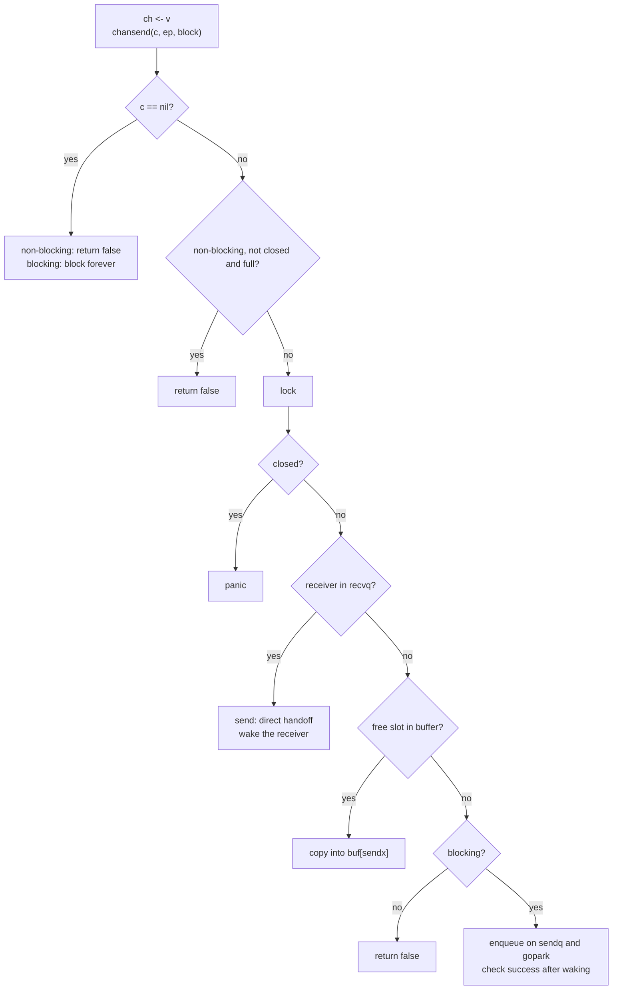

# 10.3 Send, Receive, and Direct Handoff

[10.2 hchan: The Internal Structure of a Channel](./impl.md) described the static structure of
`hchan`: a lock, a ring buffer, and a wait queue each for senders and receivers. This section
examines the actions that take place on these structures, that is, how a single `ch <- v` or
`v := <-ch` completes in the runtime.

The whole path follows one principle: when one side of a send or receive has to block, the side that
arrives later completes the entire operation on its behalf while holding the lock, including the
copy of the data, and only then wakes it. When the blocked side wakes up, the operation is already
finished; it does not retake the lock and retry, and it does not find the work gone. This principle
was inherent in unbuffered channels, and for buffered channels it holds only since Go 1.6 (10.3.6).
The rendezvous of unbuffered channels, first-come-first-served service of waiters, and the memory
model's synchronization guarantees for channels are all built on it. Its core action is copying the
value directly between the two parties without passing through the buffer, usually from the stack of
one goroutine to the stack of another, which is called **direct handoff**.

## 10.3.1 Three Destinations of a Send

The compiler translates send and receive statements into calls into the runtime. `ch <- v` becomes
`chansend1(c, &v)`; `v := <-ch` becomes `chanrecv1`, and `v, ok := <-ch` becomes `chanrecv2`; a bare
`<-ch` statement also calls `chanrecv1`, only without providing an address for the result. A
`select` with exactly one send or receive case and a `default` case is a special case that the
compiler rewrites into `selectnbsend` or `selectnbrecv`. All these entry points end up calling
`chansend` or `chanrecv`, differing only in the parameter `block`: the first three pass true, while
`selectnbsend` and `selectnbrecv` pass false. `TrySend` and `TryRecv` of the reflect package also
enter non-blockingly, and a `select` with several cases is implemented separately by `selectgo`
([10.5 The Implementation of select](./select.md)). Values are always passed by pointer, and the
runtime copies them according to the element size.

The interactive figure below builds intuition first: a buffered channel is a fixed-length queue, the
sender blocks when the buffer is full, and the receiver blocks when it is empty. You can adjust the
capacity or send and receive by hand.

<div class="viz" data-viz="channel"></div>

With the race detection, `synctest` bubble and block profiling code stripped away, the skeleton of
`chansend` is as follows [[Go Authors, 2026a](#ref-go-authors-2026a)]:

```go
// The skeleton of chansend (Go 1.26, abridged)
func chansend(c *hchan, ep unsafe.Pointer, block bool, callerpc uintptr) bool {
	if c == nil { // nil channel: fails if non-blocking, otherwise blocks forever
		if !block {
			return false
		}
		gopark(nil, nil, waitReasonChanSendNilChan, traceBlockForever, 2)
		throw("unreachable")
	}
	if !block && c.closed == 0 && full(c) { // lock-free fast path, see 10.3.5
		return false
	}

	lock(&c.lock)
	if c.closed != 0 {
		unlock(&c.lock)
		panic(plainError("send on closed channel"))
	}
	if sg := c.recvq.dequeue(); sg != nil { // destination 1: hand over to a waiting receiver
		send(c, sg, ep, func() { unlock(&c.lock) }, 3)
		return true
	}
	if c.qcount < c.dataqsiz { // destination 2: put into the buffer
		qp := chanbuf(c, c.sendx)
		typedmemmove(c.elemtype, qp, ep)
		c.sendx++
		if c.sendx == c.dataqsiz {
			c.sendx = 0
		}
		c.qcount++
		unlock(&c.lock)
		return true
	}
	if !block {
		unlock(&c.lock)
		return false
	}
	// destination 3: enqueue on sendq and block, see 10.3.3
	...
}
```

The order of the three destinations is itself a design decision. When a receiver is waiting, the
sender always hands the value straight to it, even on a buffered channel. This does not jump ahead
of earlier values in the buffer: by the invariant in [10.2.1](./impl.md), when `recvq` of a buffered
channel is non-empty, the buffer must be empty, or the receiver would not have blocked. Direct
delivery therefore neither breaks first-in-first-out nor needs the extra copy of "copy into the
buffer, then copy out". The comment on `send` writes this precondition down as a calling convention:
the channel must be empty and already locked.

When the buffer has a free slot, a send just copies the value into `buf[sendx]` and advances
`sendx`; the wrap-around is shown in [10.2.3](./impl.md). When neither path works, the sender can
only block.

## 10.3.2 Direct Handoff

`send` does all the work of destination 1:

```go
// send and sendDirect (Go 1.26, abridged)
func send(c *hchan, sg *sudog, ep unsafe.Pointer, unlockf func(), skip int) {
	if sg.elem.get() != nil {
		sendDirect(c.elemtype, sg, ep) // write into the variable on the receiver's stack
		sg.elem.set(nil)
	}
	gp := sg.g
	unlockf() // release the channel lock first
	gp.param = unsafe.Pointer(sg)
	sg.success = true // tell the receiver: the operation completed normally
	goready(gp, skip+1) // then wake the receiver
}

func sendDirect(t *_type, sg *sudog, src unsafe.Pointer) {
	// src is on the current goroutine's stack; dst is a slot on another stack.
	// After reading elem from sg, if the destination stack is copied (shrunk), the value
	// read is not updated with it, so there must be no preemption point between the read and the use.
	dst := sg.elem.get()
	typeBitsBulkBarrier(t, uintptr(dst), uintptr(src), t.Size_)
	memmove(dst, src, t.Size_)
}
```

Before blocking, the receiver records the address of its receive variable in the `elem` of its own
`sudog`; this address usually points into its own stack, and `elem` has to be adjusted when the
stack is copied, a point that
[14.4 Stack Copying and Pointer Adjustment](../../part4memory/ch14stack/copy.md) returns to. Having
found it, the sender bypasses the buffer and uses one `memmove` to write the value from its own
stack straight onto the other's. If `elem` is nil, the receiver does not need the value (for example
a bare `<-ch` statement), and the copy is skipped.

Writing into another goroutine's stack is safe for two reasons. First, the receiver is in the
`_Gwaiting` state ([9.3.4](../ch09sched/mpg.md)) and does not read or write the variable at the same
time. Second, the sender holds the channel lock, and before copying such a stack the runtime must
take the lock of the channels it waits on ([10.2.6](./impl.md)), so the slot cannot move during the
copy.

The cross-stack write also involves garbage collection. Concurrent marking assumes that, at run
time, a stack is written only by its owner: after the stack of a blocked goroutine has been scanned,
no new pointers appear in it, so writes to the stack can skip the write barrier
([13.2 Write Barrier Techniques](../../part4memory/ch13gc/barrier.md)). Direct handoff breaks this
assumption. There was already an explicit write barrier here, but it finds pointers by the heap
bitmap and has no effect when the destination is on a stack. In Go 1.5 Russ Cox changed it to
`typeBitsBulkBarrier`, which works from the type bitmap, together with a plain `memmove`; for this,
the type bitmap was extended to all types under 64 KB, which exactly covers the upper bound on
channel element sizes ([10.2.5](./impl.md)) [[Cox, 2015a](#ref-cox-2015a)]. The opposite direction,
`recvDirect`, reads from the sender's stack and at first had no barrier. Go 1.8 introduced the
hybrid write barrier, which no longer rescans stacks at mark termination, and that became a hole: a
stack not yet scanned could hand a pointer to a white object to an already scanned stack and then
delete it from its own stack; if that was the only protected reference to the object, the object
would vanish from the garbage collector's view. Austin Clements added the same barrier to
`recvDirect` [[Clements, 2016](#ref-clements-2016)]. The barrier takes effect only during the mark
phase; the rest of the time `typeBitsBulkBarrier` returns immediately.

`send` releases the lock before waking the receiver, as the lock discipline of [10.2.6](./impl.md)
requires. `goready` puts the receiver into the current P's `runnext`, so that it inherits the
remaining time slice of the sender ([9.4.3](../ch09sched/schedule.md)). As soon as the sender blocks
or yields, the receiver runs on the same processor, so a back-and-forth exchange is scheduled as if
it were one unit. When the receiver wakes up, the value is already in its variable and `success` is
true; it can return without touching the channel again.

## 10.3.3 Blocking and Waking

When the buffer is full (an unbuffered channel can be seen as always full) and no receiver is
waiting, a blocking send executes the last segment of `chansend`:

```go
	// The blocking part of chansend (Go 1.26, abridged)
	gp := getg()
	mysg := acquireSudog()
	mysg.elem.set(ep) // address of the value to send
	mysg.g = gp
	mysg.c.set(c)
	gp.waiting = mysg
	c.sendq.enqueue(mysg)
	gp.parkingOnChan.Store(true)
	gopark(chanparkcommit, unsafe.Pointer(&c.lock), waitReasonChanSend, traceBlockChanSend, 2)

	// execution continues here after being woken
	KeepAlive(ep)
	gp.waiting = nil
	gp.activeStackChans = false
	closed := !mysg.success
	mysg.c.set(nil)
	releaseSudog(mysg)
	if closed {
		panic(plainError("send on closed channel"))
	}
	return true
```

The sender wraps itself in a `sudog`, records the address of the value to send, appends it to the
tail of `sendq`, and calls `gopark` to give up the processor. The receiver's blocking is symmetric,
except that it enqueues on `recvq` and `elem` records the address of the receive variable. From then
on the side that arrived first does nothing; the later side finds it on its own path, completes the
copy for it, and calls `goready`.

The `chanparkcommit` passed to `gopark` releases the channel lock only after the goroutine has
entered `_Gwaiting`. [9.4.3](../ch09sched/schedule.md) already explained the reason for this order:
if the lock were released before stopping, the other side could take off the `sudog` in the gap and
wake a goroutine that is still running, and `ready`, on meeting a goroutine that is not in
`_Gwaiting`, reports `bad g->status in ready` and terminates the program
[[Go Authors, 2026b](#ref-go-authors-2026b)].

Before releasing the lock, `chanparkcommit` does two more things, both related to stack shrinking.
The first sets `activeStackChans` to true, telling stack copying that "a `sudog` points into this
stack, so lock the relevant channels before copying"; this flag was introduced by Austin Clements in
Go 1.14 [[Clements, 2019](#ref-clements-2019)]. The second clears `parkingOnChan`. A goroutine's
state first becomes `_Gwaiting` inside `gopark`, and `chanparkcommit` runs slightly later; in this
window a concurrent-marking worker may already consider the goroutine parked, read the not-yet-set
`activeStackChans`, and move its stack without taking the lock. In Go 1.16 Michael Knyszek closed
this window with `parkingOnChan`: while the flag is true, the stack is never shrunk
[[Knyszek, 2020](#ref-knyszek-2020)].

After waking, the sender only needs to check `mysg.success`. On normal completion, the receiver that
woke it has already taken the value and set it to true; if it is false, what woke the sender was
`close` ([10.4 The Semantics of Closing](./close.md)), and the sender panics. `KeepAlive(ep)`
ensures that the value to send is not reclaimed before the other side has taken it, because the
pointer in the `sudog` is not a root for stack scanning.

Putting the three destinations and blocking together, the whole of `chansend` looks like this:



## 10.3.4 Receive and Rendezvous

`chanrecv` is largely symmetric to `chansend`, with one extra branch: "closed and the buffer is
empty", where the receive succeeds immediately and yields the zero value:

```go
// The skeleton of chanrecv (Go 1.26, abridged)
func chanrecv(c *hchan, ep unsafe.Pointer, block bool) (selected, received bool) {
	if c == nil { /* same as send: fails if non-blocking, otherwise blocks forever */ }
	if !block && empty(c) { /* lock-free fast path, see 10.3.5 */ }

	lock(&c.lock)
	if c.closed != 0 {
		if c.qcount == 0 { // closed and the buffer is empty: yields the zero value
			unlock(&c.lock)
			if ep != nil {
				typedmemclr(c.elemtype, ep)
			}
			return true, false
		}
		// closed but the buffer still holds data: take it out as usual
	} else if sg := c.sendq.dequeue(); sg != nil { // a sender is waiting
		recv(c, sg, ep, func() { unlock(&c.lock) }, 3)
		return true, true
	}
	if c.qcount > 0 { // take from the buffer
		qp := chanbuf(c, c.recvx)
		if ep != nil {
			typedmemmove(c.elemtype, ep, qp)
		}
		typedmemclr(c.elemtype, qp) // clear the slot so the GC no longer sees the old value
		c.recvx++
		if c.recvx == c.dataqsiz {
			c.recvx = 0
		}
		c.qcount--
		unlock(&c.lock)
		return true, true
	}
	if !block {
		unlock(&c.lock)
		return false, false
	}
	// enqueue on recvq and block, symmetric to send
	...
}
```

When a sender is waiting, the receiver likewise completes the operation on its behalf, with two
cases:

```go
// The skeleton of recv (Go 1.26, abridged)
func recv(c *hchan, sg *sudog, ep unsafe.Pointer, unlockf func(), skip int) {
	if c.dataqsiz == 0 { // unbuffered: copy directly from the sender's stack
		if ep != nil {
			recvDirect(c.elemtype, sg, ep)
		}
	} else { // buffer is full: take the head, put the sender's value at the tail; they are the same slot
		qp := chanbuf(c, c.recvx)
		if ep != nil {
			typedmemmove(c.elemtype, ep, qp)
		}
		typedmemmove(c.elemtype, qp, sg.elem.get())
		c.recvx++
		if c.recvx == c.dataqsiz {
			c.recvx = 0
		}
		c.sendx = c.recvx
	}
	sg.elem.set(nil)
	gp := sg.g
	unlockf()
	gp.param = unsafe.Pointer(sg)
	sg.success = true
	goready(gp, skip+1)
}
```

An unbuffered channel has no buffer to use, so the receiver takes the value directly from the
sender's stack with `recvDirect`, the mirror image of `sendDirect`. A buffered channel is different.
The sender blocked because the buffer was full, and every value in the buffer arrived before it. To
preserve first-in-first-out, the receiver must take the value at the head, not the one in the
sender's hand. When the buffer is full, the next position to write is exactly the head, so the slot
freed by taking the head value is the right place for the sender's value; `recvx` advances by one
and `sendx` becomes equal to `recvx`. One receive thus performs two operations, and the buffer is
still full. Of the four cases (send to a waiting receiver, receive from a waiting sender, each with
and without a buffer), this is the only one that needs two copies
[[Randall, 2015a](#ref-randall-2015a)].

An unbuffered channel has a buffer capacity of zero, and `full` and `empty` degenerate into "is
anyone in the queue on the other side". A successful send or receive therefore needs both parties:
either the sender meets a queued receiver or the receiver meets a queued sender, the side that
arrives first always blocks, and the value goes from one stack straight to the other without
stopping anywhere in between. This is exactly the rendezvous that Hoare specified in CSP: when an
output command is paired with the corresponding input command, the value is copied from one process
to the other; there is no automatic buffering, and the side that is ready first waits for the other
[[Hoare, 1978](#ref-hoare-1978)].

The memory model specifies that a receive on an unbuffered channel is synchronized before the
completion of the corresponding send ([10.1.3](./model.md))
[[Go Authors, 2022](#ref-go-authors-2022)]. This guarantee in the reverse direction has a direct
source in the implementation. If the receiver arrives first, it enqueues itself on `recvq` inside
the critical section, and `chanparkcommit` then releases the lock; the sender must afterwards
acquire the same lock to find it. If the sender arrives first, it can continue running only after
the receiver has completed the copy and called `goready`. In both cases, before the sender returns
from `chansend` it passes through a point that synchronizes with the receiver, either the
acquisition of the lock or being woken by the other side. Writes the receiver made before the
receive are therefore visible to the sender that has completed the send. How these rules are fully
realized in the runtime is covered in
[10.6 The Memory Model and the Lock-Free Evolution](./lockfree.md).

## 10.3.5 The Fast Path of Non-Blocking Operations

Non-blocking sends and receives have two sources: a `select` with exactly one send or receive case
and a `default` case, and `TrySend` and `TryRecv` of the reflect package. A `select` with several
cases, even with a `default`, is handled by `selectgo` under the lock
([10.5 The Implementation of select](./select.md)). The most common outcome of a non-blocking
operation is failure: the channel is not ready, and it returns immediately. To make such failures
cheap enough, Dmitry Vyukov added a lock-free fast path for them in 2014 ([10.2.6](./impl.md))
[[Vyukov, 2014](#ref-vyukov-2014)]. The check on the send side is
`!block && c.closed == 0 && full(c)`, where `full` reads only one word:

```go
// full reports whether a send on c would block (Go 1.26)
func full(c *hchan) bool {
	if c.dataqsiz == 0 { // unbuffered: no receiver is waiting
		return c.recvq.first == nil
	}
	return c.qcount == c.dataqsiz // buffered: the buffer is full
}
```

Reading two words that can change one after the other without a lock observes two states from two
different moments. What the fast path must argue is that there is some moment at which the channel
really was "not closed and not sendable", so it can be treated as having observed the channel at
that moment and report failure. The send side first reads not-closed, then full. For a buffered
channel, if it is closed between the two reads, then because no more sends happen after closing, the
elements in the buffer only decrease, never increase, so the "full" seen by the second read must
already have held at the moment of closing; the instant before closing is the moment needed. For an
unbuffered channel, "full" means that no receiver is waiting, and closing itself empties `recvq`, so
this argument does not hold; but a send racing with a close is itself a data race, which the race
detector reports, and the runtime therefore need not give a stronger guarantee for it. Even if the
two reads are reordered by the processor, so that full is read first and not-closed after, a channel
cannot be reopened after closing, so a later read of "not closed" means that it was also not closed
at the moment "full" was read. Both orders lead to the conclusion, so `full` uses plain reads.

The argument on the receive side is not symmetric. In program order, reading empty first and
not-closed after implies that the channel was also not closed at the moment empty was read. But if
the two reads are reordered into not-closed first and empty after, the conclusion no longer holds:
the channel may be closed between the two reads, and the values remaining in the buffer then drained
by other receivers. The two reads saw "not closed" and "empty", two states that never coexisted; the
correct result is "closed and empty", and the receive should succeed immediately with the zero
value. The difference is that after closing, a buffer can become empty but cannot become full. The
receive side must therefore forbid reordering: `empty` and the read of `c.closed` both use atomic
operations, and Go's atomic operations are sequentially consistent
([11.9 Memory Consistency Models](../ch11sync/mem.md)):

```go
// empty reports whether a receive from c would block (Go 1.26, omitting the handling of timer channels)
func empty(c *hchan) bool {
	if c.dataqsiz == 0 {
		return atomic.Loadp(unsafe.Pointer(&c.sendq.first)) == nil
	}
	return atomic.Loaduint(&c.qcount) == 0
}
```

The original fast path handled only one kind of failure: "not closed and empty". A non-blocking
receive from a closed and empty channel has in fact a definite result, immediate success with the
zero value, yet it still went through the locked slow path. Ben Schwartz measured that a
non-blocking receive on an empty channel was about 700 times slower when the channel was closed than
when it was not. Schwartz's change checks `empty` once more after reading "closed": the channel is
irreversibly closed, so if it is still empty, there is no need for the lock; it writes the zero
value and returns. The second check cannot be dropped, because between the first read of empty and
the read of closed, a sender may have delivered a value before the close. The change landed during
the Go 1.14 development cycle and was then reverted because of a false positive from the race
detector (#36714): the slow path records the synchronization "close happens before receive" in the
race detector, which the fast path did not. With that step added, it landed again in Go 1.15,
cutting the time of the corresponding benchmark by 99.82% [[Schwartz, 2020](#ref-schwartz-2020)].
The two functions `full` and `empty`, and the comment sentence "Nothing here guarantees forward
progress", both come from this change: a lock-free read gives no guarantee about when it will see a
new state, and the runtime relies on the side effects of releasing the lock in `chanrecv` and
`closechan` to update the `c.closed` and buffer state seen by the current thread.

## 10.3.6 First Come, First Served

Before Go 1.6, "the later arrival completes the operation for the earlier one" held only for
unbuffered channels. Buffered channels used a different protocol: on sending to a channel with a
waiting receiver, the sender put the value into the buffer and merely woke a receiver; after waking,
the receiver had to take the lock again and recheck the buffer, and if the value had been taken by
someone else, it went back to the tail of the queue and waited again. The same held in the reverse
direction. This was a loop in the `chansend` of the time, with the comment "someone woke us up, try
again". Today the comment above `chansend` still says "The simplest thing to do is to loop and
re-execute the operation"; that passage already existed in the runtime of Go 1, written in C, and
the code long ago stopped looping.

Between waking and actually running, the woken goroutine incurs a delay. If a running goroutine
happens to operate on the same channel in the meantime, it completes first; this phenomenon is
called barging (see also [11.2.4](../ch11sync/mutex.md)). The goroutine that was barged wakes up for
nothing. Such futile wakeups once led early users of execution tracing to believe that their
programs contained a loop that did not exist, and Dmitry Vyukov had the tracer recognize and remove
them [[Vyukov, 2015](#ref-vyukov-2015)].

In July 2015, in issue #11506, Russ Cox pointed out the consequence of barging: if it happens
repeatedly, a blocked goroutine may wait an arbitrarily long time even though the channel becomes
ready every so often, and the order among waiters is scrambled [[Cox, 2015b](#ref-cox-2015b)]. Cox
proposed that buffered channels do what unbuffered channels do: let the operation that unblocks
complete the blocked operation directly, so that once queued, the order of service is fixed. Cox
also conceded that from the point of view of the happens-before relation, this difference does not
exist: there is no happens-before relation between two goroutines blocked on the same channel, and
any order is equally legal; but in terms of what actually happens, the difference is real, and many
Go programs care about latency. The proposal was explicitly limited to a change to the
implementation, not to the language.

Different opinions appeared in the discussion. Rob Pike agreed, but expected that the approach would
need more context switches under heavy contention. Austin Clements worried that strict
first-in-first-out would, like a deterministic map iteration order, be relied on by users and then
impossible to relax, and suggested introducing bounded randomness; Keith Randall thought that the
scheduler's randomization in race-detector mode would naturally shuffle the waiting order. Vyukov's
objection was the most concrete: from the goroutine's point of view, handing off to the waiter at
the head of the queue is fair; but from the message's point of view, the message at the head is
handed to a goroutine that may not run for some time, while a running goroutine that could have
processed it immediately must block or process later messages first, so the latency of the
producer-consumer pattern gets worse. Rick Hudson brought up Doug Lea's measurements of Java
synchronizers: under fully saturated contention, locks that allow barging often have overhead two
orders of magnitude lower than locks in fair mode [[Lea, 2004](#ref-lea-2004)].

Randall's change had been written before Cox raised the issue
[[Randall, 2015a](#ref-randall-2015a)]. It removed the retry loop of buffered channels: a send that
meets a waiting receiver delivers directly, and a receive that meets a waiting sender uses the "take
the head, fill the tail" of 10.3.4, so the woken side no longer needs to retake the lock. All 13
channel benchmarks it listed became faster, with running time reduced by up to 12%. The change
landed on November 5, 2015 and was reverted the next day: tests on the build machines began to fail
at random, with the `*testing.T` that the `testing` package received from a channel turning out to
be nil (#13169). The cause Randall found was that between the sender reading the address of the
receiver's slot from the `sudog` and writing to it, there was a function call (the call to
`sendDirect`), that is, a place where the goroutine could be suspended; at that moment the
receiver's stack was shrunk and copied elsewhere, and the sender then wrote the value into the now
invalid old stack. The fix was to leave no suspension point between reading the address and using
it, which is the origin of the comment in today's `sendDirect` (10.3.2). The fixed version landed
again on November 8 and shipped with Go 1.6; in the commit message Randall wrote that the old code
had worked correctly probably mostly by accident [[Randall, 2015b](#ref-randall-2015b)].

Today's behavior can be observed directly. The program below first lets three receivers block in
turn on an empty channel of capacity 2, then lets three senders block in turn on the same, now full,
channel. To make the order of arrival deterministic, the program uses `runtime.Stack` to wait until
each goroutine is really in the `chan receive` or `chan send` wait state before starting the next:

```go {run=true}
package main

import (
	"fmt"
	"runtime"
	"strings"
	"sync"
)

// blocked waits until exactly n goroutines are parked in the given wait state.
func blocked(state string, n int) {
	buf := make([]byte, 1<<16)
	for strings.Count(string(buf[:runtime.Stack(buf, true)]), "["+state+"]") != n {
		runtime.Gosched()
	}
}

func main() {
	ch := make(chan int, 2)

	// Receivers arrive first: three receivers block in turn on the empty buffer.
	var wg sync.WaitGroup
	got := make([]int, 3)
	for i := range 3 {
		wg.Go(func() { got[i] = <-ch })
		blocked("chan receive", i+1)
	}
	for v := 1; v <= 3; v++ {
		ch <- v
		fmt.Printf("after sending %d: len=%d\n", v, len(ch))
	}
	wg.Wait()
	fmt.Println("the three receivers got, in order", got)

	// Senders arrive first: the buffer is full, and three senders block in turn.
	ch <- 1
	ch <- 2
	for i := 3; i <= 5; i++ {
		go func() { ch <- i }()
		blocked("chan send", i-2)
	}
	for range 5 {
		v := <-ch
		fmt.Printf("after receiving %d: len=%d\n", v, len(ch))
	}
}
```

```
after sending 1: len=0
after sending 2: len=0
after sending 3: len=0
the three receivers got, in order [1 2 3]
after receiving 1: len=2
after receiving 2: len=2
after receiving 3: len=2
after receiving 4: len=1
after receiving 5: len=0
```

In the first part, each send hands the value directly to the receiver at the head of the queue, no
value enters the buffer, `len` stays 0, and the three receivers get 1, 2, 3 in the order of arrival.
In the second part, each of the first three receives takes the head and fills the tail with the
value of a queued sender, so the buffer stays full until the queued senders are exhausted. With the
code of Go 1.5, in the first part the values would first enter the buffer, and `len` would not be 0
before the receivers woke up.

Two kinds of first-in-first-out need to be distinguished. The language specification states that a
channel is a first-in-first-out queue: values sent by one goroutine are received by another in the
order they were sent [[Go Authors, 2026c](#ref-go-authors-2026c)]. The order of waiters is behavior
of the implementation, which neither the specification nor the memory model promises; a program that
relies on it relies on the current implementation.

Facing the same trade-off between barging and fairness, `sync.Mutex` made a different choice: it
allows barging by default and hands the lock directly to the head of the queue only when a waiter is
starving ([11.2.4](../ch11sync/mutex.md)). The difference lies in what is handed over. If a lock is
handed to a goroutine that has not yet run, the lock is unused until it wakes up, and other
goroutines can only wait; the direct handoff of a channel completes the operation at the same time
as the handover, and the channel itself immediately returns to a usable state. The cost that Vyukov
pointed out remains, only it now falls on the messages rather than on the channel.

Sending and receiving on a single channel are now complete.
[10.4 The Semantics of Closing](./close.md) discusses how closing wakes all waiters at once, and
[10.5 The Implementation of select](./select.md) extends this machinery to `select`, which waits on
several channels at the same time.

## Further Reading

- <a id="ref-clements-2016"></a>[Clements, 2016] Austin Clements. runtime: perform write barriers on
  direct channel receive. Go commit f2d05389da, 2016. https://go.dev/cl/32450
  Fixes issue #17694; released with Go 1.8.
- <a id="ref-clements-2019"></a>[Clements, 2019] Austin Clements. runtime: make copystack/sudog
  synchronization more explicit. Go commit 36a432f27b, 2019. https://go.dev/cl/172982
  Introduces `activeStackChans`; released with Go 1.14.
- <a id="ref-cox-2015a"></a>[Cox, 2015a] Russ Cox. runtime: use type-based write barrier for remote
  stack write during chansend. Go commit 80ec711755, 2015. https://go.dev/cl/10815 Released with Go
  1.5.
- <a id="ref-cox-2015b"></a>[Cox, 2015b] Russ Cox. Go issue #11506. *runtime: make sure blocked
  channels run operations in FIFO order.* https://github.com/golang/go/issues/11506
- <a id="ref-go-authors-2022"></a>[Go Authors, 2022] The Go Authors. *The Go Memory Model.* Version
  of June 6, 2022. https://go.dev/ref/mem (the section on channel communication)
- <a id="ref-go-authors-2026a"></a>[Go Authors, 2026a] The Go Authors. *runtime/chan.go.*
  https://github.com/golang/go/blob/master/src/runtime/chan.go
  (`chansend`, `chanrecv`, `send`, `recv`, `sendDirect`, `recvDirect`, `full`, `empty`)
  This section follows Go 1.26.
- <a id="ref-go-authors-2026b"></a>[Go Authors, 2026b] The Go Authors. *runtime/proc.go.*
  https://github.com/golang/go/blob/master/src/runtime/proc.go (`gopark`, `goready`, `ready`)
  This section follows Go 1.26.
- <a id="ref-go-authors-2026c"></a>[Go Authors, 2026c] The Go Authors. *The Go Programming Language
  Specification: Channel types.* https://go.dev/ref/spec#Channel_types
- <a id="ref-hoare-1978"></a>[Hoare, 1978] C. A. R. Hoare. "Communicating Sequential Processes."
  *Communications of the ACM*, 21(8), 1978. https://doi.org/10.1145/359576.359585
- <a id="ref-knyszek-2020"></a>[Knyszek, 2020] Michael Knyszek. runtime: disable stack shrinking in
  activeStackChans race window. Go commit eb3c6a93c3, 2020. https://go.dev/cl/247050
  Fixes issue #40641; released with Go 1.16.
- <a id="ref-lea-2004"></a>[Lea, 2004] Doug Lea. "The java.util.concurrent Synchronizer Framework."
  *CSJP '04*, 2004. https://gee.cs.oswego.edu/dl/papers/aqs.pdf
  Section 4.1 discusses barging and fairness; Section 5 gives the measurements.
- <a id="ref-randall-2015a"></a>[Randall, 2015a] Keith Randall. runtime: simplify buffered channels.
  Go commit 8e496f1d69, 2015. https://go.dev/cl/9345 Fixes issue #11506; reverted the next day
  because of issue #13169 (<https://go.dev/cl/16716>).
- <a id="ref-randall-2015b"></a>[Randall, 2015b] Keith Randall. runtime: simplify chan ops, take 2.
  Go commit e410a527b2, 2015. https://go.dev/cl/16740 Fixes issue #13169; released with Go 1.6.
- <a id="ref-schwartz-2020"></a>[Schwartz, 2020] Ben Schwartz. runtime: speed up receive on empty
  closed channel. Go commit 02e492f1a3, 2020. https://go.dev/cl/216818 Fixes issue #32529; the first
  submission was https://go.dev/cl/181543, reverted because of issue #36714; released with Go 1.15.
- <a id="ref-vyukov-2014"></a>[Vyukov, 2014] Dmitry Vyukov. runtime: add fast paths to non-blocking
  channel operations. Go commit f6ceefa2bf, 2014. https://github.com/golang/go/commit/f6ceefa2bf
  Released with Go 1.4.
- <a id="ref-vyukov-2015"></a>[Vyukov, 2015] Dmitry Vyukov. runtime: remove futile wakeups from
  trace. Go commit 4396ea96c4, 2015. https://go.dev/cl/7380 Released with Go 1.5.
- This book: [10.2 hchan: The Internal Structure of a Channel](./impl.md),
  [10.4 The Semantics of Closing](./close.md), [10.5 The Implementation of select](./select.md),
  [9.4 The Scheduling Loop](../ch09sched/schedule.md),
  [11.9 Memory Consistency Models](../ch11sync/mem.md).
