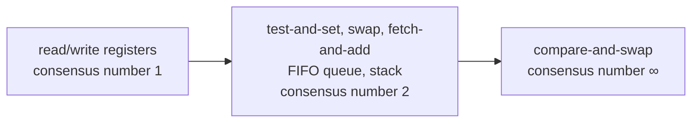

# 11.3 Atomic Operations

The fast path of the mutex in [11.2](./mutex.md) is a single compare-and-swap. This section looks at
such operations in their own right: which operations `sync/atomic` provides and how the compiler
turns them into machine instructions; why compare-and-swap occupies the center of the family; what
progress guarantees lock-free algorithms can offer and what difficulties they face; and why Go
offers only sequentially consistent atomics, and added atomic types in Go 1.19. The Go version that
introduced each interface is listed in [11.1.4](./basic.md).

## 11.3.1 Indivisible Read-Modify-Write

An **atomic operation** is one that other goroutines can observe only as having happened entirely
before or entirely after some point, never half done. The difficulty usually lies not in a single
read or write but in the combination "read, compute, write back": if two goroutines execute `x++` at
the same time, both may read the same old value, add one, and write back, so the variable grows by
one instead of two.

`sync/atomic` was added to Go by Russ Cox in 2011 [[Cox, 2011](#ref-cox-2011)]. The package
documentation states the semantics of each read-modify-write operation as equivalent sequential code
that executes as one indivisible step [[Go Authors, 2026a](#ref-go-authors-2026a)]:

```go
// Swap (SwapT)
old = *addr
*addr = new
return old

// Compare-and-swap (CompareAndSwapT)
if *addr == old {
	*addr = new
	return true
}
return false

// Add (AddT)
*addr += delta
return *addr
```

Load and store (`LoadT`, `StoreT`) are the atomic versions of `return *addr` and `*addr = val`.
`AndT` and `OrT`, added in Go 1.23, apply a bitwise AND or OR to `*addr`; unlike `AddT`, they return
the old value.

The most general of these is **compare-and-swap** (CAS). Any update that computes a new value from
the old one can be written as a retry loop: read the current value, compute the new one, and write
it back with CAS. If another goroutine modified the variable in the meantime, the CAS fails and the
loop reads again:

```go
for {
	old := atomic.LoadInt64(&x)
	if atomic.CompareAndSwapInt64(&x, old, f(old)) {
		break
	}
}
```

The loop never blocks: a goroutine's CAS fails only because another goroutine's CAS has just
succeeded. Under light contention it is cheaper than a lock, since there is no sleeping or waking.
Under heavy contention, many CAS operations fail and the cache line holding the variable bounces
between processors, so throughput can be worse than with a single lock. Moreover, although the
system as a whole keeps making progress, one goroutine may fail again and again and never complete
its own update. That is starvation, not livelock: livelock means every participant is active and
none makes progress (11.3.4).

The warning at the top of the package documentation therefore deserves to be taken seriously: these
functions require great care to be used correctly, and except for special, low-level applications,
synchronization is better done with channels or the facilities of the `sync` package
[[Go Authors, 2026a](#ref-go-authors-2026a)].

## 11.3.2 From Functions to Instructions

The functions in `sync/atomic` have only declarations in the Go source, with no bodies; assembly
stubs in `asm.s` jump directly into the runtime package `internal/runtime/atomic`. In ordinary
builds, however, those stubs are never called. The compiler registers the `sync/atomic` functions as
aliases of the corresponding functions in `internal/runtime/atomic`, which are compiler intrinsics,
so each call site is expanded directly into instructions
[[Go Authors, 2026b](#ref-go-authors-2026b)]:

```go
// cmd/compile/internal/ssagen/intrinsics.go
	/******** sync/atomic ********/

	// Note: these are disabled by flag_race in findIntrinsic below.
	alias("sync/atomic", "LoadInt32", "internal/runtime/atomic", "Load", all...)
	alias("sync/atomic", "LoadInt64", "internal/runtime/atomic", "Load64", all...)
	// ……
```

The exception named in the comment is the race detector: when building with `-race`, these calls are
not expanded but go to runtime versions prepared for race detection, which record each atomic
operation as a synchronization event ([11.9](./mem.md)).

Compiling five functions that each contain a single atomic operation with Go 1.26, the key
instructions in the `-gcflags=-S` output are as follows (the `int64` versions):

| Operation | amd64 | arm64 (default) |
| --- | --- | --- |
| `LoadInt64` | `MOVQ` | `LDAR` |
| `StoreInt64` | `XCHGQ` | `STLR` |
| `AddInt64` | `LOCK XADDQ` | `LDADDALD`, or an `LDAXR`/`STLXR` loop |
| `CompareAndSwapInt64` | `LOCK CMPXCHGQ` | `CASALD`, or an `LDAXR`/`STLXR` loop |
| `OrInt64` | `LOCK CMPXCHGQ` loop | `LDORALD`, or an `LDAXR`/`STLXR` loop |

The amd64 column has one asymmetry: an atomic load is a plain `MOVQ`, but an atomic store uses
`XCHGQ`. The x86 memory model permits only one kind of reordering: while a write sits in the store
buffer, a later read may complete first ([11.9](./mem.md)). An atomic load therefore needs no extra
instruction. An atomic store must prevent later reads from moving above it, and `XCHG` with a memory
operand implies `LOCK` semantics, which acts as a full memory barrier. `OrInt64` uses a loop because
the x86 `LOCK OR` does not return the old value; since Go 1.24, if the caller discards the result,
the compiler emits a single `LOCK ORQ` instead [[Randall, 2024](#ref-randall-2024)].

The arm64 column depends on whether the processor supports the ARMv8.1 Large System Extensions
(LSE). ARMv8.0 has only the pair of exclusive load and exclusive store instructions
(load-linked/store-conditional, LL/SC), so a read-modify-write operation has to be written as a
loop; LSE adds single-instruction atomic add and compare-and-swap. The default build checks the
runtime variable `arm64HasATOMICS` at every call site and generates both paths:

```asm
	MOVBU	runtime.arm64HasATOMICS(SB), R3
	TBZ	$0, R3, 32           // without LSE, jump to the loop at offset 32
	MOVD	R1, R27
	CASALD	R27, (R0), R2        // ARMv8.1: compare-and-swap in one instruction
	CMP	R1, R27
	CSET	EQ, R3
	JMP	56
	LDAXR	(R0), R27            // ARMv8.0: exclusive load
	CMP	R1, R27
	BNE	52
	STLXR	R2, (R0), R27        // exclusive store; fails if another core wrote the address after the exclusive load
	CBNZ	R27, 32              // retry on failure
	CSET	EQ, R3
	MOVD	R3, R0
	RET
```

When built with `GOARM64=v8.1`, both the check and the loop are omitted, leaving only `CASALD`. So
an atomic operation is not always one instruction: on a processor without LSE it is itself the retry
loop of 11.3.1, written at the level of hardware instructions.

## 11.3.3 The Consensus Hierarchy

Loads and stores are atomic too, so why can lock-free algorithms not do without compare-and-swap?
Herlihy answered this question with the **consensus number** [[Herlihy, 1991](#ref-herlihy-1991)].

In the consensus problem, $n$ processes each propose a value, and all must decide on one value,
subject to two conditions: all processes decide the same value (consistency), and the decided value
was proposed by some process (validity). In addition, the protocol must be **wait-free**: no matter
how fast the other processes run, or even if they stop, every process finishes within a finite
number of its own steps. The largest $n$ for which a shared object can solve wait-free consensus is
its consensus number; if there is no upper bound, the consensus number is infinite. The consensus
number measures the synchronization power of a primitive: if $X$ has consensus number $n$ and $Y$
has consensus number $m < n$, then in a system with more than $m$ processes there is no wait-free
implementation of $X$ from $Y$ (Theorem 1).



Read/write registers have consensus number 1 (Theorem 2): not even two processes can reach
consensus. The proof starts from a critical state, in which the next step of each of the two
processes will fix the outcome: a step by P leads to deciding $x$, a step by Q to deciding $y$.
Examine what the two steps can be. If one of them is a read, it changes only the reader's own state,
and the other process cannot notice it, so running alone from there it reaches the same decision. If
the two steps write different registers, the order does not affect the resulting state. If they
write the same register, the later write overwrites the earlier one and erases the earlier writer's
trace. In every case, some process cannot distinguish "the other went first" from "I went first", a
contradiction.

Nontrivial read-modify-write operations can solve consensus for at least two processes (Theorem 3):
each process first registers its own proposal, then performs one read-modify-write on the same
register, and whichever sees the initial value arrived first. But test-and-set, swap and
fetch-and-add stop at 2 (Theorem 4). Any two operations of this kind either commute (two
fetch-and-adds produce a result independent of order) or the later one overwrites the earlier (two
swaps), so a third process sees a result that either does not reflect the order or reflects only the
last operation. The same holds for FIFO queues (Theorem 7); stacks, deques and priority queues need
only a small modification of the proof.

Compare-and-swap has an infinite consensus number (Theorem 5). The protocol takes a single step: the
register starts empty, each process tries to swap the empty value for its own proposal, and the
proposal of the one that succeeds is the decision. Once the register is non-empty it never changes;
later CAS operations all fail, but they do not erase the value left by the first. Herlihy observes
that this protocol is evidently wait-free, since it has no loop. The following program is exactly
this protocol, with 8 goroutines over 1000 rounds:

```go {run=true}
package main

import (
	"fmt"
	"sync"
	"sync/atomic"
)

// decide is Herlihy's compare-and-swap consensus protocol: there is no loop,
// so every goroutine finishes in a constant number of steps.
func decide(cell *atomic.Pointer[int], proposal *int) int {
	cell.CompareAndSwap(nil, proposal) // only the first call succeeds; cell never changes afterwards
	return *cell.Load()
}

func main() {
	const n, rounds = 8, 1000
	good := 0
	for range rounds {
		var cell atomic.Pointer[int]
		decisions := make([]int, n)
		var wg sync.WaitGroup
		for i := range n {
			wg.Go(func() {
				proposal := 100 + i // each goroutine proposes a different value
				decisions[i] = decide(&cell, &proposal)
			})
		}
		wg.Wait()

		agreed := true // agreement: all goroutines decide the same value
		for _, d := range decisions {
			agreed = agreed && d == decisions[0]
		}
		valid := 100 <= decisions[0] && decisions[0] < 100+n // validity: the decision is someone's proposal
		if agreed && valid {
			good++
		}
	}
	fmt.Printf("of %d rounds with %d goroutines, rounds with agreed and valid decisions: %d\n", rounds, n, good)
}
```

The output is:

```
of 1000 rounds with 8 goroutines, rounds with agreed and valid decisions: 1000
```

Herlihy goes on to prove that an object with consensus number $n$ is universal in a system of at
most $n$ processes: any sequential object can be given a wait-free implementation using it. The
construction represents the object as a log of operations, and the processes repeatedly reach
consensus on "whose operation comes next". Compare-and-swap is therefore universal for any number of
processes. The construction needs $O(n^3)$ memory cells, however; it is a proof of feasibility, not
a practical design, and practical lock-free data structures still have to be designed one data type
at a time. ARM's LL/SC instruction pair can implement compare-and-swap equally well, as the loop in
11.3.2 shows.

These conclusions rest on a premise: wait-freedom. [11.2.1](./mutex.md) mentioned that Lamport's
bakery algorithm solves mutual exclusion with reads and writes alone. This does not contradict
Theorem 2, because mutual exclusion allows waiting: if one process stalls in the critical section,
the others wait indefinitely. Message passing is similar. From Theorem 7, Herlihy concludes that a
message-passing architecture that communicates only through FIFO queues cannot solve consensus among
three processes; but Go channels block, and their implementation itself uses a lock
([10.6](../ch10chan/lockfree.md)). The consensus hierarchy measures what a primitive can do when
waiting is not allowed.

## 11.3.4 Progress Conditions

The term **lock-free** is often used to mean "without locks", but its precise meaning is a progress
guarantee. Herlihy and Shavit classify the progress conditions of concurrent objects into several
levels [[Herlihy and Shavit, 2008](#ref-herlihy-shavit-2008)]:

| Progress condition | Guarantee | Example |
| --- | --- | --- |
| Blocking | If a thread stalls in a critical section, other threads wait with it | `sync.Mutex`, channels |
| Obstruction-free | A thread running in isolation finishes in a finite number of steps | The deque of Herlihy et al. |
| Lock-free | Some thread always finishes in a finite number of steps | CAS retry loops, the Treiber stack |
| Wait-free | Every thread finishes in a finite number of steps | The consensus protocol of 11.3.3 |

The last three levels are collectively called nonblocking: the delay or failure of any thread does
not prevent the others from advancing. **Obstruction-free** is the weakest of them, proposed by
Herlihy, Luchangco and Moir: a thread makes progress as long as it eventually runs in isolation
(with no other thread taking steps) [[Herlihy et al., 2003](#ref-herlihy-et-al-2003)]. When several
threads run at once, they may repeatedly make each other's operations fail, which is livelock.
Lock-freedom rules out livelock, but it guarantees only that the system as a whole advances, not
that every thread does; in the words of Herlihy et al., starvation is possible in principle but
rarely occurs in practice. Wait-freedom rules out starvation as well. The CAS loop of 11.3.1 is
lock-free, not wait-free.

A progress condition is a property of the algorithm, not of the instructions it uses. `sync.Mutex`
is built on atomic operations, but if a goroutine is switched out while holding the lock, the others
can only wait, so it is blocking. One of the earliest lock-free data structures is the Treiber stack
[[Treiber, 1986](#ref-treiber-1986)]: the top of the stack is a pointer, and push and pop are CAS
loops like that of 11.3.1 (see the example in 11.3.5 for code). Michael and Scott later gave a
nonblocking and a blocking concurrent queue algorithm
[[Michael and Scott, 1996](#ref-michael-scott-1996)], and Java's `ConcurrentLinkedQueue` is based on
the lock-free queue among them [[Oracle, 2023](#ref-oracle-2023)].

## 11.3.5 ABA and Memory Reclamation

CAS compares only values; it does not know what happened to the value in the meantime. If a variable
changes from A to B and back to A, CAS concludes that it was never modified. This is the **ABA
problem**. The following program demonstrates it on a Treiber stack. To make the result
deterministic, the program executes the steps of two threads (1 and 2) in order within a single
goroutine, simulating one possible interleaving:

```go {run=true}
package main

import (
	"fmt"
	"strings"
	"sync/atomic"
)

type node struct {
	name string
	next *node
}

// stack is a Treiber stack.
type stack struct{ top atomic.Pointer[node] }

func (s *stack) push(n *node) {
	for {
		old := s.top.Load()
		n.next = old
		if s.top.CompareAndSwap(old, n) {
			return
		}
	}
}

func (s *stack) pop() *node {
	for {
		old := s.top.Load()
		if old == nil {
			return nil
		}
		if s.top.CompareAndSwap(old, old.next) {
			return old
		}
	}
}

func (s *stack) String() string {
	var names []string
	for n := s.top.Load(); n != nil; n = n.next {
		names = append(names, n.name)
	}
	return "[" + strings.Join(names, " ") + "]"
}

func main() {
	var s stack
	s.push(&node{name: "C"})
	s.push(&node{name: "B"})
	s.push(&node{name: "A"})
	fmt.Printf("initial stack: %s\n", s.String())

	// Thread 1 runs the first half of pop: it reads the top A and its successor B, then is suspended.
	old := s.top.Load()
	next := old.next

	// Meanwhile thread 2 pops A and B, then pushes the same node A back.
	a, b := s.pop(), s.pop()
	s.push(a)
	fmt.Printf("thread 2 pops %s and %s, then pushes %s back: %s\n", a.name, b.name, a.name, s.String())

	// Thread 1 resumes: the top is still A, so the compare-and-swap succeeds.
	ok := s.top.CompareAndSwap(old, next)
	fmt.Printf("thread 1 compare-and-swap succeeded: %v; stack: %s\n", ok, s.String())
}
```

The output is:

```
initial stack: [A B C]
thread 2 pops A and B, then pushes A back: [A C]
thread 1 compare-and-swap succeeded: true; stack: [B C]
```

Thread 1's CAS sets the top to the B it read earlier, but B has already been popped by thread 2: it
is now both in thread 2's hands and back on the stack.

In languages with manual memory management, the more common source of ABA is memory reuse: node A is
popped and freed, the allocator hands the same memory to a new node, and a CAS that compares
addresses cannot tell the old node from the new. Go's garbage collector eliminates this case: as
long as thread 1 still holds a pointer to A, A will not be collected, let alone reallocated. But the
program above shows that garbage collection cannot eliminate ABA caused by the program reusing nodes
itself.

The first family of remedies attaches a counter to the pointer, incremented on every modification,
with CAS comparing pointer and counter together. The runtime's lock-free stack `lfstack` does
exactly this [[Go Authors, 2026c](#ref-go-authors-2026c)]; it was written by Dmitry Vyukov in 2012
for parallel garbage collection [[Vyukov, 2012](#ref-vyukov-2012)]:

```go
func (head *lfstack) push(node *lfnode) {
	node.pushcnt++
	new := lfstackPack(node, node.pushcnt)
	for {
		old := atomic.Load64((*uint64)(head))
		node.next = old
		if atomic.Cas64((*uint64)(head), old, new) {
			break
		}
	}
}
```

`lfstackPack` packs the pointer and the push count into one 64-bit word: on 64-bit platforms, the
count occupies the high bits that addresses do not use and the low bits freed by node alignment; on
32-bit platforms, pointer and count take half each. The runtime needs the counter because it gives
up the protection of garbage collection: `lfstack` holds no pointers visible to the garbage
collector, so nodes must be allocated outside the Go heap, and `lfnodeValidate` reports an error if
a node comes from the heap. The counter has a limited number of bits (only a dozen to two dozen on
64-bit platforms) and eventually wraps around; but for it to return exactly to its old value, the
same node would have to be pushed at least $2^{16}$ times between one read and the CAS, which can be
ignored in practice.

The second family answers a more general question: after a node has been removed from a data
structure, when can it safely be freed, given that some thread may still hold a pointer to it?

- **Hazard pointer**: each thread publishes the pointer it is about to access in a shared location,
  and the reclaimer checks these publications before freeing a node; published nodes have their
  release deferred [[Michael, 2004](#ref-michael-2004)].
- **Epoch-based reclamation**: a global epoch is maintained, and removed nodes are placed on
  reclamation lists by epoch; once all threads have observed the current epoch, the list from two
  epochs earlier can be freed safely [[Fraser, 2004](#ref-fraser-2004)].
- **Read-copy-update** (RCU): readers do no synchronization at all; a writer copies and modifies the
  data, then replaces the pointer, and the old version is freed only after every thread has passed
  through a quiescent state [[McKenney and Slingwine, 1998](#ref-mckenney-slingwine-1998)].

For Go user code, the garbage collector is exactly such a reclamation scheme. The runtime's own
off-heap structures cannot rely on it. One approach is not to free at all: the index array of the
span set (spanSet) is never returned, and the comment gives the possibility of concurrent lock-free
access as the reason [[Go Authors, 2026d](#ref-go-authors-2026d)].

The lock-free structures in Go are all implementation details; none is exported as a general-purpose
data structure. Besides `lfstack` (used for garbage collection work buffers, among other things),
there is the local run queue of each P: only the owning P puts Gs into it, and stealers take from it
with CAS ([9.2.2](../ch09sched/steal.md)). `poolDequeue` in `sync.Pool` is a fixed-size lock-free
queue with a single producer and multiple consumers ([11.6](./pool.md)). Since Go 1.24, the
hash-trie underlying `sync.Map` has a lock-free read path, while the write path locks a single
internal node ([11.7](./map.md)).

## 11.3.6 Sequential Consistency

Besides being indivisible, atomic operations also affect the visibility of other memory accesses.
The memory model, revised in Go 1.19, specifies [[Go Authors, 2022](#ref-go-authors-2022)]:

> The APIs in the sync/atomic package are collectively “atomic operations”
> that can be used to synchronize the execution of different goroutines.
> If the effect of an atomic operation A is observed by atomic operation B,
> then A is synchronized before B.
> All the atomic operations executed in a program behave as though executed
> in some sequentially consistent order.

The synchronized-before relation implies the happens-before relation ([11.9](./mem.md)): ordinary
writes that a goroutine performs before an atomic store are visible to a goroutine that observes
that store through an atomic load. Publishing a fully constructed object with `atomic.Pointer`
relies on exactly this. The second half, sequential consistency, requires all atomic operations to
form a single total order consistent with the program order of each goroutine. The memory model
notes that this is the same as the semantics of C++ sequentially consistent atomics and Java
`volatile` variables.

It took nine years for this rule to reach the memory model. In March 2013, Cox filed an issue
pointing out that neither the memory model nor the `sync/atomic` documentation said what guarantees
atomic operations provide, and argued that the guarantees should of course be "as weak as
possible" [[Cox, 2013](#ref-cox-2013)]. Vyukov immediately asked why as weak as possible, since weak
atomics are hard to program with, and in later comments pointed out that sequential consistency is
the easiest to define and the easiest to understand and explain [[Vyukov, 2013](#ref-vyukov-2013)].
In 2021, Cox adopted this position in his article on updating the Go memory model
[[Cox, 2021](#ref-cox-2021)], and the issue was closed in 2022 with Go 1.19.

The article gives two reasons for not providing acquire/release semantics. First, programs often
need to reason about the relative order of atomic operations on several variables: the old
implementation of `sync.WaitGroup` used two atomic variables for the count and the number of
waiters, and the runtime semaphore likewise depends on two atomic variables, the semaphore value and
the waiter count ([11.2](./mutex.md)). With acquire/release semantics alone, such programs no longer
behave sequentially consistently even when free of data races, and are hard to reason about. Second,
hardware is narrowing the gap between the two: ARMv8 `LDAR` and `STLR` are used to implement
sequentially consistent atomics and are also the recommended implementation of acquire/release
semantics (the arm64 column of 11.3.2 shows exactly these two instructions). If Go promised only
acquire/release semantics, a program written on ARMv8 might unknowingly depend on a stronger
ordering and fail only when moved to a weaker platform. The same reasoning is why Go does not offer
a separate acquire/release interface. As for atomic operations that take no part in synchronization
(relaxed in C++ and Rust), the article argues they should not be added without evidence, and states
what evidence is needed: broad applicability in real programs, and significant performance gains on
widely used systems.

| Language | Memory orders available for atomic operations |
| --- | --- |
| C/C++11 | `relaxed`, `consume`, `acquire`, `release`, `acq_rel`, `seq_cst`; default `seq_cst` |
| Java 9 and later | four `VarHandle` modes: Plain, Opaque, Release/Acquire, Volatile [[Lea, 2018](#ref-lea-2018)] |
| Rust | `Relaxed`, `Release`, `Acquire`, `AcqRel`, `SeqCst` |
| Go | sequentially consistent only |

Which instructions bear the cost of sequential consistency depends on the hardware: on amd64 it is
the `XCHG` used by atomic stores, on arm64 it is `LDAR` and `STLR`.

## 11.3.7 Atomic Types

The function-style interface has a fundamental flaw. In the same article, Cox points out that to
eliminate data races on a piece of memory, all accesses must be atomic: an atomic write concurrent
with a plain read, or a plain write concurrent with an atomic read, is still a data race. Whether a
value should be accessed atomically is therefore a property of the value, not of an individual
access [[Cox, 2021](#ref-cox-2021)]. Java's `volatile int` and C++'s `atomic<int>` both put this
information in the type; in Go, `atomic.AddInt64(&x, 1)` cannot stop someone elsewhere from writing
`x++`.

Cox then proposed atomic types, shipped with Go 1.19: `Bool`, `Int32`, `Int64`, `Uint32`, `Uint64`,
`Uintptr` and `Pointer[T]` [[Cox, 2022a](#ref-cox-2022a)]. The proposal explains why there is no
generic `atomic.Val[T]`: different types need different method sets (`Bool` and `Pointer[T]` should
not have `Add`), and at the time no constraint could be written that accommodates both pointers and
the various integers; even if it could, `atomic.Val[int32]` would be less convenient than
`atomic.Int32`. Taking `Int64` as an example [[Go Authors, 2026a](#ref-go-authors-2026a)]:

```go
// An Int64 is an atomic int64. The zero value is zero.
//
// Int64 must not be copied after first use.
type Int64 struct {
	_ noCopy
	_ align64
	v int64
}

// Add atomically adds delta to x and returns the new value.
func (x *Int64) Add(delta int64) (new int64) { return AddInt64(&x.v, delta) }
```

The three fields each have a purpose. `v` is unexported, so code outside the package can reach it
only through methods, and plain accesses are ruled out at compile time. `noCopy` implements empty
`Lock` and `Unlock` methods so that the copylocks check of `go vet` can detect copying after first
use. `align64` addresses alignment on 32-bit platforms: the BUG section of the package documentation
states that on ARM, 386 and 32-bit MIPS, the caller must itself ensure that a 64-bit word accessed
atomically is 64-bit aligned; the only words one can rely on to be 64-bit aligned are the first word
in an allocated struct, array or slice, and the first word in a global or local variable. Whether an
`int64` field in a struct is aligned depends on the fields before it, so the same code may work on
amd64 and crash on 32-bit ARM. `align64` is an empty struct; when computing struct layout, the
compiler recognizes this name in `sync/atomic` and `internal/runtime/atomic` and raises the
alignment requirement of the whole type to 8 bytes. A comment in the file points out that a copy of
it in any other package has no effect. The runtime's own atomic types switched to it in the same
release [[Knyszek, 2022](#ref-knyszek-2022)].

The first field of `Pointer[T]` comes from two changes in Go 1.20:

```go
type Pointer[T any] struct {
	// Mention *T in a field to disallow conversion between Pointer types.
	// See go.dev/issue/56603 for more details.
	// Use *T, not T, to avoid spurious recursive type definition errors.
	_ [0]*T

	_ noCopy
	v unsafe.Pointer
}
```

The original definition did not mention `T`, so `atomic.Pointer[A]` and `atomic.Pointer[B]` had the
same underlying type and could be converted to each other directly, treating `*A` as `*B` without
going through `unsafe`. The program in issue #56603 used this to write out of bounds, causing a
segmentation fault. The fix first added a zero-length `[0]T` field
[[Poliwczak, 2022](#ref-poliwczak-2022)], but that made a linked-list definition such as
`type List struct { Next atomic.Pointer[List] }` report an "invalid recursive type"; Cox then
changed it to `[0]*T`, just as recursion is legal when the field type is written `*List`
[[Cox, 2022b](#ref-cox-2022b)].

`atomic.Value` was added much earlier, in Go 1.4, written by Vyukov for the copy-on-write idiom: a
writer builds a new copy of the data and replaces it as a whole with `Store`; a reader obtains one
complete version with `Load` and never sees a half-modified state
[[Vyukov, 2014](#ref-vyukov-2014)]. The benchmark in the commit message shows reads scaling with the
number of processors: 21.7, 8.63 and 4.33 ns per read with 1, 2 and 4 processors.

`Value` internally holds an `any`, that is, two words, a type pointer and a data pointer
([4.2](../../part2lang/ch04type/interface.md)), while one atomic operation can write only one word.
The first `Store` must write two words in sequence, and `Value` handles this transition with a
special marker:

```go
func (v *Value) Store(val any) {
	// ……
	for {
		typ := LoadPointer(&vp.typ)
		if typ == nil {
			// Attempt to start first store.
			// Disable preemption so that other goroutines can use
			// active spin wait to wait for completion.
			runtime_procPin()
			if !CompareAndSwapPointer(&vp.typ, nil, unsafe.Pointer(&firstStoreInProgress)) {
				runtime_procUnpin()
				continue
			}
			// Complete first store.
			StorePointer(&vp.data, vlp.data)
			StorePointer(&vp.typ, vlp.typ)
			runtime_procUnpin()
			return
		}
		if typ == unsafe.Pointer(&firstStoreInProgress) {
			// First store in progress. Wait.
			// Since we disable preemption around the first store,
			// we can wait with active spinning.
			continue
		}
		// ……
	}
}
```

The goroutine doing the first write uses CAS to change the type word from nil to the address of
`firstStoreInProgress`, then writes the data word and the type word in turn. A reader in `Load` that
sees nil or this marker returns `nil`, as if nothing had been stored yet. A competing writer spins
and waits; `runtime_procPin` prevents the first writer from being preempted during this period, so
the spinning ends quickly. After the first store the type word never changes, and each `Store` only
needs to replace the data word atomically, panicking if the type differs. Go 1.17 added `Swap` and
`CompareAndSwap` to it.

With `Pointer[T]`, `Value` is usually no longer needed for storing pointers: `Pointer[T]` is
statically typed, so reads need no type assertion. `Value` suits cases where the concrete type of
the value is determined at run time but stays fixed after the first store.

## Further Reading

- <a id="ref-cox-2011"></a>[Cox, 2011] Russ Cox. sync/atomic: new package. Go commit
  22eab1f5c7, 2011. https://github.com/golang/go/commit/22eab1f5c78bb432b951426175b01c9bf97241f3
- <a id="ref-cox-2013"></a>[Cox, 2013] Russ Cox. Go issue #5045. *doc: define how sync/atomic
  interacts with memory model.* 2013. https://github.com/golang/go/issues/5045 Closed in July 2022
  with the memory model revision in Go 1.19.
- <a id="ref-cox-2021"></a>[Cox, 2021] Russ Cox. Updating the Go Memory Model (Memory Models, Part
  3). research!rsc, 12 July 2021. https://research.swtch.com/gomm
- <a id="ref-cox-2022a"></a>[Cox, 2022a] Russ Cox. Go proposal #50860. *sync/atomic: add typed
  atomic values.* 2022. https://github.com/golang/go/issues/50860 The motivation and design of the
  atomic types, and the reasons for not adopting a generic `atomic.Val[T]`; the implementation is CL
  381317, shipped with Go 1.19.
- <a id="ref-cox-2022b"></a>[Cox, 2022b] Russ Cox. sync/atomic: allow linked list of atomic pointers
  again. Go commit b14cf3d93a, 2022. https://go.dev/cl/450655
  Shipped with Go 1.20.
- <a id="ref-fraser-2004"></a>[Fraser, 2004] Keir Fraser. *Practical Lock-Freedom.* Technical Report
  UCAM-CL-TR-579, University of Cambridge Computer Laboratory, 2004. https://doi.org/10.48456/tr-579
  Section 5.2.3 covers epoch-based reclamation.
- <a id="ref-go-authors-2022"></a>[Go Authors, 2022] The Go Authors. *The Go Memory Model* (Version
  of June 6, 2022): Atomic Values. https://go.dev/ref/mem The sequential consistency guarantee of
  `sync/atomic`.
- <a id="ref-go-authors-2026a"></a>[Go Authors, 2026a] The Go Authors. *src/sync/atomic/doc.go,
  type.go, value.go.* https://github.com/golang/go/tree/master/src/sync/atomic The implementation of
  `align64`, `noCopy` and `Pointer[T]`; the `[0]*T` trick against conversion from issue #56603.
- <a id="ref-go-authors-2026b"></a>[Go Authors, 2026b] The Go Authors.
  src/cmd/compile/internal/ssagen/ intrinsics.go. Go 1.26 source.
  https://github.com/golang/go/blob/release-branch.go1.26/src/cmd/compile/internal/ssagen/intrinsics.go
- <a id="ref-go-authors-2026c"></a>[Go Authors, 2026c] The Go Authors. src/runtime/lfstack.go. Go
  1.26 source. https://github.com/golang/go/blob/release-branch.go1.26/src/runtime/lfstack.go
- <a id="ref-go-authors-2026d"></a>[Go Authors, 2026d] The Go Authors. src/runtime/mspanset.go. Go
  1.26 source. https://github.com/golang/go/blob/release-branch.go1.26/src/runtime/mspanset.go
- <a id="ref-herlihy-1991"></a>[Herlihy, 1991] Maurice Herlihy. "Wait-Free Synchronization." *ACM
  Transactions on Programming Languages and Systems*, 13(1): 124–149, 1991.
  https://doi.org/10.1145/114005.102808 The consensus hierarchy; the consensus number of read/write
  registers is 1, that of compare-and-swap is infinite; the universal construction.
- <a id="ref-herlihy-et-al-2003"></a>[Herlihy et al., 2003] Maurice Herlihy, Victor Luchangco, Mark
  Moir. "Obstruction-Free Synchronization: Double-Ended Queues as an Example." *Proceedings of the
  23rd International Conference on Distributed Computing Systems (ICDCS)*, 522–529, 2003.
  https://doi.org/10.1109/ICDCS.2003.1203503
- <a id="ref-herlihy-shavit-2008"></a>[Herlihy and Shavit, 2008] Maurice Herlihy, Nir Shavit. *The
  Art of Multiprocessor Programming.* Morgan Kaufmann, 2008 (revised edition 2020). Progress
  conditions such as obstruction-free, lock-free and wait-free; the Treiber stack and lock-free data
  structures.
- <a id="ref-knyszek-2022"></a>[Knyszek, 2022] Michael Anthony Knyszek. runtime/internal/atomic:
  align 64-bit types to 8 bytes everywhere. Go commit 0f715f1ac9, 2022. https://go.dev/cl/404096
  Shipped with Go 1.19.
- <a id="ref-lea-2018"></a>[Lea, 2018] Doug Lea. Using JDK 9 Memory Order Modes. 2018.
  https://gee.cs.oswego.edu/dl/html/j9mm.html
- <a id="ref-mckenney-slingwine-1998"></a>[McKenney and Slingwine, 1998] Paul E. McKenney, John D.
  Slingwine. "Read-Copy Update: Using Execution History to Solve Concurrency Problems." *Parallel
  and Distributed Computing and Systems*, 509–518, 1998.
  http://www.rdrop.com/users/paulmck/RCU/rclockpdcsproof.pdf
- <a id="ref-michael-2004"></a>[Michael, 2004] Maged M. Michael. "Hazard Pointers: Safe Memory
  Reclamation for Lock-Free Objects." *IEEE Transactions on Parallel and Distributed Systems*,
  15(6): 491–504, 2004. https://doi.org/10.1109/TPDS.2004.8 ABA and safe memory reclamation.
- <a id="ref-michael-scott-1996"></a>[Michael and Scott, 1996] Maged M. Michael, Michael L.
  Scott. "Simple, Fast, and Practical Non-Blocking and Blocking Concurrent Queue
  Algorithms." *Proceedings of the 15th ACM Symposium on Principles of Distributed Computing
  (PODC)*, 267–275, 1996. https://doi.org/10.1145/248052.248106 The Michael-Scott lock-free queue.
- <a id="ref-oracle-2023"></a>[Oracle, 2023] Oracle. ConcurrentLinkedQueue. *Java SE 21 & JDK 21 API
  Specification*, 2023.
  https://docs.oracle.com/en/java/javase/21/docs/api/java.base/java/util/concurrent/ConcurrentLinkedQueue.html
- <a id="ref-poliwczak-2022"></a>[Poliwczak, 2022] Mateusz Poliwczak. sync/atomic: disallow type
  conversions of atomic.Pointer[T]. Go commit 6bead8f77a, 2022. https://go.dev/cl/448275
  Fixes issue #56603; shipped with Go 1.20.
- <a id="ref-randall-2024"></a>[Randall, 2024] Keith Randall. cmd/compile: make sync/atomic AND/OR
  operations intrinsic on amd64. Go commit c18ff29295, 2024. https://go.dev/cl/594738
  Shipped with Go 1.24.
- <a id="ref-treiber-1986"></a>[Treiber, 1986] R. Kent Treiber. *Systems Programming: Coping with
  Parallelism.* IBM Research Report RJ 5118, 1986.
  The earliest lock-free stack, the prototype of the CAS retry loop.
- <a id="ref-vyukov-2012"></a>[Vyukov, 2012] Dmitriy Vyukov. runtime: add lock-free stack. Go commit
  a5dc7793c0, 2012. https://github.com/golang/go/commit/a5dc7793c0fba8d6c81098248a4fc2e8b0ddad34
  Split off from the parallel garbage collection change; shipped with Go 1.1.
- <a id="ref-vyukov-2013"></a>[Vyukov, 2013] Dmitry Vyukov. Comment on golang/go#5045, 2013.
  https://github.com/golang/go/issues/5045#issuecomment-66076281 Several comments of 14 and 15 March
  2013 argue for sequentially consistent semantics of atomic operations.
- <a id="ref-vyukov-2014"></a>[Vyukov, 2014] Dmitriy Vyukov. sync/atomic: add Value. Go commit
  98a1e207e2,
  2014. https://github.com/golang/go/commit/98a1e207e29359dba86769877021838bb77b12c3
  Shipped with Go 1.4.
- This book: [11.2 Mutex](./mutex.md), [11.9 Memory Consistency Models](./mem.md),
  [4.2 Interfaces](../../part2lang/ch04type/interface.md).
