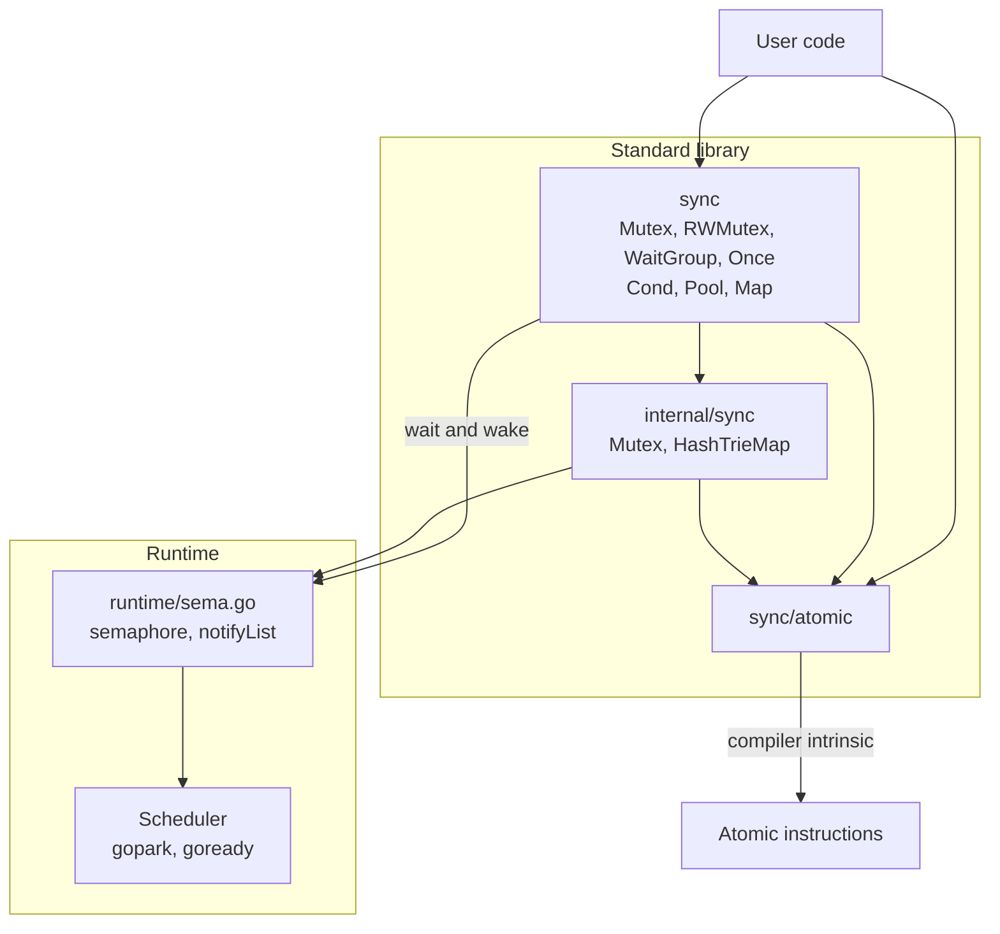

# 11.1 Shared-Memory Synchronization Patterns

[1.3.1](../../part1overview/ch01intro/csp.md) introduced the two ways in which threads cooperate,
shared memory with locks and message passing, and quoted the conclusion of Lauer and Needham that
the two can be converted into each other. [Chapter 10](../ch10chan/readme.md) discussed Go's
implementation of message passing; this chapter turns to the shared-memory side. This section first
shows how the tools on this side developed from the semaphore to the monitor, then examines the
duality between the two approaches in detail and writes it out as a Go program. Finally it describes
how Go arranges the two kinds of tools and into which layers the `sync` package is divided.

## 11.1.1 From Semaphores to Monitors

The shared-memory tradition begins with Dijkstra's long paper "Cooperating Sequential
Processes" [[Dijkstra, 1968](#ref-dijkstra-1968)]. The paper first asks how two processes can enter
their critical sections one at a time using nothing but ordinary reads and writes. Several plausible
formulations are rejected one by one until Dekker supplies the first correct solution, which is then
generalized to N processes. [11.2.1](./mutex.md) returns to this read-and-write route. Dijkstra then
points out two defects of such solutions. First, the programs are obscure: it is hard to see that
all they achieve is the simple requirement of mutual exclusion. Second, the waiting processes keep
reading and writing common variables, wasting processor and memory cycles, when they have nothing to
do while waiting and could just as well go to sleep. The root of the contortion is that every access
to a common variable is one-way: after a process reads a value and before it acts on it, another
process may have changed the value, and the read leaves no trace that other processes could notice.

To remedy this, Dijkstra introduced the semaphore, a non-negative integer that can be accessed only
through two indivisible operations, P and V. V increments it. P decrements it if the result is not
negative, and otherwise makes the process wait until another process performs V. With semaphores,
mutual exclusion among N processes becomes trivial: a semaphore with initial value 1, and the
critical section written between a P and a V. A semaphore that takes only the values 0 and 1 is
called binary; Scholten showed that "general semaphores" with larger values have wide uses, and the
paper applies one to the producer and consumer problem. On a buffer of capacity N, one semaphore
counts the items placed in the buffer for the consumers, another counts the free slots for the
producers, and a binary semaphore protects the reads and writes of the buffer itself. The paper ends
with a discussion of deadlock (which it calls the deadly embrace) and of the banker's algorithm for
avoiding it.

A semaphore can express every kind of synchronization, but it has no connection to the data it
protects: P and V can be written anywhere in a program, and the compiler cannot detect a forgotten V
or an access to the data at a time when the semaphore is not held. The monitor, proposed by Brinch
Hansen and Hoare in 1973 and 1974, fixes this connection [[Hoare, 1974](#ref-hoare-1974)]. A monitor
declares a group of shared data together with the procedures that operate on it. Only one process
can be executing in a procedure of the monitor at any time, and the monitor's data can be accessed
only by the monitor's own procedures. Hoare observes that this restriction prevents certain
insidious, timing-dependent errors, and that it can be guaranteed by inspecting the program text
alone, so that it is easily done automatically by a compiler. When a process inside the monitor must
wait for a condition, it executes wait on a condition variable and gives up the monitor; another
process that has made the condition true executes signal to wake it (who runs first after a signal
differs between Hoare's definition and the later Mesa one; see [11.4](./cond.md)). Hoare also
introduced the monitor invariant: the programmer can state an invariant on the monitor's data, which
must hold after initialization, before and after every procedure call, and before every wait.

Monitors and semaphores have the same expressive power. In the same paper Hoare argues both
directions: a few semaphores and counters suffice to implement monitor entry, exit, wait and signal;
conversely, a monitor that manages a single resource simulates a binary semaphore, with acquire and
release corresponding to P and V, which proves that the concepts of monitor and condition are in
principle no weaker than the semaphore. The difference lies in the structure of the notation. Hoare
says that condition variables are meant to replace semaphores and have their own style of use, just
as while loops and coroutines are meant to replace jumps.

The other tradition, message passing, originates in Hoare's CSP [[Hoare, 1978](#ref-hoare-1978)] and
the Actor model of Hewitt et al. [[Hewitt et al., 1973](#ref-hewitt-et-al-1973)]. Their development
and the differences between the two are covered in [1.3](../../part1overview/ch01intro/csp.md) and
are not repeated here.

## 11.1.2 The Duality of Lauer and Needham

In 1978 Hugh Lauer and Roger Needham presented "On the Duality of Operating System Structures" at an
IRIA workshop on operating systems; it was reprinted the following year in *Operating Systems
Review* [[Lauer and Needham, 1979](#ref-lauer-needham-1979)]. The paper calls itself
an "empirical" study: the authors examined a number of operating systems and found that, in how they
organize processes, synchronization and communication, most lean clearly toward one of two
categories. A message-oriented system has a small, relatively fixed number of large processes that
communicate through explicit message channels and seldom share memory directly, as in IBM's OS/360
and the GEC 4080. A procedure-oriented system has a large number of small processes that are quick
to create and destroy and that communicate through directly shared, locked data, as in HYDRA and the
Plessey System 250. The authors construct a canonical model for each category and draw three
observations:

1. The two models are duals of each other. A program written strictly in the primitives of one model
   can be mapped directly to a dual program that conforms to the other.
2. The two dual programs are logically identical and can be textually very similar, differing only
   in inessential details.
3. Under the same scheduling policy, a program and its dual perform identically, including queue
   lengths, waiting times and service rates; and the primitives provided by one kind of operating
   system can be made as efficient as their duals in the other.

The mapping is given in the following table, adapted from the table in the paper:

| Message-oriented | Procedure-oriented |
| --- | --- |
| Process, `CreateProcess` | Monitor, `NEW`/`START` |
| Message channel | Identifier of an external procedure |
| Message port | Identifier of an `ENTRY` procedure |
| Send a message and wait for the reply at once (`SendMessage`; `AwaitReply`) | Ordinary procedure call |
| Send a message, await the reply later | `FORK` ... `JOIN` |
| Send a reply (`SendReply`) | Procedure return (`RETURN`) |
| Main loop of a resource-managing process: `WaitForMessage` and a case statement | Monitor lock, the `ENTRY` attribute of procedures |
| Arms of the case statement | Declarations of the `ENTRY` procedures |
| Selective waiting for messages | Condition variable, `WAIT` and `SIGNAL` |

The most important correspondence is that between the main loop and the lock. The paper states that
the main loop of a resource-managing process, with its `WaitForMessage` and case statement, serves
exactly the same purpose as the mutual-exclusion lock on a monitor: it serializes requests for
service, admitting one at a time. The case statement distinguishes the requested service by the
message, just as the monitor distinguishes services by procedure name. The lock lines a group of
concurrent requests up and executes them one after another, and a process that owns the state
exclusively and handles messages one at a time does the same thing.

The following Go program writes out this correspondence. Two types implement the same resource pool:
the pool has n units, `Acquire` takes one and waits when none is free, and `Release` returns one.
`MonitorPool` is written in the monitor style, with a lock protecting a counter and a condition
variable for waiting. `ServerPool` is written in the message-oriented style: one goroutine owns the
counter and handles requests one by one in its main loop.

```go {run=true}
package main

import (
	"fmt"
	"sync"
	"time"
)

// Monitor style: one lock protects the state; a condition variable does the waiting.
type MonitorPool struct {
	mu   sync.Mutex
	cond sync.Cond
	free int
}

func NewMonitorPool(n int) *MonitorPool {
	p := &MonitorPool{free: n}
	p.cond.L = &p.mu
	return p
}

func (p *MonitorPool) Acquire() {
	p.mu.Lock()
	for p.free == 0 {
		p.cond.Wait()
	}
	p.free--
	p.mu.Unlock()
}

func (p *MonitorPool) Release() {
	p.mu.Lock()
	p.free++
	p.mu.Unlock()
	p.cond.Signal()
}

// Message style: one goroutine owns the state and handles requests in its main loop.
type ServerPool struct {
	acquire, release chan struct{}
}

func NewServerPool(n int) *ServerPool {
	p := &ServerPool{make(chan struct{}), make(chan struct{})}
	go func() {
		free := n
		for {
			acquire := p.acquire
			if free == 0 {
				acquire = nil // no free unit: do not receive Acquire requests
			}
			select {
			case <-acquire:
				free--
			case <-p.release:
				free++
			}
		}
	}()
	return p
}

func (p *ServerPool) Acquire() { p.acquire <- struct{}{} }
func (p *ServerPool) Release() { p.release <- struct{}{} }

type Pool interface {
	Acquire()
	Release()
}

func try(name string, p Pool) {
	for range 3 {
		p.Acquire()
	}
	done := make(chan struct{})
	go func() {
		p.Acquire()
		close(done)
	}()
	select {
	case <-done:
		fmt.Println(name, "4th Acquire did not wait")
		return
	case <-time.After(50 * time.Millisecond):
		fmt.Print(name, "4th Acquire waited; ")
	}
	p.Release()
	<-done
	fmt.Println("completed after Release")
}

func main() {
	try("Monitor: ", NewMonitorPool(3))
	try("Message: ", NewServerPool(3))
}
```

The output is:

```
Monitor: 4th Acquire waited; completed after Release
Message: 4th Acquire waited; completed after Release
```

The two versions correspond item by item. In `MonitorPool`, `mu` ensures that only one of `Acquire`
and `Release` runs at a time; in `ServerPool`, this work is done by the `for`-`select` main loop of
the serving goroutine, and the counter `free` belongs to that goroutine alone, so no lock is needed.
The two methods correspond to the two arms of the `select`, just as the `ENTRY` procedures in the
table correspond to the arms of the case statement. When no unit is free, the monitor version calls
`Wait` on the condition variable; the message version sets the local variable `acquire` to nil,
which makes that arm temporarily unselectable ([10.1.4](../ch10chan/model.md)). This is
the "selective waiting for messages" in the last row of the table: the serving goroutine stops
receiving `Acquire` requests, and the callers block on the send. In addition, the rendezvous of an
unbuffered channel merges "send the request" and "wait for the reply" into one step: when the send
completes, the serving goroutine has already received the request, and since it receives an
`Acquire` request only when a unit is free, no separate reply message is needed.

Lauer and Needham also note an asymmetry between the two models. The procedure-oriented `WAIT` is
more flexible than selectively waiting for messages: a process can wait anywhere in an `ENTRY`
procedure, even in an inner procedure that it calls. The price is that it must make sure the monitor
invariant holds while it waits, and its local variables may hold intermediate results taken from the
monitor's data, which can become invalid while it waits because other processes enter the monitor.
In their view, therefore, `WAIT` is almost as unstructured as the infamous go to statement. A few
years earlier Hoare had likened the condition variable to the while loop that replaces jumps; here
`WAIT` itself is compared to a jump. The `Acquire` above places `Wait` in a `for` loop and rechecks
the condition after waking up, which guards against exactly this invalidation. Why Go requires
`Cond.Wait` to be used this way is explained in [11.4](./cond.md).

The third observation rests on two premises: the same scheduling policy, and primitives that can be
made equally efficient. In Go the second premise does not hold. According to the measurements in
[10.7.2](../ch10chan/pattern.md), an uncontended `Mutex` lock and unlock takes about 5 ns, and a
round trip over an unbuffered channel (two rendezvous) about 200 ns: `MonitorPool` needs only a few
atomic operations when uncontended, whereas every operation of `ServerPool` must rendezvous with the
serving goroutine and usually has to wake it. Moreover, the serving goroutine never exits. This is
harmless in the example, where the pool lives as long as the program; but if the pool can be
discarded, it must be given a way to shut down, or the goroutine leaks
([10.4.5](../ch10chan/close.md)).

From this Lauer and Needham conclude that the choice of model depends not on the applications the
system is to support but on the "base" on which it is built, that is, on which set of primitives is
easier to construct and more suitable under the given machine architecture and hardware constraints.
They also remark that arguments within design teams about processes and synchronization are
often "highly emotional" and consume more energy than any other part of the system, yet are about
precisely the questions that this analysis shows to be immaterial.

Set against these two canonical models, Go has features of both: goroutines are numerous and cheap
to create and destroy, which is characteristic of the procedure-oriented model, and goroutines can
pass messages through channels, which is characteristic of the message-oriented model. Lauer and
Needham also imagined embedding the message-oriented primitives in a strongly typed language such as
Mesa, applying to the message body the same type checking as to a parameter list, and absorbing the
main loop, the wait for messages and the case statement into the language unit that describes a
process. A system and its dual would then differ textually only in the spelling of certain keywords.
Go's typed channels and `select` provide such language constructs to a large extent.

## 11.1.3 Go's Arrangement

Go provides both kinds of tools, but places them differently. Goroutines, channels and `select` are
part of the language, with dedicated syntax and type checking by the compiler
([Chapter 10](../ch10chan/readme.md)). Mutexes, condition variables, atomic operations and the like
are ordinary types and functions in the standard library packages `sync` and `sync/atomic`.
Effective Go explains the preference: in many environments, concurrent programming is difficult
because of the subtleties required to access shared variables correctly, whereas Go encourages
passing shared values around on channels, so that only one goroutine has access to a value at any
given time and data races cannot occur by design. The same passage admits that this approach can be
taken too far: reference counting, for instance, may be best done by protecting an integer variable
with a mutex [[Go Authors, 2026a](#ref-go-authors-2026a)]. For when to use a channel and when a
lock, see [10.7.3](../ch10chan/pattern.md).

Putting locks in a library means that the language does not know what a lock protects. A
`sync.Mutex` together with the fields it protects is a hand-built monitor
([1.3.1](../../part1overview/ch01intro/csp.md)), and `sync.Cond` is its condition variable. But
whereas the data of a monitor can be accessed only by the monitor's procedures, a property the
compiler can check, which fields a `Mutex` protects and which code must hold it can be recorded only
in comments. Accesses that violate the convention must be found at run time by the race detector
([10.6.4](../ch10chan/lockfree.md)).

Nor does a lock belong to any goroutine. The documentation of `sync.Mutex` states that a locked
`Mutex` is not associated with a particular goroutine, and that it is allowed for one goroutine to
lock a `Mutex` and then arrange for another goroutine to unlock it
[[Go Authors, 2026b](#ref-go-authors-2026b)]. With no owner, locking again from the same goroutine
cannot be recognized and just blocks: Go's mutex is not reentrant. This is deliberate. In 2010 a
user porting a Java program to Go asked on the golang-nuts mailing list why Go's mutex did not seem
to be reentrant, and Russ Cox answered that the fundamental reason for using a mutex is that it
protects an invariant: locking declares "I need the invariant to hold" and perhaps "I will break it
temporarily", while unlocking declares "I no longer depend on the invariant" and "if I broke it, I
have restored it" [[Cox, 2010](#ref-cox-2010)]. If function `F` calls a function `G` that also locks
while `F` holds the lock, a reentrant lock lets `G` succeed immediately, although `F` may be in the
middle of having broken the invariant. Cox therefore argues that reentrant locks do not protect
invariants, and suggests splitting a function that must be callable in both situations into two
versions: one that assumes the caller already holds the lock, and one that takes the lock and then
calls the former. The invariant here is the same concept as the one Hoare prescribed for monitors.

Goroutines also have no externally visible identity, and hence no goroutine-local storage comparable
to thread-local storage. The Go FAQ explains that goroutines are anonymous so that the full language
can be used in concurrent code: once a goroutine has a name, people tend to associate all
computation with it and to overlook the possibility of using several, or even shared, goroutines to
process the same thing. Had `net/http` associated per-request state with a goroutine, it could no
longer use more goroutines to handle a request. Graphics libraries that require all operations to
run on the "main thread" show how awkward this is in a concurrent language. When a particular
goroutine really is special, one can interact with it over a channel
[[Go Authors, 2026c](#ref-go-authors-2026c)], as with the serving goroutine in the example above.
Data related to a request is passed explicitly along the call chain ([11.8](./context.md)).

## 11.1.4 The Composition of the sync Package

The interfaces of `sync` and `sync/atomic` have only grown since Go 1. According to the record of
each release's interface in the `api` directory of the Go source tree
[[Go Authors, 2026d](#ref-go-authors-2026d)], the main changes are as follows:

| Version | Change |
| --- | --- |
| Go 1.0 | `Mutex`, `RWMutex`, `Once`, `WaitGroup`, `Cond`, `Locker`; the `Add`, `CompareAndSwap`, `Load` and `Store` families of atomic operations |
| Go 1.2 | The `Swap` family of atomic operations |
| Go 1.3 | `Pool` |
| Go 1.4 | `atomic.Value` |
| Go 1.9 | `Map` |
| Go 1.15 | `Map.LoadAndDelete` |
| Go 1.17 | `Value.CompareAndSwap`, `Value.Swap` |
| Go 1.18 | `Mutex.TryLock`, `RWMutex.TryLock`, `RWMutex.TryRLock` |
| Go 1.19 | Atomic types `atomic.Int64`, `atomic.Pointer[T]` and others |
| Go 1.20 | `Map.Swap`, `Map.CompareAndSwap`, `Map.CompareAndDelete` |
| Go 1.21 | `OnceFunc`, `OnceValue`, `OnceValues` |
| Go 1.23 | `Map.Clear`; the `And` and `Or` families of atomic operations |
| Go 1.25 | `WaitGroup.Go` |

The only data structures added after Go 1 are `Pool`, `atomic.Value` and `Map`. The other additions
are mostly new methods on existing types, more convenient notation (`TryLock`, `OnceFunc`,
`WaitGroup.Go`), or typed wrappers around existing atomic operations.

In implementation, most types in `sync` have two parts: a fast path that completes in user space
with a few atomic operations when there is no contention, and a slow path that appeals to the
runtime when the caller must wait.



From the bottom up: the compiler treats the functions in `sync/atomic` as aliases of the
corresponding functions in `internal/runtime/atomic`, which on mainstream architectures expand
directly into atomic instructions without a function call ([11.3](./atomic.md)). Since Go 1.24,
`sync.Mutex` is merely a wrapper, with the implementation moved to `internal/sync`. The reason is to
untangle package dependencies: `HashTrieMap` needs a mutex and `sync` in turn depends on
`HashTrieMap`, so the lock implementation has to sit beneath both. In the same release `sync.Map`
came to be implemented by `HashTrieMap` by default ([11.7](./map.md)). When `Mutex`, `RWMutex` and
`WaitGroup` need to wait, they call the semaphore in the runtime's `sema.go`; `Cond` uses the
`notifyList` in the same file; `Pool` uses the runtime to disable preemption and obtain the number
of the current P so that it can access the per-P caches, which the runtime also clears at the start
of each garbage collection cycle ([11.6](./pool.md)).

The runtime semaphore still has just two operations, `semacquire` and `semrelease`, corresponding to
Dijkstra's P and V. But the comment at the top of `sema.go` cautions readers not to think of them as
semaphores but as a way to implement sleep and wakeup, in which every sleep is paired with a wakeup,
even when, because of a race, the wakeup happens before the sleep
[[Go Authors, 2026e](#ref-go-authors-2026e)]. This agrees with Dijkstra's original purpose in
introducing semaphores, which was to let waiting processes sleep. The design follows the semaphores
of Plan 9 [[Mullender and Cox, 2008](#ref-mullender-and-cox-2008)]. When an acquisition fails, what
`semacquire1` suspends through `goparkunlock` is the current goroutine, not the thread it runs on:
the thread returns to the scheduling loop and goes on to run other goroutines
([9.4.3](../ch09sched/schedule.md)), until some release calls `goready` to put the waiter back on a
run queue. In Go, it is the goroutine that goes to sleep. How the wait queue is organized and when
the lock is handed directly to a waiter is described in [11.2](./mutex.md).

The remaining sections of this chapter are as follows:

- [11.2 Mutex](./mutex.md): the state word, spinning and starvation mode of `Mutex` and `RWMutex`,
  and the implementation of the runtime semaphore.
- [11.3 Atomic Operations](./atomic.md): the interface of `sync/atomic`, compiler intrinsics and the
  theory of lock-free programming.
- [11.4 Condition Variables](./cond.md): the Hoare and Mesa wakeup semantics, and the implementation
  of `Cond` and `notifyList`.
- [11.5 Wait Groups](./waitgroup.md): the state word of `WaitGroup` and `WaitGroup.Go`.
- [11.6 Object Pool](./pool.md): the per-P caches of `Pool` and the victim cache.
- [11.7 Concurrency-Safe Hash Table](./map.md): the two generations of `sync.Map`.
- [11.8 Context](./context.md): propagation of cancellation signals and deadlines along the call
  tree.
- [11.9 Memory Consistency Models](./mem.md): the happens-before relation that these primitives and
  channels provide together [[Go Authors, 2026f](#ref-go-authors-2026f)].

## Further Reading

- <a id="ref-cox-2010"></a>[Cox, 2010] Russ Cox. Reply in "Experimenting with GO." golang-nuts, 9
  June
  2010. https://groups.google.com/g/golang-nuts/c/XqW1qcuZgKg/m/Ui3nQkeLV80J
  Explains why Go's mutex is not reentrant: a mutex protects an invariant.
- <a id="ref-dijkstra-1968"></a>[Dijkstra, 1968] Edsger W. Dijkstra. "Cooperating Sequential
  Processes." In F. Genuys (ed.), *Programming Languages: NATO Advanced Study Institute*, 43–112.
  Academic Press,
  1968. https://www.cs.utexas.edu/~EWD/transcriptions/EWD01xx/EWD123.html
  Manuscript EWD123, the source of the semaphore. Discusses critical sections, Dekker's solution,
  the P and V operations, producers and consumers, and deadlock and the banker's algorithm.
- <a id="ref-go-authors-2026a"></a>[Go Authors, 2026a] The Go Authors. *Effective Go: Share by
  communicating.* https://go.dev/doc/effective_go#sharing
  Formerly at https://go.dev/doc/effective_go#concurrency.
- <a id="ref-go-authors-2026b"></a>[Go Authors, 2026b] The Go Authors. *src/sync/mutex.go*
  (documentation of `Mutex.Unlock`).
  https://github.com/golang/go/blob/release-branch.go1.26/src/sync/mutex.go
- <a id="ref-go-authors-2026c"></a>[Go Authors, 2026c] The Go Authors. *Frequently Asked Questions
  (FAQ)*, "Why is there no goroutine ID?" https://go.dev/doc/faq#no_goroutine_id
- <a id="ref-go-authors-2026d"></a>[Go Authors, 2026d] The Go Authors. *api/* (records of the public
  interface of each release). https://github.com/golang/go/tree/release-branch.go1.26/api
- <a id="ref-go-authors-2026e"></a>[Go Authors, 2026e] The Go Authors. *src/runtime/sema.go*.
  https://github.com/golang/go/blob/release-branch.go1.26/src/runtime/sema.go
- <a id="ref-go-authors-2026f"></a>[Go Authors, 2026f] The Go Authors. *The Go Memory Model.*
  https://go.dev/ref/mem
- <a id="ref-hewitt-et-al-1973"></a>[Hewitt et al., 1973] Carl Hewitt, Peter Bishop, Richard
  Steiger. "A Universal Modular ACTOR Formalism for Artificial Intelligence." *IJCAI*, 1973. The
  source of the Actor model.
- <a id="ref-hoare-1974"></a>[Hoare, 1974] C. A. R. Hoare. "Monitors: An Operating System
  Structuring Concept." *Communications of the ACM*, 17(10), 1974.
  https://doi.org/10.1145/355620.361161
- <a id="ref-hoare-1978"></a>[Hoare, 1978] C. A. R. Hoare. "Communicating Sequential
  Processes." *Communications of the ACM*, 21(8), 1978. https://doi.org/10.1145/359576.359585 The
  founding work of the message-passing tradition; see [1.3](../../part1overview/ch01intro/csp.md).
- <a id="ref-lauer-needham-1979"></a>[Lauer and Needham, 1979] Hugh C. Lauer, Roger M. Needham. "On
  the Duality of Operating System Structures." *ACM SIGOPS Operating Systems Review*, 13(2):
  3–19, 1979. https://doi.org/10.1145/850657.850658 Originally published in the proceedings of the
  Second International Symposium on Operating Systems, IRIA, October 1978. Argues that
  message-passing and shared-memory systems are duals of each other.
- <a id="ref-mullender-and-cox-2008"></a>[Mullender and Cox, 2008] Sape Mullender and Russ Cox.
  *Semaphores in Plan 9*. 2008. https://swtch.com/semaphore.pdf
  The design origin of the Go runtime semaphore (`runtime/sema.go`).
