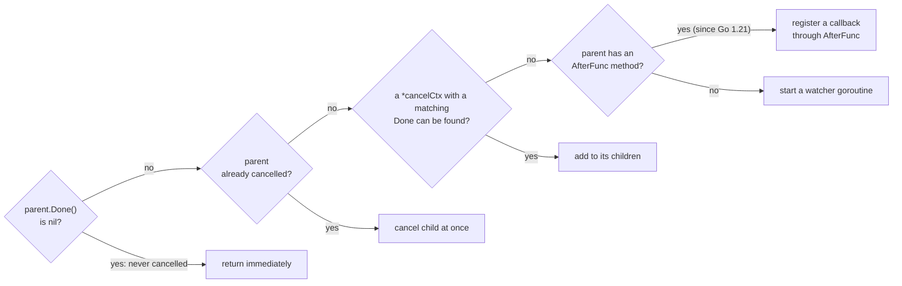
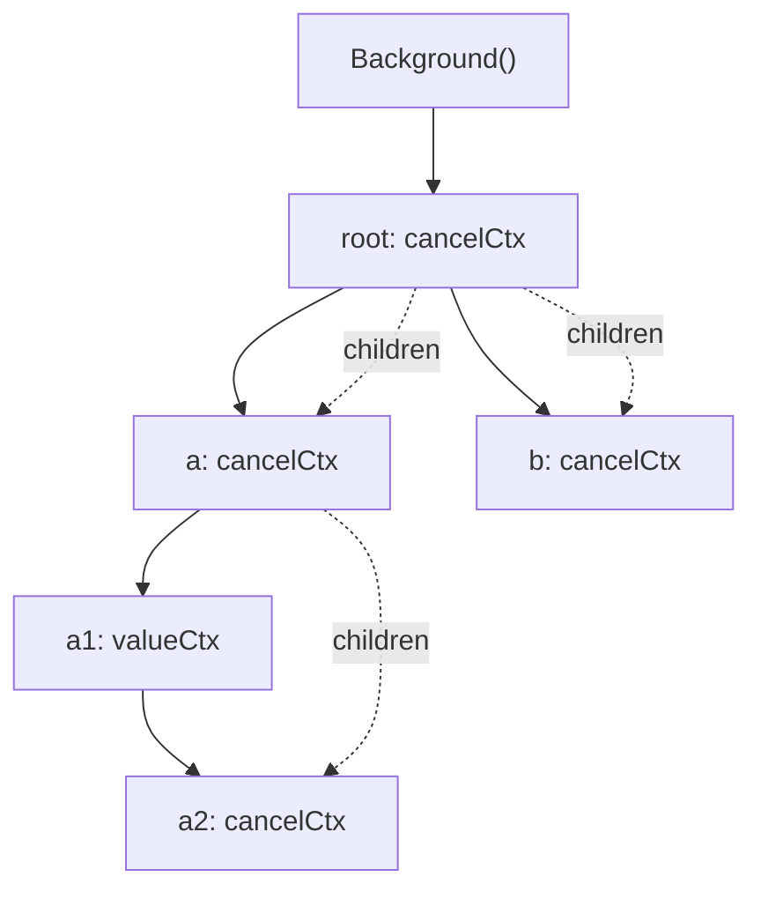

# 11.8 Context

A request arriving at a server is rarely handled by a single goroutine. The handler starts further
goroutines to query a database, call downstream services and read a cache, and these may spawn more,
forming a tree rooted at the request. Once the requester no longer needs the result, for example
because the client disconnected or the upstream timed out, the work still running in the tree is
waste: it holds connections, locks and memory, and its output will never be read. The problem is how
to deliver the signal "stop" from the root to every leaf and let each goroutine wind down on its
own.

The `context` package is Go's standard answer. According to the package documentation, a `Context`
carries deadlines, cancellation signals, and other request-scoped values across API boundaries and
between processes [[Go Authors, 2026a](#ref-go-authors-2026a)]. It was developed inside Google and
released in 2014 as `golang.org/x/net/context` [[Ajmani, 2014b](#ref-ajmani-2014b)]; in 2016 Brad
Fitzpatrick and Sameer Ajmani proposed moving it into the standard library
[[Fitzpatrick, 2016a](#ref-fitzpatrick-2016a)], and it shipped with Go 1.7
[[Fitzpatrick, 2016b](#ref-fitzpatrick-2016b)]. In the same release, `net/http`'s `Request` gained a
`Context` method, `net.Dialer` gained `DialContext`, and `os/exec` gained `CommandContext`.

This section first explains why cancellation is cooperative, then walks through the implementation
along the cancellation tree, then covers deadlines and the interfaces added in Go 1.20 and 1.21,
places `context` in the lineage of structured concurrency, and finally reviews the debate over
passing values and passing arguments explicitly.

## 11.8.1 Cooperative Cancellation

The most direct design would provide an operation that terminates a goroutine from outside. Go has
no such operation, and Java's experience shows why. Java originally offered `Thread.stop`, which JDK
1.2 deprecated. Oracle's explanation is that a stopped thread releases all the monitors it holds; if
the objects those monitors protect were in an inconsistent state, other threads
see "damaged" objects; and because the thread is killed silently, the program gets no warning, and
the corruption may surface hours or even days later [[Oracle, 2023](#ref-oracle-2023)]. The
invariants a lock protects hold only at the boundaries of the critical section, and from outside
there is no way to know whether the target thread is inside one. JDK 20 made `Thread.stop` always
throw `UnsupportedOperationException` [[OpenJDK, 2022](#ref-openjdk-2022)], and JDK 26 removes it
[[OpenJDK, 2025](#ref-openjdk-2025)].

Go never provided such an entry point: goroutines are anonymous and expose no identifier, name or
data structure to the programmer [[Go Authors, 2026b](#ref-go-authors-2026b)], and the `go`
statement returns no handle with which to control one. Cancellation can therefore only be a signal:
the sender merely notifies, and the receiver checks the signal at checkpoints of its own choosing
and decides how to undo, roll back and release resources. This is called **cooperative
cancellation**, and it is not unique to Go. The .NET cancellation model states that "cancellation is
cooperative and is not forced on the listener" [[Microsoft, 2026](#ref-microsoft-2026)]; the Kotlin
documentation likewise states that coroutine cancellation is cooperative
[[JetBrains, 2026b](#ref-jetbrains-2026b)]; and Java's structured concurrency only interrupts the
threads of subtasks on cancellation and expects them to finish promptly when interrupted
[[Bateman et al., 2026](#ref-bateman-et-al-2026)].

Before `context`, Go programs propagated cancellation with a done channel: closing a channel wakes
an unknown number of waiters, which makes it a broadcast ([10.4.3](../ch10chan/close.md))
[[Ajmani, 2014a](#ref-ajmani-2014a)]. This technique works well within a single pipeline, but its
limits show once work fans out into a tree. A done channel can only cancel the whole tree;
cancelling one subtree on its own requires another channel; deadlines and the reason for
cancellation must be passed separately; and each library has its own way of cancelling, so the
caller's channel cannot be passed into someone else's function [[Štrba, 2017](#ref-strba-2017)].
`context` solves these problems with one uniform interface and makes cancellation propagate down the
tree automatically.

## 11.8.2 The Cancellation Tree

The `Context` interface has only four methods (comments omitted):

```go
type Context interface {
	Deadline() (deadline time.Time, ok bool)
	Done() <-chan struct{}
	Err() error
	Value(key any) any
}
```

`Done` returns a channel that is closed on cancellation; a context that can never be cancelled may
return nil. Callers put it in a `select` alongside their normal work. Before `Done` is closed, `Err`
returns nil; afterwards it returns `Canceled` or `DeadlineExceeded`, stating the reason. `Deadline`
reports the deadline, and `Value` reads request-scoped values (11.8.6).

The interface has no `Cancel` method. Ajmani explains that this follows the same reasoning as `Done`
being receive-only: a function that receives a cancellation signal is usually not the one that sends
it, and when a parent operation starts goroutines for child operations, the children should not be
able to cancel the parent [[Ajmani, 2014b](#ref-ajmani-2014b)]. The power to cancel therefore does
not travel with the `Context`; it is handed to the creator as a separate `CancelFunc`. The .NET
design is the same: a `CancellationTokenSource` issues cancellation requests, while the
`CancellationToken` passed to each operation can only listen, which the documentation
calls "separation of request and listening" [[Microsoft, 2026](#ref-microsoft-2026)].

All contexts derive from a root. The root returned by `Background` is never cancelled, has no values
and no deadline; `TODO` is identical and exists only to mark "it is not yet decided which context to
use here". `WithCancel`, `WithDeadline`, `WithTimeout` and `WithValue` each take a parent context
and return a derived child. The documentation specifies that when a context is cancelled, all
contexts derived from it are cancelled too [[Go Authors, 2026a](#ref-go-authors-2026a)]; its parent
and siblings are unaffected. The following program derives `a` and `b` from `root`, attaches a value
below `a` and derives `a2` from it, and then cancels `a`:

```go {run=true}
package main

import (
	"context"
	"errors"
	"fmt"
)

type traceKey struct{}

func main() {
	root, cancelRoot := context.WithCancel(context.Background())
	defer cancelRoot()

	a, cancelA := context.WithCancelCause(root)
	a1 := context.WithValue(a, traceKey{}, "trace-42")
	a2, cancelA2 := context.WithCancel(a1)
	defer cancelA2()
	b, cancelB := context.WithCancel(root)
	defer cancelB()

	cancelA(errors.New("quota exhausted"))

	for _, n := range []struct {
		name string
		ctx  context.Context
	}{{"root", root}, {"a", a}, {"a2", a2}, {"b", b}} {
		fmt.Printf("%-4s Err=%v Cause=%v\n", n.name, n.ctx.Err(), context.Cause(n.ctx))
	}
	fmt.Printf("trace ID in a2: %v\n", a2.Value(traceKey{}))
}
```

The output is:

```
root Err=<nil> Cause=<nil>
a    Err=context canceled Cause=quota exhausted
a2   Err=context canceled Cause=quota exhausted
b    Err=<nil> Cause=<nil>
trace ID in a2: trace-42
```

Cancellation propagates only downward along the derivation; `root` and `b` are unaffected. `Err` can
only report the generic `context canceled`; the specific reason is retrieved with `Cause` (11.8.4).
Values remain readable after cancellation. Note that the documentation of `Done` allows the close to
happen asynchronously after `cancel` returns. The output above is deterministic because the standard
library's own contexts have cancelled every descendant one by one before `cancel` returns; when the
parent is a custom implementation the situation differs, as described below.

A cancellable context is implemented by `cancelCtx`:

```go
type cancelCtx struct {
	Context

	mu       sync.Mutex            // protects following fields
	done     atomic.Value          // of chan struct{}, created lazily, closed by first cancel call
	children map[canceler]struct{} // set to nil by the first cancel call
	err      atomic.Value          // set to non-nil by the first cancel call
	cause    error                 // set to non-nil by the first cancel call
}
```

The embedded `Context` points to the parent, and `children` records the descendants that must be
cancelled along with it. Several details of this structure come from later performance changes.
`done` was originally allocated at creation; in 2017 Josh Bleecher Snyder changed it to be created
on the first call to `Done`, because many contexts are never listened to, or are cancelled before
anyone listens. In a benchmark of a cancellation tree of depth 1, allocation per operation dropped
from 176 bytes to 80 bytes [[Snyder, 2017](#ref-snyder-2017)]. In 2021 `done` moved into an
`atomic.Value` so that the fast path of `Done` takes no lock, prompted by a report that the mutex of
`cancelCtx` suffered extreme contention under high concurrency; the corresponding benchmark dropped
from 67.5 ns to 2.2 ns [[Snyder, 2021](#ref-snyder-2021)].

`err` went through the same change, and it introduced a subtle bug. Go 1.25 made `err` an atomic
variable so that `Err` no longer locks; the source comment says an atomic load is about 5 times
faster than a mutex, which can matter in tight loops [[Neil, 2025a](#ref-neil-2025a)]. But `cancel`
writes `err` first and then closes `done`, publishing the two separately, so a lock-free reader may
see `err` already non-nil while `done` is not yet closed, which violates the interface's promise
that `Err` returns nil before `Done` is closed. Go 1.26 fixed this [[Neil, 2025b](#ref-neil-2025b)]:

```go
func (c *cancelCtx) Err() error {
	// An atomic load is ~5x faster than a mutex, which can matter in tight loops.
	if err := c.err.Load(); err != nil {
		// Ensure the done channel has been closed before returning a non-nil error.
		<-c.Done()
		return err.(error)
	}
	return nil
}
```

After reading a non-nil error, it waits for `done` to close before returning. The path that returns
nil is unchanged; the path that returns an error is about 3 times slower but still faster than
before Go 1.25, and a loop that polls `Err` ends the first time it gets a non-nil result, so this
path is not critical. Two separately published pieces of state must be observed in a definite order,
which is exactly the question the memory model addresses ([11.9](./mem.md)).

The cancellation itself is done by `cancel` (argument checks removed):

```go
func (c *cancelCtx) cancel(removeFromParent bool, err, cause error) {
	// ……
	c.mu.Lock()
	if c.err.Load() != nil {
		c.mu.Unlock()
		return // already canceled
	}
	c.err.Store(err)
	c.cause = cause
	d, _ := c.done.Load().(chan struct{})
	if d == nil {
		c.done.Store(closedchan)
	} else {
		close(d)
	}
	for child := range c.children {
		// NOTE: acquiring the child's lock while holding parent's lock.
		child.cancel(false, err, cause)
	}
	c.children = nil
	c.mu.Unlock()

	if removeFromParent {
		removeChild(c.Context, c)
	}
}
```

The check under the lock makes `cancel` idempotent, so `done` is closed at most once; if nobody has
called `Done` yet, a shared pre-closed channel, `closedchan`, is stored to avoid an allocation.
Then, while holding its own lock, it cancels the descendants one by one, and each descendant
recursively cancels its own. The comment points out that the child's lock is acquired while the
parent's lock is held; as cancellation propagates down the tree, locks are always acquired parent
before child. Finally `children` is set to nil, and after releasing the lock the context removes
itself from its parent's `children`.

How a child attaches to its parent is decided by `propagateCancel`, which has to cope with every
shape a parent can take:



The third test does not check whether the parent is a `*cancelCtx`; instead it queries the parent
for a special key, `&cancelCtxKey`, to which `cancelCtx` answers with itself. However many layers of
`WithValue` intervene, and whatever custom implementation wraps the parent, the nearest `*cancelCtx`
is found; if its done channel equals the one returned by the parent's `Done`, the wrapper has not
changed the cancellation semantics, and the child can be registered directly. This is Russ Cox's
2019 change. Before it, the code climbed through known types layer by layer, and when users
implemented `Context` themselves to manage values, `WithCancel` would start an extra goroutine for
them [[Cox, 2019](#ref-cox-2019)]. In the earlier example, `a2` skips over `a1` in exactly this way
and is registered directly in the `children` of `a`:



Solid lines in the figure show derivation, dashed lines show registrations in `children`, and
cancellation propagates along the dashed lines.

The last branch of the flowchart is the fallback. When the parent is a completely unknown
implementation, the only option is to start a goroutine that waits for either side to finish. If the
parent is cancelled first, it forwards the cancellation to the child; if the child finishes first,
the goroutine exits. Here cancellation must pass through one goroutine scheduling step to reach the
child, and this is what the documentation of `Done` means by closing that "may happen asynchronously
after the call to cancel returns".

## 11.8.3 Deadlines

A deadline is a cancellation that fires automatically at a given time. `timerCtx` adds to
`cancelCtx` only a timer and a point in time:

```go
type timerCtx struct {
	cancelCtx
	timer *time.Timer // Under cancelCtx.mu.

	deadline time.Time
}
```

`WithDeadline` calls `WithDeadlineCause` directly, which is implemented as follows (nil checks
removed):

```go
func WithDeadlineCause(parent Context, d time.Time, cause error) (Context, CancelFunc) {
	// ……
	if cur, ok := parent.Deadline(); ok && cur.Before(d) {
		// The current deadline is already sooner than the new one.
		return WithCancel(parent)
	}
	c := &timerCtx{
		deadline: d,
	}
	c.cancelCtx.propagateCancel(parent, c)
	dur := time.Until(d)
	if dur <= 0 {
		c.cancel(true, DeadlineExceeded, cause) // deadline has already passed
		return c, func() { c.cancel(false, Canceled, nil) }
	}
	c.mu.Lock()
	defer c.mu.Unlock()
	if c.err.Load() == nil {
		c.timer = time.AfterFunc(dur, func() {
			c.cancel(true, DeadlineExceeded, cause)
		})
	}
	return c, func() { c.cancel(true, Canceled, nil) }
}
```

If the parent's deadline is earlier than the new one, the parent will cancel the child along with
itself when its time comes, so installing a timer for the child is redundant and the call degrades
to `WithCancel`. If the deadline has already passed, the context is cancelled at once with
`DeadlineExceeded`. Otherwise a callback is registered with `time.AfterFunc`
([9.10](../ch09sched/timer.md)) and cancels at the deadline. `WithTimeout(parent, d)` is just
`WithDeadline(parent, time.Now().Add(d))`. `DeadlineExceeded` implements the `net.Error` interface,
and its `Timeout` method returns true, so network code can handle it together with I/O timeouts. The
`Deadline` method lets a callee judge, before starting work, whether the remaining time suffices,
and decline to start if it does not [[Ajmani, 2014b](#ref-ajmani-2014b)].

Whoever triggers the cancellation, the `CancelFunc` returned by `WithCancel`, `WithDeadline` and
`WithTimeout` must be called, even if the work has finished normally. The documentation says that
calling it cancels the child and its descendants, removes the parent's reference to the child, and
stops any associated timers; failing to call it leaks the child and its descendants until the parent
is cancelled [[Go Authors, 2026a](#ref-go-authors-2026a)]. Under a long-lived parent this is a
steadily growing memory leak. The idiom is to write `defer cancel()` immediately after creation. The
lostcancel check of `go vet` was added in Go 1.7 together with `context`; it searches the
control-flow graph for a path from `WithCancel` to `return` that does not use `cancel`. Alan Donovan
ran it over a sample of 50,000 source files and found 2068 instances of `cancel` assigned to the
blank identifier and 118 bugs where the function returned before calling `cancel`; he manually
inspected 20 of them and found no false positives [[Donovan, 2016](#ref-donovan-2016)]. This check
requires running `go vet` explicitly; it is not among the checks that `go test` runs automatically.

## 11.8.4 Cancellation Causes, Detaching and Callbacks

`Err` can only distinguish "cancelled" from "timed out", which is often too little when debugging.
In 2018 an issue asked for a way to find out where a context was cancelled; on that basis Ajmani
proposed an interface for cancellation causes in 2022 [[Ajmani, 2022a](#ref-ajmani-2022a)]. The
proposal lists the constraints imposed by Go 1 compatibility: no methods can be added to the
`Context` interface, the type of `CancelFunc` and the signatures of existing functions cannot
change, and `Err` can only return one of nil, `Canceled` and `DeadlineExceeded`. Go 1.20 therefore
added `WithCancelCause`, whose `CancelCauseFunc` takes an error as the cause and records it in
`cancelCtx.cause`; the cause is retrieved by the package-level function `Cause`, which also finds
the nearest `cancelCtx` through `&cancelCtxKey`. The cause is decided by the first cancellation: if
the parent is cancelled first with cause1, both parent and child have cause1; if the child is
cancelled first with cause2, the child's cause stays cause2. Go 1.21 added `WithDeadlineCause` and
`WithTimeoutCause`, which specify the cause for cancellation triggered at the deadline; the
`CancelFunc` they return sets no cause [[Ajmani, 2022b](#ref-ajmani-2022b)].

Go 1.21 also added two functions. `WithoutCancel` derives a context that keeps the values but cuts
off cancellation: its `Done` returns nil, `Err` is always nil, and `Cause` also returns nil. The use
cases listed by the proposer, Carlo Alberto Ferraris, are these: the triggering event (for example
an HTTP request) has been cancelled or has already finished, yet rollback, cleanup or a long
follow-up operation must still complete, and that operation needs the authentication, logging and
tracing values attached to the request; switching to `Background` would lose them. The proposal also
notes that similar functions had already been reimplemented many times, for example
`xcontext.Detach` inside `x/tools` [[Ferraris, 2020](#ref-ferraris-2020)]. In the implementation,
`Done` of `withoutCancelCtx` returns nil, so a child derived from it returns at the very first test
of `propagateCancel` and is never registered in the original cancellation tree; it also returns nil
when queried for `&cancelCtxKey`, since otherwise `Cause` would see through it, find the original
`cancelCtx` and retrieve the parent's cause.

`AfterFunc(ctx, f)` runs `f` in a new goroutine after `ctx` is cancelled, and returns a `stop`
function that revokes the registration. Damien Neil's proposal observes that to interrupt a blocking
operation that does not know about contexts on cancellation, such as reads and writes on a
`net.Conn` or a wait on a `sync.Cond`, the only way was to start a goroutine per operation to watch
for cancellation, which is not worthwhile when the operation itself is cheap; `AfterFunc` only
registers a callback, and in the common case where no cancellation happens, no goroutine is created
[[Neil, 2023](#ref-neil-2023)]. It is implemented by an `afterFuncCtx` that embeds `cancelCtx` and
hangs in the cancellation tree as a child, with a `sync.Once` choosing between "run
`f`" and "revoked by `stop`". The standard library example uses it to make a condition variable wait
cancellable (some comments removed):

```go
waitOnCond := func(ctx context.Context, cond *sync.Cond, conditionMet func() bool) error {
	stopf := context.AfterFunc(ctx, func() {
		// We need to acquire cond.L here to be sure that the Broadcast
		// below won't occur before the call to Wait, which would result
		// in a missed signal (and deadlock).
		cond.L.Lock()
		defer cond.L.Unlock()

		// ……
		cond.Broadcast()
	})
	defer stopf()

	for !conditionMet() {
		cond.Wait()
		if ctx.Err() != nil {
			return ctx.Err()
		}
	}

	return nil
}
```

This code condenses several points of [11.4](./cond.md). The callback acquires `cond.L` before
broadcasting; otherwise the broadcast could happen before the waiter calls `Wait`, losing the
signal. A condition variable cannot wake one specific waiter, only broadcast, so each of N
concurrent waiters causes O(N) needless wakeups for a total cost of O(N²); the original comment in
the example points out this cost explicitly. A waiter may be woken because someone else's context
was cancelled, so it must recheck the condition and `ctx.Err()` in a loop, which is exactly what
Mesa semantics requires ([11.4.2](./cond.md)).

`AfterFunc` also completes `propagateCancel` in the other direction: a custom context that provides
an `AfterFunc(func()) func() bool` method takes the branch "register a callback through
AfterFunc" in the flowchart when children are derived from it, using a callback in place of a
watcher goroutine.

## 11.8.5 Structured Concurrency

`context` answers the question "how to make the work in a tree of goroutines stop", and places no
constraint on the shape of the tree. The term "structured concurrency" was coined by Martin Sústrik
in 2016 [[Sústrik, 2016](#ref-sustrik-2016)] and became widely known through Nathaniel J. Smith's
2018 article [[Smith, 2018](#ref-smith-2018)]; for its meaning and motivation see
[3.6.5](../../part1overview/ch03life/main.md). From its viewpoint, cancellation is only half of the
problem; the other half is waiting.

Dave Cheney pointed out in 2017 that the most important function of `Context` is broadcasting a
cancellation signal, but that this function is incomplete, because there is no way to wait for the
signal to be acknowledged [[Cheney, 2017](#ref-cheney-2017)]. Cheney's point of comparison is
Gustavo Niemeyer's 2011 tomb package [[Niemeyer, 2011](#ref-niemeyer-2011)], which manages only the
life cycle of goroutines: it can notify a target to stop, wait for the target to confirm that it has
stopped, and collect the final error. The Trio library that Smith describes builds that other half
into the scope: a nursery always waits for its tasks to exit, and even a task that is being
cancelled is waited for until it has run its cleanup code; when a task raises an unhandled
exception, the nursery first cancels the remaining tasks, waits for them to finish, and then
propagates the exception outward. Smith also cautions that this requires the nursery to be tightly
integrated with the language's cancellation mechanism, which may not be easy in languages such as C#
or Go that manage cancellation through manually passed objects and conventions.

The approaches of the various languages compare as follows:

| System | Scope primitive | How cancellation is delivered | On leaving the scope |
| --- | --- | --- | --- |
| Trio | nursery | raises `Cancelled` at the next checkpoint | waits for all tasks to finish |
| Python asyncio (since 3.11) | `TaskGroup` | raises `CancelledError` in the task | waits for all tasks to finish |
| Kotlin | coroutine scope | throws `CancellationException` at the next cancellation check | the parent coroutine waits for its children |
| Java | `StructuredTaskScope` | interrupts the subtask threads | `close` waits for the subtask threads to finish |
| .NET | no corresponding primitive | `CancellationToken`, observed by polling, callbacks or wait handles | the caller waits on its own |
| Go | no language primitive; errgroup approximates one | closes the `Done` channel, which code checks in a `select` | waits only when `Wait` is called |

Python's `TaskGroup` has been available since 3.11
[[Python Software Foundation, 2026](#ref-psf-2026)]. The Kotlin documentation says that a parent
coroutine waits for its children to complete before it finishes, and that when the parent fails or
is cancelled, all its children are cancelled recursively [[JetBrains, 2026a](#ref-jetbrains-2026a)],
which is almost isomorphic to the cancellation tree of `context`. Java's `StructuredTaskScope`
appeared as an incubator module in JDK 19 and 20, became a preview API in JDK 21, and was
re-previewed several times in JDK 22 through 27, with the fifth preview in JDK 25 making major API
changes [[Bateman et al., 2025](#ref-bateman-et-al-2025)]; the final version, JEP 543, proposes to
finalize it without change in JDK 28, and its status is currently "Integrated". By its description,
when a subtask fails the remaining subtasks are interrupted, when the owner thread is interrupted
the subtasks are cancelled with it, and closing the scope waits for the subtask threads to finish
[[Bateman et al., 2026](#ref-bateman-et-al-2026)].

Two points stand out in the comparison. First, every system's cancellation is cooperative; they
differ in how it is delivered. Trio, asyncio and Kotlin have the runtime raise an exception
automatically at suspension points or checkpoints, because the runtime knows which scope each task
belongs to. Go's cancellation is an explicitly passed value, and blocking operations that do not
take a `ctx`, such as channel sends and receives, `Mutex.Lock` and `time.Sleep`, never notice it;
every wait that must respond to cancellation has to be written as a `select`. This is why `ctx` has
to appear in a long chain of function signatures (11.8.6). Second, waiting is guaranteed by the
scope in Java, Trio and Kotlin, whereas in Go it is left to `WaitGroup` and errgroup: errgroup
combines waiting, collecting the first error and a cancellation-derived context, and its
implementation is in [10.7.4](../ch10chan/pattern.md); `WaitGroup.Go` makes "register at launch" the
simplest form ([11.5.7](./waitgroup.md)); and the Go community's discussion about changing the `go`
statement is in [10.7.6](../ch10chan/pattern.md). Smith later added a footnote to the article:
someone had pointed out errgroup in Go as highly relevant.

## 11.8.6 The Debate over Values and Explicit Arguments

The `valueCtx` returned by `WithValue` is extremely simple:

```go
type valueCtx struct {
	Context
	key, val any
}
```

`Value(key)` returns the value if the key matches its own, and otherwise searches up the parent
chain, taking time proportional to the derivation depth. Since Go 1.18 this lookup is a loop rather
than recursion: profiling of a production server showed that 2.3% of CPU time went to stack growth
when `Value` was nested 12 or more levels deep in the call chain
[[roudkerk, 2021](#ref-roudkerk-2021)]. Derivation never modifies the parent, so all contexts form
an immutable persistent linked list in which siblings share ancestors, and concurrent reads need no
synchronization. The documentation places several requirements on keys: a key must be comparable and
should not be a built-in type such as `string`, to avoid collisions between packages; packages
should define an unexported key type and provide type-safe accessor functions; and keys are often of
type `struct{}`, which needs no allocation when assigned to an interface
[[Go Authors, 2026a](#ref-go-authors-2026a)].

The larger dispute is over what belongs in `Value` and whether `ctx` should appear in every function
signature. The line the documentation draws is that values are only for request-scoped data that
crosses process and API boundaries, and should not be used to pass optional parameters to functions.
In a 2017 article, Michal Štrba criticized `context` as spreading like a virus: any library that
might be used by a server must accept a `ctx` on its time-consuming functions; `Value` has no static
types and resembles thread-local storage; and the whole of `context` is in most cases just an
inefficient linked list. Štrba nevertheless conceded that it does solve cancellation, a rather hard
problem in Go, and argued that Go 2 should solve it directly in the language
[[Štrba, 2017](#ref-strba-2017)]; the corresponding proposal filed the next year was closed three
weeks later [[Štrba, 2018](#ref-strba-2018)]. Damien Neil came from the other direction and asked
whether goroutine-local storage could replace `Context` entirely [[Neil, 2017](#ref-neil-2017)]. Ian
Lance Taylor closed that proposal, reasoning that the current explicit mechanism is a deliberate
choice and appears to work well, and that copying local data for every goroutine created could also
be costly [[Taylor, 2018b](#ref-taylor-2018b)]. The Go FAQ gives a more fundamental reason:
goroutines are anonymous precisely so that computation is not bound to a particular goroutine; if
`net/http` associated per-request state with a goroutine, clients could no longer use additional
goroutines while handling a request [[Go Authors, 2026b](#ref-go-authors-2026b)].

Cheney's position is the opposite of Štrba's: values are what `context` is really for, so it should
be only a request-scoped, copy-on-write list of values, with lifetime management separated out
[[Cheney, 2017](#ref-cheney-2017)]. In 2018 Taylor opened an issue for discussing a new version of
`context`, collecting several complaints: the repetitive `ctx context.Context` spelling; `WithValue`
accepting keys of any type, which invites misuse; the name `Context` being confusing because it is
mainly used for cancellation; and the explicit passing of `ctx` everywhere
[[Taylor, 2018a](#ref-taylor-2018a)]. The issue is still open.

A companion to explicit passing is the rule not to store a `Context` in a struct but to pass it
explicitly as the first argument to every function that needs it
[[Barkhuysen and Proud, 2021](#ref-barkhuysen-proud-2021)]. In the proposal to move `context` into
the standard library, Fitzpatrick had already said that the real advice is not to "save" a context;
it should be passed like a parameter [[Fitzpatrick, 2016a](#ref-fitzpatrick-2016a)]. `http.Request`
holding a context internally is an exception to this rule: when Go 1.7 introduced `context`, adding
a parameter to methods such as `Client.Do` would have broken compatibility, so `net/http` put the
context inside the request struct, with `WithContext` returning a request that carries a new
context; the other compatible approach is to add new functions with the suffix `Context`, such as
`DialContext` on `net.Dialer` [[Barkhuysen and Proud, 2021](#ref-barkhuysen-proud-2021)]. The cost
of explicit passing is verbose signatures; in exchange, the path along which cancellation and
deadlines travel is visible in the code and can be checked statically by tools. Between tidy
signatures and visible data flow, Go once again chose the latter.

## Further Reading

- <a id="ref-ajmani-2014a"></a>[Ajmani, 2014a] Sameer Ajmani. *Go Concurrency Patterns: Pipelines
  and cancellation.* The Go Blog, March 13, 2014. https://go.dev/blog/pipelines
- <a id="ref-ajmani-2014b"></a>[Ajmani, 2014b] Sameer Ajmani. *Go Concurrency Patterns: Context.*
  The Go Blog, July 29, 2014. https://go.dev/blog/context
- <a id="ref-ajmani-2022a"></a>[Ajmani, 2022a] Sameer Ajmani. Go issue #51365. *context: add APIs
  for writing and reading cancelation cause.* 2022. https://github.com/golang/go/issues/51365
  Shipped with Go 1.20.
- <a id="ref-ajmani-2022b"></a>[Ajmani, 2022b] Sameer Ajmani. Go issue #56661. *context: add APIs
  for setting a cancelation cause when deadline or timer expires.* 2022.
  https://github.com/golang/go/issues/56661 Shipped with Go 1.21.
- <a id="ref-barkhuysen-proud-2021"></a>[Barkhuysen and Proud, 2021] Jean Barkhuysen, Matt T. Proud.
  *Contexts and structs.* The Go Blog, February 24, 2021. https://go.dev/blog/context-and-structs
- <a id="ref-bateman-et-al-2025"></a>[Bateman et al., 2025] Alan Bateman, Viktor Klang, Ron
  Pressler. *JEP 505: Structured Concurrency (Fifth Preview).* OpenJDK, JDK 25.
  https://openjdk.org/jeps/505
- <a id="ref-bateman-et-al-2026"></a>[Bateman et al., 2026] Alan Bateman, Viktor Klang, Ron
  Pressler. *JEP 543: Structured Concurrency.* OpenJDK, 2026. https://openjdk.org/jeps/543
- <a id="ref-cheney-2017"></a>[Cheney, 2017] Dave Cheney. *Context isn't for cancellation.* August
  20,
  2017. https://dave.cheney.net/2017/08/20/context-isnt-for-cancellation
- <a id="ref-cox-2019"></a>[Cox, 2019] Russ Cox. context: use fewer goroutines in
  WithCancel/WithTimeout. Go commit 0ad368675b, 2019. https://go.dev/cl/196521 Shipped with Go 1.14.
- <a id="ref-donovan-2016"></a>[Donovan, 2016] Alan Donovan. cmd/vet: -lostcancel: check for
  discarded result of context.WithCancel. Go commit b65cb7f198, 2016. https://go.dev/cl/24150
  Shipped with Go 1.7.
- <a id="ref-ferraris-2020"></a>[Ferraris, 2020] Carlo Alberto Ferraris. Go issue #40221.
  *context: add WithoutCancel.* 2020. https://github.com/golang/go/issues/40221
  Shipped with Go 1.21.
- <a id="ref-fitzpatrick-2016a"></a>[Fitzpatrick, 2016a] Brad Fitzpatrick. Go issue #14660.
  *proposal: context: new package for standard library.* 2016.
  https://github.com/golang/go/issues/14660 The original proposal to bring `context` into the
  standard library.
- <a id="ref-fitzpatrick-2016b"></a>[Fitzpatrick, 2016b] Brad Fitzpatrick. context: add the context
  package from golang.org/x/net/context. Go commit 9db7ef5614, 2016. https://go.dev/cl/20346
  Shipped with Go 1.7.
- <a id="ref-go-authors-2026a"></a>[Go Authors, 2026a] The Go Authors. *Package context.*
  https://pkg.go.dev/context ; source in `src/context/context.go` (this section follows Go 1.26).
- <a id="ref-go-authors-2026b"></a>[Go Authors, 2026b] The Go Authors. *Frequently Asked Questions:
  Why is there no goroutine ID?* https://go.dev/doc/faq#no_goroutine_id
- <a id="ref-jetbrains-2026a"></a>[JetBrains, 2026a] JetBrains. *Coroutines basics.* Kotlin
  Documentation. https://kotlinlang.org/docs/coroutines-basics.html
- <a id="ref-jetbrains-2026b"></a>[JetBrains, 2026b] JetBrains. *Cancellation and timeouts.* Kotlin
  Documentation. https://kotlinlang.org/docs/coroutines-cancellation.html
- <a id="ref-microsoft-2026"></a>[Microsoft, 2026] Microsoft. *Cancellation in Managed Threads.*
  .NET Documentation.
  https://learn.microsoft.com/en-us/dotnet/standard/threading/cancellation-in-managed-threads
- <a id="ref-neil-2017"></a>[Neil, 2017] Damien Neil. Go issue #21355. *proposal: Replace Context
  with goroutine-local storage.* 2017. https://github.com/golang/go/issues/21355
- <a id="ref-neil-2023"></a>[Neil, 2023] Damien Neil. Go issue #57928. *context: add
  AfterFunc.* 2023. https://github.com/golang/go/issues/57928 Shipped with Go 1.21.
- <a id="ref-neil-2025a"></a>[Neil, 2025a] Damien Neil. context: use atomic operation in ctx.Err. Go
  commit 0a0e6af39b, 2025. https://go.dev/cl/653795
  Shipped with Go 1.25.
- <a id="ref-neil-2025b"></a>[Neil, 2025b] Damien Neil. context: don't return a non-nil from Err
  before Done is closed. Go commit 8ca209ec39, 2025. https://go.dev/cl/705235 Shipped with Go 1.26.
- <a id="ref-niemeyer-2011"></a>[Niemeyer, 2011] Gustavo Niemeyer. *Death of goroutines under
  control.*
  2011. https://blog.labix.org/2011/10/09/death-of-goroutines-under-control ; companion library
        `gopkg.in/tomb.v2`.
  Archived:
  https://web.archive.org/web/20250812232118/https://blog.labix.org/2011/10/09/death-of-goroutines-under-control
  tomb, an early practice of cooperative cancellation.
- <a id="ref-openjdk-2022"></a>[OpenJDK, 2022] OpenJDK. JDK-8289610. *Degrade Thread.stop.* JDK
  20, 2022. https://bugs.openjdk.org/browse/JDK-8289610
- <a id="ref-openjdk-2025"></a>[OpenJDK, 2025] OpenJDK. JDK-8368226. *Remove Thread.stop.* JDK
  26, 2025. https://bugs.openjdk.org/browse/JDK-8368226
- <a id="ref-oracle-2023"></a>[Oracle, 2023] Oracle. *Java Thread Primitive Deprecation.* Java
  SE 21.
  https://docs.oracle.com/en/java/javase/21/docs/api/java.base/java/lang/doc-files/threadPrimitiveDeprecation.html
  Why `Thread.stop` was deprecated.
- <a id="ref-psf-2026"></a>[Python Software Foundation, 2026] Python Software Foundation.
  *Coroutines and Tasks: Task Groups.* Python 3 Documentation.
  https://docs.python.org/3/library/asyncio-task.html#task-groups
- <a id="ref-roudkerk-2021"></a>[roudkerk, 2021] roudkerk. context: implement Context.Value using
  iteration rather than recursion. Go commit afe43f1e5e, 2021. https://go.dev/cl/335790
  Shipped with Go 1.18.
- <a id="ref-smith-2018"></a>[Smith, 2018] Nathaniel J. Smith. *Notes on structured concurrency, or:
  Go statement considered harmful.* April 25, 2018.
  https://vorpus.org/blog/notes-on-structured-concurrency-or-go-statement-considered-harmful/
- <a id="ref-snyder-2017"></a>[Snyder, 2017] Josh Bleecher Snyder. context: lazily initialize
  cancelCtx done channel. Go commit 986768de7f, 2017. https://go.dev/cl/34979 Shipped with Go 1.9.
- <a id="ref-snyder-2021"></a>[Snyder, 2021] Josh Bleecher Snyder. context: reduce contention in
  cancelCtx.Done. Go commit ae1fa08e41, 2021. https://go.dev/cl/288193
  Shipped with Go 1.17.
- <a id="ref-strba-2017"></a>[Štrba, 2017] Michal Štrba. *Context should go away for Go 2.* August
  6,
  2017. https://faiface.github.io/post/context-should-go-away-go2/
- <a id="ref-strba-2018"></a>[Štrba, 2018] Michal Štrba. Go issue #27982. *proposal: Go 2: bake a
  cooperative goroutine cancellation mechanism into the language.* 2018.
  https://github.com/golang/go/issues/27982
- <a id="ref-sustrik-2016"></a>[Sústrik, 2016] Martin Sústrik. *Structured Concurrency.* February
  7, 2016. https://sustrik.github.io/250bpm/blog:71/index.html
- <a id="ref-taylor-2018a"></a>[Taylor, 2018a] Ian Lance Taylor. Go issue #28342. *proposal:
  context/v2: update context package.* 2018. https://github.com/golang/go/issues/28342
- <a id="ref-taylor-2018b"></a>[Taylor, 2018b] Ian Lance Taylor. Comment on golang/go#21355, 2018.
  https://github.com/golang/go/issues/21355#issuecomment-371308423
- This book: [10.4 The Semantics of Closing](../ch10chan/close.md),
  [10.7 Engineering Practice and Cross-Language Comparison](../ch10chan/pattern.md),
  [9.10 Timers](../ch09sched/timer.md), [11.4 Condition Variables](./cond.md),
  [11.5 Wait Groups](./waitgroup.md), [11.9 Memory Consistency Models](./mem.md).
