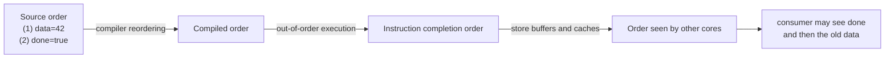
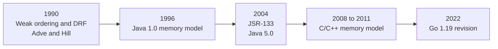
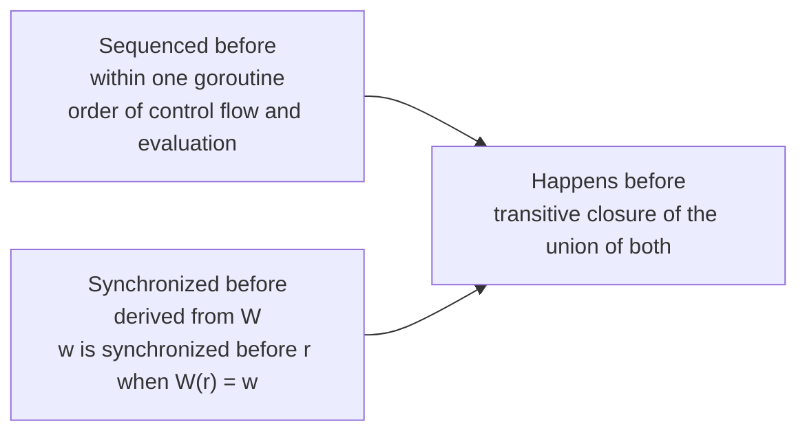
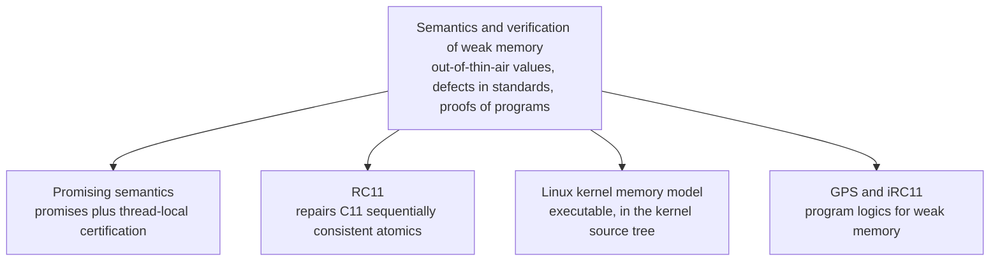

# 11.9 Memory Consistency Models

The preceding sections invoked "synchronized before" and "happens before" many times without
answering a more basic question: when two goroutines read and write the same variable at the same
time, under what conditions is one side's write guaranteed to be seen by the other? The
specification that answers it is called a **memory consistency model**, or memory model for short.
The Go memory model document opens with this statement [[Go Authors, 2022](#ref-go-authors-2022)]:

> The Go memory model specifies the conditions under which reads of a variable in one goroutine can
> be guaranteed to observe values produced by writes to the same variable in a different goroutine.

A warning follows immediately. Data accessed by several goroutines at once must have its
modifications serialized, by channel operations or by the primitives in `sync` and `sync/atomic`;
and if a reader must read the rest of the document to understand what their program does, they are
being too clever: "Don't be clever." Pike added this advice to the document in 2014
[[Pike, 2014a](#ref-pike-2014a)].

The warning is only a few words long, but behind it lie decades of negotiation among hardware,
compilers, and language specifications. This section first explains why a memory model is needed,
then introduces the basic notions of sequential consistency, weak ordering, and data-race freedom,
and surveys hardware and programming-language memory models. It then returns to Go: the formal
definition, where synchronization comes from, several incorrect idioms and the implementation of
`sync.Once`, the evolution of the document, and the problems this field has not yet solved.

## 11.9.1 Why a Memory Model Is Needed

A Go program goes through compiler transformations and optimizations on its way from source code to
execution, and the processor that runs it changes the order of instructions and memory accesses in
several ways of its own. All these optimizations observe one baseline: they must not change the
behavior that a single thread can observe of itself. Once a second thread observes the same memory,
that baseline no longer explains what the program does. Consider a minimal producer and consumer
that share `data` and `done`:

```go
var data int
var done bool

func producer() {
	data = 42      // (1)
	done = true    // (2)
}

func consumer() {
	for !done {    // (3)
	}
	print(data)    // (4)
}
```

In the source, (1) precedes (2), so intuition says that once `consumer` reads `done == true` it must
read `data == 42`. Yet the program guarantees neither that it prints 42 nor that the loop
terminates. The compiler may swap (1) and (2), which do not depend on each other, and may hoist the
read of `done` out of the loop, after which the loop keeps checking a stale value in a register and
never exits. The processor may execute instructions out of order, maintaining data dependencies only
within a single core; and a write first enters the core's private store buffer, so the moment it
becomes visible to other cores need not follow the order of the writes.



The memory model is the contract made for exactly this situation. It sits between the programmer,
the compiler, and the hardware, and states under what conditions a write by one thread is certain to
be seen by a read in another: the compiler and hardware may perform any optimization that does not
violate the contract, and the programmer may rely only on the guarantees the contract spells out. A
contract that is too strong closes off room for optimization; one that is too weak leaves the
programmer unable to reason. Once a hardware architecture has adopted a fairly strong model, it is
hard to weaken it later without breaking existing programs, which may already depend on it.

The language could define such programs to behave as intuition expects. In January 2022 Warren Bare
proposed that a few basic types such as `bool`, `byte`, and `int` be defined to work naturally in
the one-writer, many-readers case, so that a loop like `for running { ... }` would stop when another
goroutine writes `running = false` [[Bare, 2022](#ref-bare-2022)]. Cox replied
[[Cox, 2022a](#ref-cox-2022a)]:

> They may seem innocent enough, but the implications are the compiler removing very important
> optimizations all for the sake of racy programs. … We already restrict the compiler quite a lot
> compared to C/C++, and I think justifiably so, to limit the possible damage done by races. But
> races _are_ races. What you are proposing is to make them not races anymore, which would require
> much less efficient code in a variety of settings, slowing down the extant body of
> entirely-race-free Go code for no benefit to that code.

The proposal was declined in February of the same year.

Reordering in hardware is not merely a theoretical possibility either. The following program is a
**litmus test**, a small concurrent program designed to provoke one particular kind of reordering.
Two goroutines each write one variable and then read the other's; the main goroutine uses two atomic
counters to start both on every round at the same time, and checks the result after both have
finished:

```go
package main

import (
	"fmt"
	"sync/atomic"
)

const n = 1_000_000

var (
	x, y   int // plain variables; the accesses form a data race
	r1, r2 int
	start  atomic.Int64 // round i has started
	finish atomic.Int64 // number of finished half-rounds
)

func worker(id int) {
	for i := int64(1); i <= n; i++ {
		for start.Load() < i {
		}
		if id == 0 {
			x = 1
			r1 = y
		} else {
			y = 1
			r2 = x
		}
		finish.Add(1)
	}
}

func main() {
	go worker(0)
	go worker(1)
	both := 0
	for i := int64(1); i <= n; i++ {
		x, y = 0, 0
		start.Store(i)
		for finish.Load() < 2*i {
		}
		if r1 == 0 && r2 == 0 {
			both++
		}
	}
	fmt.Printf("r1 == r2 == 0 occurred %d times in %d rounds\n", both, n)
}
```

In any sequentially consistent interleaving, one side's write executes before the other side's read,
so `r1` and `r2` cannot both be 0. Run three times on an Apple M5 Pro (arm64), `r1 == r2 == 0`
occurred 997948, 997173, and 994657 times in 1 million rounds, in nearly every round. The assembly
from `go build -gcflags=-S` shows that in `worker` the store to `x`, `MOVD R2, main.x(SB)`, still
comes before the load of `y`, `MOVD main.y(SB), R3`; the compiler did not swap them. The swap
happens in the hardware: the write is still in the store buffer when the following read completes.

After `x` and `y` are changed to `atomic.Int64` and the accesses to `Store` and `Load`, the same
experiment never produced this result. This is no accident: Go's atomic operations are sequentially
consistent ([11.3.6](./atomic.md)), and the memory model guarantees that it cannot occur. The
original program has a data race. Built with `-race` (and with the round count reduced to 1000), the
race detector reports `Found 2 data race(s)`, the program prints its result as usual, and it finally
exits with status 66. The result of this program depends on hardware and scheduling, so it is not
given as a runnable example.

## 11.9.2 Sequential Consistency, Weak Ordering, and Data-Race Freedom

The most intuitive memory model was proposed by Lamport in 1979 and is called **sequential
consistency** (SC) [[Lamport, 1979](#ref-lamport-1979)]:

> the result of any execution is the same as if the operations of all the processors were executed
> in some sequential order, and the operations of each individual processor appear in this sequence
> in the order specified by its program.

A sequentially consistent machine behaves as if all processors took turns accessing a single memory:
one operation executes at a time, the operations of different processors may interleave arbitrarily,
but no processor can disturb its own order. As far as hardware goes, both programs of 11.9.1 behave
correctly on such a machine.

Sequential consistency is often confused with linearizability. The latter was proposed by Herlihy
and Wing in 1990 and concerns concurrent objects: every operation must appear to take effect
atomically at some instant between its invocation and its response
[[Herlihy and Wing, 1990](#ref-herlihy-wing-1990)]. Linearizability therefore respects real-time
order: an operation that begins after another has returned must be ordered after it. Sequential
consistency only requires a total order compatible with each processor's program order and ignores
real time. The causal consistency and eventual consistency often mentioned in distributed storage
are weaker still; they mainly describe how replicas converge and are not discussed further here.

The price of sequential consistency is that it forbids the most basic optimizations such as store
buffers: the experiment in 11.9.1 produced `r1 == r2 == 0` precisely because the writes sat in
buffers while the later reads completed first. No mainstream general-purpose processor adopts
sequential consistency as its hardware model. The fallback idea is that hardware need not be
sequentially consistent for every program, only for programs that synchronize by the rules. In 1990
Adve and Hill stated this idea as a definition of **weak ordering**
[[Adve and Hill, 1990](#ref-adve-hill-1990)]:

> Let a synchronization model be a set of constraints on memory accesses that specify how and when
> synchronization needs to be done. Hardware is weakly ordered with respect to a synchronization
> model if and only if it appears sequentially consistent to all software that obey the
> synchronization model.

The most common such rule is freedom from data races. Two operations that access the same memory
location, at least one of which is a write, with no synchronization ordering them, form a **data
race**; a program none of whose executions contains a data race is called **data-race-free** (DRF).
This yields a deal between software and hardware known as DRF-SC: the programmer is responsible for
eliminating data races, and the system is responsible for making such programs behave as if
sequentially consistent. It replaces the hard problem of "understanding a weak memory model" with
the more definite obligation of "eliminating data races", which tools can also check. The 1996
tutorial by Adve and Gharachorloo surveys the relaxed models proposed in this period
[[Adve and Gharachorloo, 1996](#ref-adve-gharachorloo-1996)]; since then, the memory models of Java,
C++, and Go have all been based on DRF-SC [[Adve and Boehm, 2010](#ref-adve-boehm-2010)].

## 11.9.3 Hardware Memory Models

Before discussing hardware, two often-confused notions need to be separated. Cache coherence
guarantees that for writes to a single memory location, all cores agree on their order; memory
consistency governs what the order of one core's reads and writes across several locations looks
like to other cores. The former is the foundation of the latter but cannot replace it
[[Sorin et al., 2011](#ref-sorin-2011)].

The main source of disordering is the **store buffer**: when a core executes a write, it puts the
write in a private buffer and continues with later instructions without waiting for the write to
reach the cache. The core need not stall; the price is that other cores see the write only after it
drains from the buffer, whereas the core's own later reads can fetch the value just written directly
from the buffer. Out-of-order and speculative execution also let memory accesses complete out of
program order. These mechanisms are transparent to a single thread and need rules to constrain them
for multiple threads. To restore order when needed, hardware that is not sequentially consistent
provides instructions called **memory barriers** or fences. In the experiment of 11.9.1, if each
thread places a barrier between its write and its read, draining its write to memory before reading,
then `r1 == r2 == 0` becomes impossible. The kinds and semantics of barriers vary across
architectures [[Cox, 2021a](#ref-cox-2021a)].

By the strength of their constraints, the memory models of mainstream hardware can be arranged
roughly along a spectrum [[Cox, 2021a](#ref-cox-2021a)].

x86 (Intel and AMD) is at the stronger end. Its model is called x86-TSO (total store order): all
cores share one memory, each core has a first-in, first-out store buffer, writes drain in program
order, and reads first consult the core's own buffer. The only visible reordering is that a read
after a write becomes visible to other cores before that write does (store→load)
[[Sewell et al., 2010](#ref-sewell-2010)]. The `r1 == r2 == 0` result of 11.9.1 is allowed by
x86-TSO as well. Concurrent code that happens to work on x86 often depends on exactly this strength
of TSO.

ARMv8 and POWER are at the weaker end; all four reorderings, store→store, store→load, load→load, and
load→store, may occur. What separates them is **multi-copy atomicity**: a core may read its own
write before it is visible to others, but once any other core sees a write, it must be visible to
all cores (strictly speaking this is called other-multi-copy atomicity). POWER does not satisfy this
property, and two writes can be seen in different orders by different readers
[[Sarkar et al., 2011](#ref-sarkar-2011)]; ARMv8 did not satisfy it at first either, and the
architecture was later revised to be multi-copy atomic, which greatly simplified the model
[[Pulte et al., 2018](#ref-pulte-2018)]. The base RISC-V model, RVWMO, is weakly ordered and also
multi-copy atomic; the optional Ztso extension adds total store ordering on top of it
[[RISC-V International, 2026](#ref-riscv-2026)].

The historical DEC Alpha is more peculiar still: even address dependencies did not order its loads.
Even if `p` is a pointer just loaded, `*p` may read content older than `p`. The reason is that
Alpha's local cache is split into two parts, and two successive writes may be handled by two parts
that are differently busy, so the later one takes effect first [[Stern, 2017](#ref-stern-2017)]. For
this the Linux kernel has the `smp_read_barrier_depends` barrier, a no-op on every other
architecture; from version 4.15 the barrier was folded into `READ_ONCE`
[[Deacon, 2017](#ref-deacon-2017)], and version 5.9 removed the interface
[[Deacon, 2019](#ref-deacon-2019)].

Litmus tests are exactly what is used to determine which reorderings a piece of hardware allows.
Several common ones follow:

| Test | Shape | Examines | Models that allow the counterintuitive result |
| --- | --- | --- | --- |
| SB (store buffering) | Two threads each write one variable, then read the other's | store→load | x86-TSO, ARMv8, POWER, RISC-V; only SC forbids it |
| MP (message passing) | One side writes data and then sets a flag; the other reads data after seeing the flag | store→store, load→load | ARMv8, POWER, RISC-V; forbidden by SC and x86-TSO |
| LB (load buffering) | Two threads each read one variable, then write the one the other read | load→store | ARMv8, POWER; forbidden by SC and x86-TSO |
| IRIW (independent reads of independent writes) | Two writers each write one variable; two readers read the two variables in opposite orders (each reader's two reads are ordered by an address dependency) | multi-copy atomicity | POWER, pre-revision ARMv8; forbidden by SC, x86-TSO, revised ARMv8, and RISC-V |

To examine multi-copy atomicity on its own, IRIW first has to rule out the readers' own load-load
reordering; the table does this by making the address of the second read depend on the result of the
first. The plain IRIW without this constraint allows the counterintuitive result on both ARM and
POWER [[Cox, 2021a](#ref-cox-2021a)]. Nor does hardware necessarily produce every result its model
allows: although LB is allowed by the ARM and POWER models, the 2012 experiments of Maranget et al.
observed it only on ARM and never on POWER [[Cox, 2021a](#ref-cox-2021a)]. When the hardware is in
practice stronger than its model, a program may come to depend on the extra strength without knowing
it, and then fail on weaker hardware later.

These models are not oral conventions. There are two ways to model hardware: an operational model
describes how an abstract machine with buffers and queues executes step by step; an axiomatic model
views an execution as a graph of relations among events and uses a set of acyclicity conditions to
specify which outcomes are legal. Alglave, Maranget, and Tautschnig gave a unified axiomatic
framework, and the accompanying herd, litmus, and diy tools can both simulate litmus tests on the
models and run them on real chips; testing on ARM hardware, they found a behavior that ARM later
confirmed as a bug [[Alglave et al., 2014](#ref-alglave-2014)].

Go supports amd64, arm64, ppc64, riscv64, and other architectures, which lie at different points on
this spectrum. The same Go program obeys the same memory model on all of them, and the differences
are absorbed by the compiler and runtime: they generate the barriers or ordering-aware instructions
each architecture needs for synchronization operations. [11.3.2](./atomic.md) lists the different
instructions that the same atomic operation compiles to on amd64 and arm64. The programmer faces one
model only; differences between hardware do not propagate to upper-level code.

## 11.9.4 Language Memory Models

A hardware model solves only half of the problem. Even a program running on fairly strong hardware
such as x86 can still go wrong, because the compiler also changes the order of memory accesses.
Compiler optimizations assume single-threaded semantics: hoisting a read out of a loop, keeping a
variable in a register for a long time, and reordering independent reads and writes are all correct
transformations for a single thread, yet enough to break the program of 11.9.1. A language therefore
needs a memory model of its own that constrains the compiler too.



Java was the first mainstream language to try to state what it guarantees to multithreaded programs
[[Cox, 2021b](#ref-cox-2021b)], but the first version was not a success. In 1999 Pugh pointed out a
series of problems in it [[Pugh, 1999](#ref-pugh-1999)]. The JSR-133 FAQ lists several serious
defects of the old model [[Manson and Goetz, 2004](#ref-manson-goetz-2004)]: it was hard to
understand and therefore widely violated, for example in many cases it forbade reorderings that
every JVM actually performed; it made no special provision for final fields, so another thread might
see a field's default value first and the constructed value only later, which made immutable objects
such as `String` appear to change their values; and it allowed volatile writes to be reordered with
nonvolatile reads and writes, contrary to what most developers expect. The new model was drafted
through JSR-133 and adopted with Java 5.0, released in 2004
[[Manson et al., 2005](#ref-manson-2005)]: it centers on the happens-before relation, guarantees
that data-race-free programs are sequentially consistent, and provides visibility guarantees for
final fields.

The difficulty is racy programs. Java's safety requirements do not allow them to be simply declared
undefined behavior, so the new model specifies that for variables of at most one word, a read must
see the value of some write: either a write that happens before it and has not been overwritten, or
a write that races with it [[Cox, 2021b](#ref-cox-2021b)]. This rule alone is not enough. Consider
the following program, with `x` and `y` initially 0:

```go
// Thread 1    // Thread 2
r1 = x         r2 = y
y = r1         x = r2
```

Can `r1` and `r2` both equal 42? Suppose `r1 = x` reads 42; then `y = r1` writes 42, so the racing
`r2 = y` may read 42, `x = r2` then writes 42, and this write in turn races with the original
`r1 = x`, providing exactly the justification for the original assumption. This 42 is called an
**out-of-thin-air value** (OOTA): it appears from nowhere and justifies itself by circular
reasoning. The happens-before relation alone cannot exclude this outcome, and the Java model added a
complicated set of causality requirements for it. Adve and Boehm looked back on this work in 2010
[[Adve and Boehm, 2010](#ref-adve-boehm-2010)]:

> Prohibiting such causality violations in a way that does not also prohibit other desired
> optimizations turned out to be surprisingly difficult. … After many proposals and five years of
> spirited debate, the current model was approved as the best compromise. … Unfortunately, this
> model is very complex, was known to have some surprising behaviors, and has recently been shown to
> have a bug.

C and C++ introduced a memory model in the 2011 standards, on a theoretical basis from the 2008 work
of Boehm and Adve [[Boehm and Adve, 2008](#ref-boehm-adve-2008)]. It takes the opposite position
from Java on racy programs: any data race is undefined behavior and the program may do anything, a
stance often called "DRF-SC or Catch Fire" [[Cox, 2021b](#ref-cox-2021b)]. So that experts can still
write high-performance lock-free code, C++ gives atomic operations several memory orders:
sequentially consistent (`seq_cst`), acquire and release (`acquire`/`release`), relaxed (`relaxed`),
and an intentionally weaker `consume`. Reads and writes of relaxed atomics race with each other
without counting as data races, so the difficulty Java met in defining racy programs came back to
C++ unchanged. C++11 tried to exclude some out-of-thin-air values with formal rules; those rules
turned out both insufficient for reasoning about programs that use relaxed atomics and arguably
forbidding every reasonable implementation of `relaxed` on ARM and POWER, so C++14 deleted them and
left only a vague recommendation: implementations should ensure that no "out-of-thin-air" values are
computed that circularly depend on their own computation. In Cox's summary: Java tried to formally
exclude all non-causal executions and failed; C++11 learned from it, tried to exclude only some of
them, and failed too; C++14 gave up giving any formal specification [[Cox, 2021b](#ref-cox-2021b)].
As late as 2019, WG21 stated that it could not give a meaningful definition of "out of thin air" at
the C++ level [[Boehm, 2019](#ref-boehm-2019)].

The fate of `consume` illustrates the difficulty of this field equally well. It was meant to order
accesses by data dependency alone, so as to support uses such as Linux kernel RCU on ARM and POWER
at lower cost than `acquire`, but it is complicated to implement and its definition
of "dependency" is too broad; every compiler in effect implements it as `acquire`, WG21 discouraged
its use in 2016 [[Boehm, 2016](#ref-boehm-2016)], and in 2025 adopted a proposal to deprecate it in
C++26 [[Boehm, 2025](#ref-boehm-2025)]. One reason given in the latter proposal is that mainstream
architectures hardly need `consume` any more: on common ARM microarchitectures, the cost of an
acquire load, and even of a sequentially consistent load, is close to that of a relaxed load.

Despite the differences in detail, C, C++, Java, JavaScript, Rust, Swift, and Go all end up making
the same promise: data-race-free programs are sequentially consistent. They differ in how they treat
racy programs: C and C++ treat them as undefined behavior, whereas Java and JavaScript confine the
outcome to a limited range. Go sides with the latter, as the next section shows in detail.

## 11.9.5 The Go Memory Model

The memory model revised in Go 1.19 gives a formal definition that follows the approach of Boehm and
Adve in 2008, and its definition of data-race-free programs and its sequential consistency guarantee
are equivalent to theirs [[Go Authors, 2022](#ref-go-authors-2022)].

A program execution consists of goroutine executions, which in turn consist of memory operations. A
memory operation is described by four items: its kind, namely an ordinary read, an ordinary write,
or a synchronizing operation such as an atomic access, a mutex operation, or a channel operation;
its location in the program; the memory location or variable it accesses; and the value read or
written. Reads, atomic reads, locks, and channel receives are read-like operations; writes, atomic
writes, unlocks, channel sends, and closes are write-like operations; operations such as
compare-and-swap are both. On this basis the model makes three requirements:

1. The memory operations in each goroutine must correspond to a correct sequential execution of that
   goroutine, given the values read and written, and must be consistent with the **sequenced
   before** relation. Sequenced before is the partial order that the language specification defines
   for control-flow constructs and the order of evaluation of expressions.
2. A program execution consists of the executions of a set of goroutines and a mapping W that
   specifies, for each read-like operation, which write-like operation it reads from. When W is
   restricted to synchronizing operations, it must be explainable by some implied total order on the
   synchronizing operations, one that is consistent with sequenced before and with the values these
   operations read and write.
3. For an ordinary read r of a memory location x, W(r) must be a write w that is visible to r.
   Visible means: w happens before r, and w does not happen before another write w' to x that itself
   happens before r.

The happens-before relation used in the third requirement has two components, one of which is
derived from W: if a synchronizing read-like operation r observes a synchronizing write-like
operation w, that is, W(r) = w, then w is **synchronized before** r. Informally, the
synchronized-before relation is a subset of the implied total order of the second requirement,
containing only the information that W observes directly. **Happens before** is defined as the
transitive closure of the union of sequenced before and synchronized before:



The term "happens before" comes from Lamport's 1978 paper on distributed systems, in which
the "happened before" relation between events is generated by two parts: the order of events within
a process, and the sending of a message preceding its receipt [[Lamport, 1978](#ref-lamport-1978)].
Go's definition corresponds to it: sequenced before corresponds to the order within a process, and
synchronized before to the sending and receiving of messages. It is no accident that the channel
rules ([10.6](../ch10chan/lockfree.md)) read like message passing.

This allows data races in Go to be defined. A read-write race on a memory location x consists of a
read-like operation and a write-like operation on x, at least one of which is not a synchronizing
operation, such that the happens-before relation does not order them; a write-write race is defined
the same way, except that both operations are write-like. If x has no race at all, then W(r) for any
read r of x has only one possibility: the write immediately before it in the happens-before order.
More generally, it can be proved that a data-race-free Go program produces only results that some
sequentially consistent interleaving of its goroutine executions can explain, with a proof identical
to Section 7 of the Boehm and Adve paper. This is DRF-SC. The document states explicitly that the
formal definition is intended to match the guarantees provided by C, C++, Java, JavaScript, Rust,
and Swift for race-free programs.

For racy programs, the document specifies informally the semantics that an implementation must
provide. When an implementation detects a data race, it may report the race and terminate the
program. The document says that implementations built with `go build -race` do exactly this; in
fact, by default the race detector keeps running after a report and exits with status 66 only when
the program ends (11.9.1), and it terminates after the first report only when run with
`GORACE=halt_on_error=1`. Beyond that:

- For a memory location no larger than a machine word, a read r must observe some write w such that
  r does not happen before w and there is no other write w' with w happening before w' and
  w' happening before r. In other words, each read observes a value written by a write that precedes
  it or is concurrent with it. Non-causal, out-of-thin-air writes must not be observed.
- Reads and writes of arrays, structs, and complex numbers may be implemented as separate reads and
  writes of their elements, fields, or real and imaginary parts, in an unspecified order.
- Reads and writes larger than a machine word are encouraged but not required to meet the same
  semantics. For performance, an implementation may treat them as a set of single-word operations in
  unspecified order, so a race on a multiword data structure may read inconsistent values that come
  from no single write. When those values depend on the consistency of an internal (pointer, length)
  or (pointer, type) pair, as in interface values, maps, slices, and strings in most Go
  implementations, such a race can lead to arbitrary memory corruption.

The single-word rule is the same as Java's, which makes Go more like Java or JavaScript than like C
and C++. In the words of the document, Go's approach aims to make erroneous programs more reliable
and easier to debug, while insisting that a race is an error and that tools can diagnose and report
it. But unlike Java, Go does not guarantee memory safety for racy programs: an interface value
consists of two words, a type pointer and a data pointer, and a racy read may assemble a value whose
type and data do not match.

The memory model constrains the compiler as much as the program. The document lists three
prohibitions: the compiler must not introduce writes that are not in the original program, must not
allow a single read to observe multiple values, and must not allow a single write to write multiple
values. For example, the compiler must not rewrite

```go
*p = 1
if cond {
	*p = 2
}
```

as

```go
*p = 2
if !cond {
	*p = 1
}
```

If `cond` is false and another goroutine is reading `*p`, in the original program it could observe
only the previous value of `*p` or 1, whereas after the rewrite it might observe 2. By the same
reasoning, the compiler cannot assume that a loop always terminates, or that a called function
always returns or contains no synchronizing operations, and hoist later memory accesses above it;
nor can it discard a local variable to save a register and reload it from shared memory, because
`*p` may have been modified in the meantime. All these optimizations are permitted in C/C++
compilers, and a Go compiler that shares a backend with C/C++ must take care to disable them.

## 11.9.6 Where Synchronization Comes From

The synchronized-before half of the happens-before relation comes from the synchronizing operations
that the language and standard library specify explicitly. The rules given by the document are as
follows:

| Source of synchronization | Rule | See |
| --- | --- | --- |
| Package initialization | If package p imports package q, the completion of all of q's `init` functions happens before the start of any of p's `init`; the completion of all `init` functions is synchronized before the start of `main.main` | [3.6.2](../../part1overview/ch03life/main.md) |
| Goroutine creation | The `go` statement that starts a new goroutine is synchronized before the start of that goroutine's execution | |
| Goroutine exit | Not guaranteed to be synchronized before any event in the program | |
| Channels | A send is synchronized before the completion of the corresponding receive; a close is synchronized before a receive that returns because the channel is closed; a receive from an unbuffered channel is synchronized before the completion of the corresponding send; for a channel with capacity C, the kth receive is synchronized before the completion of the (k+C)th send | [10.6](../ch10chan/lockfree.md) |
| Mutexes and read-write locks | For n < m, the nth `Unlock` is synchronized before the mth `Lock` returns; read locks have corresponding rules; a successful `TryLock` is equivalent to `Lock`, and a failed `TryLock` has no synchronizing effect | [11.2.6](./mutex.md), [11.2.7](./mutex.md) |
| `sync.Once` | The completion of `f` in `once.Do(f)` is synchronized before the return of any call of `once.Do(f)` | 11.9.7 |
| Atomic operations | If the effect of atomic operation A is observed by atomic operation B, then A is synchronized before B; all atomic operations behave as if executed in some sequentially consistent order | [11.3.6](./atomic.md) |
| Finalizers | `SetFinalizer(x, f)` is synchronized before the finalization call `f(x)` | [13.10.1](../../part4memory/ch13gc/finalizer.md) |

The goroutine exit row deserves a closer look. The document's example is:

```go
var a string

func hello() {
	go func() { a = "hello" }()
	print(a)
}
```

No synchronizing event follows the assignment to `a`, so it is not guaranteed to be observed by any
other goroutine; an aggressive compiler may even delete the whole `go` statement. To make one
goroutine's effects visible to another, a synchronization mechanism such as a lock or channel must
establish their relative order.

Synchronization abstractions outside the table state their guarantees in their own documentation.
When Cox revised the memory model in 2022, he also wrote these statements for `runtime`, `sync`, and
`sync/atomic`, and established in the commit message the principle that every type meant to help Go
programs synchronize should document its happens-before guarantees [[Cox, 2022e](#ref-cox-2022e)].
Earlier sections of this chapter have discussed the guarantees of condition variables
([11.4.5](./cond.md)), wait groups ([11.5.6](./waitgroup.md)), pools ([11.6.6](./pool.md)), and the
concurrency-safe hash map ([11.7.3](./map.md)). Such guarantees need implementers to maintain them
actively. The documentation of the `context` package says "If Done is not yet closed, Err returns
nil", yet after Go 1.25 changed the error to be stored in an atomic variable, `Err` could return
non-nil before `Done` was closed, which was not fixed until Go 1.26 ([11.8.2](./context.md)).

## 11.9.7 Incorrect Synchronization and sync.Once

The document uses several examples to show what goes wrong in racy programs. In the first, `f`
writes `a` and then `b`, and `g` reads `b` and then `a`:

```go
var a, b int

func f() {
	a = 1
	b = 2
}

func g() {
	print(b)
	print(a)
}

func main() {
	go f()
	g()
}
```

`g` may print 2 and then 0. Even if a read observes the value of some concurrent write, it does not
follow that a later read observes the writes that preceded that write. This fact rules out several
common idioms. The most typical is double-checked locking, which tries to avoid the cost of
synchronization once initialization is complete:

```go
var a string
var done bool

func setup() {
	a = "hello, world"
	done = true
}

func doprint() {
	if !done {
		once.Do(setup)
	}
	print(a)
}
```

That `doprint` observes `done` as true does not mean it can observe the write to `a`; the program
may print an empty string. Busy-waiting on a flag (the `consumer` of 11.9.1) has the same problem,
and the loop is not even guaranteed to end; publishing an initialized object through a pointer and
reading `g.msg` after `for g == nil {}` is no different. The remedy for all these examples is the
same: use explicit synchronization.

`sync.Once` is the correct form of double-checked locking, and its implementation is only a dozen or
so lines [[Go Authors, 2026a](#ref-go-authors-2026a)]:

```go
// src/sync/once.go
type Once struct {
	_ noCopy

	// done indicates whether the action has been performed.
	// It is first in the struct because it is used in the hot path.
	// The hot path is inlined at every call site.
	// ...
	done atomic.Bool
	m    Mutex
}

func (o *Once) Do(f func()) {
	// Note: Here is an incorrect implementation of Do:
	//
	//	if o.done.CompareAndSwap(false, true) {
	//		f()
	//	}
	//
	// Do guarantees that when it returns, f has finished.
	// This implementation would not implement that guarantee:
	// given two simultaneous calls, the winner of the cas would
	// call f, and the second would return immediately, without
	// waiting for the first's call to f to complete.
	// This is why the slow path falls back to a mutex, and why
	// the o.done.Store must be delayed until after f returns.
	if !o.done.Load() {
		// Outlined slow-path to allow inlining of the fast-path.
		o.doSlow(f)
	}
}

func (o *Once) doSlow(f func()) {
	o.m.Lock()
	defer o.m.Unlock()
	if !o.done.Load() {
		defer o.done.Store(true)
		f()
	}
}
```

Compared with the incorrect idiom above, the structure is almost the same; the difference is that
`done` is an atomic variable and the second check happens inside the lock. On the fast path, a
`Load` that reads `true` observes the `Store(true)` in `doSlow`, which is synchronized before it;
the execution of `f` is sequenced before the `Store` deferred until after it returns, so the writes
in `f` happen before the reads that follow the return of the fast path. On the slow path, a
latecomer waits at `Lock`, and the first caller's `Unlock` is synchronized before the latecomer's
`Lock` returns, giving the same chain. Together the two paths are exactly what the memory model
specifies for `Once`.

The counterexample in the comment is also worth reading: with a single compare-and-swap, `f` is
guaranteed to run only once, but there is no guarantee that `f` has finished when `Do` returns, and
the loser of concurrent calls returns at once and reads uninitialized data. Cox added this comment
in 2019, because within a few months the question "why not implement it this way" had been asked
twice on golang-dev [[Cox, 2019](#ref-cox-2019)]. Splitting the slow path into its own `doSlow` lets
the fast path, consisting of one atomic load and one conditional branch, be inlined at every call
site; Carlo Alberto Ferraris's 2018 change reduced the `Once` benchmark from 4.54 ns to 2.06 ns and
moved `done` to the start of the struct so that the fast path needs shorter instructions
[[Ferraris, 2018](#ref-ferraris-2018)]. Since Go 1.25 the type of `done` has changed from
`atomic.Uint32` to `atomic.Bool` [[Dogra, 2025](#ref-dogra-2025)].

When `f` panics, the `defer` still executes `Store(true)`, so `Once` considers `f` to have returned
and later calls to `Do` no longer call `f`. Before Go 1.4 the behavior was the opposite: `f` would
be called again and again until one call completed normally. When Pike changed the behavior in 2014,
he explained that `Once` should be understood as running the function only on the first call, not as
running it repeatedly until it completes once [[Pike, 2014b](#ref-pike-2014b)]. `sync.OnceFunc`,
added in Go 1.21 [[Gerrand, 2022](#ref-gerrand-2022)], handles this differently: according to its
documentation, if `f` panics, the returned function panics with the same value on every subsequent
call. The difference can be observed directly:

```go {run=true}
package main

import (
	"fmt"
	"sync"
)

func main() {
	var once sync.Once
	initf := func() {
		fmt.Println("running initialization")
		panic("initialization failed")
	}
	for i := range 2 {
		func() {
			defer func() { fmt.Printf("once.Do call %d: recover = %v\n", i+1, recover()) }()
			once.Do(initf)
		}()
	}

	f := sync.OnceFunc(initf)
	for i := range 2 {
		func() {
			defer func() { fmt.Printf("OnceFunc call %d: recover = %v\n", i+1, recover()) }()
			f()
		}()
	}
}
```

The output is:

```
running initialization
once.Do call 1: recover = initialization failed
once.Do call 2: recover = <nil>
running initialization
OnceFunc call 1: recover = initialization failed
OnceFunc call 2: recover = initialization failed
```

Both run the initialization only once. The second call of `once.Do` returns silently, and the caller
has no way of knowing that initialization failed; `OnceFunc` lets every caller see the same failure.

## 11.9.8 The Evolution of the Design

The Go memory model document is older than Go's open-sourcing. The table below lists its main
changes before Go 1.19:

| Date | Change | Source |
| --- | --- | --- |
| February 2009 | Document drafted, centered on the happens-before relation, with rules for initialization, goroutine creation, channels, locks, and Once | [[Cox, 2009](#ref-cox-2009)] |
| December 2010 | Goroutine exit added: not guaranteed to happen before any event | [[Cox, 2010](#ref-cox-2010)] |
| May 2011 | Rule for channel close added | [[Cox, 2011](#ref-cox-2011)] |
| March 2012 | Go 1: goroutines created during initialization no longer wait for all `init` functions to finish before starting to run | [[Ma, 2012](#ref-ma-2012)] |
| September 2012 | The claim that racy programs do not crash removed; replaced with the statement that they may print the empty string, crash, or do something else (Go 1.1) | [[Symonds, 2012](#ref-symonds-2012)] |
| March to June 2014 | Rule for channels with capacity C added, so a buffered channel can be used directly as a counting semaphore; two reversed statements in the rule were then corrected (Go 1.3, Go 1.4) | [[Cox, 2014](#ref-cox-2014)] [[Vyukov, 2014](#ref-vyukov-2014)] |
| October 2014 | "Don't be clever" advice added (Go 1.4) | [[Pike, 2014a](#ref-pike-2014a)] |

The document of this period had two evident gaps. First, it did not explain how atomic operations
relate to the memory model. The documentation of the `sync/atomic` package has said since the
package was added in 2011 only that these functions require great care to use correctly and that,
except for special low-level applications, synchronization is better done with channels or the
`sync` package [[Go Authors, 2026b](#ref-go-authors-2026b)]; library authors who needed lock-free
data structures in effect relied on an unwritten convention. In 2013 Cox opened issue #5045 for this
[[Cox, 2013](#ref-cox-2013)], and in a 2016 comment said he was fairly sure the rule would be: Go's
atomic operations are sequentially consistent among atomic variables, behaving like C/C++ `seq_cst`
atomics; the same memory word should not mix atomic and non-atomic accesses
[[Cox, 2016](#ref-cox-2016)]. The issue was not closed until the 2022 revision. Second, it said only
that racy programs are erroneous, without saying what an erroneous program might do, or what the
compiler must not do.

In the summer of 2021 Cox published three long articles: *Hardware Memory Models* surveys hardware
models, *Programming Language Memory Models* surveys the language models of C/C++, Java, and
JavaScript, and *Updating the Go Memory Model* proposes the revision for Go
[[Cox, 2021a](#ref-cox-2021a)] [[Cox, 2021b](#ref-cox-2021b)] [[Cox, 2021c](#ref-cox-2021c)], and he
started a discussion on GitHub [[Cox, 2021d](#ref-cox-2021d)]. In January 2022 the conclusions of
the discussion were collected in issue #50859 [[Cox, 2022c](#ref-cox-2022c)]; the revision shipped
with Go 1.19 [[Cox, 2022d](#ref-cox-2022d)], and the document is marked "Version of June 6, 2022".

Cox described these as relatively small adjustments; the main work of the revision was to write down
in explicit terms conventions that had long been observed tacitly. The changes listed in issue
#50859 are:

1. State the overall approach: DRF-SC, with limited guarantees for racy programs; the formal
   definition is recast in terms of sequenced before, synchronized before, and the mapping W,
   aligned with the framework of Boehm and Adve.
2. State that races on multiword data can lead to memory corruption.
3. State that the semantics of `sync/atomic` are those of C++'s sequentially consistent atomics and
   Java's volatile variables ([11.3.6](./atomic.md)).
4. State the synchronization semantics of `runtime.SetFinalizer`, and require the other types in
   `sync` to document their guarantees in their own documentation [[Cox, 2022e](#ref-cox-2022e)].
5. State the optimizations the compiler must not perform.

Another proposal that came out of the discussion was filed separately as issue #50860: add typed
atomic APIs that write "this value may be accessed only atomically" into the type
([11.3.7](./atomic.md)) [[Cox, 2022b](#ref-cox-2022b)]; it also shipped with Go 1.19.

Since then, apart from typo and formatting fixes, there has been only one substantive change: in
2023 the document added the clarification that arrays, structs, and complex numbers may be read and
written by element, field, or real and imaginary parts separately (Go 1.22)
[[Cox, 2023](#ref-cox-2023)].

One proposal in *Updating the Go Memory Model* was not adopted: providing atomic reads and writes
that do not synchronize and do not count as data races, that is, the relaxed atomics of other
languages. Cox acknowledged that C, C++, Rust, and Swift all have relaxed atomics and Java has the
plain mode of VarHandle, and Go alone has no way to do this: "maybe there should be, I don't know".
Cox's conclusion was [[Cox, 2021c](#ref-cox-2021c)]:

> With the lack of evidence we have today, we would not be justified in adding this API.

Anyone who insists would need two kinds of evidence: that it is broadly applicable in code
programmers actually need to write, and that it brings significant performance gains on widely used
systems.

## 11.9.9 Frontiers and Open Problems

Go's memory model is settled as engineering, and everyday programming does not require reading
further. But the theory underneath this contract is far from finished, and the out-of-thin-air
problem mentioned in 11.9.4 is still a core difficulty of the field: how to give relaxed atomics a
semantics that both forbids out-of-thin-air values and does not hinder compiler optimization.
Several representative lines of work on the semantics and verification of weak memory have emerged
in the past decade:



One line is the promising semantics. It lets a thread make a promise about a future write so that
other threads can read it early, but every promise must come with a thread-local certification that
the promised write could be executed even without the promise, which cuts the circle of
self-justification. The authors claim this is the first relaxed memory model that simultaneously
provably permits many standard compiler optimizations and reorderings and the standard compilation
schemes to x86-TSO and POWER, rules out out-of-thin-air behavior, provides the DRF guarantee, and
does not resort to undefined behavior to define racy programs [[Kang et al., 2017](#ref-kang-2017)].
The follow-up Promising 2.0 added several global optimizations that the original model could not
support [[Lee et al., 2020](#ref-lee-2020)]. Both are still research results and have not entered
any language standard.

Another line repairs existing standards. In 2017 Lahav et al. showed that the semantics of
sequentially consistent atomics in C11 is defective, and that both standard compilation schemes to
POWER are unsound; the RC11 they proposed restores soundness and keeps DRF-SC
[[Lahav et al., 2017](#ref-lahav-2017)].

Some models have gone straight into engineering practice. The Linux kernel memory model (LKMM) is a
formal model executable by tools; it covers `READ_ONCE`, the various barriers, and even RCU, and
lives in the `tools/memory-model` directory of the kernel source tree so that kernel developers can
check their concurrent code with litmus tests [[Alglave et al., 2018](#ref-alglave-2018)]
[[Stern, 2017](#ref-stern-2017)].

A further line builds machine-checkable proof systems for programs on weak memory. From GPS
[[Turon et al., 2014](#ref-turon-2014)] to iRC11 based on the Iris framework, researchers have
brought separation logic, ghost state, and protocols to weak memory; when Dang et al. used it to
verify concurrency primitives in the Rust standard library, they found a data race in `Arc`
[[Dang et al., 2020](#ref-dang-2020)].

Even the foremost researchers in the field are still wrestling with its foundations. That Go offers
only a simple model and provides users only with sequentially consistent atomic operations is
footnoted by the difficulty of this discipline.

## 11.9.10 Summary

The choice in the Go memory model that best shows its design stance is to give users only
sequentially consistent atomic operations. C++ provides the whole range of memory orders from
`relaxed` to `seq_cst`, which can squeeze the last bit of performance from the hardware, at the
price of handing the burden of understanding weak memory models to application developers. Go judges
that for the vast majority of programs, the performance of sequentially consistent atomics is
sufficient, and that the reasoning ease gained is worth more than peak performance
([11.3.6](./atomic.md)); whether relaxed atomics are worth adding is not considered until evidence
is produced. The runtime itself uses acquire and release semantics where it truly needs them
([11.6.3](./pool.md)) but does not hand them to users. This is consistent with Go's stance in
scheduling, garbage collection, and elsewhere: give up some controllable performance in exchange for
simple and safe semantics.

In practice, Go's advice to users remains the sentence at the start of the document: don't be
clever. Eliminate data races with channels, `sync`, and `sync/atomic`, and keep checking with the
race detector. The detector implements Go's memory model, not that of x86 or ARM
[[Cox, 2021c](#ref-cox-2021c)]; a program that happens to be correct on some hardware cannot escape
its check as long as the racy path is executed.

## Further Reading

- <a id="ref-adve-boehm-2010"></a>[Adve and Boehm, 2010] Sarita V. Adve and Hans-J. Boehm. Memory
  Models: A Case for Rethinking Parallel Languages and Hardware. *Communications of the ACM*,
  53(8):90–101, 2010. https://doi.org/10.1145/1787234.1787255
- <a id="ref-adve-gharachorloo-1996"></a>[Adve and Gharachorloo, 1996] Sarita V. Adve and Kourosh
  Gharachorloo. Shared Memory Consistency Models: A Tutorial. *IEEE Computer*, 29(12):66–76, 1996.
  https://doi.org/10.1109/2.546611
- <a id="ref-adve-hill-1990"></a>[Adve and Hill, 1990] Sarita V. Adve and Mark D. Hill. Weak
  Ordering: A New Definition. *ISCA 1990*, pp. 2–14. https://doi.org/10.1145/325164.325100
- <a id="ref-alglave-2014"></a>[Alglave et al., 2014] Jade Alglave, Luc Maranget, and Michael
  Tautschnig. Herding Cats: Modelling, Simulation, Testing, and Data Mining for Weak Memory. *ACM
  TOPLAS*, 36(2):1–74,
  2014. https://doi.org/10.1145/2627752 ; herd, litmus, and diy tools: http://diy.inria.fr
- <a id="ref-alglave-2018"></a>[Alglave et al., 2018] Jade Alglave, Luc Maranget, Paul E. McKenney,
  Andrea Parri, and Alan Stern. Frightening Small Children and Disconcerting Grown-ups: Concurrency
  in the Linux Kernel. *ASPLOS 2018*, pp. 405–418. https://doi.org/10.1145/3173162.3177156
- <a id="ref-bare-2022"></a>[Bare, 2022] Warren Bare. Go issue #50590. *proposal: Go Memory Model
  clarifications.* 2022. https://github.com/golang/go/issues/50590
  User proposal, declined in February 2022.
- <a id="ref-boehm-2016"></a>[Boehm, 2016] Hans-J. Boehm. P0371R1: Temporarily discourage
  memory_order_consume. WG21, 2016.
  https://www.open-std.org/jtc1/sc22/wg21/docs/papers/2016/p0371r1.html
- <a id="ref-boehm-2019"></a>[Boehm, 2019] Hans-J. Boehm, with input from many others. P1217R2:
  Out-of-thin-air, revisited, again. WG21, 2019.
  https://www.open-std.org/jtc1/sc22/wg21/docs/papers/2019/p1217r2.html
- <a id="ref-boehm-2025"></a>[Boehm, 2025] Hans Boehm. P3475R2: Defang and deprecate
  memory_order::consume. WG21, 2025.
  https://www.open-std.org/jtc1/sc22/wg21/docs/papers/2025/p3475r2.pdf
- <a id="ref-boehm-adve-2008"></a>[Boehm and Adve, 2008] Hans-J. Boehm and Sarita V. Adve.
  Foundations of the C++ Concurrency Memory Model. *PLDI 2008*, pp. 68–78.
  https://doi.org/10.1145/1375581.1375591
- <a id="ref-cox-2009"></a>[Cox, 2009] Russ Cox. draft of memory model. Go commit 82c38cf8dd, 2009.
  https://github.com/golang/go/commit/82c38cf8dd
  Shipped in Go 1.
- <a id="ref-cox-2010"></a>[Cox, 2010] Russ Cox. go_mem: goroutine exit is not special. Go commit
  7ff68b365b, 2010. https://golang.org/cl/3628041
  Shipped in Go 1.
- <a id="ref-cox-2011"></a>[Cox, 2011] Russ Cox. doc/go_mem.html: close happens before receive on
  closed channel. Go commit 9f03d4a3f7, 2011. https://golang.org/cl/4551042 Shipped in Go 1.
- <a id="ref-cox-2013"></a>[Cox, 2013] Russ Cox. Go issue #5045. *doc: define how sync/atomic
  interacts with memory model.* 2013. https://github.com/golang/go/issues/5045
- <a id="ref-cox-2014"></a>[Cox, 2014] Russ Cox. doc: allow buffered channel as semaphore without
  initialization. Go commit 132e816734, 2014. https://golang.org/cl/75130045
  Shipped in Go 1.3.
- <a id="ref-cox-2016"></a>[Cox, 2016] Russ Cox. Comment on golang/go#5045, 2016.
  https://github.com/golang/go/issues/5045#issuecomment-252730563
- <a id="ref-cox-2019"></a>[Cox, 2019] Russ Cox. sync: document implementation of Once.Do. Go commit
  bc593eac2d, 2019. https://go.dev/cl/184261
  Shipped in Go 1.13.
- <a id="ref-cox-2021a"></a>[Cox, 2021a] Russ Cox. *Hardware Memory Models.* June 29, 2021.
  https://research.swtch.com/hwmm ; index of the *Memory Models* series:
  https://research.swtch.com/mm
- <a id="ref-cox-2021b"></a>[Cox, 2021b] Russ Cox. *Programming Language Memory Models.* July
  6, 2021. https://research.swtch.com/plmm
- <a id="ref-cox-2021c"></a>[Cox, 2021c] Russ Cox. *Updating the Go Memory Model.* July 12, 2021.
  https://research.swtch.com/gomm
- <a id="ref-cox-2021d"></a>[Cox, 2021d] Russ Cox. Go discussion #47141. *Updating the Go memory
  model.*
  2021. https://github.com/golang/go/discussions/47141
- <a id="ref-cox-2022a"></a>[Cox, 2022a] Russ Cox. Comment on golang/go#50590, 2022.
  https://github.com/golang/go/issues/50590#issuecomment-1016793899
- <a id="ref-cox-2022b"></a>[Cox, 2022b] Russ Cox. Go issue #50860. *sync/atomic: add typed atomic
  values.* 2022. https://github.com/golang/go/issues/50860
- <a id="ref-cox-2022c"></a>[Cox, 2022c] Russ Cox. Go issue #50859. *doc: update Go memory
  model.* 2022. https://github.com/golang/go/issues/50859
- <a id="ref-cox-2022d"></a>[Cox, 2022d] Russ Cox. doc: update Go memory model. Go commit
  865911424d,
  2022. https://go.dev/cl/381315
  Shipped in Go 1.19.
- <a id="ref-cox-2022e"></a>[Cox, 2022e] Russ Cox. runtime, sync, sync/atomic: document
  happens-before guarantees. Go commit a71ca3dfbd, 2022. https://go.dev/cl/381316 Shipped in Go
  1.19.
- <a id="ref-cox-2023"></a>[Cox, 2023] Russ Cox. doc/go_mem: explain arrays, structs, and complex
  numbers. Go commit 977e23a707, 2023. https://go.dev/cl/514476 Shipped in Go 1.22.
- <a id="ref-dang-2020"></a>[Dang et al., 2020] Hoang-Hai Dang, Jacques-Henri Jourdan, Jan-Oliver
  Kaiser, and Derek Dreyer. RustBelt Meets Relaxed Memory. *Proceedings of the ACM on Programming
  Languages*, 4(POPL):1–29, 2020. https://doi.org/10.1145/3371102 iRC11.
- <a id="ref-deacon-2017"></a>[Deacon, 2017] Will Deacon. locking/barriers: Add implicit
  smp_read_barrier_depends() to READ_ONCE(). Linux commit 76ebbe78f739, 2017.
  https://github.com/torvalds/linux/commit/76ebbe78f739
  Shipped in Linux 4.15.
- <a id="ref-deacon-2019"></a>[Deacon, 2019] Will Deacon. locking/barriers: Remove definitions for
  [smp_]read_barrier_depends(). Linux commit 93fab07c2293, 2019.
  https://github.com/torvalds/linux/commit/93fab07c2293
  Shipped in Linux 5.9.
- <a id="ref-dogra-2025"></a>[Dogra, 2025] Prabhav Dogra. sync: use atomic.Bool for Once.done. Go
  commit 95611c0eb4, 2025. https://go.dev/cl/666895 Shipped in Go 1.25.
- <a id="ref-ferraris-2018"></a>[Ferraris, 2018] Carlo Alberto Ferraris. sync: allow inlining the
  Once.Do fast path. Go commit ca8354843e, 2018. https://go.dev/cl/152697 Shipped in Go 1.13.
- <a id="ref-gerrand-2022"></a>[Gerrand, 2022] Andrew Gerrand. Go issue #56102. *sync: add OnceFunc,
  OnceValue, OnceValues.* 2022. https://github.com/golang/go/issues/56102
  Shipped in Go 1.21.
- <a id="ref-go-authors-2022"></a>[Go Authors, 2022] The Go Authors. *The Go Memory Model.* Version
  of June 6, 2022. https://go.dev/ref/mem
- <a id="ref-go-authors-2026a"></a>[Go Authors, 2026a] The Go Authors. `src/sync/once.go`. Go 1.26.
  https://github.com/golang/go/blob/release-branch.go1.26/src/sync/once.go
- <a id="ref-go-authors-2026b"></a>[Go Authors, 2026b] The Go Authors. `src/sync/atomic/doc.go`. Go
  1.26. https://github.com/golang/go/blob/release-branch.go1.26/src/sync/atomic/doc.go The
  cautionary text in the package documentation has been there since the package was added in 2011
  (Go commit 22eab1f5c7).
- <a id="ref-herlihy-wing-1990"></a>[Herlihy and Wing, 1990] Maurice P. Herlihy and Jeannette M.
  Wing. Linearizability: A Correctness Condition for Concurrent Objects. *ACM TOPLAS*,
  12(3):463–492, 1990. https://doi.org/10.1145/78969.78972
- <a id="ref-kang-2017"></a>[Kang et al., 2017] Jeehoon Kang, Chung-Kil Hur, Ori Lahav, Viktor
  Vafeiadis, and Derek Dreyer. A Promising Semantics for Relaxed-Memory Concurrency. *POPL 2017*,
  pp. 175–189. https://doi.org/10.1145/3009837.3009850
- <a id="ref-lahav-2017"></a>[Lahav et al., 2017] Ori Lahav, Viktor Vafeiadis, Jeehoon Kang,
  Chung-Kil Hur, and Derek Dreyer. Repairing Sequential Consistency in C/C++11. *PLDI 2017*, pp.
  618–632. https://doi.org/10.1145/3062341.3062352
- <a id="ref-lamport-1978"></a>[Lamport, 1978] Leslie Lamport. Time, Clocks, and the Ordering of
  Events in a Distributed System. *Communications of the ACM*, 21(7):558–565, 1978.
  https://doi.org/10.1145/359545.359563
- <a id="ref-lamport-1979"></a>[Lamport, 1979] Leslie Lamport. How to Make a Multiprocessor Computer
  That Correctly Executes Multiprocess Programs. *IEEE Transactions on Computers*,
  C-28(9):690–691, 1979. https://doi.org/10.1109/TC.1979.1675439
- <a id="ref-lee-2020"></a>[Lee et al., 2020] Sung-Hwan Lee, Minki Cho, Anton Podkopaev, Soham
  Chakraborty, Chung-Kil Hur, Ori Lahav, and Viktor Vafeiadis. Promising 2.0: Global Optimizations
  in Relaxed Memory Concurrency. *PLDI 2020*, pp. 362–376. https://doi.org/10.1145/3385412.3386010
- <a id="ref-ma-2012"></a>[Ma, 2012] Shenghou Ma. doc/go_mem: init-created goroutine behavior
  changes for Go 1. Go commit 6b770f05ad, 2012. https://golang.org/cl/5732061 Shipped in Go 1.
- <a id="ref-manson-2005"></a>[Manson et al., 2005] Jeremy Manson, William Pugh, and Sarita V. Adve.
  The Java Memory Model. *POPL 2005*, pp. 378–391. https://doi.org/10.1145/1040305.1040336
- <a id="ref-manson-goetz-2004"></a>[Manson and Goetz, 2004] Jeremy Manson and Brian Goetz. *JSR 133
  (Java Memory Model) FAQ.* February 2004.
  https://www.cs.umd.edu/~pugh/java/memoryModel/jsr-133-faq.html
- <a id="ref-pike-2014a"></a>[Pike, 2014a] Rob Pike. doc/go_mem.html: don't be clever. Go commit
  2eb1b65830, 2014. https://golang.org/cl/158500043
  Shipped in Go 1.4.
- <a id="ref-pike-2014b"></a>[Pike, 2014b] Rob Pike. sync/once: panicking functions still marked as
  complete. Go commit b22dc6385d, 2014. https://golang.org/cl/137350043
  Shipped in Go 1.4.
- <a id="ref-pugh-1999"></a>[Pugh, 1999] William Pugh. Fixing the Java Memory Model. *Proceedings of
  the ACM 1999 Conference on Java Grande*, pp. 89–98, 1999. https://doi.org/10.1145/304065.304106
- <a id="ref-pulte-2018"></a>[Pulte et al., 2018] Christopher Pulte, Shaked Flur, Will Deacon, Jon
  French, Susmit Sarkar, and Peter Sewell. Simplifying ARM Concurrency: Multicopy-atomic Axiomatic
  and Operational Models for ARMv8. *Proceedings of the ACM on Programming Languages*,
  2(POPL), 2018. https://doi.org/10.1145/3158107
- <a id="ref-riscv-2026"></a>[RISC-V International, 2026] RISC-V International. *The RISC-V
  Instruction Set Manual, Volume I: Unprivileged Architecture.* RVWMO Memory Consistency Model;
  RVWMO Explanatory Material. https://github.com/riscv/riscv-isa-manual
- <a id="ref-sarkar-2011"></a>[Sarkar et al., 2011] Susmit Sarkar, Peter Sewell, Jade Alglave, Luc
  Maranget, and Derek Williams. Understanding POWER Multiprocessors. *PLDI 2011*, pp. 175–186.
  https://doi.org/10.1145/1993498.1993520
- <a id="ref-sewell-2010"></a>[Sewell et al., 2010] Peter Sewell, Susmit Sarkar, Scott Owens,
  Francesco Zappa Nardelli, and Magnus O. Myreen. x86-TSO: A Rigorous and Usable Programmer's Model
  for x86 Multiprocessors. *Communications of the ACM*, 53(7):89–97, 2010.
  https://doi.org/10.1145/1785414.1785443
- <a id="ref-sorin-2011"></a>[Sorin et al., 2011] Daniel J. Sorin, Mark D. Hill, and David A. Wood.
  *A Primer on Memory Consistency and Cache Coherence.* Morgan & Claypool, 2011.
  https://doi.org/10.1007/978-3-031-01733-9 The second edition (2020) is by Vijay Nagarajan, Daniel
  J. Sorin, Mark D. Hill, and David A. Wood: https://doi.org/10.1007/978-3-031-01764-3
- <a id="ref-stern-2017"></a>[Stern, 2017] Alan Stern. *Explanation of the Linux-Kernel Memory
  Consistency Model.* Linux kernel `tools/memory-model/Documentation/explanation.txt`, 2017.
  https://github.com/torvalds/linux/blob/master/tools/memory-model/Documentation/explanation.txt
- <a id="ref-symonds-2012"></a>[Symonds, 2012] David Symonds. doc: Don't imply incorrect guarantees
  about data races. Go commit aecf5033df, 2012. https://golang.org/cl/6489075 Shipped in Go 1.1.
- <a id="ref-turon-2014"></a>[Turon et al., 2014] Aaron Turon, Viktor Vafeiadis, and Derek Dreyer.
  GPS: Navigating Weak Memory with Ghosts, Protocols, and Separation. *OOPSLA 2014*, pp. 691–707.
  https://doi.org/10.1145/2660193.2660243
- <a id="ref-vyukov-2014"></a>[Vyukov, 2014] Dmitriy Vyukov. doc: fix happens-before rules for
  buffered channels. Go commit 81a93ef24a, 2014. https://golang.org/cl/101980047 Shipped in Go 1.4.
- This book: [11.3 Atomic Operations](./atomic.md),
  [10.6 The Memory Model and the Lock-Free Evolution](../ch10chan/lockfree.md),
  [11.2 Mutex](./mutex.md),
  [3.6 The Life and Death of the Main Goroutine](../../part1overview/ch03life/main.md),
  [13.10 Finalizers](../../part4memory/ch13gc/finalizer.md).
