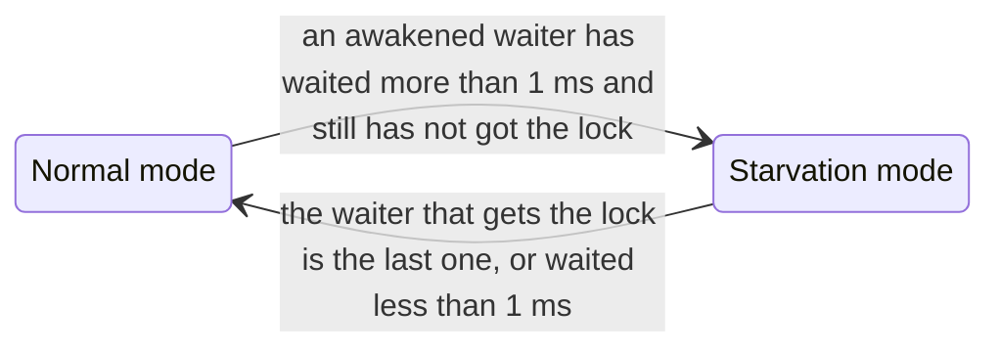

# 11.2 Mutex

The contract of `sync.Mutex` is simple: the zero value is an unlocked lock; `Lock` blocks the caller
when the lock is taken and `Unlock` releases it; and the lock does not belong to any goroutine
([11.1.3](./basic.md)). The core question that an implementation must answer is not simple: when the
lock is released, to whom does it go? Handing it to the next waiter strictly in order of arrival is
the fairest, but every handoff has to wait until the awakened goroutine actually runs. Letting a
goroutine that is already running grab it first gives higher throughput, but may let some waiter
lose out again and again. Go's mutex has gone from one of these approaches to the other and back.
This section first introduces the theory and hardware foundations of the mutual exclusion problem,
then looks at Go's implementation, and follows its history to explain the trade-off.

## 11.2.1 The Mutual Exclusion Problem and Its Foundations

A segment of a program that accesses shared data and into which only one unit of execution may enter
at a time is called a **critical section**. Ensuring this is the mutual exclusion problem.
[11.1.1](./basic.md) mentioned that in "Cooperating Sequential Processes" Dijkstra first tried to
solve it with ordinary reads and writes alone and gave Dekker's solution for two processes; in 1965,
in a one-page note, Dijkstra gave a general solution for N processes
[[Dijkstra, 1965](#ref-dijkstra-1965)]. In 1974 Lamport proposed the bakery algorithm
[[Lamport, 1974](#ref-lamport-1974)]: processes take a number as in a bakery, first choosing a
number larger than all numbers already issued, and then enter the critical section in increasing
order of number. Each shared variable is written by only one process. Lamport later wrote that he
discovered only after finishing the correctness proof that the proof does not depend on what value a
read that overlaps a write returns: the algorithm remains correct even if the read returns an
arbitrary value [[Lamport, nd](#ref-lamport-nd)].

Algorithms that use only reads and writes prove that mutual exclusion is solvable in principle, but
their cost grows with the number of processes (the bakery algorithm checks the numbers of all
processes), and they require the memory to execute reads and writes in program order, which on
modern processors takes additional memory barriers ([11.9](./mem.md)). Practical locks are all built
on the atomic read-modify-write instructions that hardware provides, such as compare-and-swap (CAS)
and fetch-and-add ([11.3](./atomic.md)): a single instruction performs "read the old value, test it,
write the new value", and the problem of one-way access that Dijkstra described is solved by the
hardware.

Given atomic instructions, there are still two ways to wait. One is spinning: retrying in a loop
until it succeeds. Spinning is cheapest when the lock will be released very soon, but the waiter
keeps occupying a processor, and all waiters repeatedly read and write the same variable, so that
the cache line holding it bounces between processors. The ticket lock issues numbers with
fetch-and-add so that waiters acquire the lock in order; the MCS lock of Mellor-Crummey and Scott
has each waiter spin on its own variable, and a handoff writes only the successor's variable
[[Mellor-Crummey and Scott, 1991](#ref-mellor-crummey-scott-1991)]. The other way is blocking: the
waiter gives up the processor and sleeps, and the releaser wakes it. In the past this meant entering
the kernel on every acquisition; the Linux futex changed that
[[Franke et al., 2002](#ref-franke-et-al-2002)]. The state of the lock lives in user space, so that
an uncontended acquisition needs only atomic operations, and the kernel is entered only under
contention, when queuing and scheduling are needed.

`sync.Mutex` combines the two: one CAS when uncontended; under contention a brief spin first
(11.2.3), and blocking if the lock still cannot be taken. Blocking uses the runtime semaphore, whose
comment at the top of `runtime/sema.go` says that its goal is the same as that of the Linux futex,
with much simpler semantics [[Go Authors, 2026a](#ref-go-authors-2026a)]. The difference is that it
suspends a goroutine, not a thread ([11.1.4](./basic.md)). The futex sits at a lower level in Go:
when the runtime's internal locks and `note`s need to put a thread M to sleep, they use futexes on
Linux and some other systems ([9.5.2](../ch09sched/thread.md)).

## 11.2.2 The State Word and the Fast Path

Since Go 1.24, `sync.Mutex` is only a wrapper around `internal/sync.Mutex` ([11.1.4](./basic.md)),
which has just two fields [[Go Authors, 2026b](#ref-go-authors-2026b)]:

```go
type Mutex struct {
	state int32
	sema  uint32
}

const (
	mutexLocked = 1 << iota // mutex is locked
	mutexWoken
	mutexStarving
	mutexWaiterShift = iota

	starvationThresholdNs = 1e6
)
```

`sema` is the address handed to the runtime semaphore. `state` is a bit field. The lowest bit,
`mutexLocked`, says that the lock is held. `mutexWoken` says that a goroutine that has been woken or
is spinning is ready to take the lock, so the unlocker need not wake anyone else. `mutexStarving`
says that the lock is in starvation mode (11.2.4). The remaining high bits record the number of
waiters, and adding or removing a waiter adds or subtracts `1<<mutexWaiterShift`. Keeping all this
information in one 32-bit integer lets a single CAS check and modify it all at once.

The two fast paths are as follows (code related to the race detector is omitted):

```go
func (m *Mutex) Lock() {
	// Fast path: grab unlocked mutex.
	if atomic.CompareAndSwapInt32(&m.state, 0, mutexLocked) {
		return
	}
	// Slow path (outlined so that the fast path can be inlined)
	m.lockSlow()
}

func (m *Mutex) Unlock() {
	// Fast path: drop lock bit.
	new := atomic.AddInt32(&m.state, -mutexLocked)
	if new != 0 {
		// Outlined slow path to allow inlining the fast path.
		m.unlockSlow(new)
	}
}
```

The locking CAS succeeds only when `state` is 0: unlocked, no waiters and no flags. Unlocking
subtracts `mutexLocked`; a result of 0 means no one is waiting and the unlock is finished. The slow
paths are split into separate functions to keep the fast paths small enough for the compiler to
inline them at the call site. These are two changes that Ferraris made in Go 1.13, and inlining
`Lock` alone made an uncontended lock about 14% faster [[Ferraris, 2018a](#ref-ferraris-2018a)]
[[Ferraris, 2018b](#ref-ferraris-2018b)].

## 11.2.3 The Slow Path: Spinning and Queuing

Under contention, a goroutine is in no hurry to sleep: a lock is often held only briefly, and the
cost of sleeping and waking can exceed the wait itself. Go 1.5 added limited active spinning to
`Mutex`, contributed by Vyukov [[Vyukov, 2015](#ref-vyukov-2015)]. The runtime's `canSpin` allows
spinning only when all of the following hold: the goroutine has spun fewer than 4 times so far; the
machine has more than one CPU; at least one P other than the current one is running; and the current
P's local run queue is empty [[Go Authors, 2026c](#ref-go-authors-2026c)]. Each spin calls
`procyield(30)`, which on amd64 executes the `PAUSE` instruction 30 times. In the commit message
Vyukov explains why to spin: previously `sync.Mutex` entered the scheduler as soon as it detected
contention, although the lock might be released very soon, especially when the critical section is
short; and CPU utilization of server programs is usually around 50%, so switching to run other
goroutines is not necessarily worthwhile. Spinning must also be conservative, because a spinner
occupies a P that other goroutines may be waiting to use; and unlike the runtime's internal locks,
no passive spinning that yields the thread is done here, because there may be work in the global
queue or on other Ps.

While spinning, if there are waiters and no one has been woken yet, the spinner sets `mutexWoken` to
tell the unlocker that someone is already ready to take the lock: on seeing this bit the unlocker no
longer wakes a waiter, and the lock is left to the spinner.

When the conditions for spinning no longer hold, `lockSlow` computes the new state, registers itself
as a waiter with a CAS, and then sleeps on the semaphore:

```go
if atomic.CompareAndSwapInt32(&m.state, old, new) {
	if old&(mutexLocked|mutexStarving) == 0 {
		break // locked the mutex with CAS
	}
	// If we were already waiting before, queue at the front of the queue.
	queueLifo := waitStartTime != 0
	if waitStartTime == 0 {
		waitStartTime = runtime_nanotime()
	}
	runtime_SemacquireMutex(&m.sema, queueLifo, 2)
	starving = starving || runtime_nanotime()-waitStartTime > starvationThresholdNs
	// ...
```

A goroutine queuing for the first time goes to the tail of the queue; one that was woken, failed to
get the lock and must queue again goes to the head. Before Go 1.9 the latter also went to the tail,
which was less fair when there were many waiters [[Vyukov, 2016](#ref-vyukov-2016)]. `waitStartTime`
records the time of the first queuing and decides when starvation mode, described in the next
section, is entered.

The semaphore itself is only a `uint32` count. `semacquire` first tries to decrement it with a CAS
and queues only if that fails; queued goroutines are organized by semaphore address in the global
`semtable`. The table has 251 buckets, a prime number chosen to avoid correlation with regularities
in the addresses used by user programs. Each bucket is protected by a runtime-internal lock, and
within the bucket is a treap keyed by address; each node represents one address and holds the list
of goroutines waiting on that address. Enqueuing and dequeuing at the same address is O(1), and
lookup among different addresses is O(log n) [[Go Authors, 2026a](#ref-go-authors-2026a)]. This
structure took shape step by step. In 2011 Vyukov replaced the single centralized wait table with a
distributed table hashed by address, and made the releaser take no lock when there are no waiters
[[Vyukov, 2011a](#ref-vyukov-2011a)]. In 2017 Cox found that when several locks hash to the same
bucket, finding the waiters of one lock scans all the waiters of another, so that n lock
acquisitions cost O(n²) in total (#17953); he first changed the singly linked list in the bucket
into a two-level list grouped by address, and then replaced the top level with a treap
[[Cox, 2017a](#ref-cox-2017a)] [[Cox, 2017b](#ref-cox-2017b)].

## 11.2.4 Handoff, Barging and Starvation Mode

Go's answer to whom the lock goes when it is released has changed twice.

The first `Mutex`, written by Cox in 2008, had only a counter and a semaphore
[[Cox, 2008](#ref-cox-2008)]. The following is the code before the 2011 change, with the same
algorithm as in 2008:

```go
func (m *Mutex) Lock() {
	if atomic.AddInt32(&m.key, 1) == 1 {
		// changed from 0 to 1; we hold lock
		return
	}
	runtime.Semacquire(&m.sema)
}

func (m *Mutex) Unlock() {
	switch v := atomic.AddInt32(&m.key, -1); {
	case v == 0:
		// changed from 1 to 0; no contention
		return
	case v == -1:
		// changed from 0 to -1: wasn't locked
		// (or there are 4 billion goroutines waiting)
		panic("sync: unlock of unlocked mutex")
	}
	runtime.Semrelease(&m.sema)
}
```

`key` counts holders and waiters together. If there are still waiters at unlock time, `key` remains
greater than zero and the lock has not really been released: the goroutine woken by `Semrelease`
holds the lock as soon as it wakes. This approach is called **handoff**: the lock stays held
throughout, and no one can cut in front of the awakened goroutine.

In 2011 Vyukov separated "locked" from "number of waiters", forming the prototype of today's `state`
[[Vyukov, 2011b](#ref-vyukov-2011b)]. Unlocking clears the lock bit and then wakes one waiter; the
awakened goroutine must compete again with the goroutines that arrive in the meantime. The commit
message says that the new implementation allows a goroutine to acquire the lock several times in a
row while there are blocked goroutines, and also allows newcomers to acquire the lock ahead of
blocked ones, that is, first-in-first-out is no longer enforced. This approach is called
**barging**. On a heavily contended benchmark the effect is an order of magnitude: with `GOMAXPROCS`
at 16, `BenchmarkMutex` dropped from 1380 ns to 96.3 ns.

Why is barging faster? Lea also chose barging when designing Java's `java.util.concurrent`, on the
grounds that it shortens the time during which the lock is free but unheld because the next thread
is still being woken [[Lea, 2004](#ref-lea-2004)]. Pizlo of WebKit explains from another angle: on a
strictly first-in-first-out lock, contenders form a "convoy", each holding the lock only once per
round and each acquisition accompanied by a context switch; barging lets a running thread acquire
the lock several times in one round [[Pizlo, 2016](#ref-pizlo-2016)].

The price is fairness. In the same section Lea points out that a barging lock is fair only in a
probabilistic sense: if newcomers arrive faster than the awakened thread can wake, the thread at the
head of the queue rarely wins. In 2015 Cox reported an extreme example in #13086
[[Cox, 2015](#ref-cox-2015)]: one goroutine holds the lock almost all the time, releasing it only
briefly each time; another goroutine needs the lock once every 100 µs but often has to wait more
than 100 seconds. The reason is that the former keeps running after unlocking and waking the latter,
and takes the lock back before the latter is actually scheduled; this repeats millions of times
before the latter succeeds once. Cox proposed falling back to handoff when severe unfairness is
detected, and wrote that he did not want to see blog posts explaining when to use `sync.Mutex` and
when to use `sync.FairMutex`.

A year later Vyukov supplied an implementation, released with Go 1.9
[[Vyukov, 2016](#ref-vyukov-2016)]. The comments in the source describe it as two modes. In normal
mode, waiters queue in first-in-first-out order, but an awakened waiter does not own the lock and
must compete with newly arriving goroutines. The newcomers are running on a CPU and may be many, so
the awakened waiter is likely to lose, and when it does it is put back at the head of the queue. If
a waiter fails to acquire the lock for more than 1 ms, it switches the lock to starvation mode. In
starvation mode, ownership of the lock is handed off directly from the unlocker to the waiter at the
head of the queue; newcomers do not try to acquire the lock even if it looks free, and do not spin,
but queue at the tail. A waiter that acquires the lock switches it back to normal mode if it is the
last waiter in the queue or if it waited less than 1 ms. The comment sums up: normal mode has much
better performance, because a goroutine can acquire the lock several times in a row even when there
are blocked waiters; starvation mode exists to prevent pathological tail latency.



The exit condition "waited less than 1 ms" is not optional. The code comment says that starvation
mode is very inefficient, and two goroutines that switch the lock into starvation mode could
otherwise alternate in holding it indefinitely, so the mode must be exited here based on the waiting
time.

The two modes on the unlocking side look like this:

```go
func (m *Mutex) unlockSlow(new int32) {
	if (new+mutexLocked)&mutexLocked == 0 {
		fatal("sync: unlock of unlocked mutex")
	}
	if new&mutexStarving == 0 {
		old := new
		for {
			// If there are no waiters or a goroutine has already
			// been woken or grabbed the lock, no need to wake anyone.
			// In starvation mode ownership is directly handed off from unlocking
			// goroutine to the next waiter. We are not part of this chain,
			// since we did not observe mutexStarving when we unlocked the mutex above.
			// So get off the way.
			if old>>mutexWaiterShift == 0 || old&(mutexLocked|mutexWoken|mutexStarving) != 0 {
				return
			}
			// Grab the right to wake someone.
			new = (old - 1<<mutexWaiterShift) | mutexWoken
			if atomic.CompareAndSwapInt32(&m.state, old, new) {
				runtime_Semrelease(&m.sema, false, 2)
				return
			}
			old = m.state
		}
	} else {
		// Starving mode: handoff mutex ownership to the next waiter, and yield
		// our time slice so that the next waiter can start to run immediately.
		// Note: mutexLocked is not set, the waiter will set it after wakeup.
		// But mutex is still considered locked if mutexStarving is set,
		// so new coming goroutines won't acquire it.
		runtime_Semrelease(&m.sema, true, 2)
	}
}
```

In normal mode, the unlocker first acquires "the right to wake someone" with a CAS and then releases
the semaphore; what the awakened goroutine gets is only the chance to compete, not the lock itself.
This also answers a question readers often ask: [if the goroutine woken is the one at the head of
the queue, why can waiters still starve](https://github.com/golang-design/under-the-hood/issues/80)?
Because in normal mode, waking is not handing off.

In starvation mode the second parameter of `Semrelease`, `handoff`, is true: the runtime performs
the semaphore decrement on behalf of the awakened goroutine, so no other goroutine can snatch it. Go
1.14 went one step further [[Ferraris, 2019](#ref-ferraris-2019)]: the releaser puts the waiter into
the current P's `runnext` and yields immediately, and the waiter inherits the remaining time slice
and starts running at once. The comment in `sema.go` explains why this is done only in starvation
mode: in normal mode, another goroutine may acquire the semaphore during the yield, which would make
the yield wasted.

The following program reproduces the scenario in #13086:

```go {run=true native=true}
package main

import (
	"fmt"
	"sync"
	"time"
)

func main() {
	var mu sync.Mutex
	done := make(chan struct{})

	// The first goroutine holds the lock almost all the time, releasing it only briefly between acquisitions.
	go func() {
		for {
			select {
			case <-done:
				return
			default:
				mu.Lock()
				time.Sleep(100 * time.Microsecond)
				mu.Unlock()
			}
		}
	}()

	// The main goroutine needs the lock only occasionally and holds it very briefly.
	var longest time.Duration
	for range 50 {
		time.Sleep(100 * time.Microsecond)
		start := time.Now()
		mu.Lock()
		longest = max(longest, time.Since(start))
		mu.Unlock()
	}
	close(done)
	fmt.Printf("longest wait in 50 acquisitions: %.1f ms\n", float64(longest)/1e6)
}
```

The output of one run is:

```
longest wait in 50 acquisitions: 1.3 ms
```

After the main goroutine queues, each time it is woken it fails to beat the other goroutine and goes
back to the head of the queue. When it finally wakes having waited more than 1 ms, it switches the
lock to starvation mode as it requeues, and the other goroutine's next unlock hands the lock
directly to it. The longest wait is therefore about 1 ms plus the length of one or two critical
sections. What Cox measured in 2015 was more than 100 seconds; in Vyukov's commit message the same
program waits about 1.2 ms.

## 11.2.5 The Spectrum of Fairness

Other systems have made different choices on this question.

Java's `ReentrantLock` leaves the choice to the user: fairness can be requested at construction, and
the default is unfair. The documentation warns that a fair lock used by many threads may have much
lower throughput, but less variance in the time to obtain the lock, and guarantees freedom from
starvation; and fairness of the lock does not imply fairness of thread scheduling
[[Oracle, 2023](#ref-oracle-2023)].

WebKit's `WTF::Lock` chooses barging, and Pizlo justifies the choice with an experiment
[[Pizlo, 2016](#ref-pizlo-2016)]: with ten threads contending for one lock for 100 ms, the operating
system's mutex is perfectly fair, but each thread gets the lock at most about 3000 times;
`WTF::Lock` does not guarantee fairness, yet even the unluckiest thread got about 557,000
acquisitions, roughly 180 times as many. Pizlo concludes that fair algorithms suit cases where
critical sections are all long and a bounded maximum wait must be guaranteed; for programs with
short critical sections, the cost of guaranteeing fairness is too high.

Rust's `parking_lot` borrows from the WebKit design. Up to 0.12.5 it used "eventual fairness": on
average every 0.5 ms it forces a fair unlock, handing the lock to the next waiter
[[d'Antras, 2025](#ref-dantras-2025)]; version 0.13, released in October 2026, removed the automatic
eventual fairness and kept only the explicit fair-unlock interface
[[d'Antras, 2026](#ref-dantras-2026)].

Go offers no choice: there is only one `Mutex`, and it switches automatically between the two modes
with 1 ms as the boundary. This agrees with what Cox wanted in #13086: users are better off not
having to know these details, let alone think about them.

## 11.2.6 Read-Write Locks

The readers-writers problem was posed by Courtois, Heymans and Parnas in 1971
[[Courtois et al., 1971](#ref-courtois-et-al-1971)]: several readers may access the data at the same
time, while a writer must have exclusive access. The structure of `sync.RWMutex` is as follows
[[Go Authors, 2026d](#ref-go-authors-2026d)]:

```go
type RWMutex struct {
	w           Mutex        // held if there are pending writers
	writerSem   uint32       // semaphore for writers to wait for completing readers
	readerSem   uint32       // semaphore for readers to wait for completing writers
	readerCount atomic.Int32 // number of pending readers
	readerWait  atomic.Int32 // number of departing readers
}

const rwmutexMaxReaders = 1 << 30
```

`readerCount` records the number of readers. `RLock` adds one to it and returns directly if the
result is non-negative; `RUnlock` subtracts one. The reader's fast path is a single atomic add and
takes no lock. This is the result of Vyukov's 2011 rewrite, which made an uncontended read lock
nearly twice as fast [[Vyukov, 2011c](#ref-vyukov-2011c)].

When a writer locks, it first excludes other writers with `w`, then subtracts `rwmutexMaxReaders`
(2^30) from `readerCount`, making it negative: readers arriving afterward see the negative number in
`RLock` and wait on `readerSem`. Adding 2^30 back to the result of the subtraction gives the number
of readers still holding the read lock at that moment; the writer adds it to `readerWait` and waits
on `writerSem` for those readers to leave, and the last reader to leave wakes the writer. When the
writer unlocks, it adds 2^30 back to `readerCount`; the result is the number of readers blocked in
the meantime, which the writer wakes one by one before releasing `w`.

This arrangement gives priority to writers: the documentation states that if a goroutine calls
`Lock` while the read lock is held, all subsequent `RLock` calls block until the writer has acquired
and released the lock, which guarantees that the writer eventually gets the lock. The cost is that
read locks cannot be taken recursively: if a goroutine already holding a read lock calls `RLock`
again and a writer arrives in between, the second `RLock` waits for the writer, and the writer waits
for the first read lock to be released, so the two wait for each other. A read lock also cannot be
upgraded to a write lock, nor a write lock downgraded to a read lock.

In the terms of the memory model ([11.9](./mem.md)): the n-th call to `Unlock` synchronizes before
the m-th call to `Lock` (n < m); for any call to `RLock`, there exists an n such that the n-th call
to `Unlock` synchronizes before that `RLock`, and the matching `RUnlock` synchronizes before the
(n+1)-th call to `Lock` [[Go Authors, 2026d](#ref-go-authors-2026d)]
[[Go Authors, 2026e](#ref-go-authors-2026e)].

## 11.2.7 TryLock

In 2010, in the same email that explained why Go's mutex is not reentrant, Cox wrote that he
believed Go would eventually need TryLock [[Cox, 2010](#ref-cox-2010)]. It was actually added 11
years later. The 2021 proposal #45435 was at first opposed by Cox himself: locks protect invariants
([11.1.3](./basic.md)), and when the lock is held by someone else nothing can be said about the
invariant, so TryLock would encourage imprecise thinking about locks [[Cox, 2021a](#ref-cox-2021a)].
What changed his mind came from the race detector: a TryLock can also be implemented outside the
library with a mutex and an atomic variable, but such an implementation creates spurious
happens-before edges for the race detector even when it fails, masking real data races, whereas a
TryLock built into `sync` does not. The commit message that implemented it states that using these
functions is almost (but not always) a bad idea [[Cox, 2021b](#ref-cox-2021b)]. `Mutex.TryLock`,
`RWMutex.TryLock` and `RWMutex.TryRLock` were released with Go 1.18.

The implementation of `Mutex.TryLock` is a single CAS (code related to the race detector is
omitted):

```go
func (m *Mutex) TryLock() bool {
	old := m.state
	if old&(mutexLocked|mutexStarving) != 0 {
		return false
	}

	// There may be a goroutine waiting for the mutex, but we are
	// running now and can try to grab the mutex before that
	// goroutine wakes up.
	if !atomic.CompareAndSwapInt32(&m.state, old, old|mutexLocked) {
		return false
	}
	return true
}
```

It fails at once if the lock is held or in starvation mode; otherwise, even if there are waiters, it
can take the lock ahead of the awakened one, which is exactly the barging of normal mode. By the
memory model, a successful `TryLock` is equivalent to a `Lock`, and a failed `TryLock` establishes
no synchronizes-before relation. The documentation cautions that there are indeed cases where
`TryLock` is used correctly, but they are rare, and its use often signals a deeper problem in some
use of the mutex.

## 11.2.8 Misuse and Diagnosis

All the state of a lock is in the value of the `Mutex`, so copying a lock yields another,
independent lock, and if the lock is held at the moment of copying, the copy is held too. The
documentation therefore requires that a `Mutex` must not be copied after first use, and the
copylocks check of `go vet` reports such copies. Go 1.24 added an explicit `noCopy` field to
`Mutex`, so that this check no longer depends on the internal structure of `Mutex`
[[Knyszek, 2024](#ref-knyszek-2024)].

Calling `Unlock` on an unlocked `Mutex` terminates the program with
`fatal error: sync: unlock of unlocked mutex`, which `recover` cannot catch. Before Go 1.8 this was
an ordinary panic, but after the panic the lock was left in an unusable state, and keeping it usable
would have made the lock significantly slower and less scalable; Cox therefore changed it to
terminate the program outright [[Cox, 2016](#ref-cox-2016)].

Lock contention can be located with the mutex profile. It was added by Weinberger in Go 1.8: after
sampling is enabled by calling `runtime.SetMutexProfileFraction`, the `mutex` profile of `pprof`
records the call stacks of the holders of contended locks rather than those of the waiters
[[Weinberger, 2016](#ref-weinberger-2016)]. The `semrelease1` in `sema.go` mentioned earlier is
exactly what, at unlock time, charges the delay suffered by the waiters to the unlocker. Since Go
1.22 this time is accumulated per blocked goroutine: 100 goroutines waiting 10 ms on the same lock
count as 1000 ms of contention, consistent with the Google C++ (now Abseil) mutex profiler on which
this profiler is modeled [[Cox, 2023](#ref-cox-2023)].

## Further Reading

- <a id="ref-courtois-et-al-1971"></a>[Courtois et al., 1971] P. J. Courtois, F. Heymans, D. L.
  Parnas. "Concurrent Control with 'Readers' and 'Writers'." *Communications of the ACM*, 14(10):
  667–668, 1971. https://doi.org/10.1145/362759.362813 The source of the readers-writers problem.
- <a id="ref-cox-2008"></a>[Cox, 2008] Russ Cox. add mutex.Mutex. Go commit bf3dd3f0ef, 2008-12-04.
  https://github.com/golang/go/commit/bf3dd3f0efe5b45947a991e22660c62d4ce6b671 Go's first mutex: a
  counter plus a semaphore, handing the lock off to the awakened goroutine on unlock.
- <a id="ref-cox-2010"></a>[Cox, 2010] Russ Cox. Reply in "Experimenting with GO." golang-nuts, 9
  June
  2010. https://groups.google.com/g/golang-nuts/c/XqW1qcuZgKg/m/Ui3nQkeLV80J
- <a id="ref-cox-2015"></a>[Cox, 2015] Russ Cox. Go issue #13086. *runtime: fall back to fair locks
  after repeated sleep-acquire failures.* 2015. https://github.com/golang/go/issues/13086 The
  lockskew program and the discussion of barging and handoff; the proposal was accepted in
  December 2016.
- <a id="ref-cox-2016"></a>[Cox, 2016] Russ Cox. sync: throw, not panic, for unlock of unlocked
  mutex. Go commit 40d81cf061, 2016. https://go.dev/cl/31359 Fixes issue #13879; released with Go
  1.8.
- <a id="ref-cox-2017a"></a>[Cox, 2017a] Russ Cox. runtime: use two-level list for semaphore address
  search in semaRoot. Go commit 45c6f59e1f, 2017. https://go.dev/cl/36792
  Fixes issue #17953; released with Go 1.9.
- <a id="ref-cox-2017b"></a>[Cox, 2017b] Russ Cox. runtime: use balanced tree for addr lookup in
  semaphore implementation. Go commit 990124da2a, 2017. https://go.dev/cl/37103
- <a id="ref-cox-2021a"></a>[Cox, 2021a] Russ Cox. Comment on golang/go#45435, 2021.
  https://github.com/golang/go/issues/45435#issuecomment-832910477 5 May 2021: locks exist to
  protect invariants. The comment of 13 May makes the case from the race detector.
- <a id="ref-cox-2021b"></a>[Cox, 2021b] Russ Cox. sync: add Mutex.TryLock, RWMutex.TryLock,
  RWMutex.TryRLock. Go commit 645d07819b, 2021. https://go.dev/cl/319769
  Released with Go 1.18.
- <a id="ref-cox-2023"></a>[Cox, 2023] Russ Cox. runtime: change mutex profile to count every
  blocked goroutine. Go commit 1c00354013, 2023. https://go.dev/cl/506415 Released with Go 1.22.
- <a id="ref-dantras-2025"></a>[d'Antras, 2025] Amanieu d'Antras. *parking_lot 0.12.5:
  src/mutex.rs* ("Fairness" section). 2025.
  https://github.com/Amanieu/parking_lot/blob/parking_lot-v0.12.5/src/mutex.rs
- <a id="ref-dantras-2026"></a>[d'Antras, 2026] Amanieu d'Antras. *parking_lot CHANGELOG*, 0.13.0,
  2026-10-21. https://github.com/Amanieu/parking_lot/blob/master/CHANGELOG.md
  "Removed automatic eventual fairness."
- <a id="ref-dijkstra-1965"></a>[Dijkstra, 1965] Edsger W. Dijkstra. "Solution of a Problem in
  Concurrent Programming Control." *Communications of the ACM*, 8(9): 569, 1965.
  https://doi.org/10.1145/365559.365617 The formalization of the mutual exclusion problem and a
  general solution for N processes (the two-process solution is Dekker's).
- <a id="ref-ferraris-2018a"></a>[Ferraris, 2018a] Carlo Alberto Ferraris. sync: allow inlining the
  Mutex.Lock fast path. Go commit 41cb0aedff, 2018. https://go.dev/cl/148959
  Released with Go 1.13.
- <a id="ref-ferraris-2018b"></a>[Ferraris, 2018b] Carlo Alberto Ferraris. sync: allow inlining the
  Mutex.Unlock fast path. Go commit 4c3f26076b, 2018. https://go.dev/cl/148958
  Released with Go 1.13.
- <a id="ref-ferraris-2019"></a>[Ferraris, 2019] Carlo Alberto Ferraris. sync: yield to the waiter
  when unlocking a starving mutex. Go commit a8f57f4ada, 2019. https://go.dev/cl/200577 Fixes issue
  #33747; released with Go 1.14.
- <a id="ref-franke-et-al-2002"></a>[Franke et al., 2002] Hubertus Franke, Rusty Russell, Matthew
  Kirkwood. "Fuss, Futexes and Furwocks: Fast Userlevel Locking in Linux." *Proceedings of the
  Ottawa Linux Symposium*, 2002. https://www.kernel.org/doc/ols/2002/ols2002-pages-479-495.pdf The
  futex, the foundation of fast user-level locks.
- <a id="ref-go-authors-2026a"></a>[Go Authors, 2026a] The Go Authors. *src/runtime/sema.go*.
  https://github.com/golang/go/blob/release-branch.go1.26/src/runtime/sema.go
- <a id="ref-go-authors-2026b"></a>[Go Authors, 2026b] The Go Authors. *The implementation of
  Mutex*. `src/internal/sync/mutex.go`, `src/sync/mutex.go`.
  https://github.com/golang/go/tree/master/src/internal/sync
- <a id="ref-go-authors-2026c"></a>[Go Authors, 2026c] The Go Authors.
  *src/runtime/proc.go* (`internal_sync_runtime_canSpin`).
  https://github.com/golang/go/blob/release-branch.go1.26/src/runtime/proc.go
- <a id="ref-go-authors-2026d"></a>[Go Authors, 2026d] The Go Authors. *src/sync/rwmutex.go*.
  https://github.com/golang/go/blob/release-branch.go1.26/src/sync/rwmutex.go
- <a id="ref-go-authors-2026e"></a>[Go Authors, 2026e] The Go Authors. *The Go Memory Model: Locks.*
  https://go.dev/ref/mem
- <a id="ref-knyszek-2024"></a>[Knyszek, 2024] Michael Anthony Knyszek. sync: add explicit noCopy
  fields to Map, Mutex, and Once. Go commit 53b2b64b64, 2024. https://go.dev/cl/627777 Released with
  Go 1.24.
- <a id="ref-lamport-1974"></a>[Lamport, 1974] Leslie Lamport. "A New Solution of Dijkstra's
  Concurrent Programming Problem." *Communications of the ACM*, 17(8): 453–455, 1974.
  https://doi.org/10.1145/361082.361093 The bakery algorithm.
- <a id="ref-lamport-nd"></a>[Lamport, nd] Leslie Lamport. *The Writings of Leslie Lamport*,
  commentary on the entry "A New Solution of Dijkstra's Concurrent Programming Problem".
  https://lamport.azurewebsites.net/pubs/pubs.html
- <a id="ref-lea-2004"></a>[Lea, 2004] Doug Lea. "The java.util.concurrent Synchronizer Framework."
  *Workshop on Concurrency and Synchronization in Java Programs (CSJP)*, 2004.
  https://gee.cs.oswego.edu/dl/papers/aqs.pdf
  Section 4.1 discusses the throughput and fairness of the barging first-in-first-out policy.
- <a id="ref-mellor-crummey-scott-1991"></a>[Mellor-Crummey and Scott, 1991] John M. Mellor-Crummey,
  Michael L. Scott. "Algorithms for Scalable Synchronization on Shared-Memory Multiprocessors." *ACM
  Transactions on Computer Systems*, 9(1): 21–65, 1991. https://doi.org/10.1145/103727.103729
  The foundation of the MCS lock and of scalable locks.
- <a id="ref-oracle-2023"></a>[Oracle, 2023] Oracle. *Java SE 21 API:
  java.util.concurrent.locks.ReentrantLock.* 2023.
  https://docs.oracle.com/en/java/javase/21/docs/api/java.base/java/util/concurrent/locks/ReentrantLock.html
- <a id="ref-pizlo-2016"></a>[Pizlo, 2016] Filip Pizlo. "Locking in WebKit." WebKit Blog, 6
  May 2016. https://webkit.org/blog/6161/locking-in-webkit/ A discussion of barging and fairness,
  with a comparison to the fairness of operating system mutexes.
- <a id="ref-vyukov-2011a"></a>[Vyukov, 2011a] Dmitriy Vyukov. runtime: replace
  Semacquire/Semrelease implementation. Go commit 997c00f991, 2011.
  https://github.com/golang/go/commit/997c00f9919794d878aee4a87187dfaaebef6cd9
- <a id="ref-vyukov-2011b"></a>[Vyukov, 2011b] Dmitriy Vyukov. sync: improve Mutex to allow
  successive acquisitions. Go commit dd2074c82a, 2011.
  https://github.com/golang/go/commit/dd2074c82acda9b50896bf29569ba290a0d13b03
- <a id="ref-vyukov-2011c"></a>[Vyukov, 2011c] Dmitriy Vyukov. sync: improve RWMutex performance. Go
  commit daaf29cf93, 2011.
  https://github.com/golang/go/commit/daaf29cf9320011af9b5feee36f75cb2ac175718
- <a id="ref-vyukov-2015"></a>[Vyukov, 2015] Dmitry Vyukov. sync: add active spinning to Mutex. Go
  commit edcad8639a, 2015. https://go.dev/cl/5430 Fixes issue #8889; released with Go 1.5.
- <a id="ref-vyukov-2016"></a>[Vyukov, 2016] Dmitry Vyukov. *sync: make Mutex more fair* (Go 1.9
  starvation mode). Go commit 0556e26273, 2016. https://go-review.googlesource.com/c/go/+/34310
  For related discussion see issue #13086.
- <a id="ref-weinberger-2016"></a>[Weinberger, 2016] Peter Weinberger. runtime: Profile goroutines
  holding contended mutexes. Go commit ca922b6d36, 2016. https://go.dev/cl/29650 Released with Go
  1.8.
- This book: [11.3 Atomic Operations](./atomic.md), [11.9 Memory Consistency Models](./mem.md).
