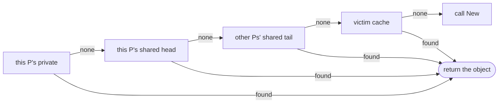

# 11.6 Object Pool

A program that repeatedly allocates and discards temporary objects of the same kind pays for one
allocation per object, and the garbage collector ([13](../../part4memory/ch13gc)) reclaims each of
them in the end. `sync.Pool` lets such objects be set aside after use and taken again directly. The
documentation describes its role as caching allocated but unused items for later reuse, relieving
pressure on the garbage collector [[Go Authors, 2026a](#ref-go-authors-2026a)]. Its example uses it
to cache buffers for logging:

```go
var bufPool = sync.Pool{
	New: func() any {
		// The Pool's New function should generally only return pointer
		// types, since a pointer can be put into the return interface
		// value without an allocation:
		return new(bytes.Buffer)
	},
}

func Log(w io.Writer, key, val string) {
	b := bufPool.Get().(*bytes.Buffer)
	b.Reset() // the retrieved object may hold content from its previous use
	// ... write one log line to b
	w.Write(b.Bytes())
	bufPool.Put(b)
}
```

`Get` takes an arbitrary object from the pool and calls `New` to create one if the pool is empty;
`Put` returns an object. Any object in the pool may be reclaimed at any time, so the caller cannot
know whether `Get` returned an old object or a new one, and should not care. This section first
explains where object caching comes from and why Go leaves the question of when to empty the pool to
the garbage collector, then discusses the three layers of the implementation in turn: per-P
sharding, lock-free stealing and the victim cache.

## 11.6.1 Object Caching

Preparing a batch of objects in advance and lending them out repeatedly is a very old practice in
memory management; the free list ([12.2](../../part4memory/ch12alloc/component.md)) is one example.
In 1994 Jeff Bonwick's slab allocator for the SunOS 5.4 kernel developed it into a set of
object-caching primitives: objects keep their constructed state between uses, which lowers the cost
of allocating complex objects [[Bonwick, 1994](#ref-bonwick-1994)]. In 2001 Bonwick and Jonathan
Adams observed that the slab allocator's global lock does not scale with the number of processors,
and added a per-processor cache layer [[Bonwick and Adams, 2001](#ref-bonwick-adams-2001)]. They
called this layer a magazine: each processor holds one loaded magazine and one spare, allocation and
free are pops and pushes on a magazine, and most operations complete locally on the processor. Only
when neither magazine can satisfy a request does the processor go to the global depot to exchange
for a full or empty magazine. The paper also notes that the last-in, first-out behavior of magazines
makes the same objects get reused again and again, so their cache lines are often already in the
processor's cache.

Above the magazine layer there is another question: how much to cache. Bonwick and Adams borrowed
Denning's working-set concept [[Denning, 1968](#ref-denning-1968)]: the depot continuously tracks
the range of variation in the number of full magazines over a period, magazines beyond that range
may be reclaimed, but they are actually released only when memory is tight. A kernel allocator can
do this because it knows exactly when memory is tight. In a language with garbage collection,
reclaiming memory is the collector's job, so the question facing an object cache becomes: when
should the cached objects be handed back to the collector?

## 11.6.2 When to Empty

In January 2013 Brad Fitzpatrick listed in issue #4720 the ad hoc object reuse scattered across the
standard library: `regexp` reuses the threads used for matching, `fmt` has its own free cache, the
32 KB buffer of `io.Copy` showed up in the profile of dl.google.com, and dl.google.com itself
allocated hundreds of MB per second and triggered garbage collection frequently until an internal
byte pool was added [[Fitzpatrick, 2013](#ref-fitzpatrick-2013)]. This pattern was being
reimplemented privately in every package, and badly, so Fitzpatrick wanted one good implementation
that everyone could reuse. Dmitry Vyukov then proposed in the discussion a general pool composed of
`Get` and `Put`, and soon produced a prototype based on processor-local data, initially named
`sync.Cache`; the name `Pool` was later judged less likely to be confused with the many kinds of
caches.

The proposal dragged on for nearly a year. Russ Cox first kept it out of Go 1.1 because the runtime
was still changing rapidly, and by Go 1.2 it was too late, with a warning to eager users that
`sync.Pool` was likewise an ad hoc leaky bucket, not a silver bullet. In November 2013 Cox proposed
a "GC-aware pool" again on golang-dev, pointing out that all earlier proposals had been stuck on the
size of the pool, that is, when and how quickly to empty it [[Cox, 2013](#ref-cox-2013)]. Using the
number of pool operations as a virtual clock means a pool that is no longer used at all is never
emptied; real time is not right either. Cox's argument, paraphrased:

> The most common purpose of a pool is to let already-allocated memory be reused before the next
> garbage collection, without paying its cost. ... Emptying the pool before a collection is not
> ideal, because before the collection this memory has had no chance to be reused. Keeping the
> values in the pool after a collection is not ideal either, because this memory could have been
> reclaimed and used for other types or returned to the operating system.

Since before the collection is too early and after the collection is too late, the time to empty the
pool can only be during the collection: the semantics of the pool must be that it is emptied on
every garbage collection. The implementation is also direct: keep a list of non-empty pools, add a
pool to the list when `Put` is called on an empty pool, empty all pools on the list at the start of
each collection, then empty the list. The work done at collection time is thus bounded by the number
of pool operations since the last collection. Cox also compared it with weak pointers: a weak
pointer is cleared only when no ordinary pointer refers to the same object, which in effect requires
the collector to scan twice, whereas a pool is emptied at collection regardless of the rest of
memory. A pointer in a pool should not be used elsewhere in the first place, because reusing it
would be a bug, so the expensive condition of weak pointers brings a pool no benefit.

In December of that year Fitzpatrick committed `sync.Pool`, with the interface Cox proposed and an
optional `New` field added because nearly all callers need it; the commit message admits it is only
a temporary implementation, to be made fast by Vyukov. `sync.Pool` was released with Go 1.3. Its
documentation has been revised several times and still states the scope of use
[[Go Authors, 2026a](#ref-go-authors-2026a)]:

- It makes it easy to build efficient, thread-safe free lists, but it is not suitable for all free
  lists.
- The appropriate use is to manage a group of temporary items that are silently shared among, and
  may be reused by, concurrent independent clients of a package, so that `Pool` spreads the cost of
  allocation across many clients. The `fmt` package is a good example: it maintains a dynamically
  sized store of temporary output buffers, which grows under load and shrinks when quiet.
- A free list maintained as part of a short-lived object is not a suitable use of `Pool`, because
  the overhead does not amortize in that scenario; it is more efficient to have such objects
  implement their own free list.

## 11.6.3 Sharding by P

In January 2014 Vyukov implemented a scalable `Pool`: each P has a fixed-size local cache, and when
the local cache overflows or runs dry it exchanges objects in batches with a global cache protected
by a mutex [[Vyukov, 2014a](#ref-vyukov-2014a)]. This is the same structure as the magazine layer,
and TCMalloc's front-end cache, divided per thread or per logical CPU, follows the same idea
[[Ghemawat and Menage, n.d.](#ref-ghemawat-menage-nd)]. In April of that year Vyukov found that each
P cached at most 15 objects that other Ps could not take; if the pool cached 2 MB large objects and
`GOMAXPROCS` was set to 32, the pool could waste up to 960 MB. The new policy gives each P exclusive
ownership of just one object and shares the rest among Ps [[Vyukov, 2014b](#ref-vyukov-2014b)]. The
local cache of each P still has this shape today:

```go
// Local per-P Pool appendix.
type poolLocalInternal struct {
	private any       // Can be used only by the respective P.
	shared  poolChain // Local P can pushHead/popHead; any P can popTail.
}

type poolLocal struct {
	poolLocalInternal

	// Prevents false sharing on widespread platforms with
	// 128 mod (cache line size) = 0 .
	pad [128 - unsafe.Sizeof(poolLocalInternal{})%128]byte
}
```

`private` can be accessed only by its own P, so the common take-and-return usage costs just a plain
field read and write. `shared` takes the overflow: the owning P accesses it at the head, other Ps
can only steal from the tail ([9.2](../ch09sched/steal.md)), so the owner's regular access and the
occasional steal work at opposite ends and rarely contend. `pad` rounds the size of each `poolLocal`
up to a multiple of 128 bytes, so that the local caches of adjacent Ps do not fall on the same cache
line, which avoids false sharing ([12.2](../../part4memory/ch12alloc/component.md)). The 2014
implementation already had a 128-byte padding; in 2017 Aliaksandr Valialkin changed it to pad to a
multiple of 128 bytes, which shrank `poolLocal` on amd64 from 176 bytes to 128 bytes
[[Valialkin, 2017](#ref-valialkin-2017)].

The `local` field of `Pool` points to an array of `poolLocal` indexed by P number, and `localSize`
records the length of the array. Both `Get` and `Put` start with `pin`:

```go
func (p *Pool) pin() (*poolLocal, int) {
	// ...
	pid := runtime_procPin()
	// In pinSlow we store to local and then to localSize, here we load in opposite order.
	// Since we've disabled preemption, GC cannot happen in between.
	// Thus here we must observe local at least as large localSize.
	// We can observe a newer/larger local, it is fine (we must observe its zero-initialized-ness).
	s := runtime_LoadAcquintptr(&p.localSize) // load-acquire
	l := p.local                              // load-consume
	if uintptr(pid) < s {
		return indexLocal(l, pid), pid
	}
	return p.pinSlow()
}
```

`runtime_procPin` increments the `locks` count of the current M and returns the current P's number.
An M holding a lock is not preempted, so the goroutine cannot leave this P, and until it unpins, no
other goroutine can run on this P. Garbage collection must stop the world first, and stopping the
world requires preempting every P, so no garbage collection can happen while pinned either. This is
the foundation of the whole fast path: reading and writing `private` needs no atomic operation, and
the synchronization with emptying the pool at collection time is also guaranteed by pinning itself.

The array is allocated only in `pinSlow`: on first use of the pool, or when `GOMAXPROCS` has grown
and the current P's number exceeds the array length, `pinSlow` allocates a new array under the
global lock `allPoolsMu` according to the current `GOMAXPROCS`, writes `local` atomically first and
then `localSize` with a store-release; on the first allocation it also adds the pool to the list
`allPools`. `pin` goes in the opposite order: it reads `localSize` with a load-acquire first, then
`local`. This is the message-passing shape of [11.9](./mem.md): having read the new length, it is
guaranteed to read an array no shorter than that. Message passing needs only acquire and release
semantics, so what is used here are `LoadAcquintptr` and `StoreReluintptr` from the runtime's
internal package `internal/runtime/atomic`. These two functions are not part of `sync/atomic`, since
Go does not offer acquire/release semantics to users ([11.3.6](./atomic.md)), yet the runtime itself
uses them where they are really needed; the atomic types of that package warn on methods such as
`LoadAcquire`: use with caution, and be careful.

After pinning, `Get` searches from near to far:

```go
func (p *Pool) Get() any {
	// ...
	l, pid := p.pin()
	x := l.private
	l.private = nil
	if x == nil {
		// Try to pop the head of the local shard. We prefer
		// the head over the tail for temporal locality of
		// reuse.
		x, _ = l.shared.popHead()
		if x == nil {
			x = p.getSlow(pid)
		}
	}
	runtime_procUnpin()
	// ...
	if x == nil && p.New != nil {
		x = p.New()
	}
	return x
}
```

It takes `private` first, then the head of the local `shared`. The comment explains why the head:
the most recently returned object is the most likely to still be in the cache, which is the reason
for the magazine's last-in, first-out order. If neither has an object, `getSlow` starts from the
next P and steals from the tail of each P's `shared` in turn, with its own shard last, and finally
looks at the victim cache (Section 11.6.5). Only if there is still nothing is `New` called, after
unpinning. `Put` is simpler: if `private` is empty the object goes into `private`, otherwise into
the head of the local `shared`.



## 11.6.4 Lock-Free Stealing

In the 2014 design, `shared` was a slice protected by a mutex, and both storing overflow objects and
stealing had to take the lock first. In 2019 Austin Clements explained the trouble this caused in a
commit message [[Clements, 2019a](#ref-clements-2019a)]: the pool is emptied during the
stop-the-world sweep termination phase, and synchronizes with `Get` and `Put` by pinning goroutines
to Ps, which makes the fast path extremely fast, needing not even an atomic write. The problem is
that a mutex cannot be acquired while pinned, or deadlock may result, so the slow path must unpin
first, and once unpinned the slow path no longer synchronizes with the emptying. Three consequences
follow:

1. The race between the slow path and the emptying is hard to reason about, and the reasoning often
   depends on unspecified details such as where preemption points occur.
2. To keep concurrent slow paths from keeping all objects alive, the emptying has to nil out the
   pointers of every object in every pool. This happens during stop-the-world, so the pause time is
   proportional to the total number of objects in the pools.
3. Implementing a victim cache would only make the emptying slower.

The `poolCleanup` of that time did nil out every element of every pool's `private` and `shared` one
by one, and its comment called this zeroing "defensive". Clements's approach was to replace the
locked slice with a lock-free structure; `Get` and `Put` stay pinned for the whole time they operate
on a shard and no longer race with the emptying. The emptying therefore does not need to touch the
objects in the pool, and the work during stop-the-world drops to being proportional to the number of
pools. The benchmark simulating the pause in the commit message went from 71.0 microseconds to 5.6
microseconds. This change also closed issue #22331. That issue reported long pauses caused by the
runtime unlinking the `sudog` and `defer` cache lists one by one in the same function, `clearpools`
[[Chan, 2017](#ref-chan-2017)]; the emptying of pools, like those, happens during stop-the-world.

The new `shared` is a `poolChain`, a doubly linked list of `poolDequeue`. A `poolDequeue` is a
lock-free queue of fixed size with a single producer and multiple consumers
[[Go Authors, 2026b](#ref-go-authors-2026b)]:

```go
// poolDequeue is a lock-free fixed-size single-producer,
// multi-consumer queue. The single producer can both push and pop
// from the head, and consumers can pop from the tail.
//
// It has the added feature that it nils out unused slots to avoid
// unnecessary retention of objects. This is important for sync.Pool,
// but not typically a property considered in the literature.
type poolDequeue struct {
	// headTail packs together a 32-bit head index and a 32-bit
	// tail index. Both are indexes into vals modulo len(vals)-1.
	// ...
	headTail atomic.Uint64

	// vals is a ring buffer of interface{} values stored in this
	// dequeue. The size of this must be a power of 2.
	// ...
	vals []eface
}
```

The head and tail indexes are packed in one 64-bit word, so that, as with the state word of
`WaitGroup` ([11.5](./waitgroup.md)), one atomic operation yields a consistent snapshot of both. The
producer is the owning P, which stores and takes at the head; when taking, it decrements the head
index with a compare-and-swap, contending with stealers for the same slot. A stealer increments the
tail index with a compare-and-swap, reads the object after winning the slot, then clears the slot,
handing it back to the producer by atomically writing the type pointer as nil. If the producer sees
before storing that the slot has not yet been handed back, it considers the queue full. Clearing the
slot is something the comment stresses: the lock-free queues in the general literature do not care
whether a removed element remains in the array, but `Pool` cannot let a removed object stay alive
through a leftover reference.

When the queue at the head is full, `poolChain` allocates a new queue of twice the size and links it
at the head of the list, with an initial size of 8 and an upper limit of $2^{30}$; stealers take
from the queue at the tail of the list, and when the tail queue is empty and has a successor, it is
unlinked from the list.

## 11.6.5 The Victim Cache

Lock-free stealing solved the pause problem, but the semantics of emptying all pools at every
collection remained. In 2017 Joe Tsai gave a benchmark in issue #22950: each round takes 1000
`flate.Writer` objects from the pool and puts them all back, then calls `runtime.GC()`, and as a
result about 1000 objects are allocated anew every round [[Tsai, 2017a](#ref-tsai-2017a)]. For a
workload that uses many objects over and over, emptying everything is unreasonable. Tsai suggested
recording the number of `Get` calls since the last emptying and keeping at most that many objects.

What Clements finally adopted was a different design, the victim cache
[[Clements, 2019b](#ref-clements-2019b)]. At each collection the pool is no longer emptied; instead,
the victim cache is dropped and the primary cache is demoted as a whole to become the victim cache.
The commit message points out that in steady state there are almost no new allocations, and when use
of the pool decreases, objects are still reclaimed within two collections, where before it was one.

```go
func poolCleanup() {
	// This function is called with the world stopped, at the beginning of a garbage collection.
	// It must not allocate and probably should not call any runtime functions.

	// Because the world is stopped, no pool user can be in a
	// pinned section (in effect, this has all Ps pinned).

	// Drop victim caches from all pools.
	for _, p := range oldPools {
		p.victim = nil
		p.victimSize = 0
	}

	// Move primary cache to victim cache.
	for _, p := range allPools {
		p.victim = p.local
		p.victimSize = p.localSize
		p.local = nil
		p.localSize = 0
	}

	// The pools with non-empty primary caches now have non-empty
	// victim caches and no pools have primary caches.
	oldPools, allPools = allPools, nil
}
```

The runtime calls it at the start of each collection, in the stop-the-world phase before concurrent
marking (`runtime.clearpools`). The two lists have separate roles: `allPools` holds the pools whose
primary cache is non-empty, and `oldPools` holds the pools whose victim cache may be non-empty. The
whole process only swaps pointers, independent of the number of objects in the pools. The lifetime
of an object is thus well defined: an object put into the pool is demoted to the victim cache at the
next collection and dropped at the one after; if it is taken by `Get` and `Put` back before then, it
returns to the primary cache and its count starts over.

`getSlow` steals from the primary caches of all Ps first and looks at the victim cache last; the
reason the comment gives is that it wants the objects in the victim cache to age out as much as
possible. When the victim cache is also empty, `getSlow` sets `victimSize` to zero, and later `Get`
calls no longer look at it. The following program uses only one P, so the result is deterministic:

```go {run=true}
package main

import (
	"fmt"
	"runtime"
	"sync"
)

func main() {
	runtime.GOMAXPROCS(1) // with a single P the result is deterministic

	n := 0
	pool := sync.Pool{New: func() any {
		n++
		return fmt.Sprintf("object #%d created by New", n)
	}}

	pool.Put("returned object")
	runtime.GC()
	fmt.Println("after one GC:", pool.Get())

	pool.Put("returned object")
	runtime.GC()
	runtime.GC()
	fmt.Println("after two GCs:", pool.Get())
}
```

The output is:

```
after one GC: returned object
after two GCs: object #1 created by New
```

With `-race` the output may differ: in race detector mode, `Put` randomly drops a quarter of the
objects (Section 11.6.6).

The victim cache also improves the relationship between the pool and the pace of collection.
Clements pointed out in the commit message that the old approach made the objects in pools
short-lived; but when the application is in steady state, the pool is refilled immediately, and
these objects affect the live heap size as long-lived objects do. When the trigger point and goal of
the collection are computed they are treated as short-lived, yet in the live heap they behave like
long-lived objects, so collection is triggered too often. With the victim cache, the objects in
pools affect the trigger point and goal as long-lived objects. In the benchmark, the number of `New`
calls per operation dropped from 40.0 to 12.4. Both changes were released with Go 1.13, and the
release notes say that large `Pool`s no longer prolong stop-the-world pauses, and that a `Pool` no
longer needs to be completely repopulated after every collection, since it retains some objects
across collections [[Go Authors, 2019](#ref-go-authors-2019)].

The name "victim cache" comes from computer architecture. In 1990 Norman Jouppi proposed adding a
small fully associative cache between a direct-mapped cache and the next level of storage, holding
the cache lines just evicted, to reduce conflict misses [[Jouppi, 1990](#ref-jouppi-1990)].
`sync.Pool` borrows the idea: an object evicted from the primary cache is not invalidated at once
but stays one more cycle in the secondary cache.

## 11.6.6 Preconditions for Use

The documentation of `Pool` promises almost nothing except that it is safe for concurrent use; the
rest are statements of non-guarantee: any item stored in the pool may be removed automatically at
any time without notification; `Get` may ignore the pool and treat it as empty; and callers should
not assume any relation between the value passed to `Put` and the value returned by `Get`
[[Go Authors, 2026a](#ref-go-authors-2026a)]. It is therefore suitable only for objects that can be
rebuilt at any time, and cannot serve as a resource pool, such as a connection pool, whose members
must be kept alive.

On the memory model side, the documentation gives two synchronizes-before guarantees: a call to
`Put(x)` synchronizes before a call to `Get` returning that same `x`; and a return from `New`
returning `x` synchronizes before a call to `Get` returning that same `x`. Hence the writes a
goroutine makes to an object before putting it back are visible to whichever goroutine gets it. The
body of the Go memory model lists only types such as the pool and says their guarantees are given in
their own documentation [[Go Authors, 2022](#ref-go-authors-2022)]. The race detector cannot see the
synchronization inside the pool, so `Put` and `Get` pick an address by hashing the object pointer
and explicitly release and acquire on it. In race detector mode, `Put` also randomly drops a quarter
of the objects. This was added by Cox in 2016; before that, in race detector mode `Pool` cached no
objects at all [[Cox, 2016](#ref-cox-2016)]. Random dropping is consistent with the documented
promises, and it also exposes programs that depend on the pool always holding an object.

`New` should return a pointer type. The comment in the documentation example explains why: a pointer
can be put into an interface value directly, with no allocation. If the pool holds slices, every
`Put` must first copy the slice header to the heap to fit it into an `any`, and the allocation the
pool saved comes back in another form:

```go {run=true}
package main

import (
	"fmt"
	"sync"
	"testing"
)

func main() {
	var pool sync.Pool
	buf := make([]byte, 1024)
	ptr := &buf

	slice := testing.AllocsPerRun(1000, func() {
		pool.Put(buf) // converting a slice to any stores the slice header on the heap
		pool.Get()
	})
	pointer := testing.AllocsPerRun(1000, func() {
		pool.Put(ptr) // a pointer fits directly in an interface value
		pool.Get()
	})
	fmt.Println("putting a slice, allocations per call:", slice)
	fmt.Println("putting a pointer, allocations per call:", pointer)
}
```

The output is:

```
putting a slice, allocations per call: 1
putting a pointer, allocations per call: 0
```

The objects in a pool should also be of roughly equal weight. In 2017 Tsai pointed out in issue
#23199 that the documentation's example at the time cached `bytes.Buffer`, whose buffer capacity
grows with use [[Tsai, 2017b](#ref-tsai-2017b)]. `Get` returns an arbitrary object and the pool
treats all objects alike; the large buffers left behind by a few large requests may be taken out and
put back again and again by the steady stream of small requests that follows, occupying memory for a
long time. Clements agreed that this should be explained in the documentation
[[Clements, 2017](#ref-clements-2017)]. Tsai then fixed `fmt`: when the buffer capacity exceeds 64
KB, the printer is no longer put back into the pool [[Tsai, 2018](#ref-tsai-2018)]; today's
implementation goes further and discards only the buffer, still recycling the printer itself.

In the same comment, Clements relayed something Rick Hudson often said: every use of `sync.Pool` is
a bug report against the garbage collector. The garbage collector has improved a great deal, but for
objects that are allocated at high frequency, have a clear lifetime and need no zeroing, `sync.Pool`
can still be a significant optimization. It compensates for the collector's shortcomings, and before
introducing it, profiling should confirm that temporary allocation really is the bottleneck.

## Further Reading

- <a id="ref-bonwick-1994"></a>[Bonwick, 1994] Jeff Bonwick. "The Slab Allocator: An Object-Caching
  Kernel Memory Allocator." *USENIX Summer 1994 Technical Conference*, 1994.
  https://www.usenix.org/legacy/publications/library/proceedings/bos94/bonwick.html The classic on
  object-caching allocation.
- <a id="ref-bonwick-adams-2001"></a>[Bonwick and Adams, 2001] Jeff Bonwick, Jonathan
  Adams. "Magazines and Vmem: Extending the Slab Allocator to Many CPUs and Arbitrary
  Resources." *USENIX Annual Technical Conference*, 2001.
  https://www.usenix.org/legacy/event/usenix01/full_papers/bonwick/bonwick.pdf The per-processor
  magazine layer and the depot.
- <a id="ref-chan-2017"></a>[Chan, 2017] Bryan Chan. Go issue #22331. *runtime: clearpools causes
  excessive STW1 time.* 2017. https://github.com/golang/go/issues/22331
- <a id="ref-clements-2017"></a>[Clements, 2017] Austin Clements. Comment on golang/go#23199, 2017.
  https://github.com/golang/go/issues/23199#issuecomment-353670473
  Relays Rick Hudson's "every use of sync.Pool is a bug report against the garbage collector".
- <a id="ref-clements-2019a"></a>[Clements, 2019a] Austin Clements. sync: use lock-free structure
  for Pool stealing. Go commit d5fd2dd6a1, 2019.
  https://github.com/golang/go/commit/d5fd2dd6a17a816b7dfd99d4df70a85f1bf0de31 `shared` becomes a
  lock-free queue; released with Go 1.13.
- <a id="ref-clements-2019b"></a>[Clements, 2019b] Austin Clements. sync: smooth out Pool behavior
  over GC with a victim cache. Go commit 2dcbf8b369, 2019.
  https://github.com/golang/go/commit/2dcbf8b3691e72d1b04e9376488cef3b6f93b286 Fixes issue #22950;
  released with Go 1.13.
- <a id="ref-cox-2013"></a>[Cox, 2013] Russ Cox. gc-aware pool draining policy. golang-dev, 2013.
  https://groups.google.com/g/golang-dev/c/kJ_R6vYVYHU/m/LjoGriFTYxMJ
  Proposes emptying the pool at every garbage collection.
- <a id="ref-cox-2016"></a>[Cox, 2016] Russ Cox. sync: enable Pool when using race detector. Go
  commit ba048f7ce4, 2016. https://go.dev/cl/31589 Fixes issue #17306; released with Go 1.8.
- <a id="ref-denning-1968"></a>[Denning, 1968] Peter J. Denning. "The Working Set Model for Program
  Behavior." *Communications of the ACM*, 11(5): 323–333, 1968.
  https://doi.org/10.1145/363095.363141
- <a id="ref-fitzpatrick-2013"></a>[Fitzpatrick, 2013] Brad Fitzpatrick. Go issue #4720. *sync: add
  Pool type.* 2013. https://github.com/golang/go/issues/4720 The proposal and discussion of
  `sync.Pool`; for the implementation see Go commit 8c6ef061e3 (<https://golang.org/cl/41860043>),
  released with Go 1.3.
- <a id="ref-ghemawat-menage-nd"></a>[Ghemawat and Menage, n.d.] Sanjay Ghemawat, Paul Menage.
  *TCMalloc: Thread-Caching Malloc.* https://google.github.io/tcmalloc/design.html The front-end
  cache is divided per thread or per logical CPU, isomorphic to the per-P sharding in this section.
- <a id="ref-go-authors-2019"></a>[Go Authors, 2019] The Go Authors. *Go 1.13 Release Notes* (the
  victim cache of sync.Pool). https://go.dev/doc/go1.13 For the proposal and discussion see
  golang/go#22950, https://github.com/golang/go/issues/22950 .
- <a id="ref-go-authors-2022"></a>[Go Authors, 2022] The Go Authors. *The Go Memory Model.*
  https://go.dev/ref/mem
  The "Additional Mechanisms" section points `Pool` and similar types to their own documentation.
- <a id="ref-go-authors-2026a"></a>[Go Authors, 2026a] The Go Authors.
  *sync.Pool documentation and src/sync/pool.go.* https://pkg.go.dev/sync#Pool
  The excerpts in this section are from Go 1.26.
- <a id="ref-go-authors-2026b"></a>[Go Authors, 2026b] The Go Authors. src/sync/poolqueue.go. Go
  1.26 source. https://github.com/golang/go/blob/release-branch.go1.26/src/sync/poolqueue.go
- <a id="ref-jouppi-1990"></a>[Jouppi, 1990] Norman P. Jouppi. "Improving Direct-Mapped Cache
  Performance by the Addition of a Small Fully-Associative Cache and Prefetch Buffers." *ISCA 1990*,
  364–373, 1990. https://doi.org/10.1145/325164.325162 The origin of the victim cache.
- <a id="ref-tsai-2017a"></a>[Tsai, 2017a] Joe Tsai. Go issue #22950. *sync: avoid clearing the full
  Pool on every GC.* 2017. https://github.com/golang/go/issues/22950
- <a id="ref-tsai-2017b"></a>[Tsai, 2017b] Joe Tsai. Go issue #23199. *sync: Pool example suggests
  incorrect usage.* 2017. https://github.com/golang/go/issues/23199
- <a id="ref-tsai-2018"></a>[Tsai, 2018] Joe Tsai. fmt: fix usage of sync.Pool. Go commit
  e82d152e66,
  2018. https://go.dev/cl/136116
  Released with Go 1.12.
- <a id="ref-valialkin-2017"></a>[Valialkin, 2017] Aliaksandr Valialkin. sync: align poolLocal to
  CPU cache line size. Go commit 8aa31d5dae, 2017. https://go.dev/cl/40918 Released with Go 1.9.
- <a id="ref-vyukov-2014a"></a>[Vyukov, 2014a] Dmitriy Vyukov. sync: scalable Pool. Go commit
  f8e0057bb7,
  2014. https://github.com/golang/go/commit/f8e0057bb71cded5bb2d0b09c6292b13c59b5748
  Per-P sharding; released with Go 1.3.
- <a id="ref-vyukov-2014b"></a>[Vyukov, 2014b] Dmitriy Vyukov. sync: less agressive local caching in
  Pool. Go commit 8fc6ed4c89, 2014.
  https://github.com/golang/go/commit/8fc6ed4c8901d13fe1a5aa176b0ba808e2855af5 Each P owns
  exclusively just one object; released with Go 1.3.
- This book: [9.2 Work-Stealing Scheduling](../ch09sched/steal.md),
  [11.9 Memory Consistency Models](./mem.md),
  [12.2 Components](../../part4memory/ch12alloc/component.md) (the same design as per-P caches and
  stealing).
