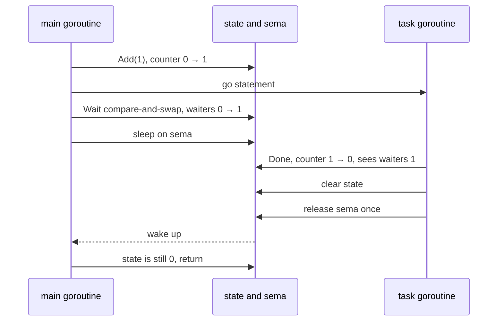

# 11.5 Wait Groups

Mutexes ([11.2](./mutex.md)) and condition variables ([11.4](./cond.md)) deal with many goroutines
contending for the same state. `sync.WaitGroup` deals with a different structure: one goroutine
forks several tasks and continues only after all of them have finished. This divide-then-merge
structure is called fork-join:

```go
var wg sync.WaitGroup
for _, t := range tasks {
	wg.Go(func() { process(t) })
}
wg.Wait() // returns only after all tasks have finished
```

The core of `WaitGroup` is a counter: add one for every task forked, subtract one for every task
finished, and release the waiters when the count reaches zero. The idea is much older than Go. In
1963 Melvin Conway designed the FORK and JOIN instructions for multiprocessor computers around
exactly such a counter [[Conway, 1963](#ref-conway-1963)]. In 2011 Gustavo Niemeyer proposed adding
it to the `sync` package under the title "Proposal for barrier
implementation" [[Niemeyer, 2011](#ref-niemeyer-2011)]. The implementation has been rewritten
several times since, from a mutex plus an on-demand semaphore to today's single 64-bit word plus a
semaphore. Its usage rules were spelled out step by step, and misuse is now caught at three levels:
the runtime, the race detector and `go vet`. `WaitGroup.Go`, added in Go 1.25, folds the most common
idiom into one method, and Go 1.26 corrected its behavior when a task panics.

## 11.5.1 The Junction Counter

Conway viewed parallelism as forks in a flow chart: a process always starts from some point of the
chart, so every instance of parallelism arises from a fork in a path of the chart, and the separated
paths can merge again at a junction [[Conway, 1963](#ref-conway-1963)]. The paper adds FORK and JOIN
to the instruction set for this purpose. Take a two-way fork as an example. `FORK 200, 299, 2` first
sets the contents of address 299 to 2, then continues execution at both 101 and 200. Each of the two
paths ends with a `JOIN 299`, which means:

> Decrement the counter at 299 by one. If the result is zero, go to 299 + 1; otherwise release this
> processor.

The paper calls this counter the junction. Each path runs on its own processor and it cannot be
known which finishes first, but the processor that decrements the counter to zero knows it is the
last one. Conway concludes that in an N-way fork the only processor with a special role is the one
that finishes last, because it must branch to the code after the junction while all the others are
released. JOIN therefore has one more crucial job, waiting, since the code after the junction cannot
start until all paths have completed.

The number of forks cannot always be determined in advance. If whether a FORK executes depends on a
condition, the junction counter cannot be set once at the start of the fork. The paper gives another
form of FORK for this case, `FORK A, J`, which adds one to the value at J and then forks to A. This
is exactly today's combination of `wg.Add(1)` and a `go` statement. The first documentation example
Niemeyer wrote for `WaitGroup` is also a conditional fork: the loop calls `Add(1)` and starts a
goroutine only for the elements that satisfy a condition [[Niemeyer, 2011](#ref-niemeyer-2011)].

`WaitGroup` keeps the counter but changes how the merge happens. Conway's processors were scarce
hardware, so the first to arrive should yield as early as possible. Goroutines are cheap, and the
code after the junction usually belongs to the goroutine that issued the fork. So Go does not let
the last arrival continue. Instead, the goroutine that calls `Wait` sleeps on the counter, and the
last `Done` wakes it when it brings the count to zero. The two designs differ in who executes the
code after the merge: Conway hands it to the path that finishes last, while `WaitGroup` leaves it
with the forking side. The cost is one block and one wakeup; the benefit is that the code after the
merge stays where it was written. Since Go 1.25 the `WaitGroup` documentation calls it a counting
semaphore [[Go Authors, 2026a](#ref-go-authors-2026a)], but its blocking condition is the opposite
of the classic counting semaphore ([11.1.1](./basic.md)): Dijkstra's P operation blocks when the
count is zero, whereas `Wait` blocks until the count is zero.

Conway's "last arrival continues" did not disappear. A Java `CyclicBarrier` can carry a barrier
action, which the last thread to arrive runs before releasing the others; the per-phase advance
action of a `Phaser` is likewise run by the participant that triggers the advance
[[Oracle, 2023](#ref-oracle-2023)]. The table below puts several primitives for waiting until a
group of events has all happened side by side:

| Primitive | How the count is set | Reusable | Who waits |
| --- | --- | --- | --- |
| `CountDownLatch` (Java 5) | Given at construction, only decreases | No, the count cannot be reset | Any thread, until the count reaches zero |
| `CyclicBarrier` (Java 5) | Number of parties fixed at construction | Yes, reused automatically after release | The parties wait for one another |
| `Phaser` (Java 7) | Parties can register and deregister at any time | Yes, advances phase by phase | Parties wait for the end of the current phase |
| `CountdownEvent` (.NET Framework 4) | Initial value plus `AddCount`; no more adds after it reaches zero | Only with an explicit `Reset` | Any thread, until the count reaches zero |
| `sync.WaitGroup` (Go) | `Add` increases or decreases at any time | Yes, once all `Wait` calls of the previous round have returned | Any goroutine, until the count reaches zero |

`CyclicBarrier` solves a different problem: a group of peer threads wait for each other, with no
distinction between one side waiting for many. The closest relatives of `WaitGroup` are
`CountDownLatch` and `CountdownEvent`. In all three, a group of waiters waits for a counter to reach
zero; they differ in what happens afterwards. A `CountDownLatch` is spent at that point and its
count cannot be reset. A `CountdownEvent` enters the signaled state once the count reaches zero, and
calling `AddCount` then throws `InvalidOperationException`, so it must be `Reset` first
[[Microsoft, 2026](#ref-microsoft-2026)]. `WaitGroup` clears its state when it wakes the waiters, so
the next round can start directly from zero with `Add`. This convenience has a precondition, the
rule in the next section: an `Add` that starts from zero must not run concurrently with `Wait`.

## 11.5.2 Usage and Rules

Since Go 1.25 the recommended usage of `WaitGroup` involves only two methods: `Go(f)` runs `f` in a
new goroutine and registers it as a task, and `Wait` blocks until all registered tasks have
finished. Earlier code maintained the count by hand with `Add` and `Done`, and the documentation
still keeps this form for comparison [[Go Authors, 2026a](#ref-go-authors-2026a)]:

```go
var wg sync.WaitGroup
wg.Add(1) // register before the go statement
go func() {
	defer wg.Done() // deregister when the task ends
	task()
}()
wg.Wait()
```

`Done` is equivalent to `Add(-1)`. The counter cannot be negative; `Add` panics as soon as it makes
the counter negative. What deserves real care is the ordering between `Add` and `Wait`, which the
documentation of `Add` specifies in three sentences:

1. A call to `Add` with a positive delta that occurs when the counter is zero must happen before a
   `Wait`.
2. Calls with a negative delta, or calls with a positive delta that start when the counter is
   greater than zero, may happen at any time.
3. If a `WaitGroup` is reused to wait for several independent sets of events, new `Add` calls must
   happen after all previous `Wait` calls have returned.

The usual meaning of the first rule is that `Add` should be written before the statement that starts
the goroutine, not inside the new goroutine. The second rule lets a task fork new tasks while it
runs: the forking task has not finished, so the counter is greater than zero, and its `Add` cannot
conflict with `Wait`. The documentation of `Go` states this point more directly: a goroutine started
by `Go` may itself call `Go`. The third rule concerns reuse. The three rules say the same thing: the
moment the counter goes from zero to positive marks the start of a new round of waiting, and it must
be ordered with respect to the waiters, not concurrent with them.

This wording took shape gradually. In 2013, at the request of issue #4762, Russ Cox added a warning
to the documentation: a call to `Add` with a positive delta must happen before the call to `Wait`,
otherwise `Wait` may wait for a set of tasks that is too small [[Cox, 2013](#ref-cox-2013)]. Some
readers understood "the call" as "all calls" and others as "at least one call", and the two readings
lead to very different behavior. In 2014 Andrew Gerrand rewrote it into the first two rules of today
[[Gerrand, 2014](#ref-gerrand-2014)]. The third rule was added in 2015 together with a rewrite of
the implementation; the next section explains where it came from.

## 11.5.3 Evolution of the Implementation

Niemeyer's first implementation protected three fields with a mutex: the counter, the number of
waiters, and a pointer to a semaphore [[Niemeyer, 2011](#ref-niemeyer-2011)]. `Wait` incremented the
waiter count under the lock and then slept on the semaphore. The `Add` that brought the counter to
zero released the semaphore once per waiter under the lock, then set the semaphore pointer to nil,
and the next waiter allocated a new one. A comment in the source explains the reason for allocating
on demand; it targets the following interleaving:

```
G1: Add(1)
G1: go G2()
G1: Wait() // switched out after releasing the lock, before Semacquire
G2: Done() // releases the semaphore: sema == 1, waiters == 0, G1 has not run yet
G3: Wait() // sees counter == 0, waiters == 0, does not block
G3: Add(1) // counter == 1, waiters == 0
G3: go G4()
G3: Wait() // G1 still has not run; G3 sees sema == 1 and is released: wrong
```

The semaphore release made by G2 was meant for G1, but was taken by G3 of the next round. With a
fresh semaphore for every round, a release left over from the previous round cannot be consumed by
the next.

In July of the same year Dmitry Vyukov added a lock-free fast path
[[Vyukov, 2011](#ref-vyukov-2011)]. The counter and the waiter count became two atomic variables.
`Add` first modifies the counter atomically and returns at once if the result is positive or nobody
is waiting; `Wait` first reads the counter atomically and returns at once if it is zero. The lock is
entered only when a goroutine really has to sleep or wake others. In the benchmark in the commit
message, several goroutines repeatedly call `Wait` on a counter that has already reached zero; with
GOMAXPROCS at 16, each call dropped from about 104 nanoseconds to about 1.3 nanoseconds, because
they no longer contend for one lock. The fast path also brought a subtle point, and a comment in
`Wait` says so:

```go
wg.m.Lock()
atomic.AddInt32(&wg.waiters, 1)
// This code is racing with the unlocked path in Add above.
// The code above modifies counter and then reads waiters.
// We must modify waiters and then read counter (the opposite order)
// to avoid missing an Add.
if atomic.LoadInt32(&wg.counter) == 0 {
	atomic.AddInt32(&wg.waiters, -1)
	wg.m.Unlock()
	return
}
```

Although this part of `Wait` holds the lock, what it races with is the lock-free fast path of `Add`.
`Add` writes the counter and then reads the waiter count; `Wait` writes the waiter count and then
reads the counter. Each side writes one variable and then reads the other's, which is the shape of
the store-buffering litmus test described in [11.9](./mem.md). If both reads could see old values,
`Add` would think nobody is waiting and return, while `Wait` would think the counter has not reached
zero and go to sleep, so the wakeup would be lost. Only when atomic operations are sequentially
consistent can the two reads not both miss. When Cox argued in 2021 that Go's atomics should be
sequentially consistent, one of his examples was an old implementation of `sync.WaitGroup` that used
a pair of atomic uint32 values, `wg.counter` and `wg.waiters` [[Cox, 2021](#ref-cox-2021)]
([11.3.6](./atomic.md)).

In 2014 Rui Ueyama fixed a spurious wakeup in this version (issue #7734)
[[Ueyama, 2014](#ref-ueyama-2014)]. G1 brings the counter to zero, sees waiters, and is about to
take the lock to wake them. Before it gets the lock, G2 increments the counter and calls `Wait`,
joining the waiters. Once G1 holds the lock, it wakes all waiters together, including G2, whose
round has not yet finished. The fix is to read the counter again under the lock and wake the waiters
only if it is still zero. The on-demand allocation of 2011 and this fix of 2014 both aim at keeping
the program correct when operations of two adjacent rounds interleave.

In 2015 Vyukov took a different approach. He revisited Niemeyer's comment and concluded that the
scenario it describes cannot be valid: G3's `Add(1)` runs concurrently with G1's `Wait`, and whether
G1 waits for that `Add` or not are both defensible, so such a program cannot have a reasonable
behavior [[Vyukov, 2015](#ref-vyukov-2015)]. Since it is misuse, there is no need to allocate the
semaphore on demand. Once dynamic allocation was gone, the mutex was no longer necessary either: the
counter and the waiter count were packed into one 64-bit word, and both `Add` and `Wait` update the
state with a single atomic read-modify-write. Interleaving of adjacent rounds is no longer tolerated
but detected: the documentation gained the third rule of Section 11.5.2, and `Add` and `Wait` gained
the corresponding panics. By this rule, in the scenario Ueyama fixed, G2 starts a new round before
the waiters of the previous round have returned, which is likewise misuse. The benchmark in the
commit message shows the scenario where waiting actually happens becoming about 18% to 21% faster,
and the memory allocations per wait dropping from two to one.

The later changes all concern where this 64-bit word is stored. A 64-bit atomic operation on a
32-bit platform requires its operand to be 8-byte aligned, while struct fields are only guaranteed
4-byte alignment. Vyukov's version therefore declared a 12-byte array `state1 [12]byte`, and the
`state()` method picked out at run time the 8 bytes that are 8-byte aligned. In 2018 Diogo Pinela
changed it to `state1 [3]uint32`, letting the semaphore occupy the remaining 4 bytes and removing
the separate `sema` field [[Pinela, 2018](#ref-pinela-2018)]. In 2022 Cuong Manh Le switched to
`atomic.Uint64`, added in Go 1.19, which guarantees 64-bit alignment by itself, and the manual
alignment code was deleted ([11.3.7](./atomic.md)) [[Le, 2022](#ref-le-2022)]. In 2025 Damien Neil
borrowed the highest bit of the waiter count for `testing/synctest`, to record whether this
`WaitGroup` belongs to a synctest bubble [[Neil, 2025](#ref-neil-2025)].

| Committed | Released in | Representation of the state | Author |
| --- | --- | --- | --- |
| February 2011 | Go 1 | Mutex + counter + waiter count + on-demand semaphore | Niemeyer |
| July 2011 | Go 1 | Counter and waiter count become atomic variables, fast path added | Vyukov |
| 2015 | Go 1.5 | Mutex and dynamic semaphore removed, state packed into `state1 [12]byte` | Vyukov |
| 2018 | Go 1.11 | `state1 [3]uint32`, semaphore in the remaining 4 bytes | Pinela |
| 2022 | Go 1.20 | `atomic.Uint64` plus a separate `sema` | Le |
| 2025 | Go 1.25 | One bit borrowed as the synctest bubble flag | Neil |

## 11.5.4 Add and Wait

Today's `WaitGroup` has only three fields [[Go Authors, 2026a](#ref-go-authors-2026a)]:

```go
type WaitGroup struct {
	noCopy noCopy

	// Bits (high to low):
	//   bits[0:32]  counter
	//   bits[32]    flag: synctest bubble membership
	//   bits[33:64] wait count
	state atomic.Uint64
	sema  uint32
}
```

`noCopy` takes no space; it exists only so that `go vet` can check for copies made after first use
([11.3.7](./atomic.md)). The high 32 bits of `state` hold the counter, the number of tasks not yet
finished; the low 31 bits hold the waiter count, the number of goroutines blocked in `Wait`; the bit
between them is the synctest bubble flag. `sema` is the semaphore the waiters sleep on, implemented
by the runtime's `sema.go` ([11.2](./mutex.md)).

Putting the counter and the waiter count in one word buys a consistent snapshot: one atomic
operation yields both values, so there is no case where the counter has been changed by someone else
between reading it and reading the waiter count. The main body of `Add` is shown below, with the
race detector and synctest code replaced by `// ...`:

```go
func (wg *WaitGroup) Add(delta int) {
	// ...
	state := wg.state.Add(uint64(delta) << 32)
	// ...
	v := int32(state >> 32)
	w := uint32(state & 0x7fffffff)
	// ...
	if v < 0 {
		panic("sync: negative WaitGroup counter")
	}
	if w != 0 && delta > 0 && v == int32(delta) {
		panic("sync: WaitGroup misuse: Add called concurrently with Wait")
	}
	if v > 0 || w == 0 {
		return
	}
	// This goroutine has set counter to 0 when waiters > 0.
	// Now there can't be concurrent mutations of state:
	// - Adds must not happen concurrently with Wait,
	// - Wait does not increment waiters if it sees counter == 0.
	// Still do a cheap sanity check to detect WaitGroup misuse.
	if wg.state.Load() != state {
		panic("sync: WaitGroup misuse: Add called concurrently with Wait")
	}
	// Reset waiters count to 0.
	wg.state.Store(0)
	// ...
	for ; w != 0; w-- {
		runtime_Semrelease(&wg.sema, false, 0)
	}
}
```

`delta` is shifted left by 32 bits and added to the state, which changes only the counter in the
high 32 bits. A negative `delta`, converted to `uint64`, is a very large number; shifted and added,
it is equivalent, modulo $2^{64}$, to subtracting the corresponding value from the high 32 bits, and
the low bits are unaffected. After the addition, `Add` extracts the counter `v` and the waiter count
`w` from the returned new state. If the counter is negative, it panics. If this call raised the
counter from zero while there are already waiters, it is concurrent with some `Wait`, and it also
panics. If the counter is positive or nobody is waiting, it returns directly, which is the path
almost all calls take. The remaining case is that this call brought the counter to zero and someone
is waiting.

For this case the comment gives a line of reasoning: no concurrent modification of the state can
occur now. A new `Add` must not be concurrent with `Wait`, which is the rule of Section 11.5.2; and
a `Wait` that sees a zero counter does not increase the waiter count. So `Add` can clear the whole
state with a plain atomic store, with no need for compare-and-swap. Before clearing, it reads the
state once more and compares it with the earlier result, as a cheap check for misuse. After
clearing, it releases the semaphore once per waiter.

`Wait` is a compare-and-swap loop:

```go
func (wg *WaitGroup) Wait() {
	// ...
	for {
		state := wg.state.Load()
		v := int32(state >> 32)
		// ...
		if v == 0 {
			// Counter is 0, no need to wait.
			// ...
			return
		}
		// Increment waiters count.
		if wg.state.CompareAndSwap(state, state+1) {
			// ...
			runtime_SemacquireWaitGroup(&wg.sema, synctestDurable)
			isReset := wg.state.Load() != 0
			// ...
			if isReset {
				panic("sync: WaitGroup is reused before previous Wait has returned")
			}
			return
		}
	}
}
```

If the counter is zero, `Wait` returns directly. Otherwise it tries to add one to the state, that
is, to increment the waiter count in the low bits; if the state changed between the read and the
compare-and-swap, the swap fails and it reads again and retries. After registering successfully, it
sleeps on the semaphore. When woken, `Wait` checks whether the state is still zero. The `Add` that
woke it cleared the state before releasing the semaphore, so if the state is nonzero now, someone
has started a new round of `Add` before `Wait` returned, which violates the third rule. This is
precisely the behavior of G3 in Niemeyer's comment: the 2011 implementation allocated a semaphore on
demand for it, and implementations since 2015 report it as misuse.

A complete round of waiting is shown in the following diagram:



## 11.5.5 Misuse and Detection

Misuse of `WaitGroup` falls into two classes, detected by different means.

The first class is an unbalanced count. With more `Done` than `Add`, the counter goes negative and
`Add` panics at once. With fewer `Done` than `Add`, the counter never reaches zero and `Wait` never
returns; if all goroutines end up blocked as a result, the runtime reports a deadlock. The former is
deterministic and can be caught with `recover`:

```go {run=true}
package main

import (
	"fmt"
	"sync"
)

func main() {
	defer func() { fmt.Println("recover:", recover()) }()

	var wg sync.WaitGroup
	wg.Add(1)
	wg.Done()
	wg.Done() // one Done too many
}
```

The output is:

```
recover: sync: negative WaitGroup counter
```

The second class is a wrong order between `Add` and `Wait`, most commonly by writing `Add` inside
the new goroutine:

```go
var wg sync.WaitGroup
go func() {
	wg.Add(1) // wrong: must be called before the go statement
	defer wg.Done()
	work()
}()
wg.Wait()
```

If `Wait` reads the state first, it sees a zero counter and returns immediately, and `work` may not
even have started. No panic occurs in this case: `Add called concurrently with Wait` can fire only
when a waiter already exists, and this `Wait` never registered as one. If `Add` gets there first,
`Wait` blocks normally and the program happens to behave correctly. The outcome depends on
scheduling, and a test may never meet the bad run.

What reliably finds such errors are two other layers of tooling. In 2013 Vyukov improved the race
detector's model of `WaitGroup` [[Vyukov, 2013](#ref-vyukov-2013)]: the `Add` that raises the
counter from zero is treated as a read of the `sema` field, and the first `Wait` that really blocks
is treated as a write to it. If there is no synchronization between the two, the race detector
reports a data race. This happens precisely in the runs where `Add` gets there first and the program
looks correct: pause briefly after the `go` statement so that `Add` runs first, then run the program
above with `-race`. The program finishes as usual, yet the race detector reports a data race between
the main goroutine's write and the new goroutine's earlier read. The commit message lists another
detectable misuse, wrongly reusing a `WaitGroup` while there are several waiters. Since Go 1.25,
`go vet` has a `waitgroup` analyzer that points out the code above at the static-check stage,
reporting `WaitGroup.Add called from inside new goroutine`
[[Go Authors, 2025](#ref-go-authors-2025)].

| Misuse | Runtime | Race detector (`-race`) | `go vet` |
| --- | --- | --- | --- |
| More `Done` than `Add` | panic | | |
| `Add` inside the new goroutine | Usually no error; `Wait` may return early | Reports a data race | Reports (since Go 1.25) |
| New round of `Add` before all `Wait` calls of the previous round have returned | panic when the operations interleave | Reports a data race (with several waiters) | |

## 11.5.6 Synchronizes Before

Besides counting, `WaitGroup` provides a guarantee in the memory model. In the terms of
[11.9](./mem.md): a call to `Done` synchronizes before the return of any `Wait` call that it
unblocks. The documentation of `Go` gives the same guarantee: the return of `f` synchronizes before
the return of any `Wait` call that it unblocks. Consequently, memory writes made before a task ends
are visible to the waiter after `Wait` returns, and the waiter can read the tasks' results without
further locking:

```go {run=true}
package main

import (
	"fmt"
	"sync"
)

func main() {
	squares := make([]int, 10)
	var wg sync.WaitGroup
	for i := range squares {
		wg.Go(func() { squares[i] = i * i }) // each task writes only its own slot
	}
	wg.Wait()

	sum := 0
	for _, s := range squares {
		sum += s
	}
	fmt.Println(squares, sum)
}
```

The output is:

```
[0 1 4 9 16 25 36 49 64 81] 285
```

Each task writes only its own slot, so tasks do not race with one another. A task's write precedes
the return of `f` in program order, the return of `f` synchronizes before the return of `Wait`, and
the return of `Wait` precedes the later reads in program order; the three links form a
happens-before chain from write to read. Without this guarantee, reading `squares` after `Wait`
would be a data race.

In the implementation, this guarantee is carried by atomic operations on the state word. Every
`Done` is an atomic read-modify-write of the same word, so each reads the value written by the
previous one and all `Done` calls synchronize in sequence; the last `Done` then synchronizes,
through the state word or the semaphore, with the `Wait` that sees the counter reach zero. Go's
atomics are sequentially consistent: when one atomic operation observes the result of another, the
latter synchronizes before the former ([11.3.6](./atomic.md)). `Add` and `Wait` switch off the race
detector's recording while they operate on the state word and tell it this edge explicitly instead:
`Add` calls `race.ReleaseMerge` when `delta` is negative, and `Wait` calls `race.Acquire` before
returning.

This guarantee was written into the documentation of `waitgroup.go` in 2022, released with Go 1.19
[[Cox, 2022](#ref-cox-2022)]. The wording comes from Cox's 2021 article on updating the memory
model, which also suggested documenting such guarantees on the types of the `sync` package, setting
an example for third-party synchronization primitives to state their ordering guarantees
[[Cox, 2021](#ref-cox-2021)]. The body of the Go memory model now lists only types such as
`WaitGroup` and says their guarantees are given in their own documentation
[[Go Authors, 2022](#ref-go-authors-2022)].

## 11.5.7 WaitGroup.Go

The trio of `Add(1)`, a `go` statement and `defer wg.Done()` is easy to omit or misplace once
written often enough. In 2023 Olivier Mengué proposed adding a `Go` method to `WaitGroup`
[[Mengué, 2023](#ref-mengue-2023)]. His reasoning was that all three look mysterious to beginners:
the 1 in `Add(1)` looks like a magic number, the `go` keyword and the `()` after the function
literal are puzzling, and so are `defer` and `Done` being written before the task code. Moreover,
combined with the change to loop variables (#60078), writing concurrent code would be much less
error-prone. That change is the per-iteration loop variable of Go 1.22
([6.1.3](../../part2lang/ch06func/func.md)) [[Chase and Cox, 2023](#ref-chase-cox-2023)]; before it,
using a loop variable in a closure required copying it by hand with `t := t`.

The proposal was accepted in April 2025 and released with Go 1.25
[[Go Authors, 2025](#ref-go-authors-2025)]. The initial implementation was as simple as the one in
the proposal [[qiulaidongfeng, 2025](#ref-qiulaidongfeng-2025)]:

```go
func (wg *WaitGroup) Go(f func()) {
	wg.Add(1)
	go func() {
		defer wg.Done()
		f()
	}()
}
```

The documentation puts only one requirement on `f`: it must not panic. Alan Donovan explained the
reason for this wording in the discussion: never promise a panic, state the precondition instead, so
that it can be relaxed later [[Donovan, 2025a](#ref-donovan-2025a)].

`defer wg.Done()` carries a hazard that is not limited to the `Go` method. In July 2025 Jille
Timmermans reported the following program [[Timmermans, 2025](#ref-timmermans-2025)]:

```go
func main() {
	var wg sync.WaitGroup
	wg.Add(1)
	go func() {
		defer wg.Done()
		panic("test")
	}()
	wg.Wait()
	os.Exit(0)
}
```

An unrecovered panic in a goroutine terminates the whole program with exit code 2. But panicking
unwinds by running deferred calls first, and `wg.Done()` wakes the main goroutine. Between that
wakeup and the moment the runtime prints the panic message and terminates the process there is a
window; if the main goroutine calls `os.Exit(0)` within it, the program ends with exit code 0 and
the panic vanishes without a trace. The reporter observed this in about 3% of runs on their machine.
A more common consequence is that the code after `Wait` reads a result that was never initialized
and panics again, masking the real cause.

This issue was closed the same day, for the very reason that a panic should not be promised. In
October, maxim2266 raised the problem again and suggested that `Go` should not use `defer` but call
`Done` after `f` returns [[maxim2266, 2025](#ref-maxim2266-2025)]: if `f` panics, the program will
terminate anyway, so it does not matter that `Done` is not called. This approach misses a third way
for `f` to end: `f` may call `runtime.Goexit`. `Goexit` terminates the current goroutine and runs
its deferred calls, but it is not a panic, and `recover` in a deferred function returns nil
([6.3.1](../../part2lang/ch06func/panic.md)). Without `defer`, `Done` is not called after `Goexit`,
and `Wait` blocks forever:

```go {run=true}
package main

import (
	"fmt"
	"runtime"
	"sync"
	"time"
)

// goWithoutDefer is the variant first suggested in issue #76126: Done is called only after f returns.
func goWithoutDefer(wg *sync.WaitGroup, f func()) {
	wg.Add(1)
	go func() {
		f()
		wg.Done()
	}()
}

// returns reports whether wg.Wait returns within one second.
func returns(wg *sync.WaitGroup) bool {
	done := make(chan struct{})
	go func() {
		wg.Wait()
		close(done)
	}()
	select {
	case <-done:
		return true
	case <-time.After(time.Second):
		return false
	}
}

func main() {
	task := func() {
		defer fmt.Println("the task's deferred call still runs")
		runtime.Goexit()
	}

	var a sync.WaitGroup
	a.Go(task)
	fmt.Printf("wg.Go: does Wait return? %v\n", returns(&a))

	var b sync.WaitGroup
	goWithoutDefer(&b, task)
	fmt.Printf("without defer: does Wait return? %v\n", returns(&b))
}
```

The output is:

```
the task's deferred call still runs
wg.Go: does Wait return? true
the task's deferred call still runs
without defer: does Wait return? false
```

In #76126 Donovan gave a third option [[Donovan, 2025b](#ref-donovan-2025b)]: keep `defer`, and use
`recover` in the deferred function to tell a panic from `Goexit`. Jes Cok changed the implementation
accordingly, fixing both issues above, and it was released with Go 1.26
[[Cok, 2025](#ref-cok-2025)]:

```go
func (wg *WaitGroup) Go(f func()) {
	wg.Add(1)
	go func() {
		defer func() {
			if x := recover(); x != nil {
				// f panicked, which will be fatal because
				// this is a new goroutine.
				// ...
				panic(x)
			}

			// f completed normally, or abruptly using goexit.
			// Either way, decrement the semaphore.
			wg.Done()
		}()
		f()
	}()
}
```

When `f` returns normally or ends through `Goexit`, `recover` returns nil and `Done` is called as
usual. When `f` panics, the deferred function panics again with the same value without calling
`Done`, so `Wait` is not woken and the process is terminated by that panic. The distinction is
reliable because since Go 1.21 `panic(nil)` is by default replaced with a `*runtime.PanicNilError`,
so a nil from `recover` only means there was no panic ([6.3.1](../../part2lang/ch06func/panic.md)).
Panicking again does not lose the scene either: while the deferred function runs, the stack frames
of the original panic are still on the stack, so the call stack printed at the crash still points to
the failing line in `f`. If `f` executes `panic("test")`, the first line uses the format introduced
in Go 1.25, `panic: test [recovered, repanicked]`.

The fix covers only the `Go` method. Code that writes `defer wg.Done()` by hand still has the
problem Timmermans described, which is one more reason to prefer `Go`.

## 11.5.8 Errors and Cancellation

`WaitGroup` answers only "when has everything finished". How the errors returned by tasks are
brought back, and how the remaining tasks are made to stop early when one fails, it leaves alone.
`golang.org/x/sync/errgroup` supplies both on top of `WaitGroup`
[[Go Authors, 2026b](#ref-go-authors-2026b)]; its implementation and usage are in
[10.7.4](../ch10chan/pattern.md). Structured concurrency, which confines the lifetime of a group of
tasks to one lexical scope, and its forms in various languages, are covered in
[11.8.5](./context.md).

## Further Reading

- <a id="ref-chase-cox-2023"></a>[Chase and Cox, 2023] David Chase, Russ Cox. *Fixing For Loops in
  Go 1.22.* The Go Blog, 2023. https://go.dev/blog/loopvar-preview Details of the specification
  change are at https://go.dev/wiki/LoopvarExperiment .
- <a id="ref-cok-2025"></a>[Cok, 2025] Jes Cok. sync: don't call Done when f() panics in
  WaitGroup.Go. Go commit 95a0e5adc1, 2025. https://go.dev/cl/717760 Fixes issues #74702 and #76126;
  released with Go 1.26.
- <a id="ref-conway-1963"></a>[Conway, 1963] Melvin E. Conway. "A Multiprocessor System Design."
  *Proceedings of the AFIPS Fall Joint Computer Conference*, 139–146, 1963.
  https://doi.org/10.1145/1463822.1463838
  The original presentation of the FORK and JOIN instructions and the junction counter.
- <a id="ref-cox-2013"></a>[Cox, 2013] Russ Cox. sync: add caution about where to call
  (*WaitGroup).Add. Go commit 02e05817ad, 2013.
  https://github.com/golang/go/commit/02e05817ada2bd3d0492387a032b1aa879c2cd3f Fixes issue #4762;
  released with Go 1.1.
- <a id="ref-cox-2021"></a>[Cox, 2021] Russ Cox. Updating the Go Memory Model. research!rsc, 2021.
  https://research.swtch.com/gomm Uses the old `WaitGroup` implementation as an example to argue
  that atomics should be sequentially consistent.
- <a id="ref-cox-2022"></a>[Cox, 2022] Russ Cox. runtime, sync, sync/atomic: document happens-before
  guarantees. Go commit a71ca3dfbd, 2022. https://go.dev/cl/381316
  Released with Go 1.19.
- <a id="ref-donovan-2025a"></a>[Donovan, 2025a] Alan Donovan. Comment on golang/go#63796, 2025.
  https://github.com/golang/go/issues/63796#issuecomment-2825614606
  The origin of the wording "f must not panic".
- <a id="ref-donovan-2025b"></a>[Donovan, 2025b] Alan Donovan. Comment on golang/go#76126, 2025.
  https://github.com/golang/go/issues/76126#issuecomment-3473417226
  The approach of using `recover` to tell a panic from `Goexit`.
- <a id="ref-gerrand-2014"></a>[Gerrand, 2014] Andrew Gerrand. sync: be more explicit in WaitGroup
  docs. Go commit bc64c07825, 2014.
  https://github.com/golang/go/commit/bc64c078259b97392c2a9d5ee6bda75ae3971579 Fixes issue
  #8543, "sync: WaitGroup Add vs Done keeps confusing people"; released with Go 1.4.
- <a id="ref-go-authors-2022"></a>[Go Authors, 2022] The Go Authors. *The Go Memory Model* (Version
  of June 6, 2022). https://go.dev/ref/mem The "Additional Mechanisms" section points `WaitGroup`
  and similar types to their own documentation.
- <a id="ref-go-authors-2025"></a>[Go Authors, 2025] The Go Authors. *Go 1.25 Release Notes* (adds
  `WaitGroup.Go`, proposal #63796). https://go.dev/doc/go1.25
  Also adds the `waitgroup` analyzer to `go vet`.
- <a id="ref-go-authors-2026a"></a>[Go Authors, 2026a] The Go Authors. *Package sync: type
  WaitGroup.* https://pkg.go.dev/sync#WaitGroup Source `src/sync/waitgroup.go`; the excerpts in this
  section are from Go 1.26.
- <a id="ref-go-authors-2026b"></a>[Go Authors, 2026b] The Go Authors. *Package errgroup.*
  https://pkg.go.dev/golang.org/x/sync/errgroup
  Source `golang.org/x/sync/errgroup`.
- <a id="ref-le-2022"></a>[Le, 2022] Cuong Manh Le. sync: use atomic.Uint64 for WaitGroup state. Go
  commit ee833ed72e, 2022. https://go.dev/cl/424835 Released with Go 1.20.
- <a id="ref-maxim2266-2025"></a>[maxim2266, 2025] maxim2266. Go issue #76126. *sync:
  WaitGroup.Go(f) may cause Wait's return to race with termination of process when f panics.* 2025.
  https://github.com/golang/go/issues/76126
- <a id="ref-mengue-2023"></a>[Mengué, 2023] Olivier Mengué. Go issue #63796. *sync: add
  WaitGroup.Go.*
  2023. https://github.com/golang/go/issues/63796
- <a id="ref-microsoft-2026"></a>[Microsoft, 2026] Microsoft. CountdownEvent.AddCount Method. *.NET
  API Reference.*
  https://learn.microsoft.com/en-us/dotnet/api/system.threading.countdownevent.addcount Calling it
  when the count has reached zero (the instance is signaled) throws `InvalidOperationException`.
- <a id="ref-neil-2025"></a>[Neil, 2025] Damien Neil. runtime, internal/synctest, sync: associate
  WaitGroups with bubbles. Go commit b170c7e94c, 2025. https://go.dev/cl/676656
  Released with Go 1.25.
- <a id="ref-niemeyer-2011"></a>[Niemeyer, 2011] Gustavo Niemeyer. sync: Proposal for barrier
  implementation. Go commit 63457d089e, 2011.
  https://github.com/golang/go/commit/63457d089ea4aebe35223dc6b70feae804a6a926
  The first implementation of `WaitGroup`; released with Go 1.
- <a id="ref-oracle-2023"></a>[Oracle, 2023] Oracle. *java.util.concurrent: CountDownLatch,
  CyclicBarrier, Phaser.* Java SE 21 & JDK 21 API Specification,
  2023. https://docs.oracle.com/en/java/javase/21/docs/api/java.base/java/util/concurrent/package-summary.html
- <a id="ref-pinela-2018"></a>[Pinela, 2018] Diogo Pinela. sync: make WaitGroup more
  space-efficient. Go commit 9ff7df003d, 2018. https://go.dev/cl/100515 Fixes issue #19149; released
  with Go 1.11.
- <a id="ref-qiulaidongfeng-2025"></a>[qiulaidongfeng, 2025] qiulaidongfeng. sync: add WaitGroup.Go.
  Go commit 822031dffc, 2025. https://go.dev/cl/662635 Released with Go 1.25.
- <a id="ref-timmermans-2025"></a>[Timmermans, 2025] Jille Timmermans. Go issue #74702. *sync: defer
  wg.Done() is dangerous.* 2025. https://github.com/golang/go/issues/74702
- <a id="ref-ueyama-2014"></a>[Ueyama, 2014] Rui Ueyama. sync: fix spurious wakeup from
  WaitGroup.Wait. Go commit e9347c781b, 2014.
  https://github.com/golang/go/commit/e9347c781be66056bbc724f4d70d4b8b9bc0288c Fixes issue #7734;
  released with Go 1.3.
- <a id="ref-vyukov-2011"></a>[Vyukov, 2011] Dmitriy Vyukov. sync: add fast paths to WaitGroup. Go
  commit ee6e1a3ff7, 2011.
  https://github.com/golang/go/commit/ee6e1a3ff77a41eff5a606a5aa8c46bf8b571a13 Released with Go 1.
- <a id="ref-vyukov-2013"></a>[Vyukov, 2013] Dmitriy Vyukov. sync: improve race instrumentation of
  WaitGroup. Go commit 0f4897ae1a, 2013.
  https://github.com/golang/go/commit/0f4897ae1a99d5c9de78c33c7b0963e71960c678
  Released with Go 1.2.
- <a id="ref-vyukov-2015"></a>[Vyukov, 2015] Dmitry Vyukov. sync: simplify WaitGroup. Go commit
  03a48ebe1c, 2015. https://go.dev/cl/4117
  Released with Go 1.5.
- This book: [11.3 Atomic Operations](./atomic.md), [11.8 Context](./context.md),
  [11.9 Memory Consistency Models](./mem.md),
  [6.1 Function Calls](../../part2lang/ch06func/func.md),
  [10.7 Engineering Practice and Cross-Language Comparison](../ch10chan/pattern.md).
