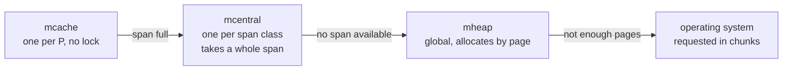

# 12.1 Design Principles

Every `new`, every variable that escapes to the heap, and every `append` that exceeds capacity in a
Go program ends up calling the same runtime function, `runtime.mallocgc`. This chapter is about the
memory allocator behind that function. This section does not yet touch individual components. It
discusses the problem the allocator faces and the few basic design decisions Go made in response:
which goals the allocator must balance, what it inherits from TCMalloc, why it allocates by size
class, how it dispatches by an object's size and type, and why it must be designed together with the
garbage collector. The components and paths discussed in [12.2](./component.md) through
[12.8](./mstats.md) all rest on these decisions.

## 12.1.1 The Problem the Allocator Faces

Allocation in this chapter means heap allocation only. A function's local variables normally live on
the goroutine's stack and become invalid when the function returns, so they do not pass through the
allocator (stack management is covered in [Chapter 14](../ch14stack/readme.md)). An object is placed
on the heap only when the compiler cannot prove that its lifetime is confined to the current stack
frame, a judgment made by escape analysis. Consider the following program:

```go
package main

func f() int {
	x := 42
	return x
}

func g() *int {
	y := 42
	return &y
}

func main() {
	_ = f()
	_ = g()
}
```

The flag `-gcflags=-m` makes the compiler print its optimization decisions:

```shell
$ go build -gcflags=-m esc.go
# command-line-arguments
./esc.go:3:6: can inline f
./esc.go:8:6: can inline g
./esc.go:13:6: can inline main
./esc.go:14:7: inlining call to f
./esc.go:15:7: inlining call to g
./esc.go:9:2: moved to heap: y
```

The first five lines are inlining decisions, which are irrelevant here. The last line shows that
because `g` returns the address of `y`, `y` may still be accessed after `g` returns, cannot stay in
`g`'s stack frame, and is therefore moved to the heap. For this the compiler generates a call to
`runtime.newobject`, and `newobject` merely calls `mallocgc` with the size of the type
[[Go Authors, 2026a](#ref-go-authors-2026a)]:

```go
func newobject(typ *_type) unsafe.Pointer {
	return mallocgc(typ.Size_, typ, true)
}
```

`x` does not escape and stays on the stack. Other operations, such as `make` creating a slice and
the growth of a slice by `append` beyond its capacity (`growslice`), also end up calling `mallocgc`.
Escape analysis itself is discussed in
[15.5 Escape Analysis](../../part5toolchain/ch15compile/escape.md); this chapter is concerned only
with its result: every escaping object is allocated on the heap by `mallocgc`.

A general-purpose allocator must satisfy several conflicting goals at once:

- Speed: allocation sits on the program's hot path, and a service may perform millions of
  allocations per second. Ideally an allocation takes only a few instructions and no lock.
- Scalability: Go programs usually run on multicore machines, and many goroutines may allocate at
  the same time. If all allocations share one global lock, contention worsens as the number of cores
  grows.
- Space efficiency: the space reserved for an object should not be much larger than the object, and
  free memory should not be divided into too many small pieces. Otherwise a long-running service
  suffers continual memory bloat.
- Cooperation with the garbage collector: Go has no explicit `free`, and the garbage collector
  decides when an object can be reused ([Chapter 13](../ch13gc/readme.md)). The allocator must
  record the information the collector needs, and the rate of allocation must influence when
  collection starts.

The first three goals are common to all allocators. The 1995 survey by Wilson et al.
[[Wilson et al., 1995](#ref-wilson-1995)] attributes space waste to fragmentation and keeps the
traditional division into two kinds. **Internal fragmentation** occurs when an allocated block is
larger than the request, so the excess is wasted inside the block. **External fragmentation** occurs
when the total amount of free memory is sufficient but cannot satisfy a request because it is split
into many smaller blocks. The survey also points out the constraints on an allocator: it cannot
decide when the program allocates or frees, and it cannot compact memory by moving allocated blocks.
It can only decide where in free memory the next request is placed. In the survey's words:

> An allocator is therefore an online algorithm, which must respond to requests in strict sequence,
> immediately, and its decisions are irrevocable.

The constraint holds for Go as well, because Go's garbage collector does not move objects. The
comment at the beginning of `runtime/mgc.go` reads [[Go Authors, 2026d](#ref-go-authors-2026d)]:

```go
// It is non-generational and non-compacting. Allocation is done using size segregated per P allocation
// areas to minimize fragmentation while eliminating locks in the common case.
```

That is, the collector is neither generational nor compacting. Allocation uses size-segregated,
per-P allocation areas, which minimize fragmentation and eliminate locks in the common case. Since
the collector does not compact the heap, fragmentation can be controlled only at allocation time.
The comment also summarizes the main design of this chapter: size segregation controls
fragmentation, and per-P allocation areas eliminate lock contention.

Wilson et al. further distinguish three levels of allocator design. A strategy exploits regularities
in the program's request sequence; a policy is an implementable rule that decides where a block is
placed; a mechanism is the algorithms and data structures that implement the policy. The survey
argues that earlier research focused too much on mechanism and neglected policy. In this vocabulary,
the size classes below are a policy: a given stretch of memory holds objects of one size only.
Spans, bitmaps and the layers of caches are the mechanisms that implement it.

## 12.1.2 From TCMalloc to Go

Go's allocator descends from Google's TCMalloc (thread-caching malloc). The TCMalloc design document
first appeared in 2005 [[Ghemawat and Menage, 2005](#ref-ghemawat-menage-2005)]. Its approach is as
follows. Each thread holds a local cache, and the allocation and release of small objects are first
served from the local cache without locking. Only when the local cache is exhausted are objects
fetched in batches from a central free list. When the central free list is also exhausted, a run of
contiguous pages is requested from the page heap and divided into objects of equal size. The
document reports that on a 2.8 GHz Pentium 4, glibc's ptmalloc2 needs about 300 nanoseconds for a
malloc and free pair while TCMalloc needs about 50 nanoseconds, and that on a 2.8 GHz Xeon a single
lock and unlock pair alone costs about 100 nanoseconds. Avoiding locks is therefore the main source
of TCMalloc's speed advantage.

Other allocators of the same period were also trying to escape the global lock, by different means.
Bonwick and Adams added a per-processor magazine layer to Solaris's slab allocator, to solve the
problem that a global lock does not scale to multiple processors
[[Bonwick and Adams, 2001](#ref-bonwick-adams-2001)]. FreeBSD's jemalloc has no private per-thread
cache. It builds multiple arenas (by default four times the number of processors on a
multiprocessor) and assigns threads to the arenas in round-robin fashion, which lowers the
probability that one arena is used concurrently [[Evans, 2006](#ref-evans-2006)]. The goal of these
approaches is the same: replace a single global lock with many local structures that rarely see
contention.

Go's allocator was written by Russ Cox in late 2008. Its original header comment states
plainly "Memory allocator, based on tcmalloc" and links to the TCMalloc document
[[Cox, 2008](#ref-cox-2008)]. The structure at that time corresponded to TCMalloc almost one to one:
about 100 size classes, a heap managed in units of 4096-byte pages, and a cache held by each thread
(in Go, each M). Since then it has diverged from TCMalloc in three respects.

The first is who owns the cache. When Go 1.1 rewrote the scheduler and introduced the P, Vyukov
moved the run queue and the memory cache from the M to the P [[Vyukov, 2013](#ref-vyukov-2013)]. An
M may block in a system call, and the number of Ms is not bounded by `GOMAXPROCS`; the number of Ps
equals `GOMAXPROCS`, and at any moment a P is held by at most one M
([9.3 The MPG Model and the Units of Concurrent Scheduling](../../part3concurrency/ch09sched/mpg.md)).
Once the cache belongs to the P, accessing it needs no lock, and the total size of the caches grows
with `GOMAXPROCS` rather than with the number of threads. TCMalloc later evolved in the same
direction. Its current design document [[TCMalloc Authors, 2026](#ref-tcmalloc-authors-2026)] points
out that per-thread caches make memory use grow with the number of threads: with many threads,
either the total cache is large or each thread's cache is small. TCMalloc therefore added a mode
that partitions caches by logical CPU, using Linux restartable sequences to remain correct without
locks or atomic instructions. In Go, the P plays the role of a logical processor in user space;
because scheduling is under the runtime's own control, this design needs no kernel support.

The second is metadata. TCMalloc serves explicit `malloc` and `free`, whereas Go's allocator serves
a precise garbage collector, so every layer of structures must record extra information the
collector needs: which words are pointers, which objects have been marked, and which slots are free
(12.1.5).

The third is a large number of implementation-level adjustments. The page size grew from 4096 to
8192 bytes in Go 1.3 [[Vyukov, 2014](#ref-vyukov-2014)]. From Go 1.7, free slots within a span are
recorded by a bitmap rather than a linked list [[Clements, 2015](#ref-clements-2015)]
[[Hudson, 2016](#ref-hudson-2016)]. From Go 1.8, the size class table is generated at build time
rather than computed at startup [[Randall, 2016](#ref-randall-2016)]. Go 1.15 replaced the locked
lists in the central cache with sets that have an atomic fast path; with `GOMAXPROCS` of 16, the
throughput of concurrently allocating 1 KiB objects rose from about 4220 MiB per second to about
10420 MiB per second [[Knyszek, 2020](#ref-knyszek-2020)]. In Go 1.8, Clements changed the header
comment to its present wording [[Clements, 2016](#ref-clements-2016)]:

```go
// This was originally based on tcmalloc, but has diverged quite a bit.
// http://goog-perftools.sourceforge.net/doc/tcmalloc.html
```

Even so, the layered structure has never changed. The same comment describes how allocating a small
object proceeds up the hierarchy:

```go
// Allocating a small object proceeds up a hierarchy of caches:
//
//	1. Round the size up to one of the small size classes
//	   and look in the corresponding mspan in this P's mcache.
//	   Scan the mspan's free bitmap to find a free slot.
//	   If there is a free slot, allocate it.
//	   This can all be done without acquiring a lock.
//
//	2. If the mspan has no free slots, obtain a new mspan
//	   from the mcentral's list of mspans of the required size
//	   class that have free space.
//	   Obtaining a whole span amortizes the cost of locking
//	   the mcentral.
//
//	3. If the mcentral's mspan list is empty, obtain a run
//	   of pages from the mheap to use for the mspan.
//
//	4. If the mheap is empty or has no page runs large enough,
//	   allocate a new group of pages (at least 1MB) from the
//	   operating system. Allocating a large run of pages
//	   amortizes the cost of talking to the operating system.
```

The first step is completed in the current P's cache, the `mcache`, without locking. The second step
obtains a whole span from the central cache `mcentral` of that size class; one refill serves many
later allocations, so the cost of synchronization is amortized. The comment still says that the
`mcentral` must be locked, which was true before Go 1.15; today its common path uses only atomic
operations. The third step requests a run of contiguous pages from the global page heap `mheap`, and
the fourth step grows the page heap, requesting memory from the operating system if necessary.
The "at least 1MB" in the comment is the lower bound of Go 1.10 and earlier; today the page heap
grows in units of 4 MiB on most platforms ([12.2 Components](./component.md)). The further down the
hierarchy, the higher the cost of a single operation and the lower its frequency:



The vast majority of allocations finish at the first step. This path, which touches only data local
to the current P, is the **fast path**; the path that must go up the hierarchy to replenish is the
**slow path**. Spreading global contention across the Ps is a design that appears in several places
in the Go runtime: the scheduler keeps a local run queue per P
([9.2 Work-Stealing Scheduling](../../part3concurrency/ch09sched/steal.md)), `sync.Pool` keeps a
local cache per P ([11.6 Object Pool](../../part3concurrency/ch11sync/pool.md)), and the allocator
keeps an `mcache` per P. The components are detailed in [12.2 Components](./component.md).

## 12.1.3 Size Classes

Wilson et al. call a simple and fast family of allocation policies simple segregated storage. A
request is rounded up to one of several size classes, and each class has its own free list. When the
free list is empty, one or two pages are requested from the operating system and divided into blocks
of equal size. Blocks are neither split nor coalesced, so a page contains blocks of one class only
[[Wilson et al., 1995](#ref-wilson-1995)]. This is exactly the policy used by TCMalloc and Go. The
classes are called **size classes**, and the contiguous pages that hold objects of one size class
are called a span ([12.2 Components](./component.md)).

The policy has three benefits. All slots in one span have the same size, so allocation only needs to
find a free slot rather than search among free blocks of varying sizes. The size of an object is
determined by the span it lives in, so it need not be recorded next to the object. And objects of
the same size are stored together, so objects of different sizes do not fragment one another's free
memory. The cost is internal fragmentation, since every request must be rounded up to some size
class. The finer the division into classes, the less is wasted by rounding; but each class needs its
own spans and caches, and too fine a division scatters free memory across too many classes. The 2005
TCMalloc document uses about 170 size classes
[[Ghemawat and Menage, 2005](#ref-ghemawat-menage-2005)], and the current document uses 60 to 80
[[TCMalloc Authors, 2026](#ref-tcmalloc-authors-2026)].

Go 1.26 has 68 size classes. Class 0 corresponds to no size, and classes 1 through 67 are in use,
covering 8 bytes to 32 KiB. The table is generated by `runtime/_mkmalloc/mksizeclasses.go` and
written to `internal/runtime/gc/sizeclasses.go` [[Go Authors, 2026b](#ref-go-authors-2026b)]
[[Go Authors, 2026c](#ref-go-authors-2026c)]. The comment at the start of the generator explains the
trade-off:

```go
// The size classes are chosen so that rounding an allocation
// request up to the next size class wastes at most 12.5% (1.125x).
//
// Each size class has its own page count that gets allocated
// and chopped up when new objects of the size class are needed.
// That page count is chosen so that chopping up the run of
// pages into objects of the given size wastes at most 12.5% (1.125x)
// of the memory. It is not necessary that the cutoff here be
// the same as above.
//
// The two sources of waste multiply, so the worst possible case
// for the above constraints would be that allocations of some
// size might have a 26.6% (1.266x) overhead.
// In practice, only one of the wastes comes into play for a
// given size (sizes < 512 waste mainly on the round-up,
// sizes > 512 waste mainly on the page chopping).
// For really small sizes, alignment constraints force the
// overhead higher.
```

There are two sources of waste. One is rounding: a request is placed in a slot no smaller than
itself. The other is chopping: the length of a span is not necessarily a multiple of the object
size, and the tail that cannot hold another object is called tail waste. The generator limits each
to at most 12.5%, and since the two multiply, the worst case is 1.125 × 1.125 ≈ 1.266, that is,
26.6%.

The generation proceeds as follows. Sizes start at 8 bytes and grow by the current alignment step,
which changes at each power of two: 16 from 32 bytes, 1/8 of that power of two from 128 bytes, and
fixed at 256 from 2048 bytes. From 128 bytes on, therefore, the gap between adjacent candidate sizes
is at most 1/8 of the size, which bounds the rounding waste; smaller sizes are constrained by 8-byte
and 16-byte alignment, and their waste ratio is higher. For each candidate size the generator picks
the smallest number of pages for which tail waste does not exceed 1/8. If a size needs the same
number of pages as the previous class, each span holds the same number of objects, and the two are
merged into one class. Finally, without changing the object count, the size is enlarged to fill the
span as far as possible; the example in the comment enlarges 8448 bytes to 9472 bytes, both of which
fit 6 objects in 7 pages. Merging and enlarging both widen the gaps between adjacent classes. The
generator also checks that the result is exactly 68 classes and reports an error otherwise.

The generated file lists the parameters of each size class in a comment. The table below excerpts a
few rows:

| Class | Object size (bytes) | Span size (bytes) | Objects | Tail waste (bytes) | Max waste | Min align (bytes) |
| --- | --- | --- | --- | --- | --- | --- |
| 1 | 8 | 8192 | 1024 | 0 | 87.50% | 8 |
| 2 | 16 | 8192 | 512 | 0 | 43.75% | 16 |
| 5 | 48 | 8192 | 170 | 32 | 31.52% | 16 |
| 10 | 128 | 8192 | 64 | 0 | 11.72% | 128 |
| 18 | 256 | 8192 | 32 | 0 | 5.86% | 256 |
| 32 | 1024 | 8192 | 8 | 0 | 12.40% | 1024 |
| 45 | 4864 | 24576 | 5 | 256 | 16.65% | 256 |
| 67 | 32768 | 32768 | 1 | 0 | 12.50% | 8192 |

The "Max waste" column adds up both kinds of waste and is computed for the worst case, in which
every object in the span was requested with just 1 byte more than the previous size class. Take
class 5 as an example. The previous class is 32 bytes, so a 33-byte request is placed in a 48-byte
slot, wasting 15 bytes per object; 170 objects waste 2550 bytes, and with 32 bytes of tail waste
this is 31.52% of 8192 bytes. The 87.50% of class 1 comes from the same calculation: a 1-byte
request occupies an 8-byte slot, wasting 7/8. This is what the comment means by alignment
constraints forcing the overhead higher for very small sizes, although the absolute waste is only a
few bytes. Of the 58 size classes of 128 bytes and above, 13 exceed 12.5%, the highest being 16.65%
for class 45, where both kinds of waste occur at the same time. The "Min align" column is the
largest power-of-two factor of the size (capped at the page size), that is, the alignment the
addresses of objects in that class are guaranteed to have. The object counts in the table are
computed by the generator over the whole span; in Go 1.26 some spans must also reserve metadata at
their end, so the actual number of slots is slightly smaller, as described in
[12.2 Components](./component.md).

Size classes can be observed directly in a program. When `append` grows a slice, the runtime rounds
the required number of bytes up to a size class and derives the capacity from the rounded size.
Therefore, after appending n bytes to an empty slice, `cap` is the size of the class that n falls
into:

```go {run=true}
package main

import "fmt"

func main() {
	for _, n := range []int{1, 9, 17, 25, 33, 100, 1025, 5000, 33000} {
		b := append([]byte(nil), make([]byte, n)...)
		fmt.Printf("requested %5d bytes, got %5d bytes\n", n, cap(b))
	}
}
```

The output is:

```
requested     1 bytes, got     8 bytes
requested     9 bytes, got    16 bytes
requested    17 bytes, got    24 bytes
requested    25 bytes, got    32 bytes
requested    33 bytes, got    48 bytes
requested   100 bytes, got   112 bytes
requested  1025 bytes, got  1152 bytes
requested  5000 bytes, got  5376 bytes
requested 33000 bytes, got 40960 bytes
```

33 bytes fall into class 5 of 48 bytes, and 1025 bytes fall into class 33 of 1152 bytes. 33000 bytes
exceed 32 KiB and belong to no size class; the object is a large object allocated in whole pages,
and 40960 bytes is exactly five 8 KiB pages.

Every small-object allocation must derive the size class from the size, and this step should use
neither division nor a loop of comparisons. The runtime pregenerates two index tables. A request of
at most 1016 bytes looks up `SizeToSizeClass8` in steps of 8 bytes, and a larger request looks up
`SizeToSizeClass128` in steps of 128 bytes, so one array index yields the size class. Computing an
object's index from its address during collection likewise avoids division: the generator
precomputes a magic number for each size class that turns `n / size` into one multiplication and one
shift, and verifies it for every possible offset within a span at generation time. Both details are
covered in [12.5 Small Object Allocation](./smallalloc.md).

## 12.1.4 Dispatch by Size and Type

Size classes solve the problem only for small objects. `mallocgc` also dispatches requests along two
dimensions: the size of the object, and whether it contains pointers. The dispatch part of
`mallocgc` in Go 1.26 is as follows [[Go Authors, 2026a](#ref-go-authors-2026a)]:

```go
func mallocgc(size uintptr, typ *_type, needzero bool) unsafe.Pointer {
	// ……
	// Short-circuit zero-sized allocation requests.
	if size == 0 {
		return unsafe.Pointer(&zerobase)
	}
	// ……
	// Actually do the allocation.
	var x unsafe.Pointer
	var elemsize uintptr
	if sizeSpecializedMallocEnabled {
		// ……
	} else {
		if size <= maxSmallSize-gc.MallocHeaderSize {
			if typ == nil || !typ.Pointers() {
				// tiny allocations might be kept alive by other co-located values.
				// Make sure secret allocations get zeroed by avoiding the tiny allocator
				// See go.dev/issue/76356
				gp := getg()
				if size < maxTinySize && gp.secret == 0 {
					x, elemsize = mallocgcTiny(size, typ)
				} else {
					x, elemsize = mallocgcSmallNoscan(size, typ, needzero)
				}
			} else {
				if !needzero {
					throw("objects with pointers must be zeroed")
				}
				if heapBitsInSpan(size) {
					x, elemsize = mallocgcSmallScanNoHeader(size, typ)
				} else {
					x, elemsize = mallocgcSmallScanHeader(size, typ)
				}
			}
		} else {
			x, elemsize = mallocgcLarge(size, typ, needzero)
		}
	}
	// ……
}
```

A request of size zero always returns the same address, `zerobase`, and occupies no memory. The
remaining requests take one of five paths:

| Path | Condition | Function | See |
| --- | --- | --- | --- |
| Tiny object | no pointers, under 16 bytes | `mallocgcTiny` | [12.6](./tinyalloc.md) |
| Small object without pointers | no pointers, 16 to 32760 bytes | `mallocgcSmallNoscan` | [12.5](./smallalloc.md) |
| Small object with pointers, no malloc header | has pointers, at most 512 bytes | `mallocgcSmallScanNoHeader` | [12.5](./smallalloc.md) |
| Small object with pointers, with malloc header | has pointers, over 512 and at most 32760 bytes | `mallocgcSmallScanHeader` | [12.5](./smallalloc.md) |
| Large object | over 32760 bytes | `mallocgcLarge` | [12.4](./largealloc.md) |

The upper limit for small objects is `maxSmallSize-gc.MallocHeaderSize`, that is, 32768 minus the
8-byte malloc header, and this limit applies to objects without pointers as well. Before Go 1.24,
these paths were written in the single body of `mallocgc`, with the conditions for the various cases
intertwined; Knyszek split them into the separate functions in the table above so that each could be
optimized on its own [[Knyszek, 2024](#ref-knyszek-2024)].

Dispatch by size exists because objects of different sizes differ greatly in number and cost. Tiny
objects are extremely numerous, and the comment names very short strings and standalone escaping
variables as the main targets; if every tiny object occupied its own smallest slot, the proportion
wasted would be high. The tiny allocator combines several tiny objects into one 16-byte block, and
the block is reclaimed only after all objects in it are unreachable. The comment reports that on a
JSON benchmark it reduced the number of allocations by about 12% and the heap size by about 20%.
Tiny objects must contain no pointers; the reason given in the comment is that this keeps the
potential waste bounded. An unreachable object may be retained because other objects in the same
block are alive, and if it contained pointers, the objects it points to would be retained along with
it. The `gp.secret` check in the code relates to the `runtime/secret` experiment in Go 1.26: other
objects in the block could keep the whole block alive for a long time, whereas objects allocated in
secret mode must be zeroed promptly when freed, so the tiny allocator is not used for them
[[Morsing, 2025](#ref-morsing-2025)]. Large objects are the opposite case: few in number but large
individually, so caching them on every P would tie up a great deal of idle memory. Large objects
therefore bypass `mcache` and `mcentral`, each takes a span of its own, and each is allocated
directly from `mheap` by page. A single such allocation is expensive, but these allocations are
rare, and the cost amortized over each byte is not significant.

Dispatch by the presence of pointers is driven by the collector. Objects without pointers are stored
in separate spans, and during marking the collector never needs to scan them: a 1 MiB `[]byte` only
has to be marked, not inspected word by word. Objects with pointers must record which words are
pointers, and where the record is kept depends on the object size
[[Go Authors, 2026e](#ref-go-authors-2026e)]:

- Objects of at most 512 bytes have no header. Their pointer information is kept in a heap bitmap at
  the end of the span, with one bit for each pointer-sized word.
- For small objects larger than 512 bytes, the first word of the slot holds a pointer to the type
  descriptor, called the **malloc header**, and the collector expands the pointer bitmap from the
  type descriptor on the fly while scanning.
- A large object occupies a span by itself, and the type pointer is stored directly in the span's
  descriptor structure.

The boundary is at 512 bytes because the space overhead of the two schemes is exactly equal at this
size. On a 64-bit platform, an 8 KiB span contains 1024 words, and the heap bitmap at one bit per
word takes 128 bytes in total. A span can hold 16 objects of 512 bytes; if each carries an 8-byte
malloc header, the total is likewise 128 bytes. For smaller objects, the total overhead of headers
would exceed that of the bitmap, so no header is used [[Go Authors, 2026f](#ref-go-authors-2026f)].

This layout dates from Go 1.22. Before that, the whole heap shared one bitmap with one bit per word,
and at allocation the pointer information had to be expanded from the type into the bitmap.
Knyszek's commit [[Knyszek, 2023](#ref-knyszek-2023)] lists the benefits of switching to malloc
headers. Most size classes no longer need to expand a bitmap at allocation; a type descriptor is far
more compact than the expanded bitmap, which eases TLB pressure; the header sits next to the object,
so looking up the type has better cache locality; and without the bitmap that covered the whole
heap, memory use drops by a fixed 1.5% or so. The cost is that some objects move up to a larger size
class because of the extra 8 bytes. The Go 1.22 release notes
[[Go Authors, 2024](#ref-go-authors-2024)] report that the change improved CPU performance of
programs by 1% to 3% and reduced memory overhead by about 1% for most programs; a side effect is
that some objects that were previously always 16-byte aligned are now guaranteed only 8-byte
alignment.

The `sizeSpecializedMallocEnabled` branch omitted from the dispatch code is an optimization still
under way. Matloob generated a dedicated allocation function for each size class of at most 512
bytes, such as `mallocgcSmallScanNoHeaderSC3`, called through a table indexed by request size; in
these functions the size class and related information are compile-time constants
[[Matloob, 2025](#ref-matloob-2025)]. The experiment was planned to be enabled in Go 1.26, but
before release large-scale deployments observed increased instruction cache footprint, so it was
disabled by default [[Knyszek, 2026](#ref-knyszek-2026)]. Go 1.27 narrows the specialized functions
to sizes within 80 bytes and enables them by default; according to Matloob, these allocations become
up to 20% to 30% faster, and allocation-heavy programs overall up to 1% faster
[[Matloob, 2026](#ref-matloob-2026)]. This book follows Go 1.26, and the rest of the discussion
covers only the general path.

## 12.1.5 Coexistence with the Garbage Collector

The coupling between allocator and collector goes beyond the dispatch above. The name `mallocgc`
itself reflects it. It first appeared in Russ Cox's commit of January 2009 that implemented the
first mark-and-sweep collector, and it means "a malloc that may trigger garbage collection": after
allocating, the function checks the number of pages in use and starts a collection when a threshold
is exceeded [[Cox, 2009](#ref-cox-2009)]. By Go 1 it took a `dogc` parameter, which allocations
inside the runtime that must not trigger collection set to 0. Today the coupling shows up in two
areas, metadata and collection pacing.

On the metadata side, besides the pointer information described in the previous subsection, each
span records which slots are allocated and which objects were marked in the current collection. The
span's class, `spanClass`, is composed of the size class and a flag for whether the span is free of
pointers; each size class has one span class with pointers and one without:

```go
func makeSpanClass(sizeclass uint8, noscan bool) spanClass {
	return spanClass(sizeclass<<1) | spanClass(bool2int(noscan))
}
```

During marking, newly allocated objects are marked directly, which the comment calls "allocate
black", on the grounds that all words of a new object are still `nil` and no scanning is needed:

```go
	if writeBarrier.enabled {
		// Allocate black during GC.
		// All slots hold nil so no scanning is needed.
		// This may be racing with GC so do it atomically if there can be
		// a race marking the bit.
		gcmarknewobject(span, uintptr(x))
	}
```

On the pacing side, Go starts collection mainly according to heap growth rather than time: the next
collection starts when the heap grows to a target, and the target is determined by the live heap
after the previous collection
([13.3 Trigger Frequency and the Pacing Algorithm](../ch13gc/pacing.md)). Time-based triggering is
only a fallback: if no collection has occurred for two minutes, one is forced. The timing of the
check against the target is also a trade-off. Small objects are checked only when a span in the
`mcache` is exhausted and needs refilling, that is, once per span used up; large objects are checked
at every allocation. During marking, allocation must also bear part of the marking work, a mechanism
called mark assist. Before allocating, `mallocgc` deducts the number of bytes of this allocation
from the current goroutine's assist credit:

```go
	// Assist the GC if needed. (On the reuse path, we currently compensate for this;
	// changes here might require changes there.)
	if gcBlackenEnabled != 0 {
		deductAssistCredit(size)
	}
```

When the credit is negative, the goroutine must first help the collector replenish it before it can
continue allocating. It first tries to steal credit accumulated by background marking work, and
performs marking work itself if that is not enough. After the allocation, the internal fragmentation
caused by rounding is also charged against the credit. The faster a goroutine allocates, the more
marking work it takes on, which ensures that marking keeps pace with allocation
([13.4 Scan Marking and Mark Assist](../ch13gc/mark.md)).

Finally, zeroing. Go guarantees that newly allocated memory is zero, but memory freshly obtained
from the operating system is already zero, so a span records in `needzero` whether zeroing is
actually needed, which avoids unnecessary writes. Zeroing a large object must also take its effect
on the collector into account: the zeroing function has no safepoints, so zeroing a very large
object at once leaves the goroutine unpreemptible for a long time, which delays the phases of the
collector that must stop all goroutines. `mallocgcLarge` therefore zeroes only after restoring the
preemptible state, and does so in chunks of 256 KiB, checking for preemption requests between chunks
[[Chase, 2020](#ref-chase-2020)].

## 12.1.6 Summary

Go's allocator is a layered cache: the most common allocations are completed in the local cache of
each P without locking, and the further down the hierarchy, the higher the cost and the lower the
frequency. It adopts the policy of simple segregated storage, trading bounded internal fragmentation
for allocation speed and controllable external fragmentation. It divides requests into five paths by
object size and by the presence of pointers, and it records the metadata the collector needs at
every layer, so that the rate of allocation drives the pace of collection. It derives from TCMalloc,
but because it serves a concurrent collector that does not move objects, it now differs greatly from
TCMalloc. [12.2 Components](./component.md) introduces the components that implement this design one
by one.

## Further Reading

- <a id="ref-bonwick-adams-2001"></a>[Bonwick and Adams, 2001] Jeff Bonwick, Jonathan
  Adams. "Magazines and Vmem: Extending the Slab Allocator to Many CPUs and Arbitrary
  Resources." *USENIX ATC 2001*, 2001.
  https://www.usenix.org/legacy/publications/library/proceedings/usenix01/bonwick.html The source of
  the per-processor magazine layer.
- <a id="ref-chase-2020"></a>[Chase, 2020] David Chase. runtime: break up large calls to
  memclrNoHeapPointers to allow preemption. Go commit 0bbfc5c31e, 2020. https://go.dev/cl/270943
  Shipped in Go 1.17. Prompted by Go issue #42642, which reported sweep-termination pauses of
  several milliseconds.
- <a id="ref-clements-2015"></a>[Clements, 2015] Austin Clements. *Proposal: Dense mark bits and
  sweep-free allocation.* 2015. https://go.dev/design/12800-sweep-free-alloc
  The design that replaces the per-span free list with a bitmap.
- <a id="ref-clements-2016"></a>[Clements, 2016] Austin Clements. runtime: update malloc.go
  documentation. Go commit aaf4099a5c, 2016. https://go.dev/cl/29731 Shipped in Go 1.8.
- <a id="ref-cox-2008"></a>[Cox, 2008] Russ Cox. malloc in runtime (not used by default). Go commit
  e29ce175ed, 2008. https://github.com/golang/go/commit/e29ce175eda2016b93e755b6a5ae759b5b692834
  Shipped in Go 1.
- <a id="ref-cox-2009"></a>[Cox, 2009] Russ Cox. gc #0. mark and sweep collector. Go commit
  1ce17918e3,
  2009. https://github.com/golang/go/commit/1ce17918e32afe42824404a1419b54a465e8b155
  Shipped in Go 1.
- <a id="ref-evans-2006"></a>[Evans, 2006] Jason Evans. "A Scalable Concurrent malloc(3)
  Implementation for FreeBSD." *BSDCan 2006*, 2006.
  https://people.freebsd.org/~jasone/jemalloc/bsdcan2006/jemalloc.pdf The original design of
  jemalloc: multiple arenas, with threads assigned in round-robin fashion.
- <a id="ref-ghemawat-menage-2005"></a>[Ghemawat and Menage, 2005] Sanjay Ghemawat, Paul Menage.
  *TCMalloc: Thread-Caching Malloc.* 2005. http://goog-perftools.sourceforge.net/doc/tcmalloc.html
  This is the document cited by `runtime/malloc.go`. The version now maintained by the gperftools
  project: https://gperftools.github.io/gperftools/tcmalloc.html
- <a id="ref-go-authors-2023"></a>[Go Authors, 2023] The Go Authors. go/types: specious "invalid
  recursive type" error? Go issue #60130, 2023. https://github.com/golang/go/issues/60130 Original
  entry: "runtime: use a per-object header for scanning (Go 1.22)", described as the move of the
  pointer bitmap from a central arena to a header inline in the object. The issue is a go/types
  problem; the object header was introduced by [Knyszek, 2023](#ref-knyszek-2023).
- <a id="ref-go-authors-2024"></a>[Go Authors, 2024] The Go Authors. *Go 1.22 Release Notes.* 2024.
  https://go.dev/doc/go1.22
  The "Runtime" section describes the changes brought by the malloc header.
- <a id="ref-go-authors-2026a"></a>[Go Authors, 2026a] The Go Authors. src/runtime/malloc.go. Go
  1.26 source. https://github.com/golang/go/blob/release-branch.go1.26/src/runtime/malloc.go The
  dispatch entry of `mallocgc` and the general description of the allocator.
- <a id="ref-go-authors-2026b"></a>[Go Authors, 2026b] The Go Authors.
  src/internal/runtime/gc/sizeclasses.go. Go 1.26 source.
  https://github.com/golang/go/blob/release-branch.go1.26/src/internal/runtime/gc/sizeclasses.go
  The 68 size classes and their waste bounds, including the `max waste` column.
- <a id="ref-go-authors-2026c"></a>[Go Authors, 2026c] The Go Authors.
  src/runtime/_mkmalloc/mksizeclasses.go. Go 1.26 source.
  https://github.com/golang/go/blob/release-branch.go1.26/src/runtime/_mkmalloc/mksizeclasses.go
- <a id="ref-go-authors-2026d"></a>[Go Authors, 2026d] The Go Authors. src/runtime/mgc.go. Go 1.26
  source. https://github.com/golang/go/blob/release-branch.go1.26/src/runtime/mgc.go
- <a id="ref-go-authors-2026e"></a>[Go Authors, 2026e] The Go Authors. src/runtime/mbitmap.go. Go
  1.26 source. https://github.com/golang/go/blob/release-branch.go1.26/src/runtime/mbitmap.go The
  layout of the heap bitmap and the malloc header.
- <a id="ref-go-authors-2026f"></a>[Go Authors, 2026f] The Go Authors.
  src/internal/runtime/gc/malloc.go. Go 1.26 source.
  https://github.com/golang/go/blob/release-branch.go1.26/src/internal/runtime/gc/malloc.go
  `MallocHeaderSize` and `MinSizeForMallocHeader`, and the explanation of the 512-byte boundary.
- <a id="ref-hudson-2016"></a>[Hudson, 2016] Rick Hudson. [dev.garbage] runtime: add bit and cache
  ctz64 (count trailing zero). Go commit 4093481523, 2016. https://go.dev/cl/20200 Shipped in Go
  1.7.
- <a id="ref-knyszek-2020"></a>[Knyszek, 2020] Michael Anthony Knyszek. runtime: add new mcentral
  implementation. Go commit a13691966a, 2020. https://go.dev/cl/221182
  Shipped in Go 1.15.
- <a id="ref-knyszek-2023"></a>[Knyszek, 2023] Michael Anthony Knyszek. runtime: implement
  experiment to replace heap bitmap with alloc headers. Go commit 38ac7c41aa, 2023.
  https://go.dev/cl/437955 Shipped in Go 1.22.
- <a id="ref-knyszek-2024"></a>[Knyszek, 2024] Michael Anthony Knyszek. runtime: refactor mallocgc
  into several independent codepaths. Go commit 8730fcf885, 2024. https://go.dev/cl/614257 Shipped
  in Go 1.24.
- <a id="ref-knyszek-2026"></a>[Knyszek, 2026] Michael Anthony Knyszek. [release-branch.go1.26]
  internal/buildcfg: disable sizespecializedmalloc by default. Go commit 3604782621, 2026.
  https://go.dev/cl/738900
  Shipped in Go 1.26.
- <a id="ref-matloob-2025"></a>[Matloob, 2025] Michael Matloob. runtime: add specialized malloc
  functions for sizes up to 512 bytes. Go commit 411c250d64, 2025. https://go.dev/cl/665835 Shipped
  in Go 1.26, disabled by default.
- <a id="ref-matloob-2026"></a>[Matloob, 2026] Michael Matloob. *Size-Specialized Memory
  Allocation.* The Go Blog, 2026. https://go.dev/blog/size-specialized-allocations
- <a id="ref-morsing-2025"></a>[Morsing, 2025] Daniel Morsing. Go issue #76356. *runtime: tiny
  allocator can keep allocations alive longer than expected.* 2025.
  https://github.com/golang/go/issues/76356
- <a id="ref-randall-2016"></a>[Randall, 2016] Keith Randall. runtime: compute size classes
  statically. Go commit 7ba36f4adb, 2016. https://go.dev/cl/32219 Shipped in Go 1.8.
- <a id="ref-tcmalloc-authors-2026"></a>[TCMalloc Authors, 2026] The TCMalloc Authors.
  *TCMalloc: Thread-Caching Malloc.* 2026. https://google.github.io/tcmalloc/design.html
  The current TCMalloc design document, describing the per-thread and per-CPU front ends.
- <a id="ref-vyukov-2013"></a>[Vyukov, 2013] Dmitriy Vyukov. runtime: improved scheduler. Go commit
  779c45a507, 2013. https://go.dev/cl/7314062
  Shipped in Go 1.1.
- <a id="ref-vyukov-2014"></a>[Vyukov, 2014] Dmitriy Vyukov. runtime: increase page size to 8K. Go
  commit e48751e217, 2014. https://go.dev/cl/56630043 Shipped in Go 1.3.
- <a id="ref-wilson-1995"></a>[Wilson et al., 1995] Paul R. Wilson, Mark S. Johnstone, Michael
  Neely, David Boles. "Dynamic Storage Allocation: A Survey and Critical Review." *IWMM 1995*,
  1–116, 1995. https://doi.org/10.1007/3-540-60368-9_19 The source of fragmentation, simple
  segregated storage, and the distinction between strategy, policy and mechanism.
- This book: [12.2 Components](./component.md), [12.4 Large Object Allocation](./largealloc.md),
  [12.5 Small Object Allocation](./smallalloc.md), [12.6 Tiny Object Allocation](./tinyalloc.md),
  [Chapter 13 Garbage Collector](../ch13gc/readme.md) (the symbiotic relationship between allocator
  and collector).

