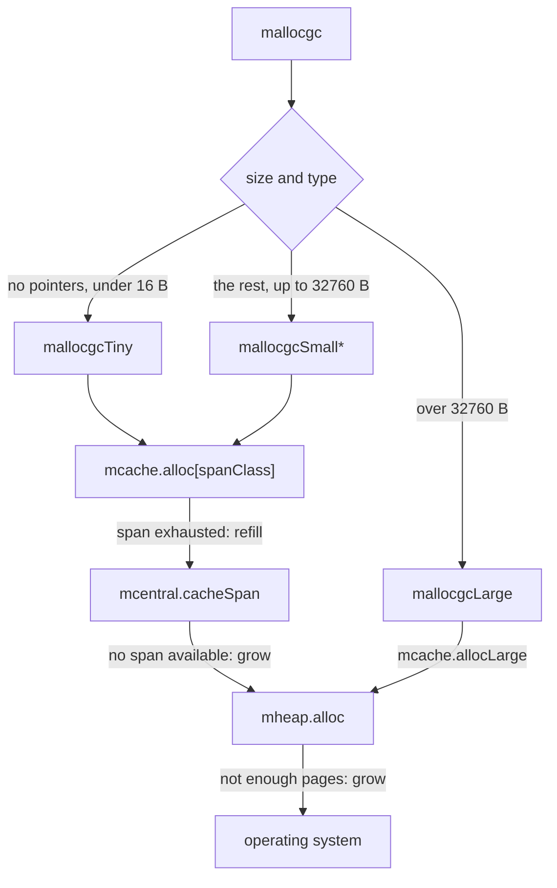

# 12.2 Components

The layered structure in [12.1](./basic.md) is implemented by four kinds of data structures:
`mspan`, which describes a run of contiguous pages; `mcache`, the local cache of each P; `mcentral`,
the central cache of each span class; and `mheap`, the global page heap. In addition, `heapArena`
gives the page heap an index from addresses to spans, and `fixalloc` and `persistentalloc` provide
storage for these structures themselves. This section introduces their definitions and
responsibilities in Go 1.26 in turn, and finally explains how a span moves among them. The struct
excerpts keep only the fields under discussion, and omissions are marked with `// ……`
[[Go Authors, 2026](#ref-go-authors-2026)].

## 12.2.1 mspan: Spans and Slots

A span is a stretch of memory made of contiguous pages, and each span is described by an `mspan`
structure. A span of small objects is divided into equal slots of one size class; each large object
occupies a span of its own; goroutine stacks are also allocated from spans, and these spans are
managed by the stack allocator itself ([14.2 Stack Allocation and Caching](../ch14stack/alloc.md)).
The main fields of `mspan` are:

```go
type mspan struct {
	_    sys.NotInHeap
	next *mspan     // next span in list, or nil if none
	prev *mspan     // previous span in list, or nil if none
	// ……
	startAddr uintptr // address of first byte of span aka s.base()
	npages    uintptr // number of pages in span

	manualFreeList gclinkptr // list of free objects in mSpanManual spans
	// ……
	freeindex uint16
	// ……
	nelems uint16 // number of object in the span.
	// ……
	allocCache uint64
	// ……
	allocBits  *gcBits
	gcmarkBits *gcBits
	// ……
	sweepgen              uint32
	divMul                uint32        // for divide by elemsize
	allocCount            uint16        // number of allocated objects
	spanclass             spanClass     // size class and noscan (uint8)
	state                 mSpanStateBox // mSpanInUse etc; accessed atomically (get/set methods)
	needzero              uint8         // needs to be zeroed before allocation
	// ……
	elemsize              uintptr       // computed from sizeclass or from npages
	// ……
	largeType             *_type        // malloc header for large objects.
}
```

`startAddr` and `npages` give the address range the span covers. `spanclass` is composed of the size
class and whether the objects contain pointers ([12.1.5](./basic.md)), `elemsize` is the size of a
slot, `nelems` is the number of slots, `divMul` is the division magic number mentioned in
[12.1.3](./basic.md), and `largeType` is the type pointer of a large object ([12.1.4](./basic.md)).
The first field, `sys.NotInHeap`, indicates that `mspan` itself cannot be allocated on the
garbage-collected heap; its storage comes from elsewhere (12.2.5).

The way free slots are recorded has undergone one important change. Before Go 1.7, the free slots of
a span were chained by a free list. A **free list** links free blocks into a linked list, with the
pointer stored in the first word of each free block itself, so it takes no extra space; allocation
removes the head and freeing inserts at the head. All the cache layers of TCMalloc are built on free
lists. With this representation, the main job of the sweeper is to rebuild the free list of each
span from the mark bits left by the marking phase. Clements's 2015 design document
[[Clements, 2015](#ref-clements-2015)] argued that this step is in a sense redundant:

> It primarily transforms one representation of the free heap (the mark bits) into another
> representation of the free heap (the free lists). Not only does this take time, but the free list
> representation is unfriendly to modern CPUs since it is not very cacheable and accesses to it are
> hard to predict.

The document estimated that a typical Go program spends about 5% of its CPU time in the sweeper and
in the cache misses caused by free lists. Hudson implemented this design in Go 1.7, and allocation
uses the bitmap directly [[Hudson, 2016b](#ref-hudson-2016b)]. Each span has two bitmaps with one
bit per slot: `allocBits` records which slots are occupied, and `gcmarkBits` records which objects
were marked in the current marking. To sweep a span, `gcmarkBits` simply becomes the new
`allocBits`, the old `allocBits` is freed, and a zeroed bitmap is installed as the `gcmarkBits` of
the next cycle. Live objects remain occupied in the new bitmap, and the slots of dead objects become
free as a consequence, with no need to insert them one by one into a list
([13.5 Sweeping and Bitmaps](../ch13gc/sweep.md)).

During allocation, all slots before `freeindex` have already been allocated, and the allocator
searches `allocBits` from `freeindex` for the next zero bit. To avoid accessing the bitmap every
time, `allocCache` caches 64 bits starting at `freeindex`, inverted, so that a single
count-trailing-zeros instruction finds the next free slot [[Hudson, 2016a](#ref-hudson-2016a)]. The
code of this fast path is in [12.5 Small Object Allocation](./smallalloc.md). The free list did not
disappear from the runtime: spans that hold stacks are managed manually by the stack allocator,
which still chains the free stacks with `manualFreeList`.

A span has three states: `mSpanDead` means it represents no memory, `mSpanInUse` means it is used by
the garbage-collected heap, and `mSpanManual` means it is managed manually by the runtime, for
example for stacks. State transitions are constrained by garbage collection. The source comments
point out that, while a collection is in progress, a span must not change from in use or manual to
free, because a concurrent collector may already have read a pointer and be about to look up the
span it belongs to, so span states must be monotonic. For the same reason, setting the state to
`mSpanInUse` or `mSpanManual` must be done atomically, and only after all other fields are valid.
Comparing `sweepgen` with the global sweep generation tells whether a span is awaiting sweeping,
being swept, or cached by some `mcache`; the rules are in
[13.5 Sweeping and Bitmaps](../ch13gc/sweep.md).

The number of slots in a span is not always equal to the object count in the table of
[12.1.3](./basic.md). The Green Tea collector
([13.11 Green Tea: Locality-Aware Marking](../ch13gc/greentea.md)), enabled by default in Go 1.26,
reserves a `spanInlineMarkBits` structure at the end of the single-page spans used by size classes
from 16 to 512 bytes, for span-granularity marking; spans of objects that contain pointers also
reserve a heap bitmap at the end ([12.1.4](./basic.md)). The following program allocates 1000
objects of 33 bytes, all of which fall into size class 5 of 48 bytes:

```go {run=true}
package main

import (
	"fmt"
	"unsafe"
)

var objs [1000]*[33]byte

func main() {
	aligned := true
	perSpan := map[uintptr]int{}
	for i := range objs {
		objs[i] = new([33]byte)
		addr := uintptr(unsafe.Pointer(objs[i]))
		if addr%8192%48 != 0 { // size class 5 uses one-page spans, i.e. 8 KiB
			aligned = false
		}
		perSpan[addr/8192]++
	}
	most := 0
	for _, n := range perSpan {
		most = max(most, n)
	}
	fmt.Printf("all offsets within the span are multiples of 48: %v\n", aligned)
	fmt.Printf("most objects in a single span: %d\n", most)
}
```

The output is:

```
all offsets within the span are multiples of 48: true
most objects in a single span: 168
```

Every object begins at an integral multiple of 48 bytes from the start of the span, which shows that
a 33-byte request occupies a 48-byte slot. The 1000 objects need six or seven spans, and a
completely full span holds 168 objects rather than the 170 in the table: `spanInlineMarkBits`
consists of 63 bytes of scan bits, a 1-byte ownership flag, 63 bytes of mark bits and a 1-byte span
class, 128 bytes in all, and (8192 − 128) / 48 rounded down is 168. With Green Tea turned off by
`GOEXPERIMENT=nogreenteagc`, the same program prints 170. By the calculation in `initSpan`, a
48-byte object that contains pointers must reserve a further 128 bytes of heap bitmap, so each span
has only (8192 − 256) / 48 rounded down, that is, 165 slots. Knyszek introduced this layout for
Green Tea [[Knyszek, 2025](#ref-knyszek-2025)]; it was available as an experiment in Go 1.25 and is
enabled by default in Go 1.26.

## 12.2.2 mcache: The Local Cache

`mcache` is the per-P local cache and corresponds to TCMalloc's thread cache
[[TCMalloc Authors, 2026](#ref-tcmalloc-authors-2026)]; the 2006 jemalloc design has no such layer
and instead assigns threads to multiple arenas [[Evans, 2006](#ref-evans-2006)]. Because only one M
holds a given P at any moment, accessing the `mcache` needs no lock:

```go
type mcache struct {
	_ sys.NotInHeap

	// The following members are accessed on every malloc,
	// so they are grouped here for better caching.
	nextSample  int64   // trigger heap sample after allocating this many bytes
	memProfRate int     // cached mem profile rate, used to detect changes
	scanAlloc   uintptr // bytes of scannable heap allocated
	// ……
	tiny       uintptr
	tinyoffset uintptr
	tinyAllocs uintptr

	// The rest is not accessed on every malloc.

	// alloc contains spans to allocate from, indexed by spanClass.
	alloc [numSpanClasses]*mspan
	// ……
	stackcache [_NumStackOrders]stackfreelist

	// flushGen indicates the sweepgen during which this mcache
	// was last flushed. If flushGen != mheap_.sweepgen, the spans
	// in this mcache are stale and need to be flushed so they
	// can be swept. This is done in acquirep.
	flushGen atomic.Uint32
}
```

The fields are grouped by access frequency: those accessed on every allocation come first so that
they fall in the same group of cache lines. The core is the `alloc` array: each of the 68 size
classes has two span classes, one with pointers and one without, for 136 entries, and each entry is
the span currently used for allocation by that span class. `nextSample` and `memProfRate` serve the
sampling of memory profiling
([16.5 Benchmarking and Performance Profiling](../../part5toolchain/ch16tools/perf.md)), the three
fields starting with `tiny` serve the tiny allocator
([12.6 Tiny Object Allocation](./tinyalloc.md)), and `stackcache` is the local cache of stacks
([14.2 Stack Allocation and Caching](../ch14stack/alloc.md)). `flushGen` records the sweep
generation in which this cache was last flushed: after each marking cycle ends, the spans cached in
an `mcache` must be returned before the P's next allocation so that they can be swept. The collector
has each P do this after mark termination, and it is checked again when a P is reacquired; the
comment above mentions only the latter.

`mcache` is likewise not on the garbage-collected heap; it is allocated by the page heap's
`cachealloc` while the heap lock is held. Each P obtains its own `mcache` through `allocmcache` when
it is initialized and returns it through `freemcache` when the P is destroyed (for example when
`GOMAXPROCS` shrinks). The allocator is needed before any P exists, so at startup `mallocinit`
creates an `mcache0`, which is later handed to P 0. `allocmcache` initializes every entry of `alloc`
to `emptymspan`, a sentinel span with no free slots, so the first allocation of each span class goes
straight into the refill path and the fast path needs no null-pointer check.

When a span is exhausted, `refill` returns it to the central cache and takes back a span with free
slots:

```go
func (c *mcache) refill(spc spanClass) {
	// Return the current cached span to the central lists.
	s := c.alloc[spc]
	// ……
	if s != &emptymspan {
		// Mark this span as no longer cached.
		if s.sweepgen != mheap_.sweepgen+3 {
			throw("bad sweepgen in refill")
		}
		mheap_.central[spc].mcentral.uncacheSpan(s)
		// ……
	}

	// Get a new cached span from the central lists.
	s = mheap_.central[spc].mcentral.cacheSpan()
	// ……
	// Indicate that this span is cached and prevent asynchronous
	// sweeping in the next sweep phase.
	s.sweepgen = mheap_.sweepgen + 3
	// ……
	c.alloc[spc] = s
}
```

The omitted parts also do accounting. When a new span is installed, `refill` assumes that all its
free slots will be occupied and immediately counts them toward the live heap size estimated by the
collector; when the span is returned, the overestimate is corrected. The source comment explains why
overestimating is preferred: underestimating would make the pacing controller believe things are
better than they are, which seemingly would lead to more memory use
[[Knyszek, 2022](#ref-knyszek-2022)]. This estimate is the basis of the collection trigger condition
mentioned in [12.1.5](./basic.md).

## 12.2.3 mcentral: The Central Cache

Each span class has one `mcentral`, shared by all Ps. It does not itself hold free objects, only
spans:

```go
type mcentral struct {
	_         sys.NotInHeap
	spanclass spanClass

	// partial and full contain two mspan sets: one of swept in-use
	// spans, and one of unswept in-use spans. These two trade
	// roles on each GC cycle. The unswept set is drained either by
	// allocation or by the background sweeper in every GC cycle,
	// so only two roles are necessary.
	//
	// sweepgen is increased by 2 on each GC cycle, so the swept
	// spans are in partial[sweepgen/2%2] and the unswept spans are in
	// partial[1-sweepgen/2%2]. Sweeping pops spans from the
	// unswept set and pushes spans that are still in-use on the
	// swept set. Likewise, allocating an in-use span pushes it
	// on the swept set.
	// ……
	partial [2]spanSet // list of spans with a free object
	full    [2]spanSet // list of spans with no free objects
}
```

Spans are divided into four sets along two dimensions: whether there are free slots (`partial` and
`full`), and whether the span has been swept in the current cycle. The sweep generation increases by
2 per collection cycle, and the parity of `sweepgen/2%2` determines which of the two indices
means "swept". When a new collection starts, the "swept" set of the previous cycle becomes
the "unswept" set as the sweep generation changes, without moving any span.

`cacheSpan` looks for a span from the lowest cost to the highest. It first takes a swept span with
free slots. If there is none, it takes one from the unswept spans, sweeps it in place and uses it,
looking first for a span with free slots and then for a full one. If it still finds none, it calls
`grow` to request new pages from the page heap. Sweeping an unswept span does not necessarily yield
free slots, so the search has an upper limit:

```go
	// If we sweep spanBudget spans without finding any free
	// space, just allocate a fresh span. This limits the amount
	// of time we can spend trying to find free space and
	// amortizes the cost of small object sweeping over the
	// benefit of having a full free span to allocate from. By
	// setting this to 100, we limit the space overhead to 1%.
	// ……
	spanBudget := 100
```

When 100 consecutive spans are swept without finding a free slot, a new span is requested directly.
This is a trade-off between time and space: the sweeping time acquires an upper bound, and each 100
spans without free slots correspond to at most one new span, so the extra space overhead does not
exceed 1%.

`spanSet` is a set that supports concurrent push and pop. It consists of a growable "spine" and a
number of fixed-size blocks, each holding 512 span pointers. Reading and writing the spine and the
blocks needs no lock; the spine lock is needed only when adding a block or enlarging the spine, and
since each span covers at least 8 KiB of heap but occupies only 8 bytes in the set, the spine grows
very little. This implementation dates from Go 1.15. Before that, `mcentral` consisted of two linked
lists, one of spans with free objects and one of spans without, protected by the same lock. Knyszek
noted in the commit message that this design caused severe lock contention and that the ownership of
spans was tangled: the same span might be held at once by several parties among the sweep buffers,
the concurrent sweeper, `mcentral` or `mcache`. The new implementation replaces the lists with sets
that have an atomic fast path, and stipulates that, with a few exceptions, at any moment only one of
`mcentral`, the sweeper or `mcache` holds a span [[Knyszek, 2020a](#ref-knyszek-2020a)]
[[Knyszek, 2020b](#ref-knyszek-2020b)]. The header comment of `mcentral.go` still describes those
two lists as `c->nonempty` and `c->empty`, wording left over from the C era.

## 12.2.4 mheap and heapArena: The Page Heap

There is exactly one page heap, the variable `mheap_`. Its main fields are:

```go
type mheap struct {
	_ sys.NotInHeap

	// lock must only be acquired on the system stack, otherwise a g
	// could self-deadlock if its stack grows with the lock held.
	lock mutex

	pages pageAlloc // page allocation data structure

	sweepgen uint32 // sweep generation, see comment in mspan; written during STW
	// ……
	allspans []*mspan // all spans out there
	// ……
	arenas [1 << arenaL1Bits]*[1 << arenaL2Bits]*heapArena
	// ……
	central [numSpanClasses]struct {
		mcentral mcentral
		pad      [(cpu.CacheLinePadSize - unsafe.Sizeof(mcentral{})%cpu.CacheLinePadSize) % cpu.CacheLinePadSize]byte
	}

	spanalloc                  fixalloc // allocator for span
	// ……
	cachealloc                 fixalloc // allocator for mcache
	// ……
}
```

`lock` protects most of the page heap's state and is one of the few global locks in the allocator.
However, when fewer than 16 pages are needed, `allocSpan` first tries the per-P page cache, so in
most cases this lock is not taken. `pages` is the page allocator, which answers the question "where
are enough contiguous free pages"; the implementation of the page cache and the page allocator is in
[12.7 The Page Allocator](./pagealloc.md). `central` is the array of all `mcentral`s. Each entry is
padded to an integral multiple of the cache line size, so that the `mcentral`s of adjacent span
classes do not share a cache line, which avoids false sharing when several Ps access different span
classes at the same time. The source comment says the padding is there so that each `mcentral.lock`
has a cache line of its own, which is again a description from before Go 1.15. `spanalloc` and
`cachealloc` provide storage for `mspan` and `mcache` respectively (12.2.5).

`arenas` is a two-level map from addresses to `heapArena`. The heap's address space is divided into
regions of fixed size (arenas), 64 MiB on most 64-bit platforms ([12.3 Initialization](./init.md)),
and each region has a `heapArena` structure that records its metadata:

```go
type heapArena struct {
	_ sys.NotInHeap

	// spans maps from virtual address page ID within this arena to *mspan.
	// For allocated spans, their pages map to the span itself.
	// For free spans, only the lowest and highest pages map to the span itself.
	// Internal pages map to an arbitrary span.
	// For pages that have never been allocated, spans entries are nil.
	// ……
	spans [pagesPerArena]*mspan
	// ……
	pageInUse [pagesPerArena / 8]uint8
	// ……
	pageMarks [pagesPerArena / 8]uint8
	// ……
	pageSpecials [pagesPerArena / 8]uint8
	// ……
	pageUseSpanInlineMarkBits [pagesPerArena / 8]uint8
	// ……
	zeroedBase uintptr
}
```

`spans` maps each page in the region to the span it belongs to. For any pointer, the collector can
find the corresponding `heapArena` through `arenas`, then look up the span by page number, and from
it learn the object's size, type information and mark bit; this is the lookup performed by `spanOf`.
The several bitmaps that follow are all indexed by page, but use only the bit for the first page of
each span: `pageInUse` marks spans in use, and `pageMarks` marks spans that contain marked objects,
which lets the sweeper quickly find spans that can be freed as a whole; `pageSpecials` marks spans
with special records such as finalizers, and `pageUseSpanInlineMarkBits` marks spans that keep
`spanInlineMarkBits` at their end. Before Go 1.22, `heapArena` also held a pointer bitmap covering
the whole region; once malloc headers replaced it, this metadata no longer exists
([12.1.4](./basic.md)).

`zeroedBase` records the first byte in the region that has never been used. Memory newly obtained
from the operating system is already zeroed, so pages above this position need not be zeroed again.
The comment points out that this one field suffices to decide whether an allocation needs zeroing,
because the page allocator uses an address-ordered first-fit policy and always prefers pages at low
addresses. The survey by Wilson et al. argues that address-ordered first fit may produce noticeably
less fragmentation than first fit ordered last-in first-out, and that it is the most studied and
apparently the most widely used variant [[Wilson et al., 1995](#ref-wilson-1995)].

## 12.2.5 The Runtime's Own Metadata: fixalloc and persistentalloc

`mspan`, `mcache` and special records such as finalizers cannot be allocated on the
garbage-collected heap. They are the data structures of the allocator and collector themselves: if
they were allocated by `mallocgc`, the allocator would have to call itself when refilling a span,
and the collector would have to trace and reclaim the very data it works with. These types are
marked `sys.NotInHeap`, and their storage comes from two simpler allocators.

`fixalloc` is a free-list allocator for objects of a fixed size. Each kind of metadata in the page
heap has a dedicated `fixalloc`, such as `spanalloc` and `cachealloc` above:

```go
func (f *fixalloc) alloc() unsafe.Pointer {
	// ……
	if f.list != nil {
		v := unsafe.Pointer(f.list)
		f.list = f.list.next
		f.inuse += f.size
		if f.zero {
			memclrNoHeapPointers(v, f.size)
		}
		return v
	}
	if uintptr(f.nchunk) < f.size {
		f.chunk = uintptr(persistentalloc(uintptr(f.nalloc), 0, f.stat))
		f.nchunk = f.nalloc
	}

	v := unsafe.Pointer(f.chunk)
	if f.first != nil {
		f.first(f.arg, v)
	}
	f.chunk = f.chunk + f.size
	f.nchunk -= uint32(f.size)
	f.inuse += f.size
	return v
}

func (f *fixalloc) free(p unsafe.Pointer) {
	f.inuse -= f.size
	v := (*mlink)(p)
	v.next = f.list
	f.list = v
}
```

A freed object is inserted at the head of the free list and is preferred by the next allocation.
When the free list is empty, an object is cut from the current large chunk, and when the chunk is
used up, a new chunk is requested through `persistentalloc`. The chunk size is an integral multiple
of the object size, not exceeding 16 KiB, so cutting leaves no tail waste. `fixalloc` itself takes
no lock and leaves synchronization to the caller, which is why `allocmcache` must acquire the heap
lock first.

`persistentalloc` is simpler still: it obtains memory from the operating system in batches, cuts it
up on demand, and never frees it. The source comment says it is used for data that must live
permanently, such as functions, types and debugging information. Objects freed by `fixalloc` return
only to its own free list and are not given back to the operating system, which suits structures
such as `mspan` whose number fluctuates with the heap size but which are reused repeatedly.

## 12.2.6 How the Components Cooperate

The following figure connects the five paths of [12.1.4](./basic.md) with the components of this
section:



A small-object allocation takes a free slot from the current span in the `mcache`. When the span is
exhausted, `refill` returns it to the corresponding `mcentral` through `uncacheSpan`, which puts it
into the swept `partial` or `full` set according to whether free slots remain, and then obtains a
span with free slots through `cacheSpan`. When `mcentral` has no suitable span, `grow` calls
`mheap_.alloc` to request the number of pages the size class needs, initializes the span and hands
it to the `mcache`. When the page heap also lacks enough contiguous free pages, `mheap.grow` grows
the heap in units of 4 MiB (512 KiB on wasm): first carving from the region already reserved, and
when that is insufficient, reserving a new region from the operating system
([12.3 Initialization](./init.md)).

A large object skips the lookup in `mcache` and `mcentral`, and `mcache.allocLarge` requests whole
pages directly from the page heap. The resulting span belongs to size class 0 and is immediately put
into the swept `full` set of the corresponding `mcentral`. The rewrite in Go 1.15 drives sweeping by
traversing the `mcentral`s rather than maintaining a separate global list of spans for sweeping, so
the spans of large objects are also placed in `mcentral`, which lets the sweeper find them in later
collection cycles [[Knyszek, 2020b](#ref-knyszek-2020b)].

## 12.2.7 Summary

`mspan` is the basic unit shared by allocation and collection. It records allocation state and
marking results in two bitmaps, and since Go 1.7 no longer maintains a free list. `mcache` lets the
vast majority of allocations touch only the current P's data; `mcentral` circulates spans among Ps
in sets with an atomic fast path and shares the sweeping work along with allocation; `mheap` manages
the whole heap in units of pages and supports lookup from any address to its span through
`heapArena`. These structures are themselves not on the garbage-collected heap but are managed by
`fixalloc` and `persistentalloc`. This hierarchy corresponds almost one to one to TCMalloc's thread
cache, central free list and page heap, the difference being that every layer carries state the
collector needs. [12.3 Initialization](./init.md) describes how these structures are set up when the
program starts.

## Further Reading

- <a id="ref-clements-2015"></a>[Clements, 2015] Austin Clements. *Proposal: Dense mark bits and
  sweep-free allocation.* 2015. https://go.dev/design/12800-sweep-free-alloc
- <a id="ref-evans-2006"></a>[Evans, 2006] Jason Evans. "A Scalable Concurrent malloc(3)
  Implementation for FreeBSD." *BSDCan 2006*, 2006.
  https://people.freebsd.org/~jasone/jemalloc/bsdcan2006/jemalloc.pdf The original design of
  jemalloc: multiple arenas, with threads assigned in round-robin fashion.
- <a id="ref-go-authors-2026"></a>[Go Authors, 2026] The Go Authors. src/runtime/mheap.go,
  mcache.go, mcentral.go, mspanset.go, mfixalloc.go. Go 1.26 source.
  https://github.com/golang/go/tree/release-branch.go1.26/src/runtime
- <a id="ref-hudson-2016a"></a>[Hudson, 2016a] Rick Hudson. [dev.garbage] runtime: add bit and cache
  ctz64 (count trailing zero). Go commit 4093481523, 2016. https://go.dev/cl/20200 Shipped in Go
  1.7.
- <a id="ref-hudson-2016b"></a>[Hudson, 2016b] Rick Hudson. [dev.garbage] runtime: allocate directly
  from GC mark bits. Go commit 3479b065d4, 2016. https://go.dev/cl/19470 Shipped in Go 1.7.
- <a id="ref-knyszek-2020a"></a>[Knyszek, 2020a] Michael Knyszek. Go issue #37487. *runtime: improve
  mcentral scalability.* 2020. https://github.com/golang/go/issues/37487
- <a id="ref-knyszek-2020b"></a>[Knyszek, 2020b] Michael Anthony Knyszek. runtime: add new mcentral
  implementation. Go commit a13691966a, 2020. https://go.dev/cl/221182
  Shipped in Go 1.15.
- <a id="ref-knyszek-2022"></a>[Knyszek, 2022] Michael Knyszek. Go issue #53738. *runtime: memory
  use regressions in various benchmarks on perf.golang.org/dashboard.* 2022.
  https://github.com/golang/go/issues/53738
- <a id="ref-knyszek-2025"></a>[Knyszek, 2025] Michael Anthony Knyszek. runtime: mark and scan small
  objects in whole spans [green tea]. Go commit 1b40dbce1a, 2025. https://go.dev/cl/658036
  Shipped in Go 1.25 as an experiment.
- <a id="ref-tcmalloc-authors-2026"></a>[TCMalloc Authors, 2026] The TCMalloc Authors. *TCMalloc:
  Thread-Caching Malloc.* 2026. https://google.github.io/tcmalloc/design.html The design of thread
  caches, central free lists and the page heap, corresponding to mcache, mcentral and mheap.
- <a id="ref-wilson-1995"></a>[Wilson et al., 1995] Paul R. Wilson, Mark S. Johnstone, Michael
  Neely, David Boles. "Dynamic Storage Allocation: A Survey and Critical Review." *IWMM 1995*,
  1–116, 1995. https://doi.org/10.1007/3-540-60368-9_19
- <a id="ref-zhang-2017"></a>[Zhang, 2017] Cherry Zhang. cmd/compile: use type information in Aux
  for Store size. Go CL 38150, 2017. https://go-review.googlesource.com/c/go/+/38150 Original
  entry: "Go 1.9 mcentral restructuring (spanSet), related discussion and commits." The CL is a
  compiler change; the `mcentral` rewrite is [Knyszek, 2020a](#ref-knyszek-2020a) and
  [Knyszek, 2020b](#ref-knyszek-2020b).
- This book: [12.1 Design Principles](./basic.md), [12.5 Small Object Allocation](./smallalloc.md),
  [13.5 Sweeping and Bitmaps](../ch13gc/sweep.md).

