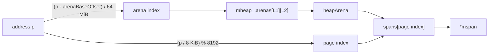
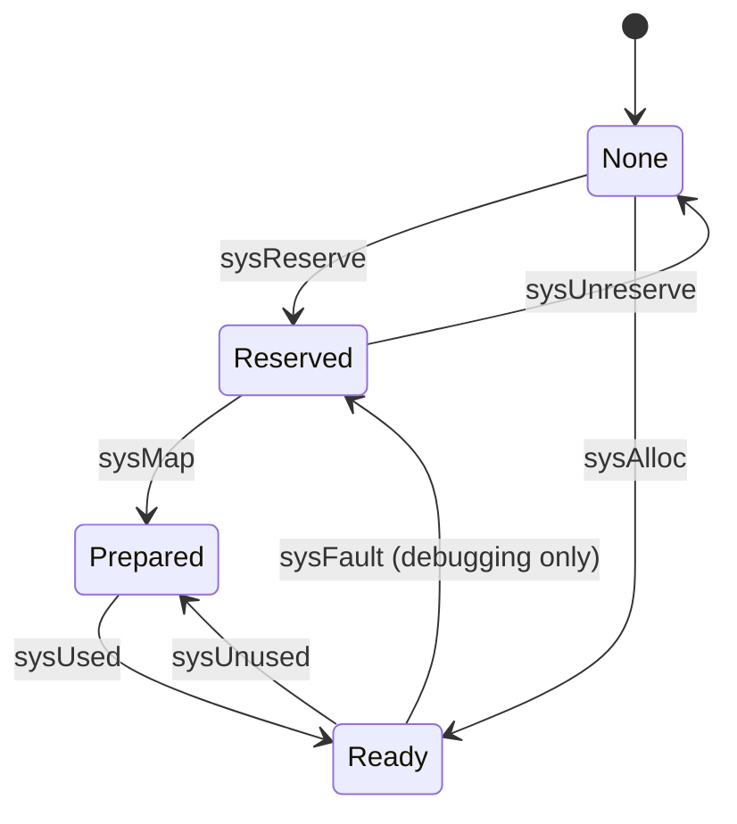

# 12.3 Initialization

[12.2](./component.md) introduced the components of the allocator. This section covers how those
components are set up at program start and how the heap obtains address space and physical memory
from the operating system. Initialization fixes two designs that everything afterwards relies on.
First, the heap's address space is divided into regions of fixed size, each aligned to its own size,
so that any address can be mapped to its metadata with a few arithmetic operations and table
lookups. Second, reserving address space from the operating system and committing physical memory to
it are separate steps, which is why the virtual memory of a Go process is often much larger than its
resident memory.

The allocator is initialized by `mallocinit`. The scheduler's initialization function `schedinit`
calls it after initializing the stack (`stackinit`) and the random number generator (`randinit`);
later steps such as `mcommoninit` and `modulesinit` all need to allocate memory
([3.5](../../part1overview/ch03life/boot.md)).

## 12.3.1 mallocinit

`mallocinit` begins by checking a series of constraints between compile-time constants and the
running environment, and aborts the program at once if any of them fails. Several of the checks tie
together the designs of the previous two sections:

```go
func mallocinit() {
	if gc.SizeClassToSize[tinySizeClass] != maxTinySize {
		throw("bad TinySizeClass")
	}
	// ...
	// Check that the minimum size (exclusive) for a malloc header is also
	// a size class boundary. This is important to making sure checks align
	// across different parts of the runtime.
	//
	// While we're here, also check to make sure all these size classes'
	// span sizes are one page. Some code relies on this.
	minSizeForMallocHeaderIsSizeClass := false
	sizeClassesUpToMinSizeForMallocHeaderAreOnePage := true
	for i := 0; i < len(gc.SizeClassToSize); i++ {
		if gc.SizeClassToNPages[i] > 1 {
			sizeClassesUpToMinSizeForMallocHeaderAreOnePage = false
		}
		if gc.MinSizeForMallocHeader == uintptr(gc.SizeClassToSize[i]) {
			minSizeForMallocHeaderIsSizeClass = true
			break
		}
	}
	// ...
```

The first check requires the size class used by the tiny allocator to be exactly 16 bytes
([12.6](./tinyalloc.md)). The later block confirms that 512 bytes is a size class boundary and that
every size class up to 512 bytes has a span of a single page. Two designs depend on this: the
pointer bitmap that [12.1.4](./basic.md) places at the end of the span for small objects containing
pointers, and the mark bits that Green Tea reserves at the end of single-page spans
([12.2.1](./component.md)) [[Go Authors, 2026e](#ref-go-authors-2026e)]. The remaining checks
confirm that the physical page size reported by the operating system is a power of two and lies
within the range the runtime supports. One more check requires `heapArenaBitmapWords` to be a power
of two; it concerns the per-arena heap bitmap that existed before Go 1.22. That bitmap has been
removed, and this check is the only remaining use of the constant in Go 1.26.

After the checks, `mallocinit` initializes the page heap and creates the first local cache:

```go
	// Initialize the heap.
	mheap_.init()
	mcache0 = allocmcache()
```

`mheap_.init` initializes a `fixalloc` for each kind of page heap metadata
([12.2.5](./component.md)): besides `mspan` and `mcache`, there are ten kinds of special records,
including finalizers, cleanups, weak pointer handles, profiling records and pin counts. It then
initializes all 136 central caches and the page allocator ([12.7](./pagealloc.md)). One of the
settings deserves attention:

```go
	// Don't zero mspan allocations. Background sweeping can
	// inspect a span concurrently with allocating it, so it's
	// important that the span's sweepgen survive across freeing
	// and re-allocating a span to prevent background sweeping
	// from improperly cas'ing it from 0.
	//
	// This is safe because mspan contains no heap pointers.
	h.spanalloc.zero = false
```

A `fixalloc` zeroes its objects on allocation by default, and `mspan` is the exception. The
background sweeper may inspect a span at the same moment the span is being reallocated, and it
advances the span's sweep generation `sweepgen` with a CAS ([13.5](../ch13gc/sweep.md)). If
`sweepgen` were zeroed on reallocation, the sweeper might perform a CAS based on that zero. The
source comment states that skipping the zeroing is safe because `mspan` contains no heap pointers.

`allocmcache` obtains an `mcache` from `cachealloc` while holding the heap lock. No P exists yet, so
this `mcache0` serves the bootstrap phase: `getMCache` returns it when the current M has no P. When
`procresize` creates the Ps, it hands `mcache0` to P 0 and then clears the variable
([3.5](../../part1overview/ch03life/boot.md)). From then on every `mcache` is bound to a P.

## 12.3.2 Arenas: Dividing the Address Space

Up to Go 1.10, the heap on 64-bit platforms was one contiguous range of address space. At startup,
`mallocinit` reserved the whole range in one step, together with the span index and heap bitmap in
front of it. The size of the reservation grew over the releases: 16 GB in Go 1.0, 128 GB in Go 1.1
[[Cox, 2012](#ref-cox-2012)], and 512 GB from Go 1.5 (in Go 1.5, together with a 32 GB bitmap, the
actual reservation was 544 GB). This design had several problems. The heap had a hard size limit
[[Daniels, 2015](#ref-daniels-2015)]. If the reserved addresses conflicted with other mappings, such
as the TSAN runtime used by the race detector, the runtime crashed during initialization or heap
growth. The huge reservation made the virtual memory size (VSIZE) of the process equally huge, which
was confusing at best and, at worst, collided with `ulimit -v` limits; the "no reserve" mode
introduced to cope with this brought new complexity. In Go 1.11, Clements turned the heap into a
sparse map of many arenas that can sit anywhere in the address space. The problems above
disappeared, at the cost of about 1% slowdown on GC-intensive benchmarks
[[Clements, 2017](#ref-clements-2017)].

An **arena** is the unit in which the heap requests address space from the operating system. It has
a fixed size and is aligned to that size. The arena size, the number of address bits and the levels
of the index are related as follows:

```go
	// The number of bits in a heap address, the size of heap
	// arenas, and the L1 and L2 arena map sizes are related by
	//
	//   (1 << addr bits) = arena size * L1 entries * L2 entries
	//
	// Currently, we balance these as follows:
	//
	//       Platform  Addr bits  Arena size  L1 entries   L2 entries
	// --------------  ---------  ----------  ----------  -----------
	//       */64-bit         48        64MB           1    4M (32MB)
	// windows/64-bit         48         4MB          64    1M  (8MB)
	//      ios/arm64         40         4MB           1  256K  (2MB)
	//       */32-bit         32         4MB           1  1024  (4KB)
	//     */mips(le)         31         4MB           1   512  (2KB)
	//           wasm         32       512KB           1  8192 (64KB)
```

On 64-bit Linux and macOS, heap addresses are computed with 48 bits and each arena is 64 MiB, so the
address space holds about 4.2 million arenas. Windows uses smaller 4 MiB arenas because Windows
charges all committed memory against the process's quota, even if the memory is never touched; for a
process with a small heap, the mapped arena space should be proportional to the size of the heap
[[Go Authors, 2026a](#ref-go-authors-2026a)]. The linear memory of wasm likewise counts entirely
toward the program's footprint. Go 1.26 shrinks the wasm arena from 4 MiB to 512 KiB, which reduces
the linear memory needed by a hello world program from 8 MB to under 3 MB
[[Mui, 2025](#ref-mui-2025)].

Given an address, the runtime first computes the number of the arena that contains it, then uses the
high and low bits of that number to index the two-level table `mheap_.arenas`:

```go
func arenaIndex(p uintptr) arenaIdx {
	return arenaIdx((p - arenaBaseOffset) / heapArenaBytes)
}
```

Addresses on amd64 are 48-bit sign-extended, and `arenaBaseOffset` is `0xffff800000000000`;
subtracting it folds the upper half of the address space into the index space. On other platforms
the user address space starts at 0 and the offset is 0 (AIX is an exception). On 64-bit non-Windows
platforms the first level has a single entry, so the arena number effectively indexes the
second-level table directly. This table has about 4.2 million entries and occupies 32 MiB. It is
allocated when the first arena is established and is not counted in any runtime statistic:

```go
			// Allocate an L2 arena map.
			//
			// Use sysAllocOS instead of sysAlloc or persistentalloc because there's no
			// statistic we can comfortably account for this space in. With this structure,
			// we rely on demand paging to avoid large overheads, but tracking which memory
			// is paged in is too expensive. Trying to account for the whole region means
			// that it will appear like an enormous memory overhead in statistics, even though
			// it is not.
			l2 = (*[1 << arenaL2Bits]*heapArena)(sysAllocOS(unsafe.Sizeof(*l2), "heap index"))
```

Only the pages of this table that have been written occupy physical memory. With 4 KiB pages, one
page holds the pointers of 512 arenas, covering 32 GiB of address space, so a process with a small
heap touches only one or two pages. Windows has smaller arenas; with a single-level index the
second-level table would be too large, so the first level on Windows has 64 entries and the
second-level tables are allocated one by one on demand.

Once the arena's `heapArena` is found, looking up the page number in its `spans` array yields the
span ([12.2.4](./component.md)). `spanOf` performs the whole lookup. Its source comment points out
that, thanks to constant folding of `arenaL1Bits`, this seemingly verbose function can be inlined
and produces rather short code [[Go Authors, 2026b](#ref-go-authors-2026b)]. The following figure
shows the lookup on 64-bit non-Windows platforms:



## 12.3.3 Arena Hints and the Heap Base

On 64-bit platforms, `mallocinit` does not reserve any arena. It only generates a list of **arena
hints**: addresses at which the runtime would like the heap to start growing. At the first heap
growth, `mheap.sysAlloc` requests a reservation at these addresses in turn. When the operating
system cannot satisfy a request at the hinted address, the runtime discards the hint and tries the
next one. When all hints fail, it accepts any aligned address the operating system offers and
generates a new hint at each end of that range, so that the heap can continue to grow contiguously
in either direction.

The source explains the choice of hint addresses in detail:

```go
		// On a 64-bit machine, we pick the following hints
		// because:
		//
		// 1. Starting from the middle of the address space
		// makes it easier to grow out a contiguous range
		// without running in to some other mapping.
		//
		// 2. This makes Go heap addresses more easily
		// recognizable when debugging.
		//
		// 3. Stack scanning in gccgo is still conservative,
		// so it's important that addresses be distinguishable
		// from other data.
		//
		// Starting at 0x00c0 means that the valid memory addresses
		// will begin 0x00c0, 0x00c1, ...
		// In little-endian, that's c0 00, c1 00, ... None of those are valid
		// UTF-8 sequences, and they are otherwise as far away from
		// ff (likely a common byte) as possible. ……
```

The default hints have the form `i<<40 | 0x00c0<<32`, with `i` decreasing from 0x7f to 0, and the
list begins with `0x00c000000000`. This is the origin of the `0xc000...` addresses that Go programs
have long shown on amd64 and similar platforms. Stored in little-endian order, addresses starting
with 0x00c0 have the bytes `c0 00`, `c1 00` and so on; none of these is a valid UTF-8 sequence, and
all are far from the common `ff`, so they are easy to recognize in memory dumps. The choice dates
from the time of the contiguous heap: the starting address in Go 1.0 began with 0x00f8, and Go 1.1
changed it to 0x00c0 when it enlarged the reservation [[Cox, 2012](#ref-cox-2012)]. At that time
Go's own collector was still conservative ([13.7](../ch13gc/safe.md)), and non-pointer data that
happened to equal a heap address would keep an object alive that should have been reclaimed.
Recognizable addresses lower the probability of such misidentification; today only the stack
scanning of gccgo still needs to consider this. arm64 is an exception: with 4 KiB pages and
three-level page tables the user address space has only 39 bits, so the hints start from
`0x0040<<32`. The race detector requires the heap to lie within `[0x00c000000000, 0x00e000000000)`,
so in `-race` mode the hints are laid out in that range with a stride of `1<<32`. In the default
mode, the half of the hints with `i` greater than 0x3f is reserved for the experimental `arena`
package (`GOEXPERIMENT=arenas`).

Go 1.26 changes this tradition. In 2018, Webb proposed that the heap should take part in address
space layout randomization (ASLR) like other mappings in the process, instead of always being mapped
at a fixed address [[Webb, 2018](#ref-webb-2018)]. Shoemaker's implementation is enabled by default
in Go 1.26 [[Shoemaker, 2025](#ref-shoemaker-2025)]. `mallocinit` draws a random number with
`bootstrapRand` (which is why `randinit` must run before `mallocinit`) and uses some of its bits to
build a random, arena-aligned address that serves as the basis for generating hints. At the first
heap growth, a random offset aligned to a page allocator chunk (4 MiB) is chosen within the arena.
Finally, a random number of pages at the start of the chunk are marked as allocated, and the address
of the next available page becomes the final heap base. The lower bound of entropy given in the
source comment is `heapAddrBits` - 13 - 2 bits, minus one more bit on amd64; that is, at least 33
bits on arm64 and at least 32 bits on amd64. The release notes present this change as a security
enhancement: in programs that use cgo, it makes it harder for an attacker to predict memory
addresses and exploit vulnerabilities [[Go Authors, 2026g](#ref-go-authors-2026g)]. Randomization
does not take effect when the race detector, MemorySanitizer or AddressSanitizer is enabled, nor on
32-bit and sbrk-style platforms; setting `GOEXPERIMENT=norandomizedheapbase64` at build time turns
it off.

The following program prints the address of a heap object:

```go {run=true}
package main

import "fmt"

var sink *[64]byte

func main() {
	sink = new([64]byte) // assigned to a global, so the object escapes to the heap
	fmt.Printf("%p\n", sink)
}
```

Built and run on macOS (arm64) with Go 1.26.10, with default settings, with randomization turned
off, and with the race detector enabled, it gives:

```shell
$ go build -o addr . && ./addr && ./addr && ./addr
0x5198a721a300
0x31a0144a6040
0x24013594300
$ GOEXPERIMENT=norandomizedheapbase64 go build -o addr . && ./addr && ./addr && ./addr
0x1400001e300
0x1400001e300
0x1400001e300
$ go build -race -o addr . && ./addr
0xc00001e300
```

With the default build, the address differs on every run. With randomization off, the address is
fixed near `0x14000000000`. By the formula above this is the hint with `i` equal to 1,
`1<<40 | 0x0040<<32`, so the hint with `i` equal to 0 could not be obtained and the runtime used the
next one. With the race detector enabled, randomization does not take effect and the heap lies in
the range required by TSAN. Run in this book's sandbox (js/wasm), the output is a small address (for
example `0x218280`) that is the same on every run: wasm is an sbrk-style platform, where the heap
starts at the low end of the linear memory and is not randomized.

The address space of a 32-bit platform is only 4 GiB, and the runtime cares more about the
contiguity of the heap. At startup, `mallocinit` reserves the space needed for all arena metadata,
then starts above the end of the program image and tries to reserve an initial heap of 512 MB, 256
MB or 128 MB in one piece, setting the hints after that range. wasm and Plan 9 use sbrk-style memory
management and generate no hints. The linear memory of wasm can only grow upward through
`memory.grow`; when the runtime releases memory at the end, it only lowers its own recorded boundary
and does not shrink the linear memory [[Go Authors, 2026f](#ref-go-authors-2026f)].

## 12.3.4 Reserving, Mapping and Committing

**Reserving** obtains only the right to use a range of addresses, not physical memory.
**Committing** makes a range of addresses safe to access and has the operating system provide
physical memory for it. The runtime abstracts the address space it manages into four states, and
every memory operation that deals with the operating system is a transition between states
[[Go Authors, 2026c](#ref-go-authors-2026c)]:

```go
// Regions of the address space managed by the runtime may be in one of four
// states at any given time:
// 1) None - Unreserved and unmapped, the default state of any region.
// 2) Reserved - Owned by the runtime, but accessing it would cause a fault.
//               Does not count against the process' memory footprint.
// 3) Prepared - Reserved, intended not to be backed by physical memory (though
//               an OS may implement this lazily). Can transition efficiently to
//               Ready. Accessing memory in such a region is undefined (may
//               fault, may give back unexpected zeroes, etc.).
// 4) Ready - may be accessed safely.
//
// This set of states is more than strictly necessary to support all the
// currently supported platforms. One could get by with just None, Reserved, and
// Ready. However, the Prepared state gives us flexibility for performance
// purposes. For example, on POSIX-y operating systems, Reserved is usually a
// private anonymous mmap'd region with PROT_NONE set, and to transition
// to Ready would require setting PROT_READ|PROT_WRITE. However the
// underspecification of Prepared lets us use just MADV_FREE to transition from
// Ready to Prepared. Thus with the Prepared state we can set the permission
// bits just once early on, we can efficiently tell the OS that it's free to
// take pages away from us when we don't strictly need them.
```

The Prepared state separates "setting access permissions" from "telling the operating system that
physical pages may be taken back": permissions need to be set only once, when mapping, and handing
physical pages back later takes a single `madvise`. The functions below perform the transitions
between states, and `sysFree` can return memory in any state directly to None:



Heap growth passes through these states in turn. `mheap.sysAlloc` reserves addresses in units of
arenas (None → Reserved). It has no matching free function, so the heap's address space only grows
and never shrinks. It shares its name with the package-level `sysAlloc` but not its meaning: the
latter lets the operating system choose the address and goes directly to Ready, and serves off-heap
memory such as `persistentalloc` ([12.2.5](./component.md)). `mheap.grow` calls `sysMap` (Reserved →
Prepared) on the reserved space in units of 4 MiB (512 KiB on wasm) and records this memory as
released. When the pages allocated by `allocSpan` include released pages, it calls `sysUsed`
(Prepared → Ready), so newly mapped memory enters Ready when it is first allocated. Pages that stay
idle for a long time are returned to the operating system by `sysUnused` (Ready → Prepared);
[12.7](./pagealloc.md) covers when and how much is returned.

These transitions are implemented on each platform as follows (on Linux, `sysUsed` does something
only when `GODEBUG=harddecommit=1` is set):

| Function | State transition | Linux | macOS | Windows | wasm |
| --- | --- | --- | --- | --- | --- |
| `sysReserve` | None → Reserved | `mmap`, `PROT_NONE` | `mmap`, `PROT_NONE` | `VirtualAlloc`, `MEM_RESERVE` | taken from the free list or by advancing the sbrk boundary |
| `sysMap` | Reserved → Prepared | `mmap`, read-write, `MAP_FIXED` | `mmap`, read-write, `MAP_FIXED` | no-op | no-op |
| `sysUsed` | Prepared → Ready | no-op | `madvise`, `MADV_FREE_REUSE` | `VirtualAlloc`, `MEM_COMMIT` | no-op |
| `sysUnused` | Ready → Prepared | `madvise`, `MADV_DONTNEED` | `madvise`, `MADV_FREE_REUSABLE` | `VirtualFree`, `MEM_DECOMMIT` | no-op |

Linux and macOS have no separate commit step (on macOS, `MADV_FREE_REUSE` only keeps the kernel's
accounting accurate). After `sysMap` the addresses are already readable and writable, and the kernel
supplies a physical page through a page fault only on the first write, that is, by demand paging.
Windows differs. The comment on `sysUsed` notes that on systems without explicit commit and without
strict overcommit limits this step is usually a no-op, but on Windows it is essential
[[Go Authors, 2026c](#ref-go-authors-2026c)]: Windows charges the memory against the process's quota
at commit time, which is also why it uses smaller arenas.

`sysUnused` on Linux has gone back and forth once. `MADV_FREE` has been available since Linux 4.5.
Compared with `MADV_DONTNEED`, a returned page causes a page fault on the next access only if the
kernel has actually reclaimed it, so it is faster. Go 1.12 switched to prefer `MADV_FREE`
[[Klauser, 2018](#ref-klauser-2018)]. However, pages returned with `MADV_FREE` still count toward
the process's resident memory until the kernel actually reclaims them, and many reports of confusing
memory statistics followed. Go 1.16 changed the default back to `MADV_DONTNEED`
[[Clements, 2020](#ref-clements-2020)]. When the runtime initializes its debug variables, it says:

```go
	if GOOS == "linux" {
		// On Linux, MADV_FREE is faster than MADV_DONTNEED,
		// but doesn't affect many of the statistics that
		// MADV_DONTNEED does until the memory is actually
		// reclaimed. This generally leads to poor user
		// experience, like confusing stats in top and other
		// monitoring tools; and bad integration with
		// management systems that respond to memory usage.
		// Hence, default to MADV_DONTNEED.
		debug.madvdontneed = 1
	}
```

Clements also noted in the commit message that since Go 1.12 the mechanism for returning memory in
the background has become timely and self-pacing, so switching to the slower `MADV_DONTNEED` only
makes memory return to the system slightly more slowly. Setting `GODEBUG=madvdontneed=0` restores
`MADV_FREE`. The difference between the two also affects zeroing: after `MADV_DONTNEED` on a private
anonymous mapping, the next access sees zero-filled pages. Since Go 1.26, when all the pages of a
span are pages that have been returned, the runtime relies on this guarantee to skip zeroing
[[Yang, 2025](#ref-yang-2025)]. `MADV_FREE` does not provide the guarantee, and in that case
`needZeroAfterSysUnusedOS` requires zeroing [[Go Authors, 2026d](#ref-go-authors-2026d)].

## 12.3.5 Virtual Memory and Resident Memory

Since Go 1.25, the runtime on Linux (5.17 and later) names its anonymous mappings with `prctl`, so
the purpose of each mapping can be seen in `/proc/<pid>/maps`. The lines below are the Go ones from
the example attached to the commit message of this change (a development version, so without heap
base randomization; whitespace abridged) [[Huard, 2025](#ref-huard-2025)]:

```
c000000000-c000400000 rw-p 00000000 00:00 0  [anon: Go: heap]
c000400000-c004000000 ---p 00000000 00:00 0  [anon: Go: heap reservation]
777f58300000-777f58400000 rw-p 00000000 00:00 0  [anon: Go: page alloc index]
777f58400000-777f5a400000 rw-p 00000000 00:00 0  [anon: Go: heap index]
777f5a400000-777f6a580000 ---p 00000000 00:00 0  [anon: Go: scavenge index]
777f6a580000-777f6a581000 rw-p 00000000 00:00 0  [anon: Go: scavenge index]
777f6a581000-777f7a400000 ---p 00000000 00:00 0  [anon: Go: scavenge index]
777f7a400000-777f8a580000 ---p 00000000 00:00 0  [anon: Go: page summary]
```

The first two lines together make exactly one 64 MiB arena: the first 4 MiB has been `sysMap`ped and
is readable and writable, and the remaining 60 MiB is only reserved, with permission `---p`
(`PROT_NONE`). The 32 MiB on the fourth line is the second-level arena index described in 12.3.2.
The metadata of the page allocator ([12.7](./pagealloc.md)) likewise reserves hundreds of MiB of
address space in advance and maps only a small part of it when needed. All these addresses count
toward the virtual memory of the process but occupy almost no physical memory.

Even memory that the runtime considers in use (Ready) occupies physical pages on Linux and macOS
only at the first write. The following program allocates a 256 MiB slice and compares the
`HeapInuse` reported by the runtime with the peak resident memory reported by the operating system.
It reads the latter through `getrusage`, so it runs only on Linux and macOS:

```go {run=true native=true}
package main

import (
	"fmt"
	"runtime"
	"syscall"
)

// peakRSS returns the peak resident set size of the process in MiB.
// ru_maxrss is in bytes on macOS and in KiB on Linux.
func peakRSS() uint64 {
	var ru syscall.Rusage
	syscall.Getrusage(syscall.RUSAGE_SELF, &ru)
	if runtime.GOOS == "darwin" {
		return uint64(ru.Maxrss) >> 20
	}
	return uint64(ru.Maxrss) >> 10
}

func report(stage string) {
	var m runtime.MemStats
	runtime.ReadMemStats(&m)
	fmt.Printf("%s: HeapInuse = %d MiB, peak RSS = %d MiB\n", stage, m.HeapInuse>>20, peakRSS())
}

func main() {
	report("at start")
	b := make([]byte, 256<<20)
	report("after allocating 256 MiB")
	for i := 0; i < len(b); i += 4096 {
		b[i] = 1
	}
	report("after touching every page")
	runtime.KeepAlive(b)
}
```

Run on macOS (arm64), the result is:

```
at start: HeapInuse = 0 MiB, peak RSS = 4 MiB
after allocating 256 MiB: HeapInuse = 256 MiB, peak RSS = 5 MiB
after touching every page: HeapInuse = 256 MiB, peak RSS = 262 MiB
```

After the allocation the runtime counts 256 MiB as in use, while the resident memory has grown by
only about 1 MiB. This memory comes from a newly mapped arena above `zeroedBase`
([12.2.4](./component.md)); the allocator knows it is all zero and does not need to clear it, so not
a single page of the slice has been touched. Only when the program writes page by page does the
kernel provide physical memory page by page.

This explains why the virtual memory (VIRT) of a Go process is often much larger than its resident
memory (RES): the former includes all reserved and mapped addresses, the latter only the pages that
have actually been accessed and reside in physical memory. It does not imply a memory leak. Compared
with the runtime's statistics: addresses that are only reserved and not mapped appear in no field of
`runtime.MemStats`; the part mapped through `sysMap` counts toward `HeapSys` and is initially
recorded as `HeapReleased` ([12.8](./mstats.md)). When the heap shrinks, pages that have been idle
for a long time are returned to the kernel by `sysUnused`. With the default settings on Linux,
resident memory drops as soon as pages are returned, so when it drops depends on when the runtime
returns them ([12.7](./pagealloc.md)); only with `GODEBUG=madvdontneed=0` does it wait until the
kernel actually reclaims the pages.

## 12.3.6 Summary

When `mallocinit` returns, the page heap, the 136 central caches, the page allocator and `mcache0`
are all ready. On 64-bit platforms only arena hints have been generated at this point and no arena
has been reserved; the page allocator has reserved address space for its own metadata, and
`persistentalloc` has obtained a small amount of memory for metadata such as `mcache0` and the arena
hints. The first arena is reserved at the first heap growth; the allocation paths that follow are
covered in [12.4](./largealloc.md) through [12.6](./tinyalloc.md).

Dividing the heap into arenas lets any address find its span in constant time, which is the
foundation the collector ([Chapter 13](../ch13gc/)) works on. Separating reserving from committing
lets the runtime claim large ranges of address space cheaply and pay for physical memory only for
the pages actually used. The sparse arenas of Go 1.11 removed the size limit of the heap, Go 1.16
switched Linux back to `MADV_DONTNEED`, and Go 1.26 randomized the heap base and shrank the wasm
arena: the design of this layer is still being adjusted for platforms and use cases.

## Further Reading

- <a id="ref-clements-2017"></a>[Clements, 2017] Austin Clements. runtime: use sparse mappings for
  the heap. Go commit 2b415549b8, 2017. https://go.dev/cl/85887 Released with Go 1.11.
- <a id="ref-clements-2020"></a>[Clements, 2020] Austin Clements. runtime: default to MADV_DONTNEED
  on Linux. Go commit 05e6d28849, 2020. https://go.dev/cl/267100 Released with Go 1.16.
- <a id="ref-cox-2012"></a>[Cox, 2012] Russ Cox. runtime: allow up to 128 GB of allocated memory. Go
  commit 9799a5a4fd, 2012. https://go.dev/cl/6826088
  Released with Go 1.1.
- <a id="ref-daniels-2015"></a>[Daniels, 2015] Noah Daniels. Go issue #10460. *runtime: 512GB memory
  limitation.* 2015. https://github.com/golang/go/issues/10460
- <a id="ref-go-authors-2026a"></a>[Go Authors, 2026a] The Go Authors. src/runtime/malloc.go
  (`mallocinit`, arena constants, arena hints and `mheap.sysAlloc`). Go 1.26 source.
  https://github.com/golang/go/blob/release-branch.go1.26/src/runtime/malloc.go Formerly at:
  https://github.com/golang/go/blob/master/src/runtime/malloc.go
- <a id="ref-go-authors-2026b"></a>[Go Authors, 2026b] The Go Authors. src/runtime/mheap.go
  (`mheap.init`, `heapArena`, `arenaIndex`, `spanOf` and `mheap.grow`). Go 1.26 source.
  https://github.com/golang/go/blob/release-branch.go1.26/src/runtime/mheap.go Formerly at:
  https://github.com/golang/go/blob/master/src/runtime/mheap.go
- <a id="ref-go-authors-2026c"></a>[Go Authors, 2026c] The Go Authors. src/runtime/mem.go (the four
  states None, Reserved, Prepared and Ready, and the transition functions). Go 1.26 source.
  https://github.com/golang/go/blob/release-branch.go1.26/src/runtime/mem.go Formerly at:
  https://github.com/golang/go/blob/master/src/runtime/mem.go
- <a id="ref-go-authors-2026d"></a>[Go Authors, 2026d] The Go Authors. src/runtime/mem_linux.go
  (`sysReserve`, `sysMap`, `sysUnused` and others implemented with `mmap` and `madvise`). Go 1.26
  source. https://github.com/golang/go/blob/release-branch.go1.26/src/runtime/mem_linux.go Formerly
  at: https://github.com/golang/go/blob/master/src/runtime/mem_linux.go
- <a id="ref-go-authors-2026e"></a>[Go Authors, 2026e] The Go Authors. src/runtime/mbitmap.go
  (`heapBitsInSpan`, `writeHeapBitsSmall`, `span.heapBits()`; since Go 1.22, pointerful objects of
  at most `gc.MinSizeForMallocHeader` bytes keep their pointer bitmap at the end of the span, larger
  objects use an allocation header, and there is no per-arena bitmap any more). Go 1.26 source.
  https://github.com/golang/go/blob/release-branch.go1.26/src/runtime/mbitmap.go Formerly at:
  https://github.com/golang/go/blob/master/src/runtime/mbitmap.go
- <a id="ref-go-authors-2026f"></a>[Go Authors, 2026f] The Go Authors.
  src/runtime/mem_darwin.go, mem_windows.go, mem_sbrk.go, mem_wasm.go, runtime1.go. Go 1.26 source.
  https://github.com/golang/go/tree/release-branch.go1.26/src/runtime
- <a id="ref-go-authors-2026g"></a>[Go Authors, 2026g] The Go Authors. *Go 1.26 Release
  Notes.* 2026. https://go.dev/doc/go1.26
- <a id="ref-huard-2025"></a>[Huard, 2025] Lénaïc Huard. runtime: decorate anonymous memory
  mappings. Go commit 52eaed6633, 2025. https://go.dev/cl/646095 Released with Go 1.25.
- <a id="ref-klauser-2018"></a>[Klauser, 2018] Tobias Klauser. runtime: use MADV_FREE on Linux if
  available. Go commit 77f9b2728e, 2018. https://go.dev/cl/135395
  Released with Go 1.12.
- <a id="ref-mui-2025"></a>[Mui, 2025] Cherry Mui. runtime: use a smaller arena size on Wasm. Go
  commit 53009b26dd, 2025. https://go.dev/cl/683296 Released with Go 1.26.
- <a id="ref-shoemaker-2025"></a>[Shoemaker, 2025] Roland Shoemaker. runtime: randomize heap base
  address. Go commit 6669aa3b14, 2025. https://go.dev/cl/674835 Released with Go 1.26.
- <a id="ref-webb-2018"></a>[Webb, 2018] Shawn Webb. Go issue #27583. *runtime: feature request:
  Support for ASLR with the heap.* 2018. https://github.com/golang/go/issues/27583
- <a id="ref-yang-2025"></a>[Yang, 2025] Lance Yang. runtime: avoid zeroing scavenged memory. Go
  commit 27937289dc, 2025. https://go.dev/cl/715160 Released with Go 1.26.
- This book: [3.5 Bootstrapping a Go Program](../../part1overview/ch03life/boot.md),
  [12.2 Components](./component.md), [12.7 The Page Allocator](./pagealloc.md),
  [Chapter 13 Garbage Collector](../ch13gc).
