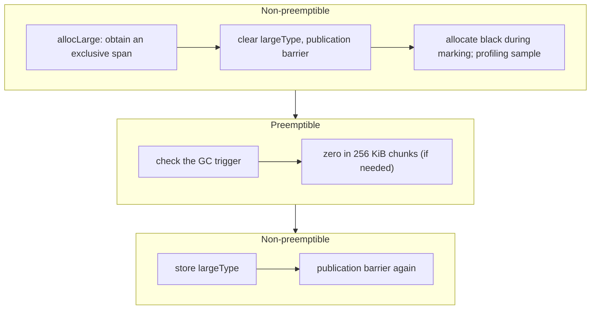

# 12.4 Large Object Allocation

In Go 1.26, an object larger than 32760 bytes is a **large object**. Large objects bypass the local
and central caches. Each one occupies a span of whole pages by itself and is requested directly from
the page heap ([12.1.4](./basic.md)). This section covers where the boundary between small and large
objects comes from, how `mallocgcLarge` arranges preemptible points among allocation, zeroing and
publication, how the page heap supplies whole pages for large objects, and what this path costs.

## 12.4.1 The Boundary Between Large and Small

The boundary value is inherited from TCMalloc. The 2005 design document by Ghemawat and Menage
treats objects of up to 32K as small; larger objects are rounded up to the page size and allocated
from the central page heap, so they are always page-aligned and occupy a whole number of pages
[[Ghemawat and Menage, 2005](#ref-ghemawat-menage-2005)]. `MaxSmallSize` in Go 1.0 was likewise 32
KiB, and it has stayed so ever since. Other allocators draw the line differently. The original
design of jemalloc divides sizes into small, large and huge: an object larger than half a page is
large and is served by contiguous pages in a chunk; one larger than half a chunk (the default chunk
is 2 MB) is huge and is carried directly by a dedicated chunk [[Evans, 2006](#ref-evans-2006)].
TCMalloc today draws the line at `kMaxSize`; objects above it are allocated directly by the back end
and are cached neither in the front end nor in the middle tier
[[TCMalloc Authors, 2026](#ref-tcmalloc-authors-2026)].

Go's size class table shows why a boundary near 32 KiB is a good fit. The purpose of a size class is
to let many objects of the same size share one span, and with it the cost of one span refill. At the
end of the table, the span of size class 66 (28672 bytes) holds only 2 objects, and the span of size
class 67 (32768 bytes) takes 4 pages and holds only 1 object
[[Go Authors, 2026d](#ref-go-authors-2026d)]. At that point allocating by size class is no different
from allocating by page, and adding more size classes would only add caches without any gain from
sharing.

After Go 1.22 introduced allocation headers, the boundary became 32760 bytes. A pointerful object
larger than 512 bytes stores an 8-byte allocation header in front of the object
([12.1.4](./basic.md)), so a pointerful object of 32768 bytes plus its header no longer fits in the
largest size class. The comparison at the boundary does not distinguish whether an object contains
pointers; it subtracts the size of the header for all objects uniformly. The commit that introduced
this comparison explains the reasoning in a comment [[Knyszek, 2023](#ref-knyszek-2023)]:

```go
	// Note: This comparison looks a little strange, but it exists to smooth out
	// the crossover between the largest size class and large objects that have
	// their own spans. The small window of object sizes between maxSmallSize-mallocHeaderSize
	// and maxSmallSize will be considered large, even though they might fit in
	// a size class. In practice this is completely fine, since the largest small
	// size class has a single object in it already, precisely to make the transition
	// to large objects smooth.
	if size <= maxSmallSize-mallocHeaderSize {
```

So objects of 32761 to 32768 bytes are allocated as large objects even if they contain no pointers.
Since size class 67 is already one object per span, and 32761 bytes rounded up to pages is again 4
pages, or 32768 bytes, objects on either side of the boundary occupy the same amount of memory; they
differ only in the path they take. Go 1.24 removed this comment when it refactored `mallocgc`, and
the comparison itself remains today [[Knyszek, 2024](#ref-knyszek-2024)].

The runtime's metrics can tell the two paths apart. `/gc/heap/allocs-by-size:bytes` in
`runtime/metrics` is a histogram of heap allocation counts by size, with one bucket per size class;
all large objects, whatever their size, count toward the last bucket:

```go {run=true}
package main

import (
	"fmt"
	"runtime"
	"runtime/metrics"
)

var sink []byte

// counts returns the last two buckets of the allocation-count histogram:
// size class 67 and large objects.
func counts() (class67, large uint64) {
	s := []metrics.Sample{{Name: "/gc/heap/allocs-by-size:bytes"}}
	runtime.GC() // at the end of a GC the Ps return their spans, so small-object counts are flushed
	metrics.Read(s)
	h := s[0].Value.Float64Histogram()
	n := len(h.Counts)
	return h.Counts[n-2], h.Counts[n-1]
}

func main() {
	for _, size := range []int{32760, 32761} {
		c0, l0 := counts()
		sink = make([]byte, size)
		c1, l1 := counts()
		fmt.Printf("%d bytes: size class 67 +%d, large +%d\n", size, c1-c0, l1-l0)
	}
}
```

The result is:

```
32760 bytes: size class 67 +1, large +0
32761 bytes: size class 67 +0, large +1
```

The allocation counts of small objects are folded into the global statistics only when the local
cache returns its span, so the program runs a GC before reading the metric; the count of large
objects is recorded immediately at allocation.

## 12.4.2 mallocgcLarge: Allocation, Zeroing and Publication

The main body of `mallocgcLarge` is as follows [[Go Authors, 2026a](#ref-go-authors-2026a)]:

```go
func mallocgcLarge(size uintptr, typ *_type, needzero bool) (unsafe.Pointer, uintptr) {
	// Set mp.mallocing to keep from being preempted by GC.
	mp := acquirem()
	// ...
	mp.mallocing = 1

	c := getMCache(mp)
	// For large allocations, keep track of zeroed state so that
	// bulk zeroing can be happen later in a preemptible context.
	span := c.allocLarge(size, typ == nil || !typ.Pointers())
	span.freeindex = 1
	span.allocCount = 1
	span.largeType = nil // Tell the GC not to look at this yet.
	size = span.elemsize
	x := unsafe.Pointer(span.base())

	// Ensure that the store above that sets largeType to
	// nil happens before the caller can make x observable
	// to the garbage collector.
	// ...
	publicationBarrier()

	if writeBarrier.enabled {
		// Allocate black during GC.
		// All slots hold nil so no scanning is needed.
		// This may be racing with GC so do it atomically if there can be
		// a race marking the bit.
		gcmarknewobject(span, uintptr(x))
	} else {
		// ...
		span.freeIndexForScan = span.freeindex
	}

	// Note cache c only valid while m acquired; see #47302
	// ...
	c.nextSample -= int64(size)
	if c.nextSample < 0 || MemProfileRate != c.memProfRate {
		profilealloc(mp, x, size)
	}
	mp.mallocing = 0
	releasem(mp)

	// Check to see if we need to trigger the GC.
	if t := (gcTrigger{kind: gcTriggerHeap}); t.test() {
		gcStart(t)
	}

	// Objects can be zeroed late in a context where preemption can occur.
	//
	// x will keep the memory alive.
	if needzero && span.needzero != 0 {
		// N.B. size == fullSize always in this case.
		memclrNoHeapPointersChunked(size, x) // This is a possible preemption point: see #47302
	}

	// ...
	mp = acquirem()
	if typ != nil && typ.Pointers() {
		// Finish storing the type information, now that we're certain the memory is zeroed.
		getMCache(mp).scanAlloc += heapSetTypeLarge(uintptr(x), size, typ, span)
	}
	// Publish the object again, now with zeroed memory and initialized type information.
	// ...
	publicationBarrier()
	releasem(mp)
	return x, size
}
```

The process has three phases. The first is non-preemptible: `acquirem` and `mallocing` guarantee
that the collector cannot interrupt an allocation halfway. `allocLarge` obtains an exclusive span
(12.4.3) and marks its only slot as occupied; the address of the object is the start address of the
span. `largeType` is the type pointer of a large object, stored in the `mspan`
([12.1.4](./basic.md)). It is cleared here to tell the collector not to inspect the object yet, and
the publication barrier that follows guarantees that this store is visible before other threads see
the object's address. On a machine with a weak memory order, without the barrier the collector could
follow a pointer to the new object and read a stale value of `largeType`. If the allocation happens
during marking, the object is marked black directly and the collector does not scan it in this cycle
([12.1.5](./basic.md)).

This phase also does the memory profiling sampling, and a comment in the code mentions issue #47302.
After Go 1.17 moved the zeroing of large objects to a preemptible point, the sampling code that came
after the zeroing occasionally corrupted runtime data structures: a goroutine may be preempted
during zeroing and resume on a different P, and the `mcache` it had obtained earlier no longer
belongs to it. Chase's fix moved the sampling back into the section where the M is held
[[Chase, 2021](#ref-chase-2021)].

The second phase can be preempted. `allocLarge` has already counted the whole span into the live
heap size, so the GC trigger condition is checked here before zeroing; the reasons for both are
given in [12.1.5](./basic.md). Large objects check the trigger on every allocation, while small
objects check it only when refilling a span. The zeroing function contains no safepoints, and a long
zeroing would delay the GC phases that need to stop all goroutines, so zeroing is placed in this
preemptible phase and done in chunks of 256 KiB [[Chase, 2020](#ref-chase-2020)]. When
`span.needzero` is 0, the memory is known to be all zero and the zeroing is omitted entirely
(12.4.3).

The third phase becomes non-preemptible again. For an object containing pointers, `heapSetTypeLarge`
stores `largeType` atomically and then executes another publication barrier. This order guarantees
that whenever the collector sees a non-nil `largeType`, the memory it sees is already zeroed.
Conversely, if the collector pauses this goroutine during zeroing, it sees only a nil `largeType`
and so does not inspect the memory that is not yet zeroed
[[Go Authors, 2026d](#ref-go-authors-2026d)]. Otherwise the collector could scan stale data left in
unzeroed memory as pointers, and the program would crash. The relation among the three phases is as
follows:



## 12.4.3 Requesting Whole Pages from the Page Heap

`mcache.allocLarge` converts the byte count to a page count and requests the pages from the page
heap [[Go Authors, 2026b](#ref-go-authors-2026b)]:

```go
func (c *mcache) allocLarge(size uintptr, noscan bool) *mspan {
	// ...
	npages := size >> gc.PageShift
	if size&pageMask != 0 {
		npages++
	}

	// Deduct credit for this span allocation and sweep if
	// necessary. mHeap_Alloc will also sweep npages, so this only
	// pays the debt down to npage pages.
	deductSweepCredit(npages*pageSize, npages)

	spc := makeSpanClass(0, noscan)
	s := mheap_.alloc(npages, spc)
	if s == nil {
		throw("out of memory")
	}

	// Count the alloc in consistent, external stats.
	stats := memstats.heapStats.acquire()
	atomic.Xadd64(&stats.largeAlloc, int64(npages*pageSize))
	atomic.Xadd64(&stats.largeAllocCount, 1)
	memstats.heapStats.release()
	// ...
	// Update heapLive.
	gcController.update(int64(s.npages*pageSize), 0)

	// Put the large span in the mcentral swept list so that it's
	// visible to the background sweeper.
	mheap_.central[spc].mcentral.fullSwept(mheap_.sweepgen).push(s)
	// ...
}
```

`deductSweepCredit` implements proportional sweep: before the allocation, it completes an amount of
sweep work corresponding to the allocated bytes, so that sweeping finishes before the next GC cycle
begins ([13.5](../ch13gc/sweep.md)). In the span class `makeSpanClass(0, noscan)`, size class 0 is
reserved for large objects. `largeAllocCount` is the source of the last bucket of the histogram in
12.4.1. After the allocation, the span is put into the swept `full` set of the central cache for
size class 0, so that the sweeper can find it in later GC cycles ([12.2.6](./component.md)).

`mheap.alloc` switches to the system stack, because it may acquire the heap lock, and a stack growth
while holding the lock would itself need to allocate heap memory ([12.2.4](./component.md)). If the
previous cycle's sweep has not finished, it first sweeps and reclaims at least as many pages, to
restrain excessive heap growth, and then calls `allocSpan`. When fewer than 16 pages are needed,
`allocSpan` first tries the page cache of the current P. The page cache is a free bitmap of 64
pages; taking pages from it, as well as obtaining the `mspan` structure, needs no heap lock
(refilling an empty page cache briefly takes the heap lock). Only when the page cache cannot satisfy
the request does it take the heap lock, ask the page allocator for contiguous free pages, and grow
the heap if necessary ([12.7](./pagealloc.md)). Large objects of up to 15 pages (120 KiB) therefore
have a chance of avoiding the heap lock completely, while larger ones always take it.

After the pages are obtained, `initSpan` initializes the span. A span of size class 0 has just one
slot, and the size of the slot is the total number of bytes of the span:

```go
		if sizeclass := spanclass.sizeclass(); sizeclass == 0 {
			s.elemsize = nbytes
			s.nelems = 1
			s.divMul = 0
		}
```

Whether zeroing is needed is also decided here [[Go Authors, 2026c](#ref-go-authors-2026c)]:

```go
	// Always call allocNeedsZero to update the arena's zeroedBase watermark
	// and determine if the memory is considered dirty.
	needZero := h.allocNeedsZero(base, npages)
	// If these pages were scavenged (returned to the OS), the kernel guarantees
	// they will be zero-filled on next use (fault-in), so we can treat them as
	// already zeroed and skip explicit clearing.
	if (needZeroAfterSysUnused() || scav != npages*pageSize) && needZero {
		s.needzero = 1
	}
```

Two kinds of memory are known to be all zero: pages above the arena's `zeroedBase` that have never
been used ([12.2.4](./component.md)), and, under the default settings on Linux, pages that have all
been returned to the operating system, which the kernel guarantees to fill with zeros when they are
accessed again; this check was added in Go 1.26 ([12.3.4](./init.md))
[[Yang, 2025](#ref-yang-2025)]. Only in the remaining cases is `needzero` set to 1, and
`mallocgcLarge` zeroes the memory in a preemptible state.

## 12.4.4 Cost

The large object path has no ready-made span, so every allocation goes through the full
`allocLarge`, `mheap.alloc` and `allocSpan`: paying off sweep debt, finding contiguous free pages,
initializing a new `mspan`, and taking the heap lock when the request needs 16 or more pages or the
page cache cannot satisfy it. Compared with one bitmap lookup on the fast path for small objects,
the fixed cost of this path is much higher; it is merely amortized over more bytes.

The internal fragmentation caused by rounding up to pages is at most one page less one byte, that
is, 8191 bytes, and its proportion to the object size shrinks as the object grows. An object of
40961 bytes occupies 6 pages, or 49152 bytes, an excess of 8191 bytes, about 20% of the request; an
object of 1000000 bytes occupies 123 pages, an excess of 7616 bytes, under 1%. The 33000-byte slice
in [12.1.3](./basic.md) that gets a capacity of 40960 bytes through `append` is also a result of
this rounding. A slice grown by `append` uses the whole rounded-up capacity, whereas a slice created
directly with `make` does not.

A large object does not trigger a GC more often than small objects of the same total bytes, because
the pace of collection depends on the number of bytes allocated ([13.3](../ch13gc/pacing.md)). What
differs is the granularity of accounting: each large object is counted into the live heap size in
whole pages at the moment of allocation and the trigger condition is checked right away, so a single
allocation of several MiB can by itself push the heap over the trigger point.

The cost of zeroing is proportional to the object size. Pages being reused need to be zeroed in
chunks; pages never used and pages that were all returned need no zeroing, but the first write
requires the kernel to supply physical pages on demand, which shifts the cost to page faults
([12.3.5](./init.md)).

An application can reuse large buffers that are short-lived and requested repeatedly, for example
with `sync.Pool`. The objects in a pool should be of roughly equal weight, though; otherwise a few
large buffers may be taken out and put back again and again for later small requests, and keep
occupying memory for a long time ([11.6](../../part3concurrency/ch11sync/pool.md)).

## 12.4.5 Summary

The large object boundary is inherited from the 32 KiB of TCMalloc, and became 32760 bytes after Go
1.22 introduced allocation headers. Around this size, the size classes have degenerated to one
object per span, and caching by size class gains nothing from sharing. Each large object occupies a
size-class-0 span by itself, supplied by the page heap in whole pages, and the smaller large objects
can also avoid the heap lock through the per-P page cache. `mallocgcLarge` places the allocation and
the publication of the type in non-preemptible sections, and the zeroing, whose cost is proportional
to the object size, in a preemptible section; two publication barriers guarantee that the collector
never sees unzeroed memory. [12.5](./smallalloc.md) discusses the contrasting small object path.

## Further Reading

- <a id="ref-chase-2020"></a>[Chase, 2020] David Chase. runtime: break up large calls to
  memclrNoHeapPointers to allow preemption. Go commit 0bbfc5c31e, 2020. https://go.dev/cl/270943
  Released with Go 1.17. Prompted by the multi-millisecond sweep termination pauses reported in Go
  issue #42642.
- <a id="ref-chase-2021"></a>[Chase, 2021] David Chase. runtime: move mem profile sampling into
  m-acquired section. Go commit fdb45acd1f, 2021. https://go.dev/cl/336449 Released with Go 1.17;
  fixes Go issue #47302.
- <a id="ref-evans-2006"></a>[Evans, 2006] Jason Evans. "A Scalable Concurrent malloc(3)
  Implementation for FreeBSD." *BSDCan 2006*, 2006.
  https://people.freebsd.org/~jasone/jemalloc/bsdcan2006/jemalloc.pdf
- <a id="ref-ghemawat-menage-2005"></a>[Ghemawat and Menage, 2005] Sanjay Ghemawat, Paul Menage.
  *TCMalloc: Thread-Caching Malloc.* 2005. http://goog-perftools.sourceforge.net/doc/tcmalloc.html
  The version now maintained by the gperftools project:
  https://gperftools.github.io/gperftools/tcmalloc.html
- <a id="ref-go-authors-2026a"></a>[Go Authors, 2026a] The Go Authors.
  src/runtime/malloc.go (`mallocgcLarge`, size dispatch and GC triggering). Go 1.26 source.
  https://github.com/golang/go/blob/release-branch.go1.26/src/runtime/malloc.go
  Formerly at: https://github.com/golang/go/blob/master/src/runtime/malloc.go
- <a id="ref-go-authors-2026b"></a>[Go Authors, 2026b] The Go Authors. src/runtime/mcache.go
  (`mcache.allocLarge`: rounding to pages, sweep credit and statistics). Go 1.26 source.
  https://github.com/golang/go/blob/release-branch.go1.26/src/runtime/mcache.go Formerly at:
  https://github.com/golang/go/blob/master/src/runtime/mcache.go
- <a id="ref-go-authors-2026c"></a>[Go Authors, 2026c] The Go Authors. src/runtime/mheap.go
  (`mheap.alloc`, `allocSpan`, `initSpan`, the page cache and heap lock paths). Go 1.26 source.
  https://github.com/golang/go/blob/release-branch.go1.26/src/runtime/mheap.go Formerly at:
  https://github.com/golang/go/blob/master/src/runtime/mheap.go
- <a id="ref-go-authors-2026d"></a>[Go Authors, 2026d] The Go Authors.
  src/runtime/mbitmap.go (`heapSetTypeLarge`), src/runtime/metrics.go,
  src/internal/runtime/gc/sizeclasses.go. Go 1.26 source.
  https://github.com/golang/go/tree/release-branch.go1.26/src
- <a id="ref-knyszek-2023"></a>[Knyszek, 2023] Michael Anthony Knyszek. runtime: implement
  experiment to replace heap bitmap with alloc headers. Go commit 38ac7c41aa, 2023.
  https://go.dev/cl/437955 Released with Go 1.22.
- <a id="ref-knyszek-2024"></a>[Knyszek, 2024] Michael Anthony Knyszek. runtime: refactor mallocgc
  into several independent codepaths. Go commit 8730fcf885, 2024. https://go.dev/cl/614257 Released
  with Go 1.24.
- <a id="ref-tcmalloc-authors-2026"></a>[TCMalloc Authors, 2026] The TCMalloc Authors.
  *TCMalloc: Thread-Caching Malloc.* 2026. https://google.github.io/tcmalloc/design.html
  Large objects bypass the thread cache and are allocated directly by the page heap.
- <a id="ref-yang-2025"></a>[Yang, 2025] Lance Yang. runtime: avoid zeroing scavenged memory. Go
  commit 27937289dc, 2025. https://go.dev/cl/715160 Released with Go 1.26.
- This book: [11.6 Object Pool](../../part3concurrency/ch11sync/pool.md) (reusing large buffers),
  [12.5 Small Object Allocation](./smallalloc.md) (the finely tuned small object path, for
  contrast), [12.7 The Page Allocator](./pagealloc.md) (how `h.pages.alloc` finds contiguous free
  pages and how `grow` grows from the operating system), [Chapter 13 Garbage Collector](../ch13gc)
  (how large objects affect the GC pace).
