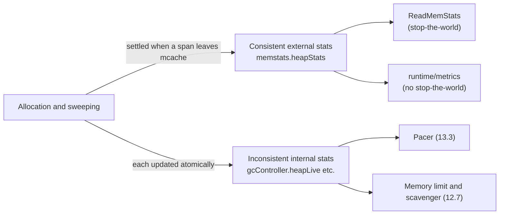

# 12.8 Memory Statistics

While the allocator and the collector work, they maintain a set of counters: how much memory the
runtime has mapped from the operating system, how much of it holds objects, how much is free, how
much has been returned, and how many objects have been allocated and freed in total. These counters
have two kinds of readers. Outside the runtime, programs inspect their own memory through
`runtime.ReadMemStats`, `runtime/metrics` and the heap profile, and monitoring systems draw graphs
and raise alerts from them. Inside the runtime, the pacer uses them to decide when the next
collection cycle starts ([13.3](../ch13gc/pacing.md)), and the memory limit and the scavenger use
them to decide whether to reclaim early and how much physical memory to return
([12.7](./pagealloc.md)).

Maintaining the counters involves two competing requirements. The allocation fast path runs
extremely often, and updating a shared counter there would slow down every allocation. Readers,
however, need a complete picture of a single moment, for example one in which the categories add up
exactly to the total. This section describes the categories into which the statistics divide memory,
how the runtime updates the counters without slowing down allocation, how it reads a consistent
snapshot without stopping the world, how the two read interfaces differ, how the heap profile
records allocation sites by sampling, and which counters the runtime itself reads.

## 12.8.1 Categories of Memory

Every byte of memory the runtime maps belongs to exactly one category. `runtime/metrics` organizes
the categories as a tree under the prefix `/memory/classes/`: the leaves are disjoint and sum to
`/memory/classes/total:bytes` [[Go Authors, 2026b](#ref-go-authors-2026b)]. The fields of
`runtime.MemStats` are sums of some of these categories, and the correspondence can be read from the
code that computes both [[Go Authors, 2026c](#ref-go-authors-2026c)]:

| Metric under `/memory/classes/` | Meaning | Corresponding `MemStats` field |
|---|---|---|
| `heap/objects:bytes` | Heap objects, including unreachable objects not yet swept | `HeapAlloc` |
| `heap/unused:bytes` | Memory assigned to heap objects but not currently holding one | `HeapInuse` − `HeapAlloc` |
| `heap/free:bytes` | Free pages still backed by physical memory | `HeapIdle` − `HeapReleased` |
| `heap/released:bytes` | Free pages with no physical memory behind them | `HeapReleased` |
| `heap/stacks:bytes` | Memory allocated from the heap for goroutine stacks | `StackInuse` |
| `os-stacks:bytes` | Thread stacks requested directly from the operating system; zero in programs without cgo | `StackSys` − `StackInuse` |
| `metadata/mspan/inuse:bytes`, `metadata/mspan/free:bytes` | `mspan` structures | `MSpanInuse`, `MSpanSys` − `MSpanInuse` |
| `metadata/mcache/inuse:bytes`, `metadata/mcache/free:bytes` | `mcache` structures | `MCacheInuse`, `MCacheSys` − `MCacheInuse` |
| `metadata/other:bytes` | Other runtime metadata, including the collector's work buffers | `GCSys` |
| `profiling/buckets:bytes` | The call-stack hash table used by profiling | `BuckHashSys` |
| `other:bytes` | Execution trace buffers, special records for finalizers and profiling, and so on | `OtherSys` |
| `total:bytes` | The sum of all the above | `Sys` |

`HeapAlloc` includes objects that are already unreachable but not yet swept. Sweeping proceeds
gradually between two collection cycles ([13.5](../ch13gc/sweep.md)), so `HeapAlloc` rises with
allocation and falls with sweeping. The documentation therefore notes that it changes smoothly,
unlike the sawtooth typical of a stop-the-world collector
[[Go Authors, 2026a](#ref-go-authors-2026a)]. The two differences in the table each have a meaning.
`HeapInuse` − `HeapAlloc` is memory already assigned to a size class but unused, an upper bound on
fragmentation. `HeapIdle` − `HeapReleased` is memory the runtime keeps for future growth: it could
be returned but has not been. If it is much larger than the heap itself, the live heap recently had
a brief peak [[Go Authors, 2026a](#ref-go-authors-2026a)].

The easiest quantities to misread are `Sys` and `HeapSys`. The `MemStats` documentation says that
`Sys` "measures the virtual address space reserved by the Go runtime", but "reserved" is used
loosely here. Of the four states introduced in [12.3.4](./init.md), only memory that has entered
Prepared or Ready through `sysMap` is counted; addresses that are merely Reserved appear in no field
([12.3.5](./init.md)). The description of `/memory/classes/total:bytes` is more accurate: it is all
the memory the runtime has mapped into the process with read and write permission
[[Go Authors, 2026b](#ref-go-authors-2026b)]. On 64-bit Linux and macOS, the heap reserves address
space in units of 64 MiB arenas, but `mheap.grow` maps it in units of 4 MiB. In the
`/proc/<pid>/maps` output quoted in [12.3.5](./init.md), only the first 4 MiB of an arena is
readable and writable; the remaining 60 MiB has the permissions `---p` and does not count toward
`Sys`.

Newly mapped heap memory is first counted as released. `mheap.grow` records it this way when it
moves reserved addresses to Prepared [[Go Authors, 2026d](#ref-go-authors-2026d)]:

```go
	// Transition the space we're going to use from Reserved to Prepared.
	//
	// The allocation is always aligned to the heap arena
	// size which is always > physPageSize, so its safe to
	// just add directly to heapReleased.
	sysMap(unsafe.Pointer(v), nBase-v, &gcController.heapReleased, "heap")

	// The memory just allocated counts as both released
	// and idle, even though it's not yet backed by spans.
	stats := memstats.heapStats.acquire()
	atomic.Xaddint64(&stats.released, int64(nBase-v))
	memstats.heapStats.release()
```

This memory has never been touched and occupies no physical memory, so statistically it is in the
same state as pages the scavenger has returned. The documentation of `HeapSys` describes it
separately from released memory ("reserved but not yet used … but tends to be small"), but in the
implementation both count toward `HeapReleased`. This yields a commonly used quantity: `Sys` −
`HeapReleased` is the memory in the Ready state, called `mappedReady` inside the runtime, and
`readmemstats_m` asserts in debug mode that the two are equal
[[Go Authors, 2026c](#ref-go-authors-2026c)]. The GC guide uses exactly `Sys` − `HeapReleased` to
define the memory that the memory limit constrains ([13.3.3](../ch13gc/pacing.md))
[[Go Authors, 2022](#ref-go-authors-2022)]. It is also the runtime's estimate of resident memory,
but only an approximate one: pages that are Ready but have never been written do not yet occupy
physical memory ([12.3.5](./init.md)), and memory allocated by cgo or `syscall.Mmap` is not counted.

To tell whether memory is leaking, look at whether the live heap after each collection keeps rising,
that is, `/gc/heap/live:bytes` (added in Go 1.21) [[Geisendörfer, 2022](#ref-geisendorfer-2022)],
rather than `Sys` or the process's virtual memory. As the documentation puts it, `HeapSys` estimates
the largest the heap has ever been, and it does not fall when the live heap shrinks; virtual memory
also includes large ranges of addresses that are only reserved and not mapped.

## 12.8.2 Settling Accounts per Span

When a small object is allocated, the fast path modifies only the `allocCount` of the span it uses
(tiny objects are additionally counted in `mcache.tinyAllocs`) and touches no global counter. These
allocations are settled only when the span leaves the `mcache`. This happens in one of two ways:
`refill` replaces a full span with a new one, or `releaseAll` empties the whole cache, which occurs
before the first allocation on each P after every mark termination, before `ReadMemStats` reads, and
when a P is destroyed. The part of `refill` related to statistics is as follows
[[Go Authors, 2026d](#ref-go-authors-2026d)]:

```go
	if s != &emptymspan {
		// ……
		// Count up how many slots were used and record it.
		stats := memstats.heapStats.acquire()
		slotsUsed := int64(s.allocCount) - int64(s.allocCountBeforeCache)
		atomic.Xadd64(&stats.smallAllocCount[spc.sizeclass()], slotsUsed)
		// ……
		memstats.heapStats.release()

		// Count the allocs in inconsistent, internal stats.
		bytesAllocated := slotsUsed * int64(s.elemsize)
		gcController.totalAlloc.Add(bytesAllocated)
		// ……
	}
	// ……
	// Store the current alloc count for accounting later.
	s.allocCountBeforeCache = s.allocCount

	// Update heapLive and flush scanAlloc.
	//
	// We have not yet allocated anything new into the span, but we
	// assume that all of its slots will get used, so this makes
	// heapLive an overestimate.
	//
	// When the span gets uncached, we'll fix up this overestimate
	// if necessary (see releaseAll).
	//
	// We pick an overestimate here because an underestimate leads
	// the pacer to believe that it's in better shape than it is,
	// which appears to lead to more memory used. See #53738 for
	// more details.
	usedBytes := uintptr(s.allocCount) * s.elemsize
	gcController.update(int64(s.npages*pageSize)-int64(usedBytes), int64(c.scanAlloc))
```

`allocCountBeforeCache` records how many objects the span already held when it was cached; when the
span leaves the cache, the difference between the two counts is the number of allocations made in
the meantime. A span holds at most 1024 objects (an 8 KiB span cut into 8-byte objects), so the
atomic operations on global counters are amortized from one per object to one per span. Large
objects must go through the page heap anyway ([12.4](./largealloc.md)) and are counted directly in
`allocLarge`. Frees are counted by the sweeper, once for each span swept
([13.5](../ch13gc/sweep.md)).

The comments in `refill` mention "inconsistent, internal stats". There are indeed two sets of
statistics, and `allocLarge` writes them side by side [[Go Authors, 2026d](#ref-go-authors-2026d)]:

```go
	// Count the alloc in consistent, external stats.
	stats := memstats.heapStats.acquire()
	atomic.Xadd64(&stats.largeAlloc, int64(npages*pageSize))
	atomic.Xadd64(&stats.largeAllocCount, 1)
	memstats.heapStats.release()

	// Count the alloc in inconsistent, internal stats.
	gcController.totalAlloc.Add(int64(npages * pageSize))

	// Update heapLive.
	gcController.update(int64(s.npages*pageSize), 0)
```

The "consistent, external stats" are `memstats.heapStats`, read by `ReadMemStats` and
`runtime/metrics`, whose counters must agree with one another; the mechanism is described in 12.8.3.
The "inconsistent, internal stats" are fields of `gcController` such as `totalAlloc` and `heapLive`,
used by the runtime to make its own decisions. Each counter is updated atomically on its own, and a
reader reads one at a time without requiring them to agree.

The two sets estimate partially used spans in opposite ways. `heapLive` counts all the free slots of
a span as allocated as soon as the span enters the cache, and deducts the unused part when it leaves
the cache, so it errs on the high side. The comment explains why: an underestimate makes the pacer
believe things are better than they are, which ends up using more memory. This change shipped in Go
1.19, prompted by rising memory usage in several benchmarks on the performance dashboard
[[Knyszek, 2022b](#ref-knyszek-2022b)]. The consistent statistics count only the slots actually
used. In Go 1.16 through 1.18 they also counted all free slots when a span entered the cache and
backed them out when it left, so an allocation counter marked monotonically increasing in
`runtime/metrics` would occasionally decrease. Go 1.19 added `allocCountBeforeCache` using 16 bits
of padding in `mspan`, which makes the count exact and monotonic
[[Knyszek, 2022a](#ref-knyszek-2022a)].

The following diagram summarizes where the counts come from and where they go:



## 12.8.3 A Consistent Snapshot Without Stopping the World

The need for consistency is visible in the computation of `/memory/classes/heap/free:bytes`. It is
derived from the committed memory minus the spans holding heap objects, the stacks and the work
buffers [[Go Authors, 2026c](#ref-go-authors-2026c)]. If the committed amount a reader sees comes
from after an allocation while the other terms come from before it, or the reverse, the result is
too large or too small, or even negative. All the counters must come from the same moment.

Up to Go 1.15, some statistics were staged in each P's `mcache` and aggregated only at each
collection cycle, so `ReadMemStats` could only stop the world and then aggregate. Go 1.16 introduced
`consistentHeapStats` precisely so that a consistent result could be read without stopping the world
[[Knyszek, 2020b](#ref-knyszek-2020b)]. It keeps the statistics as three sets of deltas, whose sum
is the current value. A global generation `gen` says which set writers currently write to, and each
P has a sequence number `statsSeq`. A writer calls `acquire` before modifying anything
[[Go Authors, 2026c](#ref-go-authors-2026c)]:

```go
func (m *consistentHeapStats) acquire() *heapStatsDelta {
	if pp := getg().m.p.ptr(); pp != nil {
		seq := pp.statsSeq.Add(1)
		if seq%2 == 0 {
			// Should have been incremented to odd.
			print("runtime: seq=", seq, "\n")
			throw("bad sequence number")
		}
	} else {
		lock(&m.noPLock)
	}
	gen := m.gen.Load() % 3
	return &m.stats[gen]
}
```

An odd sequence number means the P is writing, and `release` increments it again to restore it to
even. Writers without a P are rare, and they use a mutex instead. A reader calls `read`, whose core
steps are as follows [[Go Authors, 2026c](#ref-go-authors-2026c)]:

```go
	// Rotate gen, effectively taking a snapshot of the state of
	// these statistics at the point of the exchange by moving
	// writers to the next set of deltas.
	//
	// This exchange is safe to do because we won't race
	// with anyone else trying to update this value.
	m.gen.Swap((currGen + 1) % 3)

	// ……

	for _, p := range allp {
		// Spin until there are no more writers.
		for p.statsSeq.Load()%2 != 0 {
		}
	}

	// ……
	m.stats[currGen].merge(&m.stats[prevGen])
	m.stats[prevGen] = heapStatsDelta{}

	// Finally, copy out the complete delta.
	*out = m.stats[currGen]
```

Suppose `gen` is $g$ when the reader arrives. The reader first changes `gen` to $g+1$; every write
that starts afterwards lands in set $g+1$, and this instant is the moment of the snapshot. A writer
still writing set $g$ must have an odd sequence number, so the reader waits for the sequence numbers
of all Ps to become even one by one, after which set $g$ no longer changes. Set $g-1$ holds the
accumulated values up to the previous snapshot, and set $g$ holds the increments since. The reader
merges the former into the latter to obtain the complete statistics up to this moment, then clears
set $g-1$. The next read steers writers to $g+2$, which modulo 3 is the set just cleared. The
comment explains why three sets are needed rather than two: one set for writers to write to, one
holding the latest data, and one kept empty so that writers have somewhere to write the instant
`gen` changes.

The odd/even convention is the same as that of the Linux kernel's sequence counter: a writer
increments the counter once on entering and once on leaving the critical section, and an odd value
means an update is in progress [[Linux kernel, n.d.](#ref-linux-kernel-nd)]. The difference lies in
what the reader does. A kernel reader rereads if it sees an odd value or finds the counter changed
after reading. Here the reader does not reread; it steers writers to another set of deltas and waits
only for writes that have already begun. Writers therefore wait neither for readers nor for each
other, and the sequence numbers are kept per P. The remaining cost is an atomic add on a shared
delta, which the per-span settling of 12.8.2 has already amortized. Both designs require that a
writer's critical section not be interrupted. The kernel documentation points out that if a writer
is preempted by a reader, the reader spins for an entire scheduling period. Here `acquire` and
`release` are marked `nosplit`, and the P must not change between the two calls. The cost falls on
the reader: only one reader can run at a time, and the caller of `read` must either stop the world
or hold `metricsSema`.

## 12.8.4 Two Read Interfaces

`runtime.ReadMemStats` has been the interface for reading memory statistics since Go 1
[[Go Authors, 2026c](#ref-go-authors-2026c)]:

```go
func ReadMemStats(m *MemStats) {
	_ = m.Alloc // nil check test before we switch stacks, see issue 61158
	stw := stopTheWorld(stwReadMemStats)
	systemstack(func() {
		readmemstats_m(m)
	})
	startTheWorld(stw)
}
```

The first line touches `m` once before switching to the system stack. If `m` is nil, the error then
occurs on the user's call stack, and the traceback does not contain runtime-internal frames such as
`runtime.systemstack`. This check was added in Go 1.21 to fix issue 61158
[[Randall, 2023](#ref-randall-2023)]. `readmemstats_m` first calls `flushallmcaches`, which makes
every P's `mcache` hand back all its spans and thereby brings the unsettled allocations of 12.8.2
into the statistics. It then adds up the three sets of deltas directly with the world stopped, and
finally computes the individual fields. Both steps require all Ps to be stopped, so every call stops
the world once. The benefit is that the reading is up to date: the documentation stresses that it
reflects the state at the time of the call, unlike the heap profile, which reflects the state at the
end of the previous collection cycle [[Go Authors, 2026a](#ref-go-authors-2026a)].

Another limitation of `MemStats` is its fixed form. Its fields are bound by the Go 1 compatibility
promise and can be neither removed nor changed in meaning: `EnableGC` is always true and `DebugGC`
has long been unused; `BySize` is hard-coded to 61 entries while Go 1.26 has 68 size classes, so
size classes 61 through 67 are missing; and `PauseNs` records one number per collection cycle, the
sum of all pauses in that cycle. In his 2020 proposal, Knyszek quoted a summary by Austin Clements:
`MemStats` is hard to evolve, because every added field must be maintained forever; the format of
`GODEBUG=gctrace=1` is not bound by compatibility but is written only to standard error and is hard
for programs to collect. The proposal added that `ReadMemStats` also stops the world
[[Knyszek, 2020a](#ref-knyszek-2020a)]. From this it derived several requirements: new metrics
should be easy to add, and old ones easy to deprecate without breaking programs; metrics should be
enumerable; distributions should be expressible; and reading should not significantly affect the
program being measured.

`runtime/metrics` shipped with Go 1.16 [[Go Authors, 2021](#ref-go-authors-2021);
[Knyszek, 2020c](#ref-knyszek-2020c)]. Metrics are named by strings, followed by a colon and a unit,
as in `/gc/heap/goal:bytes`. The unit is part of the name because a change of unit usually means a
change of meaning, in which case a new name should be used
[[Go Authors, 2026b](#ref-go-authors-2026b)]. `metrics.All` lists all currently supported metrics
with their descriptions, value kinds and whether they are cumulative. The deprecation mechanism has
already been used: Go 1.22 added four stop-the-world pause-duration histograms, and
`/gc/pauses:seconds` was marked deprecated because it is identical to
`/sched/pauses/total/gc:seconds` among them, though it can still be read
[[Go Authors, 2024](#ref-go-authors-2024); [Pratt, 2023](#ref-pratt-2023)].

When reading, `metrics.Read` holds `metricsSema` and computes, for the requested metrics, the
aggregates they depend on. Heap statistics obtain a consistent snapshot through the `read` of
12.8.3; statistics outside the heap are read one by one atomically, and the usage of `mspan` and
`mcache` requires briefly holding the heap lock [[Go Authors, 2026d](#ref-go-authors-2026d)]. The
whole process does not stop the world. The design document originally intended to mark in each
metric's description whether reading it required stopping the world, so that monitoring systems
could lower their sampling frequency; the final `Description` has only four fields, name,
description, kind and whether it is cumulative [[Knyszek, 2020a](#ref-knyszek-2020a)]: with
consistent statistics, no metric needs a stop-the-world any longer. The following program compares
the number of non-GC stop-the-world pauses caused by 100 reads through each interface:

```go {run=true}
package main

import (
	"fmt"
	"runtime"
	"runtime/metrics"
)

// pauses returns the number of stop-the-world pauses so far that are unrelated to GC.
func pauses() uint64 {
	s := []metrics.Sample{{Name: "/sched/pauses/total/other:seconds"}}
	metrics.Read(s)
	var n uint64
	for _, c := range s[0].Value.Float64Histogram().Counts {
		n += c
	}
	return n
}

func main() {
	var m runtime.MemStats
	sample := []metrics.Sample{{Name: "/memory/classes/total:bytes"}}

	n0 := pauses()
	for range 100 {
		metrics.Read(sample)
	}
	n1 := pauses()
	for range 100 {
		runtime.ReadMemStats(&m)
	}
	n2 := pauses()

	fmt.Println("100 calls to metrics.Read:", n1-n0, "pauses")
	fmt.Println("100 calls to ReadMemStats:", n2-n1, "pauses")
}
```

The output is as follows:

```
100 calls to metrics.Read: 0 pauses
100 calls to ReadMemStats: 100 pauses
```

Not stopping the world has its costs. First, `metrics.Read` does not flush the `mcache`, so
allocations in spans still in use by each P are not yet settled and the allocation counts lag, by no
more than one span per P per span class. Second, the aggregates are obtained at different moments,
so there may be slight deviations between them; the comment on `sysStatsAggregate` explains that
these statistics are independent of one another and do not constitute a real consistency problem
[[Go Authors, 2026d](#ref-go-authors-2026d)]. The differences between the two interfaces are
summarized below:

| | `runtime.ReadMemStats` | `runtime/metrics` |
|---|---|---|
| Form | A fixed struct, bound by Go 1 compatibility | A set of metrics indexed by name, which can be added and deprecated |
| Reading | Stops the world and flushes all `mcache`s | Does not stop the world; computes only the requested metrics |
| Freshness | Includes unsettled allocations in `mcache`s | Excludes unsettled allocations |
| Distributions | Only the `PauseNs` ring buffer and `BySize` | Histograms |
| Use | Occasional diagnostics | Continuous monitoring; the first choice for new code |

Several metrics are commonly used in monitoring: the live heap after each collection,
`/gc/heap/live:bytes`; the memory in the Ready state, that is, `/memory/classes/total:bytes` minus
`/memory/classes/heap/released:bytes`; the frequency of collection, that is, the growth rate of
`/gc/cycles/total:gc-cycles`; and the duration of stop-the-world pauses, that is, a high percentile
of `/sched/pauses/total/gc:seconds`. The use of `runtime/metrics` and its integration with systems
such as Prometheus are covered in [16.6](../../part5toolchain/ch16tools/metric.md).

## 12.8.5 The Heap Profile

The statistics above answer "how much is used"; the **heap profile** answers "who allocated it": it
aggregates the number of allocated and freed objects and bytes by the call stack of the allocation
site. Recording a call stack for every allocation would be too expensive, so the runtime records by
sampling, on average once every `runtime.MemProfileRate` bytes allocated, with a default of 512 KiB
[[Go Authors, 2026e](#ref-go-authors-2026e)]. Each `mcache` keeps a counter `nextSample`, from which
every allocation subtracts the size of the object. When it goes negative, `profilealloc` is called
to record the call stack and a next interval is drawn [[Go Authors, 2026e](#ref-go-authors-2026e)]:

```go
// nextSample returns the next sampling point for heap profiling. The goal is
// to sample allocations on average every MemProfileRate bytes, but with a
// completely random distribution over the allocation timeline; this
// corresponds to a Poisson process with parameter MemProfileRate. In Poisson
// processes, the distance between two samples follows the exponential
// distribution (exp(MemProfileRate)), so the best return value is a random
// number taken from an exponential distribution whose mean is MemProfileRate.
func nextSample() int64 {
	// ……
	return int64(fastexprand(MemProfileRate))
}
```

Regard allocation as a timeline measured in bytes; the sampling points form a **Poisson process**,
and the interval between adjacent sampling points follows an exponential distribution with mean $R$,
where $R$ is `MemProfileRate`. The exponential distribution is memoryless: however far it is from
the previous sampling point, the probability that a sampling point falls within the next $S$ bytes
is $1-e^{-S/R}$. The probability that an object of size $S$ is sampled therefore depends only on its
size, and dividing each sample by this probability gives an unbiased estimate of the actual amount
allocated. `runtime/pprof` rescales each record this way, using its average object size
[[Go Authors, 2026e](#ref-go-authors-2026e)]:

```go
	avgSize := float64(size) / float64(count)
	scale := 1 / (1 - math.Exp(-avgSize/float64(rate)))

	return int64(float64(count) * scale), int64(float64(size) * scale)
```

When objects are much smaller than $R$, $1-e^{-S/R} \approx S/R$, and each sample represents about
$R$ bytes of allocation; when objects are much larger than $R$, the probability approaches 1 and
large objects are almost always recorded. The original implementation was different. When Russ Cox
added `MemProfileRate` in 2010, the interval was drawn from a uniform distribution on $[0, 2R)$, and
every object of at least $R$ bytes was recorded [[Cox, 2010](#ref-cox-2010)]. A uniformly
distributed interval is not memoryless: the probability that an object is sampled also depends on
how far it lies from the previous sampling point, and cannot be computed from size alone. In 2015
Raul Silvera found that the bias of this sampling interfered with the rescaling, so heap profiles
did not match expectations. He switched to a Poisson process and added the rescaling formula above,
shipped in Go 1.6 [[Silvera, 2015](#ref-silvera-2015)].

The "in use" data in a heap profile has a timing problem of its own. Allocations happen in real
time, but frees are known only at sweep time. If a profile included all allocations up to now but
only the frees up to the last sweep, the result would be biased toward recent allocations. The
runtime therefore publishes only a snapshot as of the last mark termination: its allocations all
happened before that mark termination, and its frees are counted by the sweeping that follows. In
the implementation, the global profile cycle $C$ is incremented at mark termination, and events are
charged to future cycles by the following rules [[Go Authors, 2026e](#ref-go-authors-2026e)]:

```go
	// Mallocs are accounted to cycle C+2.
	// Explicit frees are accounted to cycle C+2.
	// GC frees (done during sweeping) are accounted to cycle C+1.
```

After mark termination, the data of cycle $C$ is merged into the published profile; after sweeping
completes, `runtime.GC` also publishes $C+1$. This mechanism was introduced by Clements in Go 1.9.
Before it, the snapshot was taken after the world restarted following mark termination, so
allocations and frees in between could be charged to the wrong cycle, and a free could even be
charged to a cycle earlier than its allocation, giving negative usage in the profile
[[Clements, 2017](#ref-clements-2017)]. The documentation of `runtime.MemProfile` therefore states
that the profile may lag by up to two collection cycles
[[Go Authors, 2026e](#ref-go-authors-2026e)]. The following program records every allocation and
observes when the profile reflects the allocation and the freeing of 4000 KiB:

```go {run=true}
package main

import (
	"fmt"
	"runtime"
)

var sink [][]byte

//go:noinline
func alloc() {
	for range 1000 {
		sink = append(sink, make([]byte, 4096))
	}
}

// inuse returns the bytes allocated by alloc and not yet freed in the heap profile, in KiB.
func inuse() int64 {
	n, _ := runtime.MemProfile(nil, true)
	p := make([]runtime.MemProfileRecord, n+64)
	n, _ = runtime.MemProfile(p, true)
	var total int64
	for _, r := range p[:n] {
		for _, pc := range r.Stack() {
			if f := runtime.FuncForPC(pc); f != nil && f.Name() == "main.alloc" {
				total += r.InUseBytes()
				break
			}
		}
	}
	return total / 1024
}

func main() {
	runtime.MemProfileRate = 1 // record every allocation
	sink = make([][]byte, 0, 1000)
	runtime.GC()

	alloc()
	fmt.Printf("after allocation: %d KiB\n", inuse())

	runtime.GC()
	fmt.Printf("after one GC: %d KiB\n", inuse())

	sink = nil
	runtime.GC()
	fmt.Printf("after freeing and GC: %d KiB\n", inuse())
}
```

The output is as follows:

```
after allocation: 0 KiB
after one GC: 4000 KiB
after freeing and GC: 0 KiB
```

Right after the allocation completes, the profile does not yet contain these objects; they appear
after one collection, and after being freed they disappear only after the next one. The program
begins with a collection because, when no data has yet been published, `MemProfile` counts all
unpublished cycles together, so that programs with collection turned off can still obtain a profile
[[Go Authors, 2026e](#ref-go-authors-2026e)]; collecting once first makes the normal lag visible.

The default format obtained through `/debug/pprof/heap` of `net/http/pprof` is the binary format
read by `go tool pprof`. Adding `?debug=1` gives the text format, in which the records are followed
by a list of `MemStats` fields beginning with `# runtime.MemStats`
[[Go Authors, 2026e](#ref-go-authors-2026e)]. The first line of the text format writes the sampling
rate as `2*MemProfileRate`; a source comment explains that this is because the early C++ heap
profiler reported it that way, and pprof kept the convention. The use of heap profiles is covered in
[16.5](../../part5toolchain/ch16tools/perf.md).

## 12.8.6 Counters the Runtime Reads

The pacer, the memory limit and the scavenger do not read `MemStats`; they read the internal
statistics in `gcController` ([13.3](../ch13gc/pacing.md)):

- `heapLive` is the bytes retained by the previous collection plus the bytes newly allocated since,
  overestimated in the manner of 12.8.2. It does not include dead objects not yet swept, so it only
  grows between two cycles. The pacer compares it with the trigger point to decide when to start the
  next cycle ([13.3.4](../ch13gc/pacing.md)).
- `heapMarked` is the live heap found by the previous mark, that is, `/gc/heap/live:bytes`. Together
  with the amount of stack and global scanning work, it determines the heap goal corresponding to
  `GOGC` ([13.3.2](../ch13gc/pacing.md)). `MemStats.NextGC` and `/gc/heap/goal:bytes` are both taken
  from `gcController.heapGoal()`, the smaller of the goals given by `GOGC` and by the memory limit,
  after some adjustments.
- `mappedReady` is `Sys` − `HeapReleased`. The memory limit uses it to derive the heap goal
  ([13.3.3](../ch13gc/pacing.md)), and the scavenger uses it to decide whether to push memory below
  95% of the limit ([12.7.8](./pagealloc.md)).
- The sum of `heapInUse` and `heapFree` is the memory the heap retains, which the scavenger compares
  with the return target computed from `GOGC` ([12.7.7](./pagealloc.md)).

The internal statistics differ in meaning from the external ones, which matters when reading
`gctrace` output: the first two heap sizes joined by arrows are `heapLive` at the start of the
collection and at the end of marking, and the third is the live heap found by this cycle's mark
([13.3.6](../ch13gc/pacing.md)); they need not equal `HeapAlloc` at the same moment. The CPU
percentage in `gctrace` is the same as `MemStats.GCCPUFraction`: both are the ratio of the CPU time
the collector has used since program start (excluding idle marking) to the available CPU time
[[Go Authors, 2026a](#ref-go-authors-2026a)].

## 12.8.7 Summary

The runtime's memory statistics make trade-offs at three levels. In counting, small-object
allocations are settled per span, so the fast path never touches a shared counter; the statistics
split into consistent ones for external readers and internal ones for the runtime's decisions, and
the latter prefer to overestimate for the sake of pacing safety. In reading, `ReadMemStats` stops
the world in exchange for an up-to-date and complete reading, while `runtime/metrics`, with per-P
sequence numbers and three rotating sets of deltas, reads a consistent snapshot without stopping the
world, at the cost of excluding unsettled allocations. In recording allocation sites, the heap
profile samples as a Poisson process, so that samples can be rescaled by object size to the actual
amount allocated, and it publishes only a snapshot as of the last mark termination so as not to
favor recent allocations. Understanding that `Sys` counts mapped rather than reserved memory, and
that `HeapReleased` includes mappings that have never been used, is a prerequisite for reading these
numbers correctly.

## Further Reading

- <a id="ref-clements-2017"></a>[Clements, 2017] Austin Clements. runtime: snapshot heap profile
  during mark termination. Go commit eee85fc5a1, 2017. https://go.dev/cl/37714 Shipped in Go 1.9;
  fixes Go issue #19311.
- <a id="ref-cox-2010"></a>[Cox, 2010] Russ Cox. runtime: malloc sampling, pprof interface. Go
  commit 6eb251f244, 2010. https://go.dev/cl/719041 Predates Go 1.0.
- <a id="ref-geisendorfer-2022"></a>[Geisendörfer, 2022] Felix Geisendörfer. runtime/metrics: add
  /gc/heap/live:bytes. Go commit ef2bb813c8, 2022. https://go.dev/cl/497315
  Shipped in Go 1.21.
- <a id="ref-go-authors-2021"></a>[Go Authors, 2021] The Go Authors. Go 1.16 Release Notes. 2021.
  https://go.dev/doc/go1.16 (adds `runtime/metrics`, superseding `runtime.ReadMemStats` and
  `debug.GCStats`)
- <a id="ref-go-authors-2022"></a>[Go Authors, 2022] The Go Authors. *A Guide to the Go Garbage
  Collector.* https://tip.golang.org/doc/gc-guide (how `GOGC`, `GOMEMLIMIT` and the live heap
  determine GC pacing)
- <a id="ref-go-authors-2024"></a>[Go Authors, 2024] The Go Authors. Go 1.22 Release Notes. 2024.
  https://go.dev/doc/go1.22 (adds four stop-the-world pause-duration histograms;
  `/gc/pauses:seconds` deprecated)
- <a id="ref-go-authors-2026a"></a>[Go Authors, 2026a] The Go Authors. *Package runtime, type
  MemStats.* https://pkg.go.dev/runtime#MemStats (authoritative semantics of each field, especially
  the state division of the Heap series)
- <a id="ref-go-authors-2026b"></a>[Go Authors, 2026b] The Go Authors. *Package runtime/metrics.*
  https://pkg.go.dev/runtime/metrics (the extensible interface introduced in Go 1.16: `Sample`,
  `Value`, `All`, and all metric names and units)
- <a id="ref-go-authors-2026c"></a>[Go Authors, 2026c] The Go Authors.
  *runtime/mstats.go, runtime/metrics/description.go.* Go 1.26 source.
  https://github.com/golang/go/tree/release-branch.go1.26/src/runtime
  (the stop-the-world implementation of `ReadMemStats` and the accounting details)
- <a id="ref-go-authors-2026d"></a>[Go Authors, 2026d] The Go Authors. src/runtime/mcache.go
  (`refill`, `allocLarge`), src/runtime/mheap.go (`grow`), src/runtime/metrics.go (`readMetrics` and
  the aggregates). Go 1.26 source.
  https://github.com/golang/go/tree/release-branch.go1.26/src/runtime
- <a id="ref-go-authors-2026e"></a>[Go Authors, 2026e] The Go Authors. src/runtime/mprof.go (profile
  cycles, `MemProfileRate`, `MemProfile`), src/runtime/malloc.go (`nextSample`),
  src/runtime/pprof/protomem.go (`scaleHeapSample`), src/runtime/pprof/pprof.go
  (`writeHeapInternal`). Go 1.26 source.
  https://github.com/golang/go/tree/release-branch.go1.26/src/runtime
- <a id="ref-knyszek-2020a"></a>[Knyszek, 2020a] Michael Knyszek. *Proposal: API for unstable
  runtime metrics (runtime/metrics).* Go design document, 2020.
  https://go.googlesource.com/proposal/+/master/design/37112-unstable-runtime-metrics.md ;
  discussion at https://github.com/golang/go/issues/37112 (design motivation and trade-offs of the
  metrics interface)
- <a id="ref-knyszek-2020b"></a>[Knyszek, 2020b] Michael Anthony Knyszek. runtime: add consistent
  heap statistics. Go commit fe7ff71185, 2020. https://go.dev/cl/247037 Shipped in Go 1.16.
- <a id="ref-knyszek-2020c"></a>[Knyszek, 2020c] Michael Anthony Knyszek. runtime/metrics: add
  package interface. Go commit 2159c26ceb, 2020. https://go.dev/cl/247040 Shipped in Go 1.16.
- <a id="ref-knyszek-2022a"></a>[Knyszek, 2022a] Michael Anthony Knyszek. runtime: make alloc count
  metrics truly monotonic. Go commit 79db59ded9, 2022. https://go.dev/cl/377516
  Shipped in Go 1.19.
- <a id="ref-knyszek-2022b"></a>[Knyszek, 2022b] Michael Anthony Knyszek. runtime: overestimate the
  amount of allocated memory in heapLive. Go commit 1ebc983000, 2022. https://go.dev/cl/416417
  Shipped in Go 1.19; corresponds to Go issue #53738.
- <a id="ref-linux-kernel-nd"></a>[Linux kernel, n.d.] The Linux Kernel. *Sequence counters and
  sequential locks.* https://docs.kernel.org/locking/seqlock.html
- <a id="ref-pratt-2023"></a>[Pratt, 2023] Michael Pratt. runtime/metrics: add STW stopping and
  total time metrics. Go commit 6ef98ac87c, 2023. https://go.dev/cl/534161 Shipped in Go 1.22.
- <a id="ref-randall-2023"></a>[Randall, 2023] Keith Randall. runtime: have ReadMemStats do a nil
  check before switching stacks. Go commit e126572f8a, 2023. https://go.dev/cl/507755 Shipped in Go
  1.21; fixes Go issue #61158.
- <a id="ref-silvera-2015"></a>[Silvera, 2015] Raul Silvera. pprof: improve sampling for heap
  profiling. Go commit 27ee719fb3, 2015. https://go.dev/cl/14590 Shipped in Go 1.6; fixes Go issue
  #12620.
- This book: [13.3 Trigger Frequency and the Pacing Algorithm](../ch13gc/pacing.md),
  [12.7 The Page Allocator](./pagealloc.md), [12.3 Initialization](./init.md).
- This book: [Chapter 16 Tooling and Observability](../../part5toolchain/ch16tools/readme.md)
  (hands-on pprof and metrics).
