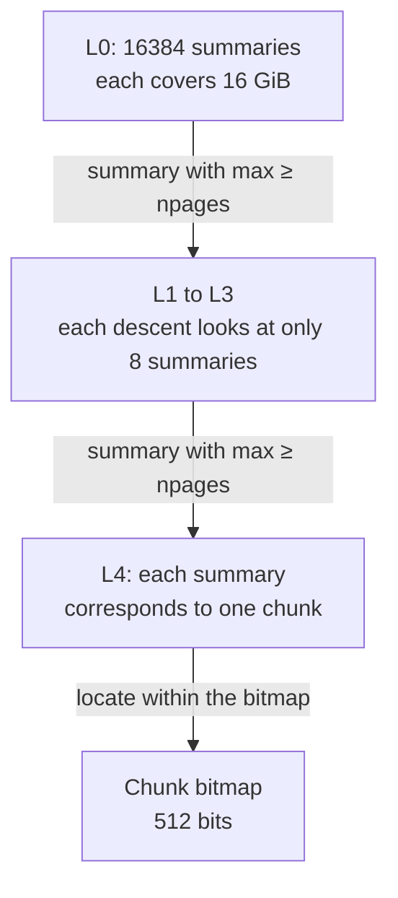

# 12.7 The Page Allocator

The runtime manages the heap in **pages** of 8 KiB. The page here is the runtime's own unit,
`pageSize`, which is not the same thing as the operating system's physical page, `physPageSize`
(commonly 4 KiB). A span consists of a run of contiguous pages ([12.2.1](./component.md)), and the
pages used by small-object spans, large objects, goroutine stacks and the collector's work buffers
all come from the **page allocator** inside the page heap. It records which pages belong to a span
and which are free, finds a long enough run of contiguous free pages on request, and takes pages
back when they are freed. A second responsibility of the page allocator is to hand the physical
memory behind long-idle pages back to the operating system, which the runtime calls **scavenging**.

The current page allocator is the result of a rewrite in Go 1.14: a bitmap records the state of
every page, a radix tree summarizes the bitmap, and each P gets a page cache that needs no lock
[[Knyszek and Clements, 2019](#ref-knyszek-clements-2019)]. This section first states the problem
the page allocator must solve and reviews the earlier treap-based implementation and its bottleneck.
It then covers bitmaps and summaries, search on the radix tree, allocation and freeing, and the page
cache. It ends with scavenging: the background and synchronous paths, the goal each pursues, and
what changes once a memory limit is set.

## 12.7.1 The Problem

The page allocator exposes two operations: `alloc(npages)` returns the start address of a contiguous
free run of `npages` pages, and `free(base, npages)` marks a run as free again. The difficulty is
that three requirements must hold at once.

First, the run must be contiguous, and the allocation policy must keep fragmentation under control.
Go's page allocator uses address-ordered **first fit**: among all free runs that are large enough,
it always picks the one with the lowest address ([12.2.4](./component.md)). This pushes allocated
pages toward low addresses and leaves larger free runs at high addresses; since scavenging starts
from high addresses, it has the least chance of interfering with allocation
[[Knyszek, 2019b](#ref-knyszek-2019b)].

Second, requests are frequent. Under garbage collection, objects die in units of collection cycles,
so many spans become empty in batches during sweeping, return to the page heap, and are requested
again soon after. The design document therefore conjectures that Go programs request memory from the
page allocator more often than programs using an allocator such as TCMalloc, which reuses objects
immediately after they are freed. In a Kubernetes load test, the most common object was about 1 KiB,
and roughly one allocation in ten had to enter the page heap; 99.89% of span requests were for
small-object spans [[Knyszek and Clements, 2019](#ref-knyszek-clements-2019)], and more than 85% of
page requests asked for exactly one page [[Knyszek, 2019c](#ref-knyszek-2019c)].

Third, many Ps request concurrently. The state of the page heap is protected by a single heap lock,
`mheap.lock` ([12.2.4](./component.md)), and the more frequent the requests and the larger
`GOMAXPROCS`, the worse the contention on that lock.

"Fast" for a page allocator therefore has two meanings: the lock should be held for a short time,
and the common case should ideally not need the lock at all. The Go 1.14 rewrite attacks both.

## 12.7.2 Before Go 1.14: Free Lists and the Treap

From Go 1.0 to 1.8, the page heap followed TCMalloc's organization ([12.1.2](./basic.md)). Free
spans hung on the lists of an array `free`, one list per page count, covering spans up to 1 MiB;
larger spans went on one further list (named `freelarge` in Go 1.8). The former is indexed directly
by page count, so insertion and removal take constant time; the latter could only be searched
linearly. As heaps approached 100 GB, the cost of the linear search became visible, and in Go 1.9
Hudson replaced that list with a treap: nodes form a binary search tree by key and a heap by
randomly assigned priority, so the tree stays balanced in a probabilistic sense and insertion and
deletion cost logarithmic time in expectation. The commit message estimated that supporting a 1 TiB
heap needs at most about a million nodes, with an ideal depth of 20, and that the depth observed in
experiments was about twice the ideal [[Hudson, 2017](#ref-hudson-2017)].

In Go 1.12, Knyszek removed the array of lists indexed by page count and put all free spans into the
treap to simplify the implementation [[Knyszek, 2018](#ref-knyszek-2018)]; scavenged spans went into
a separate treap. Go 1.13 merged the several treaps into one, keyed by the span's start address, and
recorded at each node the page count of the largest span in its subtree, which yields
address-ordered first fit. Because the tree is ordered by address, a right-to-left traversal
produces the order "scavenge from the highest address first" [[Knyszek, 2019a](#ref-knyszek-2019a)].

The problems with the treap surfaced around the release of Go 1.12 (Go issue #28479 and others). The
design document's analysis traces the root cause to the heap lock: every operation on the page heap
holds it, and lock barging had already been observed on it in Go 1.11, which shows that contention
was out of control before the 1.12 regression
[[Knyszek and Clements, 2019](#ref-knyszek-clements-2019)]. The work done under the lock was not
light either. In trace data from a 12-hour Kubernetes load test (Go 1.12.4), span allocation for the
first 50 size classes spent 4.0 µs on average per call inside the critical section. The depth of a
treap grows with the number of free runs; in a 20 GiB heap, one allocation may follow pointers down
about 20 levels, and a page allocation that costs about 100 ns on a small heap grows to more than 4
µs on a large one. A free performs one treap insertion, and merging with adjacent runs adds one or
two deletions.

The design document therefore proposes two changes: replace free spans with a bitmap that records
free pages, making the allocator itself faster and shortening lock hold times; and, on top of that,
let each P cache a portion of the free pages so that common requests need not acquire the heap lock
[[Knyszek and Clements, 2019](#ref-knyszek-clements-2019)].

## 12.7.3 Bitmaps and Summaries

The new page allocator has no notion of a "free span". It records page state in a bitmap with one
bit per page: 1 means in use (that is, part of some span) and 0 means free. The bitmap is sharded
into **chunks**, each covering 512 pages, or 4 MiB [[Go Authors, 2026a](#ref-go-authors-2026a)]:

```go
	// The size of a bitmap chunk, i.e. the amount of bits (that is, pages) to consider
	// in the bitmap at once. It is 4MB on most platforms, except on Wasm it is 512KB.
	// We use a smaller chuck size on Wasm for the same reason as the smaller arena
	// size (see heapArenaBytes).
	pallocChunkPages    = 1 << logPallocChunkPages
	pallocChunkBytes    = pallocChunkPages * pageSize
	logPallocChunkPages = 9*(1-goarch.IsWasm) + 6*goarch.IsWasm
```

On wasm a chunk has only 64 pages, or 512 KiB. The metadata of each chunk consists of two bitmaps of
equal length [[Go Authors, 2026b](#ref-go-authors-2026b)]:

```go
// pallocData encapsulates pallocBits and a bitmap for
// whether or not a given page is scavenged in a single
// structure. It's effectively a pallocBits with
// additional functionality.
//
// Update the comment on (*pageAlloc).chunks should this
// structure change.
type pallocData struct {
	pallocBits
	scavenged pageBits
}
```

`pallocBits` and `pageBits` are both `[8]uint64`, 64 bytes each. The former is the allocation
bitmap; the latter records which free pages have already been returned to the operating system, for
use by the scavenging discussed in 12.7.7. On a 64-bit platform with a 48-bit address space, laying
out the metadata of all chunks flat would take GiB-scale address space, so, like the arena index
([12.3.2](./init.md)), it is organized as a two-level sparse array. The first level of $2^{13}$
entries sits directly in the `pageAlloc` structure, and each entry points to a 1 MiB second-level
array holding $2^{13}$ chunks, allocated only when the heap grows into the corresponding address
range. These bitmaps are also protected by the heap lock; the source comment states "Protected by
mheapLock." The bitmap does not remove the heap lock. Its role is to make the work done under the
lock short and predictable.

The bitmap alone says only what state each page is in. Finding a run of contiguous free pages would
still mean scanning word by word, and the larger the heap, the slower the scan. The design document
attaches to each stretch of bitmap a **summary** that captures everything relevant to contiguous
free pages in three numbers: `start` is the number of contiguous free pages at the beginning, `end`
is the number at the end, and `max` is the length of the longest run of contiguous free pages
within. Take 16 pages whose states, from low to high address, are `0001100000111000`: `start` is 3,
`end` is 3 and `max` is 5.

The value of a summary is that summaries can be merged. For two adjacent regions A (lower address)
and B (higher address), each covering L pages, the summary of the combination can be computed from
the two summaries alone, without looking at the bitmap. The merged `start` is A.start unless A is
entirely free, in which case it is L + B.start; `end` is symmetric; and `max` is the largest of
A.max, B.max and A.end + B.start, the run that spans the boundary. `mergeSummaries` generalizes this
rule to any number of adjacent regions [[Go Authors, 2026a](#ref-go-authors-2026a)]:

```go
func mergeSummaries(sums []pallocSum, logMaxPagesPerSum uint) pallocSum {
	// Merge the summaries in sums into one.
	//
	// We do this by keeping a running summary representing the merged
	// summaries of sums[:i] in start, most, and end.
	start, most, end := sums[0].unpack()
	for i := 1; i < len(sums); i++ {
		// Merge in sums[i].
		si, mi, ei := sums[i].unpack()

		// Merge in sums[i].start only if the running summary is
		// completely free, otherwise this summary's start
		// plays no role in the combined sum.
		if start == uint(i)<<logMaxPagesPerSum {
			start += si
		}

		// Recompute the max value of the running sum by looking
		// across the boundary between the running sum and sums[i]
		// and at the max sums[i], taking the greatest of those two
		// and the max of the running sum.
		most = max(most, end+si, mi)

		// Merge in end by checking if this new summary is totally
		// free. If it is, then we want to extend the running sum's
		// end by the new summary. If not, then we have some alloc'd
		// pages in there and we just want to take the end value in
		// sums[i].
		if ei == 1<<logMaxPagesPerSum {
			end += 1 << logMaxPagesPerSum
		} else {
			end = ei
		}
	}
	return packPallocSum(start, most, end)
}
```

Stored naively, the three numbers take 12 or 24 bytes, neither of which fits neatly into a cache
line. The design document packs them into one `uint64`: each number takes 21 bits, 63 in all. The
21-bit limit comes from how the root level of the radix tree is divided (12.7.4): each summary at
the root level covers $2^{21}$ pages, or 16 GiB. A count must represent 0 through $2^{21}$, and the
latter would need a 22nd bit, but it occurs only when the whole region is free, where all three
numbers equal $2^{21}$; the remaining top bit is therefore used to represent that case alone
[[Go Authors, 2026a](#ref-go-authors-2026a)]:

```go
// pallocSum is a packed summary type which packs three numbers: start, max,
// and end into a single 8-byte value. Each of these values are a summary of
// a bitmap and are thus counts, each of which may have a maximum value of
// 2^21 - 1, or all three may be equal to 2^21. The latter case is represented
// by just setting the 64th bit.
type pallocSum uint64

// packPallocSum takes a start, max, and end value and produces a pallocSum.
func packPallocSum(start, max, end uint) pallocSum {
	if max == maxPackedValue {
		return pallocSum(uint64(1 << 63))
	}
	return pallocSum((uint64(start) & (maxPackedValue - 1)) |
		((uint64(max) & (maxPackedValue - 1)) << logMaxPackedValue) |
		((uint64(end) & (maxPackedValue - 1)) << (2 * logMaxPackedValue)))
}
```

The encoding has one more convenience: for a region that is entirely in use, the summary is
exactly 0. A search can skip it with one load and one comparison.

## 12.7.4 Search on the Radix Tree

The summaries are organized in levels into a tree: each summary in the leaf level summarizes one
chunk, and each summary in a higher level is merged from several adjacent summaries in the level
below. Each level corresponds to a range of address bits, so shifting an address right by different
amounts gives its index at each level, and the tree is in effect a **radix tree** keyed by address.
The fan-out of each level is set by `summaryLevelBits` [[Go Authors, 2026a](#ref-go-authors-2026a)]:

```go
	// The number of radix bits for each level.
	//
	// The value of 3 is chosen such that the block of summaries we need to scan at
	// each level fits in 64 bytes (2^3 summaries * 8 bytes per summary), which is
	// close to the L1 cache line width on many systems. Also, a value of 3 fits 4 tree
	// levels perfectly into the 21-bit pallocBits summary field at the root level.
	//
	// The following equation explains how each of the constants relate:
	// summaryL0Bits + (summaryLevels-1)*summaryLevelBits + logPallocChunkBytes = heapAddrBits
	//
	// summaryLevels is an architecture-dependent value defined in mpagealloc_*.go.
	summaryLevelBits = 3
	summaryL0Bits    = heapAddrBits - logPallocChunkBytes - (summaryLevels-1)*summaryLevelBits
```

The fan-out per level is 8, so the 8 summaries to inspect when descending one level take exactly 64
bytes, about one cache line. A leaf summary corresponds to $512 = 2^9$ pages, each of the four
levels above multiplies by 8, and one root summary corresponds to $2^{9+12} = 2^{21}$ pages, which
exactly exhausts the 21-bit count. On a 64-bit platform with a 48-bit address space the tree has 5
levels, and `summaryL0Bits` is 48 − 22 − 4 × 3 = 14:

| Level | Number of summaries | Address space covered by each summary |
| --- | --- | --- |
| L0 (root) | $2^{14}$ | 16 GiB |
| L1 | $2^{17}$ | 2 GiB |
| L2 | $2^{20}$ | 256 MiB |
| L3 | $2^{23}$ | 32 MiB |
| L4 (leaf) | $2^{26}$ | 4 MiB, one chunk |

On 32-bit platforms the tree has only 4 levels. The tree has no nodes linked by pointers; each level
is one large array, and the parent-child relation is implicit in the indices: entry $i$ at level $l$
corresponds to entries `i<<3` through `(i+1)<<3 - 1` at level $l+1$. The design document draws an
analogy with min-heaps: an implicit heap is stored as an array and an explicit one is linked by
pointers, and this tree is of the former kind. Traversing it involves only index arithmetic, with no
pointer chasing. The cost is address space: the array for each level is reserved at initialization
to cover the whole address space, and only the parts in use are mapped as the heap grows. By the
table above, the five levels hold 76693504 summaries of 8 bytes each, about 585 MiB in total; the
design document estimates about 600 MiB. This address space is only reserved and not mapped, so it
uses almost no physical memory, but it counts toward the process's virtual memory
([12.3.5](./init.md)).



The search is performed by `pageAlloc.find`. It starts at the root level and descends level by
level, scanning from left to right only within the group of summaries currently of interest
[[Go Authors, 2026a](#ref-go-authors-2026a)]:

```go
nextLevel:
	for l := 0; l < len(p.summary); l++ {
		// For the root level, entriesPerBlock is the whole level.
		entriesPerBlock := 1 << levelBits[l]
		logMaxPages := levelLogPages[l]

		// We've moved into a new level, so let's update i to our new
		// starting index. This is a no-op for level 0.
		i <<= levelBits[l]

		// Slice out the block of entries we care about.
		entries := p.summary[l][i : i+entriesPerBlock]
		// ……
		var base, size uint
		for j := j0; j < len(entries); j++ {
			sum := entries[j]
			if sum == 0 {
				// A full entry means we broke any streak and
				// that we should skip it altogether.
				size = 0
				continue
			}
			// ……
			s := sum.start()
			if size+s >= uint(npages) {
				// If size == 0 we don't have a run yet,
				// which means base isn't valid. So, set
				// base to the first page in this block.
				if size == 0 {
					base = uint(j) << logMaxPages
				}
				// We hit npages; we're done!
				size += s
				break
			}
			if sum.max() >= uint(npages) {
				// The entry itself contains npages contiguous
				// free pages, so continue on the next level
				// to find that run.
				i += j
				lastSumIdx = i
				lastSum = sum
				continue nextLevel
			}
			if size == 0 || s < 1<<logMaxPages {
				// We either don't have a current run started, or this entry
				// isn't totally free (meaning we can't continue the current
				// one), so try to begin a new run by setting size and base
				// based on sum.end.
				size = sum.end()
				base = uint(j+1)<<logMaxPages - size
				continue
			}
			// The entry is completely free, so continue the run.
			size += 1 << logMaxPages
		}
		// ……
```

During the scan the code maintains a "current run of contiguous free pages" (start `base`, length
`size`) and, for each summary in turn, distinguishes three cases. If the free pages accumulated so
far plus this summary's `start` are already long enough, the required run straddles the boundary and
its address can be computed directly, with no further descent. If this summary's own `max` is large
enough, the search enters the 8 summaries it corresponds to in the next level. Otherwise it begins a
new run from this summary's `end`; if this summary is entirely free, the whole summary is appended
to the current run. A full summary is skipped with one comparison. The root level has no parent to
bound its range, so the whole level forms one group, and the scan begins at the position of
`searchAddr`. If the scan reaches the end of the root level with nothing found, the heap contains no
sufficiently long run of contiguous free pages, and the caller then grows the heap (12.7.5).

`searchAddr` is the starting point of the search, and its invariant is written in the field comment
of `pageAlloc` [[Go Authors, 2026a](#ref-go-authors-2026a)]:

```go
	// The address to start an allocation search with. It must never
	// point to any memory that is not contained in inUse, i.e.
	// inUse.contains(searchAddr.addr()) must always be true. The one
	// exception to this rule is that it may take on the value of
	// maxOffAddr to indicate that the heap is exhausted.
	//
	// We guarantee that all valid heap addresses below this value
	// are allocated and not worth searching.
	searchAddr offAddr
```

First fit tends to fill low addresses, so there are no free pages below `searchAddr`, and the search
starts here. After an allocation, `find` returns a new, possibly higher starting point; if a freed
page lies below `searchAddr`, the starting point moves down accordingly. The design document points
out that without this hint, consecutive allocations would walk over the same full regions
repeatedly, and the total cost would be proportional to the product of heap size and the number of
allocations [[Knyszek and Clements, 2019](#ref-knyszek-clements-2019)]. `pageAlloc.alloc` also has a
shorter path: if the leaf summary of the chunk containing `searchAddr` shows enough free pages, it
searches the bitmap of that chunk directly, bypassing the level-by-level scan above.

Once the leaf level is reached, the search lands on the bitmap of one chunk. For a single-page
request, `find1` takes the 64-bit words one by one, finds the first word that is not all ones, and
locates the free bit with one `TrailingZeros64`. For a multi-page request, it must find $n$
contiguous free bits within a word, using `findBitRange64`
[[Go Authors, 2026b](#ref-go-authors-2026b)]. The following program reproduces it verbatim, except
that the runtime-internal `sys.TrailingZeros64` is replaced with its equivalent in `math/bits`:

```go {run=true}
package main

import (
	"fmt"
	"math/bits"
)

// findBitRange64 is taken from runtime/mpallocbits.go; only the source of TrailingZeros64 is replaced.
func findBitRange64(c uint64, n uint) uint {
	// This implementation is based on shrinking the length of
	// runs of contiguous 1 bits. We remove the top n-1 1 bits
	// from each run of 1s, then look for the first remaining 1 bit.
	p := n - 1   // number of 1s we want to remove.
	k := uint(1) // current minimum width of runs of 0 in c.
	for p > 0 {
		if p <= k {
			// Shift p 0s down into the top of each run of 1s.
			c &= c >> (p & 63)
			break
		}
		// Shift k 0s down into the top of each run of 1s.
		c &= c >> (k & 63)
		if c == 0 {
			return 64
		}
		p -= k
		// We've just doubled the minimum length of 0-runs.
		// This allows us to shift farther in the next iteration.
		k *= 2
	}
	// Find first remaining 1.
	// Since we shrunk from the top down, the first 1 is in
	// its correct original position.
	return uint(bits.TrailingZeros64(c))
}

func main() {
	// A 1 means free: pages 1 to 3, 7 to 9 and 12 to 15 are free.
	const c = 0b1111_0011_1000_1110
	for n := uint(1); n <= 5; n++ {
		if i := findBitRange64(c, n); i < 64 {
			fmt.Printf("%d contiguous pages: starting at page %d\n", n, i)
		} else {
			fmt.Printf("%d contiguous pages: not found\n", n)
		}
	}
}
```

The output is:

```
1 contiguous pages: starting at page 1
2 contiguous pages: starting at page 1
3 contiguous pages: starting at page 1
4 contiguous pages: starting at page 12
5 contiguous pages: not found
```

Here 1 means free, the opposite of the allocation bitmap's convention, because the caller inverts
the bitmap first. After `c &= c >> s`, bit $i$ is still 1 if and only if bits $i$ and $i+s$ were
both 1. As long as every gap of 0s between two runs of 1s is no shorter than $s$, this means bits
$i$ through $i+s$ are all 1, so each run of contiguous 1s shrinks by exactly $s$ bits from the top.
After the shrink, every run of 0s between two runs of 1s is also lengthened by at least $s$ bits, so
the first step can shift only 1 bit, and later steps can shift 2, 4 and so on, doubling each time.
Shrinking every run of 1s by $n-1$ bits therefore takes about $\log_2 n$ steps, and the lowest
remaining 1 is the start of the first run of contiguous free bits of length at least $n$.
`findSmallN` builds on this to handle runs that cross two adjacent words, and requests for more than
64 pages are handled by `findLargeN`, which counts by words.

Taken together, the work of one search has a clear upper bound: at most 4 levels below the root, at
most 8 summaries per level, and a final lookup within the 8 words of one chunk. The root-level scan
starts at `searchAddr`, and each full summary is skipped with one comparison. The height of the tree
does not change with the size of the heap, and every access lands on contiguous arrays. The design
document reports measurements from a prototype outside the runtime: starting from the heap layout of
a real program and allocating continuously, a page allocation without the page cache took about 680
ns on average, nearly independent of heap size, and with the page cache it dropped to 20 ns on
average [[Knyszek and Clements, 2019](#ref-knyszek-clements-2019)]. These are prototype figures, not
measurements of the current runtime. The Go 1.14 release notes summarize the real-world effect this
way: the page allocator is more efficient, lock contention is significantly reduced at high
`GOMAXPROCS`, and parallel, high-rate allocation of large blocks therefore has lower latency and
higher throughput [[Go Authors, 2020](#ref-go-authors-2020)].

## 12.7.5 Allocation, Freeing and Growth

Once an address is found, `allocRange` sets the corresponding bits in the bitmap to 1, counts how
many of those pages had been scavenged (these must be recommitted; see [12.3.4](./init.md)), and
then calls `update` to repair the summaries. `update` first recomputes the affected leaf summaries
and then merges upward level by level [[Go Authors, 2026a](#ref-go-authors-2026a)]:

```go
	// Walk up the radix tree and update the summaries appropriately.
	changed := true
	for l := len(p.summary) - 2; l >= 0 && changed; l-- {
		// Update summaries at level l from summaries at level l+1.
		changed = false

		// "Constants" for the previous level which we
		// need to compute the summary from that level.
		logEntriesPerBlock := levelBits[l+1]
		logMaxPages := levelLogPages[l+1]

		// lo and hi describe all the parts of the level we need to look at.
		lo, hi := addrsToSummaryRange(l, base, limit+1)

		// Iterate over each block, updating the corresponding summary in the less-granular level.
		for i := lo; i < hi; i++ {
			children := p.summary[l+1][i<<logEntriesPerBlock : (i+1)<<logEntriesPerBlock]
			sum := mergeSummaries(children, logMaxPages)
			old := p.summary[l][i]
			if old != sum {
				changed = true
				p.summary[l][i] = sum
			}
		}
	}
```

Once the summaries at one level stop changing, the higher levels cannot change either, and the loop
stops; if the leaf summaries do not change, `update` has already returned before entering this loop.
When one allocation spans several chunks, the chunks in the middle necessarily become entirely full
(or entirely empty on a free), and their leaf summaries are set directly to 0 or `freeChunkSum`;
only the chunks at the two ends need a bitmap scan to recompute.

Freeing mirrors allocation. `free` clears the corresponding bits in the bitmap: for a single page it
clears one bit, and otherwise it clears a range of bits per chunk; then it calls `update` in the
same way. Adjacent free runs need no explicit coalescing. They join naturally when the summaries are
recomputed, and `max`, `start` and `end` reflect the merged result accurately. The insertions and
deletions that every free required in the treap era shrink here to clearing some bits and updating
at most 5 levels of summaries along the tree. The design document also notes that the collector
frees spans in batches in address order during sweeping, so several frees within one chunk can
amortize the cost of updating the summaries
[[Knyszek and Clements, 2019](#ref-knyszek-clements-2019)].

When the page allocator cannot find a long enough free run, `mheap.allocSpan` calls `mheap.grow` to
enlarge the heap, and growth is always in whole chunks [[Go Authors, 2026d](#ref-go-authors-2026d)]:

```go
	// We must grow the heap in whole palloc chunks.
	// We call sysMap below but note that because we
	// round up to pallocChunkPages which is on the order
	// of MiB (generally >= to the huge page size) we
	// won't be calling it too much.
	ask := alignUp(npage, pallocChunkPages) * pageSize
```

Newly mapped memory is in the Prepared state and counted as scavenged ([12.3.4](./init.md)).
`pageAlloc.grow` accordingly allocates the second-level array of chunks on demand, sets all
`scavenged` bits of the new chunks to 1 (the comment reads "Newly-grown memory is always considered
scavenged."), and then updates the summaries as a free would, making this memory visible to later
searches.

## 12.7.6 The Per-P Page Cache

The bitmap and the radix tree shorten the time the lock is held but do not eliminate the heap lock.
Go 1.14 also added a page cache for each P, so that most page requests need no lock at all
[[Knyszek, 2019c](#ref-knyszek-2019c)]. [12.4.3](./largealloc.md) has explained that for requests of
fewer than 16 pages, `allocSpan` first tries the current P's page cache and obtains the span
structure from the `mspan` cache, which is also per-P. Without the latter, even though allocating
the pages needs no lock, obtaining an `mspan` from the `fixalloc` protected by the heap lock would
still require it. Here we look at the internal structure of the page cache
[[Go Authors, 2026b](#ref-go-authors-2026b)]:

```go
// pageCache represents a per-p cache of pages the allocator can
// allocate from without a lock. More specifically, it represents
// a pageCachePages*pageSize chunk of memory with 0 or more free
// pages in it.
type pageCache struct {
	base  uintptr // base address of the chunk
	cache uint64  // 64-bit bitmap representing free pages (1 means free)
	scav  uint64  // 64-bit bitmap representing scavenged pages (1 means scavenged)
}
```

A page cache covers a stretch of addresses aligned to 64 pages, and a 1 in `cache` means free, the
opposite of the global bitmap's convention. Allocating one page then takes a single
`TrailingZeros64`, and allocating several pages calls `findBitRange64` directly:

```go
func (c *pageCache) alloc(npages uintptr) (uintptr, uintptr) {
	if c.cache == 0 {
		return 0, 0
	}
	if npages == 1 {
		i := uintptr(sys.TrailingZeros64(c.cache))
		scav := (c.scav >> i) & 1
		c.cache &^= 1 << i // set bit to mark in-use
		c.scav &^= 1 << i  // clear bit to mark unscavenged
		return c.base + i*pageSize, uintptr(scav) * pageSize
	}
	return c.allocN(npages)
}
```

When the page cache is empty, `allocSpan` briefly acquires the heap lock and calls `allocToCache` to
refill it. It finds the lowest-addressed free page and takes the whole 64-page-aligned stretch
containing that page in one step: every free page in it, contiguous or not, is marked as used in the
global bitmap and handed to this P exclusively:

```go
		c = pageCache{
			base:  chunkBase(ci) + alignDown(uintptr(j), 64)*pageSize,
			cache: ^chunk.pages64(j),
			scav:  chunk.scavenged.block64(j),
		}
```

After the stretch is taken, `searchAddr` is advanced to the last page of its addresses. The design
document points out that fetching the first 64-bit group containing a free page is essentially the
same as allocating one page, since both look for the first free page in the heap, so refilling the
cache costs about as much as a single-page allocation
[[Knyszek and Clements, 2019](#ref-knyszek-clements-2019)].

The price of the page cache is fragmentation and visibility. Each P holds at most 64 pages, or 512
KiB, that no other P can use, so allocation is no longer strictly serial first fit; the design
document considers this fragmentation, which grows with the number of Ps, an acceptable cost. In
addition, pages in a cache are marked as used in the global bitmap, so the scavenger cannot see
them. At the end of each mark phase, `gcMarkTermination` flushes the page caches of idle Ps, and the
source comment gives the reason [[Go Authors, 2026d](#ref-go-authors-2026d)]:

```go
	// While we're here, flush the page cache for idle Ps to avoid
	// having pages get stuck on them. These pages are hidden from
	// the scavenger, so in small idle heaps a significant amount
	// of additional memory might be held onto.
```

When a P is destroyed (for example when `GOMAXPROCS` is reduced), `(*p).destroy` likewise returns
its page cache to the page allocator.

## 12.7.7 Scavenging Physical Memory

After pages are freed they remain mapped in the process, and their physical memory still counts
toward resident memory. The beginning of `mgcscavenge.go` explains what scavenging means and how it
proceeds [[Go Authors, 2026c](#ref-go-authors-2026c)]:

```go
// This file implements scavenging (the release of physical pages backing mapped
// memory) of free and unused pages in the heap as a way to deal with page-level
// fragmentation and reduce the RSS of Go applications.
//
// Scavenging in Go happens on two fronts: there's the background
// (asynchronous) scavenger and the allocation-time (synchronous) scavenger.
```

Scavenging is done through `sysUnused`; its implementation on each platform, and the choice between
`MADV_FREE` and `MADV_DONTNEED` on Linux, are covered in [12.3.4](./init.md). With Linux's default
settings, resident memory drops as soon as pages are scavenged, and when they are allocated again
the kernel fills them with zeros, which is why since Go 1.26 the runtime skips zeroing
([12.4.3](./largealloc.md)). More scavenging is not always better: each scavenge is a system call,
and using a scavenged page again incurs a page fault, so if a page just scavenged is soon allocated
again, both costs are paid for nothing.

Go 1.11 had only one periodic scavenging mechanism: every 2.5 minutes it checked and returned spans
unused for 5 minutes. It reacted too slowly to changes in memory use, and a process's peak resident
memory was far above its peak actual use. Go 1.12 added synchronous scavenging at heap growth, and
the Go 1.13 design proposed the framework that is still in use
[[Knyszek, 2019b](#ref-knyszek-2019b)]. The starting point of that design is an advantage Go has
over C/C++ allocators: the runtime knows that before the next collection begins, the heap will grow
to the heap goal ([13.3](../ch13gc/pacing.md)). Memory within the heap goal is therefore likely to
be used soon and not worth scavenging; only the excess is a candidate.

When no memory limit is set, the scavenging goal is defined as follows
[[Go Authors, 2026c](#ref-go-authors-2026c)]:

```go
// For the former, the goal is defined as:
//   (retainExtraPercent+100) / 100 * (heapGoal / lastHeapGoal) * lastHeapInUse
```

The heap goal is measured in bytes of objects, while resident memory is measured in pages, with
fragmentation inside spans between them. `heapGoal / lastHeapGoal` reflects how the heap scales, and
multiplying by `lastHeapInUse`, the pages actually in use at the end of the last collection,
accounts for that fragmentation. `retainExtraPercent` is 10, retaining an extra 10% of memory
unscavenged so that more allocations can land on memory that needs no page fault. The quantity
compared with the goal is `heapRetained`, the sum of heap memory in use and free but not scavenged,
which is the runtime's estimate of the resident memory occupied by the heap.

Background scavenging is carried out by the long-lived goroutine `bgscavenge`. At the end of each
sweep round, the last sweeper requests that it be woken, and sysmon does the waking on its behalf
([9.8](../../part3concurrency/ch09sched/sysmon.md)). Once awake, it repeatedly calls the scavenging
function, returning at most 64 KiB each time, until it has worked for a cumulative 1 ms or the goal
is reached; it then sleeps for a period proportional to the time it worked. The length of the sleep
is adjusted by a proportional-integral controller so that the CPU time spent on scavenging
approaches 1% of total CPU time (`scavengePercent`):

```go
	cpuFraction := worked / ((float64(slept) + worked) * float64(s.gomaxprocs()))
```

The denominator is multiplied by `GOMAXPROCS`, so the measure is relative to the time of all Ps
rather than one CPU. This is a Go 1.18 change; previously the target was 1% of one CPU. The same
release also replaced a series of ad hoc tuning mechanisms with the controller
[[Knyszek, 2021b](#ref-knyszek-2021b); [Knyszek, 2021c](#ref-knyszek-2021c)].

Scavenging proceeds from high addresses to low. Go 1.19 redesigned this part of the implementation
[[Knyszek, 2022](#ref-knyszek-2022)]: the page allocator maintains an index over the whole address
space, `scavengeIndex`, marking which chunks may contain scavengeable pages; the scavenger examines
candidate chunks from high to low, and when a page is freed the page allocator updates the index
immediately, making newly available scavengeable memory visible to all scavengers. Go 1.21 expanded
the single bit per chunk in the index into a record, `scavChunkData`, which includes the number of
pages in use and a generation count that `nextGen` increments at the end of each mark phase. This
enabled a density rule: a chunk whose occupancy reaches 96.875% (496 of 512 pages) during a
collection cycle takes no part in background scavenging or in scavenging at heap growth, in that
cycle or the next [[Knyszek and Pratt, 2023](#ref-knyszek-pratt-2023)]. The reason is that the heap
at the end of a collection cycle is often very dense, such chunks will soon be filled again, and
scavenging them only adds overhead and breaks up huge pages. The part of the same design that
explicitly marked huge pages was withdrawn in Go 1.22 because it caused long pauses
[[Knyszek, 2023](#ref-knyszek-2023)]; the density rule remains to this day.

The function that actually scavenges is `scavengeOne`. System calls can be slow, so it does not make
them while holding the heap lock [[Go Authors, 2026c](#ref-go-authors-2026c)]:

```go
			// Mark the range we're about to scavenge as allocated, because
			// we don't want any allocating goroutines to grab it while
			// the scavenging is in progress. Be careful here -- just do the
			// bare minimum to avoid stepping on our own scavenging stats.
			p.chunkOf(ci).allocRange(base, npages)
			p.update(addr, uintptr(npages), true, true)

			// With that done, it's safe to unlock.
			unlock(p.mheapLock)

			if !p.test {
				// Only perform sys* operations if we're not in a test.
				// It's dangerous to do so otherwise.
				sysUnused(unsafe.Pointer(addr), uintptr(npages)*pageSize)
				// ……
			}

			// Relock the heap, because now we need to make these pages
			// available allocation. Free them back to the page allocator.
			lock(p.mheapLock)
			if b := (offAddr{addr}); b.lessThan(p.searchAddr) {
				p.searchAddr = b
			}
			p.chunkOf(ci).free(base, npages)
			p.update(addr, uintptr(npages), true, false)

			// Mark the range as scavenged.
			p.chunkOf(ci).scavenged.setRange(base, npages)
			unlock(p.mheapLock)
```

It first marks the pages to be scavenged as used so that other goroutines cannot allocate them in
the meantime, then releases the heap lock and performs the system call, and finally reacquires the
lock, frees the pages back to the bitmap and records in the `scavenged` bitmap that they have been
scavenged. In the 2019 design document, scavenging still held the heap lock; now only the marking
and the restoring steps need it. `findScavengeCandidate`, which picks the candidate range, also
avoids splitting a free, unscavenged huge page: if the candidate range crosses the boundary of a
huge page, it is extended to cover the whole huge page.

Background scavenging proceeds at its own pace and may not keep up with the rate at which the
program creates scavengeable memory. After obtaining pages, `allocSpan` therefore also checks two
conditions and, if necessary, has the requester scavenge on the spot
[[Go Authors, 2026d](#ref-go-authors-2026d)]:

```go
	bytesToScavenge := uintptr(0)
	forceScavenge := false
	if limit := gcController.memoryLimit.Load(); !gcCPULimiter.limiting() {
		// Assist with scavenging to maintain the memory limit by the amount
		// that we expect to page in.
		inuse := gcController.mappedReady.Load()
		// Be careful about overflow, especially with uintptrs. Even on 32-bit platforms
		// someone can set a really big memory limit that isn't math.MaxInt64.
		if uint64(scav)+inuse > uint64(limit) {
			bytesToScavenge = uintptr(uint64(scav) + inuse - uint64(limit))
			forceScavenge = true
		}
	}
	if goal := scavenge.gcPercentGoal.Load(); goal != ^uint64(0) && growth > 0 {
		// We just caused a heap growth, so scavenge down what will soon be used.
		// By scavenging inline we deal with the failure to allocate out of
		// memory fragments by scavenging the memory fragments that are least
		// likely to be re-used.
		// ……
		if retained := heapRetained(); retained+uint64(growth) > goal {
			// ……
			todo := growth
			if overage := uintptr(retained + uint64(growth) - goal); todo > overage {
				todo = overage
			}
			if todo > bytesToScavenge {
				bytesToScavenge = todo
			}
		}
	}
```

The second condition corresponds to heap growth: the heap grew because no existing free run could
hold this request, and those fragments that did not fit are the memory least likely to be reused, so
the requester scavenges an amount comparable to the growth, offsetting the rise in resident memory
that growth causes. The first condition relates to the memory limit and is covered in 12.7.8.

Besides these two paths, `runtime/debug.FreeOSMemory` provides a forced path: it runs a full
collection and then calls `scavengeAll` to return all free pages, ignoring the density rule and not
bound by the 1% CPU budget. The following program observes this process through `runtime/metrics`,
where `/memory/classes/heap/free:bytes` is heap memory that is free but not scavenged and
`/memory/classes/heap/released:bytes` is heap memory returned to the operating system
([12.8](./mstats.md)):

```go {run=true}
package main

import (
	"fmt"
	"runtime"
	"runtime/debug"
	"runtime/metrics"
)

var sink [][]byte

// heap returns the heap memory that is free but not scavenged, and the heap
// memory returned to the operating system (GiB).
func heap() (free, released float64) {
	s := []metrics.Sample{
		{Name: "/memory/classes/heap/free:bytes"},
		{Name: "/memory/classes/heap/released:bytes"},
	}
	metrics.Read(s)
	return float64(s[0].Value.Uint64()) / (1 << 30), float64(s[1].Value.Uint64()) / (1 << 30)
}

func main() {
	for i := 0; i < 256; i++ {
		sink = append(sink, make([]byte, 1<<20)) // 256 MiB in total
	}
	sink = nil
	runtime.GC()
	free, released := heap()
	fmt.Printf("After GC: %.2f GiB free and not scavenged\n", free)

	debug.FreeOSMemory()
	free2, released2 := heap()
	fmt.Printf("After forced scavenging: %.2f GiB free and not scavenged, %.2f GiB newly scavenged\n", free2, released2-released)
}
```

The output is:

```
After GC: 0.25 GiB free and not scavenged
After forced scavenging: 0.00 GiB free and not scavenged, 0.25 GiB newly scavenged
```

When the collection ends, all 256 MiB have returned to the page allocator, but not one page has been
scavenged. The chunks holding these pages were full before the collection, so under the density rule
they stay invisible to the background scavenger until the mark phase of the next collection ends: if
you wait a few seconds after `runtime.GC()`, the free but unscavenged memory barely decreases; only
after another collection does the background scavenger return it, within a very short time.
`FreeOSMemory` ignores this rule and returns all of it immediately. After scavenging, free but
unscavenged memory is not strictly zero, only below 0.01 GiB: for example, free pages in the page
cache of a P that is still running are marked as used in the bitmap, and the scavenger cannot see
them (12.7.6).

## 12.7.8 Scavenging Under a Memory Limit

`GOMEMLIMIT` (or `debug.SetMemoryLimit`) sets a soft memory limit for the runtime, introduced in Go
1.19 [[Knyszek, 2021a](#ref-knyszek-2021a)]. Unlike similar interfaces in other languages that limit
only heap objects, this limit applies to all memory the runtime uses, including heap metadata,
fragmentation, and pages that are free but not yet scavenged. More frequent collection alone
therefore cannot maintain it, and the scavenger must take part. How the collector adjusts the heap
goal accordingly is covered in [13.3.3](../ch13gc/pacing.md); here we discuss only the scavenging
side.

Once a limit is set, scavenging gains a second goal [[Go Authors, 2026c](#ref-go-authors-2026c)]:

```go
// If a memory limit is set, then we wish to pick a scavenge goal that maintains
// that memory limit. For that, we look at total memory that has been committed
// (memstats.mappedReady) and try to bring that down below the limit. In this case,
// we want to give buffer space in the *opposite* direction. When the application
// is close to the limit, we want to make sure we push harder to keep it under, so
// if we target below the memory limit, we ensure that the background scavenger is
// giving the situation the urgency it deserves.
//
// In this case, the goal is defined as:
//    (100-reduceExtraPercent) / 100 * memoryLimit
```

`reduceExtraPercent` is 5, so the goal is 95% of the limit. The quantity compared with it is
`mappedReady`, all memory the runtime has committed (in the Ready state), which is on the same basis
as the limit. The buffer goes in the opposite direction from `retainExtraPercent`: with no limit,
10% extra is retained to reduce page faults; with a limit, 5% less is retained, so that when memory
approaches the limit the background scavenger does not stop exactly at the limit but keeps working.
Both goals are updated at the end of each collection cycle, and the background scavenger keeps
running as long as either goal has not been reached.

Note that the background scavenger's CPU budget does not grow as memory nears the limit; it is
always 1% of total CPU time. The design document once proposed using a proportional-integral
controller to raise this budget as memory approached the limit; the current implementation instead
has requesters share the work, which is the first condition of `allocSpan` in 12.7.7: if the pages
this request must recommit plus `mappedReady` would exceed the limit, the requester scavenges the
excess on the spot, and does so by force, ignoring the density rule. If heap growth also occurred,
the requester scavenges the larger of the two amounts, so both requirements are satisfied together.
The time requesters spend scavenging counts toward the collector's CPU limiter; while the limiter is
active, requesters no longer scavenge for the memory limit, and scavenging in progress stops early,
so that the program does not fall into a state where collection and scavenging consume all CPU and
it cannot make progress [[Knyszek, 2021a](#ref-knyszek-2021a)].

In environments with a fixed memory quota, such as containers, a common practice is to set
`GOMEMLIMIT` slightly below the quota, so that the runtime collects and scavenges proactively as it
approaches the quota instead of waiting to be killed by the system
[[Go Authors, 2022](#ref-go-authors-2022)].

## 12.7.9 Summary

The page allocator records in a bitmap whether each page belongs to a span, summarizes any stretch
of the bitmap with a three-number summary, and organizes the summaries in an implicit radix tree, so
that the work of finding contiguous free pages has an upper bound that does not vary with heap size.
It is still protected by the heap lock; the Go 1.14 rewrite shortened the time the lock is held, and
the per-P page cache together with the `mspan` cache lets most page requests proceed without it.
Scavenging has two paths: the background scavenger, on a 1% CPU budget, returns memory above the
goal from high addresses to low, and requesters scavenge on the spot when the heap grows or the
memory limit would be exceeded. The goal is derived from the heap goal, and once a memory limit is
set, a second goal based on the limit is added. The speed of allocation and the amount of resident
memory always pull against each other, and the design of the page allocator is a trade-off between
the two; the collector's side of the trade-off is in [Chapter 13](../ch13gc).

## Further Reading

- <a id="ref-go-authors-2020"></a>[Go Authors, 2020] The Go Authors. Go 1.14 Release Notes. 2020.
  https://go.dev/doc/go1.14 (the page allocator is "more efficient, with significantly reduced lock
  contention at high `GOMAXPROCS`")
- <a id="ref-go-authors-2022"></a>[Go Authors, 2022] The Go Authors. *A Guide to the Go Garbage
  Collector.* https://go.dev/doc/gc-guide (how `GOGC` and `GOMEMLIMIT` work together, and tuning)
- <a id="ref-go-authors-2026a"></a>[Go Authors, 2026a] The Go Authors. src/runtime/mpagealloc.go
  (pageAlloc, pallocSum, radix tree search find). Go 1.26 source.
  https://github.com/golang/go/blob/release-branch.go1.26/src/runtime/mpagealloc.go
- <a id="ref-go-authors-2026b"></a>[Go Authors, 2026b] The Go Authors. src/runtime/mpagecache.go,
  src/runtime/mpallocbits.go (per-P page cache, chunk bitmap pallocData, `findBitRange64`). Go 1.26
  source. https://github.com/golang/go/blob/release-branch.go1.26/src/runtime/mpagecache.go
- <a id="ref-go-authors-2026c"></a>[Go Authors, 2026c] The Go Authors. src/runtime/mgcscavenge.go
  (background and synchronous scavengers, derivation of the scavenging goals, `scavengeIndex`). Go
  1.26 source. https://github.com/golang/go/blob/release-branch.go1.26/src/runtime/mgcscavenge.go
- <a id="ref-go-authors-2026d"></a>[Go Authors, 2026d] The Go Authors. src/runtime/mheap.go
  (`allocSpan`, `grow`, `tryAllocMSpan`), src/runtime/mgc.go (`gcMarkTermination`),
  src/runtime/proc.go (`(*p).destroy`), src/runtime/mgcsweep.go. Go 1.26 source.
  https://github.com/golang/go/tree/release-branch.go1.26/src/runtime
- <a id="ref-hudson-2017"></a>[Hudson, 2017] Rick Hudson. runtime: redo insert/remove of large
  spans. Go commit 6e9ec14186, 2017. https://go.dev/cl/38732 Shipped in Go 1.9; fixes Go issue
  #19393.
- <a id="ref-knyszek-2018"></a>[Knyszek, 2018] Michael Anthony Knyszek. runtime: use only treaps for
  tracking spans. Go commit 07e738ec32, 2018. https://go.dev/cl/139837
  Shipped in Go 1.12.
- <a id="ref-knyszek-2019a"></a>[Knyszek, 2019a] Michael Anthony Knyszek. runtime: change the span
  allocation policy to first-fit. Go commit 40036a99a0, 2019. https://go.dev/cl/164101
  Shipped in Go 1.13.
- <a id="ref-knyszek-2019b"></a>[Knyszek, 2019b] Michael Knyszek. Proposal: Smarter Scavenging. Go
  design document, 2019.
  https://go.googlesource.com/proposal/+/master/design/30333-smarter-scavenging.md
- <a id="ref-knyszek-2019c"></a>[Knyszek, 2019c] Michael Anthony Knyszek. runtime: add per-p page
  allocation cache. Go commit a2cd2bd55d, 2019. https://go.dev/cl/195701
  Shipped in Go 1.14.
- <a id="ref-knyszek-clements-2019"></a>[Knyszek and Clements, 2019] Michael Knyszek, Austin
  Clements. Proposal: Scaling the Go page allocator. Go design document, 2019.
  https://go.googlesource.com/proposal/+/master/design/35112-scaling-the-page-allocator.md (the Go
  1.14 page allocator rewrite, bitmap plus radix tree)
- <a id="ref-knyszek-2021a"></a>[Knyszek, 2021a] Michael Knyszek. Proposal: Soft memory limit. Go
  design document, 2021.
  https://go.googlesource.com/proposal/+/master/design/48409-soft-memory-limit.md (`GOMEMLIMIT`, Go
  1.19)
- <a id="ref-knyszek-2021b"></a>[Knyszek, 2021b] Michael Anthony Knyszek. runtime: use a controller
  to control the scavenge rate. Go commit e48e4b4cbb, 2021. https://go.dev/cl/353975 Shipped in Go
  1.18.
- <a id="ref-knyszek-2021c"></a>[Knyszek, 2021c] Michael Anthony Knyszek. runtime: pace the
  scavenger according to 1% of overall CPU time. Go commit 6f32d2050d, 2021.
  https://go.dev/cl/358675 Shipped in Go 1.18.
- <a id="ref-knyszek-2022"></a>[Knyszek, 2022] Michael Anthony Knyszek. runtime: redesign scavenging
  algorithm. Go commit 91f863013e, 2022. https://go.dev/cl/399474
  Shipped in Go 1.19.
- <a id="ref-knyszek-2023"></a>[Knyszek, 2023] Michael Anthony Knyszek. runtime: avoid MADV_HUGEPAGE
  for heap memory. Go commit 9f9bb26880, 2023. https://go.dev/cl/516795 Shipped in Go 1.22.
- <a id="ref-knyszek-pratt-2023"></a>[Knyszek and Pratt, 2023] Michael Knyszek, Michael Pratt. A
  more hugepage-aware Go heap. Go design document, 2023.
  https://go.googlesource.com/proposal/+/master/design/59960-heap-hugepage-util.md
- This book: [12.2 Components](./component.md),
  [9.8 System Monitoring](../../part3concurrency/ch09sched/sysmon.md) (waking the scavenger),
  [Chapter 13 Garbage Collector](../ch13gc).
- This book: [12.3 Initialization](./init.md) (the four states of the address space and
  `sysUnused`), [12.4 Large Object Allocation](./largealloc.md) (conditions for using the page
  cache), [13.3 Trigger Frequency and the Pacing Algorithm](../ch13gc/pacing.md) (heap goal and
  memory limit).
