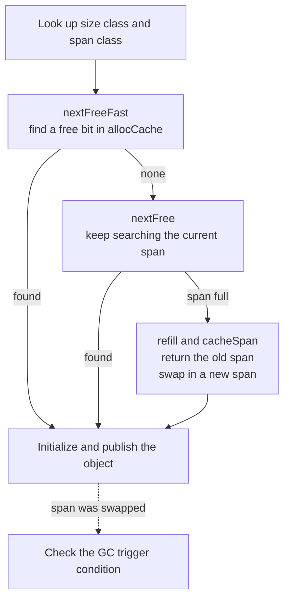

# 12.5 Small Object Allocation

A **small object** is one managed by size classes. Objects without pointers qualify from 16 bytes up
(smaller ones go to the tiny allocator, [12.6](./tinyalloc.md)); objects with pointers qualify at
any size; the upper limit in both cases is 32760 bytes. Depending on whether the object contains
pointers and whether it needs an allocation header, `mallocgc` dispatches to one of three functions
([12.1.4](./basic.md)): `mallocgcSmallNoscan`, `mallocgcSmallScanNoHeader` and
`mallocgcSmallScanHeader`. All three share one skeleton: compute the size class from the size, take
a free slot from the current span in the local cache, swap in a span from the central cache when
none is left, and finally initialize the object so that the collector can safely see it. This
section follows that skeleton, using the pointer-free version as the main line and noting where the
pointer-carrying versions differ. It ends with how slots are reused after a collection.



## 12.5.1 From Size to Size Class

The following is the beginning of `mallocgcSmallNoscan`
[[Go Authors, 2026a](#ref-go-authors-2026a)]:

```go
func mallocgcSmallNoscan(size uintptr, typ *_type, needzero bool) (unsafe.Pointer, uintptr) {
	// Set mp.mallocing to keep from being preempted by GC.
	mp := acquirem()
	// ...
	mp.mallocing = 1

	checkGCTrigger := false
	c := getMCache(mp)
	var sizeclass uint8
	if size <= gc.SmallSizeMax-8 {
		sizeclass = gc.SizeToSizeClass8[divRoundUp(size, gc.SmallSizeDiv)]
	} else {
		sizeclass = gc.SizeToSizeClass128[divRoundUp(size-gc.SmallSizeMax, gc.LargeSizeDiv)]
	}
	size = uintptr(gc.SizeClassToSize[sizeclass])
	spc := makeSpanClass(sizeclass, true)
	span := c.alloc[spc]
	// ...
```

`acquirem` increments the lock count of the current M, and `mallocing` marks the M as allocating.
Either one makes `canPreemptM` return false; both cooperative preemption (`newstack`) and
asynchronous preemption (`isAsyncSafePoint`) consult it, so a goroutine is never preempted in the
middle of an allocation ([9.7](../../part3concurrency/ch09sched/preemption.md)). This is required:
the local cache belongs to the P, so if a goroutine were preempted midway and resumed on another P,
the `c` in its hand would no longer be its own. The comment on `nextFree` demands a non-preemptible
context for the same reason.

Size classes are looked up in two tables. Requests of at most 1016 bytes are rounded in steps of 8
bytes and index the 129-entry `SizeToSizeClass8`. Larger requests have 1024 subtracted and are
rounded in steps of 128 bytes, indexing the 249-entry `SizeToSizeClass128`; a request of 1017 to
1024 bytes wraps around in unsigned arithmetic after the subtraction, and rounding up gives exactly
entry 0, the 1024-byte class. `mksizeclasses.go` fills both tables by finding the size class of the
upper bound of each step [[Go Authors, 2026d](#ref-go-authors-2026d)]. Size classes below 1024 bytes
are multiples of 8 and those above are multiples of 128, so all requests within one step land in the
same size class and the lookup is exact; using two step widths keeps both tables within a few
hundred bytes. The divisor of `divRoundUp` is a power-of-two constant, and a source comment notes
that the compiler optimizes the division away, leaving one addition and one shift.
`mallocgcSmallScanNoHeader` handles only objects of at most 512 bytes, so it consults only the first
table. `makeSpanClass` shifts the size class left by one bit and records in the lowest bit whether
the object is pointer-free, so the 68 size classes yield 136 span classes; the `alloc` array of the
local cache is indexed by span class ([12.2.2](./component.md)).

The table lookup solves the problem of finding the size class from a size. The opposite computation
is just as frequent: given an address inside a span, find which object it belongs to. A pointer that
the collector meets during marking may point into the interior of an object, and it must compute the
object index before it can find the mark bit; the same computation is needed when a new object is
allocated black and when `runtime.Pinner` pins an object. The index is the offset of the address
from the start of the span divided by the object size, and integer division is much slower than
multiplication. `mspan.divideByElemSize` replaces the division with one multiplication and one shift
[[Go Authors, 2026c](#ref-go-authors-2026c)]:

```go
	// See explanation in mksizeclasses.go's computeDivMagic.
	q := uintptr((uint64(n) * uint64(s.divMul)) >> 32)
```

Here `divMul` comes from the `SizeClassToDivMagic` table and equals ⌊(2³² − 1)/d⌋ + 1, where d is
the object size. For 48-byte objects the magic number is 89478486, and the object at offset 4800 has
index (4800 × 89478486) >> 32 = 100. Multiplying instead of dividing is exact only when the dividend
stays within a certain range. Lemire, Kaser and Kurz give a bound on the number of fractional bits
required [[Lemire et al., 2019](#ref-lemire-2019)]. Based on that bound, `mksizeclasses.go` confirms
that 32 bits suffice for every size class, and then checks every offset from 0 to the span length to
verify that the multiplication gives the same result as true division; any mismatch fails the
generation [[Go Authors, 2026e](#ref-go-authors-2026e)]. Before Go 1.17 the computation branched on
whether the object size was a power of two and used three parameters, `divShift`, `divMul` and
`divShift2`, to shift, multiply and shift again. Dempsky used the bound above to turn it into a
single unconditional multiplication, which reduced the geometric mean of compiler benchmark times by
1.6% [[Dempsky, 2021](#ref-dempsky-2021)].

## 12.5.2 The Fast Path: nextFreeFast

`span` is the current span that the local cache keeps for this span class. The allocator first tries
`nextFreeFast` [[Go Authors, 2026a](#ref-go-authors-2026a)]:

```go
// nextFreeFast returns the next free object if one is quickly available.
// Otherwise it returns 0.
func nextFreeFast(s *mspan) gclinkptr {
	theBit := sys.TrailingZeros64(s.allocCache) // Is there a free object in the allocCache?
	if theBit < 64 {
		result := s.freeindex + uint16(theBit)
		if result < s.nelems {
			freeidx := result + 1
			if freeidx%64 == 0 && freeidx != s.nelems {
				return 0
			}
			s.allocCache >>= uint(theBit + 1)
			s.freeindex = freeidx
			s.allocCount++
			return gclinkptr(uintptr(result)*s.elemsize + s.base())
		}
	}
	return 0
}
```

`allocCache` is the complement of 64 bits of `allocBits` starting at `freeindex`, and its lowest bit
corresponds to the slot `freeindex` points to ([12.2.1](./component.md))
[[Hudson, 2016a](#ref-hudson-2016a)]. `TrailingZeros64` finds the lowest 1 bit, which is the
distance from `freeindex` to the next free slot. The compiler turns it into one or two instructions:
`RBIT` and `CLZ` on arm64; `BSFQ` plus a conditional move on amd64, or `TZCNTQ` directly with
`GOAMD64=v3` and above; `i64.ctz` on wasm [[Go Authors, 2026g](#ref-go-authors-2026g)]. Once the
function has confirmed that the slot found lies within `nelems`, it shifts the cache right to
discard the allocated bits, advances `freeindex` and `allocCount`, and computes the object address
as "index × slot size + base".

Two of the checks need explanation. The first is `result < s.nelems`: the cache is loaded 8 bytes at
a time, so the last window may contain bits beyond `nelems`, and a field comment in `mspan` states
that callers must ignore them. The second concerns the window boundary: if the slot just allocated
is the last one in a 64-bit window, the cache is exhausted and the next chunk must be loaded from
`allocBits`. `nextFreeFast` does not load it itself. It returns 0 and leaves this case, together
with the empty-cache case, to the slow path. This is a deliberate trade-off: the original version
called `refillAllocCache` here, which pushed the function past the compiler's inlining limits in
size and complexity; only after Hudson moved this case to the slow path could `nextFreeFast` be
inlined [[Hudson, 2016c](#ref-hudson-2016c)]. In Go 1.26 it is inlined at the four call sites in
`malloc.go`, namely the tiny allocator and the three small-object allocation functions:

```shell
$ cd $(go env GOROOT)/src/runtime
$ go build -gcflags=-m 2>&1 | grep -oE 'malloc\.go:.*nextFreeFast$'
malloc.go:969:6: can inline nextFreeFast
malloc.go:1277:19: inlining call to nextFreeFast
malloc.go:1395:19: inlining call to nextFreeFast
malloc.go:1527:19: inlining call to nextFreeFast
malloc.go:1625:19: inlining call to nextFreeFast
```

Before the bitmap replaced the free list, this step looked like this
[[Go Authors, 2016](#ref-go-authors-2016)]:

```go
			v := s.freelist
			if v.ptr() == nil {
				systemstack(func() {
					c.refill(int32(sizeclass))
				})
				shouldhelpgc = true
				s = c.alloc[sizeclass]
				v = s.freelist
			}
			s.freelist = v.ptr().next
			s.ref++
			// prefetchnta offers best performance, see change list message.
			prefetchnta(uintptr(v.ptr().next))
```

Unlinking the list head also takes only a few lines, but the cost lies in reading `v.ptr().next`:
the address of the next free block is stored inside the current free block, free blocks are
scattered across the span, and the accessed addresses are hard to predict and hard to hit in the
cache. Hudson prefetched the next free block on every allocation to counter this, which gained about
1% on the garbage benchmark [[Hudson, 2015](#ref-hudson-2015)]; Clements's design document measured
that 14% to 19% of the time in `mallocgc` went to walking the free list
[[Clements, 2015](#ref-clements-2015)]. In the bitmap scheme, `allocCache` and `freeindex` both live
in the `mspan` structure, so allocation touches metadata that was just used, and finding a free slot
is bit arithmetic in registers. When the series of changes that allocate directly from the bitmap
[[Hudson, 2016b](#ref-hudson-2016b)] was merged into the main branch, the garbage benchmark's
running time dropped by 3.9% [[Hudson, 2016d](#ref-hudson-2016d)].

## 12.5.3 The Slow Path: nextFree

When `nextFreeFast` returns 0, the allocator calls `nextFree`; the consistency checks are omitted
below [[Go Authors, 2026a](#ref-go-authors-2026a)]:

```go
func (c *mcache) nextFree(spc spanClass) (v gclinkptr, s *mspan, checkGCTrigger bool) {
	s = c.alloc[spc]
	checkGCTrigger = false
	freeIndex := s.nextFreeIndex()
	if freeIndex == s.nelems {
		// The span is full.
		// ...
		c.refill(spc)
		checkGCTrigger = true
		s = c.alloc[spc]

		freeIndex = s.nextFreeIndex()
	}
	// ...
	v = gclinkptr(uintptr(freeIndex)*s.elemsize + s.base())
	s.allocCount++
	// ...
	return
}
```

`nextFreeIndex` is the complete version of `nextFreeFast`
[[Go Authors, 2026c](#ref-go-authors-2026c)]. When the cache is all zeros, it advances `freeindex`
to the start of the next 64-bit window and reloads the cache, until it finds a free bit or reaches
the end of the span. If the slot it hands out is the last one in a window, it also loads the next
chunk, which is exactly the case `nextFreeFast` declines to handle. Since `freeindex` only grows,
allocating a whole span from start to end between two sweeps loads the cache at most as many times
as the span has 64-bit windows, a constant amortized over the allocations.

When `nextFreeIndex` returns `nelems`, the span is full, and only then is `refill` called to hand
back the current span and have the central cache swap in one with free slots
([12.2.2](./component.md), [12.2.3](./component.md)). If the span swapped in is new, this path runs
only once per filled span: a span of the 48-byte size class holds about 170 slots, while one of the
1024-byte size class holds only 8. Only after this path does `checkGCTrigger` become true, and at
the end of the allocation the allocator checks whether a new collection cycle should start
([12.1.5](./basic.md)).

The span handed over need not start allocating from the beginning, and `freeindex` need not be a
multiple of 64. For example, when sweeping a full span that awaits sweeping yields free slots,
`cacheSpan` sets `freeindex` to the index of the first free slot after the sweep. Hence `cacheSpan`
must align the cache with `freeindex` before handing the span out
[[Go Authors, 2026b](#ref-go-authors-2026b)]:

```go
	freeByteBase := s.freeindex &^ (64 - 1)
	whichByte := freeByteBase / 8
	// Init alloc bits cache.
	s.refillAllocCache(whichByte)

	// Adjust the allocCache so that s.freeindex corresponds to the low bit in
	// s.allocCache.
	s.allocCache >>= s.freeindex % 64
```

It first loads the whole window that contains `freeindex`, then shifts right by `freeindex % 64`
bits so that the lowest bit of the cache corresponds to `freeindex`. A span newly requested from the
page heap needs no loading: `initSpan` sets the cache to all ones directly, meaning every slot is
free [[Go Authors, 2026f](#ref-go-authors-2026f)].

## 12.5.4 After a Slot Is Obtained

Once a slot is obtained, `mallocgcSmallNoscan` still has to zero it, publish it, mark it and sample
it. The part omitted at the beginning, under `GOEXPERIMENT=runtimefreegc`, first checks the local
cache for an object that can be reused; this experiment is off by default in Go 1.26
([12.9](./history.md)). The rest is as follows [[Go Authors, 2026a](#ref-go-authors-2026a)]:

```go
	v := nextFreeFast(span)
	if v == 0 {
		v, span, checkGCTrigger = c.nextFree(spc)
	}
	x := unsafe.Pointer(v)
	if needzero && span.needzero != 0 {
		memclrNoHeapPointers(x, size)
	}

	// Ensure that the stores above that initialize x to
	// type-safe memory and set the heap bits occur before
	// the caller can make x observable to the garbage
	// collector. Otherwise, on weakly ordered machines,
	// the garbage collector could follow a pointer to x,
	// but see uninitialized memory or stale heap bits.
	publicationBarrier()

	if writeBarrier.enabled {
		// Allocate black during GC.
		// All slots hold nil so no scanning is needed.
		// This may be racing with GC so do it atomically if there can be
		// a race marking the bit.
		gcmarknewobject(span, uintptr(x))
	} else {
		// Track the last free index before the mark phase. This field
		// is only used by the garbage collector. During the mark phase
		// this is used by the conservative scanner to filter out objects
		// that are both free and recently-allocated. It's safe to do that
		// because we allocate-black if the GC is enabled. The conservative
		// scanner produces pointers out of thin air, so without additional
		// synchronization it might otherwise observe a partially-initialized
		// object, which could crash the program.
		span.freeIndexForScan = span.freeindex
	}

	// Note cache c only valid while m acquired; see #47302
	// ...
	c.nextSample -= int64(size)
	if c.nextSample < 0 || MemProfileRate != c.memProfRate {
		profilealloc(mp, x, size)
	}
	mp.mallocing = 0
	releasem(mp)

	if checkGCTrigger {
		if t := (gcTrigger{kind: gcTriggerHeap}); t.test() {
			gcStart(t)
		}
	}
	return x, size
}
```

Zeroing comes first. `span.needzero` records whether the memory in the span may be nonzero
([12.4.3](./largealloc.md)); for a pointer-free object, the `needzero` passed by the caller also
matters. When `growslice` grows a slice of pointer-free elements it passes `false`, because `append`
immediately overwrites the part from the old length to the new length and `growslice` clears only
the part after that; the memory allocated by `slicebytetostring` is likewise filled at once by
`memmove` [[Go Authors, 2026g](#ref-go-authors-2026g)]. Objects with pointers must be zeroed, and
`mallocgc` throws an error if asked for the opposite. A comment in `growslice` gives the reason:
otherwise the collector might scan uninitialized memory.

An object with pointers must also record which words are pointers ([12.1.4](./basic.md)). After
zeroing, `mallocgcSmallScanNoHeader` calls `heapSetTypeNoHeader` to write the type's pointer mask
into the heap bitmap at the end of the span. An object is at most 512 bytes, that is, at most 64
words, so it occupies no more than one word of bitmap, and the write touches at most two adjacent
words [[Go Authors, 2026c](#ref-go-authors-2026c)]. The 8-byte size class 1 on 64-bit platforms is
an exception: an object with pointers in this class has only one word, which must be a pointer, so
`initHeapBits` has already set the whole bitmap to 1 when the span is initialized and nothing needs
to be written at allocation time. `mallocgcSmallScanHeader` adds 8 bytes to the size before the
table lookup, writes the type pointer into the first word of the slot, and returns the address after
it to the caller.

Next comes the publication barrier. After receiving the object, the caller writes its address
somewhere, for example into a global variable; from that moment the collector, running on another
thread, may follow the pointer to it. On processors with weak memory ordering
([11.9](../../part3concurrency/ch11sync/mem.md)), the writes that initialize the object and the
write that publishes the address could be reordered, and the collector would see memory that has not
been zeroed or a stale heap bitmap. `publicationBarrier` guarantees that writes before the barrier
are observed by other processors before the writes after it. On arm64 it is a `DMB ST` instruction;
x86 guarantees write order by itself, so the amd64 implementation is only a `RET`, whose sole
purpose is to keep the compiler from reordering; on wasm it is likewise a `RET`
[[Go Authors, 2026g](#ref-go-authors-2026g)]. The reading side needs no corresponding barrier; a
comment in `stubs.go` notes that every architecture Go supports guarantees the ordering of data
dependencies.

Then marking. While the collector is marking, the write barrier is enabled and a new object is
marked immediately, so objects are "allocated black": the object has just been zeroed, holds no
non-nil pointers and needs no scanning, and it is marked only so that this cycle does not treat it
as garbage; if its span uses the inline mark bits of the Green Tea collector, its scan bit is set as
well ([13.11](../ch13gc/greentea.md)). Outside the mark phase, the allocator updates
`freeIndexForScan`, a field that serves conservative scanning. A stack frame interrupted by
asynchronous preemption has no precise pointer information
([9.7](../../part3concurrency/ch09sched/preemption.md), [13.7.4](../ch13gc/safe.md)), so the
collector can only treat every pointer-like value in it as a pointer, and such a value may happen to
point to a slot that was just allocated and is not yet initialized. `scanConservative` filters such
values with `isFreeOrNewlyAllocated`: a slot whose index is not below `freeIndexForScan` and which
was free at the last sweep is either still free or an object allocated after marking began, and the
latter has already been marked black, so both cases can be skipped
[[Go Authors, 2026f](#ref-go-authors-2026f)]. `freeindex` moves forward as soon as a slot is taken,
at which point the object has not been zeroed and the heap bitmap has not been written;
`freeIndexForScan` is updated only after initialization and the publication barrier. Before Go 1.20
the scanner judged directly by `freeindex` and could scan an uninitialized object during concurrent
allocation; the memory corruption in compress/flate reported in issue #54596 was related to this.
Mui gave the scanner a field of its own [[Mui, 2022](#ref-mui-2022)].

The last two steps: `nextSample` decreases by the number of bytes allocated, and when it drops below
zero a memory profile sample is recorded ([16.5](../../part5toolchain/ch16tools/perf.md)); the
#47302 mentioned in the comment is discussed in [12.4.2](./largealloc.md). If this allocation
swapped in a span, the allocator checks the GC trigger condition after preemption is allowed again.

## 12.5.5 Reclaiming and Reusing Slots

Slots are freed only during sweeping. When sweeping a span ([13.5](../ch13gc/sweep.md)), the runtime
replaces the allocation bits with this cycle's mark bits and resets `freeindex` to zero
[[Go Authors, 2026f](#ref-go-authors-2026f)]:

```go
	s.allocCount = nalloc
	s.freeindex = 0 // reset allocation index to start of span.
	s.freeIndexForScan = 0
	// ...

	// gcmarkBits becomes the allocBits.
	// get a fresh cleared gcmarkBits in preparation for next GC
	s.allocBits = s.gcmarkBits
	s.gcmarkBits = newMarkBits(uintptr(s.nelems))
	// ...

	// Initialize alloc bits cache.
	s.refillAllocCache(0)
```

After that, allocation in this span starts again at the first slot and fills the holes left by dead
objects in increasing address order, skipping live objects. Between two sweeps no slot is freed: a
slot before `freeindex` is either still alive or dead but not yet swept, and the allocator never
goes back to use it. Objects that the compiler frees explicitly under the `runtimefreegc` experiment
are reused through a separate table in the local cache, and `allocBits` is still rewritten only by
the sweeper ([12.9](./history.md)).

The following program allocates 80 pointer-free objects of 112 bytes, which fall into size class 9,
then frees the odd-numbered ones, calls `runtime.GC()`, and allocates 4 more objects of the same
size. `runtime.GC()` finishes the sweep of the current cycle before returning; a source comment says
this is both to complete the whole cycle and because tests and benchmarks often use it to bring the
system into a relatively stable state [[Go Authors, 2026f](#ref-go-authors-2026f)]. The program sets
`GOMAXPROCS` to 1: with several Ps, which P continues running `main` after the collection and which
span that P's local cache already holds are both uncertain, so the new objects need not land in the
span that holds these objects.

```go {run=true}
package main

import (
	"fmt"
	"runtime"
	"slices"
	"unsafe"
)

const size = 112 // falls in size class 9; []byte has no pointers

var objs [80][]byte

func addr(b []byte) uintptr { return uintptr(unsafe.Pointer(&b[0])) }

func main() {
	runtime.GOMAXPROCS(1) // one P: the same mcache before and after the GC
	for i := range objs {
		objs[i] = make([]byte, size)
	}
	fmt.Print("consecutive allocations, address differences: ")
	for i := 73; i < 80; i++ {
		fmt.Print(addr(objs[i])-addr(objs[i-1]), " ")
	}
	fmt.Println()

	var freed []uintptr
	for i := 1; i < len(objs); i += 2 {
		freed = append(freed, addr(objs[i]))
		objs[i] = nil // free the odd-numbered objects
	}
	runtime.GC()

	var again [4][]byte
	for i := range again {
		again[i] = make([]byte, size)
	}
	fmt.Print("after the GC, address differences: ")
	reused := true
	for i, b := range again {
		if i > 0 {
			fmt.Print(addr(b)-addr(again[i-1]), " ")
		}
		reused = reused && slices.Contains(freed, addr(b))
	}
	fmt.Println("\nall new objects sit where freed objects were:", reused)
	runtime.KeepAlive(&objs)
}
```

The output is as follows:

```
consecutive allocations, address differences: 112 112 112 112 112 112 112 
after the GC, address differences: 224 224 224 
all new objects sit where freed objects were: true
```

Consecutively allocated objects are 112 bytes apart and occupy adjacent slots. After the collection,
the 4 new objects are 224 bytes apart: each skips one live object and lands in a freed slot. The
span of the new objects still has never-allocated slots at its end; they come after the freed slots
and are therefore used later.

## 12.5.6 Cost

On the fast path, obtaining a slot takes one table lookup, one trailing-zero count, one shift and
one multiply-add; no lock is taken, and `nextFreeFast` is inlined. The fast path of TCMalloc
likewise takes no lock [[Ghemawat and Menage, 2005](#ref-ghemawat-menage-2005)]; the current
TCMalloc can also cache per CPU rather than per thread, using Linux restartable sequences (rseq) to
access the per-CPU caches without locks or atomic instructions
[[TCMalloc Authors, 2026](#ref-tcmalloc-authors-2026)]. Go's local cache belongs to a P, and only
one M holds a P at a time, so no such mechanism is needed ([12.2.2](./component.md)). The cost of
the slow path is amortized per span: swapping in a span accesses the central cache's sets with
atomic operations, may sweep the span on the spot, or requests new pages through the page heap
([12.7](./pagealloc.md)), and the swap also takes on a proportional share of sweeping work
([13.5](../ch13gc/sweep.md)). The deeper the path goes, the more expensive the synchronization and
the less often it is reached. This follows the same reasoning as the scheduler keeping a local run
queue per P ([9.2](../../part3concurrency/ch09sched/steal.md)) and `sync.Pool` sharding per P
([11.6](../../part3concurrency/ch11sync/pool.md)): shared state is accessed only when local
resources run out.

A single allocation is therefore rarely the bottleneck; the cost of allocation shows up mainly in
collection. The bytes allocated drive the heap toward the collection trigger
([13.3](../ch13gc/pacing.md)); live objects must be marked, dead slots swept, and objects with
pointers scanned word by word. Reducing the number and the bytes of allocations is more effective
than speeding up a single allocation: escape analysis keeps non-escaping objects on the stack
([15.5](../../part5toolchain/ch15compile/escape.md)), `sync.Pool` reuses temporary objects
([11.6](../../part3concurrency/ch11sync/pool.md)), and data layouts without pointers avoid scanning.
On the allocator side, Go 1.27 enables dedicated allocation functions for size classes up to 80
bytes, in which the size class and related information become compile-time constants
([12.1.4](./basic.md)).

## 12.5.7 Summary

Small object allocation first maps the size to a size class through two tables, then looks for a
free slot in the span's allocation bitmap. `allocCache` reduces this step to a few bit operations in
registers, and the uncommon cases are left to the slow path so that the fast path can be inlined;
only when the span is exhausted does the allocator ask the central cache for a new one. After a slot
is obtained, zeroing, writing the heap bitmap, the publication barrier, allocating black and
`freeIndexForScan` together ensure that the collector sees only fully initialized objects. Slots are
freed only during sweeping, which turns the mark bits into allocation bits and resets `freeindex` to
zero, after which allocation fills the holes in address order. This design dates from Go 1.7, when a
bitmap replaced the free list; later changes have mostly aimed to shorten the fast path and make the
state the collector sees more consistent.

## Further Reading

- <a id="ref-clements-2015"></a>[Clements, 2015] Austin Clements. *Proposal: Dense mark bits and
  sweep-free allocation.* 2015. https://go.dev/design/12800-sweep-free-alloc
- <a id="ref-dempsky-2021"></a>[Dempsky, 2021] Matthew Dempsky. runtime: simplify divmagic for span
  calculations. Go commit 4662029264, 2021. https://go.dev/cl/300994
  Shipped in Go 1.17.
- <a id="ref-ghemawat-menage-2005"></a>[Ghemawat and Menage, 2005] Sanjay Ghemawat, Paul Menage.
  *TCMalloc: Thread-Caching Malloc.* 2005. http://goog-perftools.sourceforge.net/doc/tcmalloc.html
  The version now maintained by the gperftools project:
  https://gperftools.github.io/gperftools/tcmalloc.html
- <a id="ref-go-authors-2016"></a>[Go Authors, 2016] The Go Authors. src/runtime/malloc.go
  (`mallocgc` in the free-list era). Go 1.6 source.
  https://github.com/golang/go/blob/release-branch.go1.6/src/runtime/malloc.go
- <a id="ref-go-authors-2026a"></a>[Go Authors, 2026a] The Go Authors. src/runtime/malloc.go
  (`mallocgcSmallNoscan` / `mallocgcSmallScanNoHeader` / `mallocgcSmallScanHeader` / `nextFreeFast`
  / `mcache.nextFree`). Go 1.26 source.
  https://github.com/golang/go/blob/release-branch.go1.26/src/runtime/malloc.go Formerly at:
  https://github.com/golang/go/blob/master/src/runtime/malloc.go
- <a id="ref-go-authors-2026b"></a>[Go Authors, 2026b] The Go Authors.
  src/runtime/mcache.go (`refill`), src/runtime/mcentral.go (`cacheSpan` / `grow`). Go 1.26 source.
  https://github.com/golang/go/blob/release-branch.go1.26/src/runtime/mcache.go
  Formerly at: https://github.com/golang/go/blob/master/src/runtime/mcache.go
- <a id="ref-go-authors-2026c"></a>[Go Authors, 2026c] The Go Authors. src/runtime/mbitmap.go
  (`nextFreeIndex` / `refillAllocCache`, the bit scan of allocBits and allocCache). Go 1.26 source.
  https://github.com/golang/go/blob/release-branch.go1.26/src/runtime/mbitmap.go Formerly at:
  https://github.com/golang/go/blob/master/src/runtime/mbitmap.go
- <a id="ref-go-authors-2026d"></a>[Go Authors, 2026d] The Go Authors.
  src/internal/runtime/gc/sizeclasses.go (the 68 size classes, `SizeToSizeClass8/128`; rounding
  waste and tail waste are each at most 12.5%, except for size classes below 128 bytes, which are
  constrained by alignment). Go 1.26 source.
  https://github.com/golang/go/blob/release-branch.go1.26/src/internal/runtime/gc/sizeclasses.go
  Formerly at: https://github.com/golang/go/blob/master/src/internal/runtime/gc/sizeclasses.go
- <a id="ref-go-authors-2026e"></a>[Go Authors, 2026e] The Go Authors.
  src/runtime/_mkmalloc/mksizeclasses.go (generation and verification of the size class table and
  the division magic numbers). Go 1.26 source.
  https://github.com/golang/go/blob/release-branch.go1.26/src/runtime/_mkmalloc/mksizeclasses.go
- <a id="ref-go-authors-2026f"></a>[Go Authors, 2026f] The Go Authors.
  src/runtime/mgcsweep.go, src/runtime/mgc.go (`GC`), src/runtime/mgcmark.go (`gcmarknewobject`,
  `scanConservative`), src/runtime/mheap.go (`initSpan`). Go 1.26 source.
  https://github.com/golang/go/tree/release-branch.go1.26/src/runtime
- <a id="ref-go-authors-2026g"></a>[Go Authors, 2026g] The Go Authors. src/runtime/stubs.go,
  asm_amd64.s, atomic_arm64.s, asm_wasm.s (`publicationBarrier`), src/runtime/slice.go,
  src/runtime/string.go, src/cmd/compile/internal/ssa/_gen/*.rules (the lowering rules of `Ctz64`).
  Go 1.26 source. https://github.com/golang/go/tree/release-branch.go1.26/src
- <a id="ref-hudson-2015"></a>[Hudson, 2015] Rick Hudson. runtime: Add prefetch to allocation code.
  Go commit 99482f2f9e, 2015. https://go.dev/cl/5350 Shipped in Go 1.5.
- <a id="ref-hudson-2016a"></a>[Hudson, 2016a] Rick Hudson. [dev.garbage] runtime: add bit and cache
  ctz64 (count trailing zero). Go commit 4093481523, 2016. https://go.dev/cl/20200 Shipped in Go
  1.7.
- <a id="ref-hudson-2016b"></a>[Hudson, 2016b] Rick Hudson. [dev.garbage] runtime: allocate directly
  from GC mark bits. Go commit 3479b065d4, 2016. https://go.dev/cl/19470 Shipped in Go 1.7.
- <a id="ref-hudson-2016c"></a>[Hudson, 2016c] Rick Hudson. [dev.garbage] runtime: simplify
  nextFreeFast so it is inlined. Go commit e9eaa181fc, 2016. https://go.dev/cl/22598 Shipped in Go
  1.7.
- <a id="ref-hudson-2016d"></a>[Hudson, 2016d] Rick Hudson. Merge remote-tracking branch
  'origin/dev.garbage'. Go commit 56b5491262, 2016.
  https://go.googlesource.com/go/+/56b54912628934707977a2a0a3824288c0286830
  Shipped in Go 1.7.
- <a id="ref-lemire-2019"></a>[Lemire et al., 2019] Daniel Lemire, Owen Kaser, Nathan Kurz. "Faster
  Remainder by Direct Computation: Applications to Compilers and Software Libraries." *Software:
  Practice and Experience* 49(6): 953–970, 2019. https://doi.org/10.1002/spe.2689
- <a id="ref-mui-2022"></a>[Mui, 2022] Cherry Mui. runtime: make GC see object as allocated after it
  is initialized. Go commit febe7b8e2a, 2022. https://go.dev/cl/449017 Shipped in Go 1.20; fixes Go
  issue #54596.
- <a id="ref-tcmalloc-authors-2026"></a>[TCMalloc Authors, 2026] The TCMalloc Authors.
  *TCMalloc: Thread-Caching Malloc.* 2026. https://google.github.io/tcmalloc/design.html
  The prototype of the size class and thread cache ideas.
- This book: [12.2 Components](./component.md), [12.6 Tiny Object Allocation](./tinyalloc.md),
  [13.5 Sweeping and Bitmaps](../ch13gc/sweep.md) (the swap of allocBits and gcmarkBits).
- This book: [15.5 Escape Analysis](../../part5toolchain/ch15compile/escape.md),
  [11.6 Object Pool](../../part3concurrency/ch11sync/pool.md) (two ways to reduce the number of
  allocations).
