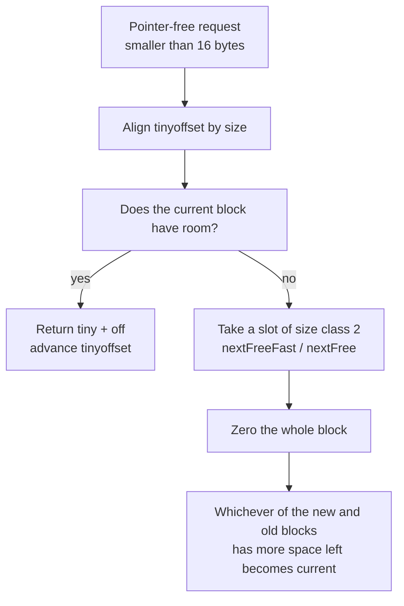

# 12.6 Tiny Object Allocation

A **tiny object** is one smaller than 16 bytes and without pointers. `mallocgc` hands these to
`mallocgcTiny`: several tiny objects are combined into one 16-byte block, and the block is reclaimed
only after every object in it has become unreachable. [12.1.4](./basic.md) has given the reasons.
Tiny objects are numerous, and giving each its own minimal slot would waste a high proportion of
memory; restricting the mechanism to pointer-free objects bounds the potential waste; and objects
allocated in secret mode do not use it. This section discusses the implementation: how the block and
offset are managed, how the effect of combining can be observed, where the size of 16 bytes comes
from, and what follows from several objects sharing one piece of memory.

The tiny allocator was added by Vyukov in 2014 and shipped in Go 1.3; the commit message reads:
combine small pointer-free allocations of less than 16 bytes into one memory block
[[Vyukov, 2014](#ref-vyukov-2014)]. Its basic structure has not changed since; later changes mainly
concern how it cooperates with the collector, the race detector and other runtime mechanisms.

## 12.6.1 Block and Offset

Three fields in each P's local cache serve tiny objects: `tiny` points to the start of the current
block, `tinyoffset` is the offset used so far within the block, and `tinyAllocs` counts the tiny
allocations completed by this P ([12.2.2](./component.md)). The main body of `mallocgcTiny` follows;
the beginning omits a prologue identical to the one in [12.5.1](./smallalloc.md), and the end omits
the publication, marking and sampling identical to [12.5.4](./smallalloc.md)
[[Go Authors, 2026a](#ref-go-authors-2026a)]:

```go
	c := getMCache(mp)
	off := c.tinyoffset
	// Align tiny pointer for required (conservative) alignment.
	if size&7 == 0 {
		off = alignUp(off, 8)
	} else if goarch.PtrSize == 4 && size == 12 {
		// Conservatively align 12-byte objects to 8 bytes on 32-bit
		// systems so that objects whose first field is a 64-bit
		// value is aligned to 8 bytes and does not cause a fault on
		// atomic access. See issue 37262.
		// TODO(mknyszek): Remove this workaround if/when issue 36606
		// is resolved.
		off = alignUp(off, 8)
	} else if size&3 == 0 {
		off = alignUp(off, 4)
	} else if size&1 == 0 {
		off = alignUp(off, 2)
	}
	if off+size <= maxTinySize && c.tiny != 0 {
		// The object fits into existing tiny block.
		x := unsafe.Pointer(c.tiny + off)
		c.tinyoffset = off + size
		c.tinyAllocs++
		mp.mallocing = 0
		releasem(mp)
		return x, 0
	}
	// Allocate a new maxTinySize block.
	checkGCTrigger := false
	span := c.alloc[tinySpanClass]
	v := nextFreeFast(span)
	if v == 0 {
		v, span, checkGCTrigger = c.nextFree(tinySpanClass)
	}
	x := unsafe.Pointer(v)
	(*[2]uint64)(x)[0] = 0 // Always zero
	(*[2]uint64)(x)[1] = 0
	// See if we need to replace the existing tiny block with the new one
	// based on amount of remaining free space.
	if !raceenabled && (size < c.tinyoffset || c.tiny == 0) {
		// Note: disabled when race detector is on, see comment near end of this function.
		c.tiny = uintptr(x)
		c.tinyoffset = size
	}
	// ...
```

The alignment of the offset depends only on the requested size: a size that is a multiple of 8
aligns to 8, a multiple of 4 to 4, a multiple of 2 to 2, and any other size is not aligned. The size
of a type is always an integer multiple of its alignment, so the alignment inferred from the size is
never smaller than what the type actually needs, which is why the comment calls it conservative. A
12-byte object on a 32-bit platform is the exception. On these platforms a 64-bit field is aligned
to only 4 bytes, and an atomic operation on a 64-bit value that is not 8-byte aligned can fail. The
usual practice is to place the 64-bit field that needs atomic access at the start of a struct and
rely on the allocator to return an 8-byte-aligned address
([11.3](../../part3concurrency/ch11sync/atomic.md)); but `struct { a uint64; b byte }` is 12 bytes
on a 32-bit platform, and the tiny allocator by its rules would align it only to 4, defeating this
practice. Knyszek therefore special-cased 12-byte objects to align to 8
[[Knyszek, 2020](#ref-knyszek-2020)].

When the current block has room, the allocation merely returns `c.tiny + off` and advances the
offset: nothing is zeroed, the span is not touched, and the GC trigger condition is not checked. The
slot size returned on this path is 0. At its end `mallocgc` adds the assist debt as "slot size minus
requested size"; with a slot size of 0 it skips this step, so an allocation merged into an existing
block is charged only for the requested size, and the remaining space in the block has already been
paid for by the allocation that opened it.

When the current block has no room, the allocator takes a slot of `tinySpanClass` from the local
cache, that is, a pointer-free 16-byte slot of size class 2
[[Go Authors, 2026c](#ref-go-authors-2026c)], in exactly the same way as for small objects
([12.5.2](./smallalloc.md)). The new block is always zeroed in full, and `mallocgcTiny` has no
`needzero` parameter. It then decides which block becomes the current one: the new block has used
`size` bytes and has 16 − `size` left; the old block has 16 − `tinyoffset` left. The new block
replaces the old one only when it has more left, that is, when `size < c.tinyoffset`, and later tiny
objects continue to fill whichever block has more space remaining. The block not chosen is nothing
special: it is an ordinary 16-byte object that lives as long as any tiny object in it lives.



`tiny` is a pointer into the heap, but the local cache is not on the garbage-collected heap, so the
collector does not scan it. The runtime handles this in two ways. First, as a comment in `mcache.go`
points out, `releaseAll` clears `tiny` and `tinyoffset` at mark termination, so tiny objects in a
new collection cycle always start from a new block. Second, when marking begins, the runtime shades
each P's current block gray while all goroutines are stopped. The hybrid write barrier of Go 1.8
requires newly allocated objects to be black, but if the current block was allocated before marking
began, tiny objects carved out of it afterwards never trigger blackening, and the collector might
sweep a block that is still reachable. Clements chose to handle all current blocks once at the start
of marking, and a comment in the code explains why the alternative was rejected: marking the block
black on every allocation from it would slow down the tiny allocator
[[Clements, 2016](#ref-clements-2016)] ([13.2](../ch13gc/barrier.md)).

## 12.6.2 The Effect of Combining

The following program allocates 2²⁰ pointer-free objects each of 3, 4, 12 and 16 bytes, keeps all of
them reachable, and computes the average heap memory taken per object. `runtime.GC()` stabilizes the
statistics between the two reads, and also clears the current block at mark termination, so each
group of allocations starts from a new block.

```go {run=true}
package main

import (
	"fmt"
	"runtime"
)

const n = 1 << 20

var (
	b3  [n]*[3]byte
	b4  [n]*[4]byte
	b12 [n]*[12]byte
	b16 [n]*[16]byte
)

// perObject returns the average heap memory (in bytes) taken by the n objects that alloc allocates.
func perObject(alloc func(i int)) float64 {
	var before, after runtime.MemStats
	runtime.GC()
	runtime.ReadMemStats(&before)
	for i := range n {
		alloc(i)
	}
	runtime.GC()
	runtime.ReadMemStats(&after)
	return float64(after.HeapAlloc-before.HeapAlloc) / n
}

func main() {
	fmt.Printf(" 3 bytes: %.1f\n", perObject(func(i int) { b3[i] = new([3]byte) }))
	fmt.Printf(" 4 bytes: %.1f\n", perObject(func(i int) { b4[i] = new([4]byte) }))
	fmt.Printf("12 bytes: %.1f\n", perObject(func(i int) { b12[i] = new([12]byte) }))
	fmt.Printf("16 bytes: %.1f\n", perObject(func(i int) { b16[i] = new([16]byte) }))
}
```

The output is as follows:

```
 3 bytes: 3.2
 4 bytes: 4.0
12 bytes: 16.0
16 bytes: 16.0
```

A 3-byte object needs no alignment, so one block holds 5 of them, using 15 bytes, or 3.2 bytes per
object on average; a block holds exactly 4 objects of 4 bytes. Without the tiny allocator, both
would fall into the 8-byte size class 1 and take 8 bytes each. A 12-byte object aligns to 4, and the
second object, starting at offset 12, would exceed 16 bytes, so a new block is taken; the condition
`size < c.tinyoffset`, that is 12 < 12, does not hold, so the old block, of which only 12 bytes are
used, stays current and the new object occupies a block alone. Every object ends up taking a full 16
bytes, no different from not combining. The 4 bytes left in the old block are kept for later,
smaller requests. A 16-byte object is not a tiny object and is allocated directly from size class 2,
which serves as a control.

Running the same program with `-race` gives 16.0 on all four lines. When the race detector is
enabled, the `!raceenabled` in the condition for replacing the current block keeps `tiny`
permanently empty, so every tiny object takes a block alone; `mallocgcTiny` also places the object
at the end of the block, so that pointer arithmetic running past the end of the object can be caught
by checkptr. This was added by Randall and fixes the checkptr miss on tiny objects reported in issue
#38872 [[Randall, 2021](#ref-randall-2021)].

## 12.6.3 Why 16 Bytes

A comment at the beginning of `mallocgcTiny` discusses the block size
[[Go Authors, 2026a](#ref-go-authors-2026a)]:

```go
	// Size of the memory block used for combining (maxTinySize) is tunable.
	// Current setting is 16 bytes, which relates to 2x worst case memory
	// wastage (when all but one subobjects are unreachable).
	// 8 bytes would result in no wastage at all, but provides less
	// opportunities for combining.
	// 32 bytes provides more opportunities for combining,
	// but can lead to 4x worst case wastage.
	// The best case winning is 8x regardless of block size.
```

The multiples here are relative to the footprint without combining: a tiny object allocated alone
takes at least one 8-byte slot. In the worst case only one sub-object in the block survives, which
keeps the whole block from being reclaimed, and the memory used equals the block size; relative to
the 8-byte baseline that is 2 times for a 16-byte block, 4 times for 32 bytes, and for 8 bytes the
same as without combining, so there is no extra waste. In the best case the block is full of 1-byte
objects, each taking 1 byte rather than 8 when allocated alone, so the footprint is one eighth of
that without combining, independent of block size. The larger the block, the more opportunities to
combine and the worse the worst case; 16 bytes is a compromise between the two. The block size must
also be the size of some size class, so that a new block can be taken directly from that class;
`mallocinit` checks at startup that the size of size class 2 equals `maxTinySize`.

Vyukov's original commit reported the practical effect of this trade-off: on the json benchmark,
allocations fell by 11.3% and heap use by 19.7%; on the garbage benchmark, allocations fell by 12.3%
and heap use by 1.5% [[Vyukov, 2014](#ref-vyukov-2014)]. This agrees with the figures in the
comment, a reduction of about 12% in allocations and about 20% in heap size.

## 12.6.4 Consequences of Shared Lifetimes

Tiny objects in a block live and die together, which directly affects mechanisms that depend on
object lifetimes. Finalizers, cleanup functions and weak pointers are all triggered by an object
becoming unreachable, and an unreachable tiny object may never be reclaimed because another object
in the same block stays alive. The documentation of `runtime.SetFinalizer`, `runtime.AddCleanup` and
`weak.Pointer` all carry the same note; for finalizers it reads
[[Go Authors, 2026d](#ref-go-authors-2026d)]:

> Note that because finalizers may execute arbitrarily far into the future
> after an object is no longer referenced, the runtime is allowed to perform
> a space-saving optimization that batches objects together in a single
> allocation slot. The finalizer for an unreferenced object in such an
> allocation may never run if it always exists in the same batch as a
> referenced object. Typically, this batching only happens for tiny
> (on the order of 16 bytes or less) and pointer-free objects.

This note on finalizers comes from a commit by Ou and fixes the missing documentation raised in
issue #46827 [[Ou, 2021](#ref-ou-2021)]; the cleanup functions and weak pointers added in Go 1.24
reuse the same wording. The runtime also leaves room for tiny objects in its implementation:
`SetFinalizer` normally requires the pointer to point to the start of an allocated block, but allows
it to point inside the block if the object's type contains no pointers and is smaller than 16 bytes;
when `AddCleanup` allocates storage for the cleanup function's argument, it deliberately bypasses
the tiny allocator, and the source comment gives the reason as avoiding liveness problems, since
this storage is treated as a root by the collector ([13.10](../ch13gc/finalizer.md)). The
`runtime/secret` experiment of Go 1.26 makes allocations in secret mode bypass the tiny allocator
for a similar reason: other objects in the block could keep the whole block alive for a long time,
while secret objects must be zeroed promptly when freed [[Morsing, 2025](#ref-morsing-2025)].

Statistics are affected too. The runtime does not track the lifetime of individual tiny objects,
only of the blocks that contain them. For historical reasons `runtime.MemStats` counts tiny
allocations in both `Mallocs` and `Frees`, and a source comment admits that this in a sense counts
memory twice, since the blocks themselves are counted too; tracking the lifetime of each tiny object
would be too expensive [[Go Authors, 2026d](#ref-go-authors-2026d)]. `runtime/metrics` lists the
number of tiny allocations separately as `/gc/heap/tiny/allocs:objects`, and the histograms by size
include only blocks. Memory profiling likewise samples only blocks: only an allocation that opens a
new block decrements `nextSample`, and it decrements by the full 16 bytes of the block; allocations
merged into an existing block are never sampled.

The `runtimefreegc` experiment also avoids tiny objects: `reusableSize` rejects objects smaller than
16 bytes, in line with the requirement in the `mallocgcTiny` comment that objects obtained from the
tiny allocator cannot be freed explicitly ([12.9](./history.md)). In the size-specialized allocation
functions, which are off by default, the tiny functions are generated by request size rather than
size class, 15 of them from `mallocgcTinySize1` to `mallocgcTinySize15`, and the request size is a
compile-time constant in each ([12.1.4](./basic.md)).

## 12.6.5 Where Tiny Objects Sit on the Allocation Path

[12.1.4](./basic.md) lists five paths of `mallocgc`, and tiny objects are one of them, but they are
not a self-contained system: the block is an ordinary slot of size class 2, sharing a span class
with pointer-free 16-byte small objects, and fetching a block takes exactly the fast and slow paths
of small objects ([12.5](./smallalloc.md)). One trace of this remains in `refill`: when a span is
handed back and its span class is `tinySpanClass`, the `tinyAllocs` accumulated by the local cache
is added to the global statistics [[Go Authors, 2026b](#ref-go-authors-2026b)]. The tiny allocator
can therefore be seen as a layer on top of the small object allocator: the small object allocator
delivers a 16-byte slot, and the tiny allocator divides it by offset among several objects.

## 12.6.6 Summary

The tiny allocator combines pointer-free objects smaller than 16 bytes into 16-byte blocks. Within a
block it aligns by size and advances an offset; when the block is full it takes a new block from
size class 2 and keeps the one with more space left as the current block. Combining brings the
average footprint of such objects close to their actual size, at the price of shared lifetimes: the
worst case uses twice the memory of not combining, finalizers, cleanup functions and weak pointers
may never fire, and statistics and profiles can only work in units of blocks. To cooperate correctly
with the collector and the race detector, the runtime shades the current block gray when marking
begins, clears it at mark termination, and turns combining off when race detection is on.

## Further Reading

- <a id="ref-clements-2016"></a>[Clements, 2016] Austin Clements. runtime: mark tiny blocks at GC
  start. Go commit 85c22bc3a5, 2016. https://go.dev/cl/31456 Shipped in Go 1.8.
- <a id="ref-go-authors-2026a"></a>[Go Authors, 2026a] The Go Authors. src/runtime/malloc.go
  (`mallocgcTiny`, `maxTinySize`, the alignment and block-swap logic, the measured data of the JSON
  benchmark). Go 1.26 source.
  https://github.com/golang/go/blob/release-branch.go1.26/src/runtime/malloc.go
  Formerly at: https://github.com/golang/go/blob/master/src/runtime/malloc.go
- <a id="ref-go-authors-2026b"></a>[Go Authors, 2026b] The Go Authors. src/runtime/mcache.go
  (the `tiny`/`tinyoffset` fields and `tinySpanClass`). Go 1.26 source.
  https://github.com/golang/go/blob/release-branch.go1.26/src/runtime/mcache.go
  Formerly at: https://github.com/golang/go/blob/master/src/runtime/mcache.go
- <a id="ref-go-authors-2026c"></a>[Go Authors, 2026c] The Go Authors. src/runtime/mheap.go
  (`tinySpanClass = tinySizeClass<<1 | 1`, `makeSpanClass`). Go 1.26 source.
  https://github.com/golang/go/blob/release-branch.go1.26/src/runtime/mheap.go
  Formerly at: https://github.com/golang/go/blob/master/src/runtime/mheap.go
- <a id="ref-go-authors-2026d"></a>[Go Authors, 2026d] The Go Authors. src/runtime/mfinal.go
  (`SetFinalizer`), src/runtime/mcleanup.go (`AddCleanup`), src/weak/pointer.go,
  src/runtime/mstats.go, src/runtime/metrics/description.go, src/runtime/mgc.go (`gcStart`),
  src/runtime/mgcmark.go (`gcMarkTinyAllocs`), src/runtime/malloc_generated.go. Go 1.26 source.
  https://github.com/golang/go/tree/release-branch.go1.26/src
- <a id="ref-knyszek-2020"></a>[Knyszek, 2020] Michael Anthony Knyszek. runtime: align 12-byte
  objects to 8 bytes on 32-bit systems. Go commit 5756b35601, 2020. https://go.dev/cl/254057 Shipped
  in Go 1.16; fixes Go issue #37262: https://go.dev/issue/37262
- <a id="ref-morsing-2025"></a>[Morsing, 2025] Daniel Morsing. Go issue #76356. *runtime: tiny
  allocator can keep allocations alive longer than expected.* 2025. https://go.dev/issue/76356
  Allocations in secret mode therefore bypass the tiny allocator.
- <a id="ref-ou-2021"></a>[Ou, 2021] Changkun Ou. runtime: clarify finalizer semantics for tiny
  objects. Go commit 80d487111b, 2021. https://go.dev/cl/337391 Shipped in Go 1.20; fixes Go issue
  #46827.
- <a id="ref-randall-2021"></a>[Randall, 2021] Keith Randall. runtime: top align tinyallocs in race
  mode. Go commit 2c05ba4ae0, 2021. https://go.dev/cl/315029 Shipped in Go 1.17; fixes Go issue
  #38872.
- <a id="ref-vyukov-2014"></a>[Vyukov, 2014] Dmitriy Vyukov. runtime: combine small NoScan
  allocations. Go commit 1fa7029425, 2014. https://codereview.appspot.com/38750047 Shipped in Go
  1.3.
- This book: [12.4 Large Object Allocation](./largealloc.md),
  [12.5 Small Object Allocation](./smallalloc.md) (the two ends that the tiny path builds on).
- This book: [12.2 Components](./component.md) (mcache, span, size class),
  [Chapter 13 Garbage Collector](../ch13gc) (whole-block liveness, scanning and sweeping).
