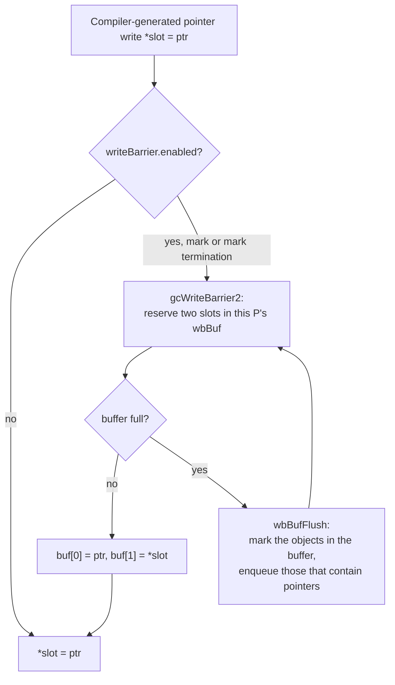

# 13.2 Write Barrier Techniques

[13.1.4](./basic.md) described the risk of concurrent marking: if the mutator writes a pointer to a
white object into a black object and at the same time destroys every path from a grey object to it,
the collector misses an object that is still reachable. The **write barrier** is the means of
preventing this: the compiler inserts a small piece of code at pointer writes that may point into
the heap, and the code tells the collector what it needs to know when the write happens. This
section first introduces the two classic kinds of write barrier and the cost of each, then the
hybrid write barrier used since Go 1.8, and finally its implementation in the compiler and the
runtime.

The write barrier here is a garbage-collection concept: a piece of software logic executed by the
mutator. It is not the same thing as the memory barrier at the processor level, which constrains the
order of memory accesses (see [11.9](../../part3concurrency/ch11sync/mem.md)). The two meet at one
point in Go's implementation, mentioned in 13.2.4.

## 13.2.1 Two Kinds of Write Barrier

Missing an object requires two conditions to hold together: the mutator writes a pointer to a white
object into a black object, and the original path from a grey object to that white object is
destroyed before the collector can see it [[Wilson, 1992](#ref-wilson-1992)]. A pointer write
`*slot = ptr` involves two pointers: the new value `ptr` being written and the old value `*slot`
being overwritten. A write barrier can watch either one, which gives two kinds of barrier, each
ruling out one condition.

An insertion barrier watches the new value, and is also called an incremental-update barrier. Before
the write it shades the object that the new value points to, which ensures that after the write no
black object points to a white object. This rules out the first condition and maintains the strong
tricolor invariant. The idea comes from Dijkstra et al.
[[Dijkstra et al., 1978](#ref-dijkstra-1978)], and what Go 1.7 used was a coarsened Dijkstra barrier
that does not check the color of the object holding `slot` and always shades
[[Clements and Hudson, 2016](#ref-clements-hudson-2016)]:

```go
// Dijkstra insertion barrier (pseudocode)
writePointer(slot, ptr):
	shade(ptr)
	*slot = ptr
```

A deletion barrier watches the old value, and is also called a snapshot-at-the-beginning barrier. It
shades the old value before it is overwritten, so whenever a path to a white object is destroyed,
the collector is given another path, and the second condition cannot arise; it maintains the weak
tricolor invariant. Its best-known form is due to Yuasa [[Yuasa, 1990](#ref-yuasa-1990)]:

```go
// Yuasa deletion barrier (pseudocode)
writePointer(slot, ptr):
	shade(*slot)
	*slot = ptr
```

The name snapshot-at-the-beginning describes its effect: objects reachable when marking starts are
not reclaimed in this cycle, even if they become unreachable during marking. Objects retained this
way, reclaimable only in the next cycle, are called floating garbage. Insertion barriers also
produce floating garbage, because a newly shaded value may be overwritten right afterwards.

Both kinds of barrier only shade white objects, so an object's color changes monotonically from
white to grey to black, and the total marking work is bounded by the size of the heap. Steele's
barrier does the opposite: it turns black objects back to grey, so the same object may be scanned
repeatedly [[Clements and Hudson, 2016](#ref-clements-hudson-2016)]. Pirinen classified the various
barriers systematically by the color of the mutator [[Pirinen, 1998](#ref-pirinen-1998)].

The color of the mutator refers to the state, in the collector's eyes, of its roots, mainly
goroutine stacks. A mutator whose stacks have been scanned and which the collector no longer needs
to revisit is black; a mutator whose stacks have not been scanned, or which may again hold white
pointers after scanning and need to be rescanned, is grey. A grey mutator means its stacks must be
rescanned before marking ends.

## 13.2.2 The Cost of the Two Barriers in Go

For Go, the crux is the stack. Pointer writes on goroutine stacks are extremely frequent, and
executing a write barrier on every stack write would be too expensive, so both kinds of barrier need
special treatment of stacks, and each treatment comes with a stop-the-world.

Go 1.5 through 1.7 used an insertion barrier [[Hudson, 2015](#ref-hudson-2015)] and set no barrier
on stack writes. The cost is that stacks can only be in a "permagrey" state: a stack scanned at the
start of collection stays black only until its goroutine runs again, after which it may hold
pointers to white objects and must be treated as grey. Before marking ends, the collector has to
rescan all grey stacks with the world stopped. The design document points out that in programs with
many goroutines this rescan can take tens or even hundreds of milliseconds, and it was the last
unbounded pause source in Go 1.7 that scaled with program size
[[Clements and Hudson, 2016](#ref-clements-hudson-2016)].

A deletion barrier can keep scanned stacks black, but stack writes again have no barrier, and the
snapshot at the beginning must include all stacks, so it requires stopping the world at the start of
marking to scan or copy all stacks at once. When Yuasa proposed the algorithm, it targeted a system
with a single thread and small stacks; Go programs often have tens of thousands of stacks, and
handling them with the world stopped is just as expensive. Requiring all stacks to be scanned before
any heap object can be scanned would instead create a parallelism bottleneck between stack scanning
and heap scanning. The design document also cites Pirinen's conclusion: for a black mutator, every
barrier except the Yuasa barrier needs a read barrier, and pointer reads are more than an order of
magnitude more frequent than writes, which is unacceptable for performance
[[Clements and Hudson, 2016](#ref-clements-hudson-2016)].

## 13.2.3 The Hybrid Write Barrier

Go 1.8 combined the two kinds of barrier into the **hybrid write barrier**
[[Clements and Hudson, 2016](#ref-clements-hudson-2016)]. The comment at the top of `mbarrier.go`
first explains that it combines a Yuasa-style deletion barrier, which shades the overwritten object,
with a Dijkstra-style insertion barrier, which shades the object being written, where the insertion
part is needed only when the caller's stack is grey; it then gives pseudocode and explains how the
two shades and the condition together prevent the mutator from hiding objects
[[Go Authors, 2026a](#ref-go-authors-2026a)]:

```go
//     writePointer(slot, ptr):
//         shade(*slot)
//         if current stack is grey:
//             shade(ptr)
//         *slot = ptr
//
// ...
//
// The two shades and the condition work together to prevent a mutator
// from hiding an object from the garbage collector:
//
// 1. shade(*slot) prevents a mutator from hiding an object by moving
// the sole pointer to it from the heap to its stack. If it attempts
// to unlink an object from the heap, this will shade it.
//
// 2. shade(ptr) prevents a mutator from hiding an object by moving
// the sole pointer to it from its stack into a black object in the
// heap. If it attempts to install the pointer into a black object,
// this will shade it.
//
// 3. Once a goroutine's stack is black, the shade(ptr) becomes
// unnecessary. shade(ptr) prevents hiding an object by moving it from
// the stack to the heap, but this requires first having a pointer
// hidden on the stack. Immediately after a stack is scanned, it only
// points to shaded objects, so it's not hiding anything, and the
// shade(*slot) prevents it from hiding any other pointers on its
// stack.
```

A mutator can hide an object in only two ways: by moving the sole pointer to it from the heap to a
stack, or from a stack into a black object in the heap. The deletion part `shade(*slot)` blocks the
former, because unlinking a pointer from the heap means overwriting it, and the overwritten object
is shaded at once; the insertion part `shade(ptr)` blocks the latter. The third point explains why
the insertion part is needed only when the stack is grey: to move an object from a stack into the
heap, it must first be hidden on the stack, and a freshly scanned stack points only to shaded
objects, while the deletion part prevents it from hiding new pointers taken from the heap
afterwards.

This yields the most important property of the hybrid write barrier: once a stack has been scanned
and turned black, it stays black and never needs to be rescanned. Each goroutine's stack can be
scanned concurrently one at a time after marking starts, pausing only the goroutine being scanned,
and mark termination no longer has to stop the world to rescan stacks. The hybrid barrier maintains
the weak tricolor invariant: a scanned black stack may hold pointers to white objects, but such a
white object is always protected by a grey object. The design document also notes that the barrier
requires newly allocated objects to be black, which Go already did; it is equivalent to the "double
write barrier" of the Metronome collector used in IBM's real-time Java, an incremental rather than
concurrent collector that likewise has to keep stop-the-world time strictly within a small bound
[[Clements and Hudson, 2016](#ref-clements-hudson-2016)]
[[Auerbach et al., 2007](#ref-auerbach-2007)].

The effect was dramatic. In the commit that disables stack rescanning, Clements reported that with
GOMAXPROCS=12, not counting the time needed to stop the world itself, the worst-case mark
termination stayed consistently under 100 microseconds; in a benchmark built to create a large
number of dirty stacks, the 95th percentile stop-the-world time with 500,000 dirty stacks fell from
150 milliseconds to 195 microseconds, nearly three orders of magnitude
[[Clements, 2016b](#ref-clements-2016b)]. The Go 1.8 release notes state that GC pauses are
typically under 100 microseconds and often as low as 10 microseconds
[[Go Authors, 2017](#ref-go-authors-2017)].

## 13.2.4 Go's Implementation: the Unconditional Hybrid Barrier

The hybrid barrier Go actually implements drops the condition "the current stack is grey" and always
shades both the old and the new value. Clements explained the reason in the commit that implemented
it: channel operations copy data directly between the stacks of two goroutines, so the barrier would
have to check the colors of both the source and destination stacks, and at the time there was no way
to pass that information to the write barrier [[Clements, 2016a](#ref-clements-2016a)]. The design
document also discusses this unconditional variant: its correctness is easier to argue, because the
heap never contains a pointer from a black object to a white object; the price is an overhead about
twice that of the conditional version for most of the mark phase
[[Clements and Hudson, 2016](#ref-clements-hudson-2016)]. Through Go 1.26 the barrier is still
unconditional, and a TODO remains in `wbBufFlush1` contemplating skipping the new value when the
stack has already been scanned.

`mbarrier.go` also contains a note about memory ordering, concerning another condition: both kinds
of barrier could in principle run only when the object holding `slot` is black. Imagine the mutator
first writes `slot` and then reads the mark bit of the object holding `slot`, while a collector
thread first sets that mark bit and then reads `slot`. Without an expensive memory barrier between
the write and the read on each thread, on most hardware including 386 and amd64, both can read the
old value: the mutator thinks the object is still white and skips the barrier, and the collector
does not see the newly written pointer. This is exactly the reordering that Peterson's and Dekker's
mutual exclusion algorithms must avoid. Go prefers to shade unconditionally rather than pay for a
memory barrier on every pointer write [[Go Authors, 2026a](#ref-go-authors-2026a)]. This is the
meeting point of write barriers and memory barriers mentioned at the start of this section.

### Barriers Inserted by the Compiler

The write barrier is inserted by the compiler in the `writebarrier` pass of SSA. The comment of that
pass describes the shape of the generated code [[Go Authors, 2026b](#ref-go-authors-2026b)]:

```go
// writebarrier pass inserts write barriers for store ops (Store, Move, Zero)
// when necessary (the condition above). It rewrites store ops to branches
// and runtime calls, like
//
//	if writeBarrier.enabled {
//		buf := gcWriteBarrier2()	// Not a regular Go call
//		buf[0] = val
//		buf[1] = *ptr
//	}
//	*ptr = val
```

`writeBarrier.enabled` is true only during the mark and mark termination phases
([13.1.4](./basic.md)); the rest of the time, the extra cost of a pointer write is one load and one
conditional branch. When the barrier is on, `gcWriteBarrier2` reserves two slots in the current P's
write barrier buffer and returns their address; the generated code stores the new and old values
there in turn, and only then performs the actual write. The following function writes a pointer into
a struct field:

```go
package wb

type T struct{ p *int }

func set(t *T, v *int) {
	t.p = v
}
```

Use `-gcflags=-S` to look at the instructions generated for line 6 on amd64:

```shell
$ GOARCH=amd64 go build -gcflags=-S . 2>&1 | grep 'wb.go:6)' | grep -v PCDATA | sed 's/.*)\t//'
TESTB	AL, (AX)
CMPL	runtime.writeBarrier(SB), $0
JEQ	36
MOVQ	(AX), CX
CALL	runtime.gcWriteBarrier2(SB)
MOVQ	BX, (R11)
MOVQ	CX, 8(R11)
MOVQ	BX, (AX)
```

`t` is in `AX` and `v` in `BX`. The first instruction probes whether `t` is a nil pointer with a
read. When `writeBarrier` is zero, control jumps straight to the last instruction, which performs
the write; otherwise the old value `t.p` is first loaded into `CX`, `gcWriteBarrier2` is called to
obtain the buffer address `R11`, the new and old values are stored into the buffer, and then the
write is done. This is exactly the shape described in the comment above.

The compiler inserts a barrier only when necessary. A write whose target is an address in the
current stack frame needs no barrier; if the target is known to be freshly allocated, still-zero
memory, the old value need not be recorded; if the value written is nil or the address of a global,
it cannot point into the heap, and the new value need not be recorded. The barrier is elided
entirely only when neither the new nor the old value needs recording
[[Go Authors, 2026b](#ref-go-authors-2026b)]. But if a pointer to the stack is passed to a callee,
writes through it still carry a barrier, because the compiler cannot be sure it does not point into
the heap. Writes to globals also need a barrier: `mbarrier.go` explains that many collectors ignore
writes to globals and instead rescan the global area at mark termination, but that increases the
pause, so Go executes the barrier on global writes too, to avoid rescanning at mark termination
[[Go Authors, 2026a](#ref-go-authors-2026a)]. When memory containing pointers is copied or zeroed in
bulk, as in `typedmemmove` and `wbZero`, the runtime uses `bulkBarrierPreWrite` to handle all the
pointer slots at once.

### The Write Barrier Buffer

Shading is not done immediately on the barrier's fast path. Since Go 1.10, the barrier only stores
pointers into a per-P private buffer `wbBuf`, which has 512 slots, and calls `wbBufFlush` to process
them in bulk only when it fills up [[Go Authors, 2026c](#ref-go-authors-2026c)]. The fast path is
written in assembly and does not clobber any general-purpose register, which avoids the
register-saving overhead of an ordinary Go function call; the slow path saves all registers and does
not allow any safe point that could observe this stack frame. In the commit that introduced the
buffer, Clements reported that the average cost of the write barrier fell to about a quarter of its
former level [[Clements, 2017](#ref-clements-2017)]. Before that, a group of writes to several
pointer fields of the same type already shared one branch, but each pointer still called the barrier
once; Go 1.21 changed this so that the barrier call returns space in the buffer and the generated
code stores the pointers itself, with one call able to reserve space for up to 8 pointers
[[Randall, 2022](#ref-randall-2022)]. The `gcWriteBarrier2` in the assembly above reserves space for
two pointers.

When the buffer is flushed, `wbBufFlush1` processes the pointers in it one by one: it skips values
that obviously do not point into the heap, such as nil, finds the object each pointer belongs to,
and sets its mark bit if it is not yet marked; an object that contains no pointers is black once
marked, and any other object is put on the collector's work queue and becomes grey. Under the Green
Tea collector, small objects suited to span-based scanning instead enqueue their span
([13.11](./greentea.md)).



## 13.2.5 Summary

The write barrier maintains the tricolor invariants when the mutator modifies pointers. The
insertion barrier maintains the strong invariant and the deletion barrier the weak one; in Go the
former requires stopping the world at mark termination to rescan stacks, and the latter requires
stopping the world at the start of marking to scan all stacks. The hybrid write barrier of Go 1.8
combines the two so that scanned stacks stay black forever, eliminating stack rescanning, the
largest source of pauses. The actual implementation shades both the new and the old value
unconditionally, which simplifies cross-stack writes such as channel operations; its overhead is
kept down by the compiler's on-demand insertion, the global switch that is on only during marking,
and the per-P write barrier buffer.

## Further Reading

- <a id="ref-auerbach-2007"></a>[Auerbach et al., 2007] Joshua Auerbach, David F. Bacon, Bob
  Blainey, Perry Cheng, Michael Dawson, Mike Fulton, David Grove, Darren Hart, Mark
  Stoodley. "Design and Implementation of a Comprehensive Real-Time Java Virtual
  Machine." *EMSOFT '07*, 2007, 249-258. https://doi.org/10.1145/1289927.1289967
- <a id="ref-clements-2016a"></a>[Clements, 2016a] Austin Clements. runtime: implement unconditional
  hybrid barrier. Go commit 5380b22991, 2016. https://go.dev/cl/31765
  Shipped with Go 1.8.
- <a id="ref-clements-2016b"></a>[Clements, 2016b] Austin Clements. runtime: disable stack
  rescanning by default. Go commit bd640c882a, 2016. https://go.dev/cl/31766 Shipped with Go 1.8.
- <a id="ref-clements-2017"></a>[Clements, 2017] Austin Clements. runtime: buffered write barrier
  implementation. Go commit e9079a69f3, 2017. https://go.dev/cl/73711
  Shipped with Go 1.10.
- <a id="ref-clements-hudson-2016"></a>[Clements and Hudson, 2016] Austin Clements, Rick Hudson.
  *Proposal: Eliminate STW stack re-scanning.* Go design document, golang/go#17503, 2016.
  https://github.com/golang/proposal/blob/master/design/17503-eliminate-rescan.md The design and
  correctness proof of the hybrid barrier, the primary source for this section's main line.
- <a id="ref-dijkstra-1978"></a>[Dijkstra et al., 1978] Edsger W. Dijkstra, Leslie Lamport, A. J.
  Martin, C. S. Scholten, E. F. M. Steffens. "On-the-Fly Garbage Collection: An Exercise in
  Cooperation." *Communications of the ACM*, 21(11), 1978, 966-975.
  https://doi.org/10.1145/359642.359655 The foundation of the insertion barrier and tricolor
  marking.
- <a id="ref-go-authors-2017"></a>[Go Authors, 2017] The Go Authors. *Go 1.8 Release Notes.* 2017.
  https://go.dev/doc/go1.8
- <a id="ref-go-authors-2026a"></a>[Go Authors, 2026a] The Go Authors. src/runtime/mbarrier.go,
  src/runtime/mwbbuf.go, src/runtime/mgc.go (the hybrid barrier implementation, batching in the
  buffer, and the `writeBarrier.enabled` / `gcphase` gate). Go 1.26 source.
  https://github.com/golang/go/tree/release-branch.go1.26/src/runtime
- <a id="ref-go-authors-2026b"></a>[Go Authors, 2026b] The Go Authors.
  src/cmd/compile/internal/ssa/writebarrier.go. Go 1.26 source.
  https://github.com/golang/go/blob/release-branch.go1.26/src/cmd/compile/internal/ssa/writebarrier.go
- <a id="ref-go-authors-2026c"></a>[Go Authors, 2026c] The Go Authors. src/runtime/mwbbuf.go,
  src/runtime/asm_amd64.s (`wbBuf`, `gcWriteBarrier`). Go 1.26 source.
  https://github.com/golang/go/tree/release-branch.go1.26/src/runtime
- <a id="ref-hudson-2015"></a>[Hudson, 2015] Richard Hudson. "Go GC: Prioritizing low latency and
  simplicity." *The Go Blog*, 2015. https://go.dev/blog/go15gc
  The Go 1.5 collector uses a Dijkstra-style insertion barrier.
- <a id="ref-pirinen-1998"></a>[Pirinen, 1998] Pekka P. Pirinen. "Barrier Techniques for Incremental
  Tracing." *Proceedings of the International Symposium on Memory Management (ISMM)*, 1998, 20-25.
  https://doi.org/10.1145/286860.286863
  A classification framework for the basic actions of barriers.
- <a id="ref-randall-2022"></a>[Randall, 2022] Keith Randall. cmd/compile: batch write barrier
  calls. Go commit 21d82e6ac8, 2022. https://go.dev/cl/447781 Shipped with Go 1.21.
- <a id="ref-wilson-1992"></a>[Wilson, 1992] Paul R. Wilson. "Uniprocessor Garbage Collection
  Techniques." *International Workshop on Memory Management (IWMM)*, LNCS 637, 1992, 1-42.
  https://doi.org/10.1007/BFb0017182 A survey of the two conditions for missing an object, tricolor
  invariance, incremental update and snapshot-at-the-beginning.
- <a id="ref-yuasa-1990"></a>[Yuasa, 1990] Taiichi Yuasa. "Real-Time Garbage Collection on
  General-Purpose Machines." *Journal of Systems and Software*, 11(3), 1990, 181-198.
  https://doi.org/10.1016/0164-1212(90)90084-Y The original paper on the deletion barrier /
  snapshot-at-the-beginning.
- This book: [13.1 The Basic Idea of Garbage Collection](./basic.md),
  [13.6 Mark Termination Phase](./termination.md),
  [11.9 Memory Consistency Models](../../part3concurrency/ch11sync/mem.md).
