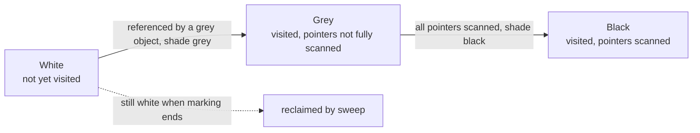
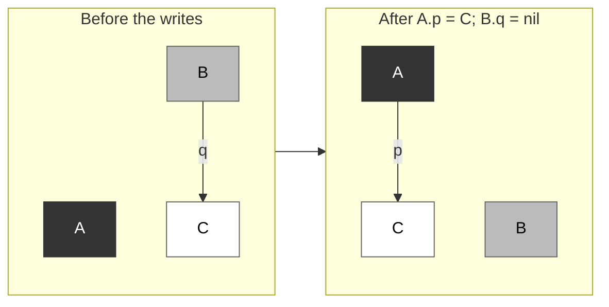
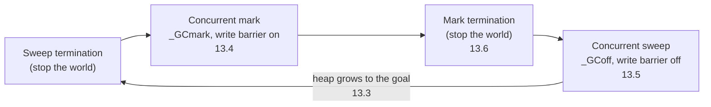

# 13.1 The Basic Idea of Garbage Collection

Garbage collection frees programs from releasing memory explicitly. The price is that the runtime
must work out for itself which memory will still be used and which can be reclaimed. This section
builds the concepts for the whole chapter: reachability as an approximation of liveness, mark-sweep
as a way to find and reclaim garbage, the tricolor abstraction as a description of a half-finished
mark, and the tricolor invariants as the correctness condition for concurrent marking. It ends with
where Go's collector stands among these choices, and why.

Dijkstra et al. divide a program with garbage collection into two roles
[[Dijkstra et al., 1978](#ref-dijkstra-1978)]. The **mutator** is the user program; as far as
collection is concerned, all it does is modify references between objects, that is, add and delete
directed edges in the object graph. The **collector** is the part of the runtime that finds and
reclaims garbage. Most of the difficulty in this chapter comes from the two running at the same
time.

## 13.1.1 Reachability and Liveness

An object is **live** if the program will access it in the future. This property depends on the
program's future execution path and is undecidable in general. Collectors therefore use a
conservative approximation, **reachability**: starting from a set of roots, every object that can be
reached by following pointers is considered live, and all others are garbage. An object that cannot
be reached from the roots can never be accessed again, so reclaiming it is safe. The converse does
not hold: a reachable object may never be used again, such as an entry that is no longer read but
still sits in a global map. The collector reclaims only unreachable objects; objects that remain
reachable but unused are a memory leak in the program itself.

In Go the runtime enumerates the roots at the start of each mark phase. `mgc.go` describes root
marking this way: scan the stacks of all goroutines, and shade the heap pointers in globals and in
runtime data structures outside the heap [[Go Authors, 2026a](#ref-go-authors-2026a)]. In terms of
the task division in `markroot`, the roots are the globals in the data and BSS segments, the stack
of each goroutine, the queues of finalizers and cleanup functions, and the finalizer, weak pointer
and cleanup records attached to spans ([13.10](./finalizer.md))
[[Go Authors, 2026b](#ref-go-authors-2026b)]. Registers are not a separate class of root: when a
goroutine stops at a safe point, the pointer values that are still live have already been saved on
the stack and are scanned with it ([13.7](./safe.md)).

One direct consequence of reachability is that cyclic structures do not prevent collection. The
following program builds two cycles of two nodes that reference each other. One is attached to a
global variable; the other has no path from any root. The program uses `weak.Pointer` to observe
whether a node has been collected: a weak pointer does not keep its object alive, and `Value`
returns nil once the object is gone. `root = a` makes the first cycle reachable through the global,
while nothing holds a strong reference to the second cycle after `cycle` returns:

```go {run=true}
package main

import (
	"fmt"
	"runtime"
	"weak"
)

type node struct {
	next *node
	data [64]byte
}

var root *node // globals are part of the roots

// cycle builds two nodes that reference each other and returns weak
// pointers to them. If keep is true, the cycle is attached to the global root.
func cycle(keep bool) (weak.Pointer[node], weak.Pointer[node]) {
	a, b := new(node), new(node)
	a.next, b.next = b, a
	if keep {
		root = a
	}
	return weak.Make(a), weak.Make(b)
}

func main() {
	la, lb := cycle(true)
	da, db := cycle(false)
	runtime.GC()
	fmt.Println("cycle reachable from root:", la.Value() != nil, lb.Value() != nil)
	fmt.Println("unreachable cycle:        ", da.Value() != nil, db.Value() != nil)
}
```

The output is:

```
cycle reachable from root: true true
unreachable cycle:         false false
```

In the unreachable cycle each node is still referenced by the other, but that does not matter: the
collector only asks whether an object can be reached from a root. Reference-counting collectors fail
exactly here; 13.1.2 returns to this point.

Deciding reachability presupposes recognizing pointers. Go's collector is precise (also called
type-accurate): using type information and stack maps generated by the compiler, the runtime can
tell whether a word is a pointer or an integer, so it never treats an integer that happens to look
like an address as a pointer and retains memory that should be reclaimed. This precision arrived in
steps. The Go 1.1 release notes call the collector "more precise"; since Go 1.3, stack scanning is
precise too; and only after Go 1.4 rewrote most of the runtime from C to Go did the collector
become "fully precise" [[Go Authors, 2013](#ref-go-authors-2013)]
[[Go Authors, 2014a](#ref-go-authors-2014a)] [[Go Authors, 2014b](#ref-go-authors-2014b)].
Asynchronous preemption, introduced in Go 1.14, left one exception: a goroutine may stop at an
arbitrary instruction, where there is no stack map, so the runtime scans the interrupted function's
frame and the frame that saved its registers conservatively, treating every word that points to an
allocated object as a pointer [[Clements, 2019](#ref-clements-2019)]. Conservative scanning is
covered in [13.7](./safe.md).

## 13.1.2 Mark-Sweep

The earliest garbage collection appears in McCarthy's 1960 paper describing the implementation of
Lisp [[McCarthy, 1960](#ref-mccarthy-1960)]. When the free-storage list is exhausted, the program
starts a "reclamation cycle": it first finds all accessible cells by following the car and cdr
chains from the base registers and sets their sign bits negative; it then sweeps the whole
program-structure storage area, returns the cells whose sign bit is unchanged to the free-storage
list, and restores the sign bit of accessible cells to positive. This is **mark-sweep**: the mark
phase traverses the object graph from the roots and records every reachable object, and the sweep
phase walks the whole heap and reclaims the objects that were not recorded. In pseudocode:

```go
// Mark: traverse the object graph from the roots (pseudocode)
func mark(roots []*object) {
	var work []*object // marked but not yet scanned
	for _, r := range roots {
		shade(r, &work)
	}
	for len(work) > 0 {
		obj := work[len(work)-1]
		work = work[:len(work)-1]
		for _, child := range obj.pointers() {
			shade(child, &work)
		}
	}
}

func shade(obj *object, work *[]*object) {
	if obj != nil && !obj.marked {
		obj.marked = true
		*work = append(*work, obj)
	}
}

// Sweep: reclaim unmarked objects and clear the marks of live ones to
// prepare for the next cycle (pseudocode)
func sweep(heap []*object) {
	for _, obj := range heap {
		if obj.marked {
			obj.marked = false
		} else {
			free(obj)
		}
	}
}
```

Two other classic approaches are copying collection and reference counting. A copying collector
moves live objects into a fresh space and releases the old space as a whole, so there is no
fragmentation and allocation only bumps a pointer; the cost is that objects must be moved and every
pointer to them updated, and the classic semispace design also reserves half the heap. Reference
counting records, for each object, the number of pointers to it and reclaims the object as soon as
the count reaches zero, spreading reclamation work through the program's execution. But every
pointer write must update a count, which puts the overhead on the path the mutator executes most
often, and, as the previous example shows, objects in a cycle never reach zero and need separate
handling.

Go uses mark-sweep; its collector neither moves objects nor is generational. The comment at the top
of `mgc.go` summarizes these choices: the collector runs concurrently with the mutator threads, is
type-precise, and allows multiple collector threads to run in parallel; it is a concurrent
mark-sweep collector that uses write barriers, is non-generational and non-compacting; allocation is
done using per-P, size-segregated allocation areas to minimize fragmentation and to eliminate
locking in the common case [[Go Authors, 2026a](#ref-go-authors-2026a)].

Hudson explained the reasons for not moving objects in his 2018 ISMM keynote
[[Hudson, 2018](#ref-hudson-2018)]. Go is a value-oriented language: struct fields are embedded
directly and interior pointers (pointers into the middle of an object) are common, so the collector
must be able to find an object's start address efficiently from an interior pointer. Size-segregated
spans provide this, because all objects in a span have the same size, and rounding an address down
gives the start of its object. Second, the team's earlier experience with TCMalloc, Hoard and
Intel's scalable allocator showed that fragmentation in non-moving allocators is not a serious
problem. Finally, Go must interoperate directly with C and C++ code, and if objects do not move,
there is no need to implement pinning or add an indirection layer for objects passed to C. The
fragmentation that non-moving brings is bounded by the allocator's size classes: objects of one size
class are laid out at equal sizes in a span, so external fragmentation becomes bounded rounding and
tail waste, analyzed in [12.1.3](../ch12alloc/basic.md).

## 13.1.3 The Tricolor Abstraction

Marking concurrently with the mutator requires a way to describe the state of a half-finished mark.
Dijkstra et al. proposed the **tricolor abstraction** for this
[[Dijkstra et al., 1978](#ref-dijkstra-1978)], which assigns each object one of three colors from
the collector's point of view:

- White: objects the collector has not yet visited. All objects are white when marking starts, and
  any object still white when marking ends is unreachable, hence garbage.
- Grey: objects that have been visited but whose pointers have not all been scanned, so they may
  still point to white objects.
- Black: objects that have been visited and whose pointers have all been scanned.

Marking starts by shading the roots grey and then repeats one action: take a grey object, shade the
white objects it references grey, and turn it black, until no grey objects remain. The grey objects
form the boundary between the black and white regions, and marking is the process of this boundary
advancing; when it disappears, every reachable object is black.



The interactive figure below demonstrates the process: the roots are shaded grey first, the grey
frontier keeps turning white neighbors grey and itself black until the grey set is empty, and the
sweep phase then reclaims the objects that are still white. Readers can step through it and watch
the frontier advance.

<div class="viz" data-viz="gc-tricolor"></div>

Colors only describe marking progress; objects have no color field. In Go, color is determined
jointly by the mark bit and the work queue. The comment in `mgcwork.go` reads
[[Go Authors, 2026b](#ref-go-authors-2026b)]:

```go
// For objects in workbufs, a grey object is one that is marked and
// on a work queue. A black object is marked and not on a work queue.
//
// For objects in the span queue, a grey object is one that is marked
// and has an unset scan bit. A black object is marked and has its scan
// bit set. (Green Tea GC only.)
```

A white object is one that is not marked. The span queue in the second paragraph belongs to the
Green Tea collector, enabled by default in Go 1.26, which queues spans rather than individual
objects for scanning; see [13.11](./greentea.md).

## 13.1.4 Concurrent Marking and the Tricolor Invariants

If all mutators are paused during marking, collection is one atomic step from the user program's
point of view, and correctness needs no argument, but the pause grows linearly with the heap.
Shortening it requires marking to run concurrently with the mutator, which immediately raises a
correctness problem. Suppose that halfway through marking, the mutator writes a pointer to a white
object C into a black object A, and then deletes the pointer from a grey object B to C:



A black object is not scanned again and B no longer points to C, so although C is still reachable
through A, it is never shaded grey. It is still white when marking ends, it is reclaimed as garbage,
and the program then accesses freed memory through A. This error needs two conditions to hold
together: the mutator writes a pointer to a white object into a black object, and every path from
any grey object to that object through white objects has been destroyed. Breaking either condition
is enough to avoid missing a reachable object.

Corresponding to these two conditions are two **tricolor invariants**. The strong tricolor invariant
requires that no black object points to a white object, which rules out the first condition. The
weak tricolor invariant allows black objects to point to white objects but requires that such a
white object be protected by a grey object, that is, reachable from some grey object through a chain
of white objects, which rules out the second condition [[Pirinen, 1998](#ref-pirinen-1998)]
[[Clements and Hudson, 2016](#ref-clements-hudson-2016)]. The means of maintaining an invariant is
the write barrier: the compiler inserts a small piece of code at pointer writes that does the
necessary shading when the write happens. Different write barriers maintain different invariants;
the hybrid write barrier used since Go 1.8 maintains the weak invariant, described in
[13.2](./barrier.md).

The write barrier is enabled only when needed. The runtime function that sets the collection phase
also decides whether the barrier is on [[Go Authors, 2026a](#ref-go-authors-2026a)]:

```go
func setGCPhase(x uint32) {
	atomic.Store(&gcphase, x)
	writeBarrier.enabled = gcphase == _GCmark || gcphase == _GCmarktermination
}
```

The write barrier is on only during the mark and mark termination phases; the rest of the time, a
pointer write only checks one global flag, which is cheap.

## 13.1.5 The Course of One Collection Cycle

The comment at the top of `mgc.go` divides one collection cycle into four phases
[[Go Authors, 2026a](#ref-go-authors-2026a)]. The diagram below summarizes them and the sections of
this chapter that cover each:



When a cycle begins, the runtime first pauses all goroutines, an operation called **stop-the-world**
(STW). During this brief pause the runtime finishes the sweeping left over from the previous cycle,
turns on the write barrier and enqueues the root-marking jobs. The mutator then resumes, and marking
is done jointly by background mark workers and mark assists at allocation time, with newly allocated
objects colored black directly. Once the grey objects are exhausted, a second stop-the-world enters
mark termination, which finishes up and turns the write barrier off before moving on to the sweep
phase. Sweeping runs concurrently with the mutator, performed both by background sweeper goroutines
and by goroutines that allocate memory when needed. When the heap again grows to the goal set by the
pacer, the next cycle begins; the pacer's design dates from Go 1.5
[[Clements, 2015](#ref-clements-2015)] and is covered in [13.3](./pacing.md).

These phases can be observed directly. With `GODEBUG=gctrace=1`, the runtime prints a one-line
summary to standard error at the end of every cycle; the runtime documentation notes that this
format may change [[Go Authors, 2026c](#ref-go-authors-2026c)]. The following program allocates
50000 objects of about 1 KiB and keeps one tenth of them:

```go {run=true env="GODEBUG=gctrace=1"}
package main

import "fmt"

type item struct {
	next *item
	buf  [1 << 10]byte
}

func main() {
	var keep *item
	for i := 0; i < 50000; i++ {
		it := &item{}
		if i%10 == 0 { // keep one tenth; the rest become garbage
			it.next = keep
			keep = it
		}
	}
	n := 0
	for p := keep; p != nil; p = p.next {
		n++
	}
	fmt.Println("live objects:", n)
}
```

Run on an Apple M5 Pro, the first part of the summaries for cycles 7 to 9 reads:

```shell
$ GODEBUG=gctrace=1 ./gcdemo 2>&1 | sed -n 7,9p | cut -d, -f1
gc 7 @0.004s 5%: 0.032+0.23+0.005 ms clock
gc 8 @0.004s 5%: 0.038+0.26+0.018 ms clock
gc 9 @0.005s 5%: 0.051+0.48+0.007 ms clock
```

`gc 7` is the cycle number, `@0.004s` is the time elapsed since program start, and `5%` is the
fraction of time spent in collection since the start. The three numbers joined by plus signs are the
wall-clock times of sweep termination, concurrent mark and mark termination, in that order. The two
stop-the-world pauses each take between a few microseconds and a few tens of microseconds, while
marking, which takes about ten times as long, runs concurrently with the program. The remaining
fields of the summary record heap sizes and goals, and are explained in [13.3](./pacing.md).

## 13.1.6 Go's Trade-offs and Position

Go's collector directly inherits the theoretical lineage above. The comment in `mgc.go` traces its
ideas to the on-the-fly algorithm of Dijkstra et al., and notes that a proof that these steps are
complete, correct and terminating is in Hudson and Moss's 2003 paper
[[Hudson and Moss, 2003](#ref-hudson-moss-2003)]; for general knowledge of garbage collection it
recommends Jones et al.'s *The Garbage Collection Handbook* as a starting point
[[Jones et al., 2023](#ref-jones-2023)]. Go 1.5 first implemented concurrent marking, and Go 1.8
used the hybrid write barrier to remove the need to rescan stacks at mark termination; the full
history is in [13.12](./history.md).

The objective function behind these choices is latency. When Go 1.5 shipped, Hudson wrote that Go's
collector is a tricolor concurrent mark-sweep collector, a deliberate departure from
most "enterprise" collectors of the day; it was designed to prioritize low latency, offers only one
tuning knob, `GOGC`, and Go 1.5's GC pauses were already well under the 10 ms target set a year
earlier [[Hudson, 2015](#ref-hudson-2015)]. In his 2018 talk Hudson explained why latency matters so
much: for a session of 100 requests, even if 99% of GC pauses are under 10 ms, only about 37% of
users see no longer pause during the whole session, so what really has to be constrained is the
99.99th percentile latency. The same talk set the new 2018 goal: each collection cycle pauses for no
more than 500 microseconds [[Hudson, 2018](#ref-hudson-2018)].

Mainstream Java virtual machines mostly use moving, generational collectors, which rely on moving
objects to eliminate fragmentation and on the generational hypothesis to concentrate effort on young
objects. Go's reason for not being generational also comes from its language. In Hudson's account,
it is not that the generational hypothesis fails in Go; rather, young objects tend to be born on the
stack and die on the stack: escape analysis ([15.5](../../part5toolchain/ch15compile/escape.md))
allocates many short-lived objects on the stack, where they are freed when the function returns and
never enter the heap, so generational collection has far less to contribute than in other managed
languages [[Hudson, 2018](#ref-hudson-2018)]. The Go team tried a request-oriented collector and a
non-moving generational collector; both were abandoned because of the cost of an always-on write
barrier, see [13.8](./generational.md) and [13.9](./roc.md).

## 13.1.7 Summary

The collector approximates liveness with reachability: starting from the roots it finds all
reachable objects, and the rest is garbage. Mark-sweep does this in two steps; on top of it Go
chooses neither to move objects nor to make the heap generational, limits fragmentation with size
classes, and relies on escape analysis to handle young objects. The tricolor abstraction describes
the intermediate state of concurrent marking, the tricolor invariants give the condition under which
concurrent mutator and collector do not miss reachable objects, and the write barrier maintains that
condition when the mutator modifies pointers. The remaining sections of this chapter cover the write
barrier ([13.2](./barrier.md)), triggering and pacing ([13.3](./pacing.md)), marking
([13.4](./mark.md)), sweeping ([13.5](./sweep.md)) and mark termination ([13.6](./termination.md)).

## Further Reading

- <a id="ref-clements-2015"></a>[Clements, 2015] Austin Clements. *Go 1.5 concurrent garbage
  collector pacing.* Go design document, 2015. https://go.dev/s/go15gcpacing
- <a id="ref-clements-2019"></a>[Clements, 2019] Austin Clements. runtime: scan stacks
  conservatively at async safe points. Go commit d16ec13756, 2019. https://go.dev/cl/201761 Shipped
  with Go 1.14.
- <a id="ref-clements-hudson-2016"></a>[Clements and Hudson, 2016] Austin Clements, Rick Hudson.
  *Proposal: Eliminate STW stack re-scanning.* Go design document, 2016.
  https://go.dev/design/17503-eliminate-rescan The design document of the hybrid write barrier,
  which states the strong and weak tricolor invariants.
- <a id="ref-dijkstra-1978"></a>[Dijkstra et al., 1978] Edsger W. Dijkstra, Leslie Lamport, A. J.
  Martin, C. S. Scholten, E. F. M. Steffens. "On-the-Fly Garbage Collection: An Exercise in
  Cooperation." *Communications of the ACM*, 21(11), 1978, 966-975.
  https://doi.org/10.1145/359642.359655 The foundation of tricolor marking and concurrent GC.
- <a id="ref-go-authors-2013"></a>[Go Authors, 2013] The Go Authors. *Go 1.1 Release Notes.* 2013.
  https://go.dev/doc/go1.1
- <a id="ref-go-authors-2014a"></a>[Go Authors, 2014a] The Go Authors. *Go 1.3 Release Notes.* 2014.
  https://go.dev/doc/go1.3
- <a id="ref-go-authors-2014b"></a>[Go Authors, 2014b] The Go Authors. *Go 1.4 Release Notes.* 2014.
  https://go.dev/doc/go1.4
- <a id="ref-go-authors-2026a"></a>[Go Authors, 2026a] The Go Authors. src/runtime/mgc.go (the GC
  overview comment, including the phases and the intellectual lineage). Go 1.26 source.
  https://github.com/golang/go/blob/release-branch.go1.26/src/runtime/mgc.go
- <a id="ref-go-authors-2026b"></a>[Go Authors, 2026b] The Go Authors.
  src/runtime/mgcmark.go (`markroot`, `scanframeworker`), src/runtime/mgcwork.go. Go 1.26 source.
  https://github.com/golang/go/tree/release-branch.go1.26/src/runtime
- <a id="ref-go-authors-2026c"></a>[Go Authors, 2026c] The Go Authors.
  src/runtime/extern.go (the output format of `GODEBUG=gctrace=1`). Go 1.26 source.
  https://github.com/golang/go/blob/release-branch.go1.26/src/runtime/extern.go
- <a id="ref-hudson-2015"></a>[Hudson, 2015] Richard Hudson. "Go GC: Prioritizing low latency and
  simplicity." *The Go Blog*, 2015. https://go.dev/blog/go15gc
  Go's design orientation toward low-latency concurrent collection.
- <a id="ref-hudson-2018"></a>[Hudson, 2018] Rick Hudson. "Getting to Go: The Journey of Go's
  Garbage Collector." *The Go Blog*, 2018. https://go.dev/blog/ismmkeynote The transcript of the
  ISMM 2018 keynote, reviewing the design choices of Go's collector and the attempts that failed.
- <a id="ref-hudson-moss-2003"></a>[Hudson and Moss, 2003] Richard L. Hudson, J. Eliot B.
  Moss. "Sapphire: Copying Garbage Collection without Stopping the World." *Concurrency and
  Computation: Practice and Experience*, 15(3-5), 2003, 223-261. https://doi.org/10.1002/cpe.712 The
  proof that the concurrent collector is complete, correct and terminating.
- <a id="ref-jones-2023"></a>[Jones et al., 2023] Richard Jones, Antony Hosking, Eliot Moss. *The
  Garbage Collection Handbook: The Art of Automatic Memory Management.* 2nd ed., CRC Press, 2023.
- <a id="ref-mccarthy-1960"></a>[McCarthy, 1960] John McCarthy. "Recursive Functions of Symbolic
  Expressions and Their Computation by Machine, Part I." *Communications of the ACM*, 3(4), 1960,
  184-195. https://doi.org/10.1145/367177.367199 The origin of mark-sweep.
- <a id="ref-pirinen-1998"></a>[Pirinen, 1998] Pekka P. Pirinen. "Barrier Techniques for Incremental
  Tracing." *Proceedings of the International Symposium on Memory Management (ISMM)*, 1998, 20-25.
  https://doi.org/10.1145/286860.286863
- This book: [12.1 Design Principles](../ch12alloc/basic.md),
  [12.2 Components](../ch12alloc/component.md), [13.2 Write Barrier Techniques](./barrier.md).
