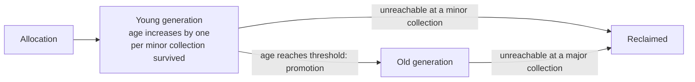

# 13.8 The Generational Hypothesis and Generational Collection

The comment at the top of `runtime/mgc.go` summarizes Go's collector as follows
[[Go Authors, 2026](#ref-go-authors-2026)]:

```go
// The GC runs concurrently with mutator threads, is type accurate (aka precise), allows multiple
// GC threads to run in parallel. It is a concurrent mark and sweep that uses a write barrier. It is
// non-generational and non-compacting. Allocation is done using size segregated per P allocation
// areas to minimize fragmentation while eliminating locks in the common case.
```

Non-generational and non-compacting: this differs from the HotSpot JVM and .NET, whose collectors
both divide objects into generations by age, which is why generations are often regarded as the
standard way to make collection efficient. The Go team did try. After abandoning the
request-oriented collector ([13.9](./roc.md)), they implemented two non-moving generational
collectors, measured them, and did not adopt either. This section first presents the principle of
generational collection and how mainstream runtimes implement it, and then describes Go's
experiments and the reasons they were dropped.

## 13.8.1 The Generational Hypothesis

A tracing collector traverses all live objects in every cycle, so its cost grows with the size of
the live heap ([13.1](./basic.md)). Generational collection exploits the distribution of object
lifetimes to reduce that work. The HotSpot tuning guide states that generational collection exploits
several properties observed in most applications, the most important being the weak generational
hypothesis: most objects survive only a short time, for example an iterator object that typically
lives only for the duration of one loop [[Oracle, 2021](#ref-oracle-2021)]. JEP 439 puts it more
fully: young objects tend to die young, and old objects tend to live for a long time
[[Karlsson, 2023](#ref-karlsson-2023)]. This observation is called the **generational hypothesis**.
Lieberman and Hewitt proposed a collector that divides the heap into regions by object lifetime in
1983 [[Lieberman and Hewitt, 1983](#ref-lieberman-hewitt-1983)], and Ungar's generation scavenging
the following year was another early contribution in this direction
[[Ungar, 1984](#ref-ungar-1984)].

Generational collection accordingly divides the heap into a young generation and an old generation.
Newly allocated objects go into the young generation, and objects that survive a number of
collections are moved to the old generation, a step called promotion. When the young generation
fills up, only it is collected, which is called a minor collection; the whole heap is collected only
when the old generation fills up, which is called a major collection. The HotSpot guide points out
that the cost of a minor collection is roughly proportional to the number of live objects in the
region being collected, so a young generation full of dead objects can be collected very quickly
[[Oracle, 2021](#ref-oracle-2021)]. Suppose the young generation holds $N$ objects of which a
fraction $s$ is live. A minor collection does about $sN$ units of work and reclaims about $(1-s)N$
objects, so the work per reclaimed object is about $s/(1-s)$. With $s$ at 5%, this ratio is about
0.05. The live fraction of the whole heap is much higher, because most objects in the old generation
are still alive, so the same amount of work in a full collection recovers far less memory.

## 13.8.2 Remembered Sets and Promotion

When only the young generation is collected, the root set is no longer just the stacks and global
variables. An old object may hold a pointer to a young object; if a young object is referenced only
through such a pointer, a minor collection must treat these fields as roots as well, or it would
mistake a live object for garbage. A generational collector therefore has to record the locations in
the old generation that may point into the young generation. This set is called the **remembered
set**, and its implementations are surveyed in [[Jones et al., 2023](#ref-jones-2023)]. The
remembered set is maintained by the write barrier ([13.2](./barrier.md)): every time the mutator
stores to a pointer field, the write barrier checks or records the store.

The most common implementation is the **card table**. The heap is divided into fixed-size cards,
typically one byte of the card table per 512 bytes of heap. On a pointer store the write barrier
marks the containing card dirty, and a minor collection scans only the address ranges covered by
dirty cards [[Karlsson, 2023](#ref-karlsson-2023)]. In pseudocode:

```go
// Executed when the mutator stores to a pointer field
func writePointer(slot *unsafe.Pointer, ptr unsafe.Pointer) {
	*slot = ptr
	cardTable[uintptr(unsafe.Pointer(slot))>>9] = dirty // one card per 512 bytes
}

// Roots of a minor collection: stacks and globals, plus the pointer fields in dirty cards
func minorGC() {
	roots := stackAndGlobalRoots()
	for i := range cardTable {
		if cardTable[i] == dirty {
			roots = append(roots, pointersInCard(i)...)
			cardTable[i] = clean
		}
	}
	collectYoung(roots) // copy live objects; promote those whose age reaches the threshold
}
```

This barrier checks neither whether the written object is in the old generation nor whether the
stored value points into the young generation. An implementation can add filters; for example, the
slow path of the Generational ZGC barrier filters out stores to fields of young objects, but does
not filter on the stored value [[Karlsson, 2023](#ref-karlsson-2023)]. Filtered or not, the barrier
stays on for as long as the mutator runs, and every pointer store pays for it.

Mainstream generational collectors move objects during minor collections. The young generation of
the HotSpot serial collector consists of Eden and two survivor spaces. Most objects are allocated in
Eden. At a collection, live objects in Eden and one survivor space are copied to the other survivor
space, and the two survivor spaces then swap roles. An object is moved to the old generation once it
has been copied between survivor spaces a certain number of times, or when the survivor space runs
out of room [[Oracle, 2021](#ref-oracle-2021)]. Copying means a minor collection touches only live
objects, compacts the free memory of the young generation, and advances object age naturally with
the number of copies. The life cycle of an object in a generational heap is shown below:



## 13.8.3 Generational Collection in Mainstream Runtimes

The .NET managed heap has three generations, 0, 1 and 2. New objects are allocated in generation 0.
After a generation 0 collection, the survivors are compacted and promoted to generation 1, and the
survivors of generation 1 are in turn promoted to generation 2. Collecting a generation also
collects all younger generations, so a generation 2 collection is a full collection. Generations 0
and 1 are called the ephemeral generations. Large objects are allocated on the large object heap and
are logically collected as part of generation 2 [[Microsoft, 2025](#ref-microsoft-2025)].

The JDK 17 tuning guide states that, among the HotSpot collectors, all but ZGC use generational
collection [[Oracle, 2021](#ref-oracle-2021)]. ZGC targets low latency: nearly all of its work runs
concurrently with application threads, pauses are on the order of microseconds and independent of
heap size, and it has been production-ready since JDK 15. It originally did not distinguish objects
by age and processed all objects in every cycle, which is fine as long as memory and CPU suffice for
the collector to keep up with allocation. JEP 439 in JDK 21 added a generational mode, aiming to
lower the risk of allocation stalls and to reduce both the extra heap memory required and the CPU
overhead of collection, while keeping pauses under 1 millisecond
[[Karlsson, 2023](#ref-karlsson-2023)]. JDK 23 made the generational mode the default
[[Boldt-Christmas, 2024a](#ref-boldt-christmas-2024a)], and JDK 24 removed the non-generational mode
[[Boldt-Christmas, 2024b](#ref-boldt-christmas-2024b)].

ZGC's history is worth comparing with Go's. Like Go's collector, ZGC trades concurrency for short
pauses, yet it eventually chose generations, which shows that the benefit of generations is not only
shorter pauses. But ZGC already moves objects, and for that purpose inserts a load barrier into the
mutator, which lazily fixes stale pointers to moved objects when the application loads a pointer;
the write barrier and remembered set that generations need are built on top of this existing
machinery [[Karlsson, 2023](#ref-karlsson-2023)]. Go's collector does not move objects and has no
barrier outside the mark phase, so the marginal cost of introducing generations is much higher.
Whether generations pay off depends on which mechanisms the collector was already paying for.

## 13.8.4 Go's Non-Moving Generational Experiments

Hudson reviewed this history in his ISMM 2018 keynote [[Hudson, 2018a](#ref-hudson-2018a)]. The Go
team first tried the request-oriented collector ([13.9](./roc.md)) and turned to generational
collection only after it failed. This book arranges its sections by topic, so their order here is
the reverse of the historical one. The team was unwilling to give up low latency or the fact that
objects do not move, so what it needed was a non-moving generational collector.

Non-moving generational collection uses the sticky mark bits method, proposed by Demers, Boehm and
others [[Demers et al., 1990](#ref-demers-1990)]. Since Go 1.7, objects have been allocated directly
on the mark bitmap ([12.5](../ch12alloc/smallalloc.md)), and this method can reuse that same bitmap.
The allocator advances along the bitmap and allocates objects at positions whose value is 0. A bit
that is 1 means the corresponding object survived the last collection and belongs to the old
generation; an object at a position that is still 0 when the allocator reaches it is a newly
allocated young object. A minor collection does not clear the marks of the previous cycle. If an
object whose bit is 1 points to an object whose bit is 0, the latter's bit is set to 1, which
completes its promotion, and all reachable young objects are promoted transitively along pointers.
After promotion finishes, the allocator returns to the start of the bitmap, and the 0 bits not
touched in this cycle are the free positions [[Hudson, 2018a](#ref-hudson-2018a)]. Promotion needs
no copying, and an object's age has just one bit: whether it survived the last collection.

The first version maintained the remembered set with a card table. While a collection cycle was
running it used the existing write barrier; while the collector was idle it used a fast write
barrier that recorded the written pointers in a buffer and flushed the buffer into the card table
when it filled up. This version did well on benchmarks with large heaps, but the results on the
performance benchmarks selected by the compiler team were disappointing. Hudson concluded that the
write barrier, though fast, was still not fast enough, and hard to optimize. For example, if the
only writes to an object between its allocation and the next safe point are initializations, the
barrier could be omitted; but the runtime was moving toward a design in which every instruction can
be a safe point, and such opportunities would disappear [[Hudson, 2018a](#ref-hudson-2018a)]. That
direction was later realized with the asynchronous preemption of Go 1.14
([9.7](../../part3concurrency/ch09sched/preemption.md)).

The second idea came from Austin Clements: instead of a write barrier, keep a hash of all the
pointers in each card. If a pointer was written into a card between two collections, its hash
changes and the card is considered dirty. The hash can be computed with the processor's AES
instructions, and walking the cards visits memory in address order, which is friendly to caches and
hardware prefetching. This moves the cost of recording cross-generation pointers from the mutator
into the collection cycle. It also allows the decision to collect generationally to be deferred to
the start of each cycle and left to the pacer ([13.3](./pacing.md)), which can turn generations off
for programs that gain nothing from them [[Hudson, 2018a](#ref-hudson-2018a)]. In September 2018
Hudson uploaded this implementation as a series of CLs marked DO NOT SUBMIT, with a card size of 1
KiB [[Hudson, 2018b](#ref-hudson-2018b)]. The comment at the top of the new file `mgcgen.go`
describes the design:

```go
// Go uses a sticky bit approach to implement generational
// GC. (See Alan Demers, Mark Weiser, Barry Hayes,
// Hans Boehm, Daniel Bobrow, and Scott Shenker. 1989.
// ...
// Instead of "card marking" Go uses "card hashing" to
// identify regions that may contain pointers from
// mature to young objects. This approach has the advantage
// of eliminating the write barrier typically used to
// monitor the installation of mature to young pointers.
// ...
// Go's card table entries hold a hash for each card.
// This hash is created by hashing all the heap pointers in
// the card. If a rehashing of the card produces the
// same hash then the card is considered unchanged.
// If on the other hand the hash changes from one GC cycle
// to the next cycle then the card is considered changed.
// The main advantage of this approach is that it does
// not need a write barrier so applications that do not
// benefit from a generation GC avoid the write barrier
// tax.
```

Using hashes to detect whether a card was rewritten can fail with some probability: on a hash
collision a rewritten card is judged unchanged, and the young objects in it might be wrongly
reclaimed. A comment in the same file estimates this. Suppose 400 million chips run Go programs with
10 GB heaps every year, each collecting once per second. With a 64-bit hash, the mean time to
failure per chip is about 58419 years, so 64 bits is sufficient. Whether each cycle performs a
generational or a full collection is decided by comparing the weighted decaying averages of the
mark-to-allocation ratio, tracked separately for the two kinds of cycle
[[Hudson, 2018b](#ref-hudson-2018b)]. According to Hudson's talk, the card-hashing version also did
well on the large-heap benchmarks, but showed several clear outliers on the performance benchmarks.
Because cross-generation pointer handling was now concentrated inside the collection cycle, the team
envisioned the pacer deciding per cycle and turning generations off
[[Hudson, 2018a](#ref-hudson-2018a)]. This series of CLs stayed at the experimental stage and has
never been merged.

## 13.8.5 Why It Was Not Adopted

In 2017, someone asked on Go's issue tracker why Go does not use generational and compacting
collection, and the question was redirected to the golang-nuts mailing list
[[BlueBlue-Lee, 2017](#ref-blueblue-lee-2017)]. Ian Lance Taylor's answer there lists several
reasons [[Taylor, 2017](#ref-taylor-2017)], and Hudson's talk gives the judgment after the
experiments. Together they come down to three points.

First, escape analysis has already disposed of many short-lived objects. The benefit of generational
collection comes mainly from short-lived objects, but Go's compiler uses escape analysis
([15.5](../../part5toolchain/ch15compile/escape.md)) to allocate many of them on the stack. They are
freed when the function returns, never enter the heap, and so are never the collector's business
[[Taylor, 2017](#ref-taylor-2017)]. Hudson put it this way: "It isn't that the generational
hypothesis isn't true for Go, it's just that the young objects live and die young on the
stack." [[Hudson, 2018a](#ref-hudson-2018a)] The following program uses `testing.AllocsPerRun` to
count the average number of heap allocations per call of two functions:

```go {run=true}
package main

import (
	"fmt"
	"testing"
)

var sink *int

func local(n int) int {
	p := new(int) // the address does not leave the function
	for i := 0; i < n; i++ {
		*p += i
	}
	return *p
}

func escape(n int) int {
	p := new(int) // the address is stored in a global variable
	sink = p
	for i := 0; i < n; i++ {
		*p += i
	}
	return *p
}

func main() {
	fmt.Println("local: ", testing.AllocsPerRun(1000, func() { local(10) }))
	fmt.Println("escape:", testing.AllocsPerRun(1000, func() { escape(10) }))
}
```

The output is:

```
local:  0
escape: 1
```

Both functions create their object with `new`, but only the one whose address is stored in a global
variable allocates on the heap. The compiler's decisions can be seen with `-gcflags=-m`. Only the
lines about `new(int)` are kept below; the last two lines correspond to the copies of the two
functions inlined into the closures in `main`:

```shell
$ go build -gcflags=-m . 2>&1 | grep 'new(int)'
./main.go:11:10: new(int) does not escape
./main.go:19:10: new(int) escapes to heap
./main.go:28:66: new(int) does not escape
./main.go:29:67: new(int) escapes to heap
```

The object in `local` is exactly the kind of short-lived object that young-generation collection
targets, and in Go it never appears on the heap at all.

Second, Go does not need generations to shorten pauses. Taylor points out that generational
collectors usually aim at short pauses: collecting only the youngest generation keeps the pause
short. Go's collector is concurrent, and "in Go the pause time is independent of the size of the
youngest generation, or of any generation." Go's basic assumption is that in a multithreaded program
it is better to collect in parallel on another core and spend somewhat more CPU time overall than to
stall the whole program longer in order to cut collection time [[Taylor, 2017](#ref-taylor-2017)].
Hudson explained the point from the other side:

> The real value of generational GC is that, when looking at GC times, the write barrier costs are
> ignored since they are smeared across the mutator. This is generational GC's great advantage, it
> greatly reduces the long STW times of full GC cycles but it doesn't necessarily improve
> throughput. Go doesn't have this stop the world problem so it had to look more closely at the
> throughput problems [[Hudson, 2018a](#ref-hudson-2018a)].

Third, in throughput, the write barrier of generational collection has difficulty competing with the
cost of marking. In the cost model of the GC guide, the CPU cost of a cycle is a fixed cost plus a
mark cost proportional to the size of the live heap, and `GOGC` determines how much new memory can
be allocated between collections, about `GOGC/100` times the live heap (together with roots)
[[Go Authors, 2022](#ref-go-authors-2022)]. Ignoring the fixed cost and roots, let the live heap be
$L$ and the average mark cost per byte be $c$. The mark cost amortized over each allocated byte is
then about

$$
\frac{cL}{L \cdot \mathrm{GOGC}/100} = \frac{100c}{\mathrm{GOGC}},
$$

which does not depend on the size of the live heap and is determined only by `GOGC`: doubling `GOGC`
halves the mark cost per allocation, at the price of a larger peak heap. The example in the guide is
a program with a 10 MiB live heap that allocates 10 MiB per second. Collecting once per CPU second
makes collection take 10% of the CPU, with a peak heap of 20 MiB; collecting once per two CPU
seconds lowers the CPU cost to 5% and raises the peak heap to 30 MiB
[[Go Authors, 2022](#ref-go-authors-2022)].

The cost of a write barrier, by contrast, is added to every pointer store and is independent of
collection frequency. Hudson estimated the write barrier cost at about 4% to 5%. In the analysis
charts of his talk, for programs with a mark cost of 10% or even 20%, collection cycles become
sparser as the heap grows, the cumulative mark cost falls quickly and eventually drops below the
cost of the write barrier; the write barrier cost is constant and cannot be reduced in the same way
[[Hudson, 2018a](#ref-hudson-2018a)]. Go's current write barrier is enabled only during marking
([13.2](./barrier.md)):

```go
func setGCPhase(x uint32) {
	atomic.Store(&gcphase, x)
	writeBarrier.enabled = gcphase == _GCmark || gcphase == _GCmarktermination
}
```

Card-table-based generational collection requires the barrier to stay on for as long as the mutator
runs, and the first version still had to execute the fast write barrier while the collector was
idle, which is why it fell behind on the performance benchmarks. Hudson's judgment about hardware
supports this trade-off further: chip capacity continues Moore's law better than processors do,
and "doubling memory is going to be a better value than doubling
cores" [[Hudson, 2018a](#ref-hudson-2018a)]. Trading memory for CPU is exactly what `GOGC` does.

Compacting collection is similar. Taylor points out that the main benefits of compaction are
avoiding fragmentation and letting the allocator allocate by moving a single pointer (bump-pointer
allocation). An allocator based on TCMalloc has almost no fragmentation problem, and bump-pointer
allocation in a multithreaded program needs locking, which is less efficient than having each thread
cache its own memory [[Taylor, 2017](#ref-taylor-2017)]. Go's allocator is organized by size class
and cached per P ([12.1](../ch12alloc/basic.md)).

These reasons have preconditions. Trading memory for CPU requires memory to be plentiful; in
memory-constrained deployments with a memory limit ([13.3](./pacing.md)), the room for adjusting
`GOGC` shrinks, and reducing heap memory overhead is one of the goals of Generational ZGC. Taylor
also noted in 2017 that whether generational collection would reduce Go's collection work had not
been tested; Hudson's experiments gave the answer at the time, not a final verdict.

## 13.8.6 Summary

Generational collection rests on the generational hypothesis: most objects die young, so collecting
only the young generation reclaims more memory with less work. The price is the remembered set,
usually maintained by an always-on write barrier and a card table; mainstream implementations also
rely on copying to promote objects and compact the young generation. The Go team implemented two
generational collectors that keep objects in place and preserve low latency, one maintaining the
card table with a buffered write barrier and the other replacing the write barrier with card
hashing, and merged neither. The reasons are that escape analysis already keeps many young objects
on the stack, that concurrent collection already makes pauses independent of generation size, and
that, in throughput, a mark cost that falls as the heap grows is hard to offset against an always-on
write barrier. Go later looked for improvements in the memory-access locality of marking, which is
Green Tea ([13.11](./greentea.md)), enabled by default in Go 1.26.

## Further Reading

- <a id="ref-blueblue-lee-2017"></a>[BlueBlue-Lee, 2017] BlueBlue-Lee. Go issue #20373. *Why
  golang's garbage collector not implement Generational and Compact gc?* 2017.
  https://github.com/golang/go/issues/20373 The question was closed and redirected to the
  golang-nuts mailing list; for the explanations (escape analysis, concurrent collection making
  pauses independent of generation size, and so on), see the reply by Go team member Ian Lance
  Taylor on the list (Taylor, 2017).
- <a id="ref-boldt-christmas-2024a"></a>[Boldt-Christmas, 2024a] Axel Boldt-Christmas. JEP 474: ZGC:
  Generational Mode by Default. OpenJDK, 2024. https://openjdk.org/jeps/474
  Shipped in JDK 23.
- <a id="ref-boldt-christmas-2024b"></a>[Boldt-Christmas, 2024b] Axel Boldt-Christmas. JEP 490: ZGC:
  Remove the Non-Generational Mode. OpenJDK, 2024. https://openjdk.org/jeps/490
  Shipped in JDK 24.
- <a id="ref-demers-1990"></a>[Demers et al., 1990] Alan Demers, Mark Weiser, Barry Hayes, Hans
  Boehm, Daniel Bobrow, Scott Shenker. "Combining Generational and Conservative Garbage Collection:
  Framework and Implementations." *POPL '90*, 261–269, 1990. https://doi.org/10.1145/96709.96735 The
  origin of sticky mark bits.
- <a id="ref-go-authors-2022"></a>[Go Authors, 2022] The Go Authors. *A Guide to the Go Garbage
  Collector.* https://go.dev/doc/gc-guide The design of the current non-moving concurrent mark-sweep
  collector, and the cost model centered on `GOGC`.
- <a id="ref-go-authors-2026"></a>[Go Authors, 2026] The Go Authors. src/runtime/mgc.go (header
  comment, `setGCPhase`). Go 1.26 source.
  https://github.com/golang/go/blob/release-branch.go1.26/src/runtime/mgc.go
- <a id="ref-hudson-2018a"></a>[Hudson, 2018a] Rick Hudson. *Getting to Go: The Journey of Go's
  Garbage Collector.* ISMM 2018 keynote, 2018. https://go.dev/blog/ismmkeynote The first-hand
  account of how Go implemented and abandoned non-moving generational collection.
- <a id="ref-hudson-2018b"></a>[Hudson, 2018b] Rick Hudson. runtime: constants and data structures
  for generational GC. Go CL 137476, 2018. https://go.dev/cl/137476 The first CL of the card-hashing
  generational collector series; the same series also includes CL 137481 (sticky mark bits) and CL
  137482 (triggering generational cycles), none of which was merged.
- <a id="ref-jones-2023"></a>[Jones et al., 2023] Richard Jones, Antony Hosking, Eliot Moss. *The
  Garbage Collection Handbook: The Art of Automatic Memory Management.* 2nd ed., CRC Press, 2023.
  https://doi.org/10.1201/9781003276142 A systematic treatment of remembered sets, card tables and
  the mechanisms of generational collection.
- <a id="ref-karlsson-2023"></a>[Karlsson, 2023] Stefan Karlsson. JEP 439: Generational ZGC.
  OpenJDK,
  2023. https://openjdk.org/jeps/439
  Shipped in JDK 21.
- <a id="ref-lieberman-hewitt-1983"></a>[Lieberman and Hewitt, 1983] Henry Lieberman, Carl
  Hewitt. "A Real-Time Garbage Collector Based on the Lifetimes of Objects." *Communications of the
  ACM* 26(6): 419–429, 1983. https://doi.org/10.1145/358141.358147 One of the earliest sources of
  the idea of generational collection.
- <a id="ref-microsoft-2025"></a>[Microsoft, 2025] Microsoft. Fundamentals of Garbage Collection.
  .NET documentation, 2025.
  https://learn.microsoft.com/en-us/dotnet/standard/garbage-collection/fundamentals
- <a id="ref-oracle-2021"></a>[Oracle, 2021] Oracle. *Java Platform, Standard Edition HotSpot
  Virtual Machine Garbage Collection Tuning Guide*, Release 17, 2021.
  https://docs.oracle.com/en/java/javase/17/gctuning/garbage-collector-implementation.html
- <a id="ref-taylor-2017"></a>[Taylor, 2017] Ian Lance Taylor. Re: Why golang garbage-collector not
  implement Generational and Compact gc? golang-nuts, 2017.
  https://groups.google.com/g/golang-nuts/c/KJiyv2mV2pU/m/wdBUH1mHCAAJ
- <a id="ref-ungar-1984"></a>[Ungar, 1984] David Ungar. "Generation Scavenging: A Non-Disruptive
  High Performance Storage Reclamation Algorithm." *SDE 1984*, 157–167, 1984.
  https://doi.org/10.1145/800020.808261 "Generation scavenging", the founding work of generational
  collection.
- This book: [13.9 The Request Hypothesis and the Request-Oriented Collector](./roc.md),
  [13.12 Past, Present, and Future](./history.md),
  [15.5 Escape Analysis](../../part5toolchain/ch15compile/escape.md).
