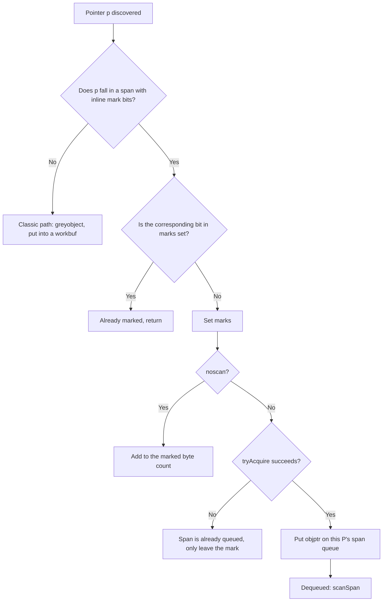
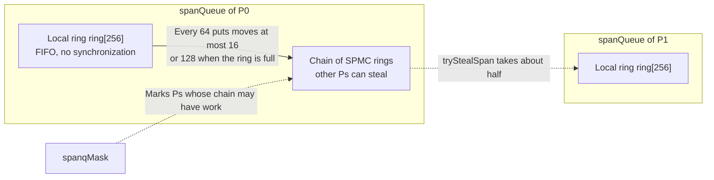

# 13.11 Green Tea: Locality-Aware Marking

The previous sections dealt with the correctness and timeliness of marking: the write barrier
([13.2](./barrier.md)) guarantees that concurrent marking misses nothing, and pacing and mark assist
([13.3](./pacing.md), [13.4](./mark.md)) guarantee that marking keeps up with allocation. This
section turns to a different question, how fast marking itself runs. In the Green Tea design
document (issue #73581), Knyszek and Clements point out that memory latency and bandwidth are an
increasing constraint: processor clocks grow faster than DRAM clocks, more cores load a physically
limited memory bus, and the speed of light forces memory topologies to become more and more
non-uniform. Spatial locality, temporal locality and awareness of topology therefore matter more and
more for high-performance systems, yet most garbage collection algorithms today work against these
trends [[Knyszek and Clements, 2025a](#ref-knyszek-clements-2025a)].

Green Tea is a new marking algorithm aimed at this problem. It shipped in Go 1.25 as the experiment
`GOEXPERIMENT=greenteagc`, has been enabled by default since Go 1.26, and can be turned off with
`GOEXPERIMENT=nogreenteagc` [[Go Authors, 2025](#ref-go-authors-2025)]
[[Go Authors, 2026a](#ref-go-authors-2026a)]. It changes neither the tricolor abstraction nor the
barriers. What changes is how the marker walks objects: instead of scanning objects one at a time,
it accumulates the objects waiting to be scanned that fall in the same span and scans them together.
This section covers, in turn, the locality problem it addresses, the core mechanism of accumulating
per span, the fast path for a single object, the span queue and work distribution, the two paths for
scanning a span, and finally its effects, limitations and evolution.

## 13.11.1 The Locality Problem of Marking

Classic tricolor marking ([13.1](./basic.md)) starts from grey objects, scans the pointers in them,
colors the white objects they point to grey and puts them on a work queue, until the queue is empty.
The design document calls this a **graph flood**: heap objects are the nodes of a graph, pointers
are its edges, and the order of traversal pays no attention to where objects sit in memory. The
result is very poor spatial locality, as the marker jumps between completely unrelated regions of
memory; temporal locality is equally poor, as repeated accesses to the same memory are spread across
the whole collection cycle; and the memory topology is ignored entirely. The data in the design
document: the collector spends 85% of its time on average in the core loop of the graph flood, the
scan loop, and more than 35% of the CPU cycles in the scan loop are spent merely waiting for memory
accesses [[Knyszek and Clements, 2025a](#ref-knyszek-clements-2025a)]. The Green Tea blog post gives
a similar conclusion from another angle: about 90% of the cost of collection goes to marking and
about 10% to sweeping, and at least 35% of the marking time is typically stalled on accesses to heap
memory [[Knyszek and Clements, 2025b](#ref-knyszek-clements-2025b)].

Most memory accesses in marking are pointer chasing: the address of the next access is read from the
result of the previous load, so the hardware prefetcher struggles to find a predictable access
pattern, and the metadata of an object, such as its pointer bitmap, is stored elsewhere and requires
additional accesses. The design document expects this problem to get worse as multicore and
non-uniform memory architectures spread. It also cites the division in *The Garbage Collection
Handbook*: parallel collection algorithms fall into processor-centric and memory-centric ones, where
the former aggressively balance work among processors for maximum parallelism, and the latter may
not parallelize as well but process contiguous chunks of the heap. Go's existing marking algorithm
belongs entirely to the former, and the handbook asserts that all known parallel marking algorithms
are processor-centric [[Knyszek and Clements, 2025a](#ref-knyszek-clements-2025a)]. The design
document says Green Tea is, if not memory-centric, at least memory-aware: it tries to process
objects that are adjacent to one another together.

This idea contrasts with the two abandoned routes in [13.8](./generational.md) and [13.9](./roc.md).
Generational collection and ROC exploit regularities of objects in time, namely age and request
boundaries, to scan fewer objects, at the cost of a write barrier that stays on throughout mutator
execution. Green Tea exploits a regularity in space: the allocator places objects of the same size
class in the same span ([12.2](../ch12alloc/component.md)), so these objects have the same size and
are adjacent, and if they are discovered at nearby moments they can be processed together. It does
not reduce the objects that need scanning but tries to scan the same number faster, and therefore
needs no change to the write barrier.

## 13.11.2 Accumulating per Span

The design document summarizes the core idea of Green Tea this way: the collector no longer scans
objects one at a time but in much larger contiguous blocks of memory. What is queued on the shared
work queue are these blocks, and the objects in a block that are waiting to be scanned are recorded
by the block itself. The central assumption is that while a block waits in the queue it accumulates
more objects that need scanning, so when it is dequeued a single scan handles more than one object;
this improves the locality of memory access and also amortizes the fixed cost of each scan better
[[Knyszek and Clements, 2025a](#ref-knyszek-clements-2025a)]. In Go's implementation such a block is
a span. The comment at the start of `mgcmark_greenteagc.go` adds that handling objects in batches
improves the chance of touching adjacent objects, amortizes the cost of accessing object metadata,
and creates better conditions for prefetching [[Go Authors, 2026b](#ref-go-authors-2026b)].

To this end each span maintains two sets of bits: the mark bits `marks`, set when a pointer to an
object is first discovered, and the scan bits `scans`, which record that an object has been scanned.
The design document calls them the grey bit and the black bit: a white object has neither bit set, a
grey object has only the grey bit set, and a black object has both. The comment in `mgcwork.go`
correspondingly says that for objects on a span queue, grey means marked but with the scan bit
unset, and black means marked with the scan bit set ([13.1.3](./basic.md)). When a span is dequeued,
`spanSetScans` compares the two sets of bits one machine word at a time (abridged)
[[Go Authors, 2026b](#ref-go-authors-2026b)]:

```go
	for i := uintptr(0); i < bytes; i += goarch.PtrSize {
		scans := atomic.Loaduintptr(&imbScans[i/goarch.PtrSize])
		marks := imbMarks[i/goarch.PtrSize]
		// ...
		toGrey := marks &^ scans
		toScan[i/goarch.PtrSize] = toGrey

		// If there's anything left to grey, do it.
		if toGrey != 0 {
			toGrey = bswapIfBigEndian(toGrey)
			if goarch.PtrSize == 4 {
				atomic.Or32((*uint32)(unsafe.Pointer(&imbScans[i/goarch.PtrSize])), uint32(toGrey))
			} else {
				atomic.Or64((*uint64)(unsafe.Pointer(&imbScans[i/goarch.PtrSize])), uint64(toGrey))
			}
		}
		objsMarked += sys.OnesCount64(uint64(toGrey))
	}
```

The objects that are marked but not yet scanned, `marks &^ scans`, form the set `toScan` to be
scanned this time, and are merged into `scans` at the same time, so `scans` becomes the union of the
two. Even if the same span is enqueued several times in succession, each object is scanned only
once, and collection stays precise.

This mechanism is used only for small objects. The condition of `gcUsesSpanInlineMarkBits` is
`heapBitsInSpan(size) && size >= 16`, that is, the size classes from 16 to 512 bytes whose pointer
bitmap is stored at the end of the span, and whose spans each occupy exactly one 8 KiB page
[[Go Authors, 2026b](#ref-go-authors-2026b)]. The design document explains the choice of small
objects: the collector spends very little scanning time on each small object, so the fixed cost of
each scan is hardest to amortize there [[Knyszek and Clements, 2025a](#ref-knyszek-clements-2025a)].
Objects of other sizes still take the original object-by-object path, and objects larger than 128
KiB are still split into oblets for parallel scanning as before ([13.4](./mark.md)). The two sets of
bits, together with an ownership flag and the size class, make up the 128-byte structure
`spanInlineMarkBits` placed at the end of the span; its layout and its effect on the number of slots
per span are in [12.2.1](../ch12alloc/component.md), and the `pageUseSpanInlineMarkBits` bitmap in
`heapArena` marks which pages belong to such spans ([12.2.4](../ch12alloc/component.md)).

When a pointer is discovered, `tryDeferToSpanScan` decides which path it takes (abridged)
[[Go Authors, 2026b](#ref-go-authors-2026b)]:

```go
func tryDeferToSpanScan(p uintptr, gcw *gcWork) bool {
	// ...
	// Quickly to see if this is a span that has inline mark bits.
	ha := heapArenaOf(p)
	if ha == nil {
		return false
	}
	pageIdx := ((p / pageSize) / 8) % uintptr(len(ha.pageInUse))
	pageMask := byte(1 << ((p / pageSize) % 8))
	if ha.pageUseSpanInlineMarkBits[pageIdx]&pageMask == 0 {
		return false
	}

	// Find the object's index from the span class info stored in the inline mark bits.
	base := alignDown(p, gc.PageSize)
	q := spanInlineMarkBitsFromBase(base)
	objIndex := uint16((uint64(p-base) * uint64(gc.SizeClassToDivMagic[q.class.sizeclass()])) >> 32)

	// Set mark bit.
	idx, mask := objIndex/8, uint8(1)<<(objIndex%8)
	if atomic.Load8(&q.marks[idx])&mask != 0 {
		return true
	}
	atomic.Or8(&q.marks[idx], mask)

	// Fast-track noscan objects.
	if q.class.noscan() {
		gcw.bytesMarked += uint64(gc.SizeClassToSize[q.class.sizeclass()])
		return true
	}

	// Queue up the pointer (as a representative for its span).
	if q.tryAcquire() {
		if gcw.spanq.put(makeObjPtr(base, objIndex)) {
			// ...
		}
	}
	return true
}
```

The decision needs only one lookup in a page-granularity bitmap, which, as the design document
points out, fits easily in cache even for a large heap and sees very little contention. Because such
spans are exactly one page and page-aligned, the location of the metadata can be computed directly
from the address: `spanInlineMarkBitsFromBase` takes the start address of the page, adds 8 KiB and
subtracts the size of the structure, and the index of the object is computed from the offset using
the division magic number of the size class. The whole process need not go through `mspan`, which
avoids the indirect accesses and interdependent loads that badly hurt performance. An object without
pointers only needs its mark bit set and is never queued. An object with pointers is queued in the
form of an `objptr` that stands for its span: the low 13 bits of a page-aligned span start address
are always zero, which is exactly where the index of the object within the span is stored.



## 13.11.3 The Fast Path for a Single Object

If only one object needs scanning when a span is dequeued, processing per span does more work than
the object-by-object algorithm. The design document uses two measures for this: it records the
object that was marked when the span was enqueued as the span's representative, and gives the span a
flag indicating that further objects were marked while it was queued. When scanning, if this flag is
not set, the representative object is scanned directly and the whole span is not processed
[[Knyszek and Clements, 2025a](#ref-knyszek-clements-2025a)].

In the implementation, the representative is the object index in the `objptr`, and the flag is the
ownership field `owned` in `spanInlineMarkBits`. It has three states: `spanScanUnowned` means nobody
has claimed the span; `spanScanOneMark` means exactly one mark bit is set relative to the scan bits;
`spanScanManyMark` means possibly more than one is set [[Go Authors, 2026b](#ref-go-authors-2026b)].
`tryAcquire` advances this state with an atomic OR; only the thread that moves it out of
`spanScanUnowned` succeeds in claiming the span and is responsible for enqueueing it, and when
further objects in this span are marked afterwards, `tryAcquire` only advances the state to
`spanScanManyMark`. At the start, `scanSpan` calls `release`, which releases the span with an atomic
exchange and returns the state before the release:

```go
	// Release span.
	if imb.release() == spanScanOneMark {
		// Nobody else set any mark bits on this span while it was acquired.
		// That means p is the sole object we need to handle. Fast-track it.
		objIndex := p.objIndex()
		bytep := &imb.scans[objIndex/8]
		mask := uint8(1) << (objIndex % 8)
		if atomic.Load8(bytep)&mask != 0 {
			return
		}
		atomic.Or8(bytep, mask)
		gcw.bytesMarked += uint64(elemsize)
		// ...
		b := spanBase + uintptr(objIndex)*elemsize
		scanObjectSmall(spanBase, b, elemsize, gcw)
		return
	}
```

The return value is only an upper bound: with `spanScanManyMark` there may in fact be only one mark
bit, in which case the full merge and difference is performed, and the result is still correct,
merely at the cost of some extra work. After the release, newly discovered pointers can claim the
span again and have it re-enqueued.

## 13.11.4 The Span Queue and Work Distribution

The classic marker gives each worker a fixed-size local object stack and, to preserve parallelism,
frequently checks and refills a global list; the design document points out that on multicore
systems frequent modification of the global list is a major source of contention. Green Tea sets up
a separate queue for spans, the **span queue**, whose structure follows the distributed, stealable
run queues of the goroutine scheduler; stealing directly from other workers reduces contention on
the global list, and queueing per span makes the queues hold far fewer items, which lowers
contention at its root [[Knyszek and Clements, 2025a](#ref-knyszek-clements-2025a)].

The `spanQueue` of each P has two parts [[Go Authors, 2026b](#ref-go-authors-2026b)]. One is a
256-entry ring buffer accessed only by this P and needing no synchronization; the other is a chain
visible to other Ps, built from single-producer, multi-consumer ring buffers, a structure that the
comments say is modeled on the double-ended queue of `sync.Pool`
([11.6](../../part3concurrency/ch11sync/pool.md)). `put` prefers the local ring and checks once
every 64 puts: it takes half the number of spans in the local ring, at most 16, and if that number
is greater than 4 and the chain is empty, it moves that many spans to the chain to create
parallelism; when the local ring is full it moves half at once, that is, 128. A thief uses the
global bitmap `spanqMask` to find a P whose chain may have work, takes about half of that chain, at
most 128, and puts it in its own local ring. The bitmap is deliberately maintained without
synchronization: a P that fails to steal clears the other's bit, and may happen to erase a bit the
other has just set; the comments say this race window is small, and a wrongly cleared bit is set
again by the irregular barrier in `gcMarkDone` before mark termination ([13.6](./termination.md)).



The order of spans in the queue affects how well they accumulate. The design document compares
several strategies, including first-in first-out, last-in first-out, sparsest first, densest first,
random and sorting by address, and finds that first-in first-out gives the highest average density
of objects waiting to be scanned when a span is dequeued
[[Knyszek and Clements, 2025a](#ref-knyszek-clements-2025a)]; the source comment likewise says that
unlike the workbuf, which is last-in first-out, the span queue is first-in first-out, which
empirically is best for accumulating objects on spans.

When the object queue and the span queue coexist, the order in which work is fetched is fixed by a
table in `mgcwork.go` [[Go Authors, 2026d](#ref-go-authors-2026d)]:

```go
// Work queues must be prioritized in the following order wherever work
// is processed.
//
// +----------------------------------------------------------+
// | Priority | Work queue | Restrictions | Function          |
// |----------------------------------------------------------|
// | 1        | Workbufs   | P-local      | tryGetObjFast     |
// | 2        | Span queue | P-local      | tryGetSpanFast    | [greenteagc]
// | 3        | Workbufs   | None         | tryGetObj         |
// | 4        | Span queue | None         | tryGetSpan        | [greenteagc]
// | 5        | Span queue | None         | tryStealSpan      | [greenteagc]
// +----------------------------------------------------------+
//
// The rationale behind this ordering comes from two insights:
// 1. It's always preferable to look for P-local work first to avoid hammering on
//    global lists.
// 2. It's always preferable to scan individual objects first to increase the
//    likelihood that spans will accumulate more objects to scan.
```

The second rationale comes from the same consideration as the choice of first-in first-out: let a
span stay longer in the queue, so that it accumulates more objects by the time it is dequeued. The
main loop of `gcDrain` fetches work in this order, calling `scanObject` when it gets an object and
`scanSpan` when it gets a span. The organization of workbufs and the global queue is described in
[13.4](./mark.md).

## 13.11.5 Scanning a Span

Apart from the fast path for a single object, `scanSpan` first obtains the set of objects to scan
and their count from `spanSetScans`, and then chooses between two paths by density
[[Go Authors, 2026b](#ref-go-authors-2026b)]:

```go
	// Check if we have enough density to make a dartboard scan
	// worthwhile. If not, just do what scanobject does, but
	// localized to the span, using the dartboard.
	if !scan.HasFastScanSpanPacked() || objsMarked < int(nelems/8) {
		// ...
		scanObjectsSmall(spanBase, elemsize, nelems, gcw, &toScan)
		return
	}

	// Scan the span.
	//
	// N.B. Use gcw.ptrBuf as the output buffer. This is a bit different
	// from scanObjectsSmall, which puts addresses to dereference. ScanSpanPacked
	// on the other hand, fills gcw.ptrBuf with already dereferenced pointers.
	nptrs := scan.ScanSpanPacked(
		unsafe.Pointer(spanBase),
		&gcw.ptrBuf[0],
		&toScan,
		uintptr(spanclass.sizeclass()),
		spanPtrMaskUnsafe(spanBase),
	)
```

The sparse path `scanObjectsSmall` visits only the objects whose bits are set in `toScan`, takes the
pointer bits of each object from the pointer bitmap at the end of the span, issues a prefetch for
each pointer field, and stores the field addresses in a buffer; only after the whole span has been
collected does it read these fields one by one and process the pointers in them. The comments say
the position of the prefetch was chosen empirically. The acknowledgments of the design document
mention that the correct prefetching, loading subsequent pointers in batches to hide memory latency,
and the simpler object pointer traversal all come from microarchitecture advice by Intel's
Vandriessche [[Knyszek and Clements, 2025a](#ref-knyszek-clements-2025a)].

The dense path `ScanSpanPacked` is used when the objects to scan make up at least one eighth of the
span's slots. The design document points out that the vector kernel needs a higher object density to
beat the sparse scan, so it is enabled only when the density reaches the threshold
[[Knyszek and Clements, 2025a](#ref-knyszek-clements-2025a)]. It also requires the processor to have
the corresponding vector instructions: in Go 1.26 there is only an AVX-512 implementation on amd64,
requiring support for the AVX-512 VL, BW, DQ, BITALG, VBMI and GFNI extensions. The package also has
a portable Go implementation, but the comments say it is not fast enough, and jumping from object to
object remains much better even at fairly high object density, so on other platforms
`HasFastScanSpanPacked` is always false and all spans take the sparse path
[[Go Authors, 2026c](#ref-go-authors-2026c)]. The blog post describes the steps of this scan: take
the mark bits and scan bits of a page; their union becomes the new scan bits, and their difference
is the bitmap of active objects to scan in this pass; expand one bit per object to one bit per word
to get the bitmap of active words; intersect it with the pointer bitmap maintained by the allocator
to get the positions of all pointers to scan in the page; finally collect the pointers from memory
according to this bitmap, 64 bytes at a time. In the Go 1.26 implementation, the first two steps are
done by `spanSetScans` in ordinary Go code, `ScanSpanPacked` already receives the bitmap of objects
to scan and the pointer bitmap, and the kernel itself does the expansion, intersection and
collection. The expansion step relies on the `VGF2P8AFFINEQB` instruction of the GFNI extension: it
treats each byte in a vector as an 8-dimensional vector over GF(2) and multiplies it by an 8×8 bit
matrix, so that a few matrices per object size suffice to expand one bit into several; the expansion
functions for each size class are produced by a code generator. This method was designed by Clements
[[Knyszek and Clements, 2025b](#ref-knyszek-clements-2025b)]. The 512-bit registers of AVX-512 are
wide enough that two of them hold the metadata of a whole page, a possibility that exists only
because scanning is organized per span: in an object-by-object graph flood, objects differ in size,
their metadata is sometimes just two bits and sometimes as many as ten thousand, and there is no
regularity for vector hardware to exploit.

Neither path scans the pointers it collects immediately; both hand them to `tryDeferToSpanScan`
again: a pointer to a small object sets the mark bit in the target span and, if needed, enqueues
that span; a pointer to any other object goes through `findObject` and `greyobject` into the classic
object queue.

## 13.11.6 Effects and Limitations

The effect of Green Tea depends on how many objects a span has accumulated by the time it is
dequeued. With `GODEBUG=gctrace=2`, Green Tea prints scan statistics summarized per size class after
the gctrace line of each collection cycle; this output is not documented and its format may change
at any time. The following program builds about two million 24-byte nodes in two ways: a complete
binary tree in which the nodes of each subtree are allocated contiguously, and a linked list whose
nodes are allocated first and then strung together in random order:

```go
package main

import (
	"fmt"
	"math/rand/v2"
	"os"
	"runtime"
)

type node struct {
	left, right *node
	val         int
}

// tree builds a complete binary tree of depth d; the nodes of each subtree are allocated contiguously.
func tree(d int) *node {
	if d == 0 {
		return &node{}
	}
	return &node{left: tree(d - 1), right: tree(d - 1)}
}

// list allocates the same number of nodes, shuffles them randomly, and strings them into a linked list.
func list(n int) *node {
	nodes := make([]*node, n)
	for i := range nodes {
		nodes[i] = &node{}
	}
	rand.Shuffle(n, func(i, j int) { nodes[i], nodes[j] = nodes[j], nodes[i] })
	for i := 0; i+1 < n; i++ {
		nodes[i].left = nodes[i+1]
	}
	return nodes[0]
}

var sink *node

func main() {
	if len(os.Args) > 1 && os.Args[1] == "list" {
		sink = list(1<<21 - 1)
	} else {
		sink = tree(20)
	}
	runtime.GC()
	fmt.Println("done")
}
```

Run on arm64 with Go 1.26.10, taking the summary line of the last collection cycle (the one
triggered by `runtime.GC`):

```shell
$ go build -o ex .
$ GODEBUG=gctrace=2 ./ex tree 2>&1 | grep 'scan: total' | tail -1
scan: total 13066+2084231+0=2097297 objs, 47595+0=47595 spans
$ GODEBUG=gctrace=2 ./ex list 2>&1 | grep 'scan: total' | tail -1
scan: total 2097227+66+0=2097293 objs, 11+0=11 spans
```

The exact numbers differ somewhat from run to run, but the ratio between the two is stable.

According to the field comments of `sizeClassScanStats`, the three terms of the object count are, in
order, objects scanned one at a time, objects scanned through the sparse path `scanObjectsSmall`,
and objects scanned through the dense path `ScanSpanPacked`; the two terms of the span count are the
spans scanned through the sparse and dense paths [[Go Authors, 2026b](#ref-go-authors-2026b)]. The
objects scanned one at a time come, in size classes that use inline mark bits, from the
single-object fast path `scanObjectSmall`, and in other size classes from `scanObject`; the former
scans only one object per span and does not count a span. arm64 has no dense path, so the third term
and the second term of the span count are zero. In the binary tree result, about 2.08 million
objects were completed through about 47,600 span scans, an average of about 44 objects per scan; a
24-byte span with pointers has (8192 − 128 − 128) / 24 rounded down, that is 330 slots, so each scan
handles about 13% of them. In the linked list result, almost every object is scanned through the
single-object path: after the random shuffle, successive nodes on the chain fall in different spans,
only its representative object needs scanning when a span is dequeued, and accumulation per span
comes to nothing. The blog post admits that this case can be worse than a graph flood, because the
collector does extra work for accumulation and gets nothing in return; the special path for a single
object mitigates the regression but cannot eliminate it completely
[[Knyszek and Clements, 2025b](#ref-knyszek-clements-2025b)].

In the evaluation in the design document, on the two collection-intensive microbenchmarks garbage
and binary-trees, the CPU cost of collection dropped by 10% to 50% depending on the number of cores,
with the reduction broadly growing with core count, and L1 and L2 cache misses were cut in half.
Among the larger benchmark set, tile38 and bleve-index correspond exactly to the two cases above.
The heap of tile38 is mainly a tree with very high fan-out, on which Green Tea quickly generates
plenty of work and high density, and the collection cost dropped by 35%. The heap of bleve-index is
mainly a binary tree with low fan-out that is modified frequently, and half of the span scans
scanned only one object; the design document conjectures that frequent tree rotations scramble the
structure of the tree in a heap of more than a hundred MiB, whereas binary-trees does no rotations
and the tree layout keeps the good locality of its initial allocation. The conclusion of the design
document: when the application itself has good locality, Green Tea also has good locality, unlike
existing collectors; but it cannot create locality out of nothing
[[Knyszek and Clements, 2025a](#ref-knyszek-clements-2025a)]. The amount of accumulation needed is
also smaller than intuition suggests: the blog reports that scanning only 2% of a page each time
already beats a graph flood [[Knyszek and Clements, 2025b](#ref-knyszek-clements-2025b)]. The binary
tree above scans about 13% of the slots each time, far above this level.

On the wider benchmark set and in real programs, the release notes of both Go 1.25 and Go 1.26
expect a reduction of 10% to 40% in garbage collection overhead for real programs that make heavy
use of the collector [[Go Authors, 2025](#ref-go-authors-2025)]
[[Go Authors, 2026a](#ref-go-authors-2026a)]; the blog adds that around 10% is the most common
improvement, that if a program originally spent 10% of its time on collection the overall CPU saving
is 1% to 4%, and that large-scale deployments inside Google saw similar results
[[Knyszek and Clements, 2025b](#ref-knyszek-clements-2025b)]. The Go 1.26 release notes also state
that on Intel Ice Lake, AMD Zen 4 and newer amd64 processors, scanning small objects with vector
instructions is expected to reduce collection overhead by a further 10% or so
[[Go Authors, 2026a](#ref-go-authors-2026a)]. Some benchmarks also regressed, and sometimes the CPU
time used by collection decreased while the program as a whole became slower. The design document
gives two reasons: the duration of the mark phase shrinks and floating garbage shrinks with it, and
in some benchmarks floating garbage acts as ballast; and once collection takes less time, the
program spends more time on other scaling bottlenecks in the runtime or in user code
[[Knyszek and Clements, 2025a](#ref-knyszek-clements-2025a)].

## 13.11.7 Evolution and Outlook

The early effort on the Go collector went mainly into pauses. In Hudson's retrospective, Go 1.5,
released in August 2015, first used concurrent collection and cut pauses from three or four hundred
milliseconds to thirty or forty; Go 1.8, released in February 2017, eliminated the stop-the-world
stack rescan at the end of marking and brought pauses into the sub-millisecond range
[[Hudson, 2018](#ref-hudson-2018)]. Once the pause problem was largely solved, the CPU cost of
collection, especially marking throughput, became the more prominent problem. The idea of
accumulating pointers per span and then scanning them, the acknowledgments of the design document
say, was written down by Clements as early as 2018
[[Knyszek and Clements, 2025a](#ref-knyszek-clements-2025a)], the same year Hudson reviewed the
generational and ROC experiments at ISMM. The blog recalls that in 2024 Clements finished an early
prototype that proved the core idea feasible, and the name Green Tea came from the large amounts of
matcha drunk while writing that prototype; in 2025 Knyszek implemented it and put it into
production, with ideas continuing to evolve along the way
[[Knyszek and Clements, 2025b](#ref-knyszek-clements-2025b)].

The Green Tea implementation was merged into the main branch in May 2025 and shipped as an
experiment with Go 1.25 [[Knyszek, 2025a](#ref-knyszek-2025a)]
[[Go Authors, 2025](#ref-go-authors-2025)]. The AVX-512 scan kernel and the change that made it the
default were merged in August and October 2025 respectively and shipped with Go 1.26
[[Knyszek, 2025c](#ref-knyszek-2025c)] [[Knyszek, 2025b](#ref-knyszek-2025b)]. The Go 1.26 release
notes expect the opt-out `GOEXPERIMENT=nogreenteagc` to be removed in Go 1.27
[[Go Authors, 2026a](#ref-go-authors-2026a)]; yet as of Go 1.27.3 the source still keeps the old
marking implementation `mgcmark_nogreenteagc.go`, and the option still works
[[Go Authors, 2026e](#ref-go-authors-2026e)].

The design document lists two follow-up directions. The first is vectorized scan kernels: generating
a dedicated kernel for each size class, exploiting the regularity of object layout within a single
span and the compact pointer bitmaps of small objects, and using SIMD bit operations and permutation
instructions to do loading, masking, rearranging, compacting and enqueueing; Clements's AVX-512
prototype cut collection cost by a further 15% to 20% on benchmarks that had already improved, and
this direction is partly implemented in Go 1.26. The second is the concentrator network of
Clements's original design, a sorting network used to obtain the higher pointer density that vector
scanning needs and to bring locality also to metadata operations such as setting grey bits. It was
not adopted for now for two reasons: even at low density, combined with the single-object
optimization it achieves good results; and the concentrator network differs more from the existing
algorithm and is more complex to implement. Because it is more general and more tunable, the design
document says there are still plans to explore it
[[Knyszek and Clements, 2025a](#ref-knyszek-clements-2025a)]. The blog says it hopes the assembly
code of the kernels can soon be replaced by Go code
[[Knyszek and Clements, 2025b](#ref-knyszek-clements-2025b)].

On a longer time scale, Green Tea continues the consistent trade-offs of the Go collector: it does
not move objects, does not require a permanent write barrier, and lowers cost through improvements
in algorithms and implementation. Its benefit depends on the allocator gathering objects of the same
size in the same span, another example of the co-design of allocator and collector
([12.1](../ch12alloc/basic.md)). The timeline of the collector across versions is in
[13.12](./history.md).

## 13.11.8 Summary

Classic marking is a graph flood that ignores memory locality and spends most of its time waiting
for memory. Green Tea defers the scanning of small objects of 16 to 512 bytes to the span level:
when a pointer is discovered, it only sets a mark bit in the inline bitmap at the end of the span,
and the thread that succeeds in claiming the span enqueues it; when a span is dequeued,
`marks &^ scans` gives the objects to scan, and one scan finishes them all. The fast path for a
single object limits the cost when accumulation fails, the per-P stealable first-in first-out span
queue and the object-first order of fetching work let spans accumulate as many objects as possible,
and on amd64 processors with AVX-512, sufficiently dense spans can also be scanned with a vector
kernel. It is highly effective on programs whose heap structure is regular and whose locality is
good, but cannot create locality for a heap with very poor locality. Since Go 1.26 it is the default
marking algorithm.

## Further Reading

- <a id="ref-go-authors-2025"></a>[Go Authors, 2025] The Go Authors. Go 1.25 Release Notes: New
  experimental garbage collector. https://go.dev/doc/go1.25#new-experimental-garbage-collector
- <a id="ref-go-authors-2026a"></a>[Go Authors, 2026a] The Go Authors. Go 1.26 Release Notes: New
  garbage collector. https://go.dev/doc/go1.26#new-garbage-collector
- <a id="ref-go-authors-2026b"></a>[Go Authors, 2026b] The Go Authors.
  *runtime/mgcmark_greenteagc.go.* Go 1.26.
  https://github.com/golang/go/blob/release-branch.go1.26/src/runtime/mgcmark_greenteagc.go (the
  implementation of `spanInlineMarkBits`, `spanQueue` and `scanSpan`; formerly at
  https://github.com/golang/go/blob/master/src/runtime/mgcmark_greenteagc.go)
- <a id="ref-go-authors-2026c"></a>[Go Authors, 2026c] The Go Authors. *internal/runtime/gc/scan.*
  `ScanSpanPacked` and its AVX-512 specialization. Go 1.26.
  https://github.com/golang/go/tree/release-branch.go1.26/src/internal/runtime/gc/scan (formerly at
  https://github.com/golang/go/tree/master/src/internal/runtime/gc/scan)
- <a id="ref-go-authors-2026d"></a>[Go Authors, 2026d] The Go Authors. src/runtime/mgcwork.go,
  mgcmark.go; src/internal/buildcfg/exp.go. Go 1.26.
  https://github.com/golang/go/tree/release-branch.go1.26/src
- <a id="ref-go-authors-2026e"></a>[Go Authors, 2026e] The Go Authors.
  src/runtime/mgcmark_nogreenteagc.go; src/internal/buildcfg/exp.go. Go 1.27.3.
  https://github.com/golang/go/tree/release-branch.go1.27/src
- <a id="ref-hudson-2018"></a>[Hudson, 2018] Richard L. Hudson. *Getting to Go: The Journey of Go's
  Garbage Collector.* ISMM 2018 keynote / The Go Blog, 2018. https://go.dev/blog/ismmkeynote
  (the design stance on concurrent marking, the main line that Green Tea continues)
- <a id="ref-knyszek-2025a"></a>[Knyszek, 2025a] Michael Knyszek. runtime: mark and scan small
  objects in whole spans [green tea]. Go CL 658036, 2025. https://go.dev/cl/658036
- <a id="ref-knyszek-2025b"></a>[Knyszek, 2025b] Michael Knyszek. internal/buildcfg: enable
  greenteagc experiment by default. Go CL 656195, 2025. https://go.dev/cl/656195
- <a id="ref-knyszek-2025c"></a>[Knyszek, 2025c] Michael Knyszek. internal/runtime/gc/scan: import
  scan kernel from gclab [green tea]. Go CL 655280, 2025. https://go.dev/cl/655280
- <a id="ref-knyszek-clements-2025a"></a>[Knyszek and Clements, 2025a] Michael Knyszek, Austin
  Clements. *runtime: green tea garbage collector* (issue #73581).
  https://github.com/golang/go/issues/73581 (the design motivation, benchmarks and discussion of
  enabling it by default)
- <a id="ref-knyszek-clements-2025b"></a>[Knyszek and Clements, 2025b] Michael Knyszek, Austin
  Clements. The Green Tea Garbage Collector. The Go Blog, October 29, 2025.
  https://go.dev/blog/greenteagc
- This book: [13.1 The Basic Idea of Garbage Collection](./basic.md),
  [13.4 Scan Marking and Mark Assist](./mark.md),
  [13.8 The Generational Hypothesis and Generational Collection](./generational.md), [13.9 The
  Request Hypothesis and the Request-Oriented Collector](./roc.md),
  [13.12 Past, Present, and Future](./history.md), [12.2 Components](../ch12alloc/component.md).
